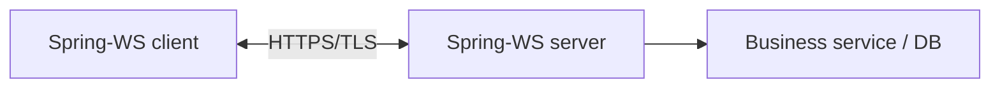
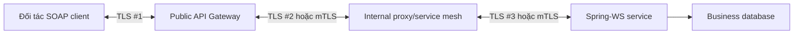
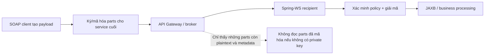
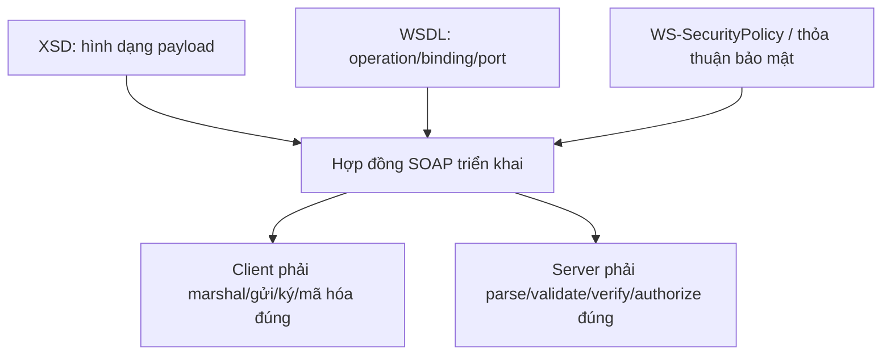
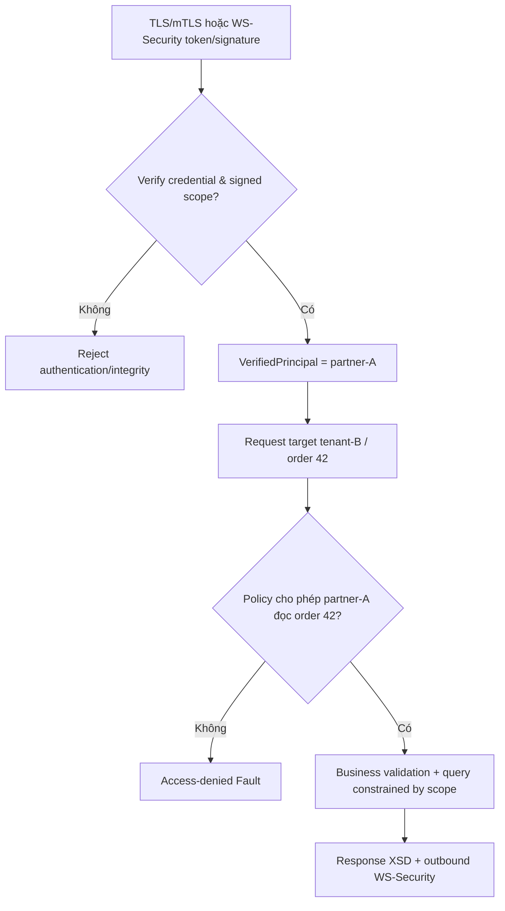

# Bảo mật tầng truyền tải và bảo mật thông điệp bảo vệ những phạm vi nào

Khi phát triển SOAP service **contract-first** bằng **Spring Web Services (Spring-WS)**, câu hỏi “đã dùng HTTPS thì có cần WS-Security nữa không?” không thể trả lời bằng một chữ có hoặc không. **HTTPS/TLS** và **WS-Security** bảo vệ thông tin ở **những ranh giới khác nhau**. TLS bảo vệ một *kênh truyền* giữa hai điểm kết thúc TLS; WS-Security dùng các thành phần như XML Signature, XML Encryption và security token để bảo vệ hoặc chứng minh những *phần được chỉ định của SOAP message* theo chính sách. Một hệ thống có thể cần cả hai, chỉ một trong hai hoặc thêm những biện pháp khác tùy threat model và hợp đồng tích hợp.

Bài thuộc chương **WS-Security** của module `SPRING_WEB_SERVICES`. Chúng ta sẽ phân biệt **bảo mật tầng truyền tải** với **bảo mật thông điệp**, phạm vi của mã hóa và chữ ký, tác động của gateway/reverse proxy, danh tính qua mTLS so với UsernameToken/chứng chỉ ký, chính sách SOAP Header/Body và attachments, cách tích hợp Spring-WS/WSS4J, xử lý SOAP Fault, quản lý khóa và kiểm thử tương thích với XSD/WSDL, JAXB, endpoint và SOAP client.

> **Kết luận ngắn để ghi nhớ:** TLS bảo vệ byte **khi đi qua từng kết nối đã thiết lập**; WS-Security có thể bảo vệ những phần SOAP **sau khi rời kết nối đó, cho tới nơi giải mã/xác minh được chỉ định**. Nhưng **không cơ chế nào tự thay thế authorization, XSD validation, chống XXE, idempotency, giới hạn tài nguyên hoặc bảo vệ dữ liệu khi đã được ứng dụng đọc ở dạng rõ**.

## 1. Xác định đúng câu hỏi bảo mật trước khi chọn công nghệ

Một kiến trúc SOAP doanh nghiệp cần phân biệt ít nhất sáu mục tiêu:

| Mục tiêu | Câu hỏi cần trả lời | Giải pháp thường liên quan |
| --- | --- | --- |
| **Bí mật khi truyền** | Kẻ quan sát mạng có đọc được byte SOAP không? | TLS; WS-Security Encryption nếu cần bảo vệ qua trung gian |
| **Toàn vẹn khi truyền** | Byte có bị sửa trên cùng kết nối không? | TLS integrity; XML Signature cho signed SOAP parts |
| **Xác thực peer/kênh** | Client đang kết nối tới server nào? Server đang nhận client certificate nào? | TLS server authentication, mTLS |
| **Xác thực chủ thể SOAP** | Ai là bên gửi nội dung thông điệp/credential mà service tin cậy? | WS-Security token, chữ ký; ánh xạ principal và trust policy |
| **Ủy quyền nghiệp vụ** | Chủ thể đó có quyền thao tác operation, tenant và resource cụ thể không? | Application authorization, domain policy |
| **Khả năng phục hồi và kiểm toán** | Timeout/replay xảy ra thế nào? Có thể tra trạng thái và chứng minh xử lý đúng không? | Timestamp/nonce/replay cache, business idempotency, transaction/outbox, audit |

Không nên nhập chung **confidentiality** và **integrity**: một SOAP message *được ký nhưng không mã hóa* vẫn có thể bị đọc; một message *được mã hóa nhưng không có một chữ ký/xác thực nguồn phù hợp* không tự chứng minh ai tạo nội dung.

### Phân biệt “người giữ khóa” và “người được quyền”

Một certificate do đối tác xuất trình qua mTLS có thể cho biết peer ở kết nối hiện tại sở hữu private key tương ứng và được hệ thống tin cậy theo policy. Điều đó **không tự chứng minh** tổ chức/tài khoản đó có quyền xem đơn hàng `42` hay được sửa dữ liệu tenant `B`. Xác thực là một đầu vào cho quyết định phân quyền, không phải quyền toàn năng.

## 2. Ranh giới của TLS: bảo vệ **một chặng kết nối**

TLS bảo vệ byte trên đường truyền giữa **hai TLS endpoints**. Với HTTPS request SOAP, một mô hình đơn giản:



Khi client xác minh chứng chỉ server và kết nối TLS được thiết lập an toàn, TLS mang lại:

1. **Bí mật byte trên chặng đó** trước bên thứ ba thụ động quan sát mạng.
2. **Toàn vẹn dữ liệu trong kênh** và phát hiện sửa đổi theo giao thức.
3. **Server authentication** nếu client xác minh certificate chain, hostname và trust policy đúng.
4. **Client authentication** nếu có mTLS và server xác minh client certificate theo trust policy.

TLS **không** tự cung cấp:

- Chữ ký XML tồn tại độc lập với kết nối để một bên thứ ba xác minh message về sau.
- Mã hóa SOAP Body khi một TLS endpoint đã nhận và giải mã byte.
- Xác thực mọi HTTP header từ các hop trước khi qua gateway.
- Validation XSD, kiểm tra SOAPAction và QName, authorization theo order/tenant.
- Giữ bí mật dữ liệu trong log, queue, disk, memory hoặc database sau khi ứng dụng giải mã.
- Bảo đảm một lần xử lý nghiệp vụ khi client retry sau read timeout.

**Quan trọng:** TLS thường được mô tả là “end-to-end” trong kiến trúc client ↔ server trực tiếp. Nhưng nếu có gateway kết thúc TLS ở giữa, **hai TLS endpoints là client và gateway**, không phải client và SOAP application ở phía sau gateway.

## 3. Mô hình thực tế: TLS termination ở API Gateway

Một hệ thống thường có nhiều hop:



Ở mỗi node kết thúc TLS, byte SOAP có thể tồn tại **dưới dạng rõ** trong bộ nhớ của thành phần đó. Nếu gateway inspect payload, ghi log hoặc chuyển tiếp tới đích không được bảo vệ, TLS #1 không ngăn được những rủi ro này.

| Vị trí | TLS bảo vệ tới đâu? | Rủi ro còn lại |
| --- | --- | --- |
| Client → Gateway | Kênh TLS #1 | Gateway nhìn được SOAP message sau giải mã |
| Gateway → Service | Kênh TLS #2, nếu đã cấu hình | Proxy/người có quyền tại hai TLS endpoints có thể xử lý plaintext |
| Service → DB | TLS DB riêng, nếu có | Quyền truy cập DB và dữ liệu lưu trữ là ranh giới khác |
| Gateway log/queue | Không còn nằm trong kênh TLS #1 | Message có thể bị lưu/đọc/chỉnh sửa theo quyền của middleware |
| SOAP message có XML Encryption | Những element được mã hóa cho key của recipient | Các header/element không mã hóa vẫn có thể lộ; recipient vẫn có plaintext sau giải mã |

Có thể cần **re-encrypt mọi hop** và mTLS nội bộ ngay cả khi sử dụng WS-Security. “Đã có message encryption nên HTTP nội bộ không cần bảo vệ” là kết luận thiếu an toàn: **metadata HTTP, các SOAP parts không mã hóa, traffic pattern và credential transport** vẫn có thể bị lộ.

### Gateway nào là endpoint tin cậy?

Cần thiết kế rõ:

- Gateway có quyền **đọc Body** để validate schema, kiểm tra nội dung và chống lạm dụng không?
- Gateway chỉ được **định tuyến theo HTTP metadata** mà không thấy thông tin nhạy cảm trong Body?
- Gateway được phép **ký lại hoặc sửa SOAP Header** hay phải giữ nguyên chữ ký end-to-end?
- Ai sở hữu **private key giải mã** và ai được phép đọc plaintext?
- Gateway có thực hiện **mTLS client authentication** và truyền danh tính nội bộ tới service theo cơ chế đáng tin không?

Nếu service nhận `X-Authenticated-User` từ gateway, gateway phải xóa/ghi đè header tương ứng do public client tự gửi và đường gateway → service phải được xác thực/bảo vệ. Nếu không, attacker có thể tự chèn HTTP header giống tên đó.

## 4. HTTPS, mTLS và chứng chỉ ở tầng truyền tải

### 4.1. HTTPS thường: server xác thực với client

Một HTTP SOAP client dùng `https://orders.example/ws` cần xác minh:

- Hostname trong URI phù hợp Subject Alternative Name của certificate.
- Certificate chain dẫn tới CA/trust anchor được tin cậy theo policy.
- Certificate chưa hết hạn và không bị từ chối bởi các kiểm tra trạng thái/revocation được hệ thống áp dụng.
- TLS version/cipher suite phù hợp yêu cầu hiện hành.
- Proxy/TLS inspection nếu có là **một trust boundary có chủ đích**, không phải ngoại lệ bị bỏ qua.

**Không tắt hostname verification hoặc dùng “trust all certificates”** để làm test production chạy qua. Đó là hành vi làm mất khả năng xác định bạn đang gửi token và dữ liệu tới đúng server.

### 4.2. mTLS: cả hai phía có thể xác thực peer

Với **mutual TLS**, client cũng trình certificate và chứng minh sở hữu private key trong TLS handshake. Server/gateway kiểm tra certificate và ánh xạ peer identity theo chính sách.

```text
SOAP client                                        TLS server/gateway
-----------                                        ------------------
Validate server certificate + hostname  <-------- Server certificate
Client certificate / key proof           --------> Validate client certificate
Encrypted channel established          <========> Protected application data
```

Nhưng khi mTLS **kết thúc tại gateway**, Spring-WS application phía sau **không trực tiếp thấy cùng một TLS peer certificate** trừ khi có cơ chế propagation danh tính được thiết kế an toàn. Không dùng raw `X-Client-Cert` từ Internet như bằng chứng; gateway cần xác thực, loại bỏ đầu vào giả mạo và truyền kết quả theo kênh tin cậy.

### 4.3. mTLS khác chữ ký SOAP thế nào?

| Thuộc tính | mTLS | XML Signature trong WS-Security |
| --- | --- | --- |
| Bằng chứng gắn với | TLS peer/session và certificate phù hợp | Những SOAP nodes được ký bởi khóa tương ứng |
| Xác minh thường diễn ra ở | TLS endpoint/gateway | WS-Security processor/recipient của message |
| Bảo vệ khi message lưu trong queue | **Không**, sau TLS termination | Signature vẫn có thể xác minh nếu byte/node được giữ đúng quy tắc |
| Dùng qua nhiều hop | Mỗi hop có trust/session riêng | Có thể giữ signature qua middleware không sửa signed parts |
| Mã hóa nội dung | TLS mã hóa byte trên kênh | Signature **không mã hóa**; cần XML Encryption riêng |
| Gắn với operation/tenant | Cần authorization riêng | Vẫn cần authorization riêng và signed scope phù hợp |

mTLS và XML Signature có thể dùng **cùng hệ PKI về mặt tổ chức**, nhưng certificate/key usage, rotation, private key policy và mức tin cậy phải được phân tách theo mục tiêu. Không mặc định một certificate hợp lệ cho TLS cũng được phép ký SOAP message.

## 5. WS-Security: bảo mật gắn với **SOAP message**

**WS-Security** cung cấp khung mở rộng bảo mật trong SOAP Header, sử dụng các chuẩn như XML Signature, XML Encryption và security tokens. Những thành phần thường thấy:

| Thành phần | Chức năng | Giới hạn cần nhớ |
| --- | --- | --- |
| `wsse:Security` | Chứa metadata/structures bảo mật của SOAP message | Header tồn tại **chưa chứng minh đã xác thực** |
| `wsu:Timestamp` | Thời điểm tạo/hết hạn theo profile | Không đủ chống replay nếu không có policy/cache phù hợp |
| UsernameToken | Xác thực dựa trên tên/secret hoặc profile token | Phải kiểm tra credential, dạng proof, kênh bảo vệ và replay |
| BinarySecurityToken/X.509 | Mang certificate hoặc token liên quan khóa | Certificate đính kèm tự nó **không phải trust anchor** |
| `ds:Signature` | Chữ ký trên các XML references đã khai báo | Chỉ bảo vệ **đúng các phần đã ký và được xác minh** |
| `xenc:EncryptedData` | Mã hóa nội dung XML được chỉ định | Không che những phần vẫn để plaintext |
| `wsse:SecurityTokenReference` | Tham chiếu token/key material | Cần chống spoofing, duplicate ID, wrapping |
| Security policy / WS-Policy | Quy định thuật toán, parts cần ký/mã hóa, token | Phải được **enforce**, không chỉ đặt trong tài liệu |

Namespace hay gặp:

```text
WS-Security secext:
http://docs.oasis-open.org/wss/2004/01/oasis-200401-wss-wssecurity-secext-1.0.xsd

WS-Security utility:
http://docs.oasis-open.org/wss/2004/01/oasis-200401-wss-wssecurity-utility-1.0.xsd

XML Signature:
http://www.w3.org/2000/09/xmldsig#

XML Encryption:
http://www.w3.org/2001/04/xmlenc#
```

Các profile WSS, WS-SecurityPolicy và WS-Addressing có **phiên bản** khác nhau. Không trộn namespace hoặc token profile tùy ý; client và server phải thống nhất với WSDL/WS-Policy/đặc tả tích hợp.

### WS-Security không phải “HTTPS thêm một lần”

TLS bảo vệ các record byte trong channel; WS-Security làm việc với **nội dung thông điệp XML và security assertions**, ví dụ một bên gửi ký SOAP Body rồi để message đi qua queue/gateway mà bên nhận cuối vẫn có thể kiểm tra chữ ký Body. Nhưng để đạt điều đó, intermediary phải không sửa signed parts theo cách làm signature invalid, và policy phải chỉ rõ ai ký, ai xác minh, phần nào được ký.

## 6. Chữ ký, mã hóa và token giải quyết các bài toán khác nhau

### 6.1. Ký mà không mã hóa

Nếu client ký Body và gửi trên HTTP không TLS, bên nghe lén vẫn có thể đọc Body. Chữ ký chỉ cho phép recipient kiểm tra **tính toàn vẹn và nguồn gốc theo khóa/chính sách**.

```text
SOAP Body ở dạng rõ
  + ds:Signature tham chiếu Body
= Body có thể được xác minh toàn vẹn, KHÔNG được giữ bí mật.
```

Trong thực tế nên bảo vệ kênh bằng HTTPS ngay cả khi có XML Signature, để giảm lộ metadata/header, tránh downgrade/credential leakage và đáp ứng vận hành an toàn.

### 6.2. Mã hóa mà không xác minh người gửi

XML Encryption cho phép mã hóa một số element để chỉ holder của decryption key tương ứng đọc được. Nhưng **chỉ có khả năng giải mã thành công không tự cấp danh tính người gửi hay chứng minh người gửi được phép gọi operation**. Cần một chính sách nguồn gốc/toàn vẹn thích hợp, kết hợp TLS, chữ ký, token và ứng dụng.

### 6.3. Token xác thực không thay thế chữ ký

UsernameToken có thể hỗ trợ xác thực tùy profile, nhưng không mặc nhiên chứng minh SOAP Body không bị thay đổi bởi một trung gian **sau khi token được kiểm tra**. Khi hợp đồng yêu cầu tính toàn vẹn message-level, phải kiểm tra **signed parts**. Với token dạng mật khẩu, cần TLS và xử lý secret đúng, không gửi plaintext credential trong môi trường không được bảo vệ.

### 6.4. Ký và mã hóa cùng lúc

Một policy có thể yêu cầu cả **Signature** và **Encryption**. Thứ tự ký trước mã hóa hay mã hóa trước ký và cách biểu diễn tham chiếu phụ thuộc profile, interoperability và security design. Không tự chọn thứ tự bằng suy đoán hoặc đổi thứ tự sau khi ký; hãy dùng WS-Security implementation được hỗ trợ và kiểm thử với đối tác.

**Lưu ý:** XML Signature không tự đem lại giá trị *non-repudiation* pháp lý. Điều đó còn đòi hỏi quản trị private key, nhận diện tổ chức/chủ thể, chính sách chứng cứ và quy định áp dụng.

## 7. Bảng so sánh phạm vi bảo vệ

| Tiêu chí | HTTPS/TLS | mTLS | WS-Security Signature | WS-Security Encryption |
| --- | --- | --- | --- | --- |
| Chống nghe lén trên kết nối | **Có**, trong TLS channel | **Có**, nhờ TLS | **Không**, nếu không mã hóa | **Có** với những phần đã mã hóa |
| Phát hiện sửa byte trên kết nối | **Có** | **Có** | Không phải channel property | Không thay thế toàn vẹn channel |
| Xác thực server transport | Có, nếu verify cert/hostname | Có | Không tự là server TLS authentication | Không |
| Xác thực client transport | Không mặc định | **Có**, khi verify client certificate | Có thể chứng minh người ký với policy phù hợp, không phải mTLS identity | Không tự chứng minh sender |
| Xác minh nội dung sau TLS termination | **Không** bằng kênh TLS đã kết thúc | **Không** chỉ bằng session trước | **Có** với signed XML references, nếu được giữ/verify đúng | Recipient giải mã protected parts bằng key |
| SOAP parts không được bảo vệ | Không phân biệt parts trong kênh | Không phân biệt parts trong kênh | **Không được signature bảo vệ** | **Vẫn plaintext** |
| Quyền tenant/operation | Không | Không | Không tự động | Không |
| Ngăn XML parser DoS/XXE | Không | Không | Không | Không |
| Đảm bảo SOAP message được giao một lần | Không | Không | Không | Không |
| Bảo vệ dữ liệu sau giải mã trong ứng dụng | Không | Không | Không | Không |

**Diễn giải cẩn thận:** XML Encryption là một cơ chế mật mã bảo vệ nội dung được mã hóa, nhưng ứng dụng vẫn cần thiết kế toàn vẹn, trust và kiểm tra hợp đồng; bảng không nhằm nói việc mã hóa một phần tử tự giải quyết toàn bộ yêu cầu mật mã/định danh.

### Phạm vi bảo vệ phụ thuộc **đúng điểm kết thúc**

Ví dụ: gateway có private key của recipient và **giải mã XML tại gateway**. Lúc đó XML Encryption **không còn bí mật đối với gateway**, dù vẫn có thể được mã hóa trở lại khi chuyển đi. “Message-level security” không tự đồng nghĩa “chỉ application cuối cùng có thể đọc” nếu key đã được cấp cho intermediary.

## 8. WS-Security bảo vệ **phần XML nào**?

Một SOAP Envelope có thể gồm:

```text
soap:Envelope
  soap:Header
    wsa:To
    wsa:Action
    wsa:ReplyTo
    ctx:TenantId
    wsse:Security
      wsu:Timestamp
      ds:Signature
  soap:Body wsu:Id="body-..."
    ord:CreateOrderRequest
      ord:requestKey
      ord:amount
```

Nếu chữ ký chỉ tham chiếu `#body-...`, những trường nằm trong Body (và được reference đúng) có thể được bảo vệ, nhưng `wsa:ReplyTo` hoặc `ctx:TenantId` **không nhất thiết được ký**.

Một message có signature “hợp lệ” vẫn có thể nguy hiểm nếu:

- Endpoint sử dụng một **Body khác** với Body được ký.
- Security interceptor chỉ verify một subset nhưng application tin toàn bộ Header.
- `wsa:Action` không được ký nhưng server dùng làm nguồn quyết định operation quan trọng.
- `ctx:TenantId` được sửa ở giữa, trong khi authorization tin nó như quyền đã xác thực.
- Attachment được client đính kèm **không nằm trong signed/encrypted scope**.
- Các node có ID trùng/namespace giống nhau tạo **ambiguity** giữa node được ký và node được xử lý.

### XML Signature Wrapping

**XML Signature Wrapping** là nhóm tấn công làm security processor xác minh một node, còn business processor đọc **node khác** có nội dung bị thay đổi. Biện pháp phòng vệ không phải chỉ kiểm tra `signatureValid == true`:

1. Dùng implementation WS-Security/XML Signature được duy trì, có kiểm tra ID, reference và cấu trúc SOAP.
2. Thực thi chính sách **signed parts cụ thể**, không chỉ “có ít nhất một chữ ký hợp lệ”.
3. Bảo đảm **node mà endpoint đọc** là node đã được kiểm tra theo policy.
4. Từ chối duplicate ID/Body hoặc cấu trúc mơ hồ trái chuẩn/profile.
5. Không dùng XPath theo local name bỏ namespace hoặc tái cấu trúc SOAP sau verification mà làm mất liên kết danh tính node.
6. Kiểm thử tình huống nhiều node tương tự, signed reference khác node được ứng dụng xử lý.

**QName** phải so bằng cả namespace URI và local name. Prefix khác nhau không có nghĩa node khác danh tính; local name giống nhau nhưng namespace khác không phải cùng contract element.

## 9. Ví dụ SOAP Header chứa WS-Security (mẫu cấu trúc)

Đoạn sau giúp nhận diện vị trí Header/Body, **không phải SOAP message đã ký hợp lệ**. Giá trị certificate, digest, signature được lược bỏ; không sao chép rồi gửi production.

```xml
<soap:Envelope
    xmlns:soap="http://schemas.xmlsoap.org/soap/envelope/"
    xmlns:wsse="http://docs.oasis-open.org/wss/2004/01/oasis-200401-wss-wssecurity-secext-1.0.xsd"
    xmlns:wsu="http://docs.oasis-open.org/wss/2004/01/oasis-200401-wss-wssecurity-utility-1.0.xsd"
    xmlns:ds="http://www.w3.org/2000/09/xmldsig#"
    xmlns:ord="https://example.com/orders/v1">
  <soap:Header>
    <wsse:Security>
      <wsu:Timestamp wsu:Id="ts-1">
        <wsu:Created>2026-01-01T10:00:00Z</wsu:Created>
        <wsu:Expires>2026-01-01T10:05:00Z</wsu:Expires>
      </wsu:Timestamp>
      <!-- ds:Signature và KeyInfo thật phải được WSS4J tạo,
           gồm các ds:Reference, DigestValue, SignatureValue
           đúng thuật toán và policy. Không đặt secret vào XML. -->
    </wsse:Security>
  </soap:Header>
  <soap:Body wsu:Id="body-1">
    <ord:GetOrderRequest>
      <ord:orderId>42</ord:orderId>
    </ord:GetOrderRequest>
  </soap:Body>
</soap:Envelope>
```

Timestamp đã nêu là **ví dụ lịch sử cố định**, không thể dùng để gửi message hiện tại. Message thật phải được thư viện tạo Timestamp/nonce/signature trong cửa sổ hợp lệ, không tái sử dụng một Envelope đã ký sau khi hết hạn.

### Vì sao `ds:Reference` mới là trọng tâm?

Trong XML Signature, các reference xác định **dữ liệu được ký** (thông qua URI, transforms và digest). Việc nhìn thấy `<ds:Signature>` chưa đủ: cần xác minh chữ ký **và** xác minh **các node bắt buộc nằm trong danh sách reference được bảo vệ** theo policy.

Một signature hợp lệ trên Timestamp mà **không ký Body** không đáp ứng một policy bắt buộc ký Body. Tương tự, nếu policy cần ký `wsa:Action`, ký Body đơn thuần chưa đủ.

## 10. Mã hóa XML có thể giữ bí mật qua trung gian, nhưng không phải “mọi thứ”

Mô hình ứng dụng:



Nếu client mã hóa `ord:PaymentDetails` bằng **public key của recipient**, gateway không có private key của recipient sẽ không đọc được element đó. Nhưng gateway vẫn có thể thấy:

- HTTP method/URI/host, kích thước và timing.
- SOAP Envelope/Header/Body **không** được mã hóa.
- `wsa:To`, `wsa:Action` hoặc các routing headers để plaintext nếu policy thiết kế như vậy.
- MIME part metadata hoặc attachments không được mã hóa.

Nếu gateway bắt buộc phải inspect XML của `PaymentDetails` để quyết định routing/business policy, mã hóa end-to-end **có thể mâu thuẫn chức năng gateway**. Không “tạm giải mã ở gateway” mà vẫn tuyên bố chỉ recipient cuối nhìn được dữ liệu.

**Quy tắc:** Định nghĩa rõ **security recipient** và **intermediaries**. Nếu message đi qua nhiều node, phần nào có thể được đọc/sửa/ghi log ở mỗi node phải được thể hiện trong architecture/security policy.

## 11. WSDL, XSD và WS-SecurityPolicy: ba lớp hợp đồng khác nhau

Trong hệ Spring-WS contract-first:

- **XSD** định nghĩa cấu trúc XML của payload, ví dụ `GetOrderRequest`, `GetOrderResponse` và business Fault detail.
- **WSDL** định nghĩa operation, input/output/fault messages, binding, SOAPAction và endpoint address.
- **WS-SecurityPolicy/WS-Policy**, nếu dùng, mô tả security assertions như token, signed parts, encrypted parts và thuật toán theo profile.



Một WSDL có `soap:address` dùng HTTPS **không tự chứng minh**:

1. Server đang xác minh certificate client (mTLS).
2. SOAP Body được ký và kiểm tra.
3. `wsa:Action` hoặc `ctx:TenantId` được bao phủ chữ ký.
4. XML Encryption đang được bật.
5. Key/truststore đúng đối tác.
6. Client retry và server chống xử lý trùng.

Các yêu cầu đó phải được triển khai và kiểm thử. Một file WS-Policy tồn tại nhưng **không được enforce** trong runtime cũng không tạo security guarantee.

### Ví dụ input XSD để phân biệt validation với security

```xml
<xs:schema xmlns:xs="http://www.w3.org/2001/XMLSchema"
           xmlns:ord="https://example.com/orders/v1"
           targetNamespace="https://example.com/orders/v1"
           elementFormDefault="qualified">
  <xs:element name="GetOrderRequest">
    <xs:complexType>
      <xs:sequence>
        <xs:element name="orderId" type="xs:positiveInteger"/>
      </xs:sequence>
    </xs:complexType>
  </xs:element>
</xs:schema>
```

Một request `orderId=42` có thể **đúng schema** nhưng người gọi không được phép đọc đơn 42; một message có chữ ký hợp lệ cũng có thể chứa `orderId=-1` nếu policy không validate XSD. Hai bước này cần thiết kế độc lập.

## 12. Ranh giới xác thực, ủy quyền và ngữ nghĩa nghiệp vụ

Giả sử security processor xác minh một certificate và ánh xạ thành principal `partner-A`. SOAP Header lại có `ctx:TenantId=tenant-B`.



**Không dùng kết quả mTLS hoặc chữ ký để bỏ qua authorization**. Đối tác A có private key hợp lệ vẫn không được đọc dữ liệu B nếu không được cấp quyền.

Một SOAP Header do client tự viết như `ctx:Role=ADMIN` **không phải role tin cậy**. Kể cả Header đã được đối tác ký, server vẫn phải kiểm tra người ký có được phép **tự khai role** hay không. Chữ ký chứng minh giá trị không bị thay đổi bởi bên không có key, không tự chứng minh claim đúng theo policy.

### Hãy tách bốn loại đối tượng

| Đối tượng | Nguồn đáng tin | Dùng để làm gì |
| --- | --- | --- |
| `RawSoapHeader` | Bên gửi bên ngoài; chưa tin | Hints/routing metadata, phải kiểm tra |
| `VerifiedPrincipal` | Kết quả xác thực trong trust boundary | Danh tính để áp policy |
| `AuthorizedRequest` | Server tạo sau authorization | Operation/tenant/resource đã được phép |
| `DomainCommand` | Server tạo sau business validation | Thực thi nghiệp vụ và kiểm soát side effects |

**JAXB unmarshal không biến RawSoapHeader thành VerifiedPrincipal.** Mô hình Java/annotation chỉ mô tả cách đọc dữ liệu, không phải cấp quyền.
## 13. Spring-WS: thành phần nào thực hiện bảo mật ở mỗi tầng?

Một triển khai Spring-WS có thể sử dụng các thành phần sau:

| Thành phần | Bảo mật thuộc tầng nào? | Điều cần cấu hình/kiểm tra |
| --- | --- | --- |
| `MessageDispatcherServlet` | HTTP → SOAP dispatch | Request limits, endpoint routing và integration với servlet/filter |
| HTTP container, gateway hoặc HTTP client | **TLS/mTLS transport** | SSL context, certificate trust, hostname verification, client cert, proxy |
| `WebServiceMessageSender` | Transport phía client | HTTPS sender, timeout, connection pool, TLS settings |
| `WebServiceMessageFactory` | SOAP message parse/serialize | SOAP version, parser security và XML limits |
| `Wss4jSecurityInterceptor` (nơi được hỗ trợ) | **WS-Security message-level** | Inbound validation, outbound securement, Crypto/trust, token, signed parts |
| `PayloadValidatingInterceptor` | XSD payload validation | Schema đúng version và thực sự đăng ký |
| `EndpointInterceptor` | Cross-cutting request/response/Fault | Không tự trở thành một security validator chỉ vì tên |
| `@Endpoint` và application service | Authorization, domain invariant | Principal đã xác minh, tenant/resource permission |
| `EndpointExceptionResolver` | SOAP Fault | Không lộ stack trace/secret và fault code đúng protocol |

**Quan trọng:** Không dùng `@PayloadRoot` hoặc `@SoapAction` làm bằng chứng đã xác thực. Chúng giúp ánh xạ operation; phân quyền phải có principal và policy độc lập.

### Có một WS-Security Header nghĩa là đã an toàn?

Không. Để nói server đã xác minh chữ ký, tối thiểu phải xác định:

1. `Wss4jSecurityInterceptor` hoặc security processor thực sự được đăng ký và **chạy trước hành động nghiệp vụ**.
2. Policy yêu cầu những actions phù hợp, ví dụ signature và timestamp.
3. Trust store/crypto dùng để xác minh đối tác đúng danh sách được phép.
4. Xác minh những parts *bắt buộc được ký*, không chỉ có bất kỳ signature nào.
5. Bản rõ sau giải mã và node mà endpoint dùng phù hợp với node đã verify.
6. Không có một endpoint mapping/transport route khác bỏ qua interceptor.

Một bean WSS4J có mặt trong `ApplicationContext` **chưa đủ**. Cần test gọi đúng SOAP endpoint và khẳng định request thiếu/sai security **không kích hoạt business service**.

## 14. Ví dụ Spring-WS inbound: xác minh Timestamp và Signature

Spring-WS có integration với Apache WSS4J trong những phiên bản tương thích. Dưới đây là **mẫu định hướng cho nhánh có package `wss4j2`**; tên package, các action strings và API Crypto cần kiểm tra với dependencies của dự án khi triển khai thực tế:

```java
import org.apache.wss4j.common.crypto.Crypto;
import org.springframework.context.annotation.Bean;
import org.springframework.context.annotation.Configuration;
import org.springframework.ws.soap.security.wss4j2.Wss4jSecurityInterceptor;

@Configuration
public class InboundSoapSecurityConfig {

    @Bean
    public Wss4jSecurityInterceptor inboundSecurity(
            Crypto partnerVerificationCrypto) {

        Wss4jSecurityInterceptor interceptor =
                new Wss4jSecurityInterceptor();

        // Yêu cầu kiểm tra Timestamp và XML Signature.
        interceptor.setValidationActions("Timestamp Signature");

        // Crypto/trust configuration PHẢI được quản lý đáng tin cậy.
        interceptor.setValidationSignatureCrypto(
                partnerVerificationCrypto);

        return interceptor;
    }
}
```

`partnerVerificationCrypto` là **bean được chuẩn bị riêng** từ trust material đã được quản trị và policy certificate. Bài không hard-code password, private key hoặc đường dẫn bí mật. Code **không** tự chứng minh X.509 subject được quyền với tenant và **không chỉ rõ đầy đủ signed-parts policy**; điều này cần được cấu hình/kiểm tra theo WS-SecurityPolicy và tính năng phiên bản thực tế.

Đăng ký interceptor đúng endpoint chain:

```java
import java.util.List;
import org.springframework.context.annotation.Configuration;
import org.springframework.ws.config.annotation.EnableWs;
import org.springframework.ws.config.annotation.WsConfigurer;
import org.springframework.ws.server.EndpointInterceptor;
import org.springframework.ws.soap.security.wss4j2.Wss4jSecurityInterceptor;

@Configuration
@EnableWs
public class OrdersWsConfiguration implements WsConfigurer {
    private final Wss4jSecurityInterceptor inboundSecurity;

    public OrdersWsConfiguration(
            Wss4jSecurityInterceptor inboundSecurity) {
        this.inboundSecurity = inboundSecurity;
    }

    @Override
    public void addInterceptors(
            List<EndpointInterceptor> interceptors) {
        interceptors.add(inboundSecurity);
    }
}
```

**Đọc kỹ phạm vi của ví dụ:**

- Mẫu giả định server dùng cấu hình annotation-based Spring-WS và bean `Wss4jSecurityInterceptor` tương thích.
- Nếu project dùng Spring-WS/Jakarta/WSS4J khác nhánh, hãy đối chiếu API; đừng trộn package `wss4j` cũ với `wss4j2` mới mà không cập nhật dependencies.
- Chỉ đặt `ValidationActions` không thay cho policy kiểm tra **signed references bắt buộc**. Body, Timestamp và headers quan trọng phải được bảo vệ theo hợp đồng và xác minh ở runtime.
- Thứ tự **WS-Security, schema validation, application authorization** phải phù hợp với message được mã hóa/ký. Không tự copy một thứ tự cho mọi profile.
- Lỗi parse SOAP **trước endpoint mapping** có thể không đi qua interceptor. Parser đầu tiên vẫn phải được harden.
- WS-Security validation **không tự chọn operation nghiệp vụ**, không tự tra entitlement hoặc chống transaction duplicate.

### Nếu cùng server có nhiều đối tác?

Một service có thể nhận messages từ hai đối tác với certificate khác nhau. Trust policy cần xác minh:

- Certificate/chain thuộc **đối tác được phép**, không phải “bất kỳ chứng chỉ nào từ một CA quá rộng”.
- Certificate dùng cho **đúng mục đích** ký/authentication, không mặc định tin mọi key.
- Mapping certificate/token → verified partner identity độc lập với Header `PartnerId` do bên gửi khai báo.
- Quyền operation/tenant/resource phù hợp với identity đã xác minh.

Nếu hai endpoint yêu cầu **policy khác nhau**, cần cấu hình/mapping rõ ràng để một endpoint không vô tình chấp nhận policy yếu hơn của endpoint khác.

## 15. Spring-WS outbound: phía client phải gửi WS-Security đúng hợp đồng

Khi SOAP client cần ký request, có thể dùng `Wss4jSecurityInterceptor` ở phía outbound thông qua client interceptor. Mẫu code (với package/API tương thích nhánh được sử dụng):

```java
import org.apache.wss4j.common.crypto.Crypto;
import org.springframework.context.annotation.Bean;
import org.springframework.ws.soap.security.wss4j2.Wss4jSecurityInterceptor;

@Bean
public Wss4jSecurityInterceptor outboundSecurity(
        Crypto clientSigningCrypto,
        ClientSigningSettings settings) {

    Wss4jSecurityInterceptor interceptor =
            new Wss4jSecurityInterceptor();

    // Timestamp/Signature là minh họa; profile thực tế
    // còn quy định signed parts, algorithm suite và token.
    interceptor.setSecurementActions("Timestamp Signature");
    interceptor.setSecurementSignatureCrypto(clientSigningCrypto);
    interceptor.setSecurementUsername(settings.keyAlias());
    interceptor.setSecurementPassword(settings.keyPassword());

    return interceptor;
}
```

`ClientSigningSettings` là **kiểu cấu hình ứng dụng tự định nghĩa**; `keyAlias` và `keyPassword` phải được cấp từ secret management/keystore policy chứ không ghi vào source code hoặc log. Chú ý API triển khai và cách WSS4J chọn private key/certificate thực tế có thể khác theo phiên bản.

Gắn outbound interceptor vào template:

```java
import org.springframework.ws.client.core.WebServiceTemplate;
import org.springframework.ws.client.support.interceptor.ClientInterceptor;

@Bean
public WebServiceTemplate ordersSoapTemplate(
        Jaxb2Marshaller ordersMarshaller,
        Wss4jSecurityInterceptor outboundSecurity) {

    WebServiceTemplate template = new WebServiceTemplate();
    template.setDefaultUri("https://orders.partner.example/ws");
    template.setMarshaller(ordersMarshaller);
    template.setUnmarshaller(ordersMarshaller);
    template.setInterceptors(
            new ClientInterceptor[] { outboundSecurity });
    return template;
}
```

Các kiểu `Jaxb2Marshaller` và `Wss4jSecurityInterceptor` ở đoạn này giả định imports tương ứng; chỉ là **các fragment cấu hình**, chưa định nghĩa message sender, TLS trust, schema validation, error handling và dependency setup đầy đủ.

**Đừng dùng cùng một security interceptor instance cho server inbound và client outbound chỉ vì class giống nhau.** Mỗi hướng có action, trust, key, role và lifecycle riêng; chia cấu hình theo rõ hướng/đối tác.

### Client thường cần cả TLS và WS-Security

Một lời gọi `marshalSendAndReceive` thường cần:

1. Chọn HTTPS endpoint URI, đúng `soap:address`/routing policy.
2. TLS: xác minh host/certificate server, gửi client certificate nếu mTLS được yêu cầu.
3. JAXB: serialize request element đúng XSD.
4. SOAPAction/WS-Addressing: gắn action/hướng trả lời theo WSDL/profile.
5. WS-Security: ký/mã hóa đúng Body/Headers, token và timestamp theo policy.
6. Parse/verify response và SOAP Fault theo security policy chiều inbound.
7. Xác minh response QName/XSD rồi sử dụng business result.

**Không chỉ bảo vệ request và quên response.** Một policy có thể yêu cầu **server ký response hoặc SOAP Fault**, hoặc mã hóa dữ liệu trả về cho client. Hãy xác nhận hai chiều bằng test.

## 16. TLS configuration của SOAP client phải thuộc transport, không phải SOAP Header

Một `WebServiceTemplate` có thể sử dụng `HttpUrlConnectionMessageSender` hoặc HTTP sender dựa trên Apache HttpClient tương thích. Những thành phần này quyết định cách kết nối HTTPS, proxy, timeout và pool.

```java
import org.springframework.ws.client.core.WebServiceTemplate;
import org.springframework.ws.transport.http.HttpUrlConnectionMessageSender;

WebServiceTemplate template = new WebServiceTemplate();
HttpUrlConnectionMessageSender sender =
        new HttpUrlConnectionMessageSender();

sender.setConnectionTimeout(3_000);
sender.setReadTimeout(10_000);

template.setMessageSender(sender);
template.setDefaultUri("https://orders.partner.example/ws");
```

Đây chỉ là **fragment transport**. HTTP URLConnection sender có thể sử dụng TLS settings của JVM/môi trường; trong ứng dụng có nhiều đối tác, để tách truststore/mTLS certificate theo endpoint thường cần HTTP client/SSL context được cấu hình tường minh bằng API hỗ trợ trong phiên bản đang dùng.

Các điểm cần kiểm tra:

- Truststore nào dùng để verify server certificate?
- Có hostname verification và đúng SNI không?
- Client có cần certificate cho mTLS? Chọn key alias nào, ai bảo vệ private key?
- Proxy có terminate TLS hoặc intercept certificate không?
- Nếu hai đích yêu cầu credential khác nhau, một template/sender dùng chung có đưa nhầm credential sang đích khác không?
- Timeout connection/read/pool lease có phù hợp SLO và budget không?
- Có redirect tự động đưa SOAP Body/credential tới hostname ngoài allowlist không?

**Không hard-code secret trong JVM arguments, source code hoặc application.yml public.** Hãy dùng cơ chế bảo mật bí mật phù hợp với môi trường triển khai và giới hạn quyền đọc private key.

## 17. Thiết kế PKI: key/certificate nào dành cho việc gì?

Khi có TLS/mTLS và WS-Security cùng lúc, có thể tồn tại nhiều key/certificate:

| Key/certificate | Ai giữ private key? | Mục đích | Đối tượng tin cậy |
| --- | --- | --- | --- |
| TLS server identity | Gateway/server TLS endpoint | Chứng minh endpoint HTTPS | SOAP client/HTTP client |
| TLS client identity | SOAP client | mTLS client authentication | Gateway/server TLS endpoint |
| WS-Security signing key của client | SOAP sender được ủy quyền | Ký Body/Header theo policy | SOAP recipient WS-Security processor |
| WS-Security encryption recipient key | SOAP recipient | Giải mã những phần message được mã hóa cho nó | SOAP sender cần đúng public key/cert |
| WS-Security signing key của server | SOAP responder | Ký response/Fault theo policy | SOAP client |
| WS-Security encryption recipient key của client | SOAP client | Giải mã response từ server nếu contract yêu cầu | SOAP server dùng public key đúng |

Về mặt triển khai, có thể chia sẻ hạ tầng CA hoặc keystore, nhưng **không mặc định dùng một private key cho tất cả mục tiêu**. Hãy tuân thủ key usage, extended key usage, trust boundary, certificate pinning (nếu policy), HSM/KMS và quy trình quay vòng.

### Những lỗi vận hành thường thấy

- Client tin certificate server vì trust-all, mất hostname validation.
- Service nhận mọi certificate từ một CA tổng quát nhưng không mapping đối tác cụ thể.
- Private key ký SOAP được copy sang gateway chỉ để gateway “debug”, làm thay đổi phạm vi bí mật.
- Cấu hình recipient cert cũ khiến server không giải mã được request sau certificate rotation.
- Response được ký bằng alias/certificate khác với certificate mà client đang tin cậy.
- Không nạp đầy đủ certificate chain hoặc chọn sai mục đích key.
- Thêm certificate mới nhưng không giữ overlap window khi đối tác đang chuyển đổi.
- Keystore password/private key xuất hiện trong exception, application log hoặc Fault detail.

### Quy trình quay vòng an toàn

1. Kiểm kê certificate, key alias, owner, môi trường, mục đích và deadline hết hạn.
2. Công bố **public certificate/trust update** cho đối tác trước khi đổi key thật.
3. Có giai đoạn **overlap** tin cậy certificate cũ/mới theo policy và khả năng hệ thống.
4. Kiểm thử signature verification, encryption/decryption, outbound response và SOAP Fault ở staging.
5. Chuyển ký/mã hóa sang key mới theo lịch hai phía đã đồng ý.
6. Thu hồi key cũ đúng hạn, giám sát rejection/expiry và có quy trình khôi phục sự cố.
7. Nếu private key bị lộ, làm incident response phù hợp; đổi certificate không tự xử lý mọi message đã bị tiết lộ.

**TLS certificate rotation và WS-Security signing/encryption rotation có thể có lịch khác nhau.** Không xem việc thay một certificate TLS là đã cập nhật mọi profile bảo mật message.

## 18. Replay protection, timestamp, nonce và idempotency khác nhau

TLS bảo vệ session nhưng **không tự cấm client hợp lệ gửi cùng SOAP operation hai lần**. WS-Security có thể áp chính sách Timestamp/nonce/replay cache trong một cửa sổ. Tuy nhiên, **chống replay ở tầng security** khác **tính lũy đẳng nghiệp vụ**.

```text
Attempt 1:
  TLS session: S1
  WS-Security timestamp/nonce: T1/N1
  WS-Addressing MessageID: M1
  Business idempotency key: K

Attempt 2 sau timeout:
  TLS session: S2 (hoặc connection được tái sử dụng)
  WS-Security timestamp/nonce: T2/N2
  WS-Addressing MessageID: M2
  Business idempotency key: K
```

Một retry hợp lệ có thể cần message mới với timestamp, nonce, MessageID và signature mới; trong khi **business key K phải giữ nguyên** để server nhận diện cùng một ý định, tránh tạo hai đơn/thu tiền hai lần.

| Cơ chế | Mục tiêu | Không được suy ra |
| --- | --- | --- |
| TLS | Bảo vệ byte/kênh, xác thực TLS peer | Không xử lý trùng business request |
| WS-Security Timestamp | Đặt giới hạn thời gian token/message theo profile | Không cam kết lưu kết quả nghiệp vụ |
| Nonce/replay cache | Phát hiện phát lại credential/message trong scope/cửa sổ | Không thay idempotency DB |
| `wsa:MessageID` | Correlate SOAP messages | Không mặc nhiên bảo đảm exactly-once |
| Business idempotency key | Nhận diện cùng ý định nghiệp vụ | Không thay authentication/signature |
| Unique constraint/atomic claim | Chống concurrent duplicate tại DB | Không tự ngăn double charge ở external provider |

**Một thông điệp được ký hợp lệ vẫn có thể bị gửi lại**. Chữ ký chứng minh tính toàn vẹn theo key, không chứng minh đây là lần sử dụng đầu tiên của payload. Security replay cache và business deduplication có vòng đời/trạng thái khác nhau.

## 19. XML parser, XSD và giới hạn tài nguyên vẫn phải an toàn

WS-Security không làm **XML parser ban đầu** an toàn trước XXE hoặc entity expansion. Một SOAP message phải được parse trước khi xử lý nhiều rule WS-Security; nếu parser cho phép external entity, lỗi có thể xảy ra **trước khi security interceptor chạy**.

Các nhóm kiểm soát:

- Chặn/tắt **DTD, external entities và external schema/stylesheet access** cho nguồn XML không tin cậy, dùng parser policy fail closed.
- Giới hạn byte, độ sâu, số node, text length, số MIME parts và kích thước attachments.
- Cấu hình parser ngay ở **message factory/JAXP provider đầu tiên** đọc dữ liệu, không chỉ ở một helper DOM trong endpoint.
- Dùng `PayloadValidatingInterceptor` hoặc schema validation tương ứng để kiểm tra SOAP Body theo XSD, cùng version WSDL đã công bố.
- Không load arbitrary XSD từ `xsi:schemaLocation` của client; dùng schema/trust resolver đã kiểm soát.
- Cẩn thận khi validator/logging đọc `StreamSource`/`StAXSource` tiến về trước, có thể làm endpoint gặp EOF hoặc ảnh hưởng signed nodes.
- Nếu dùng MTOM, attachment có lifecycle và signature/encryption scope riêng; XSD Body không tự chứng minh binary attachment được bảo vệ hoặc an toàn.

**Message được ký không tự chứng minh XML hợp lệ theo XSD**. XML được mã hóa cũng không có nghĩa sau giải mã có thể được tin dùng: phải validate và áp policy đúng.

### Có nên giải mã rồi validate?

Nếu phần payload mà validator cần đọc đang bị mã hóa, phải có dữ liệu plaintext theo cơ chế framework đã xác minh trước khi validate schema. Nhưng **thứ tự decrypt, signature verification, transform và validation** phụ thuộc profile ký/mã hóa được thỏa thuận. Không tự thiết kế một thứ tự cố định rồi chấp nhận mọi SOAP message như tương đương.

## 20. SOAP Header, intermediary và phạm vi thông tin để lộ

Những SOAP headers được chọn để routing có thể cần ở dạng rõ đối với gateway. Ví dụ:

- `wsa:To`: endpoint đích logic.
- `wsa:Action` hoặc HTTP `SOAPAction`: operation/action.
- `wsa:ReplyTo`: nơi nhận response bất đồng bộ.
- `ctx:TenantHint`: gợi ý tenant do caller gửi.
- `wsse:Security`: thông tin xác minh/chứng chỉ/token ở các dạng khác nhau.

Nếu một header dùng để **ra quyết định bảo mật**, phải biết:

1. Header đó có nằm trong signed parts không?
2. Principal nào là người ký và có quyền đề nghị giá trị đó không?
3. Header có thể bị gateway rewrite không? Nếu có, ai ký/verify lại và theo policy nào?
4. Có duplicate/header nhắm tới actor/role khác nhau không?
5. Backend đã **thật sự chạy** security interceptor/mustUnderstand processor chưa?

Đừng lấy `wsa:ReplyTo` là URL để server gửi dữ liệu hoặc Fault tới bất kỳ host nào: đó là nguy cơ **SSRF và rò rỉ nội dung**. Cần allowlist/registered callback + egress policy, xác thực recipient và kiểm tra redirect. **Một ReplyTo được ký vẫn không tự làm URL đó an toàn**, vì nó có thể là một yêu cầu có chủ ý nhưng **không được cấp quyền**.

### Khi trung gian chỉnh sửa XML

XML Signature được thiết kế theo các transforms/canonicalization cụ thể, nhưng không phải mọi rewrite XML đều bảo toàn chữ ký. Gateway thay namespace/ID, reserialize sai cách hoặc sửa signed Header/Body có thể làm signature verification fail. Trước khi bật “SOAP rewrite”, phải xác định phần được ký và kiểm thử hai phía.

Nếu gateway cần thay một phần **đã ký**, phải có một **trust transformation protocol rõ ràng**, ví dụ gateway được ủy quyền làm security recipient, xác minh, rồi ký lại message với danh tính của gateway theo policy. Khi đó **nguồn gốc và trust boundary đã thay đổi**; không thể tiếp tục quảng cáo nguyên trạng chữ ký end-to-end của client ban đầu.

## 21. Phân biệt lỗi transport, XML contract và security fault

Khi một SOAP call thất bại, client cần biết nó thất bại **trước hay sau SOAP processing**:

| Lỗi | Nơi phát hiện | Có SOAP Fault để đọc không? | Điều cần làm |
| --- | --- | --- | --- |
| TLS certificate/hostname không hợp lệ | TLS handshake | Thường **không** | Sửa trust/host, không tắt validation |
| Client mTLS không được chấp nhận | Gateway/TLS endpoint | Thường **không** | Sửa identity/certificate/ACL |
| Gateway HTTP 401/403/407 | HTTP/proxy | Không nhất thiết | Xem transport authentication |
| XML malformed/DTD bị từ chối | SOAP parser | Có thể không tạo được Fault | Chặn parser sớm, kiểm tra XML |
| SOAP Envelope sai version | SOAP processing | Có thể `VersionMismatch` | Sửa SOAP version/Content-Type |
| XSD payload không hợp lệ | Schema validator | Có thể `Client/Sender` | Sửa payload theo contract |
| WS-Security signature/timestamp sai | WSS4J/WS-Security | Có thể security Fault | Kiểm tra trust/key/policy, không lộ secret |
| Token đã verify nhưng thiếu quyền order | Authorization | Business/access-denied Fault | Sửa quyền hoặc request, không sửa chữ ký |
| Response sai XSD | Outbound serializer/validator | Lỗi server | Sửa server model/schema |
| Timeout sau server commit | Transport/response path | **Không nhận được Fault hay success** | Idempotency/status reconciliation |

SOAP 1.1 dùng `Client/Server`; SOAP 1.2 dùng `Sender/Receiver`; `MustUnderstand` và `VersionMismatch` có ý nghĩa giao thức riêng. WS-Security profile có thể định nghĩa Fault/detail/subcode riêng. **Đừng đưa internal key alias, keystore path, stack trace, token hoặc thông tin chính xác về private key vào SOAP Fault**.

Nếu policy yêu cầu ký Fault response, phải kiểm thử rằng **Fault từ đường exception resolver hoặc security interceptor** được xử lý đúng. Lỗi xảy ra trước khi server có đủ security context/khả năng tạo message có thể không sinh được signed SOAP Fault.

## 22. Các kiến trúc thường gặp và lựa chọn phù hợp

| Kiến trúc | Bảo vệ bắt buộc nên xem xét | Những giới hạn cần kiểm tra |
| --- | --- | --- |
| Client ↔ Server trực tiếp trên HTTPS | TLS verify, authentication/authorization, parser/XSD security | Có cần chữ ký/mã hóa message theo compliance không? |
| Đối tác ↔ Gateway ↔ Service | TLS từng hop, gateway identity, internal mTLS/policy | Gateway thấy plaintext; Header trust/forwarding |
| SOAP qua broker/store-and-forward | Transport bảo vệ mỗi hop + WS-Security nếu cần nguồn gốc/bí mật xuyên queue | Khóa recipient, signed parts, queue access, replay |
| Nhiều SOAP intermediaries | WS-Security theo role/target và hop security | Node nào có thể đọc/sửa phần nào? |
| Chuyển thông tin tài chính/PII | TLS, message-level encryption/signature theo yêu cầu, redaction, strict authorization | Không lưu raw message/secret trong log |
| Operation tạo đơn/thanh toán | Security các tầng + business idempotency | Timeout/retry có thể gây double charge dù TLS/signature hợp lệ |
| Đối tác chỉ hỗ trợ SOAP 1.1 không WS-Security | HTTPS/mTLS + application credential/policy nếu contract cho phép | Không được tự tuyên bố đạt WS-Security signature requirement |

### Khi nào chỉ TLS có thể đủ?

Nếu client kết nối trực tiếp tới một server duy nhất; không có trung gian cần lưu/đọc và bảo vệ nội dung theo yêu cầu riêng; hợp đồng/đối tác/chính sách tuân thủ **không đòi message-level signature/encryption**, thì TLS với authentication/authorization tốt và XML hardening có thể đủ cho threat model đó.

### Khi nào WS-Security đặc biệt có giá trị?

Khi SOAP message phải đi qua **nhiều hop hoặc được lưu/chuyển tiếp**, cần recipient kiểm tra **nguồn gốc/toàn vẹn của các phần XML** độc lập với TLS session; hoặc cần **mã hóa selected parts cho recipient cuối** trong khi intermediaries không đọc được.

**Nhưng WS-Security không mặc định cần bật cho mọi SOAP API**. Nó tăng chi phí key management, interoperability, canonicalization, CPU và rủi ro cấu hình. Phải dựa trên policy và nguy cơ thực tế, không “càng nhiều chữ ký càng chắc chắn”.

## 23. Hiệu năng: chi phí và rủi ro khi bảo vệ message

WS-Security có thể làm tăng:

- CPU khi canonicalize/verify XML Signature và decrypt/encrypt.
- Bộ nhớ khi materialize XML, giữ signed nodes, attachments hoặc cache payload.
- Kích thước thông điệp vì `wsse:Security`, certificate/token, signature values và encrypted blocks.
- Độ trễ khi xử lý certificates, trust lookup, cryptographic operations.
- Phức tạp khi logging/tracing/correlation cần ẩn dữ liệu bí mật.
- Rủi ro tương thích khi client và server dùng thuật toán, canonicalization hoặc signed-parts policy khác nhau.

Những việc nên đo:

1. p50/p95/p99 thời gian xử lý SOAP trước/sau WS-Security.
2. CPU/heap/GC dưới tải đồng thời và message kích thước lớn.
3. Tỷ lệ verification failures theo nhóm lỗi, tránh log private material.
4. Hiệu năng với nhiều signed references và MTOM attachments.
5. Chi phí kiểm tra certificate trust/revocation theo runtime.
6. Tỷ lệ lỗi khi certificate rotation, clock skew hoặc key alias thay đổi.

**Không tăng giới hạn XML payload vô hạn để “cho đủ chỗ ký”**. Giới hạn byte/depth/attachments vẫn phải áp trước khi parser tiêu thụ tài nguyên. Nếu dùng cache để đọc lại signed XML, cần đánh giá memory amplification.

## 24. Chiến lược kiểm thử: chứng minh đúng ranh giới

Một kế hoạch test đầy đủ cần ít nhất bốn lớp:

| Lớp test | Công cụ/cách làm | Chứng minh |
| --- | --- | --- |
| Unit cấu hình TLS | HTTP client/TLS test endpoint | Certificate trust, hostname, mTLS rejection |
| Spring-WS endpoint | `MockWebServiceClient` + endpoint/interceptor chain | WS-Security validation có chạy, không gọi business khi reject |
| Spring-WS client | `MockWebServiceServer` + outbound client interceptors | Request/Header/action/payload được xây dựng đúng; response/Fault xử lý đúng |
| Real integration | HTTPS gateway/proxy + keystore/cert test + SOAP stack thật | TLS termination, message signing/encryption across hops, signed parts, Fault |
| Security XML regression | XML malformed/duplicate ID/wrapping, large payload/attachment | Parser limits, reject ambiguous signing, no external resource access |
| Business authorization | Verified test principal + tenant/order fixtures | Không đọc/ghi resource vượt quyền dù signature hợp lệ |
| Resilience | Timeout sau commit/retry, replay | Không tạo side effect trùng, security và idempotency phối hợp |

**Mock test có thể không đi qua TLS hoặc HTTP gateway**, vì vậy không thể xác nhận certificate/hostname/redirect bằng cách chỉ gọi `MockWebServiceClient`.

### Sử dụng test certificates một cách an toàn

- Chỉ tạo/giao nhận **chứng chỉ thử nghiệm** và key test trong môi trường cô lập.
- Không đưa private key production vào repository/test fixtures.
- Thiết lập test cases với certificate đã hết hạn, trust root sai, alias sai và certificate rotation overlap.
- Đối chiếu request/response thực trên wire với profile bảo mật đã thống nhất.
- Khi test WS-Security có Timestamp, tránh hard-code giờ cũ khiến test lỗi ngẫu nhiên; dùng clock/test helper được kiểm soát.
- Các bài thử signature wrapping/XXE nên chạy trên test server không có quyền đến hệ thống nội bộ/production.

## 25. Ma trận 44 ca kiểm thử tầng truyền tải và thông điệp

| Ca | Tình huống | Điều cần xác minh |
| --- | --- | --- |
| S01 | HTTPS kết nối đúng hostname/certificate | TLS server auth thành công |
| S02 | HTTPS certificate do CA không tin cậy ký | Client từ chối, không bật trust-all |
| S03 | HTTPS certificate đúng CA nhưng hostname sai | Hostname verification từ chối |
| S04 | TLS protocol/cipher không được policy cho phép | Handshake từ chối an toàn |
| S05 | mTLS client không gửi certificate | Gateway/server từ chối đúng policy |
| S06 | mTLS client cert hợp lệ nhưng không được phép đối tác | Mapping/authorization từ chối |
| S07 | Client cert hợp lệ tại gateway nhưng header identity do client giả | Gateway loại bỏ/ghi đè header, service không tin dữ liệu giả |
| S08 | TLS kết thúc tại gateway, hop nội bộ dùng HTTP plaintext | Architecture test phát hiện lỗ hổng/chưa đúng policy |
| S09 | Gateway re-encrypt TLS vào Spring-WS service | Identity/trust hop nội bộ đúng cấu hình |
| S10 | HTTPS client gọi SOAP 1.2 vào SOAP 1.1-only endpoint | Fault/protocol mismatch; không nhầm lỗi certificate |
| S11 | SOAP Body đúng XSD nhưng không có wsse:Security khi policy bắt buộc | Endpoint không thực thi nghiệp vụ |
| S12 | Có wsse:Security nhưng không có signature cần thiết | Security validation từ chối |
| S13 | Chữ ký hợp lệ trên Timestamp nhưng Body không ký | Signed-parts policy phải từ chối |
| S14 | Chữ ký hợp lệ trên Body, Header tenant bị sửa | Không coi TenantId là signed/authorized |
| S15 | Signature reference tới node khác Body được ứng dụng đọc | Chống XML Signature Wrapping |
| S16 | Hai phần tử có cùng wsu:Id | Từ chối ambiguity/duplicate ID |
| S17 | SOAPAction hoặc wsa:Action không nằm trong signed scope nhưng dùng để cấp quyền | Security design/test từ chối suy luận quyền |
| S18 | XML namespace prefix khác nhưng QName giống | Parser/validator hoạt động đúng QName |
| S19 | Chữ ký được tạo bởi certificate không được tin cậy | Signature trust validation từ chối |
| S20 | Certificate hợp lệ nhưng key usage/policy không đúng | Không dùng được để ký/xác thực ngoài phạm vi |
| S21 | Timestamp đã hết hạn | Reject theo policy |
| S22 | Timestamp quá xa tương lai | Reject theo clock-skew policy |
| S23 | SOAP message bị replay nguyên văn trong cache window | Replay detection theo policy |
| S24 | Retry mới với timestamp/nonce mới và cùng business key | Security chấp nhận nếu hợp lệ; nghiệp vụ không nhân đôi |
| S25 | Signature/DigestValue bị thay đổi | Verification từ chối, business không chạy |
| S26 | XML Encryption đúng recipient key | Recipient có thể giải mã phần được chỉ định |
| S27 | XML Encryption dùng sai recipient certificate | Decryption thất bại an toàn |
| S28 | Mã hóa Body nhưng Header nhạy cảm không mã hóa | Test phát hiện plaintext leak ngoài scope |
| S29 | Gateway không có decryption key | Không đọc được encrypted parts |
| S30 | Gateway có private key và giải mã sớm | Architecture ghi nhận gateway là security endpoint |
| S31 | Mã hóa mà không có sender authentication phù hợp | Policy không coi nguồn gốc đã xác minh |
| S32 | Chỉ dùng signature mà không encryption, truyền plaintext | Test chứng minh confidentiality không được bảo đảm ở mức message |
| S33 | SOAP Body có DTD/external entity | Parser đầu tiên từ chối, không truy cập file/mạng |
| S34 | SOAP payload rất lớn hoặc XML nhiều node | Resource limits/timeout/concurrency hoạt động |
| S35 | Attachment MTOM không được ký dù policy bắt buộc | Security profile từ chối |
| S36 | XML signed Body bị proxy rewrite | Signature fail hoặc policy transformation được xác minh |
| S37 | SOAP response không ký nhưng profile yêu cầu | Client từ chối/kiểm tra outbound policy |
| S38 | SOAP Fault chứa token, private path hoặc stack trace | Response không phát tán dữ liệu nhạy cảm |
| S39 | Request được ký đúng nhưng principal không có quyền order | Authorization từ chối trước business query |
| S40 | Callback `wsa:ReplyTo` trỏ host nội bộ | Chặn SSRF và không chuyển credential |
| S41 | Certificate rotation, trust cả key cũ/mới theo overlap | Duy trì interoperability, từ chối key hết hạn theo lịch |
| S42 | Gateway 401/403 trước SOAP parser | Client phân loại HTTP/transport, không đòi SOAP Fault |
| S43 | Server commit rồi client read timeout | Idempotency/reconciliation ngăn duplicate khi retry |
| S44 | Client Java và .NET sinh từ WSDL/policy thật | SOAPAction, signature/encryption, token/Fault interoperable |

**Các ca S13–S16, S26–S32, S35–S37 và S39** có giá trị đặc biệt vì buộc team kiểm tra **chính xác phạm vi bảo vệ** thay vì chỉ assert `hasSignature=true` hoặc `HTTPS=200`.

Test cần khẳng định **ứng dụng không thực hiện side effect** khi yêu cầu security/authorization không được đáp ứng. Chỉ xem SOAP Fault được trả là chưa đủ nếu lỗi phát sinh sau khi database đã bị thay đổi.

## 26. Chẩn đoán theo triệu chứng và ranh giới

| Triệu chứng | Ranh giới khả nghi | Cách điều tra |
| --- | --- | --- |
| TLS handshake thất bại | Transport TLS | Hostname, trust anchor, client certificate, cipher/proxy |
| mTLS gateway PASS nhưng service không nhận principal | Gateway → service | Cơ chế propagation danh tính và trust nội bộ |
| SOAP Fault `InvalidSecurity` hoặc tương đương | WS-Security | Signature/UsernameToken/Timestamp/trust/policy |
| Có Signature nhưng Body vẫn không được bảo vệ | Signed-parts policy | Kiểm tra reference URIs và node nhận thực tế |
| Body được ký đúng nhưng endpoint xử lý node giả | XML Signature Wrapping | Duplicate ID, DOM reference, node identity |
| SOAP request được mã hóa nhưng gateway vẫn thấy plaintext | Key ownership/termination | Ai giữ private key và giải mã ở đâu |
| Payload đúng XSD nhưng bị từ chối quyền | Authorization | Principal, tenant/resource mapping |
| SOAP response không unmarshal được sau decrypt | Contract/marshalling | Namespace, SOAP version, schema/JAXB class |
| Chỉ lỗi khi cert rotation | PKI lifecycle | Alias, trust overlap, cache, certificate chain |
| Security interceptor không chạy | Spring-WS registration/routing | Bean chain, endpoint mapping, early parse error |
| HTTP 502 HTML bị parse như SOAP Fault | Gateway/transport | HTTP status, Content-Type, SOAP Envelope |
| Message cũ bị từ chối khi retry | Timestamp/replay cache | Tạo message/signature mới, giữ business idempotency key |
| Chỉ lỗi dưới tải cao khi bật ký SOAP | Crypto/DOM/memory | CPU, heap, GC, message size, connection pool |
| HTTP header tenant giả làm thay đổi quyền | Gateway/header trust | Stripping/rewriting và principal policy |
| Chữ ký response thất bại sau proxy rewrite | Outbound security boundary | Xác định signed parts và cơ chế rewrite |

### Quy trình điều tra có kiểm soát

1. **Xác định lỗi nằm ở TLS hay SOAP**: có qua handshake và nhận SOAP Envelope không?
2. Kiểm tra URI, hostname, certificate chain, TLS termination và mTLS peer identity.
3. Kiểm tra SOAP version, Content-Type, SOAPAction/WS-Addressing và đúng endpoint mapping.
4. Kiểm tra request đã đi qua **Wss4jSecurityInterceptor thực tế** và actions được enforce.
5. Xem **các node/headers được ký hoặc mã hóa**, thay vì chỉ kiểm tra signature marker.
6. Kiểm tra token/trust/algorithm/timestamp và certificate rotation state.
7. Xác minh principal đã được ánh xạ rồi kiểm tra quyền operation/tenant/resource.
8. Phân biệt lỗi XSD/JAXB, business Fault, transport timeout và WS-Security Fault.
9. Thêm test đúng **điểm thất bại** qua transport hoặc SOAP stack thật, không chỉ mock code.

## 27. Bài tập thiết kế: gateway phải định tuyến nhưng không được đọc dữ liệu nhạy cảm

**Bối cảnh:** Đối tác gửi SOAP `SubmitPaymentRequest` đến public API Gateway. Gateway cần biết `wsa:Action` và tenant route để chuyển tới service phù hợp, nhưng **không được nhìn thấy số tài khoản trong `pay:AccountDetails`**. Backend Spring-WS phải xác minh người gửi, kiểm tra quyền tenant và tránh double charge nếu client timeout. Nhóm phát triển cho rằng “đã có mTLS ở gateway nên không cần thiết kế gì khác”.

**Yêu cầu:** Đề xuất security boundary và cách chứng minh từng yêu cầu.

**Hướng giải quyết:**

1. **HTTPS/mTLS client → gateway:** xác minh certificate đối tác; gateway mapping principal theo trust policy. Không tin `X-Client-Cert` do client tự gửi.
2. **HTTPS/mTLS gateway → service:** bảo vệ chặng nội bộ và truyền danh tính đã xác minh theo cơ chế an toàn. Cân nhắc phân biệt gateway peer với actor gốc.
3. **WS-Security message encryption:** mã hóa `pay:AccountDetails` bằng recipient certificate của **backend**, không cấp private key giải mã cho gateway. Để `wsa:Action` và routing metadata ở dạng rõ nếu gateway cần, nhưng tránh tiết lộ dữ liệu nhạy cảm ở header.
4. **Message integrity:** ký Body và những routing/tenant headers mà backend cần tin về tính toàn vẹn, với profile/signed parts cụ thể. Nếu gateway cần đổi một Header đã ký, phải thiết kế lại trust boundary thay vì tự rewrite.
5. **Backend verification:** xác minh signature và certificate/trust, bảo đảm đúng node được ký, kiểm tra timestamp/replay và chỉ sau đó dùng plaintext phù hợp.
6. **Authorization:** principal đã xác thực chỉ được gọi tenant/operation được phép. Không dùng `ctx:TenantHint` làm quyền.
7. **Contract:** XSD/WSDL công bố request/response/business faults; WS-SecurityPolicy quy định signed/encrypted parts và thuật toán được chấp nhận.
8. **Idempotency:** request có `businessRequestKey` ổn định qua attempts; database có unique constraint/atomic claim, downstream payment cũng cần idempotency/reconciliation.
9. **Test:** chứng minh gateway không có decryption key, TLS mỗi hop hợp lệ, sửa signed Header bị phát hiện, tenant giả bị từ chối, mất response sau commit không charge hai lần.
10. **Vận hành:** certificate rotation overlap, giám sát crypto latency, không log SOAP Body/token hoặc dữ liệu tài khoản.

**Kết quả mong muốn:** Gateway định tuyến được request nhưng **không đọc được AccountDetails**; backend nhận đúng payload được bảo vệ và không xử lý đơn ngoài quyền. Một timeout không làm phát sinh giao dịch thanh toán trùng. Kết quả này đòi hỏi **kết hợp TLS, message security, authorization và idempotency**, không chỉ mTLS.

## 28. Checklist triển khai bảo mật SOAP qua nhiều ranh giới

1. **Vẽ topology thực tế:** client, gateway, service mesh, Spring-WS server, queue và database.
2. **Xác định từng TLS endpoint**, nơi plaintext xuất hiện và ai có quyền đọc/ghi log.
3. **Bật HTTPS với hostname/certificate verification**; không dùng trust-all.
4. **Sử dụng mTLS khi policy yêu cầu**, xác minh client cert và mapping partner identity đúng.
5. **Không tin HTTP identity headers do public client tự gửi**; gateway phải sanitize và bảo vệ đường truyền nội bộ.
6. **Công bố WS-SecurityPolicy đúng hợp đồng** nếu cần message-level signature/encryption và bảo đảm runtime enforce.
7. **Phân biệt chữ ký và mã hóa:** ký để xác minh toàn vẹn/nguồn gốc theo policy, mã hóa để bảo vệ bí mật của selected parts.
8. **Kiểm tra signed parts/encrypted parts thực tế**, không chỉ sự tồn tại của `wsse:Security`.
9. **Bảo vệ SOAP Body và headers quan trọng** như `wsa:Action`/tenant metadata theo profile nếu chúng được dùng trong quyết định tin cậy.
10. **Chống XML Signature Wrapping, duplicate ID và namespace ambiguity**.
11. **Giới hạn parser/XML/MTOM**, chặn XXE/DTD/external schema tại parser đầu tiên.
12. **Giữ XSD/WSDL/JAXB cùng version**, validate payload trước nghiệp vụ và outbound response đúng contract.
13. **Cấu hình `Wss4jSecurityInterceptor` đúng chiều inbound/outbound**, đúng bean/chain và kiểm tra compatibility của Spring-WS/WSS4J.
14. **Bảo vệ khóa/chứng chỉ** bằng secret management, keystore/HSM khi phù hợp, rotation và least privilege.
15. **Không gán quyền từ raw Header**, dù Header đã ký; luôn authorization theo verified principal–tenant–operation–resource.
16. **Kết hợp nonce/timestamp/replay policy với business idempotency riêng**, không nhầm `wsa:MessageID` với business key.
17. **Kiểm soát ReplyTo/callback và redirects** bằng allowlist/egress policy chống SSRF.
18. **Không lộ raw SOAP, token, private key hoặc stack trace** trong log, metrics, SOAP Fault và test fixtures.
19. **Kiểm thử SOAP Fault và response bảo mật hai chiều**, không chỉ request.
20. **Thử TLS/gateway thật cùng XML Signature/Encryption**, không chỉ dùng mock endpoint.
21. **Đo chi phí ký/mã hóa và giới hạn heap/CPU** dưới tải đồng thời.
22. **Test certificate rotation, clock skew và signed-part mismatch** với đối tác Java/.NET theo policy đã thỏa thuận.
23. **Không tuyên bố exactly-once delivery/payment chỉ vì có TLS hoặc chữ ký**, dùng idempotency/transaction/reconciliation.
24. **Ghi rõ security owner ở mỗi hop** và bảo đảm thay đổi gateway, SOAP mapping hay key material đều có regression tests.

**Kết luận:** **TLS/mTLS** bảo vệ một kết nối và xác thực các peer ở **từng TLS boundary**; khi gateway hoặc proxy kết thúc TLS, phạm vi bảo vệ của kết nối đó cũng kết thúc. **WS-Security** bổ sung bảo vệ message-level: **XML Signature** cho phép xác minh những phần XML đã ký, **XML Encryption** giữ bí mật những phần được mã hóa cho recipient có key, và token/timestamp hỗ trợ xác thực/chống replay theo profile. Nhưng những bảo vệ này **không tự xác minh XSD, cấp quyền tenant, ngăn XXE, bảo vệ dữ liệu sau giải mã hay chống tạo tác dụng nghiệp vụ trùng**. Với Spring-WS contract-first, thiết kế an toàn là xác định **rõ mỗi trust boundary, owner của khóa, những SOAP parts được bảo vệ, các bước kiểm tra ở runtime và bằng chứng kiểm thử cho từng guarantee**.

