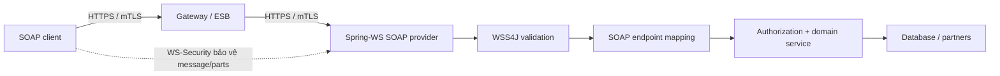
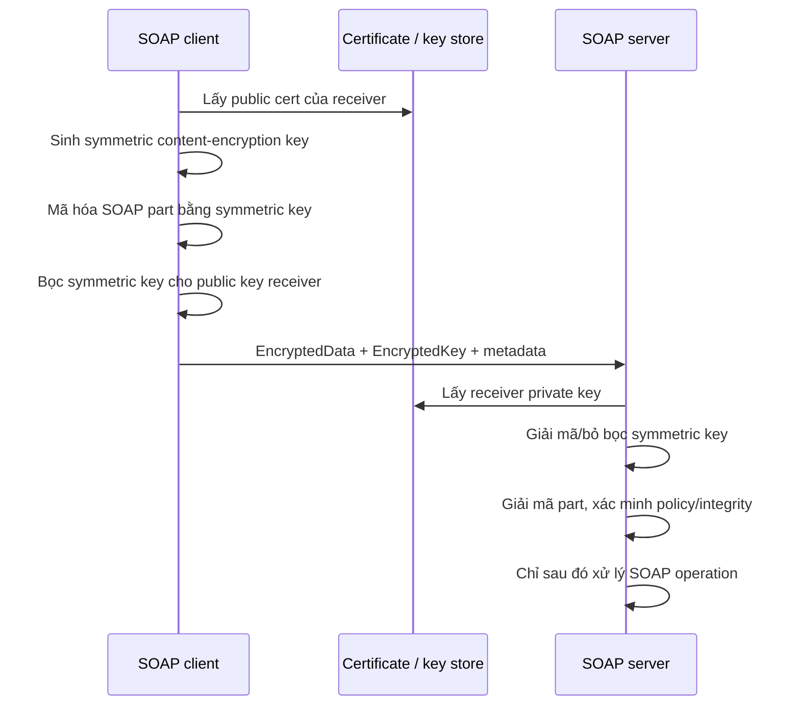
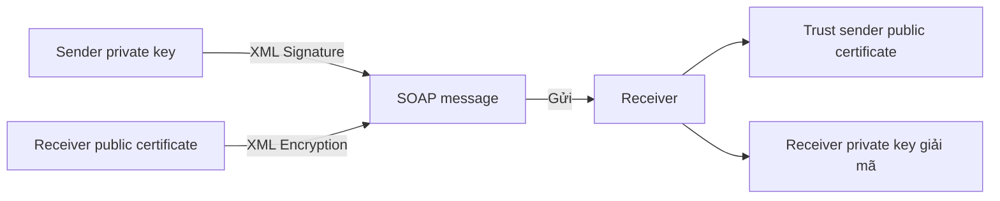
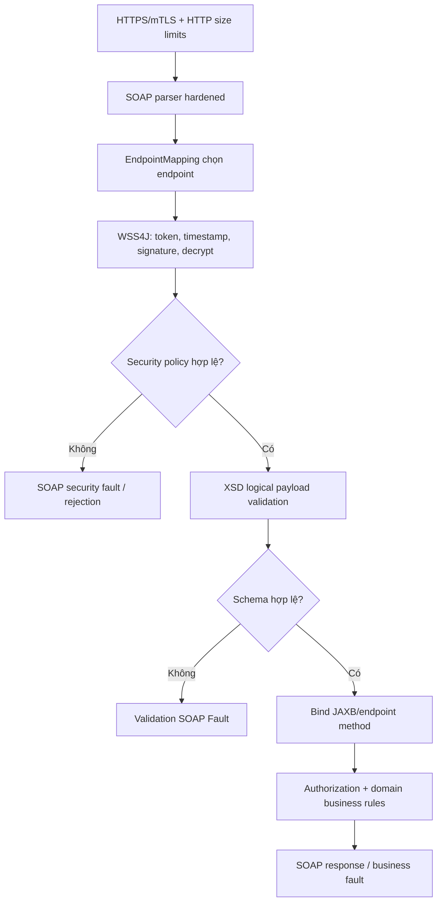
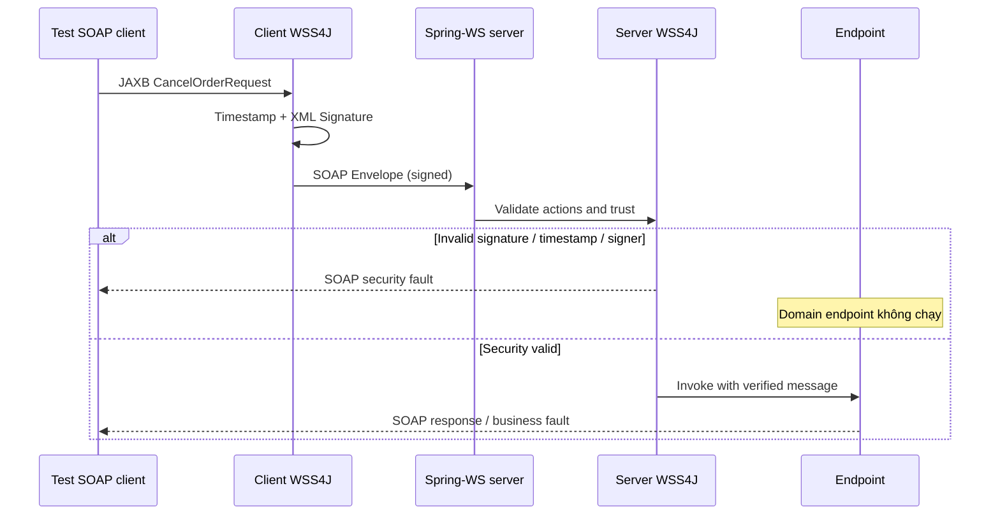

# WS-Security header, token, timestamp, chữ ký và mã hóa

## 1. WS-Security giải quyết bài toán nào?

Một SOAP service có thể sử dụng **HTTPS**, thậm chí **mutual TLS (mTLS)**, nhưng khi message đi qua nhiều hệ thống trung gian (gateway, ESB, message broker hoặc các SOAP intermediaries), chỉ bảo vệ kết nối **không đủ** để mọi bên cuối cùng xác minh nguồn gốc và tính toàn vẹn của **chính thông điệp SOAP**.

**WS-Security** (*Web Services Security*, thường viết WS-Security hoặc WSS) là tập tiêu chuẩn mở rộng **SOAP Header** để mang security tokens, timestamp, chữ ký XML và dữ liệu mã hóa. Nó cho phép hai hệ thống thỏa thuận chính sách như:

- Người gửi phải xác thực bằng UsernameToken, chứng chỉ X.509 hoặc token được công nhận.
- Request phải được ký số; phía nhận xác minh đúng khóa và các phần được ký.
- Thông điệp phải có timestamp hợp lệ và chống replay theo nonce/message ID.
- Dữ liệu nhạy cảm trong SOAP Body phải được mã hóa ở mức message.
- Một số SOAP headers chứa thông tin định tuyến/định danh cũng cần được ký.
- Bên nhận chỉ thực hiện nghiệp vụ khi **kiểm tra policy security thành công**.

Trong **Spring Web Services (Spring-WS)**, ứng dụng contract-first tiếp tục dựa trên XSD/WSDL để xác định SOAP operation và payload; security thường được tích hợp bằng **`Wss4jSecurityInterceptor`** (Apache WSS4J), keystore/truststore và policy đã thống nhất với đối tác.

Bài sử dụng ví dụ service `OrderService` với SOAP operation `CancelOrder` thuộc namespace XML `https://example.org/orders/v1`. Đây là namespace của hợp đồng, **không phải URL HTTP thật**.

### Mục tiêu học tập

Sau khi học xong, bạn có thể:

1. Phân biệt **TLS/mTLS** và **WS-Security message-level**.
2. Đọc và giải thích `wsse:Security`, `UsernameToken`, `BinarySecurityToken` và `wsu:Timestamp`.
3. Hiểu cách `ds:Signature` và `xenc:EncryptedData/EncryptedKey` bảo vệ từng phần SOAP message.
4. Phân biệt **xác thực identity**, **xác minh chữ ký**, **xác thực chuỗi chứng chỉ**, **ủy quyền** và **chống replay**.
5. Biết vai trò của `Wss4jSecurityInterceptor` ở SOAP server và SOAP client trong Spring-WS.
6. Tránh các lỗi phổ biến: chọn sai signed parts, chấp nhận unsigned Body, XML Signature Wrapping, khóa yếu, nonce replay hoặc truststore «tin mọi chứng chỉ».
7. Thiết kế kiểm thử âm tính cho token, timestamp, signature, encryption, certificate và SOAP Fault.
8. Kiểm chứng tính tương thích giữa các SOAP stacks mà không thay đổi XSD/WSDL tùy tiện.

**Phạm vi:** đây là bài giải thích cơ chế và hướng dẫn cấu hình có kiểm soát. Cấu hình production phải bám theo **WS-SecurityPolicy/security profile được phê duyệt**, phiên bản Spring-WS/WSS4J, yêu cầu chứng chỉ và bài kiểm thử liên thông. Các token, ID và địa chỉ trong ví dụ chỉ để minh họa; không dùng làm credential thật.

## 2. Bản đồ các lớp bảo vệ trong một SOAP system



### 2.1. TLS/mTLS không đồng nghĩa XML Signature

| Cơ chế | Bảo vệ hoặc xác minh | Phạm vi | Điều không tự làm |
|---|---|---|---|
| HTTPS/TLS | Bí mật/toàn vẹn dữ liệu qua một kết nối | Transport giữa hai hops | Không tự ký SOAP message cho các intermediaries |
| mTLS | Xác thực client/server ở tầng TLS theo cert/trust policy | Một kết nối | Không tự đặt identity đã xác thực vào SOAP token |
| WS-Security UsernameToken | Credential ở SOAP Header | SOAP message | Không tự chứng minh quyền thực hiện operation |
| WS-Security X.509 Signature | Tính toàn vẹn và nguồn ký của **các XML parts được ký** | Message/parts | Không tự mã hóa dữ liệu; không tự ủy quyền |
| WS-Security encryption | Tính bí mật của các XML parts được mã hóa | Message/parts | Không tự bảo đảm người gửi đã được xác thực |
| `wsu:Timestamp` + replay controls | Ràng buộc thời gian, hỗ trợ chống phát lại | Message | Timestamp riêng không chặn reuse trong cửa sổ hợp lệ |
| XSD validation | XML đúng cấu trúc hợp đồng | SOAP payload logic | Không xác thực identity, signature hoặc quyền |

**Chữ ký số và mã hóa giải quyết hai vấn đề khác nhau**. Signature bảo vệ integrity/authenticity của phần đã ký; encryption bảo vệ confidentiality của phần đã mã hóa. Có thể cần cả hai, theo thứ tự và profile rõ ràng.

### 2.2. Security properties cần thống nhất trước khi viết code

Ví dụ một profile `CancelOrder` có thể yêu cầu:

| Yêu cầu | Chính sách minh họa |
|---|---|
| Transport | HTTPS, xác minh hostname/CA, có thể mTLS |
| Authenticator | Chứng chỉ X.509 dùng để ký XML |
| Signed parts | SOAP Body và `wsu:Timestamp`, cộng headers liên quan nếu có |
| Timestamp | Created + Expires, thời hạn vài phút có giới hạn |
| Replay | Unique message ID/nonce cache hoặc nonce/token cache theo profile |
| Encryption | Mã hóa SOAP Body cho public key của provider |
| Key validation | PKIX trust/path/key usage và policy chứng chỉ |
| Authorization | Identity đã xác minh được phép `CancelOrder` |
| Logging | Chỉ correlation ID, security outcome và error code an toàn |

Đây **không phải** profile tiêu chuẩn áp dụng cho mọi SOAP service. Thực tế có thể dùng UsernameToken hoặc SAML token, chỉ ký mà không mã hóa, hoặc có security token profile riêng. Hãy dùng hợp đồng bảo mật do hai bên phê duyệt thay vì phát minh các action theo cảm tính.

## 3. Đọc SOAP Header `wsse:Security`

Một SOAP 1.1 Envelope minh họa:

```xml
<soap:Envelope
    xmlns:soap="http://schemas.xmlsoap.org/soap/envelope/"
    xmlns:wsse="http://docs.oasis-open.org/wss/2004/01/oasis-200401-wss-wssecurity-secext-1.0.xsd"
    xmlns:wsu="http://docs.oasis-open.org/wss/2004/01/oasis-200401-wss-wssecurity-utility-1.0.xsd"
    xmlns:ord="https://example.org/orders/v1">

  <soap:Header>
    <wsse:Security soap:mustUnderstand="1">
      <!-- Timestamp, token, Signature, EncryptedKey ... -->
    </wsse:Security>
  </soap:Header>

  <soap:Body wsu:Id="body-1">
    <ord:CancelOrderRequest>
      <ord:orderId>ORD-000123</ord:orderId>
    </ord:CancelOrderRequest>
  </soap:Body>
</soap:Envelope>
```

Hai namespace `wsse` và `wsu` dùng **URI đầy đủ, không chứa whitespace**. Ví dụ trên chỉ biểu diễn bố cục Header/Body; nó chưa có token, timestamp, chữ ký hay mã hóa thật và vì thế **không phải một SOAP message bảo mật hoàn chỉnh**.

### 3.1. Vai trò của `soap:Header` và `wsse:Security`

- `soap:Header` chứa các SOAP header blocks không thuộc payload nghiệp vụ.
- `wsse:Security` là security header block theo **OASIS WS-Security**.
- Header này có thể chứa credentials/tokens, `wsu:Timestamp`, `ds:Signature`, `xenc:EncryptedKey` hoặc các thành phần theo profile.
- `soap:mustUnderstand="1"` (SOAP 1.1) yêu cầu node đích của header phải hiểu/xử lý header theo SOAP semantics; không phải tuyên bố rằng mọi chữ ký/thuộc tính bên trong được xác minh thành công.
- SOAP 1.2 dùng namespace Envelope khác, giá trị `mustUnderstand` có thể là `true`/`1` và cơ chế role theo SOAP 1.2.

### 3.2. `actor` và `role` ảnh hưởng ai phải xử lý

SOAP có thể có intermediaries. Với SOAP 1.1, `soap:actor` định hướng header tới một SOAP node; SOAP 1.2 dùng `soap:role`. Security interceptor phải xử lý đúng security header dành cho node của nó.

Không được tự bỏ qua header có `mustUnderstand` khi ứng dụng là node đích phải hiểu header đó. Đồng thời, không đọc bừa security header dành cho node khác rồi tin rằng mình đã hoàn tất toàn bộ security policy.

### 3.3. `wsu:Id` là tham chiếu security, không phải dữ liệu nghiệp vụ

`wsu:Id="body-1"` là XML ID giúp `ds:Reference URI="#body-1"` chỉ tới SOAP Body. Nếu kẻ tấn công tạo duplicate IDs hoặc thay đổi vị trí XML element, một implementation thiếu bảo vệ có thể xác minh chữ ký trên **một element** nhưng endpoint lại xử lý **element khác** (*XML Signature Wrapping*).

Vì vậy, phải dùng WSS4J/XML security parser có kiểm tra ID uniqueness và binding giữa signed parts với **Body/Headers thực được ứng dụng xử lý**. Đừng tự tìm element theo XPath tùy tiện hoặc dùng regex.

## 4. Token trong WS-Security: identity, credential và certificate

**Security token** là dữ liệu để xác thực hoặc định danh principal trong một security profile. Token không đồng nghĩa «đã được cho phép truy cập».

### 4.1. UsernameToken với mật khẩu truyền dạng text

Mẫu rút gọn:

```xml
<wsse:UsernameToken
    wsu:Id="ut-1"
    xmlns:wsse="http://docs.oasis-open.org/wss/2004/01/oasis-200401-wss-wssecurity-secext-1.0.xsd"
    xmlns:wsu="http://docs.oasis-open.org/wss/2004/01/oasis-200401-wss-wssecurity-utility-1.0.xsd">
  <wsse:Username>partner-a</wsse:Username>
  <wsse:Password
      Type="http://docs.oasis-open.org/wss/2004/01/oasis-200401-wss-username-token-profile-1.0#PasswordText">REDACTED</wsse:Password>
</wsse:UsernameToken>
```

**`PasswordText` không có nghĩa nội dung đã được mã hóa.** Người quan sát SOAP message ở một hop có quyền đọc Header có thể thấy password. Khi dùng loại token này:

- Bắt buộc có TLS được cấu hình đúng, cùng access controls/log redaction.
- Ưu tiên credentials ngắn hạn hoặc cơ chế xác thực mạnh hơn theo policy doanh nghiệp.
- Không ghi password/token vào logs, tracing, SOAP audit hoặc fault detail.
- Xác thực username/password bằng hệ thống server có kiểm soát, không tin `Username` vì nó có text hợp lệ.
- Phải có **timestamp/nonce/replay policy** khi profile yêu cầu; TLS không loại bỏ hoàn toàn mọi nguy cơ replay nghiệp vụ.

Đoạn XML minh họa **không có mật khẩu thật** và không phải một request đủ điều kiện an toàn.

### 4.2. UsernameToken PasswordDigest

WS-Security UsernameToken Profile có cơ chế `PasswordDigest` lịch sử. Ý tưởng ở profile dùng nonce, timestamp và secret để tính digest:

```text
PasswordDigest = Base64(
    SHA-1( nonceBytes || createdUtf8 || passwordUtf8 )
)
```

Đây là **mô tả thuật toán của profile**, không phải lời khuyên dùng SHA-1 để thiết kế một giao thức xác thực mới. Cách biểu diễn `Nonce` trong XML thường là Base64; khi tính digest phải sử dụng **bytes đã decode**, không dùng nguyên chuỗi Base64 text.

Ví dụ cấu trúc:

```xml
<wsse:UsernameToken
    xmlns:wsse="http://docs.oasis-open.org/wss/2004/01/oasis-200401-wss-wssecurity-secext-1.0.xsd"
    xmlns:wsu="http://docs.oasis-open.org/wss/2004/01/oasis-200401-wss-wssecurity-utility-1.0.xsd">
  <wsse:Username>partner-a</wsse:Username>
  <wsse:Password
      Type="http://docs.oasis-open.org/wss/2004/01/oasis-200401-wss-username-token-profile-1.0#PasswordDigest">EXAMPLE_ONLY</wsse:Password>
  <wsse:Nonce
      EncodingType="http://docs.oasis-open.org/wss/2004/01/oasis-200401-wss-soap-message-security-1.0#Base64Binary">EXAMPLE_NONCE</wsse:Nonce>
  <wsu:Created>2026-11-27T02:00:00Z</wsu:Created>
</wsse:UsernameToken>
```

**Không dùng các chuỗi placeholder như một token hợp lệ**. WSS4J cần nonce thực đủ ngẫu nhiên, thời gian tạo hợp lệ và digest khớp theo profile. Khi xác minh PasswordDigest, hệ thống thường cần truy xuất **secret tương đương password** (không thể luôn xác minh chỉ từ salted one-way password hash như hệ thống đăng nhập thông thường). Cần đánh giá credential storage/rủi ro kỹ thuật trước khi quyết định sử dụng.

Mặc dù PasswordDigest không gửi plaintext password trực tiếp, nó **không thay thế HTTPS, bảo vệ secret, chống replay hay cơ chế chống đoán mật khẩu**. Với thiết kế mới, ưu tiên profile/thuật toán mạnh được hai bên thỏa thuận, và tránh tự viết bộ tạo hoặc kiểm tra digest bằng tay.

### 4.3. `BinarySecurityToken` chứa chứng chỉ X.509

Ví dụ:

```xml
<wsse:BinarySecurityToken
    xmlns:wsse="http://docs.oasis-open.org/wss/2004/01/oasis-200401-wss-wssecurity-secext-1.0.xsd"
    xmlns:wsu="http://docs.oasis-open.org/wss/2004/01/oasis-200401-wss-wssecurity-utility-1.0.xsd"
    wsu:Id="cert-1"
    EncodingType="http://docs.oasis-open.org/wss/2004/01/oasis-200401-wss-soap-message-security-1.0#Base64Binary"
    ValueType="http://docs.oasis-open.org/wss/2004/01/oasis-200401-wss-x509-token-profile-1.0#X509v3">
  BASE64_DER_CERTIFICATE_EXAMPLE
</wsse:BinarySecurityToken>
```

Certificate ở đây thường là **public X.509 certificate**, được dùng để truy xuất khóa công khai hoặc thông tin identity. **Chỉ đính kèm certificate không chứng minh người gửi sở hữu private key.** Phải có bằng chứng mật mã như XML Signature, và phía nhận phải xác minh chứng chỉ đáng tin, key usage, thời hạn, trust chain và đúng identity/policy.

Không bao giờ đặt private key vào `BinarySecurityToken`. Private key phải nằm trong keystore/HSM/KMS hoặc nền tảng quản lý bí mật theo policy.

### 4.4. Các token khác

WS-Security ecosystem còn có SAML Assertion, Kerberos Token và các profile khác. Một `wsse:Security` có thể tham chiếu token bằng `wsse:SecurityTokenReference` thay vì nhúng toàn bộ dữ liệu.

**Không tự tin** vì token có XML cấu trúc hợp lệ. Token phải được xác thực theo issuer, audience, signature, thời hạn, binding, replay và identity mapping của profile tương ứng.

## 5. `wsu:Timestamp`, clock skew và replay protection

Một timestamp thông thường:

```xml
<wsu:Timestamp
    xmlns:wsu="http://docs.oasis-open.org/wss/2004/01/oasis-200401-wss-wssecurity-utility-1.0.xsd"
    wsu:Id="ts-1">
  <wsu:Created>2026-11-27T02:00:00Z</wsu:Created>
  <wsu:Expires>2026-11-27T02:05:00Z</wsu:Expires>
</wsu:Timestamp>
```

`Created` và `Expires` cung cấp **cửa sổ thời gian**. Validator cần quy định:

- Không chấp nhận `Expires` quá hạn hoặc Created quá xa tương lai.
- Có giới hạn clock skew hợp lý giữa client/server, thường phụ thuộc hệ thống đồng bộ NTP.
- Không chấp nhận thời gian sống quá dài ngoài profile đã phê duyệt.
- Timestamp phải nằm trong **các parts được bảo vệ bằng chữ ký** nếu cần chống kẻ tấn công sửa thời gian.
- Không tự lấy timestamp do client gửi làm nguồn tin cậy khi chưa xác minh chữ ký/token.
- Nếu profile yêu cầu replay protection, phải có cache lưu `Nonce`, message ID hoặc signature identifier theo cửa sổ tương ứng.

### 5.1. Timestamp một mình không chặn replay

Nếu request có thời hạn 5 phút, kẻ tấn công có được một SOAP message hợp lệ có thể phát lại **trong chính 5 phút đó**, trừ khi phía nhận có cơ chế phát hiện duplicate hoặc business operation có idempotency.

Vì vậy, replay protection có thể gồm:

1. Signed Timestamp: chống sửa thời gian mà không làm hỏng signature.
2. Nonce/message ID duy nhất: chống reuse token/request.
3. Replay cache có TTL đủ lớn: nhớ các identifiers đã xử lý.
4. Đồng hồ đồng bộ và giới hạn skew.
5. Idempotency key ở domain cho operation thay đổi trạng thái.

Replay cache có thể cần **dùng chung giữa nhiều server replicas** hoặc một mô hình phối hợp đủ mạnh. Cache cục bộ trên mỗi instance có thể bị bypass nếu cùng request được phân phối luân phiên qua các replicas.

### 5.2. Thử nghiệm timeout

Một test tốt phải có request:

| Timestamp case | Kỳ vọng |
|---|---|
| `Created` và `Expires` nằm trong window hợp lệ | Có thể vượt bước timestamp validation |
| `Expires` trong quá khứ | Từ chối |
| `Created` quá xa tương lai | Từ chối |
| `Expires` quá xa Created so với policy | Từ chối nếu giới hạn TTL |
| Timestamp thiếu nhưng policy bắt buộc | Từ chối |
| Timestamp đã ký bị sửa một byte | Signature validation thất bại |
| Replay y nguyên một signed request | Bị replay policy/domain idempotency xử lý đúng |

Không đưa timestamps cố định từ tài liệu vào test «happy path» theo đồng hồ hiện tại mà không điều chỉnh thời gian. Ví dụ chỉ biểu diễn **cấu trúc**, không phải token còn hiệu lực.

## 6. XML Digital Signature: chính xác phần nào được ký?

`ds:Signature` thường nằm trong `wsse:Security` và tham chiếu đến các SOAP elements có ID:

```xml
<ds:Signature
    xmlns:ds="http://www.w3.org/2000/09/xmldsig#">
  <ds:SignedInfo>
    <ds:CanonicalizationMethod
        Algorithm="http://www.w3.org/2001/10/xml-exc-c14n#"/>
    <ds:SignatureMethod
        Algorithm="http://www.w3.org/2001/04/xmldsig-more#rsa-sha256"/>
    <ds:Reference URI="#body-1">
      <ds:Transforms>
        <ds:Transform
          Algorithm="http://www.w3.org/2001/10/xml-exc-c14n#"/>
      </ds:Transforms>
      <ds:DigestMethod
          Algorithm="http://www.w3.org/2001/04/xmlenc#sha256"/>
      <ds:DigestValue>EXAMPLE_DIGEST</ds:DigestValue>
    </ds:Reference>
    <ds:Reference URI="#ts-1">
      <ds:DigestMethod
          Algorithm="http://www.w3.org/2001/04/xmlenc#sha256"/>
      <ds:DigestValue>EXAMPLE_TIMESTAMP_DIGEST</ds:DigestValue>
    </ds:Reference>
  </ds:SignedInfo>
  <ds:SignatureValue>EXAMPLE_SIGNATURE</ds:SignatureValue>
  <ds:KeyInfo>
    <!-- wsse:SecurityTokenReference tới cert-1 -->
  </ds:KeyInfo>
</ds:Signature>
```

Đây là **schema shape minh họa**, không phải chữ ký thật hoặc một XML Signature hoàn chỉnh: giá trị Digest/Signature placeholder, KeyInfo chưa có reference, transforms của timestamp ref chỉ minh họa thiếu chi tiết. Không gửi nguyên nó như một message đã ký.

### 6.1. Phân tích cấu trúc chữ ký

| Thành phần | Ý nghĩa |
|---|---|
| `ds:SignedInfo` | Danh sách references và thuật toán được áp dụng |
| `ds:CanonicalizationMethod` | Chuẩn hóa XML trước khi ký/xác minh |
| `ds:SignatureMethod` | Thuật toán chữ ký dựa trên khóa riêng của signer |
| `ds:Reference URI="#body-1"` | Chỉ tới element có ID tương ứng |
| `ds:DigestMethod`/`DigestValue` | Hash của content được tham chiếu sau transforms |
| `ds:SignatureValue` | Chữ ký trên canonicalized SignedInfo |
| `ds:KeyInfo`/`SecurityTokenReference` | Gợi ý cách tìm khóa/chứng chỉ để xác minh |

Không phải cứ có `ds:SignatureValue` nghĩa là mọi thứ trong Envelope đã được ký. Chỉ những bytes/XML nodes được references bao phủ theo transforms mới có bảo vệ integrity của chữ ký.

### 6.2. Canonicalization vì sao quan trọng?

XML có nhiều cách biểu diễn khác nhau về thứ tự thuộc tính, prefix và whitespace nhưng có thể tương đương ở những khía cạnh nhất định. **XML canonicalization (C14N)** tạo dạng chuẩn để ký/xác minh dựa trên mô hình XML. Trong SOAP, **exclusive canonicalization** thường được dùng để giảm tác động namespace context từ intermediaries.

Tuy nhiên, canonicalization không phải lý do để ứng dụng được tự ý sửa SOAP XML sau khi ký. Thay đổi giá trị element, ID, reference, digest hoặc whitespace thuộc signed content có thể làm chữ ký invalid. SOAP server cần xác minh theo chính sách đã thống nhất và hạn chế biến đổi trung gian.

### 6.3. Phải ký SOAP Body *được sử dụng thật*

Một lỗi nghiêm trọng là validator xác minh chữ ký trên element ID `body-1`, nhưng endpoint adapter lại xử lý một SOAP Body khác do XML Signature Wrapping. Để bảo vệ:

- Sử dụng WSS4J và XML parser có kiểm tra duplicate IDs, signed-part policy và cấu trúc SOAP hợp lệ.
- Bảo đảm SOAP Body thực tế mà Spring-WS dispatch xử lý **chính là Body được ký**.
- Nếu headers ảnh hưởng routing, tenant, recipient hoặc authorization, đưa chúng vào **signed parts bắt buộc** theo security profile.
- Từ chối references trỏ tới resource không được phép hoặc có ambiguity.
- Không tự đánh giá tính hợp lệ bằng cách thấy một element `ds:Signature` «có mặt» rồi cho qua.

### 6.4. Chứng chỉ trong KeyInfo chưa đủ để được tin

Ngay cả khi signature toán học hợp lệ với public key lấy từ một `BinarySecurityToken`, server vẫn phải xác nhận:

1. Certificate path đến trust anchor được chấp thuận.
2. Certificate chưa hết hạn, chưa bị thu hồi theo revocation policy (CRL/OCSP khi yêu cầu).
3. Key usage/EKU và certificate policy phù hợp chức năng ký của đối tác.
4. Identity trong certificate gắn với đúng partner/service account/tenant.
5. Signature algorithm/key strength nằm trong allowlist.
6. Token phải dành cho đúng hệ thống/đích theo profile, không tin bất cứ cert tự ký nào đính kèm.

**Truststore là trust policy**, không phải kho gom mọi certificate mà client gửi lên. Một self-signed cert do attacker đưa vào token **không phải** trusted signer.

## 7. XML Encryption: bảo vệ nội dung nhạy cảm trong SOAP

Nếu muốn người trung gian chuyển tiếp SOAP message nhưng **không đọc được một số dữ liệu**, WS-Security có thể dùng XML Encryption.

Hai cấu trúc thường gặp:

- `xenc:EncryptedData`: thay thế element hoặc element content được mã hóa.
- `xenc:EncryptedKey`: mang một symmetric key đã được bảo vệ bằng public key hoặc một key-encryption mechanism khác.

Ví dụ **chỉ minh họa cấu trúc**, không phải ciphertext thật:

```xml
<xenc:EncryptedData
    xmlns:xenc="http://www.w3.org/2001/04/xmlenc#"
    Id="enc-body-1"
    Type="http://www.w3.org/2001/04/xmlenc#Content">
  <xenc:EncryptionMethod
      Algorithm="http://www.w3.org/2009/xmlenc11#aes256-gcm"/>
  <ds:KeyInfo xmlns:ds="http://www.w3.org/2000/09/xmldsig#">
    <!-- Reference tới xenc:EncryptedKey -->
  </ds:KeyInfo>
  <xenc:CipherData>
    <xenc:CipherValue>BASE64_CIPHERTEXT_PLACEHOLDER</xenc:CipherValue>
  </xenc:CipherData>
</xenc:EncryptedData>
```

**Không** tự tạo ciphertext bằng Base64 của plaintext; mã hóa cần thuật toán, IV/nonce, authentication tag và key management chuẩn. WSS4J/XML Encryption library phải thực hiện và xác minh các bước này.

### 7.1. Mô hình hybrid encryption



Ở mô hình phổ biến:

- Nội dung SOAP Body được mã hóa bằng symmetric algorithm, có thể là AES-GCM nếu cả hai phía hỗ trợ.
- Symmetric key được bảo vệ qua key transport như RSA-OAEP hoặc cơ chế được phê duyệt.
- Chỉ holder của private key tương ứng mới giải mã được key.
- Có thể mã hóa element **content** hoặc cả **element**; ảnh hưởng SOAP parsing/dispatch và interoperability, phải theo security policy.
- Không trộn cipher algorithms hoặc dùng RSA PKCS#1 v1.5 key transport nếu policy yêu cầu OAEP.

### 7.2. Signature và Encryption không thay thế nhau

| Chỉ có | Điều được bảo vệ | Rủi ro còn lại |
|---|---|---|
| TLS | Kênh truyền giữa các hops | SOAP message không có integrity bằng chữ ký khi đi qua intermediaries |
| XML Signature | Tính toàn vẹn/authenticity của signed parts | Plaintext vẫn đọc được nếu không mã hóa |
| XML Encryption | Bí mật của encrypted parts | Chưa xác nhận signer/nguồn gửi nếu không có authentication |
| Signature + Encryption | Integrity/authenticity và confidentiality theo profile | Cần quản lý trust, replay, signed parts, authorization |
| Timestamp + token | Freshness và identity claims theo validation | Không đủ nếu không bảo vệ, xác thực và chống replay |

## 8. Thứ tự ký–mã hóa và security policy của đối tác

Có hai chiến lược khái niệm:

1. **Sign then encrypt:** ký XML parts theo profile trước, sau đó mã hóa những phần đã chọn.
2. **Encrypt then sign:** mã hóa rồi ký representation phù hợp; chữ ký có thể bao phủ ciphertext.

Chúng khác nhau về phần được ký, cách bên nhận khôi phục/xác minh và khả năng interoperability. Không tự đảo action order rồi coi như tương đương. Với Spring-WS/WSS4J cần cấu hình **securement/validation actions và parts** theo một profile có test bằng client của đối tác.

### 8.1. Điều cần thống nhất trong WS-SecurityPolicy hoặc integration contract

| Mục | Câu hỏi |
|---|---|
| SOAP version | 1.1 hay 1.2? WS-Addressing có hay không? |
| Token | UsernameToken, X.509, SAML hay token khác? |
| Timestamp | Bắt buộc không, TTL/skew bao nhiêu, có ký timestamp không? |
| Signed parts | Body, `wsa:To`, `wsa:Action`, transaction headers, token nào? |
| Encryption targets | SOAP Body content, Body element hay header/attachment? |
| Algorithms | Signature digest, C14N, asymmetric key transport, symmetric cipher |
| Certificate trust | CA, pinning, EKU, revocation, identity mapping |
| Replay detection | Nonce/cache/message ID, retention, distributed replicas |
| Signature order | Sign-before-encrypt hay encrypt-before-sign, transform/profile? |
| Fault policy | Client/Sender vs Server/Receiver, không lộ dữ liệu nhạy cảm |
| Rotation | Overlap window của cert cũ/mới, rollover và audit |
| MTOM | Có attachments không, XOP/signature transform nào được hỗ trợ? |

Với SOAP client của hệ thống doanh nghiệp, **WSDL/XSD đúng nhưng WS-SecurityPolicy không khớp** vẫn dẫn tới partner từ chối. Không dùng wildcard «chấp nhận mọi thứ WSS4J có thể parse» làm cách tương thích.

## 9. Xác thực, tin cậy và ủy quyền là ba bước riêng

Giả sử SOAP client gửi X.509 certificate và XML Signature hợp lệ:

1. **Integrity:** xác minh signature của signed parts.
2. **Trust:** xác minh signer certificate/chain/identity chính là đối tác được chấp thuận.
3. **Freshness:** xác minh timestamp, nonce/replay theo policy.
4. **Authentication:** gắn identity đã xác minh vào principal/security context thích hợp.
5. **Authorization:** kiểm tra principal đó được phép hủy **đơn hàng cụ thể**.
6. **Business validation:** kiểm tra đơn tồn tại, trạng thái, concurrency, thời hạn hủy.
7. **Processing:** thực hiện transaction và trả SOAP response/Fault.

Một signer được tin **không nhất thiết** được phép thao tác mọi đơn. Security interceptor không thể thay kiểm tra tenant ownership, quyền user, trạng thái DB hoặc atomic transaction.

### 9.1. Không tin payload của client để cấp quyền

Các trường `tenantId`, `userId`, `partnerId` trong SOAP Body hoặc Header là dữ liệu do client cung cấp. Khi muốn sử dụng để ủy quyền:

- Xác định chúng có nằm trong **signed parts** hay không.
- Đối chiếu với identity đã được chứng thực và authorization policy.
- Không chỉ dựa vào username text, `wsse:BinarySecurityToken` hay `SOAPAction` chưa xác minh.
- Nếu qua gateway, làm rõ có delegation/trust assertion chính thức hay không.

### 9.2. Khi client dùng mTLS đồng thời ký XML

Hai identity có thể khác nhau: TLS client certificate là identity của connection, còn XML Signature dùng một key/certificate khác. Nếu policy yêu cầu chúng khớp hoặc thuộc cùng đối tác, phải thực hiện kiểm tra liên kết đó. Không tự suy chúng là một chỉ vì HTTP call chạy qua HTTPS.

### 9.3. Cấp quyền sau khi validation đã thành công

Một SOAP operation nhạy cảm như `CancelOrder` không được chạy domain service khi UsernameToken, signature, timestamp, certificate hoặc decryption chưa được xác minh đầy đủ. Security interceptor nên được đăng ký trong **đúng SOAP endpoint mapping/interceptor chain** và cấu hình **fail-closed**. Cần test rằng operation mới thiếu annotation đặc biệt **không bypass** chính sách an ninh bắt buộc.

## 10. Cấu hình chứng chỉ, truststore và vòng đời khóa

Một ứng dụng ký và giải mã SOAP message thường có hai mục đích khóa:

- **Local private key:** dùng để ký outbound messages hoặc giải mã message gửi tới mình.
- **Trusted partner public certificate/CA:** dùng để xác minh chữ ký inbound hoặc mã hóa outbound cho receiver.

| Kho dữ liệu | Nội dung thường có | Sử dụng |
|---|---|---|
| Keystore (PKCS#12/JKS/HSM) | Local private key + public certificate chain | Ký request/response; giải mã inbound |
| Truststore/PKIX policy | Trusted CA certs, pinned partner certs (khi policy dùng) | Xác minh signer/certificate path |
| Partner encryption certificate | Public cert được phê duyệt cho encryption | Mã hóa symmetric key cho receiver |
| Secret manager/HSM | Password, private key access, credentials | Quản lý secrets và rotation |
| Replay cache | Nonces, message IDs/token identifiers | Ngăn message/token được dùng lại |

### 10.1. Keystore và truststore không hoán đổi vô điều kiện

Không nên tải certificate từ SOAP request rồi **thêm vào truststore khi thấy thiếu**. Đây là hành vi «trust on first use» không được chấp thuận có thể làm lộ dịch vụ cho attacker. Trust anchors và partner identity phải được provision qua quy trình quản trị, không lấy từ dữ liệu chưa tin cậy trên wire.

### 10.2. Khóa/cert phải có vòng đời

- Thuật toán/key length phù hợp tiêu chuẩn hiện hành và thỏa thuận.
- Private keys trong HSM/KMS hoặc keystore bảo vệ tốt; không commit vào source control.
- Password keystore/private key chỉ load từ secret manager/env được kiểm soát, không in vào logs.
- Kiểm tra `notBefore/notAfter`, certificate chain, key usage và EKU.
- Có policy thu hồi/CRL/OCSP khi cần, kiểm tra failure mode nếu revocation service unavailable.
- Certificate rotation có khoảng chồng lấn hợp lý để client/server triển khai không cùng thời điểm.
- Khi rotate, cập nhật signing keystore, verification trust, encryption target cert và integration tests riêng.
- Bảo vệ backup, quyền đọc/ghi keystore và audit việc sử dụng private key.

### 10.3. Mã hóa cho người nhận đúng certificate

Outbound encryption sử dụng **public certificate của receiver**, trong khi outbound signature sử dụng **private key của sender**. Đây là hai hướng khác nhau; đừng mã hóa bằng public key của mình rồi mong receiver giải mã được.



Nếu có nhiều partner/tenants, key alias/certificate selection phải theo trusted configuration, không lấy `encryptionUser` tùy ý từ untrusted request.

## 11. WS-Security và Spring-WS: vị trí của WSS4J interceptor

Spring-WS thường tích hợp Apache WSS4J qua **`org.springframework.ws.soap.security.wss4j2.Wss4jSecurityInterceptor`** (tên package tùy Spring-WS major/version). Nó được đặt trong SOAP pipeline để:

- **Outbound securement:** tạo UsernameToken, Timestamp, XML Signature và/hoặc encryption theo actions/crypto đã cấu hình.
- **Inbound validation:** xác minh yêu cầu có token, chữ ký, encryption/timestamp đúng policy.
- **Client-side:** được đăng ký như interceptor của `WebServiceTemplate`.
- **Server-side:** được đăng ký như `EndpointInterceptor` vào mapping chain.

### 11.1. Hai hướng của một SOAP application

```text
SOAP client outbound:
  JAXB marshal → client interceptors (WS-Security securement)
  → HTTP message sender → partner

SOAP server inbound:
  HTTP message / SOAP factory → endpoint mapping
  → server interceptors (WS-Security validation)
  → JAXB binding → domain service
```

Trên response path, nếu policy yêu cầu, server có thể ký/mã hóa response và client phải validate/decrypt response. Đừng chỉ secure request rồi mặc định SOAP response cũng được bảo vệ đúng profile.

### 11.2. Ghi nhớ về Spring-WS versions

Cấu hình security trong Spring-WS có khác biệt theo major/minor versions và WSS4J version. Ví dụ bên dưới là **skeleton cấu hình theo API Wss4jSecurityInterceptor của Spring-WS 4.x/Jakarta stack**; các beans Crypto/password callback/trust provisioning phải do application cung cấp. Trước khi đưa production, kiểm tra **Javadocs thực của phiên bản được khóa trong dependency BOM**, action names và crypto property APIs. Không copy cấu hình WSS4J 1.x sang 2.x hoặc trộn `javax`/`jakarta`.

### 11.3. Server interceptor chỉ nên là một lớp trong defense in depth

Có thể cần thêm:

- Gateway TLS/mTLS, HTTP size/rate limits.
- XML parser hardening chống XXE, entity expansion và oversized XML.
- XSD validation theo contract.
- Authorization ở domain service.
- Security logs không lộ token, secrets hoặc dữ liệu nhạy cảm.
- SOAP Fault mapping an toàn và metrics cho security failures.

**WS-Security validation thành công chỉ chứng minh những chính sách security đã cấu hình và được thực thi**. Nếu cấu hình chỉ yêu cầu Timestamp nhưng không yêu cầu Signature, server không thể suy rằng request Body đã được ký.

## 12. Cấu hình WS-Security validation trên SOAP server

Đối với Spring-WS annotation-driven, có thể đăng ký WSS4J interceptor vào endpoint mapping thông qua `WsConfigurerAdapter.addInterceptors(...)`. Ví dụ dưới đây yêu cầu request có **Timestamp** và **Signature**; X.509 trust/signature verification sử dụng một `Crypto` đã được cấp qua cấu hình tin cậy của ứng dụng.

### 12.1. Spring Java configuration minh họa

```java
package org.example.orders.soap.security;

import java.util.List;
import org.apache.wss4j.common.crypto.Crypto;
import org.springframework.context.annotation.Bean;
import org.springframework.context.annotation.Configuration;
import org.springframework.ws.config.annotation.EnableWs;
import org.springframework.ws.config.annotation.WsConfigurerAdapter;
import org.springframework.ws.server.EndpointInterceptor;
import org.springframework.ws.soap.security.wss4j2.Wss4jSecurityInterceptor;

@Configuration
@EnableWs
public class OrdersSoapSecurityConfiguration
        extends WsConfigurerAdapter {

    private final Crypto trustedPartnerCrypto;

    public OrdersSoapSecurityConfiguration(
            Crypto trustedPartnerCrypto) {
        this.trustedPartnerCrypto = trustedPartnerCrypto;
    }

    @Bean
    public Wss4jSecurityInterceptor inboundWss4j() {
        Wss4jSecurityInterceptor interceptor =
            new Wss4jSecurityInterceptor();

        interceptor.setValidationActions("Timestamp Signature");
        interceptor.setValidationSignatureCrypto(trustedPartnerCrypto);

        return interceptor;
    }

    @Override
    public void addInterceptors(
            List<EndpointInterceptor> interceptors) {

        // Chạy kiểm tra WSS trước các interceptor nghiệp vụ.
        interceptors.add(inboundWss4j());
    }
}
```

**Điều kiện:** `trustedPartnerCrypto` là một bean `org.apache.wss4j.common.crypto.Crypto` được tạo từ truststore/PKIX policy do ứng dụng provision. Ví dụ không tự khởi tạo crypto/password vì đó là một phần quản trị secrets/certificates riêng. Nếu hệ thống có nhiều `Crypto` beans, cần dùng `@Qualifier` tương ứng.

Một số điểm quan trọng:

- `setValidationActions("Timestamp Signature")` nói WSS4J phải tìm và xác minh **các loại WS-Security actions** đó.
- `setValidationSignatureCrypto(...)` cung cấp thông tin để kiểm tra trust/verification của signer.
- **Chưa đủ để phát biểu toàn bộ security policy đã an toàn**: còn cần ràng buộc signed parts, certificate-to-partner identity, timestamp bounds/replay policy, algorithm restrictions và authorization.
- `@EnableWs` cung cấp hạ tầng annotation-driven Spring-WS; `addInterceptors(...)` đưa security interceptor vào mapping chain tương ứng.
- Bean `Wss4jSecurityInterceptor` tồn tại trong ApplicationContext nhưng **không được đăng ký vào mapping** có thể không chạy trên request thật.
- Nếu WAR có root + servlet child contexts, bean/configuration phải thuộc context mà **SOAP MessageDispatcherServlet** sử dụng.

### 12.2. Phải kiểm tra điều gì ngoài action list?

WSS4J có thể xác minh cryptographic signature, nhưng hệ thống còn phải biết **đúng những phần nào bắt buộc được ký**. Cần policy cụ thể:

```text
Required inbound signed parts:
  SOAP Body thật được endpoint xử lý
  wsu:Timestamp (nếu chống sửa thời gian)
  wsa:To và wsa:Action (nếu WS-Addressing/routing quan trọng)
  tenant/account headers nếu được dùng để quyết định authorization

Required trust:
  signer certificate chain + purpose + partner identity

Required freshness:
  timestamp TTL/skew + replay-cache policy
```

Không thể suy rằng `setValidationActions("Timestamp Signature")` **tự đảm bảo** tất cả headers quan trọng được ký, signer là đối tác phù hợp, replay bị chặn hoặc requester có quyền hủy đơn.

Đối với action/part policy, có thể dùng khả năng security configuration và result validation của phiên bản Spring-WS/WSS4J cụ thể, hoặc một bước kiểm tra policy được hỗ trợ sau xác minh cryptographic. Khi tự viết validator bổ sung, **chỉ đọc các kết quả đã được WSS4J tin cậy**; không tự tin XPath/ID từ SOAP XML chưa xác minh.

### 12.3. Thêm giải mã khi contract yêu cầu encryption

Nếu inbound request có encrypted SOAP Body, có thể cần action `Encrypt` và local private-key crypto dùng để giải mã:

```java
interceptor.setValidationActions(
    "Timestamp Signature Encrypt");

// Crypto chứa private key của chính server để giải mã,
// khác với Crypto dùng để tin cậy signer của partner.
interceptor.setValidationDecryptionCrypto(serverPrivateKeyCrypto);
```

Đoạn này là **cấu hình fragment**, giả định `serverPrivateKeyCrypto` đã được cung cấp đúng và unlock bằng callback/password mechanism phù hợp. Không thêm `Encrypt` vào `validationActions` khi partner chỉ gửi signed plaintext SOAP; sẽ khiến các request hợp lệ theo profile cũ bị từ chối.

**Thứ tự actions và cách xác minh khi message được sign-then-encrypt hoặc encrypt-then-sign phải phù hợp security profile**. Trên một số configurations, WSS4J xử lý các actions theo processing pipeline khác với thứ tự text trực giác; cần test bằng message do partner thật tạo, không dựa vào việc đảo chuỗi action rồi suy tính chính xác.

### 12.4. Không tắt kiểm tra security chỉ để test endpoint

Một anti-pattern:

```java
// Anti-pattern: bỏ validation trên server production để request chạy được.
interceptor.setValidateRequest(false);
```

Nếu tắt validation trên một endpoint quan trọng, request thiếu Signature/Timestamp có thể đi vào domain service. Không cấu hình «fail-open» với lý do partner chưa cài xong certificate. Hãy dùng **test profile** riêng, certificates/keys giả chỉ cho local integration test, và security-negative tests phải luôn chạy trong CI trước production.

### 12.5. Cẩn trọng với interceptor scope

Nếu chỉ đăng ký WSS4J cho các endpoint có annotation riêng, một operation mới chưa đánh dấu có thể bypass bảo mật. Đối với security **bắt buộc**, nên áp dụng mặc định cho toàn SOAP surface cần bảo vệ và chỉ định public exceptions bằng policy đã được review. Authorization vẫn là bước riêng sau khi authentication/verification đã thành công.

## 13. Cấu hình WS-Security securement trên SOAP client

Một SOAP client có thể tạo Timestamp, ký SOAP request bằng private key của sender rồi gửi qua HTTPS. Có thể dùng cùng class interceptor với hướng **securement**.

### 13.1. Khung Java config cho outbound request

```java
package org.example.orders.soap.client;

import org.apache.wss4j.common.crypto.Crypto;
import org.springframework.context.annotation.Bean;
import org.springframework.context.annotation.Configuration;
import org.springframework.ws.client.core.WebServiceTemplate;
import org.springframework.ws.client.support.interceptor.ClientInterceptor;
import org.springframework.ws.soap.security.wss4j2.Wss4jSecurityInterceptor;

@Configuration
public class PartnerSoapClientSecurityConfig {

    @Bean
    public Wss4jSecurityInterceptor outboundWss4j(
            Crypto senderPrivateKeyCrypto) {

        Wss4jSecurityInterceptor interceptor =
            new Wss4jSecurityInterceptor();

        interceptor.setSecurementActions("Timestamp Signature");
        interceptor.setSecurementSignatureCrypto(senderPrivateKeyCrypto);

        // Alias là cấu hình được kiểm soát từ keystore.
        interceptor.setSecurementSignatureUser("sender-signing-key");

        // Private-key password/unlock được cấp bằng secret config
        // và callback cơ chế phù hợp (không hard-code ở đây).
        return interceptor;
    }

    @Bean
    public WebServiceTemplate securePartnerTemplate(
            Wss4jSecurityInterceptor outboundWss4j) {

        WebServiceTemplate template = new WebServiceTemplate();

        template.setInterceptors(
            new ClientInterceptor[] { outboundWss4j });

        // Còn phải cấu hình SOAP message factory, JAXB/OXM,
        // message sender HTTPS/mTLS, URI, timeouts và nếu cần
        // inbound response security validation.
        return template;
    }
}
```

**Skeleton có chủ đích:** code chỉ minh họa **wiring WSS4J**, chưa phải client production runnable. Muốn ký được, WSS4J phải truy cập private key trong keystore/HSM bằng password/callback mechanism đã cấu hình; `WebServiceTemplate` cần marshaller, unmarshaller, message factory, HTTP sender, URI và response security policy. Một bean `Crypto` cũng cần được tạo từ cấu hình trust/key được provision an toàn.

Đừng gắn `setSecurementPassword("example")` cứng trong source repo rồi dùng ở production. Nếu API của phiên bản đang dùng hỗ trợ callback hoặc secret injection, lấy từ secret manager và không log. Nếu tách `ClientInterceptor` và `EndpointInterceptor`, hãy kiểm tra WSS4J interceptor được đăng ký trên đúng đường outgoing/incoming.

### 13.2. Mã hóa cho public cert của partner

Khi partner yêu cầu encrypt Body, client có thể cần thêm action `Encrypt` và cấu hình:

```java
interceptor.setSecurementActions(
    "Timestamp Signature Encrypt");

interceptor.setSecurementEncryptionCrypto(
    partnerEncryptionCrypto);

// Alias được provision và trỏ đúng public cert người nhận.
interceptor.setSecurementEncryptionUser("partner-encryption-cert");
```

Các biến `partnerEncryptionCrypto` và alias là dữ liệu cấu hình đã xác minh. Đừng nhầm:

- **`securementSignatureCrypto`** phải truy cập được **private signing key của client**.
- **`securementEncryptionCrypto`** cần **public certificate được tin cậy của receiver** để mã hóa key.
- **`validationSignatureCrypto`** dùng để tin cậy/xác minh chữ ký trên inbound messages.
- **`validationDecryptionCrypto`** cần **private key của local receiver** để giải mã inbound message.

Tên chính xác và cách cung cấp `Crypto` có thể khác nhau giữa các phiên bản Spring-WS/WSS4J; cần biên dịch và integration test trên dependency BOM thật.

### 13.3. Client phải validate SOAP response nếu contract yêu cầu

Nhiều ví dụ chỉ ký request nhưng quên verify response. Nếu ứng dụng dựa vào nội dung `CancelOrderResponse` để cập nhật trạng thái hoặc thanh toán, cần quy định:

- Server response có bắt buộc signature không?
- Ai được phép ký response (certificate identity)?
- Timestamp response có giới hạn tuổi không?
- Có encrypt response để chỉ client đọc được không?
- SOAP Fault có được ký/mã hóa theo profile không?
- Kết quả verification được thực thi **trước khi** domain client dùng response chưa?

Nếu response bị thay đổi trên một hop hoặc certificate server không còn được tin cậy, client phải từ chối khi policy yêu cầu. TLS chỉ bảo vệ từng hop; nếu yêu cầu bảo vệ message qua intermediaries, phải kiểm tra WS-Security trên response.

## 14. UsernameToken trong WSS4J: chỉ bật những gì đã thỏa thuận

Một tích hợp legacy có thể dùng UsernameToken thay cho XML Signature/X.509. Trên server, một cấu hình fragment về mặt ý tưởng:

```java
interceptor.setValidationActions("UsernameToken Timestamp");

// Callback/validator xác minh credential theo hệ thống identity,
// không cho request bất kỳ tự gán quyền.
interceptor.setValidationCallbackHandler(usernameTokenCallback);
```

Trên client, tùy phương thức UsernameToken Profile:

```java
interceptor.setSecurementActions("UsernameToken Timestamp");
interceptor.setSecurementUsername("partner-a");

// Mật khẩu được inject bí mật, không đặt literal trong code.
// PasswordType/nonce/created phải theo partner security profile.
```

**Cảnh báo:** WSS4J callback handler có nhiều usage modes (private-key password, UsernameToken password, decryption). Không dùng một callback cố định trả **cùng một password cho mọi identifier**. Credential lookup phải dựa trên identity hợp lệ, scope tenant và secret store, rồi xác minh đúng loại token/profile.

### 14.1. UsernameToken không đồng nghĩa chữ ký SOAP Body

Ngay cả khi UsernameToken được xác thực thành công, nếu Body hoặc các headers ảnh hưởng nghiệp vụ **không được ký**, một SOAP intermediary thiếu tin cậy có thể thay đổi payload sau bước xác thực theo threat model. Khi cần integrity end-to-end, phải dùng XML Signature theo policy hoặc cơ chế được hai bên phê duyệt, không chỉ thêm một Timestamp và UsernameToken.

### 14.2. PasswordDigest không bảo đảm chống replay tự động trong mọi cấu hình

Nonce + Created hỗ trợ chống replay, nhưng **server phải thực sự kiểm soát tính mới và trùng lặp**. Cần kiểm tra replay cache, kích thước/TTL, clock skew và multi-instance behavior của WSS4J, không tự suy một PasswordDigest hợp lệ thì không thể dùng lại.

Ngoài ra, UsernameToken PasswordDigest lịch sử sử dụng SHA-1 theo profile; đó không phải lý do tắt TLS hoặc dùng secret entropy thấp. Với hệ thống mới, xem xét token/certificate-based policy mạnh hơn và các thỏa thuận liên thông hiện hành.

## 15. Những kiểm tra bắt buộc ngoài XML Signature cryptography

Một chữ ký khớp về mặt toán học không đồng nghĩa cả SOAP message an toàn.

### 15.1. Signed parts và XML Signature Wrapping

Các bước kiểm soát:

- **Body thực** được application đọc phải là Body được ký.
- Unique `wsu:Id` và không có duplicate IDs gây ambiguity.
- Signed `wsa:Action`/`wsa:To` hoặc transaction headers nếu có thể ảnh hưởng routing, tenant hay quyền.
- Không cho unsigned element thay thế signed element trong SOAP Body.
- Không cho external references hoặc transforms/XPath nguy hiểm tùy ý.
- Giới hạn references/transforms để tránh CPU/memory exhaustion.
- Không tự implement verification bằng regex/XPath text.
- Chỉ dùng dữ liệu đã được WSS4J verified theo policy.

**Test phải ký một Body A và khiến endpoint đọc Body B**, rồi xác nhận request bị từ chối. Đó là cách phát hiện các lớp lỗi XML Signature Wrapping, không phải chỉ test sửa một ký tự payload.

### 15.2. Thuật toán được chấp nhận và legacy compatibility

- Ưu tiên modern digest/signature schemes như SHA-256 và RSA-SHA256 hoặc bộ thuật toán đã được phê duyệt cho hợp đồng.
- Không tự hạ về SHA-1 signatures hoặc thuật toán encryption yếu chỉ vì một đối tác gửi message không được xác minh.
- Dùng AES-GCM hoặc cipher mode được đánh giá phù hợp, đúng profile/implementation support.
- Dùng key-transport được phê duyệt như RSA-OAEP khi sử dụng RSA.
- Áp dụng minimum key lengths, allowed algorithms và C14N transformations theo security policy.
- Một legacy partner có thể buộc dùng thuật toán cũ; nếu không thể đổi ngay, cần risk acceptance chính thức, isolation, compensating controls và lộ trình nâng cấp, không mở wildcard cho toàn service.

**Lưu ý:** sự tương thích với thuật toán hiện đại phải được xác minh trên WSS4J version, JCE/JCA provider, certificate/key type và SOAP toolkit partner. Không giả định bộ thuật toán nào cũng chạy với mọi stack.

### 15.3. XML parser và external entities

WS-Security hoạt động trên XML, nên phải chống:

- XXE/DTD external entity và truy cập file/network nội bộ qua parser.
- Billion Laughs / entity expansion resource exhaustion.
- Oversized SOAP Header, excessive references, deep/nested XML.
- XML Signature Wrapping/duplicate `wsu:Id`.
- Custom XPath transforms do attacker điều khiển.
- Malformed UTF-8, namespace confusion và SOAP version mismatch.

Dùng parser hardening của SOAP message factory/WSS4J, resource limits ở gateway/container và test âm tính. Không tắt XML secure processing khi WSS4J gặp exception; hãy điều chỉnh cấu hình đúng theo implementation, không loại bỏ bảo vệ parser.

### 15.4. Đừng lấy SOAPAction làm bằng chứng authorization

SOAPAction của SOAP 1.1 hoặc action trong SOAP 1.2 giúp biểu đạt/định tuyến operation nhưng là metadata có thể được client tạo. Nếu quyền phụ thuộc operation/recipient, bind policy với actual endpoint/QName và signed WS-Addressing headers (khi dùng), rồi kiểm tra principal quyền trong application service.

### 15.5. Bảo mật phải mặc định từ chối

Nếu middleware «không có signature thì vẫn cho chạy endpoint vì không bật WS-Security ở profile local», cần chứng minh profile đó **không tồn tại trong production**. Các cấu hình bảo mật bắt buộc phải được test khi operation mới được thêm và khi servlet mapping/context thay đổi.

## 16. Thứ tự WS-Security, schema validation và endpoint processing

Một thứ tự khái niệm cho request nhạy cảm:



Sơ đồ chỉ diễn giải **trách nhiệm và thứ tự mong muốn**. XML parsing và endpoint mapping có thể có các thao tác nội bộ trước interceptor; WS-Security decryption/validation thứ tự chi tiết phụ thuộc WSS4J pipeline và message factory. Không coi tất cả exception đều do endpoint exception resolver xử lý.

### 16.1. Vì sao thường ưu tiên security trước domain processing?

- Không được cho domain service chạy khi signature, timestamp hoặc certificate invalid.
- Có thể cần decrypt SOAP Body **trước khi JAXB/XSD hiểu logical payload**.
- Tránh logging hoặc xử lý nghiệp vụ trên dữ liệu chưa xác thực.
- Kiểm tra XML quá lớn/DTD/transport size **trước khi** WSS4J phải parse message lớn.
- XSD validation vẫn cần chạy trên logical payload đã được giải mã/khôi phục.

### 16.2. Đăng ký theo thứ tự nhưng phải kiểm thử thực tế

Ví dụ cấu hình fragments:

```java
@Override
public void addInterceptors(
        List<EndpointInterceptor> interceptors) {

    interceptors.add(inboundWss4j());
    interceptors.add(payloadValidatingInterceptor);
    interceptors.add(auditInterceptor);
}
```

Các biến `payloadValidatingInterceptor`, `auditInterceptor` phải là beans đã được khởi tạo và đăng ký đúng context; đây là **fragment** để giải thích thứ tự. Kiểm tra cả callbacks response/fault và thứ tự ngược khi dùng interceptor chain.

Không giả định `PayloadValidatingInterceptor` có thể validate encrypted Body **trước khi** WSS4J xử lý encryption; cần integration test theo SOAP version và partner message thực.

### 16.3. Response security không thể bị bỏ qua

Nếu WSDL/security profile yêu cầu SOAP response hoặc SOAP Fault có signature/encryption:

- Server phải có securement actions phù hợp.
- Client phải validate/decrypt trước khi chấp nhận.
- Fault resolver có thể tạo SOAP Fault trước hoặc sau các interceptor callbacks; test cả success/fault path.
- Một lỗi WS-Security trước khi endpoint được chọn có thể không có domain fault; phản hồi có thể khác theo SOAP 1.1/1.2.
- Không log raw security header hoặc decrypted sensitive Body vào lỗi.

## 17. SOAP Fault khi WS-Security thất bại

Một SOAP service có thể từ chối request vì:

- Thiếu `wsse:Security` khi policy bắt buộc.
- `wsse:UsernameToken` không hợp lệ.
- Timestamp hết hạn hoặc ở tương lai quá giới hạn.
- Nonce hoặc message ID trùng.
- Signature hash/cryptographic verification sai.
- Certificate chưa được trust, hết hạn hoặc không có quyền đối tác.
- `xenc:EncryptedData` không giải mã được hoặc dùng encryption algorithm không được phép.
- Security header target/mustUnderstand không đúng.
- Không đủ signed parts theo policy.

### 17.1. Đừng nhầm security fault với business fault

| Loại lỗi | Ví dụ | Lớp xử lý |
|---|---|---|
| Security | Signature validation failed | WSS4J/security pipeline |
| XML syntax | SOAP Envelope malformed | Parser/message factory/transport |
| XSD validation | Missing required `orderId` | Schema validation interceptor |
| Authorization | Signer không có quyền hủy đơn | Security/application domain |
| Business | Order already cancelled | Domain exception → SOAP fault resolver |
| Transport | TLS handshake failed | HTTP/TLS, có thể **không có SOAP Fault** |

Không map một signature failure thành `ORDER_NOT_FOUND`. Nếu đối tác bị từ chối ở security layer, phía cung cấp phải **không thực thi endpoint nghiệp vụ**.

### 17.2. Reason công khai phải an toàn

Ví dụ SOAP 1.1 fault fragment:

```xml
<soap:Fault xmlns:soap="http://schemas.xmlsoap.org/soap/envelope/">
  <faultcode>soap:Client</faultcode>
  <faultstring>Security validation failed</faultstring>
</soap:Fault>
```

Đây là **minh họa lý do chung**; các WS-Security Fault codes cụ thể như token invalid/security fault có thể sử dụng QName/profile khác nhau và SOAP 1.2 dùng Sender/Receiver. Đừng tự tạo Fault bằng string nếu Spring-WS/WSS4J cung cấp cơ chế tạo Fault theo message version.

Không trả tên keystore alias, URL truststore, stack trace, raw token, private key path hoặc nội dung plaintext bị giải mã vào SOAP Fault. Chỉ trả một mã/lý do công khai theo security policy và tương thích client.

### 17.3. HTTP 500 hoặc TLS failure không chứng minh SOAP Fault

Trong SOAP over HTTP, WS-Security failure có thể có SOAP Fault với HTTP status theo binding. Nhưng lỗi TLS xảy ra **trước HTTP** nên không có SOAP Envelope để trả. Gateway cũng có thể trả HTML error thay vì SOAP XML.

Một SOAP client phải phân biệt SOAP Fault nhận được với `IOException`, TLS trust exception, HTTP error không có SOAP Body và JAXB unmarshalling error.

## 18. WS-Security và MTOM/XOP attachments

Một SOAP service có thể gửi `multipart/related` MTOM để tối ưu file PDF/ảnh lớn. Khi đó yêu cầu «ký SOAP Body» có thể **chưa đủ** để bảo vệ binary MIME attachment theo threat model.

### 18.1. Tránh hiểu sai về XOP

- Logical XML có `xs:base64Binary`.
- Wire XML root part có thể dùng `xop:Include href="cid:..."`.
- Bytes thật nằm trong MIME part khác.
- SOAP XML signature, XOP transform và WS-Security attachment protection phải phối hợp theo profile.
- Một signed Content-ID reference **không tự chứng minh** binary bytes của MIME part cũng được ký.

Nếu tài liệu cần bảo đảm integrity end-to-end, phải kiểm tra attachment security profile/WSS4J support và test **sửa một byte của MIME part** sau khi ký: receiver phải từ chối nếu protection được yêu cầu.

### 18.2. Các kiểm thử MTOM security

1. Multipart message có MIME Content-ID khớp `xop:Include`.
2. Binary parts đúng checksum.
3. Body/header/attachment được ký/mã hóa theo policy đã thỏa thuận.
4. Thay MIME bytes, duplicate Content-ID hoặc đổi `href` → reject khi integrity policy yêu cầu.
5. XML/XOP reconstruction không bypass schema validation.
6. Content length/attachments size/count giới hạn trước khi buffer.
7. Memory/CPU không vượt ngưỡng khi signature verification và encryption cho file lớn.
8. Client khác stack đọc được MIME parts và xác minh signature.

**Không coi `Jaxb2Marshaller#setMtomEnabled(true)` là một security setting**. Nó bật khả năng tối ưu nhị phân ở OXM path; WS-Security có cấu hình và kiểm thử riêng.

## 19. Kiểm thử WS-Security: phải có cả happy path và negative path

Một test chỉ chứng minh request ký đúng đi qua WSS4J **chưa chứng minh** server từ chối các request bị tấn công. Bộ kiểm thử phải bao phủ **sự hiện diện, tính hợp lệ và phạm vi** của bảo vệ.

### 19.1. Ma trận kiểm thử trọng tâm

| # | Tình huống | Kỳ vọng |
|---|---|---|
| 1 | Signed Timestamp + signed Body + trusted cert | Đi tiếp nếu policy/authorization hợp lệ |
| 2 | Không có `wsse:Security` | Từ chối nếu profile yêu cầu |
| 3 | Có Header nhưng thiếu Signature | Từ chối |
| 4 | Chữ ký trên Body bị sửa một byte | Từ chối |
| 5 | Signature chỉ ký một element phụ, không ký Body thật | Từ chối |
| 6 | Duplicate `wsu:Id`/XML Signature Wrapping | Từ chối |
| 7 | Signature hợp lệ với untrusted self-signed cert | Từ chối |
| 8 | Cert hết hạn/not yet valid | Từ chối |
| 9 | Certificate có key usage/EKU không phù hợp | Từ chối theo PKIX policy |
| 10 | Cert signer trusted nhưng không thuộc partner được phép | Từ chối authorization/identity mapping |
| 11 | Timestamp hết hạn | Từ chối |
| 12 | `Created` quá xa tương lai | Từ chối |
| 13 | Timestamp có chữ ký bị sửa | Từ chối |
| 14 | Signed message phát lại nguyên vẹn | Từ chối hoặc xử lý idempotent theo replay policy |
| 15 | PasswordText sai password | Từ chối |
| 16 | PasswordDigest sai nonce/created | Từ chối |
| 17 | Nonce trùng trong thời hạn | Từ chối nếu replay policy yêu cầu |
| 18 | SOAP Header `mustUnderstand`/role không phù hợp | Từ chối theo SOAP policy |
| 19 | EncryptedData bị sửa/authentication tag không hợp lệ | Từ chối |
| 20 | Ciphertext dùng algorithm không được phép | Từ chối |
| 21 | EncryptedKey dùng cert đích sai | Không giải mã được/từ chối |
| 22 | Sign-then-encrypt vs encrypt-then-sign lệch profile | Từ chối hoặc xử lý đúng profile, không silent downgrade |
| 23 | Signed `wsa:To`/`Action` bị sửa | Từ chối khi policy yêu cầu ký |
| 24 | SOAP Body hợp XSD nhưng principal không được quyền | Từ chối ở authorization |
| 25 | WS-Security invalid + domain endpoint ghi đè DB | Endpoint **không được gọi** |
| 26 | SOAP 1.1 client với SOAP 1.2 binding | Lỗi version/binding, không bypass security |
| 27 | Response thiếu chữ ký khi policy bắt buộc | SOAP client từ chối |
| 28 | Response signer không trusted | SOAP client từ chối |
| 29 | XML có DTD/XXE payload | Parser/security từ chối theo hardening |
| 30 | XOP MIME bytes bị sửa sau khi ký | Từ chối nếu attachment integrity bắt buộc |
| 31 | Keystore bị rotate, cert mới được provision đúng | Happy path sau rollout |
| 32 | Cert cũ bị thu hồi theo policy | Từ chối sau effective cutoff |

### 19.2. `MockWebServiceClient` và integration testing

`MockWebServiceClient` giúp kiểm thử Spring-WS endpoint mapping/interceptors trong ApplicationContext, nhưng phải cung cấp **SOAP message đã được ký hợp lệ** nếu muốn đi qua WSS4J. Không có private key/certificate test thì một plain payload không thể «tự nhiên» vượt qua signature validation.

Quy trình hữu ích:

1. Dùng **test keystore/truststore riêng**, không dùng khóa production.
2. Tạo SOAP request bằng một WSS4J test client thực hoặc các XML fixtures có signature hợp lệ.
3. Gửi qua `MockWebServiceClient` nếu framework test path thực sự thực thi security interceptor.
4. Spy domain service để chứng minh **không chạy** với unsigned/invalid messages.
5. Dùng kiểm thử HTTP thật cho TLS/mTLS, proxy, Content-Type, SOAPAction, WS-Security và client interoperability.

Không chỉ gọi `clientOrSenderFault()` rồi kết luận validation đúng: một XML malformed hoặc mapping fail cũng có thể cho Fault tương tự. Test phải kiểm tra **nguyên nhân từ security policy**, điều kiện fail, và domain method không bị gọi.

### 19.3. Integration test có hai phía WSS4J

Để tạo request có chữ ký hợp lệ, có thể cấu hình một `WebServiceTemplate` test client với outbound `Wss4jSecurityInterceptor` dùng **test private key** và gửi đến một Spring-WS test server có inbound validation dùng **test truststore**.

Ví dụ sơ đồ:



Test này chứng minh **đường message security thực** tốt hơn một unit test chỉ serialize `ds:Signature`. Tuy nhiên TLS/HTTP-specific behavior vẫn cần test qua servlet/network thực với certificates và proxy profile.

### 19.4. Interoperability phải test với SOAP toolkit khác

Khi tích hợp với .NET WCF, Apache CXF, IBM/WebSphere hoặc SOAP gateway khác, kiểm tra:

- SOAP version và WS-Addressing/WS-SecurityPolicy compatibility.
- UsernameToken password type, nonce encoding, timestamp format.
- X.509 BinarySecurityToken reference style và Certificate Subject Key Identifier/IssuerSerial nếu profile dùng.
- XML canonicalization và signed parts references/transforms.
- Signature/digest/encryption algorithms và key-transport profile.
- Timestamp skew, replay behavior và time synchronization.
- Client/server certificate chain và rotation.
- SOAP Fault shape với security errors.
- MTOM/XOP attachment signatures khi có.
- Không tự «nới» policy sau một lỗi liên thông; phải có thử nghiệm/approval rõ.

### 19.5. Test fail-closed khi có endpoint mới

Thêm một `@PayloadRoot` method mới không có annotation security riêng, rồi gửi request unsigned. Nếu security là mặc định bắt buộc cho toàn SOAP API, request **phải bị từ chối**. Test này bắt các lỗi registration/scope mà một happy-path `CancelOrder` không phát hiện được.

## 20. Chẩn đoán WS-Security và quan sát vận hành

| Triệu chứng | Nguyên nhân khả dĩ | Kiểm tra |
|---|---|---|
| Missing signature dù có Security Header | Chỉ có UsernameToken/Timestamp, thiếu Signature action | SOAP wire, validation actions |
| Signature validation failed | XML bị sửa, canonicalization, digest, key khác | Signed references, certificate, transforms |
| Certificate not trusted | Trust chain/CA hoặc identity không phù hợp | PKIX/truststore, signer identity |
| Cert trusted nhưng vẫn bị từ chối | Identity không đủ quyền nghiệp vụ | Principal/tenant/resource authorization |
| Timestamp expired hoặc Created ở tương lai | Clock skew/TTL không phù hợp | NTP, UTC, Created/Expires |
| UsernameToken digest sai | Nonce bytes, Created string, secret khác | Token profile và WSS4J callback |
| Message bị replay | Replay cache không bật/không chia sẻ replicas | Nonce/message ID TTL và domain idempotency |
| Signature valid nhưng Body vẫn bị thay | Ký nhầm XML part hoặc Signature Wrapping | Actual signed Body và unique `wsu:Id` |
| Decryption failed | Sai receiver cert/private key/algorithm | EncryptionUser, decrypt Crypto, OAEP/AES |
| SOAP 1.2 mustUnderstand fault | SOAP version/role/header target không khớp | Envelope namespace, role, mustUnderstand |
| WSS4J không chạy | Bean không được gắn vào đúng chain | Server addInterceptors/client setInterceptors |
| SOAP Fault chưa đi tới business resolver | Security reject trước endpoint | WSS4J/interceptor fault handling |
| Sau certificate rotation lỗi tăng | Alias/trust chain cũ, thiếu overlap | Keystore/truststore rollout |
| MTOM Attachment bị sửa nhưng vẫn nhận | Attachment bytes không thuộc security protection | Attachment transforms/profile |
| CPU/heap tăng mạnh khi verify | Oversized SOAP, nhiều references, crypto provider chậm | XML limits, WSS4J metrics, HSM latency |

### 20.1. Trình tự điều tra lỗi

1. Xác nhận request tới đúng SOAP servlet/URL qua HTTPS/mTLS, đúng SOAP version và binding.
2. Kiểm tra WSS4J validation đã được đăng ký vào đúng context và chạy trước domain.
3. Quan sát **security outcome metadata**: missing token, invalid signature, expired timestamp, untrusted cert, decryption error, replay.
4. Kiểm tra UTC/NTP, timestamp/clock skew và replay-cache status.
5. Kiểm tra signer certificate trust, key usage và identity-to-partner mapping.
6. Xác minh Body và headers mà ứng dụng **thực xử lý** nằm trong signed parts bắt buộc.
7. Nếu mã hóa, xác nhận receiver private key, algorithm suite và decrypted XML QName.
8. Phân biệt lỗi XSD/JAXB với lỗi security và domain authorization.
9. Chạy lại negative test tái hiện: invalid request phải bị từ chối và domain method không chạy.

### 20.2. Không log plaintext token hoặc toàn SOAP Envelope

Một event nội bộ có thể chứa metadata:

```text
event=soap_security_rejected
correlationId=REQ-2026-0001
endpoint=CancelOrder
contractVersion=orders-v1
reasonCategory=INVALID_SIGNATURE
partnerProfile=partner-a
time=2026-11-27T02:00:00Z
```

Không log raw UsernameToken, PasswordText/Digest, `BinarySecurityToken` đầy đủ, private key, WS-Security Header, decrypted Body hay truststore passwords. Trong SOAP Fault công khai không tiết lộ key alias, nội dung stack trace, truststore path hoặc chi tiết người dùng có thể khai thác.

Với correlation ID lấy từ client, giới hạn kích thước/ký tự trước khi ghi log và kiểm tra quyền truy cập logs/traces.

### 20.3. Phân biệt lỗi contract với lỗi security

- SOAP Body QName không khớp `@PayloadRoot` → có thể là endpoint mapping/XSD.
- JAXB thiếu `ObjectFactory`/sai namespace → lỗi OXM.
- Signature hợp lệ nhưng `orderId` thiếu → lỗi XML Schema.
- XSD hợp lệ nhưng đối tác không được hủy đơn → authorization.
- Mã lỗi nghiệp vụ như `ORDER_ALREADY_CANCELLED` → domain fault.
- WSS4J từ chối trước endpoint → security fault.

Không nới security policy để xử lý các lỗi JAXB, XSD hoặc routing ở tầng khác.

## 21. Thực hành: SOAP `CancelOrder` có X.509 Signature và Timestamp

Dùng **test CA/keystore/truststore riêng**, không dùng credentials của production.

### Giai đoạn A — Chuẩn bị

1. Chọn SOAP 1.1 hoặc SOAP 1.2, WSDL/XSD và SOAPAction đúng contract.
2. Sinh JAXB classes từ XSD, xác minh `@PayloadRoot`/namespace và method signature.
3. Tạo keypair test client để ký và keystore riêng lưu private key.
4. Tạo truststore test server chứa trust anchor được duyệt.
5. Tạo một signer certificate **không đáng tin** để test trust failure.
6. Chốt security profile: Timestamp + Signature, ký Body và Timestamp.
7. Chọn thuật toán mạnh mà hai SOAP stacks hỗ trợ, ví dụ RSA-SHA256 theo policy.
8. Đặt TTL, clock skew, nonce/message ID và replay-cache policy.

### Giai đoạn B — Provider Spring-WS

9. Đăng ký inbound `Wss4jSecurityInterceptor` vào endpoint mapping chain.
10. Cấu hình validation actions và signature Crypto từ trusted keystore/truststore setup.
11. Xác minh **actual Body và Timestamp** thuộc signed parts.
12. Thêm schema validation cho logical payload và domain authorization.
13. Dùng spy để xác nhận domain method **không được gọi** khi WSS4J từ chối.
14. Kiểm tra SOAP Fault không lộ token, secret hoặc đường dẫn nội bộ.

### Giai đoạn C — Client và interoperability

15. Tạo `WebServiceTemplate` với JAXB marshaller, SOAP message factory và HTTPS message sender.
16. Đăng ký outbound WSS4J, ký Body và timestamp bằng test private key.
17. Gửi signed request, server xác minh và xử lý operation khi đủ quyền.
18. Nếu response phải ký, thêm server securement và client-side validation.
19. Nếu contract yêu cầu encryption, dùng public cert của receiver và private key giải mã của receiver.
20. Kiểm tra sign-then-encrypt/encrypt-then-sign theo **policy được thống nhất**.
21. Gọi cùng service từ một SOAP toolkit khác để kiểm tra canonicalization, token references và algorithms.

### Giai đoạn D — Security-negative tests

22. Gửi request thiếu `wsse:Security` → từ chối.
23. Xóa signature hoặc thay một byte trong Body đã ký → từ chối.
24. Dùng untrusted/expired signer certificate → từ chối.
25. Gửi Timestamp quá hạn hoặc ở tương lai xa → từ chối.
26. Replay y nguyên signed request → bị replay policy xử lý.
27. Dùng duplicate `wsu:Id` hoặc wrapping payload khác → từ chối.
28. Dùng principal được xác minh nhưng không có quyền hủy đơn → từ chối.
29. Dùng UsernameToken sai password/nonce nếu service hỗ trợ kiểu token này.
30. Dùng encryption cert sai, ciphertext bị sửa hoặc thuật toán bị cấm → từ chối.
31. Nếu MTOM, sửa binary MIME attachment sau khi ký → từ chối khi policy bảo vệ attachment.
32. Thêm endpoint mới và gửi unsigned request → từ chối nếu security là bắt buộc toàn SOAP surface.

### Giai đoạn E — Vận hành

33. Thử rotate certificate với overlap window và revocation behavior.
34. Kiểm tra TLS/mTLS chain, hostname verification và proxy.
35. Đo latency/CPU/heap khi ký, xác minh và giải mã SOAP lớn.
36. Thiết lập metrics cho security failure classes, không log raw secrets.
37. Kiểm tra replay-cache khi chạy nhiều server replicas.
38. Lưu WS-SecurityPolicy/profile, signed parts, trust identities và tests trong tài liệu tích hợp.
39. Chạy positive/negative-path tests trong CI và HTTP interoperability trên staging.

### Câu hỏi tự kiểm tra

1. WS-Security bổ sung khả năng nào khác HTTPS?
2. Có `wsse:Security` Header đồng nghĩa token đã được xác minh chưa?
3. UsernameToken PasswordText có được mã hóa nhờ nằm trong SOAP Header không?
4. Nonce/Created và PasswordDigest giải quyết vấn đề gì, vì sao vẫn cần TLS?
5. Chỉ nhúng BinarySecurityToken X.509 có chứng minh sở hữu private key không?
6. Vì sao phải kiểm tra cả signature correctness và trust chain?
7. Signed Timestamp không có replay cache có đủ chống replay không?
8. XML Signature Wrapping khai thác sự khác nhau nào giữa signed element và processed element?
9. `EncryptedKey` và `EncryptedData` bảo vệ các loại key/data nào?
10. Sign-then-encrypt và encrypt-then-sign có mặc nhiên tương đương không?
11. Vì sao TLS identity và XML signer identity có thể khác nhau?
12. `setValidationActions("Timestamp Signature")` có tự đảm bảo Body thực được ký không?
13. WSS4J interceptor cần được đặt ở đâu để chạy khi SOAP request vào?
14. Vì sao không được tắt `setValidateRequest(false)` trong production?
15. Signer có chữ ký hợp lệ vẫn có thể bị từ chối authorization vì sao?
16. Một lỗi WSS4J có chắc đi qua business `EndpointExceptionResolver` không?
17. Với MTOM, ký `xop:Include` có chắc bảo vệ binary attachment bytes không?
18. Test nào chứng minh một signed request không đáng tin **không gọi domain endpoint**?

## 22. Definition of Done: WS-Security trong Spring-WS

Một SOAP integration có WS-Security cần chứng minh **đúng cấu hình trên wire và không thể bypass**, thay vì chỉ khẳng định application có một WSS4J bean.

### 22.1. Hợp đồng và chính sách

- [ ] XSD/WSDL, SOAP 1.1/1.2 binding, SOAPAction/WS-Addressing nhất quán giữa provider và consumer.
- [ ] WS-SecurityPolicy hoặc tài liệu security profile được phê duyệt, nêu token type, role, mustUnderstand và action order.
- [ ] Các SOAP Header blocks, Body, Timestamp, transaction headers được ký/mã hóa đúng yêu cầu.
- [ ] Security profile làm rõ HTTP TLS/mTLS, XML Signature/Encryption, trust và replay — không đánh đồng.
- [ ] Dữ liệu lỗi security và SOAP Fault được định nghĩa an toàn, không lộ thông tin nhạy cảm.
- [ ] Không có thay đổi XSD/WSDL tùy tiện chỉ để «cho chạy» sau khi thêm WS-Security.

### 22.2. Token, timestamp và replay

- [ ] UsernameToken hoặc X.509 token được xác thực bằng credential/trust policy thực, không chỉ vì XML có element hợp lệ.
- [ ] Nếu dùng PasswordText, transport và log redaction bắt buộc được bật; credentials không hard-code.
- [ ] Nếu dùng PasswordDigest, nonce/created/secret/replay cache khớp profile và không coi SHA-1 legacy là lựa chọn cho thiết kế mới.
- [ ] Timestamp có TTL/skew hữu hạn, sử dụng clock UTC/NTP đúng; từ chối timestamp quá hạn/tương lai.
- [ ] Timestamp được ký nếu profile yêu cầu; bảo đảm không bị thay khi verify.
- [ ] Replay cache có thời hạn/uniqueness phù hợp và không bị bypass qua nhiều replicas.
- [ ] Operation thay đổi trạng thái có idempotency/transaction policy độc lập với replay cache.

### 22.3. Chữ ký, chứng chỉ và mã hóa

- [ ] XML Signature có digest/signature algorithms được allowlist, ký đúng SOAP Body mà endpoint xử lý.
- [ ] Các headers ảnh hưởng recipient, routing, tenant hoặc authorization có chữ ký khi policy yêu cầu.
- [ ] Kiểm tra duplicate ID, XML Signature Wrapping, transforms và external references.
- [ ] Signer certificate được xác minh chain, trust anchor, validity, revocation, key usage/EKU và partner identity mapping.
- [ ] Private keys không xuất hiện trong code/logs hoặc SOAP Header; được bảo vệ bằng keystore/HSM/secret manager.
- [ ] Encryption dùng đúng receiver public certificate và local receiver private key; cipher/key-transport suites được phê duyệt.
- [ ] Thứ tự ký–mã hóa và phạm vi parts đã được kiểm chứng với SOAP toolkit đối tác.
- [ ] Nếu sử dụng MTOM, attachment bytes được bảo vệ theo policy, không chỉ tin rằng XOP reference đã ký là đủ.

### 22.4. Spring-WS pipeline, kiểm thử và vận hành

- [ ] Server WSS4J interceptor nằm trong đúng SOAP endpoint mapping chain; client WSS4J nằm trong đúng `WebServiceTemplate`.
- [ ] Có xác minh request và, nếu hợp đồng yêu cầu, xác minh response/SOAP Fault.
- [ ] Security validation được thực hiện **trước** khi domain operation nhạy cảm chạy.
- [ ] XSD/JAXB validation và domain authorization vẫn hoạt động độc lập sau security checks.
- [ ] XML parsing hạn chế DTD/XXE, entity expansion, XML depth/size và excessive signature references.
- [ ] Có positive path cho token/signature/crypto hợp lệ và negative paths cho missing/tampered/untrusted/expired/replay/wrapping cases.
- [ ] Test chứng minh domain service không bị gọi với security-invalid request.
- [ ] Có HTTP/TLS/mTLS integration, SOAP 1.1/1.2 đúng binding và client interoperability tests.
- [ ] Certificate rotation, revocation và alert expiration được diễn tập trong staging.
- [ ] Security error metrics/logs có correlation ID an toàn, không lưu plaintext token, signature secret, private key hoặc dữ liệu đã giải mã.

**Ghi nhớ:** WS-Security không chỉ là thêm `<wsse:Security>` vào SOAP Header. Một tích hợp an toàn cần **token được xác thực, Timestamp với replay protection, chữ ký phủ đúng phần XML, chứng chỉ đáng tin, mã hóa đúng receiver, quyền nghiệp vụ và kiểm thử fail-closed**. TLS/mTLS, XSD/JAXB, SOAP Fault và WS-Security là các lớp bổ sung cho nhau, không thay thế nhau.

## 23. Tài liệu tham khảo

- [OASIS — WS-Security SOAP Message Security 1.1.1](https://docs.oasis-open.org/wss-m/wss/v1.1.1/os/wss-SOAPMessageSecurity-v1.1.1-os.html): chuẩn `wsse:Security`, token reference, signature, encryption và SOAP security semantics.
- [OASIS — UsernameToken Profile 1.1.1](https://docs.oasis-open.org/wss-m/wss/v1.1.1/os/wss-UsernameTokenProfile-v1.1.1-os.html): Username, PasswordText, PasswordDigest, Nonce và Created.
- [OASIS — X.509 Token Profile 1.1.1](https://docs.oasis-open.org/wss-m/wss/v1.1.1/os/wss-x509TokenProfile-v1.1.1-os.html): BinarySecurityToken, certificate và token reference forms.
- [OASIS — WS-SecurityPolicy 1.3](https://docs.oasis-open.org/ws-sx/ws-securitypolicy/200702/ws-securitypolicy-1.3-spec-os.html): signed/encrypted parts, security bindings, tokens và algorithm suites.
- [W3C — XML Signature Syntax and Processing 1.1](https://www.w3.org/TR/xmldsig-core1/): SignedInfo, Reference, canonicalization và signature verification.
- [W3C — XML Encryption Syntax and Processing 1.1](https://www.w3.org/TR/xmlenc-core1/): EncryptedData, EncryptedKey và content encryption.
- [W3C — SOAP 1.1](https://www.w3.org/TR/2000/NOTE-SOAP-20000508/): SOAP Envelope/Header/Fault và actor/mustUnderstand.
- [W3C — SOAP 1.2 Part 1](https://www.w3.org/TR/soap12-part1/): SOAP Header role/mustUnderstand, Envelope và Fault semantics.
- [Spring Web Services — Reference Documentation](https://docs.spring.io/spring-ws/docs/current/reference/html/): WS-Security integration, WSS4J interceptor, client/server configuration và SOAP contract-first.
- [Spring Web Services — Wss4jSecurityInterceptor API](https://docs.spring.io/spring-ws/docs/current/api/org/springframework/ws/soap/security/wss4j2/Wss4jSecurityInterceptor.html): validation/securement actions và crypto properties.
- [Apache WSS4J — Official Project](https://ws.apache.org/wss4j/): WSS4J engine, crypto/trust, UsernameToken và security actions.
- [Apache WSS4J — Configuration](https://ws.apache.org/wss4j/config.html): configuration properties, actions, signature/encryption và callbacks.
- [OASIS — WS-Security SOAP Messages with Attachments Profile 1.1.1](https://docs.oasis-open.org/wss-m/wss/v1.1.1/os/wss-SwAProfile-v1.1.1-os.html): ký/mã hóa SOAP attachments.
- [W3C — XML-binary Optimized Packaging](https://www.w3.org/TR/xop10/): XOP Include và binary MIME packaging.
- [OWASP — XML Security Cheat Sheet](https://cheatsheetseries.owasp.org/cheatsheets/XML_Security_Cheat_Sheet.html): XXE, DTD, entity expansion và XML parser hardening.
- [OWASP — Web Service Security Cheat Sheet](https://cheatsheetseries.owasp.org/cheatsheets/Web_Service_Security_Cheat_Sheet.html): SOAP security, TLS, authentication và validation controls.
