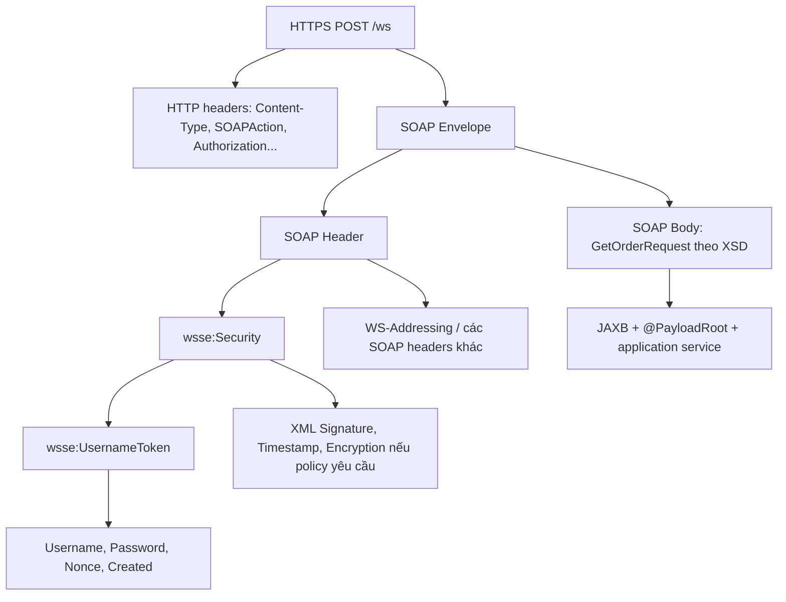
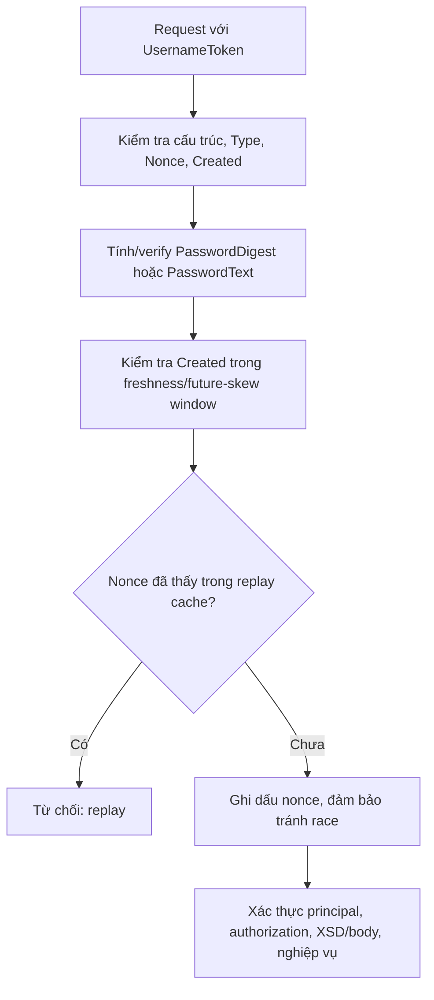
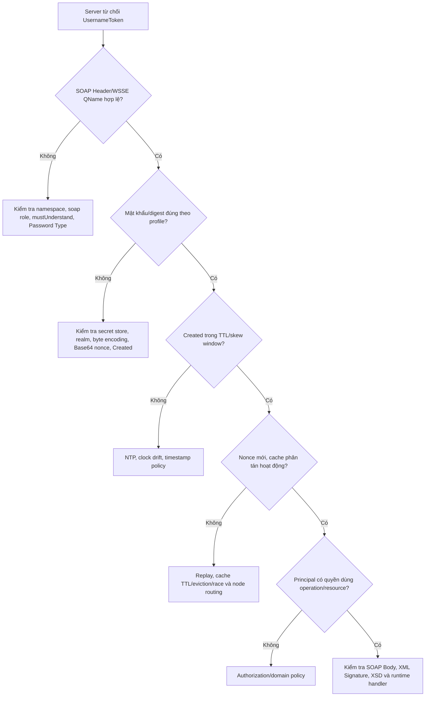

# UsernameToken, PasswordText, PasswordDigest và giới hạn bảo vệ mật khẩu

## 1. Bối cảnh: xác thực SOAP không dừng lại ở một tên người dùng

Trong module **SPRING_WEB_SERVICES**, dịch vụ SOAP theo hướng **contract-first** dựa trên **XSD/WSDL** để mô tả dữ liệu, JAXB/OXM để ánh xạ Java ↔ XML, và Spring Web Services (Spring-WS) để xây dựng endpoint cùng SOAP client. Một lớp quan trọng của tích hợp doanh nghiệp là **WS-Security**, đặc biệt khi các hệ thống cần trao đổi thông điệp có xác thực, chữ ký, mã hóa, chứng chỉ và chính sách xử lý lỗi rõ ràng.

**UsernameToken** là một security token của WS-Security được đặt trong **SOAP Header**. Nó có thể chứa `Username`, một giá trị `Password` ở dạng `PasswordText` hoặc `PasswordDigest`, và các thành phần hỗ trợ chống phát lại như `Nonce` và `Created`. Spring-WS tích hợp Apache **WSS4J** để tạo, kiểm tra token và xử lý SOAP security.

Một cách hiểu rất nguy hiểm là:

> “Cứ dùng PasswordDigest thay PasswordText thì thông điệp đã được mã hóa, không bị phát lại và không cần HTTPS.”

Điều đó **không đúng**. `PasswordDigest` theo UsernameToken Profile là cách chứng minh bên gửi biết một **shared secret** bằng phép băm gắn với nonce và thời gian, nhưng **không mã hóa SOAP Body**, **không tự ký nội dung nghiệp vụ**, **không đảm bảo bí mật của token trên đường truyền** và **không loại bỏ rủi ro đoán mật khẩu yếu**. Muốn bảo vệ một giao dịch doanh nghiệp đáng tin cậy phải kết hợp **TLS/mTLS, replay cache, clock window, quyền truy cập, secret rotation, WS-Security Signature/Encryption khi cần**, cùng kiểm thử tương thích giữa các bên.

### Mục tiêu học tập

Sau bài thuộc chương **WS-Security**, bạn có thể:

1. Xác định đúng `wsse:Security`/`wsse:UsernameToken` trong SOAP Envelope, phân biệt với **HTTP Authorization**, SOAP Body, SOAPAction và WS-Addressing.
2. Diễn giải `PasswordText`, `PasswordDigest`, `Nonce`, `wsu:Created` và các URI `Type` của OASIS UsernameToken Profile.
3. Giải thích công thức digest ở mức **byte**, đặc biệt nonce là bytes giải mã Base64 và timestamp/password dùng UTF-8.
4. Phân tích chính xác những gì UsernameToken **có** và **không có**: xác thực shared secret, replay resistance có điều kiện, không thay chữ ký/mã hóa.
5. Cấu hình **`Wss4jSecurityInterceptor`** cho client/server Spring-WS, callback handler, mật khẩu/secret và **ReplayCache** theo phiên bản.
6. Xây dựng ma trận kiểm thử token hợp lệ, sai mật khẩu/digest, nonce trùng, timestamp cũ/tương lai, namespace sai, SOAP Fault và WS-Security policy.
7. Lựa chọn cách quản trị mật khẩu phù hợp giữa **PasswordText qua TLS**, **PasswordDigest**, **password hashing tại server**, **mTLS/certificates** và chữ ký thông điệp.

**Giới hạn của bài:** tập trung vào UsernameToken và vấn đề bảo vệ mật khẩu. Các cấu hình chữ ký X.509, XML Encryption, chứng chỉ và policy đầy đủ được nhắc tới để xác định ranh giới an toàn, không trình bày giả như chỉ một token có thể thay tất cả các cơ chế đó.

## 2. UsernameToken nằm ở đâu trong một SOAP request?

SOAP Envelope gồm `Header` và `Body`. WS-Security sử dụng một **SOAP Header block** có QName `wsse:Security`, bên trong có thể chứa nhiều loại token/security elements. UsernameToken nằm trong block này, không phải một trường của request nghiệp vụ do JAXB XSD sinh ra.



### 2.1. Các namespace cần chính xác

| Prefix thường dùng | Namespace URI | Vai trò |
| --- | --- | --- |
| `soap` | `http://schemas.xmlsoap.org/soap/envelope/` | SOAP Envelope 1.1, Header, Body, Fault. |
| `env` | `http://www.w3.org/2003/05/soap-envelope` | SOAP Envelope 1.2. |
| `wsse` | `http://docs.oasis-open.org/wss/2004/01/oasis-200401-wss-wssecurity-secext-1.0.xsd` | WS-Security header/token elements. |
| `wsu` | `http://docs.oasis-open.org/wss/2004/01/oasis-200401-wss-wssecurity-utility-1.0.xsd` | Security utility như `Created`, `Timestamp`, `Id`. |
| UsernameToken profile | `http://docs.oasis-open.org/wss/2004/01/oasis-200401-wss-username-token-profile-1.0` | Định nghĩa các kiểu mật khẩu/token được gắn vào URI fragments. |

**Namespace URI không phải URL tải về mỗi lần parse message.** Khi một hệ thống XML parser cố truy cập Internet để nạp DTD/schema từ input không đáng tin, đó là vấn đề XML security/XXE cần xử lý ở parser/resolver, không phải lý do thay URI WS-Security.

### 2.2. PasswordText trong SOAP 1.1

```xml
<?xml version="1.0" encoding="UTF-8"?>
<soap:Envelope
    xmlns:soap="http://schemas.xmlsoap.org/soap/envelope/"
    xmlns:wsse="http://docs.oasis-open.org/wss/2004/01/oasis-200401-wss-wssecurity-secext-1.0.xsd"
    xmlns:wsu="http://docs.oasis-open.org/wss/2004/01/oasis-200401-wss-wssecurity-utility-1.0.xsd"
    xmlns:ord="https://example.com/orders/v1">
    <soap:Header>
        <wsse:Security soap:mustUnderstand="1">
            <wsse:UsernameToken wsu:Id="ut-001">
                <wsse:Username>partner-demo</wsse:Username>
                <wsse:Password
                    Type="http://docs.oasis-open.org/wss/2004/01/oasis-200401-wss-username-token-profile-1.0#PasswordText">DEMO-ONLY-NOT-A-REAL-SECRET</wsse:Password>
                <wsse:Nonce
                    EncodingType="http://docs.oasis-open.org/wss/2004/01/oasis-200401-wss-soap-message-security-1.0#Base64Binary">c2FtcGxlLW5vbmNlLWJ5dGVz</wsse:Nonce>
                <wsu:Created>2026-11-27T02:00:00Z</wsu:Created>
            </wsse:UsernameToken>
        </wsse:Security>
    </soap:Header>
    <soap:Body>
        <ord:GetOrderRequest>
            <ord:orderId>ORD-000123</ord:orderId>
        </ord:GetOrderRequest>
    </soap:Body>
</soap:Envelope>
```

**Ví dụ trên chỉ minh họa cấu trúc.** Mật khẩu là chuỗi giả vô dụng; nonce được mã hóa Base64 từ bytes minh họa, **không phải nonce ngẫu nhiên an toàn**; Created là thời điểm cố định nên sẽ hết hạn. Không dùng XML này làm một token thật, và tuyệt đối không lưu token thực trong source code, tài liệu, test snapshots hay log.

Ý nghĩa các trường:

- `wsse:Username` là tên đối tác/tài khoản được khai báo, **không phải bằng chứng xác thực tự nó**.
- `wsse:Password Type="...#PasswordText"` chứa một giá trị có thể khôi phục trên wire, thường là **plain shared password**, đôi khi là password-equivalent theo thỏa thuận đặc biệt.
- `wsse:Nonce` là một giá trị **mới và khó đoán cho từng token/message**.
- `wsu:Created` ghi thời điểm tạo token, thường dùng UTC, phải phù hợp clock/freshness policy.
- `soap:mustUnderstand="1"` yêu cầu SOAP node đúng vai trò xử lý Security header hoặc trả lỗi giao thức; nó **không tự xác minh mật khẩu**.
- `wsu:Id` định danh XML token để tham chiếu/chữ ký trong một số policy; **không được xem là credential**.

### 2.3. PasswordDigest: khác phần tử PasswordText ở Type và giá trị

```xml
<wsse:UsernameToken
    xmlns:wsse="http://docs.oasis-open.org/wss/2004/01/oasis-200401-wss-wssecurity-secext-1.0.xsd"
    xmlns:wsu="http://docs.oasis-open.org/wss/2004/01/oasis-200401-wss-wssecurity-utility-1.0.xsd">
    <wsse:Username>partner-demo</wsse:Username>
    <wsse:Password
        Type="http://docs.oasis-open.org/wss/2004/01/oasis-200401-wss-username-token-profile-1.0#PasswordDigest">BASE64_DIGEST_COMPUTED_AT_RUNTIME</wsse:Password>
    <wsse:Nonce
        EncodingType="http://docs.oasis-open.org/wss/2004/01/oasis-200401-wss-soap-message-security-1.0#Base64Binary">BASE64_NONCE_COMPUTED_AT_RUNTIME</wsse:Nonce>
    <wsu:Created>2026-11-27T02:00:00Z</wsu:Created>
</wsse:UsernameToken>
```

Hai giá trị chữ hoa `BASE64_...` là **placeholder diễn giải**, không phải Base64 digest/nonce hợp lệ để xác thực. Trong triển khai thực tế, **để WSS4J sinh giá trị** bằng nguồn ngẫu nhiên mật mã và thời gian hiện tại; không hard-code token/digest trong code nghiệp vụ.

**Định nghĩa:** `PasswordDigest` **không** có nghĩa “mật khẩu đã được mã hóa bằng AES”, “mật khẩu đã được băm bằng BCrypt” hoặc “SOAP Body đã được ký”. Nó là **mã kiểm chứng có cấu trúc cụ thể** theo OASIS UsernameToken Profile.

## 3. PasswordText: lợi ích, rủi ro và điều kiện chấp nhận

### 3.1. PasswordText không phải lúc nào cũng là password từ một form

Trong UsernameToken Profile, `#PasswordText` có thể chứa mật khẩu thực hoặc một **password equivalent/giá trị bí mật đã thỏa thuận**. Tuy nhiên, giá trị đó xuất hiện **dưới dạng text trong XML trên wire**. Nếu một người truy cập được request body/log/proxy capture, họ có thể lấy và sử dụng giá trị đó như credential, bất kể nó được gọi là “token” hay “password equivalent”.

**Rủi ro điển hình:**

- HTTP không mã hóa làm lộ mật khẩu/token qua mạng.
- TLS chấm dứt ở reverse proxy nhưng hệ thống sau proxy tiếp tục truyền rõ ràng, tạo điểm lộ nội bộ.
- Log SOAP Envelope, tracing, lỗi JAXB hoặc debug interceptor ghi lại `wsse:Password`.
- Lưu shared secret trong `application.yml`, Git, screenshot hay tập tin cấu hình không bảo vệ.
- Dùng chung credential giữa nhiều đối tác, nhiều môi trường, khó thu hồi/rotate riêng.
- Không khóa tài khoản hoặc rate limit khi password guessing/brute force.

### 3.2. Khi nào có thể dùng PasswordText?

Với một đối tác legacy hoặc một service nội bộ có yêu cầu rõ, **PasswordText qua TLS được cấu hình và xác minh đúng** có thể là một lựa chọn tương thích:

1. Mọi kết nối bên ngoài phải qua **HTTPS** với kiểm tra certificate chain/hostname, không cho fallback HTTP.
2. Nếu TLS terminate tại gateway, phải có policy bảo vệ/giới hạn access trên các hop nội bộ.
3. Shared password phải đủ mạnh, khác nhau giữa các đối tác, được cấp phát/rotate qua secret manager.
4. **Bắt buộc chống replay nếu threat model yêu cầu**, không chỉ nhìn `PasswordText` rồi coi request mới. Có thể dùng Nonce/Created + replay cache/idempotency theo policy và WSS4J validation.
5. Không ghi SOAP Security Header/credential vào log, error response hoặc traces.
6. Server phải xác thực username/password **trước khi** thực hiện business operation và kiểm tra authorization trên từng tài nguyên.
7. Với yêu cầu integrity đầu cuối qua nhiều intermediary không tin cậy, **WS-Security Signature** hoặc cơ chế tương đương có thể cần bổ sung.

**Câu hỏi đúng không phải** “PasswordText có an toàn tuyệt đối không?”, mà là **bộ bảo vệ đường truyền, lưu trữ, chống replay, phân quyền và vận hành có đáp ứng threat model hay không?**

### 3.3. PasswordText và password hashing ở backend

Đối với lưu trữ mật khẩu người dùng, ứng dụng hiện đại thường giữ **one-way salted password hashes** như Argon2id, scrypt hoặc BCrypt (theo policy) thay vì lưu mật khẩu rõ. Khi nhận `PasswordText` qua TLS, một bộ xác thực có thể lấy giá trị text từ request và so với hash đã lưu bằng password verification được thiết kế an toàn, **nếu** callback/integration thực sự hỗ trợ cách đối chiếu đó.

Không suy rằng mọi `SimplePasswordValidationCallbackHandler` hay `SpringSecurityPasswordValidationCallbackHandler` tự động tương thích với schema dữ liệu BCrypt/salted hash của hệ thống. Kiểm tra API/PasswordEncoder/provider thực tế; callback đơn giản của Spring-WS phục vụ demo có thể dùng password values trực tiếp.

**Lưu ý:** nếu lưu một **password equivalent có thể khôi phục** để phục vụ SOAP digest, bảo mật vận hành của equivalent đó phải ngang với mật khẩu gốc. Không coi việc đổi tên trường thành `credentialHash` là đã giải quyết rủi ro.

## 4. PasswordDigest: công thức chính xác theo OASIS

UsernameToken Profile quy định:

```text
Password_Digest = Base64( SHA-1( nonce + created + password ) )
```

Trong đó:

- `nonce` là **octet sequence của giá trị đã giải mã Base64** trong `wsse:Nonce`, **không phải** các ký tự ASCII của chuỗi Base64.
- `created` là **UTF-8 bytes của text trong `wsu:Created`**.
- `password` là **UTF-8 bytes của shared secret/password-equivalent** mà bên gửi và bên nhận biết.
- Dấu `+` có nghĩa **nối bytes theo đúng thứ tự**, không phải cộng số, không phải thêm dấu cộng ASCII.
- SHA-1 cho ra digest 20 bytes; `wsse:Password` mang **Base64 của 20 bytes đó**, không phải hex string.

**Đây là thuật toán được một chuẩn tương thích SOAP legacy định nghĩa**, không phải gợi ý thiết kế mật mã mới. SHA-1 đã lỗi thời cho nhiều mục đích bảo mật hiện đại; không tự chế một “UsernameToken SHA-256” bằng cách thay `SHA-1` nhưng giữ Type URI `#PasswordDigest` — như vậy sẽ phá interoperability và không còn đúng profile.

### 4.1. Các lỗi byte encoding phổ biến

| Sai lầm | Hậu quả |
| --- | --- |
| Băm **chuỗi ký tự Base64** của nonce thay vì raw nonce bytes | Digest khác đặc tả, đối tác không xác minh được. |
| Nối `created` ở dạng local time thay vì cùng lexical value trong token | Digest không khớp dù cùng instant. |
| Băm Java `String` theo default charset của máy | Sai khi secret có Unicode, không ổn định giữa environments. |
| Dùng Base64 text của password thay vì UTF-8 bytes | Thay input của thuật toán, không liên thông. |
| Đổi thứ tự thành `password + nonce + created` | Sai profile. |
| Đổi SHA-1 thành SHA-256 nhưng giữ `Type=#PasswordDigest` | Không còn đúng UsernameToken Profile interoperable. |
| Dùng hex của SHA-1 thay vì Base64 | Server parse sai giá trị. |
| Tái sử dụng nonce hoặc timestamp cố định | Dễ bị replay; giảm đáng kể giá trị của cơ chế. |

### 4.2. Ví dụ Java tính digest để hiểu thuật toán (không thay WSS4J)

```java
import java.nio.charset.StandardCharsets;
import java.security.MessageDigest;
import java.util.Base64;

public final class UsernameTokenDigestExample {

    public static String digestForUnderstanding(
            byte[] decodedNonce,
            String createdText,
            String sharedPassword) throws Exception {

        MessageDigest sha1 = MessageDigest.getInstance("SHA-1");
        sha1.update(decodedNonce);
        sha1.update(createdText.getBytes(StandardCharsets.UTF_8));
        sha1.update(sharedPassword.getBytes(StandardCharsets.UTF_8));
        return Base64.getEncoder().encodeToString(sha1.digest());
    }

    public static void main(String[] args) throws Exception {
        byte[] nonce = Base64.getDecoder()
            .decode("c2FtcGxlLW5vbmNlLWJ5dGVz");
        String created = "2026-11-27T02:00:00Z";
        String password = "TEST-ONLY-NOT-A-REAL-SECRET";
        String expectedDigest =
            digestForUnderstanding(nonce, created, password);
        System.out.println("Digest test (không dùng làm credential): "
            + expectedDigest);
    }
}
```

**Phạm vi của đoạn code là minh họa cách nối bytes, không phải một WS-Security implementation sản xuất.** Nó không sinh nonce ngẫu nhiên, không kiểm tra freshness, không làm replay cache, không thực hiện password verification constant-time hoặc ký XML. Password/nonce/timestamp demo **không được** dùng trong request thật. Trong sản xuất, hãy dùng **Apache WSS4J** đã được bảo trì và kiểm tra chính sách; không tự viết giao thức bảo mật rồi cho qua chỉ vì hai đầu cùng tính ra một chuỗi.

Nếu xây test vector, nên tính digest theo công thức trên và cho WSS4J/client đối tác verify ở cả hai hướng. Ngoài test đúng, cần test sửa **một byte** nonce, Created hoặc password làm thất bại xác thực.

### 4.3. Digest hợp lệ không chứng minh nonce mới

Một attacker ghi lại được toàn bộ token:

```text
Username + PasswordDigest + Nonce + Created
```

có thể **gửi lại nguyên token** với cùng SOAP message. Giá trị digest vẫn đúng vì input không đổi. Nếu server không lưu nonce đã thấy, hoặc chấp nhận Created cũ không giới hạn, yêu cầu phát lại có thể vượt qua bước kiểm tra mật khẩu. Đây là lý do **Nonce và Created phải đi kèm replay detection**, không chỉ xuất hiện trong XML.

### 4.4. Digest không ràng buộc SOAP Body

`PasswordDigest` chỉ băm **nonce + Created + shared password**. Nó **không băm hoặc ký SOAP Body**. Một bên có khả năng thay đổi Body trên đường đi mà không làm thay đổi các trường UsernameToken có thể tạo nội dung nghiệp vụ khác trong khi digest vẫn giữ nguyên.

TLS cung cấp confidentiality/integrity cho **mỗi kết nối TLS**; nếu SOAP message đi qua những intermediary xử lý lại XML hoặc yêu cầu integrity đầu cuối, hãy dùng **WS-Security XML Signature** bao phủ **đúng SOAP Body/Headers và các reference** theo policy. **Không coi UsernameToken là chữ ký thông điệp**.

## 5. Nonce, Created, replay cache và clock skew

### 5.1. Nonce là gì?

**Nonce** là giá trị ngẫu nhiên mới do bên gửi tạo **cho mỗi UsernameToken**. Nó không nhất thiết là một UUID text, và profile thường truyền dưới dạng **Base64 bytes**. Nonce cần:

- Được tạo bởi **cryptographically secure random generator**;
- Có độ entropy đủ cao theo chính sách hệ thống;
- Không tái sử dụng cho cùng principal/flow;
- Được validate đúng EncodingType/format trước khi xử lý;
- Được server lưu trong replay cache trong khoảng hiệu lực phù hợp.

**Không** lấy timestamp, số thứ tự hoặc `documentId` dễ đoán làm nonce. Không dựa vào việc nonces “trông ngẫu nhiên” trong log; verify phải chống trùng giữa các request và giữa các node server nếu hệ thống có load balancing.

### 5.2. Created và freshness window

`wsu:Created` là timestamp trong UsernameToken, ví dụ:

```xml
<wsu:Created
    xmlns:wsu="http://docs.oasis-open.org/wss/2004/01/oasis-200401-wss-wssecurity-utility-1.0.xsd">2026-11-27T02:00:00Z</wsu:Created>
```

Server thường áp dụng một khoảng thời gian chấp nhận:

```text
Created không được quá cũ so với server clock.
Created không được quá xa trong tương lai (clock skew tolerance).
Nonce chưa từng được sử dụng trong khoảng replay protection.
```

OASIS UsernameToken Profile khuyến nghị dùng **cả Nonce và Created**, giới hạn thời gian hợp lệ và cache nonce trong khoảng ít nhất tương đương freshness window. Một khoảng quanh **năm phút** thường được dùng làm hướng dẫn ban đầu, **không phải con số bắt buộc cho mọi hệ thống**. Cần chọn theo độ trễ, NTP/clock synchronization, đặc điểm queue, batch và rủi ro replay.

**Phân biệt:** `wsu:Created` **bên trong UsernameToken** với `wsu:Timestamp` **một security header element riêng** có thể chứa `Created`/`Expires`. Cấu hình WSS4J action `Timestamp` không đồng nghĩa tự động thay thế validation của UsernameToken nonce/Created. Hai chính sách có liên quan nhưng không phải một.

### 5.3. Replay cache phải thực sự hoạt động

Một replay cache lưu identifier của nonce đã được chấp nhận và kiểm tra khi token mới đến. Kịch bản tốt:



Sơ đồ trên mô tả **các điều kiện bảo vệ**, không cam kết thứ tự gọi nội bộ của mọi WSS4J version. Khi triển khai phải có **hành vi reject replay atomically hoặc theo bảo đảm của cache/provider**; check-then-set không nguyên tử trong ứng dụng phân tán có thể để lọt hai request đồng thời dùng cùng nonce.

**Các lỗi triển khai hay gặp:**

- Cache chỉ nằm ở một node, nhưng gateway load-balance request phát lại sang node khác.
- Cache có TTL ngắn hơn freshness window, nonce bị quên quá sớm.
- Cache eviction vì áp lực bộ nhớ khiến request cũ trong window được coi là mới.
- Cache key không phân biệt principal/tenant/realm khi cần, hoặc thiếu namespace làm các hệ thống lẫn nhau.
- Clock của node lệch lớn; một request quá cũ ở node này lại được chấp nhận ở node khác.
- Cấu hình WSS4J có field replay cache nhưng runtime thực sự không dùng hoặc missing nonce được chấp nhận.
- Cho phép nhiều token/multiple identities mà application chọn sai principal.

Để kiểm thử, dùng **một token hợp lệ đã được ký tự digest đúng**, gửi hai lần trong window; request thứ hai phải bị chặn theo policy, kể cả khi đi vào node khác. Với những operation có side effect, cần **idempotency ở tầng nghiệp vụ riêng** — replay cache không thay thế transaction deduplication sau khi window hết hạn.

## 6. Chọn PasswordText hay PasswordDigest: sự đánh đổi khi lưu mật khẩu

Một câu hỏi khó của UsernameToken không nằm ở XML syntax mà ở **secret storage tại server**.

### 6.1. Vì sao BCrypt/Argon2 password hashes không trực tiếp thay được shared secret để tính digest?

Với `PasswordDigest` chuẩn, server cần tính/kiểm tra:

```text
SHA-1(decodedNonce || UTF8(Created) || UTF8(passwordOrEquivalent))
```

Nếu database chỉ có `bcrypt(password, randomSalt)` hoặc `Argon2id(password, salt)`, server **không thể suy ra password gốc** từ giá trị hash đó để áp dụng đúng công thức trên. Đây là đặc tính mong muốn của password hashing một chiều, không phải lỗi của BCrypt.

**Không nên chữa bằng cách:**

- Truyền chính giá trị BCrypt/Argon2id hash như “password” cho client rồi coi đó là an toàn. Khi shared hash trở thành giá trị mà client biết/dùng làm shared secret, nó **trở thành credential có thể bị đánh cắp và replay**; làm suy yếu mục đích của việc chỉ lưu hash.
- Tắt validation của WSS4J rồi tự so chuỗi Base64 theo một quy tắc khác nhưng vẫn khai `#PasswordDigest`.
- Lưu thêm một bản plaintext trong file cấu hình bên cạnh salted hash mà không có bảo vệ/rotation/audit.
- Giảm ngẫu nhiên của nonce hoặc bỏ Created để “dễ tính digest”.

**Phương án được cân nhắc** phải phù hợp threat model và khả năng của client:

1. **PasswordText qua HTTPS + xác minh bằng password hashing phù hợp**: server có thể xác minh password đầu vào bằng BCrypt/Argon2id thông qua adapter được kiểm tra và không cần giữ bản rõ ở database. Vẫn phải bảo vệ giá trị trên wire, gateway và logs.
2. **PasswordDigest với shared secret có thể truy xuất an toàn**: hai bên được cấp riêng một secret đủ mạnh, server dùng secret manager/KMS hoặc kho credential được quản trị nghiêm ngặt, có rotation, access control và audit. Đây là **reversible/shared-secret requirement** của profile.
3. **X.509 signing/mTLS hoặc cơ chế token phù hợp**: khi yêu cầu end-to-end integrity, non-repudiation, hoặc không muốn dùng shared password lâu dài. Việc lựa chọn cụ thể cần được thống nhất trong WS-SecurityPolicy/WSDL và năng lực đối tác.

### 6.2. Bảng so sánh thực tiễn

| Tiêu chí | PasswordText qua TLS | PasswordDigest + Nonce/Created |
| --- | --- | --- |
| Giá trị `wsse:Password` trên wire | Credential hoặc password equivalent đọc được nếu thấy plaintext SOAP XML. | Một giá trị Base64 của SHA-1 digest theo nonce/created/secret, không gửi literal secret. |
| Bảo mật khi nghe lén không có TLS | **Kém**: lộ trực tiếp shared secret. | Không lộ trực tiếp secret nhưng có thể bị thu token để replay và thử đoán offline; **không thay TLS**. |
| Lưu trữ server | Có thể dùng password hashing một chiều **nếu** verifier hỗ trợ. | Thường cần password/shared equivalent đủ để tính digest, quản trị như credential có thể khôi phục. |
| Chống replay | Không tự có; cần timestamps/nonces/cache và/hoặc cơ chế bổ sung. | Có nền tảng chống replay với nonce/created **chỉ khi** kiểm tra freshness và cache đúng. |
| Tính toàn vẹn của SOAP Body | Không tự có; TLS bảo vệ từng hop. | **Không tự có**; digest không bao gồm Body. |
| Chi phí interoperability | Thường dễ với các SOAP stacks legacy. | Phải khớp công thức bytes, Nonce, Created, profile và verification. |
| Rủi ro vận hành | Lộ plaintext qua log/intermediaries, password reuse, rotation. | Cần quản lý shared secret, replay cache, clock skew và không để weaker SHA-1 digest bị dùng sai mục đích. |
| Khuyến nghị | Chấp nhận khi đáp ứng HTTPS + password management + policy. | Chỉ dùng khi hợp đồng yêu cầu, thêm TLS và replay protection mạnh, không xem là mã hóa. |

### 6.3. SHA-1 ở UsernameToken PasswordDigest cần được hiểu đúng

SHA-1 là hàm băm thuộc một profile cũ. Không nên lấy việc SHA-1 nằm trong chuẩn làm bằng chứng rằng toàn bộ cơ chế đã đạt các mục tiêu bảo mật hiện đại. Trong PasswordDigest:

- Mật khẩu yếu vẫn có nguy cơ **offline dictionary attack** nếu attacker có token và giá trị nonce/Created.
- Không có **message authenticity** cho Body, nên phải dùng XML Signature/TLS theo threat model.
- Không có **confidentiality** cho token/Body trên mạng không bảo vệ.
- Không có **replay protection** nếu server không kiểm soát thời gian/nonce trùng.
- Nên dùng shared secret **mạnh, ngẫu nhiên, riêng từng đối tác** nếu giao thức buộc dùng PasswordDigest.

**Không tự thay SHA-1 bằng SHA-256 rồi vẫn gắn Type URI chuẩn `#PasswordDigest`.** Nếu hai bên cần một scheme mới, phải dùng profile/contract bảo mật tương ứng và đánh giá interoperability, hoặc chuyển sang cơ chế xác thực/chữ ký được chuẩn hóa khác.

### 6.4. Rotation và multi-tenant

Khi nhiều đối tác dùng cùng SOAP service:

- **Mỗi đối tác một credential/identity**; không đặt chung “soapUser” toàn tổ chức.
- Tách credential cho **dev/staging/prod**, không copy secret production vào test.
- Có lịch rotation, trạng thái hết hạn và quy tắc thu hồi khẩn cấp.
- Nếu hỗ trợ overlap của old/new secret để tránh downtime, phải có chính sách version/validity rõ, giới hạn thời gian và ghi audit.
- Trong thời gian overlap, đảm bảo replay protection và auth policy **không lẫn realm/identity**.
- Rate limit/lockout theo account/tenant và log **mã lỗi công khai**, không log password/digest.
- Dùng API secret manager/KMS phù hợp để truy xuất, kiểm soát quyền và tránh lưu secret trong classpath source.

**Cẩn thận với cache bí mật:** giữ shared secret lâu dài trong singleton `String`/heap có thể gây rủi ro memory dump. Không thể xóa hoàn toàn Java `String` khỏi heap theo ý muốn; quản trị process, secrets lifecycle và dùng credential ngắn hạn/chữ ký hoặc vault-backed retrieval khi có yêu cầu cao.

## 7. Spring-WS và Apache WSS4J: lớp nào xử lý token?

Trong Spring-WS, **`Wss4jSecurityInterceptor`** thường được cấu hình để bảo vệ request/response SOAP. Nó dựa trên **Apache WSS4J** và có thể hoạt động với `SaajSoapMessageFactory` hoặc `AxiomSoapMessageFactory` khi runtime/dependencies phù hợp.

### 7.1. Những action quan trọng

| Action | Vai trò |
| --- | --- |
| `UsernameToken` | Thêm hoặc validate UsernameToken trong `wsse:Security`. |
| `Timestamp` | Thêm/kiểm tra một `wsu:Timestamp` riêng theo WS-Security policy. |
| `Signature` | Ký/xác minh các XML parts có tham chiếu, giúp integrity/authenticity nếu cấu hình trust đúng. |
| `Encrypt` | Mã hóa/giải mã những XML parts đã chọn. |
| `UsernameTokenSignature` | Mô hình dùng UsernameToken-derived secret key với chữ ký; **khác** với UsernameToken PasswordDigest đơn lẻ. |
| `NoSecurity` | Không có action security tương ứng; không dùng để “cho qua” endpoint cần xác thực. |

**`securementActions`** dành cho việc thêm biện pháp bảo vệ lên SOAP message **đi ra**, còn **`validationActions`** định nghĩa những security actions phải được kiểm tra trên message **đi vào**. Việc kiểm tra action order và policy thuộc interceptor, không phải `@Endpoint`.

Trong code sử dụng WS-Security:

```text
Client:
  JAXB request
    → WebServiceTemplate
    → Wss4jSecurityInterceptor (securement)
    → SOAP Header wsse:Security
    → HTTP sender / TLS

Server:
  HTTP receiver / SOAP message factory
    → Wss4jSecurityInterceptor (validation)
    → EndpointMapping / JAXB
    → application authorization
    → SOAP response / Fault
```

Đây là **mô hình logic**, không áp đặt thứ tự vật lý của mọi interceptor, đặc biệt khi có XML Encryption hoặc security headers phức tạp. Với SOAP message đã ký, cần giữ đúng node được xác minh để application sử dụng; không tin message chỉ vì nó chứa `ds:Signature`.

### 7.2. Chú ý generation: Spring-WS 4.x, WSS4J 2.x, javax/jakarta

Ví dụ mã trong bài chủ yếu dựa trên **Spring-WS 4.1.x**, nơi interceptor có package:

```java
import org.springframework.ws.soap.security.wss4j2.Wss4jSecurityInterceptor;
```

Một số type Java nền tảng **vẫn** thuộc `javax` trong Jakarta stack:

```java
import javax.security.auth.callback.Callback;
import javax.security.auth.callback.CallbackHandler;
import javax.security.auth.callback.UnsupportedCallbackException;
import javax.xml.namespace.QName;
```

Ngược lại, JAXB/SAAJ/Activation trong Spring Framework 6+/Jakarta generation thường ở `jakarta.xml.bind.*`, `jakarta.xml.soap.*` và `jakarta.activation.*`.

**Không đổi hàng loạt mọi `javax.*` thành `jakarta.*`.** Cần dùng dependency management tương thích Spring-WS, WSS4J, SAAJ, JAXB runtime, Java version và test thực tế trên stack đó. Một class tên giống nhau trong hướng dẫn cũ có thể thuộc package khác ở bản mới.

## 8. Client Spring-WS: sinh PasswordDigest UsernameToken

### 8.1. Java configuration dùng secret lấy từ cấu hình bảo vệ

Ví dụ Spring configuration cho một **SOAP client** gửi UsernameToken:

```java
import org.springframework.context.annotation.Bean;
import org.springframework.context.annotation.Configuration;
import org.springframework.core.env.Environment;
import org.springframework.ws.soap.security.wss4j2.Wss4jSecurityInterceptor;

@Configuration
public class PartnerUsernameTokenClientSecurity {

    @Bean
    public Wss4jSecurityInterceptor outboundUsernameToken(
            Environment environment) {

        String username = environment.getRequiredProperty(
            "partner.soap.username");
        String sharedSecret = environment.getRequiredProperty(
            "partner.soap.shared-secret");

        Wss4jSecurityInterceptor interceptor =
            new Wss4jSecurityInterceptor();
        interceptor.setSecurementActions("UsernameToken");
        interceptor.setSecurementUsername(username);
        interceptor.setSecurementPassword(sharedSecret);
        interceptor.setSecurementPasswordType("PasswordDigest");

        // Spring-WS 4.1.x: yêu cầu có Nonce/Created trên token.
        interceptor.setSecurementUsernameTokenNonce(true);
        interceptor.setSecurementUsernameTokenCreated(true);
        return interceptor;
    }
}
```

**Đây là mã cấu hình minh họa**, giả định properties được cấp qua secret manager, môi trường triển khai được bảo vệ hoặc cơ chế injection tương đương — **không** đặt literal password trong Git. Hàm `getRequiredProperty(...)` trả `String` ở JVM, nên phải quản trị access, vòng đời secrets và rotation. Với security yêu cầu hot rotation/per-request identity, cần cơ chế callback/context riêng được kiểm tra thay vì một singleton giữ cứng credential cũ cho mọi request.

Lưu ý:

- `securementActions("UsernameToken")` thêm UsernameToken, **không ký SOAP Body**.
- `securementPasswordType("PasswordDigest")` chọn chuẩn digest theo UsernameToken Profile, **không phải BCrypt/SHA-256 password hash**.
- `setSecurementUsernameTokenNonce(true)`/`setSecurementUsernameTokenCreated(true)` yêu cầu các element; **vẫn phải test output thực tế** của WSS4J và policy đối tác.
- Hai setter boolean có trong Javadoc Spring-WS 4.1.x; ở bản cũ có thể cần thuộc tính tương đương `securementUsernameTokenElements` hoặc cấu hình WSS4J khác. **Không sao chép setter không tồn tại vào version cũ**.
- Nonce/Created phải được **WSS4J sinh mỗi message**, không tái sử dụng một cặp token hard-coded từ fixture.

### 8.2. Gắn interceptor vào WebServiceTemplate

```java
import org.springframework.beans.factory.annotation.Qualifier;
import org.springframework.context.annotation.Bean;
import org.springframework.oxm.jaxb.Jaxb2Marshaller;
import org.springframework.ws.client.core.WebServiceTemplate;
import org.springframework.ws.client.support.interceptor.ClientInterceptor;
import org.springframework.ws.soap.saaj.SaajSoapMessageFactory;
import org.springframework.ws.soap.security.wss4j2.Wss4jSecurityInterceptor;

@Bean
public WebServiceTemplate securedOrderClient(
        SaajSoapMessageFactory soap11ClientMessageFactory,
        @Qualifier("ordersMarshaller") Jaxb2Marshaller marshaller,
        @Qualifier("outboundUsernameToken")
        Wss4jSecurityInterceptor securityInterceptor) {

    WebServiceTemplate template =
        new WebServiceTemplate(soap11ClientMessageFactory);
    template.setMarshaller(marshaller);
    template.setUnmarshaller(marshaller);
    template.setInterceptors(
        new ClientInterceptor[]{securityInterceptor});
    return template;
}
```

Đây là một **`@Bean` method thuộc một `@Configuration`** đã có Java/Spring context; các bean `SaajSoapMessageFactory`, `ordersMarshaller` phải tồn tại và dùng WSDL/XSD đúng contract. `Wss4jSecurityInterceptor` triển khai cả client/server interceptor, nhưng khi gắn vào template trong ví dụ, nó dùng để **secure outbound requests** theo cấu hình.

Với SOAP 1.2, sử dụng **message factory SOAP 1.2** cùng WSDL SOAP 1.2 binding; UsernameToken Header có thể dùng cùng WS-Security namespace, nhưng SOAP Envelope, Fault, Content-Type/action sẽ khác. Đừng đổi duy nhất `setSecurementPasswordType` để chuyển SOAP version.

### 8.3. Kiểm tra token sinh ra

Trong integration test, gửi một SOAP request và quan sát **SOAP Header của request thực tế**:

```text
wsse:Security
  └── wsse:UsernameToken
        ├── wsse:Username = principal đối tác đã cấu hình
        ├── wsse:Password/@Type = ...#PasswordDigest
        ├── wsse:Nonce / @EncodingType hợp lệ
        └── wsu:Created = thời điểm hiện tại
```

Trước khi kết luận thành công, xác nhận server **thực sự chấp nhận token** và application principal được ánh xạ đúng. Chỉ assert SOAP Header có bốn tag là chưa đủ; digest có thể sai do bytes, password/realm khác hoặc clock lệch.

**Không dùng logs để in đầy đủ wsse:Security** trong môi trường tích hợp thật. Test có thể truy cập token nội bộ trong test process để assert cấu trúc nhưng không lưu secret/digest vào build logs, snapshots hoặc báo cáo CI.

### 8.4. PasswordText outbound: không có nghĩa được phép bỏ TLS

Nếu đối tác **chỉ** hỗ trợ `PasswordText`, cấu hình khác:

```java
Wss4jSecurityInterceptor interceptor =
    new Wss4jSecurityInterceptor();
interceptor.setSecurementActions("UsernameToken");
interceptor.setSecurementUsername(usernameFromSecretStore);
interceptor.setSecurementPassword(passwordFromSecretStore);
interceptor.setSecurementPasswordType("PasswordText");
interceptor.setSecurementUsernameTokenNonce(true);
interceptor.setSecurementUsernameTokenCreated(true);
```

Các biến `usernameFromSecretStore`/`passwordFromSecretStore` là giá trị giả định từ dịch vụ cấp credentials. **PasswordText token vẫn lộ secret cho ai nhìn thấy SOAP XML ở plaintext**. Vì thế cấu hình này chỉ phù hợp khi hệ thống bảo vệ transport/termination/log và replay policy đúng; không được coi là ngang với password đã được mã hóa trong message.

Tài liệu Spring-WS cũ có thuộc tính chuỗi `securementUsernameTokenElements="Nonce Created"` dành cho `PasswordText`. Trong Spring-WS 4.1.x, Javadoc công bố các setter boolean `setSecurementUsernameTokenNonce` và `setSecurementUsernameTokenCreated`. Khi bảo trì dự án cũ, đọc **Javadoc của đúng release** để không dùng nhầm API.

## 9. Server Spring-WS: kiểm tra UsernameToken, không xác thực bằng endpoint thủ công

Khi server nhận SOAP request, `Wss4jSecurityInterceptor` có nhiệm vụ xử lý `wsse:Security` **trước khi cho phép ứng dụng xử lý nội dung nghiệp vụ** theo interceptor chain được cấu hình. Một endpoint `@PayloadRoot` không nên tự lấy `wsse:Password` rồi so với mật khẩu trong database.

### 9.1. Demo nhỏ dùng SimplePasswordValidationCallbackHandler

Spring-WS cung cấp `SimplePasswordValidationCallbackHandler` để xác thực UsernameToken từ danh sách username/password dạng `Properties`. Nó hữu ích cho **bài kiểm thử hoặc mẫu chạy trong môi trường được cách ly**, không nên biến thành hệ thống lưu credential production chỉ vì dễ cấu hình.

```java
import java.util.Properties;
import org.springframework.context.annotation.Bean;
import org.springframework.context.annotation.Configuration;
import org.springframework.core.env.Environment;
import org.springframework.ws.soap.security.wss4j2.callback.SimplePasswordValidationCallbackHandler;

@Configuration
public class DemoPartnerPasswordConfiguration {
    @Bean
    public SimplePasswordValidationCallbackHandler demoPasswordHandler(
            Environment environment) {

        Properties users = new Properties();
        users.setProperty(
            "partner-demo",
            environment.getRequiredProperty(
                "demo.partner.soap.shared-secret")
        );
        SimplePasswordValidationCallbackHandler handler =
            new SimplePasswordValidationCallbackHandler();
        handler.setUsers(users);
        return handler;
    }
}
```

Điểm cần nhớ: `SimplePasswordValidationCallbackHandler` dựa trên **giá trị shared secret có thể so sánh**. Nó không phải một tích hợp mặc định với BCrypt/Argon2id password storage. Với production hãy cân nhắc `SpringSecurityPasswordValidationCallbackHandler` hoặc `CallbackHandler` tùy chỉnh cùng credential store, nhưng phải **kiểm thử cơ chế verify thực tế**, không chỉ có bean.

### 9.2. Production callback lấy shared secret từ kho tin cậy

Trong Apache WSS4J, callback có thể nhận `WSPasswordCallback` với `usage == USERNAME_TOKEN`. Một ứng dụng có thể cung cấp shared password/equivalent thông qua `CallbackHandler` lấy từ một kho secret được kiểm soát:

```java
import java.io.IOException;
import javax.security.auth.callback.Callback;
import javax.security.auth.callback.CallbackHandler;
import javax.security.auth.callback.UnsupportedCallbackException;
import org.apache.wss4j.common.ext.WSPasswordCallback;

public interface PartnerSecretProvider {
    // Null nếu principal không được cấp shared secret trong realm này.
    String resolveSecret(String principal);
}

public final class PartnerUsernameTokenCallback
        implements CallbackHandler {
    private final PartnerSecretProvider provider;

    public PartnerUsernameTokenCallback(PartnerSecretProvider provider) {
        this.provider = provider;
    }

    @Override
    public void handle(Callback[] callbacks)
            throws IOException, UnsupportedCallbackException {
        for (Callback callback : callbacks) {
            if (!(callback instanceof WSPasswordCallback password)
                    || password.getUsage()
                    != WSPasswordCallback.USERNAME_TOKEN) {
                throw new UnsupportedCallbackException(callback);
            }

            String sharedSecret =
                provider.resolveSecret(password.getIdentifier());
            if (sharedSecret == null) {
                throw new IOException("UsernameToken invalid");
            }
            password.setPassword(sharedSecret);
        }
    }
}
```

**Các public top-level types ở ví dụ là các file Java riêng**, ví dụ `PartnerSecretProvider.java` và `PartnerUsernameTokenCallback.java`. Code này minh họa **cách cấp một secret cho WSS4J**, không thay thế một thiết kế credential vault đầy đủ.

Các yêu cầu production:

- `PartnerSecretProvider` chỉ truy cập principal/realm đã đăng ký; không lấy raw SQL table name/tenant từ username để tạo câu truy vấn.
- Dùng shared secret **riêng từng đối tác** và có rotation; kho secret phải audit, có quyền tối thiểu, không trả trực tiếp credential trong API/log.
- Xử lý account bị khóa/hết hạn/thu hồi, throttling và quan sát thất bại; đừng chỉ cấp secret đúng là đã được phép dùng mọi operation.
- Xác minh API/behavior WSS4J cụ thể cho PasswordText và PasswordDigest; callback chỉ **cung cấp thông tin xác minh**, còn WSS4J phải thực sự chạy validator/action và kiểm tra giá trị.
- Không so `password.getIdentifier()` với tên business resource hoặc cho endpoint tự coi username string là authenticated principal.
- Nếu có nhiều `WSPasswordCallback` usages (ví dụ decrypt/signature), dùng callback handlers riêng hoặc có logic rõ thay vì trả cùng shared secret cho mọi usage.

### 9.3. ReplayCache cho Spring-WS 4.1.4+

Tài liệu Spring-WS 4.1.4 công bố `setValidationReplayCache(ReplayCache)` và `SpringReplayCache`; đây là ví dụ cho một service **chạy nhiều node** có Spring `CacheManager` được cấu hình **với backend phân tán**:

```java
import org.apache.wss4j.common.cache.ReplayCache;
import org.springframework.cache.Cache;
import org.springframework.cache.CacheManager;
import org.springframework.context.annotation.Bean;
import org.springframework.context.annotation.Configuration;
import org.springframework.ws.soap.security.wss4j2.cache.SpringReplayCache;

@Configuration
public class UsernameTokenReplayCacheConfiguration {
    @Bean
    public ReplayCache wsSecurityReplayCache(CacheManager cacheManager) {
        Cache cache = cacheManager.getCache("ws-security-replay");
        if (cache == null) {
            throw new IllegalStateException(
                "Replay cache chưa được cấu hình");
        }
        return new SpringReplayCache(cache);
    }
}
```

**Điều kiện quan trọng:** Bean `CacheManager` trong ví dụ **phải trỏ tới cache phân tán phù hợp** ở production multi-node. `SpringReplayCache` chỉ là adapter WSS4J `ReplayCache` trên Spring Cache abstraction; nó **không tự biến một local in-memory map thành distributed cache**. Cấu hình TTL/eviction và thao tác add/contains phải được kiểm tra trong tải đồng thời.

Spring-WS còn có `ConcurrentMapReplayCache` dành cho **một host**:

```java
import org.apache.wss4j.common.cache.ReplayCache;
import org.springframework.ws.soap.security.wss4j2.cache.ConcurrentMapReplayCache;

ReplayCache localDemoOnly = new ConcurrentMapReplayCache();
```

**Không dùng localDemoOnly như bảo vệ replay multi-node**: khi request được load-balance sang node khác, node đó chưa có dấu nonce trước đó. Khi cache bị lỗi/không truy cập được, **fail closed** theo security policy; không tự cho phép request chạy nghiệp vụ như trước.

**Lưu ý phiên bản:** `setValidationReplayCache(...)` và `SpringReplayCache` đã được xác minh ở **Javadoc Spring-WS 4.1.4**. Các bản 4.1.x cũ hơn hoặc Spring-WS 3.x có thể khác API/cách cấu hình replay; phải dùng Javadoc của đúng phiên bản đang build, không chấp nhận lược bỏ replay check vì setter chưa tồn tại.

### 9.4. Bean Wss4jSecurityInterceptor để validate inbound

```java
import javax.security.auth.callback.CallbackHandler;
import org.apache.wss4j.common.cache.ReplayCache;
import org.springframework.beans.factory.annotation.Qualifier;
import org.springframework.context.annotation.Bean;
import org.springframework.context.annotation.Configuration;
import org.springframework.ws.soap.security.wss4j2.Wss4jSecurityInterceptor;

@Configuration
public class PartnerSoapInboundSecurityConfiguration {
    @Bean
    public Wss4jSecurityInterceptor inboundUsernameToken(
            @Qualifier("partnerUsernameTokenCallback")
            CallbackHandler credentialHandler,
            @Qualifier("wsSecurityReplayCache")
            ReplayCache replayCache) {

        Wss4jSecurityInterceptor interceptor =
            new Wss4jSecurityInterceptor();
        interceptor.setValidationActions("UsernameToken");
        interceptor.setValidationCallbackHandler(credentialHandler);
        interceptor.setValidationReplayCache(replayCache);

        // Endpoint được bảo vệ phải có WS-Security Header hợp lệ.
        interceptor.setValidateRequest(true);
        interceptor.setSkipValidationIfNoHeaderPresent(false);
        interceptor.setBspCompliant(true);
        return interceptor;
    }
}
```

**Các điều kiện để dùng code:**

- Bean `partnerUsernameTokenCallback` được đăng ký bằng `@Bean` hoặc `@Component` trong Spring context; ví dụ `PartnerUsernameTokenCallback` ở trên là một `CallbackHandler` do ứng dụng cung cấp.
- `ReplayCache` thực sự có backend/configuration đúng deployment.
- `setValidationActions("UsernameToken")` chỉ kiểm tra action được khai báo; **không** tự yêu cầu XML Signature, Timestamp security element hay Encryption.
- `setSkipValidationIfNoHeaderPresent(false)` phải kết hợp việc interceptor **được đăng ký vào chain** và validation không bị vô hiệu hóa bởi mapping/order khác; test âm tính với request không có header là bắt buộc.
- `setBspCompliant(true)` giữ kiểm tra WS-I Basic Security Profile thay vì tùy tiện nới lỏng vì một client gửi XML sai quy tắc.
- Các quy tắc bắt buộc có **cả Nonce và Created**, freshness, future skew, duplicates, password type đều phải được **xác minh bằng test/policy**; không suy từ việc gọi một setter rằng mọi ràng buộc đều được enforced như mong muốn.

**Một chỉ dẫn an toàn:** việc bật replay cache trong interceptor không tự bảo đảm reject mọi request **thiếu Nonce/Created** ở tất cả version. Khi hợp đồng yêu cầu bắt buộc hai trường, hãy cấu hình WSS4J/BSP/validator hoặc security policy phù hợp để **reject missing elements**, rồi kiểm thử trên dây. Không tự nhận một yêu cầu thiếu nonce là an toàn chỉ vì request có PasswordDigest hợp lệ theo phép băm.

### 9.5. Đăng ký inbound interceptor vào WS dispatcher

```java
import java.util.List;
import org.springframework.beans.factory.annotation.Qualifier;
import org.springframework.context.annotation.Configuration;
import org.springframework.ws.config.annotation.EnableWs;
import org.springframework.ws.config.annotation.WsConfigurer;
import org.springframework.ws.server.EndpointInterceptor;
import org.springframework.ws.soap.security.wss4j2.Wss4jSecurityInterceptor;

@EnableWs
@Configuration
public class PartnerSoapWsConfiguration implements WsConfigurer {
    private final Wss4jSecurityInterceptor security;

    public PartnerSoapWsConfiguration(
            @Qualifier("inboundUsernameToken")
            Wss4jSecurityInterceptor security) {
        this.security = security;
    }

    @Override
    public void addInterceptors(List<EndpointInterceptor> interceptors) {
        interceptors.add(security);
    }
}
```

Đây là cấu hình Spring-WS **4.1.x**; với các bản có `WsConfigurer` methods abstract, bổ sung các overrides cần thiết theo Javadoc. Ứng dụng còn cần `MessageDispatcherServlet`, SOAP factory, endpoint và XSD/WSDL; không mặc định có `@EnableWs` là đã bật TLS/WS-Security.

Nếu nhiều `@Endpoint` có chính sách khác nhau (public vs protected), không đăng ký interceptor global rồi vô tình từ chối mọi operation không cần token. Dùng **endpoint-specific interceptor mapping/security chain phù hợp** hoặc tách servlet/binding theo contract; tuyệt đối không “sửa nhanh” bằng cách `setSkipValidationIfNoHeaderPresent(true)` toàn service, khiến endpoint cần xác thực có thể bị bypass.

### 9.6. Nơi xác thực phải tạo được principal đáng tin cậy

`Wss4jSecurityInterceptor` được cấu hình thành công **không mặc nhiên có nghĩa business service đang nhận đúng `Authentication` trong Spring Security context**. `SimplePasswordValidationCallbackHandler` có thể kiểm tra password nhưng không thiết lập đầy đủ identity/roles/tenant như một Spring Security authentication provider.

Nếu cần authorization:

1. Chọn callback/integration với Spring Security hoặc custom principal mapping đã được xác minh.
2. Sau khi token hợp lệ, tạo **authenticated principal** có nguồn đáng tin cậy.
3. Kiểm tra quyền operation và quyền tài nguyên theo principal/tenant thực tế.
4. Không tin `wsse:Username` chưa verify hoặc một `userId` trong SOAP Body.
5. Ghi audit auth success/failure bằng mã/trace an toàn, không ghi password/digest.

**Authentication (bạn là ai) khác Authorization (bạn được làm gì).** Một partner có shared secret hợp lệ không đương nhiên được xem mọi order hoặc xóa mọi tài liệu.

## 10. Khi nào dùng Spring Security callback handler?

Spring-WS có `SpringSecurityPasswordValidationCallbackHandler` trong package:

```java
import org.springframework.ws.soap.security.wss4j2.callback.SpringSecurityPasswordValidationCallbackHandler;
```

Handler này tích hợp với `UserDetailsService` và có thể gắn authentication vào Spring Security context theo tài liệu của Spring-WS. Một cấu hình khung:

```java
import org.springframework.context.annotation.Bean;
import org.springframework.security.core.userdetails.UserDetailsService;
import org.springframework.ws.soap.security.wss4j2.callback.SpringSecurityPasswordValidationCallbackHandler;

@Bean
public SpringSecurityPasswordValidationCallbackHandler
        partnerPasswordValidation(UserDetailsService userDetailsService) {
    SpringSecurityPasswordValidationCallbackHandler handler =
        new SpringSecurityPasswordValidationCallbackHandler();
    handler.setUserDetailsService(userDetailsService);
    return handler;
}
```

**Đây chỉ là phần nối Spring Security, không phải tuyên bố tự động hỗ trợ mọi dạng lưu hash**. Khi dùng `PasswordText` với salted password hashes, cần xác minh handler và `PasswordEncoder` thực tế có đối chiếu đúng/không lưu raw password. Khi dùng `PasswordDigest`, cần bảo đảm server có shared secret/password-equivalent phù hợp với công thức OASIS; một row chứa `BCrypt` thường **không đủ**.

Đối với các hệ thống có yêu cầu hiện đại như external IAM, SSO, OAuth, mTLS hoặc signature-based identities, việc cố nhét tất cả vào `UserDetailsService` của UsernameToken có thể không còn là kiến trúc tốt. Hãy thỏa thuận rõ phương thức xác thực và cơ chế token trong WSDL/WS-SecurityPolicy/kiến trúc tích hợp.

## 11. UsernameToken có thể được ký hoặc mã hóa không?

**Có**, nhưng đó là các **security actions bổ sung**, không phải một chế độ ngầm có trong `PasswordDigest`.

| Biện pháp | Bảo vệ | Không tự bảo vệ |
| --- | --- | --- |
| **UsernameToken PasswordText** | Chứng minh shared credential nếu verifier đúng. | Confidentiality, replay, integrity Body. |
| **UsernameToken PasswordDigest** | Chứng minh biết shared secret dựa vào digest; có cơ sở cho nonce/Created replay checks. | Confidentiality, integrity Body, authorization. |
| **TLS** | Confidentiality và integrity của dữ liệu qua **từng TLS hop**. | E2E integrity qua các SOAP intermediary chấm dứt TLS, authz tài nguyên. |
| **mTLS** | Hai chiều xác minh danh tính certificate ở transport. | Tự động kiểm soát quyền nghiệp vụ hoặc signed Body end-to-end. |
| **WS-Security XML Signature** | Integrity/authenticity của **các node được ký** và nhận dạng khóa sau trust validation. | Confidentiality của plaintext Body và các node không được ký. |
| **WS-Security XML Encryption** | Confidentiality của **các XML parts được mã hóa**. | Tự chứng minh sender identity/authorization nếu không kèm auth/signature. |
| **ReplayCache + freshness** | Ngăn sử dụng lại token/nonce trong window khi vận hành đúng. | Idempotency lâu dài hoặc thay thế signature/authorization. |

### 11.1. Khi cần bảo vệ SOAP Body bằng chữ ký

Một thông điệp có thể chứa UsernameToken và `ds:Signature`. Nhưng **chỉ nhìn thấy `Signature` chưa đủ**:

- Chữ ký phải được **kiểm tra cryptographically** với trust anchor/chứng chỉ hợp lệ.
- Các `Reference` phải trỏ tới đúng **SOAP Body/Headers** mà application thật sự đọc.
- Không được xác minh một node rồi dùng node thứ hai chưa ký do XML Signature wrapping.
- Khi có nhiều security headers, phải kiểm tra actor/role/mustUnderstand và processing policy.
- Body hoặc attachment được sửa sau verification có thể phá ranh giới tin cậy.
- XML canonicalization, ID uniqueness và namespace handling cần được test trên đúng stack WSS4J.

Khi yêu cầu end-to-end integrity qua intermediary, chỉ `UsernameToken PasswordDigest` là **không đủ**, kể cả nonce mới và HTTPS đúng.

### 11.2. Khi cần bảo vệ UsernameToken bằng mã hóa

Nếu dùng `PasswordText` qua một môi trường có intermediary không hoàn toàn đáng tin, ngoài TLS từng hop có thể cần **WS-Security Encryption** để giới hạn ai giải mã được nội dung token/payload. Phải thỏa thuận loại phần tử được mã hóa, thuật toán, khóa và role của recipient. **Đừng** mã hóa riêng một trường theo custom code rồi gắn vào `wsse:Password Type="#PasswordText"`, vì như vậy client đối tác sẽ không theo profile nếu không có một contract riêng.

### 11.3. UsernameToken không thay chứng chỉ và trust policy

UsernameToken thường xác thực một shared secret; nó không đem theo một chứng chỉ X.509 được một CA tin cậy ký để chứng minh chữ ký số. Việc sử dụng **certificate-based signature** hoặc mTLS là một cơ chế khác với truststore, key usage, chain, hostname/subject policy và rotation riêng. Không gộp mọi lỗi chứng chỉ thành “UsernameToken password wrong”.

## 12. Bộ negative tests tối thiểu cho UsernameToken

Một test chỉ xác nhận client gửi tag `wsse:UsernameToken` là **không đủ**. Các lỗi nguy hiểm nhất là token giả, token cũ và token đã được xác minh nhưng business service vẫn xử lý sai identity.

### 12.1. Ma trận thử nghiệm theo lớp

| Ca kiểm thử | Dữ liệu đầu vào | Kỳ vọng bảo mật |
| --- | --- | --- |
| **Digest hợp lệ** | Username đã đăng ký; digest tính đúng; nonce mới; Created đúng window. | Xác thực principal đúng, vào nghiệp vụ nếu có quyền. |
| **PasswordText hợp lệ theo policy** | Text đúng, qua HTTPS, các yếu tố replay được yêu cầu. | Chấp nhận **chỉ khi** policy của operation cho phép PasswordText. |
| **Thiếu Security Header** | SOAP Body đúng XSD, không có `wsse:Security`. | **Từ chối** nếu endpoint bắt buộc UsernameToken; service không chạy. |
| **Thiếu UsernameToken** | Có `wsse:Security` rỗng/không có token bắt buộc. | Từ chối; không tự coi HTTP có TLS là đủ thay token. |
| **Username không biết** | Username ngoài credential store. | Từ chối, không tiết lộ user tồn tại hay không qua lỗi chi tiết. |
| **PasswordText sai** | Text khác shared secret. | Từ chối, không gọi nghiệp vụ. |
| **Digest sai** | Sửa một ký tự của Base64 digest nhưng giữ nonce/Created. | Từ chối; không có fallback “thử PasswordText” ngoài policy. |
| **Sai nonce byte** | Sửa raw nonce và giữ digest cũ. | Từ chối vì digest không còn khớp. |
| **Sai Created byte** | Đổi một ký tự của timestamp và giữ digest cũ. | Từ chối vì input digest thay đổi. |
| **Nonce trùng** | Gửi lại nguyên token trong freshness window. | Từ chối replay, kể cả khi password/digest đúng. |
| **Created quá cũ** | Token ngoài TTL đã thỏa thuận. | Từ chối, không kéo dài window vô hạn. |
| **Created quá tương lai** | Token vượt clock skew cho phép. | Từ chối. |
| **Thiếu nonce** | Digest có thể tính nhưng không có Nonce. | **Từ chối khi policy bắt buộc Nonce**. |
| **Thiếu Created** | Có digest và Nonce nhưng không có Created. | **Từ chối khi policy bắt buộc Created**. |
| **Nonce sai EncodingType** | Không phải Base64Binary theo profile/policy. | Từ chối hoặc xử lý theo thông báo lỗi profile; không tự đoán kiểu. |
| **Base64 malformed** | `Nonce`/`PasswordDigest` chứa dữ liệu không giải mã được. | Từ chối an toàn, không log nguyên token. |
| **Password Type lạ** | `Type` URI không thuộc profile được phép. | Từ chối, không dùng custom type lenient một cách im lặng. |
| **Namespace WSSE giả** | Local name `UsernameToken` đúng nhưng namespace URI sai. | Không coi là security token chuẩn. |
| **Nhiều UsernameTokens** | Hai principal/token trong một Security header. | Không chọn ngẫu nhiên principal; policy phải quy định rõ hoặc từ chối. |
| **Header role/actor sai** | Token nằm trên Security header cho SOAP role khác. | Không mặc định xác thực principal không dành cho node này. |
| **PasswordText ở endpoint digest-only** | Type bị hạ từ digest xuống text. | Từ chối downgrade nếu contract quy định digest-only. |
| **XSD Body sai nhưng token đúng** | Body thiếu trường bắt buộc. | XSD validator từ chối; không nhầm auth success thành business success. |
| **Không có quyền tài nguyên** | Token đúng nhưng order thuộc account khác. | Authorization từ chối, không tiết lộ dữ liệu. |
| **SOAP Body bị sửa sau khi xác thực** | Token giữ nguyên, sửa `orderId`. | Nếu policy yêu cầu end-to-end integrity, chữ ký kiểm tra phải chặn. |
| **Cache replay mất kết nối** | Redis/cache service không truy cập được. | **Fail closed** theo chính sách, không tạm tắt replay detection để “giữ availability”. |
| **Replay sang node khác** | Token đã chấp nhận trên node A, phát lại tới node B. | B cũng từ chối nếu dùng distributed cache đúng. |

**Cách tổ chức test:** mỗi ca nên thay **một điều kiện bảo mật**, để xác định validator nào thực sự đã kích hoạt. Một request vừa sai digest, vừa quá TTL và sai XSD không chứng minh replay detection hoạt động vì nó có thể bị từ chối sớm do lỗi đầu tiên.

### 12.2. Test “valid token” cần kiểm tra application principal

Khi một SOAP request được WSS4J chấp nhận, hãy xác minh tiếp:

1. Principal được gán đúng danh tính/tenant/realm đã được xác thực.
2. Application service không lấy identity từ `<userId>` do SOAP Body tự khai.
3. Authorization cho operation và order/document được kiểm tra.
4. Account disabled/revoked/hết hạn không được cấp quyền.
5. Không có security failure bị chuyển thành kết quả SOAP thành công rỗng.

Với Spring Security, test phải đọc **authentication context thực sự trong request thread**. Chỉ thấy callback handler chạy hoặc thấy tên user trong SOAP Header chưa đủ.

### 12.3. Không để test mock tạo cảm giác chống replay giả

Nếu một bài test tự dựng một SOAP XML fixture có Nonce/Created rồi chỉ gọi `MockWebServiceClient` một lần, bạn mới chứng minh **XML có cấu trúc dự kiến**. Để test replay:

- Tạo một token hợp lệ (ưu tiên sinh bằng **WSS4J client**).
- Gửi cùng token **hai lần** trong window mà không thay bytes Nonce/Created/digest.
- Xác nhận lượt đầu có thể thành công (nếu đủ quyền) và lượt hai thất bại.
- Trong multi-node test, cho hai lần đi qua các nodes khác nhau.
- Nếu dùng cluster cache, thử restart node, bị mất kết nối cache hoặc concurrent requests.
- Đừng vô tình sinh **token mới** trên lần gọi thứ hai khi dùng client interceptor, vì như vậy **không còn là test replay**.

## 13. Spring-WS test: phân biệt SOAP-level với HTTP-level

Spring-WS cung cấp `MockWebServiceClient` cho server và `MockWebServiceServer` cho client. Chúng hữu ích để kiểm tra **SOAP Header/Body và interceptor**, nhưng không thay thế HTTPS transport, certificate chain, proxy hoặc tests với hệ thống đối tác thực.

### 13.1. Server-side: request thiếu UsernameToken

Một test server có thể dùng `RequestCreators.withSoapEnvelope` để gửi **Envelope đầy đủ** thay vì chỉ gửi Body:

```java
import org.springframework.xml.transform.StringSource;
import org.springframework.ws.test.server.MockWebServiceClient;
import static org.springframework.ws.test.server.RequestCreators
    .withSoapEnvelope;
import static org.springframework.ws.test.server.ResponseMatchers
    .clientOrSenderFault;

MockWebServiceClient mock =
    MockWebServiceClient.createClient(applicationContext);

StringSource missingToken = new StringSource("""
    <soap:Envelope
      xmlns:soap="http://schemas.xmlsoap.org/soap/envelope/"
      xmlns:ord="https://example.com/orders/v1">
      <soap:Body>
        <ord:GetOrderRequest>
          <ord:orderId>ORD-000123</ord:orderId>
        </ord:GetOrderRequest>
      </soap:Body>
    </soap:Envelope>
    """);

mock.sendRequest(withSoapEnvelope(missingToken))
    .andExpect(clientOrSenderFault());
```

Trong một test Spring-WS có **validator thực sự được đăng ký và bắt buộc Security Header**, kỳ vọng là request này **không được thực thi**. Fault category/matcher cần được xác minh trên stack cụ thể; có thể có lỗi security khác đi qua exception resolver, và một số malformed-message errors xảy ra trước dispatcher.

**Đây là thân JUnit integration test minh họa**, `applicationContext` cần chứa dispatcher, SOAP factory, security interceptor, endpoint và mock service. Bổ sung Mockito/spy để assert **business service không được gọi** và kiểm tra không có dữ liệu nghiệp vụ bị trả. `clientOrSenderFault()` không tự chứng minh đúng một loại WS-Security Fault detail.

### 13.2. Client-side: kiểm tra SOAP Header do WSS4J tạo

`MockWebServiceServer` có thể kiểm tra outgoing SOAP message có một `wsse:Security` Header:

```java
import javax.xml.namespace.QName;
import org.springframework.xml.transform.StringSource;
import org.springframework.ws.test.client.MockWebServiceServer;
import static org.springframework.ws.test.client.RequestMatchers.soapHeader;
import static org.springframework.ws.test.client.ResponseCreators.withPayload;

MockWebServiceServer server =
    MockWebServiceServer.createServer(securedOrderClient);

QName wsseSecurity = new QName(
    "http://docs.oasis-open.org/wss/2004/01/oasis-200401-wss-wssecurity-secext-1.0.xsd",
    "Security");

server.expect(soapHeader(wsseSecurity))
    .andRespond(withPayload(new StringSource("""
        <ord:GetOrderResponse
          xmlns:ord="https://example.com/orders/v1">
          <ord:orderId>ORD-000123</ord:orderId>
          <ord:status>CONFIRMED</ord:status>
        </ord:GetOrderResponse>
        """)));

GetOrderRequest request = new GetOrderRequest();
request.setOrderId("ORD-000123");
securedOrderClient.marshalSendAndReceive(
    "https://api.example.com/ws", request);
server.verify();
```

Đây là **test body minh họa**, giả định `securedOrderClient` dùng `Wss4jSecurityInterceptor` từ mục 8, JAXB request/response hợp XSD, các bean đã được tạo. `soapHeader(wsseSecurity)` chỉ xác nhận **SOAP Header tồn tại**, không chứng minh PasswordDigest đúng, nonce duy nhất, freshness, TLS hay WSS4J server chấp nhận token. Test tiếp cần một server validator thực để kiểm tra cryptographic/shared-secret authentication.

### 13.3. Test lớp bảo mật thực: không cần gửi mật khẩu thật vào log

Trong một integration environment có HTTPS/mTLS được cấp chứng chỉ test, bạn có thể:

1. Gọi service bằng `WebServiceTemplate` có WSS4J securement interceptor.
2. Dùng một account riêng cho test được cấp qua secret manager.
3. Kiểm tra thành công theo **principal và quyền**, không in SOAP Header.
4. Đổi password test → lỗi xác thực, không gọi domain service.
5. Bật/tắt replay cache trong môi trường kiểm thử biệt lập để chứng minh security test bắt được replay.
6. Test certificate đã hết hạn/hostname sai: request có thể thất bại **trước khi SOAP stack chạy**, không ép thành SOAP Fault.

Lưu ý các test **TLS/certificates không thay thế** XML Signature security tests khi cần integrity end-to-end. Ngược lại, mock SOAP Header không cho biết đường HTTPS có xác minh server certificate đúng hay không.

## 14. SOAP Fault của WS-Security: không công bố nguyên nhân nội bộ

Khi UsernameToken sai, thiếu hoặc quá hạn, server có thể tạo **WS-Security SOAP Fault** phù hợp với SOAP version và security handler. Các mã/tên chi tiết có thể là `wsse:FailedAuthentication`, `wsse:InvalidSecurity`, lỗi timestamp hoặc các lỗi khác tùy profile/stack.

**Không cố ép tất cả lỗi thành một mã Fault duy nhất bất kể loại**. Điều quan trọng với tích hợp:

- SOAP 1.1 Fault sử dụng `faultcode`, `faultstring`, `detail` theo giao thức.
- SOAP 1.2 Fault sử dụng `env:Code`, `env:Reason`, `env:Detail` và optional `Subcode`.
- HTTP transport có thể trả lỗi **không có SOAP Envelope** khi TLS/gateway/parser thất bại.
- Client phải phân loại lỗi authentication/WS-Security, SOAP business Fault và transport failure.
- **Business endpoint không chạy** khi security validation thất bại.
- Nội dung lỗi công khai không tiết lộ có username nào tồn tại, password/digest đúng một phần, nonce trong cache, stack trace, vault location hoặc internal truststore path.

### 14.1. Ví dụ SOAP 1.1 security Fault minh họa

```xml
<soap:Envelope
    xmlns:soap="http://schemas.xmlsoap.org/soap/envelope/">
    <soap:Body>
        <soap:Fault>
            <faultcode>soap:Client</faultcode>
            <faultstring>Security validation failed</faultstring>
        </soap:Fault>
    </soap:Body>
</soap:Envelope>
```

**Không khẳng định đây là XML mặc định do mọi WSS4J version sinh ra.** Một số security faults có QName/subcode khác. Ví dụ chỉ minh họa **thông điệp công khai an toàn** cho client mà không đưa raw token vào `detail`. Đừng từ chối mọi WSS4J fault hợp lệ chỉ vì nó không có chuỗi `Security validation failed` như ví dụ.

### 14.2. Logging và telemetry cho lỗi UsernameToken

Server có thể ghi **metadata an toàn**:

```text
event=ws_security_auth_failed
operation=GetOrder
soap_version=1.1
public_error=AUTHENTICATION_FAILED
correlation_id=req-20261127-001
transport=tls
duration_ms=23
```

**Không log:** `wsse:Password` dù Type là Digest, `wsse:Nonce` (trừ khi có yêu cầu chẩn đoán đặc biệt đã ẩn/mã hóa), SOAP Envelope đầy đủ, HTTP Authorization, raw credential, shared secret, khóa/chứng chỉ riêng hoặc stack trace chứa secret. Với metrics, dùng mã lỗi hữu hạn như `AUTHENTICATION_FAILED` thay vì username/token/digest làm labels.

Nên theo dõi tỷ lệ authentication failure, rejected replay, clock skew, cache errors, account lockouts và security handler latency; luôn tránh tạo kênh oracle cho attacker qua khác biệt lỗi public.

## 15. PasswordDigest không bảo vệ dữ liệu nghiệp vụ: một case study

Giả sử client gửi:

```text
SOAP Body:
    <ord:CancelOrderRequest>
      <ord:orderId>ORD-000123</ord:orderId>
    </ord:CancelOrderRequest>

SOAP Header:
    wsse:UsernameToken
      Username=partner-A
      PasswordDigest=D
      Nonce=N
      Created=T
```

WSS4J phía server xác minh D hợp lệ cho N, T và shared secret của partner A. Điều này chỉ chứng minh **token của partner A hợp lệ** tại thời điểm kiểm tra. Nó **không** chứng minh nội dung `ord:orderId` chưa bị thay đổi bởi một intermediary có quyền sửa SOAP Body, hoặc partner A được phép hủy đơn `ORD-000123`.

### 15.1. Lỗ hổng khi đồng nhất authentication với authorization

Một endpoint sai có thể làm:

```java
// PHẢN DIỆN: Không kiểm tra order thuộc partner đã xác thực.
@PayloadRoot(
    namespace = "https://example.com/orders/v1",
    localPart = "CancelOrderRequest")
@ResponsePayload
public CancelOrderResponse cancel(
        @RequestPayload CancelOrderRequest request) {

    return orders.cancelAnyOrder(request.getOrderId());
}
```

Mặc dù token đúng, partner A có thể sửa `orderId` thành đơn thuộc partner B. Cách sửa là application service cần **principal đã xác thực** và quyền theo từng tài nguyên:

```java
// Logic minh họa: principal phải đến từ security context đã xác minh.
public CancelOrderResponse cancel(
        CancelOrderRequest request,
        AuthenticatedPartner partner) {

    return orders.cancelOrderForPartner(
        request.getOrderId(), partner.partnerId());
}
```

`AuthenticatedPartner`/`orders` là các abstraction nghiệp vụ của ví dụ. Không lấy `partnerId` từ SOAP Body hoặc HTTP header không được xác thực. Nếu hợp đồng yêu cầu chống sửa nội dung qua intermediary, còn phải áp dụng **XML Signature** trên đúng Body và chính sách trust.

### 15.2. Lỗ hổng phát lại một token hợp lệ

Giả sử attacker lưu được một request SOAP `CancelOrder` với token hợp lệ rồi gửi lại. Nếu:

- Nonce được tái sử dụng;
- Created chưa hết freshness window; và
- Server không kiểm tra replay cache phân tán;

thì digest **vẫn hợp lệ**. Nếu CancelOrder có side effect và ứng dụng không có idempotency, một request phát lại có thể tác động không mong muốn.

**Hai hàng rào độc lập cần có:**

1. **UsernameToken nonce/replay policy** ngăn sử dụng lại token trong window.
2. **Idempotency/transactional contract** bảo vệ thao tác khỏi lặp ngoài window, gửi lại khi client timeout hoặc nhiều request hợp lệ khác nhau cùng yêu cầu.

### 15.3. Phân tích lỗi nếu client báo “sai mật khẩu”

Không sửa luôn `shared-secret` khi nhận security Fault. Cần kiểm tra theo lớp:



Một lỗi public dạng “Security validation failed” có thể do nhiều nguyên nhân; log nội bộ có quyền truy cập phù hợp và correlation ID giúp phân tích mà không tiết lộ bí mật cho người gửi.

## 16. Sự cố thường gặp khi cấu hình UsernameToken

| Dấu hiệu | Nguyên nhân có thể | Chẩn đoán và khắc phục |
| --- | --- | --- |
| SOAP Header có UsernameToken nhưng server vẫn từ chối | Sai `validationActions`, callback, password type, namespace hoặc role. | Kiểm tra pipeline WSS4J, XSD-independent WSSE QName và policy. |
| `PasswordText` hoạt động, `PasswordDigest` thất bại | Secret trên server không tương ứng; dùng salted hash thay secret; nonce/Created bytes sai. | Đối chiếu OASIS formula; kiểm tra provider/callback, không print secret. |
| Username hợp lệ nhưng không có quyền | Authentication khác authorization. | Lấy principal đáng tin và kiểm tra ACL/tenant/resource. |
| Client dùng BCrypt hash làm `PasswordDigest` shared secret | Cả hai đầu không dùng cùng giá trị gốc; nguy cơ biến hash thành bearer credential. | Quản trị secret đúng profile hoặc chọn PasswordText/TLS và verifier phù hợp. |
| Digest sai chỉ trên môi trường có Unicode | Dùng default charset hoặc normalize secret khác nhau. | UTF-8 bytes đúng theo profile, test vector có Unicode. |
| Digest sai do Nonce | Băm Base64 text, không decode hoặc EncodingType sai. | Decode nonce bytes trước hash; để WSS4J xử lý. |
| Digest sai do Created | Tự đổi `Z` ↔ offset/format sau khi tính digest. | Dùng **exact lexical text bytes** đã phát trên wire. |
| Replay request vẫn được chấp nhận | Thiếu cache hoặc cache local theo node, TTL sai, disable validation. | Bật/test ReplayCache, shared storage, fail closed, collision/race tests. |
| Request mới bị coi là replay | Reused static nonce, cache key collision hoặc thời gian test cố định. | Sinh nonce ngẫu nhiên mỗi message, không dùng fixture token cố định như production. |
| Timestamp mới mà bị “expired” | Clock drift, TTL quá ngắn hoặc queue/truyền chậm. | Đồng bộ clock, kiểm tra future skew và window theo SLA, không nới vô hạn. |
| SOAP Body đúng XSD nhưng security lỗi | XSD validation không thay WS-Security. | Test riêng security handler và business mapping. |
| Token hợp lệ nhưng XML Body bị sửa | Digest không ký Body; intermediary không tin cậy. | Áp dụng XML Signature cho các phần bắt buộc, xác minh đúng nodes. |
| UsernameToken yêu cầu nhưng request thiếu vẫn chạy | Interceptor chưa gắn vào endpoint, skip-validation/header policy sai. | Test missing-header và assert application service không được gọi. |
| Đổi Spring-WS version rồi không compile setter replay cache | API khác giữa 4.1.4 và bản cũ. | Dùng Javadoc chính xác, cấu hình WSS4J equivalent được hỗ trợ, không bỏ replay. |
| Duplicate WSSE Header/principal không rõ ràng | Client gửi nhiều `wsse:Security` hoặc UsernameTokens. | Chọn role/policy, reject ambiguity, không lấy token đầu tiên tùy ý. |
| SOAP 1.2 client bị version mismatch | Sai Envelope/message factory/Content-Type. | Kiểm tra binding SOAP 1.2 riêng, không sửa UsernameToken password. |
| PasswordText có Nonce và Created nhưng replay vẫn lọt | Chỉ kiểm tra password, không xác minh replay/time. | Cấu hình rõ replay policy và test gửi lại **same token**. |
| SOAP Fault lộ username hoặc hash | Log/error mapping copy exception message hoặc raw header. | Sanitize Fault; giới hạn log, dùng public code chung và correlation ID. |
| HTTP `401` không có SOAP Fault | HTTP auth/proxy/TLS từ chối trước Spring-WS. | Phân biệt HTTP transport security với SOAP WS-Security. |
| Cache unavailable làm request chạy như success | Hệ thống “fail open” khi Redis/cache lỗi. | Điều chỉnh fail closed theo security policy, metric/alarm. |
| Client báo Signature invalid dù PasswordDigest đúng | XML Signature/KeyInfo/ID/WS-SecurityPolicy sai; digest độc lập. | Test signed references, truststore, canonicalization, signature wrapping. |

### 16.1. Dữ liệu chẩn đoán an toàn

Để phân biệt lỗi mà không lộ credential, log nội bộ có thể ghi:

```text
operation=GetOrder
soap_version=1.1
has_security_header=true
has_username_token=true
password_type=PasswordDigest
has_nonce=true
has_created=true
security_outcome=rejected
reason_category=replay_or_freshness
correlation_id=req-20261127-001
```

**Không ghi literal UsernameToken/digest/nonce vào log đại trà**. Nếu cần debug cryptographic interoperability, dùng **test credentials giả** trên môi trường cách ly, không dùng token sản xuất và không chia sẻ raw SOAP Header với nhóm không có quyền.

### 16.2. Dấu hiệu mâu thuẫn WSDL/WS-SecurityPolicy

Nếu đối tác yêu cầu `PasswordDigest + Nonce + Created` nhưng một client gửi `PasswordText`, đừng hạ server policy thành “accept all password types” để chữa lỗi. Trước hết kiểm tra:

1. Chính sách bảo mật đã **được hai bên ký duyệt** là gì?
2. WSDL/WS-Policy có mô tả đúng token profile/transport/signature yêu cầu không?
3. Client có thực sự được cấu hình WSS4J và sử dụng đúng template/factory không?
4. Security interceptor server có được áp dụng đúng operation/role không?
5. Cơ chế replay cache hoạt động qua tất cả nodes không?

**Có class JAXB đúng không chứng minh UsernameToken đúng**. Security Header không thuộc thông tin business request gốc do `@PayloadRoot` quyết định.

## 17. Contract-first và WS-SecurityPolicy

**XSD** định nghĩa SOAP Body nghiệp vụ; **WSDL** định nghĩa operation, message/binding/service; **WS-SecurityPolicy** có thể diễn đạt chính sách như yêu cầu UsernameToken, bảo vệ transport, các parts được ký hoặc mã hóa. Chúng là các tầng hợp đồng **bổ sung** nhau.

### 17.1. Chính sách cần làm rõ trước khi viết code

| Nội dung cần thỏa thuận | Ví dụ |
| --- | --- |
| SOAP protocol | SOAP 1.1 qua HTTPS, hoặc SOAP 1.2 binding riêng. |
| Authentication mechanism | UsernameToken PasswordDigest, hoặc PasswordText qua TLS. |
| Token profile/version | UsernameToken Profile 1.0/1.1.1 theo stack đối tác hỗ trợ. |
| Bắt buộc Nonce và Created? | Cả hai phải có, chặn request thiếu theo policy. |
| Freshness & future clock skew | Window ngắn có kiểm tra và đồng bộ NTP. |
| Replay cache | Shared across service instances; TTL và failure mode được quy định. |
| SOAP Header role/mustUnderstand | Node nào xử lý `wsse:Security`, có bắt buộc understand? |
| Security actions khác | Chữ ký Body, encryption token/data, X.509 certificate trust. |
| Credential provisioning/rotation | Per partner, secret manager, overlap thu hồi có giới hạn. |
| Error contract | WS-Security Fault, SOAP 1.1/1.2 behavior và HTTP proxy errors. |
| Authorization | Tenant/resource scopes, không dùng username string như toàn quyền. |
| Auditing & rate limits | Log không lộ token, chống brute force và DoS. |

Một WSDL được sinh từ XSD bằng `DefaultWsdl11Definition` **không có nghĩa nó tự công bố đầy đủ WS-SecurityPolicy**. Khi đối tác cần policy, phải quản trị WSDL/Policy attachments hoặc tài liệu contract tương ứng và kiểm thử client codegen/interoperability. Tương tự, policy được viết đúng không tự gắn `Wss4jSecurityInterceptor` vào server.

### 17.2. Sự khác nhau giữa SOAP Header policy và XSD validation

Ví dụ request:

```xml
<ord:GetOrderRequest xmlns:ord="https://example.com/orders/v1">
    <ord:orderId>ORD-123456</ord:orderId>
</ord:GetOrderRequest>
```

Payload trên có thể hợp `GetOrderRequest` XSD trong khi SOAP Header **không có UsernameToken**. Bộ XSD validator của Body chỉ thấy payload và vẫn cho PASS; yêu cầu bảo mật phải được WS-Security processing kiểm tra độc lập.

Ngược lại, một UsernameToken hợp lệ không cho phép bỏ kiểm tra `orderId` pattern hoặc quyền xem order. Cần **hai loại tests**: security negative tests và schema/business negative tests.

### 17.3. Tương thích giữa producer/consumer nhiều nền tảng

| Producer/client | Server/consumer | Rủi ro cần thử |
| --- | --- | --- |
| Spring-WS 4.x + WSS4J | Spring-WS 4.x | Namespace, Type URI, Nonce/Created, replay cache, callback. |
| Spring-WS 3.x legacy | Spring-WS 4.x Jakarta | API khác nhưng wire profile cần giữ tương thích; kiểm tra strict BSP và các defaults. |
| .NET WCF legacy | Spring-WS | PasswordText vs digest policy, timestamp/skew, username realm, WS-Policy profile. |
| Java CXF | Spring-WS | WSS4J versions/action ordering, UsernameToken validation, signature/role. |
| SOAP 1.1 client | SOAP 1.2-only server | Envelope/Content-Type và SOAP Fault version mismatch, không phải chỉ password. |
| Đối tác mới | Server dùng BCrypt-only credential DB | PasswordDigest có thể không xác minh được nếu không cấp shared equivalent đúng. |
| Multi-node server mới | Client cũ vẫn gửi token hợp lệ | Replay cache phải shared; cần test khi load balancing. |

Khi nâng Spring-WS hoặc đổi SAAJ ↔ AXIOM, không chỉ chạy “request valid → response 200”. Phải test **invalid token, replay, clock skew, SOAP Fault, signed Body, MTOM/attachments nếu có** với client thật hoặc test harness đại diện cho client cũ **chưa regenerate**.

## 18. An toàn vận hành: rate limiting, parser và bí mật

### 18.1. UsernameToken có thể bị brute-force, không chỉ replay

Ngay cả khi server kiểm tra Nonce/Created và digest đúng profile, một kẻ tấn công có thể:

- Gửi nhiều UsernameTokens đoán username/password.
- Dùng nhiều nonces mới để bypass replay cache vì đó là **các token khác nhau**.
- Tận dụng tài khoản dùng shared secret yếu hoặc tái sử dụng secret từ môi trường test.
- Đoán offline từ những token bị thu lại nếu secret yếu.
- Đẩy quá nhiều nonce khác nhau vào replay cache để làm đầy bộ nhớ/quota.

Cần **rate limiting, account lockout/throttling có kiểm soát, monitoring, strong secrets, circuit-breaker/cache quotas và auth policy**. Replay cache không phải anti-brute-force mechanism. Đối với password-equivalent có entropy thấp, chuyển từ PasswordText sang PasswordDigest không tự chữa rủi ro đoán mật khẩu.

### 18.2. XML parser và SOAP Header phải có giới hạn

WS-Security xử lý XML, vì vậy trước khi WSS4J kịp validate còn có rủi ro XML/MIME parser:

- XXE/DTD/entity expansion nếu parser không được harden;
- Security Header cực lớn, nhiều UsernameTokens hoặc namespace blocks;
- Nonce/password quá dài, Base64 malformed hoặc gây cấp phát bộ nhớ lớn;
- XML Signature wrapping, duplicate `wsu:Id` và tham chiếu vào node sai;
- Nhiều SOAP Header blocks với actor/role khác nhau;
- SOAP attachment/MTOM lớn không được giới hạn ở transport/middleware.

Hệ thống cần áp quota **HTTP request bytes, header bytes, XML depth/nodes, token length, nonce cache capacity, processing time** và WSS4J XML security settings thích hợp. Không dùng XML parse “cho phép mọi external entity” để chữa lỗi namespace/WSSE prefix.

### 18.3. Security policy ở nhiều tầng

```text
Client
  ├─ Secret manager / certificate material (được cấp theo quyền)
  ├─ WSS4J securement (UsernameToken + optional Signature/Encrypt)
  └─ HTTPS/mTLS client
             ↓
Edge / reverse proxy
  ├─ TLS verification / rate limit / body size / auth policy
  └─ Trusted forwarding to backend
             ↓
Spring-WS server
  ├─ SOAP factory / safe XML parser
  ├─ WSS4J validation + replay cache
  ├─ XSD validation / endpoint mapping
  └─ Authenticated principal → authorization/business
             ↓
  SOAP success hoặc Fault + telemetry/redaction
```

Đây là **phân lớp trách nhiệm**, không phải thứ tự bắt buộc của mọi middleware khi SOAP có encryption/signature. Một security control hoàn chỉnh phải tránh việc tầng sau **dùng nội dung không được tầng trước xác minh**.

### 18.4. Cơ chế khắc phục sự cố an toàn

Khi credential rotation gây lỗi:

1. Xác minh current principal/secret version trong secret manager qua kênh vận hành có quyền.
2. Dùng correlation ID để đối chiếu client/server log đã redaction.
3. Kiểm tra token Type, Created, nonce policy và time synchronization.
4. Nếu cần chạy đồng thời secret cũ/mới trong thời gian chuyển đổi, cấu hình **overlap có hạn** và thu hồi cũ đúng deadline.
5. Chạy test client cũ và new client theo contract đã phát hành.
6. Không tắt replay/clock validation hoặc bỏ TLS/certificate verification để “làm hệ thống chạy lại”.

Khi replay cache unavailable, ưu tiên **fail closed và alert**. Nếu business thực sự cần degraded mode, đó là một quyết định security architecture cần được đánh giá trước, không phải một `catch(Exception){return true;}` trong callback.

## 19. Checklist thiết kế và triển khai UsernameToken

### Contract và cấu trúc SOAP

- [ ] Đã phân biệt rõ **HTTP Authorization** và `wsse:Security/wsse:UsernameToken` trong SOAP Header.
- [ ] WSDL/WS-SecurityPolicy và tài liệu đối tác xác định **PasswordText hay PasswordDigest** theo đúng UsernameToken Profile.
- [ ] SOAP 1.1/1.2 Envelope, Header role/actor, `mustUnderstand`, Content-Type/action được kiểm tra riêng.
- [ ] `wsse`/`wsu` namespace URI, `Password/@Type` URI, `Nonce/@EncodingType` đúng theo profile.
- [ ] Không đưa mật khẩu hoặc kiểu bảo mật vào XSD business DTO như một trường `GetOrderRequest.password` để thay thế WS-Security.
- [ ] `@PayloadRoot` đúng QName nhưng vẫn cần WSS4J validation trên protected endpoint.

### Xác thực và bảo vệ mật khẩu

- [ ] Client tạo UsernameToken bằng WSS4J/framework, không tự nối XML hoặc tự viết thuật toán security production.
- [ ] `PasswordText` chỉ dùng theo policy và được bảo vệ qua **TLS đã xác minh** cùng bảo vệ gateway/log.
- [ ] `PasswordDigest` được hiểu là `Base64(SHA-1(rawNonce + UTF8(Created) + UTF8(sharedSecret)))`, **không phải XML Encryption**.
- [ ] Không dùng salted BCrypt/Argon2id hash như một password-equivalent chia sẻ cho client mà không thẩm định an toàn.
- [ ] Nếu server dùng password hashing một chiều, cơ chế PasswordText verification/PasswordEncoder đã được kiểm tra thực tế.
- [ ] Secrets đủ mạnh, cấp riêng từng đối tác và môi trường, được lưu trong secret manager và có rotation/thu hồi.
- [ ] Password digest không được dùng làm bằng chứng **SOAP Body integrity** hoặc authorization.
- [ ] Không log `wsse:Password`/digest, Nonce, raw token, HTTP Authorization hoặc secrets.

### Nonce, Created và replay

- [ ] Mỗi UsernameToken có **Nonce ngẫu nhiên mới**, không tái sử dụng.
- [ ] `Created` là timestamp phù hợp clock/UTC policy, có freshness và future-skew limits được kiểm tra.
- [ ] Khi contract bắt buộc cả Nonce và Created, test **từ chối nếu thiếu từng phần**.
- [ ] Server validate digest bằng đúng **byte representation**, không băm Base64 text nonce hoặc đổi Created lexical form.
- [ ] ReplayCache được cấu hình trên đúng validation interceptor và **thực sự hoạt động**.
- [ ] Multi-node deployment có cache phân tán; TTL không ngắn hơn thời gian replay protection cần thiết.
- [ ] Cache failure/eviction/race không dẫn tới **fail open**; replay token bị từ chối ở tất cả nodes.
- [ ] Có test thay nonce/Created, gửi lại token giống hệt và kiểm tra clock skew.
- [ ] Với operation có side effect, có **idempotency** riêng khỏi replay cache.

### Spring-WS/WSS4J và quyền

- [ ] `Wss4jSecurityInterceptor` được đăng ký **đúng request interceptor chain** của protected endpoint.
- [ ] `validationActions`, `securementActions` và password type đúng với profile đã thỏa thuận.
- [ ] Bean callback handler nhận credential từ nguồn tin cậy, không lưu mật khẩu test trong source code.
- [ ] Không bật `skipValidationIfNoHeaderPresent` để bỏ qua auth của operation bảo vệ.
- [ ] `setValidationReplayCache` chỉ được dùng khi đúng Spring-WS version hỗ trợ; không tự suy từ Javadoc release khác.
- [ ] SOAP Header security được xử lý trước khi business logic tin identity.
- [ ] Principal/tenant/roles có nguồn từ **authenticated security context**, không tự tin `Username` XML.
- [ ] Authorization theo operation/resource được test, kể cả với token hợp lệ.
- [ ] Khi yêu cầu E2E integrity, cấu hình **Signature** trên đúng Body/Headers và truststore certificate phù hợp.
- [ ] Khi yêu cầu confidentiality, xem xét Encryption/transport policy; không nhầm digest với mã hóa.

### Kiểm thử và vận hành

- [ ] Test cả PasswordText và PasswordDigest **đúng/sai** theo policy, không chỉ happy path.
- [ ] Test missing WSSE Header, Password Type lạ, user không tồn tại, Base64 lỗi và namespace sai.
- [ ] Test stale/future Created, reused nonce, replay qua nhiều nodes, cache unavailable.
- [ ] Test client cũ (Java/.NET) chưa regenerate và SOAP 1.1/1.2 trên binding được hỗ trợ.
- [ ] Test XML Signature wrapping/duplicate ID khi policy dùng signature, không chỉ check có `ds:Signature`.
- [ ] SOAP Fault/HTTP 401/403/TLS errors được phân loại đúng tầng, không lộ bí mật.
- [ ] XML parser, body/header size limits, rate limits, credential lockout, TLS/mTLS và certificate validation hoạt động.
- [ ] Telemetry có correlation ID/metrics an toàn và incident playbook cho credential rotation/cache failure.

## 20. Câu hỏi tự kiểm tra

1. Vì sao `wsse:UsernameToken` nằm trong SOAP Header chứ không phải SOAP Body request được XSD nghiệp vụ định nghĩa?
2. HTTP `Authorization: Basic ...` và WS-Security `UsernameToken` khác nhau về tầng xử lý, policy và khả năng áp dụng qua intermediary thế nào?
3. Khi `wsse:Password` có `Type=#PasswordText`, giá trị này có phải luôn là password do người dùng nhập trực tiếp không? Vì sao vẫn là credential nhạy cảm?
4. Mô tả công thức `PasswordDigest` theo thứ tự raw bytes của nonce, UTF-8 Created và password.
5. Vì sao không được băm ký tự Base64 của `wsse:Nonce`?
6. Vì sao digest dùng SHA-1 theo profile không có nghĩa “mật khẩu được mã hóa”?
7. Khi thay Created từ `2026-11-27T02:00:00Z` thành một cách biểu diễn offset khác nhưng cùng instant, tại sao digest cũ có thể không khớp?
8. Một token PasswordDigest hợp lệ có chống replay không nếu server không lưu nonce?
9. Tại sao cache nonce trên một node lại chưa đủ khi có load balancer?
10. Freshness window và future clock skew khác nhau như thế nào?
11. `wsu:Created` bên trong UsernameToken và action `wsu:Timestamp` riêng có vai trò giống hệt nhau không?
12. Server chỉ lưu BCrypt salted hash có thể trực tiếp tính UsernameToken PasswordDigest chuẩn bằng cách nào? Vì sao đây là vấn đề kiến trúc?
13. Khi cấp một password equivalent/hashed string cho client làm shared secret, thuộc tính nào khiến nó trở thành credential nhạy cảm?
14. `setSecurementActions("UsernameToken")` có tự ký SOAP Body không?
15. Vai trò của `setValidationActions("UsernameToken")` và `validationCallbackHandler` khác với `securementActions` thế nào?
16. `Wss4jSecurityInterceptor` được khai báo làm Spring bean nhưng chưa gắn vào `WsConfigurer` có đủ bảo vệ request không?
17. Nếu token hợp lệ nhưng người gọi không có quyền xem đơn, nên trả thành công hay chặn ở tầng nào?
18. Khi nào cần dùng XML Signature hoặc mTLS thay vì chỉ dựa vào PasswordDigest?
19. Vì sao một request thiếu UsernameToken có thể bị XSD Body validator coi là hợp lệ?
20. Vì sao gửi hai lần bằng `WebServiceTemplate` mặc định có thể **không test replay**, nếu mỗi lần WSS4J tạo nonce mới?
21. Security Fault từ WSS4J khác với lỗi business SOAP Fault và HTTP/TLS failure thế nào?
22. Khi nâng Spring-WS từ bản cũ lên 4.1.4, vì sao phải kiểm tra replay setter/API, Jakarta/JAXB/SAAJ cùng WSS4J version?

## 21. Bài tập thực hành: một tích hợp GetOrder có chống replay

### Bối cảnh

Một hệ thống đối tác gửi `GetOrderRequest` đến Spring-WS SOAP service qua HTTPS. Hợp đồng v1 quy định **UsernameToken PasswordDigest + Nonce + Created**, server dùng **shared secret riêng cho mỗi đối tác**, client có thể là Java hoặc .NET. Những yêu cầu có UsernameToken sai phải bị từ chối **trước nghiệp vụ**, và yêu cầu hợp lệ chỉ được truy cập đơn thuộc quyền của đối tác.

### Phần A — Hợp đồng và tạo token

1. Viết `GetOrderRequest`/`GetOrderResponse` XSD, WSDL SOAP 1.1 binding và document security requirements (Type URI, username realm, nonce, Created, freshness).
2. Cấu hình `WebServiceTemplate` + SOAP 1.1 factory + JAXB/`Jaxb2Marshaller`.
3. Thêm `Wss4jSecurityInterceptor` outbound với `securementActions="UsernameToken"` và `securementPasswordType="PasswordDigest"`.
4. Dùng secret manager **test** để cấp username/secret; không in credential vào logs.
5. Gửi request qua mock client/server để kiểm tra token có đúng `wsse:Security`, `UsernameToken`, `Nonce`, `Created` và Type URI.
6. Xác minh server WSS4J chấp nhận digest đúng với Nonce/Created/secret, rồi ứng dụng phân quyền order theo principal.

### Phần B — Negative và replay tests

7. Làm sai một ký tự trong `PasswordDigest`, giữ mọi trường khác → phải bị từ chối.
8. Làm sai raw nonce bytes hoặc Created nhưng giữ digest cũ → phải bị từ chối.
9. Gửi thiếu Security Header, thiếu UsernameToken, thiếu Nonce hoặc thiếu Created → test failure theo policy.
10. Gửi token Created cũ/quá tương lai → từ chối theo freshness/skew.
11. Dùng **một SOAP Envelope hợp lệ đã tạo sẵn trong test** gửi hai lần trong freshness window. Lần hai phải bị chặn bởi replay cache.
12. Chạy hai instance server sau load balancer và gửi cùng token tới hai nodes. Kiểm tra cache dùng chung.
13. Tắt cache hoặc mô phỏng cache server unavailable **trong môi trường test cách ly**; hệ thống phải fail closed.
14. Dùng PasswordText vào endpoint digest-only và digest vào endpoint chỉ chấp nhận text (nếu có) để thử policy downgrade.

### Phần C — Authorization, Fault và certificate

15. Dùng token đúng của partner A để truy cập order thuộc partner B; không được trả dữ liệu hoặc tiết lộ tài nguyên trái policy.
16. Cấu hình SOAP Fault công khai an toàn; không trả stack trace/password/digest/nonce trong `detail`.
17. Thử HTTP 401/403 và lỗi TLS certificate/hostname khác SOAP WS-Security Fault.
18. Thêm WS-Security Signature nếu threat model đòi body integrity qua intermediaries; thử sửa `orderId` sau ký, phải bị phát hiện.
19. Thử token hợp lệ nhưng SOAP Body sai XSD, bảo đảm auth success không làm bỏ qua schema validation.
20. Tạo báo cáo kết quả gồm: test name, input mutation, WS-Security validation, application calls, SOAP Fault/HTTP status, replay cache hit và security rationale.

**Tiêu chí đạt:** token được sinh và kiểm tra đúng profile; không thể dùng lại một nonce đã chấp nhận; principal được gán đúng và bị giới hạn quyền; lỗi an toàn không lộ secrets; TLS/certificates và chữ ký Body (nếu yêu cầu) hoạt động; các thay đổi version không làm mở rộng quyền hoặc hạ security policy.

## 22. Nguồn chuẩn và tài liệu API tham khảo

Các tài liệu dưới đây là nguồn chính để đối chiếu **phiên bản và hành vi cụ thể**:

- [OASIS Web Services Security Username Token Profile 1.1.1](https://docs.oasis-open.org/wss-m/wss/v1.1.1/os/wss-UsernameTokenProfile-v1.1.1-os.html): namespace/type URI, `PasswordText`/`PasswordDigest`, phép tính digest bằng nonce/Created/password, replay recommendations, security considerations.
- [Spring Web Services Reference 4.1.4 — Securing Web Services](https://docs.spring.io/spring-ws/docs/4.1.4/reference/html/): `Wss4jSecurityInterceptor`, UsernameToken authentication, callback handlers, securement và replay cache.
- [Spring-WS Wss4jSecurityInterceptor Javadoc 4.1.4](https://docs.spring.io/spring-ws/docs/4.1.4/api/org/springframework/ws/soap/security/wss4j2/Wss4jSecurityInterceptor.html): `setSecurementPasswordType`, `setSecurementUsernameTokenNonce/Created`, `setValidationCallbackHandler`, `setValidationReplayCache`, security actions.
- [Spring-WS SpringReplayCache API](https://docs.spring.io/spring-ws/docs/4.1.4/api/org/springframework/ws/soap/security/wss4j2/cache/SpringReplayCache.html): tích hợp WSS4J replay cache với Spring Cache, TTL và cảnh báo multi-host.
- [Spring-WS ConcurrentMapReplayCache API](https://docs.spring.io/spring-ws/docs/4.1.4/api/org/springframework/ws/soap/security/wss4j2/cache/ConcurrentMapReplayCache.html): replay cache in-memory chỉ dành cho single-host.
- [Apache WSS4J User Guide](https://ws.apache.org/wss4j/user_guide.html): `WSPasswordCallback`, UsernameToken processing và các action/configuration có thể thay đổi theo WSS4J generation.
- [Spring-WS RequestCreators API](https://docs.spring.io/spring-ws/docs/4.1.x/api/org/springframework/ws/test/server/RequestCreators.html): `withSoapEnvelope` cho kiểm thử SOAP Header đầy đủ.
- [Spring-WS RequestMatchers API](https://docs.spring.io/spring-ws/docs/4.1.4/api/org/springframework/ws/test/client/RequestMatchers.html): `soapHeader` và kiểm thử SOAP client.

**Chú ý cập nhật phiên bản:** URL Javadoc 4.1.4 là một **điểm tham chiếu cụ thể**, không xác nhận hệ thống của bạn đang chạy Spring-WS 4.1.4. Khi project dùng bản khác, kiểm tra lại class/method signatures, WSS4J version, Spring Security/JAXB/SAAJ packages và integration tests trước khi copy cấu hình.

## 23. Tổng kết

**UsernameToken** là cơ chế xác thực dựa trên thông tin người dùng và shared secret trong **SOAP Header**. `PasswordText` mang một giá trị credential có thể đọc nếu thấy SOAP XML plaintext; `PasswordDigest` mang một giá trị băm theo chuẩn OASIS:

```text
Base64( SHA-1( decodedNonceBytes + UTF8(Created) + UTF8(sharedSecret) ) )
```

**PasswordDigest không phải encryption, không tự chống replay nếu thiếu freshness/cache, không ký SOAP Body và không cấp quyền truy cập tài nguyên.** Điểm đánh đổi quan trọng là phía nhận thường cần một shared secret/password-equivalent có thể dùng để tái tính digest, điều này khác với lưu BCrypt/Argon2id hash một chiều của password-authentication hiện đại.

Với **Spring Web Services contract-first**, hãy thiết kế cùng lúc **SOAP/WSDL security policy, WSS4J UsernameToken callbacks, secret provisioning/rotation, Nonce/Created, replay cache phân tán, TLS/mTLS, chữ ký/mã hóa theo threat model, XSD/JAXB, SOAP Fault, authorization và kiểm thử tương thích**. Đánh giá trên **SOAP message và đường truyền thực** chứ không chỉ nhìn một tag trong Header hoặc một request thành công.

**Ghi nhớ:** bảo vệ mật khẩu không thể chỉ là đổi `PasswordText` thành `PasswordDigest`. Một hệ thống SOAP doanh nghiệp ổn định phải bảo vệ **secret lúc cấp/lưu/truyền**, nhận biết **request phát lại**, xác minh **đúng nội dung và danh tính**, và từ chối an toàn mọi trường hợp vượt chính sách.
