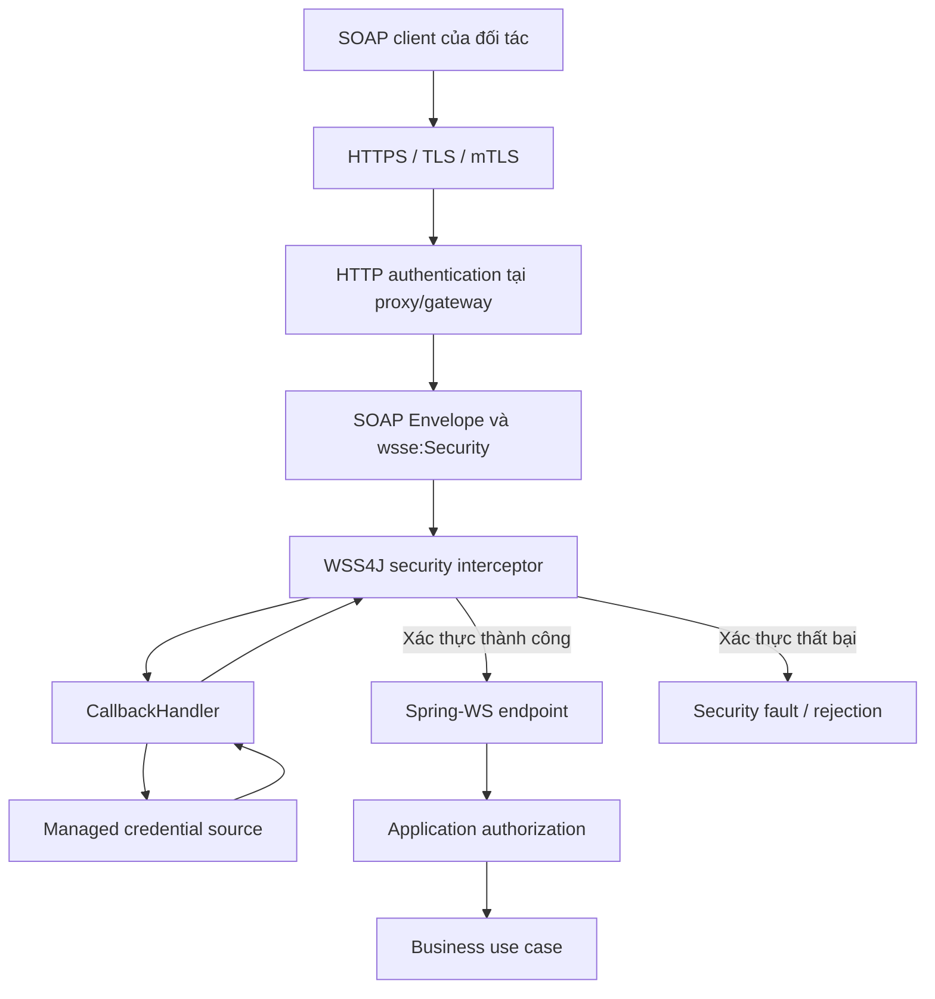
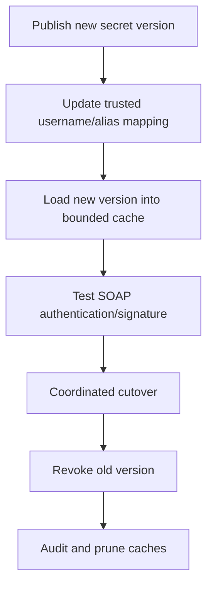

# CallbackHandler và lấy thông tin xác thực từ nguồn được quản lý

## 1. Vì sao WS-Security cần CallbackHandler?

Trong các hệ thống SOAP doanh nghiệp, **WS-Security** bảo vệ thông điệp ở tầng SOAP: thông qua UsernameToken, chữ ký XML, mã hóa XML, Timestamp và các cơ chế xác thực khác theo thỏa thuận. Một ứng dụng Spring Web Services (Spring-WS) có thể dùng `Wss4jSecurityInterceptor` dựa trên **Apache WSS4J** để kiểm tra thông điệp đến hoặc bảo vệ thông điệp đi.

Câu hỏi quan trọng là: **WSS4J lấy mật khẩu, shared secret hoặc mật khẩu mở private key từ đâu?** Không thể hardcode mật khẩu của đối tác vào controller hoặc tự lấy một chuỗi từ SOAP Header rồi coi nó đã được xác thực. Thay vào đó, WSS4J sử dụng cơ chế **JAAS `CallbackHandler`**: engine thông báo nó cần một loại thông tin nào đó, kèm định danh và mục đích, rồi ứng dụng trả về thông tin được phép sử dụng.

Ví dụ hệ thống tra cứu vận đơn nhận yêu cầu từ đối tác với UsernameToken:

- Đối tác gửi `wsse:Username` là `partner-a` và một token được bảo vệ theo policy.
- WSS4J phân tích UsernameToken và yêu cầu callback cung cấp **shared secret đã đăng ký cho `partner-a`**.
- Callback chỉ truy vấn nguồn được quản lý, ví dụ secret manager, và đưa secret vào đối tượng callback.
- **WSS4J** thực hiện việc kiểm chứng PasswordText/PasswordDigest theo định dạng token và policy.
- Sau khi xác thực thành công, tầng application vẫn phải kiểm quyền trên `accountId` hoặc `shipmentId` đang được yêu cầu.

Đây là nội dung của bài **“CallbackHandler và lấy thông tin xác thực từ nguồn được quản lý”**, thuộc chương **WS-Security** của module **SPRING_WEB_SERVICES**. Phạm vi module gồm phát triển SOAP **contract-first**, thiết kế XSD/WSDL, JAXB/OXM, endpoint và client, SOAP Fault, interceptor, XML security, WS-Security, chứng chỉ và kiểm thử tương thích để tích hợp doanh nghiệp ổn định.

### Mục tiêu học tập

Sau bài học, bạn có thể:

1. Giải thích vai trò của `javax.security.auth.callback.CallbackHandler` trong WSS4J.
2. Phân biệt **callback cung cấp secret** với **WSS4J xác thực token** và **application phân quyền**.
3. Nhận biết `WSPasswordCallback` theo `getIdentifier()` và `getUsage()`.
4. Lấy thông tin xác thực từ secret manager, vault hoặc provider nội bộ đã được kiểm soát.
5. Cấu hình `Wss4jSecurityInterceptor.setValidationCallbackHandler(...)` trong Spring-WS.
6. Hiểu tại sao PasswordDigest không thể tự xác minh bằng một bcrypt hash độc lập.
7. Phân biệt shared secret UsernameToken, mật khẩu private key, khóa đối xứng và certificate trust.
8. Thiết kế rotation, cache, scope theo đối tác/tenant và thất bại an toàn.
9. Kiểm thử callback, SOAP security interceptor, timestamp, nonce, replay và quyền truy cập.
10. Không lộ secret vào log, SOAP Fault, metrics, config file hoặc source repository.

## 2. Các ranh giới xác thực trong tích hợp SOAP

Một SOAP request có thể đi qua nhiều lớp:



| Lớp | Kiểm tra điều gì? | Thông tin sử dụng |
| --- | --- | --- |
| TLS | Bên gửi có kết nối an toàn với đúng server không? | Server certificate, truststore |
| mTLS | Client có chứng chỉ được chấp thuận không? | Client cert, private key, CA |
| HTTP authentication | Gateway/origin có chấp nhận HTTP caller? | `Authorization`, credential provider |
| **WS-Security** | SOAP token, chữ ký, timestamp và mã hóa có thỏa policy? | UsernameToken secret, signing key, trust configuration |
| **Authorization** | Caller đã xác thực có quyền với tài nguyên đang yêu cầu? | Principal đáng tin và domain policy |
| Business validation | Lệnh có hợp lệ theo dữ liệu/trạng thái? | XSD, command, domain invariants |

**CallbackHandler trong bài này thuộc ranh giới WSS4J**. Nó không cấu hình HTTP Basic/proxy, không thay TLS truststore, không thay JAXB validation và không tự quyết định caller được xem vận đơn nào.

## 3. Ý nghĩa của một UsernameToken

Một SOAP 1.1 Header minh họa UsernameToken **PasswordText chỉ dùng trong môi trường thử nghiệm**:

```xml
<soapenv:Envelope
  xmlns:soapenv="http://schemas.xmlsoap.org/soap/envelope/"
  xmlns:wsse="http://docs.oasis-open.org/wss/2004/01/oasis-200401-wss-wssecurity-secext-1.0.xsd"
  xmlns:wsu="http://docs.oasis-open.org/wss/2004/01/oasis-200401-wss-wssecurity-utility-1.0.xsd"
  xmlns:sh="urn:example:shipment:v1">
  <soapenv:Header>
    <wsse:Security soapenv:mustUnderstand="1">
      <wsu:Timestamp wsu:Id="TS-1">
        <wsu:Created>2026-11-27T02:00:00Z</wsu:Created>
        <wsu:Expires>2026-11-27T02:05:00Z</wsu:Expires>
      </wsu:Timestamp>
      <wsse:UsernameToken wsu:Id="UT-1">
        <wsse:Username>partner-a</wsse:Username>
        <wsse:Password
          Type="http://docs.oasis-open.org/wss/2004/01/oasis-200401-wss-username-token-profile-1.0#PasswordText">DEMO-ONLY-SECRET</wsse:Password>
      </wsse:UsernameToken>
    </wsse:Security>
  </soapenv:Header>
  <soapenv:Body>
    <sh:GetShipmentStatusRequest>
      <sh:shipmentId>SHP-1042</sh:shipmentId>
    </sh:GetShipmentStatusRequest>
  </soapenv:Body>
</soapenv:Envelope>
```

**Không gửi ví dụ này tới production.** Mật khẩu mẫu là dữ liệu thử nghiệm; Timestamp chỉ minh họa cấu trúc và sẽ hết hạn. Một message thực phải đáp ứng chính xác policy thời gian, nonce/replay, SOAP version và cơ chế bảo vệ đã thỏa thuận với đối tác.

### 3.1. Những gì callback không được tin

- `wsse:Username` là **định danh do sender khai**, chưa phải principal đã xác thực.
- `wsse:Password` là **proof/candidate** từ thông điệp, không phải nguồn sự thật cho secret đã đăng ký.
- `accountId` trong Body không thay thế authentication.
- Một custom `TenantCode` Header không tự xác minh tenant.
- Sự có mặt của `wsse:Security` không đồng nghĩa chữ ký hoặc UsernameToken đã được kiểm chứng.

WSS4J phải xác minh toàn bộ điều kiện policy **trước khi** tầng nghiệp vụ tin danh tính.

## 4. CallbackHandler là hợp đồng nào trong Java?

`CallbackHandler` thuộc Java authentication APIs:

```java
import javax.security.auth.callback.Callback;
import javax.security.auth.callback.CallbackHandler;
import javax.security.auth.callback.UnsupportedCallbackException;
import java.io.IOException;

public interface CallbackHandler {
    void handle(Callback[] callbacks)
        throws IOException, UnsupportedCallbackException;
}
```

Đây là chữ ký mô tả API, **không phải interface cần khai báo lại** trong dự án.

Trong Spring Framework 6/Spring-WS 4.x dùng Jakarta EE cho JAXB/SAAJ, **JAAS CallbackHandler vẫn thuộc `javax.security.auth.callback`**, không đổi thành `jakarta.security.auth.callback`.

WSS4J truyền một mảng callbacks; handler có thể phải xử lý nhiều callbacks trong **một lần gọi**, không nên chỉ đọc phần tử đầu tiên rồi bỏ qua những phần còn lại.

### 4.1. Callback theo mục đích, không phải theo hình dạng chuỗi

WSS4J dùng `org.apache.wss4j.common.ext.WSPasswordCallback` để yêu cầu material. Những trường thường dùng:

```java
String id = passwordCallback.getIdentifier();
int usage = passwordCallback.getUsage();
passwordCallback.setPassword(secret);
```

- `identifier` có thể là username hoặc key alias tùy loại yêu cầu.
- `usage` cho biết **loại material engine cần**.
- `setPassword(String)` là API cung cấp mật khẩu/shared secret cho WSS4J.
- Một số usages cần `setKey(byte[])` hoặc `setCustomToken(Element)` thay vì `setPassword`.

Đừng hiểu `getIdentifier()` luôn là tài khoản SOAP của con người; khi ký/giải mã, nó thường là **alias của khóa**.

## 5. Các WSPasswordCallback usages quan trọng

| Usage | Phía thường dùng | WSS4J cần gì? | Dữ liệu ứng dụng phải quản lý |
| --- | --- | --- | --- |
| `USERNAME_TOKEN` | Inbound và một số outbound flows | Secret cho UsernameToken creation/validation | Shared secret hoặc password-equivalent theo profile |
| `SIGNATURE` | Outbound signing | Mật khẩu để mở private key theo alias | Key-entry password, không phải toàn bộ private key |
| `DECRYPT` | Inbound decryption | Mật khẩu mở private key giải mã | Decryption key-entry password |
| `SECRET_KEY` | Tùy security action | Bytes của khóa bí mật | Symmetric key material được cấp đúng mục đích |
| `SECURITY_CONTEXT_TOKEN` | Secure conversation | Key associated with token | Security context key |
| `CUSTOM_TOKEN` | Custom token resolution | DOM Element của token | Token được quản lý/cấp phát an toàn |
| `PASSWORD_ENCRYPTOR_PASSWORD` | Crypto property handling | Master password để giải mã protected properties | Master secret theo cơ chế encryptor đã chọn |

Tên/semantics ở đây tương ứng WSS4J 2.x. Kiểm tra API thực tế của phiên bản đang dùng vì không phải mọi flow đều yêu cầu mọi usage.

### 5.1. Quy tắc bắt buộc

**Không trả cùng một mật khẩu cho mọi usage** chỉ vì `WSPasswordCallback` đều có method `setPassword`. UsernameToken shared secret, mật khẩu private key và master secret mở encrypted properties có **mục đích, scope và vòng đời riêng**.

Nếu callback chỉ có trách nhiệm `USERNAME_TOKEN` mà nhận `SIGNATURE` hoặc `DECRYPT`, hành vi an toàn là **từ chối usage không hỗ trợ**. Đó không phải lý do để âm thầm trả một secret khác.

## 6. CallbackHandler không phải AuthenticationManager

Một `CallbackHandler` được WSS4J gọi để **cấp material**. Trong trường hợp UsernameToken PasswordDigest, thông lệ là:

1. WSS4J xác định `Username` và dữ liệu token.
2. Nó gọi callback để lấy secret đã được server quản lý.
3. Handler cung cấp secret tương ứng identifier/usage.
4. WSS4J tính toán và đối chiếu theo UsernameToken profile.
5. WSS4J kiểm thêm timestamp, nonce, replay và các actions theo policy.
6. Nếu thành công, ứng dụng có thể xây dựng/nhận principal đáng tin theo security integration.
7. Application kiểm **authorization** trên tài nguyên.

Một callback tùy biến **không nên tự xử lý so sánh digest từ SOAP bằng một thuật toán tự nghĩ**, hoặc tự tạo SecurityContext authentication chỉ vì nó tìm thấy username. Làm vậy dễ bỏ qua timestamp/replay, key derivation, algorithm policy và WSS4J validation.

### 6.1. Exception thể hiện điều gì?

- `UnsupportedCallbackException`: callback type/usage không được implementation hỗ trợ.
- `IOException`: không thể cung cấp credential cần thiết hoặc secret source có lỗi.
- Một policy từ chối identifier không được phép nên được ánh xạ thành **lỗi xác thực công khai chung**, không tiết lộ tài khoản có tồn tại.
- Lỗi vault/network là lỗi phụ thuộc hạ tầng, nhưng **không được fail open** bằng secret mặc định.

Trong log nội bộ, phân loại các lỗi lookup để vận hành; trong SOAP Fault công khai, giới hạn thông tin theo security policy.

## 7. Nguồn thông tin xác thực nào được xem là được quản lý?

Một **managed credential source** có thể là:

- Secrets manager/Vault có access control, audit, rotation và secret version.
- Một key/secret service nội bộ được bảo vệ theo workload identity.
- External KMS/HSM có API thực hiện ký/giải mã mà không xuất private key (không nhất thiết map thành `String password`).
- Một application config provider lấy giá trị từ secret injection của deployment, được bảo vệ quyền truy cập.
- User directory/identity service khi dùng handler hỗ trợ Spring Security và cơ chế validation tương thích.
- Keystore/PKCS#12 có password do secret manager cung cấp, certificate trust theo policy.

Không nên coi những nguồn sau là “được quản lý an toàn” chỉ vì code đọc được:

- String password hardcode trong `@Configuration`.
- Plaintext secret trong Git repository hoặc sample WSDL.
- Password đặt trong SOAP Body hoặc custom Header tùy ý.
- File cấu hình có secret thật được commit hoặc copy vào logs.
- Password lấy trực tiếp từ request parameter chưa xác thực.
- Một global map static chứa mật khẩu và không có rotation/audit.

### 7.1. Tách các danh tính

| Danh tính/material | Ví dụ | Dùng ở đâu |
| --- | --- | --- |
| Workload identity của ứng dụng | Service account của Kubernetes/host | Gọi secret manager |
| UsernameToken identity | `partner-a` | Chọn shared secret theo profile |
| HTTP Basic identity | `http-service-a` | HTTP `Authorization` |
| mTLS client identity | Certificate subject/SAN | TLS handshake |
| Keystore alias | `shipment-signer-v2` | Mở key để ký/decrypt |
| Domain principal | `partner-a` đã được xác thực | Authorization theo account/shipment |

Một partner có thể dùng nhiều identity khác nhau qua các tầng; không lấy UsernameToken username để đoán keystore alias hoặc credential secret-manager path nếu contract không quy định.

## 8. Một interface làm ranh giới cho managed secret

Để không phụ thuộc Vault SDK/KMS cụ thể, dùng một abstraction tối thiểu:

```java
import java.io.IOException;

public interface WssCredentialSource {

    /**
     * Trả về bản sao có thể xóa của shared secret.
     * null nếu username không được phép/không tồn tại.
     * Caller sở hữu char[] và phải xóa sau sử dụng.
     */
    char[] loadUsernameTokenSecret(String username)
            throws IOException;
}
```

Đây là **abstraction của application**, không phải class Spring-WS built-in. Ưu điểm:

1. Callback không biết token/API của Vault.
2. Test có thể cung cấp fake source.
3. Secret access có thể được giới hạn ở một module được review.
4. Có thể thay backend khi migrate cloud/provider.
5. Có nơi thống nhất timeout/cache/rotation và audit.

### 8.1. Vì sao trả char[]?

`char[]` có thể bị ghi đè sau khi dùng; `String` là immutable nên không có API xóa nội dung khỏi heap.

Tuy nhiên, `WSPasswordCallback.setPassword(...)` nhận **`String`**, vì vậy callback cuối cùng vẫn tạo hoặc truyền một String chứa secret. **Không hứa rằng xóa `char[]` đã xóa toàn bộ bản sao trong heap.** Mục tiêu là giảm bản sao và phạm vi tồn tại; thời điểm String bị GC không được ứng dụng kiểm soát hoàn toàn.

Với private keys và HSM, phương án tốt hơn là tránh xuất key material nếu library/provider có thể dùng key handle hoặc provider-backed crypto API được hỗ trợ.

## 9. Không ghép đường dẫn Vault trực tiếp từ SOAP Username

Một lỗi thiết kế:

```java
// Anti-pattern: username đến từ SOAP, chưa được xác thực.
String ref = "secrets/partners/" + username;
char[] secret = vault.readSecret(ref);
```

Ngay cả khi path traversal đã bị ngăn, thiết kế này vẫn cho mọi caller tự lựa chọn **secret refs** để gây truy vấn/quét danh tính ngoài policy. Hãy dùng **allowlist ánh xạ cố định** từ public username sang secret reference do ứng dụng quản lý.

### 9.1. Secret provider và allowlisted mapping

```java
import java.io.IOException;
import java.util.Map;

public interface ManagedSecretProvider {
    /**
     * Mỗi lần gọi trả về char[] mới mà caller được quyền xóa.
     * secretRef phải đến từ cấu hình tin cậy.
     */
    char[] readCharacters(String secretRef) throws IOException;
}

public final class AllowlistedWssCredentialSource
        implements WssCredentialSource {

    private final Map<String, String> refs;
    private final ManagedSecretProvider provider;

    public AllowlistedWssCredentialSource(
            Map<String, String> allowedUsernameToSecretRef,
            ManagedSecretProvider provider) {

        this.refs = Map.copyOf(allowedUsernameToSecretRef);
        this.provider = provider;
    }

    @Override
    public char[] loadUsernameTokenSecret(String username)
            throws IOException {

        if (username == null || username.length() > 128) {
            return null;
        }

        String secretRef = refs.get(username);
        if (secretRef == null) {
            return null;
        }

        return provider.readCharacters(secretRef);
    }
}
```

Các `secretRef` là **định danh nội bộ do operator cấu hình**, không phải mật khẩu. `Map.copyOf` tạo bản sao read-only của mapping, tránh mutation trong lúc nhiều requests đang được xác thực. `ManagedSecretProvider` chỉ được phép truy cập những secret refs đã được cấp quyền riêng.

Nếu nhiều tenants cùng có username giống nhau, đừng dựa vào username đơn độc: key cần được scope theo một **partner binding đáng tin từ endpoint/mTLS/gateway**. Không thêm giá trị tenant từ SOAP Body vào secret lookup trước khi được xác thực.

### 9.2. Dùng cache có điều kiện

Một secret manager remote có latency, quota và sự cố mạng. Nếu query nó cho từng SOAP message, authentication có thể trở thành nút thắt hoặc gây tự tạo DoS.

Có thể dùng một cache bảo mật:

- Key là **trusted secretRef + version/realm**, không phải raw arbitrary path.
- Có TTL thấp, giới hạn số entries và concurrency.
- Mỗi consumer nhận bản sao buffer; không trả tham chiếu mutable đang được cache.
- Có invalidation khi rotate/revoke; không dùng credential cũ vô hạn.
- Không log value và không serialize cache trong dump.
- Cache miss/secret source unavailable phải fail closed theo policy.

Không giả định bất kỳ cache library nào bảo đảm memory zeroization hoàn hảo trong JVM.

## 10. Tự viết CallbackHandler lấy UsernameToken secret

Ví dụ dưới đây chỉ xử lý đúng usage `USERNAME_TOKEN`. Nó **không tự đọc token từ SOAP**, không tự kiểm PasswordDigest và không chấp nhận các private-key callbacks khác.

```java
import java.io.IOException;
import java.util.Arrays;

import javax.security.auth.callback.Callback;
import javax.security.auth.callback.CallbackHandler;
import javax.security.auth.callback.UnsupportedCallbackException;

import org.apache.wss4j.common.ext.WSPasswordCallback;

public final class ManagedUsernameTokenCallbackHandler
        implements CallbackHandler {

    private final WssCredentialSource credentialSource;

    public ManagedUsernameTokenCallbackHandler(
            WssCredentialSource credentialSource) {
        this.credentialSource = credentialSource;
    }

    @Override
    public void handle(Callback[] callbacks)
            throws IOException, UnsupportedCallbackException {

        for (Callback callback : callbacks) {
            if (!(callback instanceof WSPasswordCallback password)) {
                throw new UnsupportedCallbackException(
                        callback, "Unsupported WS callback type");
            }

            if (password.getUsage()
                    != WSPasswordCallback.USERNAME_TOKEN) {
                throw new UnsupportedCallbackException(
                        callback, "Unsupported WS credential purpose");
            }

            char[] secret;
            try {
                secret = credentialSource.loadUsernameTokenSecret(
                        password.getIdentifier());
            } catch (IOException lookupFailure) {
                // Provider ghi audit/metrics nội bộ đã được làm sạch;
                // không đẩy raw secret-manager error vào SOAP stack.
                throw new IOException(
                        "Authentication material unavailable");
            }

            if (secret == null || secret.length == 0) {
                throw new IOException(
                        "Authentication material unavailable");
            }

            try {
                // WSS4J API cần String; không log hoặc cache String này.
                password.setPassword(new String(secret));
            } finally {
                Arrays.fill(secret, '\0');
            }
        }
    }
}
```

Ví dụ dùng **WSS4J 2.x** với package `org.apache.wss4j.common.ext` và Java 17+ (`instanceof` pattern matching). Để ứng dụng chạy, cần hiện thực `WssCredentialSource`, cấu hình secret provider và Spring-WS interceptor như các mục tiếp theo.

### 10.1. Điều gì tốt trong callback này?

- Xử lý **từng phần tử** trong `Callback[]`.
- Từ chối callback type/usage ngoài phạm vi.
- Chỉ lấy secret qua một interface được quản lý.
- Không lưu secret vào field static hoặc log.
- Xóa buffer `char[]` mà callback nhận.
- Không cho một username lạ đọc arbitrary secret path.
- Lỗi unknown user và missing secret không đưa ra danh tính chi tiết.

### 10.2. Những giới hạn cần biết

- `setPassword(String)` tạo/cung cấp String secret, không thể bảo đảm xóa khỏi heap ngay.
- Secret lookup exception có thể làm call chậm; phải đặt timeout, pool và retry hợp lý ở provider.
- Adapter kết nối secret manager phải tự ghi nhận lỗi nội bộ bằng audit an toàn; callback chỉ trả thông báo chung, không truyền raw provider error chứa secret reference/endpoint cho SOAP fault mapper.
- Nếu một secret manager trả null hoặc gây IOException, kết quả phải **từ chối**, không chuyển sang giá trị demo.
- Một handler này **không mở private key** cho SIGNATURE/DECRYPT. Nếu operation cần các usages ấy, thiết kế handler riêng theo key purpose.
- Không coi việc gọi `setPassword` là đã xác thực; WSS4J vẫn phải verify token.
- Một handler singleton có thể dùng chung nếu các dependencies an toàn cho concurrent access; không lưu username/password request hiện tại vào mutable fields.

## 11. Nối CallbackHandler vào Spring-WS interceptor

Trong Spring-WS 4.x, `Wss4jSecurityInterceptor` có thể nhận một `CallbackHandler` qua `setValidationCallbackHandler(...)`.

```java
import java.util.List;
import javax.security.auth.callback.CallbackHandler;

import org.springframework.context.annotation.Bean;
import org.springframework.context.annotation.Configuration;
import org.springframework.ws.config.annotation.EnableWs;
import org.springframework.ws.config.annotation.WsConfigurer;
import org.springframework.ws.server.EndpointInterceptor;
import org.springframework.ws.soap.security.wss4j2.Wss4jSecurityInterceptor;

@Configuration
@EnableWs
public class ShipmentWsSecurityConfig implements WsConfigurer {

    private final CallbackHandler usernameTokenHandler;

    public ShipmentWsSecurityConfig(
            CallbackHandler usernameTokenHandler) {
        this.usernameTokenHandler = usernameTokenHandler;
    }

    @Bean
    public Wss4jSecurityInterceptor shipmentWsSecurity() {
        Wss4jSecurityInterceptor interceptor =
                new Wss4jSecurityInterceptor();

        interceptor.setValidationActions(
                "UsernameToken Timestamp");

        interceptor.setValidationCallbackHandler(
                usernameTokenHandler);

        interceptor.setValidationTimeToLive(300);
        interceptor.setTimestampStrict(true);

        return interceptor;
    }

    @Override
    public void addInterceptors(
            List<EndpointInterceptor> interceptors) {
        interceptors.add(shipmentWsSecurity());
    }
}
```

**Cần đăng ký callback handler bean** cùng dependency `WssCredentialSource` trong application context; `CallbackHandler` là JAAS interface, không tự được Spring tạo chỉ nhờ annotation ở class.

### 11.1. Tại sao có cả UsernameToken và Timestamp?

`validationActions = "UsernameToken Timestamp"` yêu cầu cả hai lớp kiểm tra theo policy. Ví dụ SOAP ở mục 3 có `wsu:Timestamp` riêng và `wsse:UsernameToken`.

Một `wsu:Created` nằm **bên trong UsernameToken** không mặc nhiên thỏa action `Timestamp` riêng biệt; đừng cấu hình hai actions nhưng chỉ gửi UsernameToken rồi đoán server sẽ chấp nhận. Cần test SOAP message thật.

### 11.2. Interceptor bean không đủ nếu không được gắn vào chain

`@Bean Wss4jSecurityInterceptor` chỉ tạo đối tượng. `WsConfigurer.addInterceptors(...)` mới đăng ký nó vào Spring-WS endpoint interceptor chain theo cấu hình thường dùng. Nếu ứng dụng có nhiều Spring-WS contexts, cần xác minh interceptor được dùng bởi đúng `MessageDispatcher` phục vụ endpoint nhạy cảm.

Chạy integration test với một UsernameToken sai và assert **application use case không được gọi**. Nếu vẫn gọi được endpoint, cấu hình đã thất bại dù mọi bean đều tồn tại.

### 11.3. Version và SOAP factory

Package của Spring-WS hiện đại là `org.springframework.ws.soap.security.wss4j2.Wss4jSecurityInterceptor`; tài liệu Spring-WS rất cũ có package `wss4j`. Với Spring-WS 4.x, interceptor dựa trên WSS4J 2.x và được dùng cùng `SaajSoapMessageFactory` theo tài liệu. Hãy kiểm dependencies/version Spring Framework/Jakarta XML/SAAJ tương thích, không copy nguyên cấu hình Spring-WS 2.x mà bỏ qua sự khác biệt.

## 12. Tạo beans từ secret manager được quản lý

Một cách wiring minh họa:

```java
import java.util.Map;
import javax.security.auth.callback.CallbackHandler;

import org.springframework.context.annotation.Bean;
import org.springframework.context.annotation.Configuration;

@Configuration
public class ManagedCredentialConfiguration {

    @Bean
    public WssCredentialSource wssCredentialSource(
            ManagedSecretProvider provider) {

        return new AllowlistedWssCredentialSource(
            Map.of(
                "partner-a", "prod/soap/inbound/partner-a/v1",
                "partner-b", "prod/soap/inbound/partner-b/v2"
            ),
            provider
        );
    }

    @Bean
    public CallbackHandler usernameTokenHandler(
            WssCredentialSource source) {

        return new ManagedUsernameTokenCallbackHandler(source);
    }
}
```

Trong ví dụ, các chuỗi `prod/soap/...` là **references**, không phải secret values. Đối với production, đọc mapping từ cấu hình có quản trị quyền, không hardcode environment-specific refs trong một reusable library; giữ separation theo môi trường và deployment.

`ManagedSecretProvider` là **port** của ứng dụng; adapter thật có thể dùng Vault, AWS/GCP/Azure secret store hoặc một internal credential service, tùy môi trường. Việc chọn provider không ảnh hưởng contract SOAP, miễn semantics lookup, rotation và security policy được bảo đảm.

### 12.1. Quyền tối thiểu của service identity

Workload identity mà ứng dụng dùng để gọi vault chỉ cần:

- Đọc đúng prefix/refs đã được cấp quyền.
- Không có quyền liệt kê tất cả tenants nếu không cần.
- Không có quyền tạo/sửa/xóa secret khi chỉ thực hiện xác thực.
- Có audit logs theo secret ref/request category, không chứa giá trị.
- Có network egress/endpoint allowlist tới secret service.
- Không dùng chung vault token với nhiều ứng dụng có nhu cầu khác nhau.

Nếu service bị chiếm quyền, quyền truy cập hẹp giúp giảm tác động tới những bí mật khác.

## 13. PasswordText và PasswordDigest khác nhau thế nào?

WS-Security UsernameToken Profile định nghĩa hai cách biểu diễn thường gặp:

- **PasswordText**: password hoặc password-equivalent xuất hiện trong token dưới dạng có thể đọc nếu xem SOAP message chưa mã hóa.
- **PasswordDigest**: mã digest được tính từ nonce, thời điểm và shared secret theo profile, không gửi shared secret thẳng dưới dạng PasswordText.

Một biểu diễn logic:

\[
\text{PasswordDigest} =
\operatorname{Base64}\left(
\operatorname{SHA1}(
\text{nonceBytes}\,\Vert\,\text{createdUtf8}\,\Vert\,\text{secretUtf8})
\right)
\]

Trong đó `nonceBytes` là **bytes sau decode** của `wsse:Nonce`, không phải chuỗi ký tự Base64; `createdUtf8` là UTF-8 bytes của thời điểm xuất hiện trong `wsu:Created`; `secretUtf8` là bytes theo profile.

**Đây là cơ chế legacy để tương thích chuẩn UsernameToken, không phải một hàm hash password hiện đại để lưu database.** Tránh tự viết thuật toán bên ngoài WSS4J nếu engine đã cung cấp triển khai được test theo profile.

### 13.1. PasswordDigest không thay HTTPS hoặc XML Signature

- Digest **không** mã hóa SOAP Body.
- Digest không ký mọi trường nghiệp vụ trong SOAP Body.
- Digest một mình không bảo vệ trước mọi replay nếu receiver không kiểm thời gian/nonce/cache.
- SHA-1 là một thành phần lịch sử của UsernameToken profile; không xem việc dùng SHA-1 là lời khuyên thiết kế chữ ký mới.
- Với dữ liệu nhạy cảm, yêu cầu TLS/WS-Security encryption/signature theo threat model và policy đối tác.

### 13.2. Tại sao callback cần secret gốc hoặc password-equivalent?

Để kiểm digest, WSS4J phải có material tương ứng với shared secret mà sender dùng. Một **bcrypt/Argon2 hash** đã lưu trong database **không thể tự động dùng làm shared secret gốc** trong công thức UsernameToken PasswordDigest tiêu chuẩn.

Không làm:

```java
// Sai: nhét bcrypt hash làm password vào WSPasswordCallback
// rồi mong WSS4J kiểm đúng digest được tạo từ secret gốc.
passwordCallback.setPassword("$2a$..."); 
```

Nếu hai phía cố ý thống nhất một password-equivalent làm shared secret, đó là **một secret mới cần được quản lý và bảo vệ tương đương mật khẩu**. Không lấy kết quả password hash trong database làm secret công khai để “lách” hạn chế.

### 13.3. Khi nào dùng hệ thống password hash một chiều?

Với authentication application chỉ nhận PasswordText qua kênh bảo mật và dùng identity store có bcrypt/Argon2, có thể tích hợp **Spring Security authentication flow** để so password theo PasswordEncoder phù hợp. Nhưng phải dùng handler/validator đã được thiết kế cho cơ chế đó và thử interoperability; không đồng nhất với raw `WSPasswordCallback.USERNAME_TOKEN` source vốn cung cấp shared secret cho WSS4J.

## 14. SpringSecurityPasswordValidationCallbackHandler là lựa chọn nào?

Spring-WS có handler tích hợp `SpringSecurityPasswordValidationCallbackHandler` (trong package `org.springframework.ws.soap.security.wss4j2.callback`). Theo tài liệu, handler này dùng `UserDetailsService` để tìm user details và kiểm UsernameToken theo cơ chế Spring Security/WSS4J.

Điểm mạnh:

- Tích hợp account status checks, ví dụ disabled/locked/expired nếu được cấu hình.
- Có thể đưa authentication vào `SecurityContextHolder` theo Spring Security integration.
- Tận dụng identity store hiện có thay vì một map password thủ công.
- Cung cấp logic authentication riêng cho UsernameToken qua handler có sẵn.

Điểm cần lưu ý:

1. **Không mặc nhiên hỗ trợ mọi kiểu hashed password cho mọi UsernameToken digest**. Kiểm theo phiên bản Spring-WS/Spring Security và dạng credential thực tế.
2. `UserDetailsService` chỉ là nơi lấy user details; authorization vẫn phải cấu hình riêng.
3. Security context có phạm vi thread/request; nếu đẩy việc sang async executor, cần chính sách propagation/cleanup rõ.
4. Một SOAP service có thể dùng cả mTLS, UsernameToken và signature; Spring Security principal chỉ có ý nghĩa nếu các identities được ánh xạ nhất quán.
5. Account cache phải có expiration/revocation policy.

Chọn handler built-in nếu workflow của bạn thật sự là **xác thực user account**. Chọn custom managed `CallbackHandler` khi cần **shared secret/keystore material** riêng cho đối tác và việc truy xuất từ vault.

## 15. Chữ ký XML: CallbackHandler dùng cho SIGNATURE

Với WS-Security **Signature**, WSS4J thường cần:

- `Crypto` để tìm certificate/private key theo **alias**.
- Mật khẩu của private-key entry nếu keystore bảo vệ bằng password.
- Security policy chọn thuật toán ký, canonicalization, parts phải được ký và key identifier.
- Ở phía nhận, trust configuration để kiểm chứng certificate của signer.

Khi WSS4J gọi callback với `WSPasswordCallback.SIGNATURE`, `getIdentifier()` thường là **key alias**, không phải username trong SOAP Body. Handler có thể cung cấp **key-entry password** qua `setPassword(String)`.

### 15.1. Ví dụ handler chỉ xử lý SIGNATURE

```java
import java.io.IOException;
import java.util.Arrays;
import javax.security.auth.callback.Callback;
import javax.security.auth.callback.CallbackHandler;
import javax.security.auth.callback.UnsupportedCallbackException;
import org.apache.wss4j.common.ext.WSPasswordCallback;

public final class SigningKeyPasswordCallbackHandler
        implements CallbackHandler {

    private final KeyPasswordSource keys;

    public SigningKeyPasswordCallbackHandler(
            KeyPasswordSource keys) {
        this.keys = keys;
    }

    @Override
    public void handle(Callback[] callbacks)
            throws IOException, UnsupportedCallbackException {

        for (Callback callback : callbacks) {
            if (!(callback instanceof WSPasswordCallback password)
                    || password.getUsage()
                        != WSPasswordCallback.SIGNATURE) {
                throw new UnsupportedCallbackException(callback);
            }

            char[] entryPassword = keys
                    .readSigningKeyPassword(
                            password.getIdentifier());

            if (entryPassword == null) {
                throw new IOException(
                    "Signing key material unavailable");
            }

            try {
                password.setPassword(new String(entryPassword));
            } finally {
                Arrays.fill(entryPassword, '\0');
            }
        }
    }
}
```

`KeyPasswordSource` là port do ứng dụng định nghĩa; nó phải chỉ chấp nhận **trusted alias allowlist**. Đây là ví dụ callback cấp mật khẩu; việc ký thật còn cần `Crypto`, keystore/PKCS#11 provider và WSS4J action config.

### 15.2. Cẩn thận: một key không đồng nghĩa một password

- **Keystore password** có thể dùng để mở keystore file.
- **Key-entry password** có thể dùng để mở một private key trong keystore.
- **Private key material** là bí mật cần bảo vệ bằng KeyStore/HSM; không phải thứ nên serialize vào SOAP hay đưa vào String.
- **Certificate** chỉ chứa public key/metadata và không thay thế trust policy.
- **Truststore** là nguồn certificate/CA tin cậy ở phía kiểm chứng, khác keystore chứa private key.

Callback `SIGNATURE` không thay việc cấu hình `securementSignatureCrypto` và `securementSignatureUser` theo API WSS4J/Spring-WS đang dùng.

## 16. Giải mã XML: CallbackHandler dùng cho DECRYPT

Khi inbound SOAP message được mã hóa bằng khóa công khai của receiver, receiver cần private key để giải mã một session key. WSS4J có thể gọi callback `DECRYPT` để lấy mật khẩu mở private-key entry.

```java
switch (password.getUsage()) {
    case WSPasswordCallback.DECRYPT -> {
        char[] secret = decryptionKeys.readEntryPassword(
                password.getIdentifier());
        // Kiểm null, setPassword, xóa char[] trong finally.
    }
    default -> throw new UnsupportedCallbackException(password);
}
```

Đây là **trích đoạn định hướng**, không phải một class chạy độc lập. `decryptionKeys` là provider ứng dụng do bạn định nghĩa, và đoạn này cố ý không thực hiện toàn bộ secret lifecycle. Hãy dựa vào mẫu đầy đủ mục 15 khi triển khai.

### 16.1. Một bảng phân công an toàn

| Nhu cầu | Callback purpose | Resource |
| --- | --- | --- |
| Kiểm UsernameToken | `USERNAME_TOKEN` | Shared secret theo partner username |
| Ký SOAP Body | `SIGNATURE` | Password mở signing private key |
| Giải mã SOAP Body | `DECRYPT` | Password mở decryption private key |
| Ký với key trong HSM | Tùy provider integration | Key handle/PKCS#11, không nhất thiết có raw password callback |
| Kiểm signature của đối tác | Không chỉ nhờ callback | Trusted certificate store/Crypto và signature policy |

**Không tái sử dụng signing key password làm UsernameToken shared secret.** Hai secrets này có trách nhiệm và exposure khác nhau.

## 17. CryptoFactoryBean và KeyStoreCallbackHandler có vai trò gì?

Spring-WS có các convenience components:

- `CryptoFactoryBean` tạo WSS4J `Crypto` với keystore/truststore properties.
- `KeyStoreCallbackHandler` hỗ trợ cấp key password/symmetric key material từ keystore theo cấu hình.
- `Wss4jSecurityInterceptor` có setters cho `securementSignatureCrypto`, `validationSignatureCrypto`, `validationDecryptionCrypto` và các tùy chọn tương ứng.
- `setValidationCallbackHandler(...)` cấp callback handler cho validation/decryption flows khi có yêu cầu material.

### 17.1. Đừng nhét secret vào XML bean config trong production

Một số ví dụ chính thức dùng `keyStorePassword="..."` hoặc `privateKeyPassword="..."` trực tiếp để minh họa. Đó là **giá trị test/example**, không phải quy tắc để triển khai production.

Production nên dùng:

1. Secret manager cấp key-entry/keystore password theo workload identity.
2. Keystore/truststore artifacts ở vị trí được bảo vệ.
3. Certificate/key alias được allowlist.
4. Rotation có kiểm soát và kiểm tra trust chain.
5. HSM/KMS khi policy đòi hỏi private key không được xuất.

**Lấy được password từ callback không đồng nghĩa application đã xác minh signer certificate.** Incoming XML Signature cần trusted `Crypto`, algorithm policy, reference coverage và kiểm revocation nếu threat model yêu cầu.

## 18. Outbound UsernameToken: đừng giả định mọi setter đều có CallbackHandler

Một client Spring-WS có thể bảo vệ request đi bằng:

```java
import org.springframework.ws.soap.security.wss4j2.Wss4jSecurityInterceptor;
import org.apache.wss4j.common.WSS4JConstants;

public final class OutboundUsernameTokenFactory {

    public static Wss4jSecurityInterceptor create(
            String username, String secret) {

        Wss4jSecurityInterceptor interceptor =
                new Wss4jSecurityInterceptor();

        interceptor.setSecurementActions("UsernameToken");
        interceptor.setSecurementUsername(username);
        interceptor.setSecurementPassword(secret);
        interceptor.setSecurementPasswordType(
                WSS4JConstants.PW_DIGEST);

        return interceptor;
    }
}
```

Code trên chỉ minh họa **API tạo UsernameToken**, không phải cách triển khai quản lý secret hoàn chỉnh: `secret` không được hardcode hoặc log. Handler securement cho SAML là API khác; **không bịa ra method `setSecurementCallbackHandler(...)`** trên `Wss4jSecurityInterceptor` nếu phiên bản thực tế không có method đó.

### 18.1. Vấn đề của secret đặt trong interceptor dùng chung

`setSecurementPassword(String)` giữ secret String trong configuration của interceptor. Nếu ứng dụng rotate, đừng thay password trên **cùng singleton interceptor đang xử lý song song** khi chưa có cơ chế đồng bộ và cutover; request có thể dùng sai credential.

Một số hướng hợp lệ tùy framework:

- Tạo một **client/security profile mới** từ secret version mới, kiểm thử, rồi hoán đổi atomically và retire profile cũ.
- Tách `WebServiceTemplate`/security interceptor theo partner credential profile.
- Sử dụng lower-level WSS4J callback/configuration hoặc message-context mechanism có API và thread-safety đã xác minh, nếu cần per-request credentials.
- Khi dùng dynamic token supplier, kiểm TTL/rotation, không truyền một global secret String qua tất cả tenants.

Mỗi hướng cần test khi credentials được thay đổi **giữa các SOAP requests đồng thời**.

### 18.2. Thêm interceptor vào WebServiceTemplate

`WebServiceTemplate` hỗ trợ client interceptors. Khi có nhiều interceptors (tracing, security, custom SOAP headers), thứ tự có thể ảnh hưởng nội dung được ký và log:

```java
template.setInterceptors(
    new org.springframework.ws.client.support.interceptor.ClientInterceptor[] {
        outboundSecurityInterceptor
    }
);
```

`outboundSecurityInterceptor` phải được cấu hình đầy đủ trước đó; ví dụ này không tạo TLS/HTTP auth. Không sửa SOAP Body đã được ký bằng custom interceptor sau bước signature nếu làm thay đổi canonicalized content.

## 19. PasswordDigest, nonce, created và replay protection

Một UsernameToken có `PasswordDigest` thường gắn với:

- `wsse:Nonce`: giá trị ngẫu nhiên do sender tạo.
- `wsu:Created`: thời điểm tạo token.
- `wsse:Password`: digest theo thuật toán profile.

Tính digest đúng **chỉ là một điều kiện**, chưa đủ chống replay nếu receiver chấp nhận cùng nonce/token mãi mãi.

### 19.1. Chính sách tiếp nhận nên yêu cầu

1. Timestamp/token `Created` trong cửa sổ thời gian ngắn hợp lý.
2. Nonce đủ ngẫu nhiên, không bị tái sử dụng trong cửa sổ lưu.
3. Cache replay có TTL và giới hạn số entries.
4. Clock synchronization phù hợp giữa partner systems.
5. Chỉ chấp nhận password type/algorithm đúng profile.
6. Chống duplicate UsernameTokens hoặc timestamp ambiguity.
7. Dừng request trước application use case khi kiểm tra thất bại.

Cấu hình `setValidationTimeToLive(...)` xử lý freshness theo API; **không mặc định nó tự giải quyết mọi replay policy** cho cả token và attachments. Xác minh WSS4J replay cache được cấu hình và hoạt động đúng trong deployment, nhất là khi có nhiều instances.

### 19.2. Multi-instance replay cache

Nếu service có nhiều pods, cache nonce chỉ ở memory mỗi pod có thể không đủ ngăn một token được gửi lại qua pod khác, tùy thiết kế replay protection và load balancer.

Cân nhắc distributed replay cache/consistent routing theo security policy. Tuy nhiên một replay cache từ xa cũng có thể tạo latency/availability dependency; cần TTL, atomic insert-if-absent và giới hạn dung lượng.

## 20. Managed secret rotation không được làm lộ secret cũ

Một hệ thống có thể rotate:

- UsernameToken shared secret của từng đối tác.
- Signing private key hoặc key-entry password.
- Decryption private key.
- Keystore store password.
- Master secret của encrypted Crypto properties.
- Credentials dùng ứng dụng truy cập secret manager.

### 20.1. Quy trình rotation đề xuất



Có thể có thời gian chồng lấn cũ/mới, nhưng với **UsernameToken PasswordDigest**, callback thường trả **một shared secret cho mỗi identifier** ở lần kiểm cụ thể. Không chỉ giữ hai passwords trong một danh sách và mong WSS4J tự thử tất cả.

Các cách có kiểm soát:

- **Username/realm/key ID versioned** nếu contract cho phép, ví dụ `partner-a-v2`.
- Thỏa thuận cutover có đồng bộ giờ và ngừng nhận version cũ.
- Handler/security implementation được thiết kế rõ để chấp nhận nhiều phiên bản theo policy, có test replay/trust, không tự fallback vô hạn.
- Kiểm tra việc cache invalidation thật sự loại secret bị thu hồi.

### 20.2. Secret version không phải SOAP Username

Không tự dùng một field tự khai trong SOAP Body làm chỉ báo version để chọn shared secret nếu chưa có trust binding. Cách đơn giản là version đi cùng định danh đã được provision sẵn hoặc đối tác thống nhất ID tại security layer.

### 20.3. Private key rotation khác password rotation

Đổi **key-entry password** không làm đổi public certificate. Đổi **signing private key/certificate** có thể đòi partner cập nhật trust chain/alias/key identifier. Đừng xem hai quy trình là một; mỗi quy trình có test interoperability khác nhau.

## 21. Cache, concurrency và lỗi nguồn secret

### 21.1. Một callback có thể chạy đồng thời

Spring-WS server xử lý nhiều SOAP messages trên nhiều threads. Một `CallbackHandler` singleton phải:

- Không giữ `currentUsername`/`currentPassword` mutable giữa requests.
- Chỉ dùng biến local để chứa transient credential.
- Truy cập provider/cache thread-safe.
- Không trả trực tiếp char[] đang được nhiều threads dùng chung.
- Giới hạn số lời gọi song song tới vault.
- Có timeout và circuit-breaking phù hợp, tránh quá tải secret backend.

### 21.2. Khi vault lỗi, ứng dụng nên làm gì?

- Nếu policy không cho dùng secret cũ, **fail closed** và trả lỗi bảo mật/kỹ thuật phù hợp.
- Nếu policy cho phép cache trong một khoảng ngắn, sử dụng snapshot **đã xác thực, chưa hết hạn** có giới hạn rõ.
- Không fallback về demo/test secrets.
- Không cho caller tự cung cấp secret thay thế trong SOAP Header.
- Không retry vault vô hạn trong request thread.
- Không log raw response từ secret manager nếu nó chứa value.

Tùy nơi lỗi phát sinh, public SOAP response có thể là security Fault, HTTP/gateway rejection hoặc lỗi service tạm thời; không hứa luôn có một typed SOAP Fault.

### 21.3. Khi username không tồn tại

Không tiết lộ:

> “Username partner-a tồn tại, nhưng mật khẩu sai.”

trong khi với username lạ trả:

> “Username không tồn tại trong Vault.”

Những khác biệt này có thể hỗ trợ liệt kê tài khoản. Nên trả thông điệp authentication failure chung và lưu nguyên nhân phân loại trong hệ thống nội bộ có bảo vệ.

## 22. Identity theo tenant: tìm secret chưa đủ để chứng minh quyền

Giả sử request:

```xml
<sh:GetShipmentStatusRequest
    xmlns:sh="urn:example:shipment:v1">
  <sh:accountId>ACCT-900</sh:accountId>
  <sh:shipmentId>SHP-1042</sh:shipmentId>
</sh:GetShipmentStatusRequest>
```

UsernameToken có thể chứng minh `partner-a`, nhưng không chứng minh `partner-a` được phép truy cập `ACCT-900`.

### 22.1. Hai bước tách rời

**Authentication boundary:**

```text
WSS4J verifies UsernameToken
  -> trusted identity = partner-a
```

**Authorization boundary:**

```text
ShipmentUseCase.getStatus(identity=partner-a,
                          accountId=ACCT-900,
                          shipmentId=SHP-1042)
  -> check tenant ownership and privileges
  -> return data or access denial
```

Không dùng `getIdentifier()` của callback để tạo global static principal trước khi WSS4J kết luận verification thành công.

### 22.2. Kết hợp nhiều identities

Nếu gateway đã xác thực mTLS certificate thuộc partner B nhưng SOAP UsernameToken lại là partner A, hệ thống phải có policy rõ:

- Cho phép tổ hợp ấy khi có delegation được cấu hình.
- Hoặc từ chối vì không có binding/mapping được phê duyệt.
- Không âm thầm chọn một identity “thuận tiện nhất”.

Những mapping tin cậy phải dựa trên deployment/security config, không chỉ Body fields do client tự khai.

## 23. Xử lý exception và SOAP Fault an toàn

Callback có thể ném `IOException`/`UnsupportedCallbackException`; WSS4J/`Wss4jSecurityInterceptor` thường chuyển chúng thành lỗi bảo mật trong quá trình validation. Phản hồi cuối có thể là SOAP 1.1 `Client`, SOAP 1.2 `Sender` hoặc cách từ chối khác theo stack/policy.

Không nên:

- Trả exception message nguyên văn chứa secret ref hoặc vault endpoint.
- Đưa stack trace, raw token, nonce, password hay private key vào `faultstring`.
- Coi mọi vấn đề credentials là `SHIPMENT_NOT_FOUND`.
- Bypass authentication nếu fault mapper không biết exception type.

### 23.1. Taxonomy cần phân biệt trong nội bộ

| Nội bộ | Ý nghĩa | Public behavior |
| --- | --- | --- |
| `UNKNOWN_USERNAME` | Không có identity được provision | Authentication failed chung |
| `WRONG_TOKEN_PROOF` | Digest/text không khớp | Authentication failed chung |
| `TOKEN_EXPIRED` | Timestamp ngoài cửa sổ | Security rejection theo policy |
| `REPLAY_REJECTED` | Nonce/token dùng lại | Security rejection theo policy |
| `SECRET_SOURCE_UNAVAILABLE` | Vault/KMS lỗi | Fail closed, có thể service unavailable an toàn |
| `KEY_ALIAS_NOT_ALLOWED` | Alias ngoài allowlist | Security rejection |
| `CERTIFICATE_UNTRUSTED` | Signature cert không được tin | Security rejection |
| `RESOURCE_ACCESS_DENIED` | Principal hợp lệ nhưng thiếu quyền | Authorization failure không lộ tenant khác |

Giữ public code/message có chủ đích. Không phải mọi nội bộ code đều được công bố trong XSD/WSDL typed Fault.

### 23.2. Security exception không phải business exception

Khi UsernameToken chưa được xác thực, đừng gọi application service rồi để domain tự quyết định. Nếu security interceptor từ chối trước endpoint, **không có side effects** là invariant quan trọng cần test.

## 24. HTTP Basic, mTLS và WS-Security CallbackHandler khác nhau

Một SOAP service có thể yêu cầu tất cả:

- HTTPS với server certificate validation.
- mTLS certificate của caller.
- HTTP Basic tại API gateway.
- UsernameToken hoặc XML Signature trong SOAP Header.
- Quyền truy cập tài nguyên theo principal.

Mỗi tầng có credential source riêng. `CallbackHandler` của WSS4J **không tự điền HTTP Authorization**, không tự chọn proxy username/password và không tự thiết lập `SSLContext`.

| Trường hợp | Thành phần cấu hình phù hợp |
| --- | --- |
| HTTP Basic đến origin | HTTP client/message sender, scoped credentials |
| HTTP proxy 407 | Proxy auth config, proxy-specific credentials |
| TLS/mTLS | SSL context, trust/key manager |
| UsernameToken inbound | WSS4J + validation CallbackHandler |
| XML Signature outbound | WSS4J Crypto + signing material |
| XML Encryption inbound | WSS4J Crypto + decryption material |
| Domain authorization | Spring Security/application policy |

Dùng cùng một password cho HTTP Basic, proxy, UsernameToken và keystore là một anti-pattern về bí mật và blast radius.

## 25. Secret manager và môi trường triển khai

Một integration có thể chạy tại development, staging và production; mỗi môi trường cần namespaces/refs và quyền riêng:

```yaml
partner:
  shipment-soap:
    endpoint: https://soap.example.invalid/ws
    ws-security:
      username-token:
        allowed-identities:
          partner-a: secretref://prod/soap/partner-a/v2
          partner-b: secretref://prod/soap/partner-b/v1
```

Đây là **lược đồ cấu hình minh họa**, không phải schema Spring Boot mặc định. `secretref://...` chỉ là logical reference, **không chứa secret value** và không là URI mà parser SOAP tự tải. Adapter `ManagedSecretProvider` giải quyết reference này theo policy.

### 25.1. Phân quyền theo môi trường

- Không cho development workload đọc production secrets.
- Không tái sử dụng UsernameToken secret giữa staging và production.
- Khi test interoperability, dùng test certificates/shared secrets riêng.
- Chỉ CI runner được cấp quyền đọc secrets cần cho integration tests, không đưa lên public build logs.
- Khi một environment bị compromise, có thể revoke credential riêng mà không cắt tất cả môi trường.

### 25.2. Tách metadata và material

Những trường có thể nằm trong config:

- Public WS-Security Username/partner ID.
- Key alias được sử dụng.
- Secret reference, credential profile ID.
- Cửa sổ timestamp/replay và allowed algorithms.
- Certificate trust policy metadata.

Những trường **không** nên nằm trong source/config đã commit:

- UsernameToken shared secret thật.
- Private key bytes hoặc keystore password.
- Vault token, API key, refresh token.
- Giá trị đã decode của wsse:Password.
- Raw XML chứa secrets từ request/response.

## 26. Khóa ký và HSM: không phải lúc nào callback trả String

Một số tổ chức yêu cầu **private key không được xuất khỏi HSM/KMS**. Trong trường hợp đó:

- Callback có thể vẫn cần PIN hoặc provider-specific activation material.
- Engine có thể dùng PKCS#11/JCA `PrivateKey` handle hoặc một provider-backed `Signature`.
- Việc ký được thực hiện bằng cryptographic provider, **không** bằng cách kéo raw private key về thành String.
- Hợp đồng WSS4J `Crypto` và JCA provider cần được kiểm thử tương thích.
- Keystore alias/trust chain và algorithm policy vẫn phải cấu hình đúng.

Đừng thiết kế `ManagedSecretProvider.readCharacters(...)` như con đường duy nhất cho mọi key security operation. Một hệ thống hỗ trợ HSM có thể cần abstraction `Signer`/`KeyHandle` riêng.

### 26.1. Key password không bảo vệ certificate trust

Một key-entry password đúng chỉ cho phép mở private key. Nó không xác minh certificate bên kia được tin cậy, chưa kiểm chain, hạn sử dụng, subject constraints hoặc revocation. Những việc ấy thuộc `Crypto` và certificate validation policy ở phía inbound.

## 27. Vì sao WSS4J cần cả CallbackHandler và Crypto?

| Câu hỏi | CallbackHandler | Crypto/Trust policy |
| --- | --- | --- |
| Shared secret của UsernameToken là gì? | Có, nếu profile dùng shared secret | Thường không phải vai trò chính |
| Mật khẩu mở private key là gì? | Có, theo usage | Cung cấp key/certificate entry |
| Private key nằm ở đâu? | Thường không trực tiếp | Keystore/HSM/JCA Crypto |
| Chữ ký được tạo như thế nào? | Không tự ký | WSS4J action + Crypto/provider |
| Certificate của sender có đáng tin? | Không chỉ callback | Trust chain/certificate validation |
| Body có nằm trong phần đã ký? | Không | XML Signature policy và reference coverage |
| Người dùng được phép xem shipment? | Không | Application authorization |

**Dùng CallbackHandler đúng là một mảnh ghép, không phải toàn bộ cấu hình WS-Security.**

## 28. Kiểm thử unit: CallbackHandler phải fail closed

Với fake credential source chỉ sử dụng chuỗi demo trong test, ta có thể kiểm trực tiếp `handle(...)` không cần khởi tạo SOAP runtime.

```java
import static org.junit.jupiter.api.Assertions.*;

import java.io.IOException;
import javax.security.auth.callback.Callback;
import javax.security.auth.callback.UnsupportedCallbackException;

import org.apache.wss4j.common.ext.WSPasswordCallback;
import org.junit.jupiter.api.Test;

class ManagedUsernameTokenCallbackHandlerTest {

    private final WssCredentialSource source =
            username -> "partner-a".equals(username)
                ? "TEST-SECRET-ONLY".toCharArray()
                : null;

    private final ManagedUsernameTokenCallbackHandler handler =
            new ManagedUsernameTokenCallbackHandler(source);

    @Test
    void providesSecretForAllowlistedUsername() throws Exception {
        WSPasswordCallback request =
            new WSPasswordCallback(
                "partner-a", WSPasswordCallback.USERNAME_TOKEN);

        handler.handle(new Callback[] { request });

        assertEquals("TEST-SECRET-ONLY", request.getPassword());
    }

    @Test
    void rejectsUnknownUsername() {
        WSPasswordCallback request =
            new WSPasswordCallback(
                "unknown", WSPasswordCallback.USERNAME_TOKEN);

        assertThrows(
            IOException.class,
            () -> handler.handle(new Callback[] { request }));
    }

    @Test
    void rejectsDifferentSecretPurpose() {
        WSPasswordCallback request =
            new WSPasswordCallback(
                "partner-a", WSPasswordCallback.SIGNATURE);

        assertThrows(
            UnsupportedCallbackException.class,
            () -> handler.handle(new Callback[] { request }));
    }
}
```

Các giá trị `TEST-SECRET-ONLY` chỉ là fixture, không phải secret production. Test này chứng minh **callback wiring**, chưa chứng minh WSS4J đã xác thực một UsernameToken thật.

### 28.1. Test mảng callback

Bổ sung test khi `handle(new Callback[]{a,b})` nhận hai `WSPasswordCallback` cùng usage hợp lệ; cả hai phải được xử lý. Khi một callback không hỗ trợ, handler phải throw exception, không silently ignore phần tử đó.

### 28.2. Test xóa char[]

Dùng một fake source trả một `char[]` đã tạo riêng, gọi callback rồi assert mảng đã được điền `'\0'`. Nhưng hãy nhớ rằng `String` trong `WSPasswordCallback` vẫn tồn tại ở memory cho đến khi WSS4J xử lý xong và GC thu dọn.

### 28.3. Test bí mật không lọt logs

Đặt test log appender trong môi trường kiểm thử và xác minh không xuất hiện literal `TEST-SECRET-ONLY`, `WSPasswordCallback.getPassword()`, vault API token hoặc raw `wsse:Security`. Đừng dùng unit test logger mặc định làm nơi in secret thật.

## 29. Kiểm thử tích hợp Spring-WS và UsernameToken

Kiểm thử cuối cùng phải đi qua **SOAP message pipeline thật**, không chỉ gọi Java method trên callback.

### 29.1. Các ca tối thiểu

| Kịch bản | Kết quả mong đợi |
| --- | --- |
| UsernameToken hợp lệ, Timestamp hợp lệ | Endpoint được gọi, còn authorization phải kiểm |
| Username không tồn tại | Bị từ chối, endpoint không chạy |
| PasswordText sai | Bị từ chối |
| PasswordDigest sai | Bị từ chối |
| Header không có UsernameToken | Bị từ chối theo validation policy |
| Timestamp riêng thiếu khi `validationActions` yêu cầu | Bị từ chối |
| Token quá hạn/tương lai ngoài policy | Bị từ chối |
| Nonce/token bị replay | Bị từ chối nếu replay policy yêu cầu và cấu hình |
| SOAP Body bị sửa sau ký | Bị từ chối khi signature policy yêu cầu |
| Callback secret source unavailable | Fail closed, không tạo business side effect |
| Callback usage không hỗ trợ | Authentication/security processing thất bại |
| Partner A yêu cầu shipment tenant B | Authentication có thể thành công, authorization phải từ chối |

### 29.2. Dùng MockWebServiceClient

Spring-WS `MockWebServiceClient` cho phép gửi SOAP payload/message đến application context. Tuy nhiên test phải thực sự có **WS-Security Header và security interceptor**, không chỉ gửi XML Body vào endpoint rồi kết luận UsernameToken đã được kiểm.

Đối với test chữ ký/nonce/digest, hãy tạo SOAP message bằng một client WSS4J được cấu hình với **test secrets**; không tự ghép fake digest string rồi mong validation thành công.

### 29.3. Cần kiểm side effects

Khi authentication thất bại:

- `ShipmentUseCase` không được gọi.
- Repository không tạo/đổi shipment.
- Không đọc dữ liệu của tenant khác.
- Secret source chỉ được gọi theo key/usage được phép.
- Không log raw password hoặc error chi tiết ra client.

Một HTTP 500 đơn thuần không đủ chứng minh các điều trên.

## 30. Kiểm thử rotation, cache và lỗi vault

| Test | Kết quả cần chứng minh |
| --- | --- |
| Secret v1 hợp lệ | Client cũ được chấp nhận trong cửa sổ được cho phép |
| Cutover sang v2 | Client v2 thành công sau mapping/cache refresh |
| v1 bị revoke | Các instance không tiếp tục chấp nhận v1 ngoài policy |
| Vault timeout | Không fail open, không block vô hạn |
| Vault trả 403 | Workload identity không có quyền, authentication thất bại an toàn |
| Cache entry hết TTL | Được reload đúng policy |
| Hai threads cùng cache miss | Không tạo ồ ạt requests tới Vault |
| 100 requests song song | Không dùng nhầm username/secret giữa requests |
| Alias SIGNATURE bị yêu cầu ở UsernameToken handler | Bị từ chối, không trả key password |
| Secret manager trả chuỗi rỗng | Bị từ chối, không dùng default |
| Callback exception | Không lộ secret refs/stack trace trong SOAP Fault |
| mTLS principal khác UsernameToken principal | Binding policy phát hiện mismatch |

### 30.1. Thử chạy qua nhiều pods

Nếu deployment có load balancer:

- Mọi pod phải nhận mapping/secret version phù hợp.
- Replay cache cần đáp ứng threat model trên toàn cluster.
- Rotation nên có cách quan sát và xác định pod chưa cập nhật.
- Timestamp/clock skew phải được kiểm soát.
- Không dựa vào một pod được cập nhật để kết luận toàn bộ cluster đã rotate xong.

## 31. Những anti-pattern thường gặp

### 31.1. Hardcode mật khẩu trong interceptor

```java
interceptor.setSecurementPassword("real-production-password");
```

**Sửa:** tải từ managed secret source. Khi cần rotate runtime, thực hiện controlled replacement/security profile cutover; không commit secret vào code.

### 31.2. Callback trả mọi secret cho mọi identifier

```java
password.setPassword(globalPassword);
```

**Sửa:** allowlist trusted username/key alias và phân biệt purpose theo `getUsage()`.

### 31.3. Username từ SOAP trở thành đường dẫn Vault

`"secret/" + untrustedUsername` có thể tạo truy vấn không được phép hoặc cho phép enumeration.

**Sửa:** mapping trusted ID → preconfigured secretRef, không nhận arbitrary paths.

### 31.4. Handler tự so PasswordDigest thay WSS4J

Dễ sai cách dùng nonce decoded bytes, timestamp UTF-8, algorithm và replay policy.

**Sửa:** WSS4J thực hiện token verification; callback chỉ cung cấp material đúng usage.

### 31.5. Đổi mật khẩu theo tenant bằng cách mutate singleton

Requests đồng thời có thể dùng nhầm secret.

**Sửa:** immutable credential profiles, scoped providers và atomic cutover.

### 31.6. Coi bcrypt hash như UsernameToken PasswordDigest secret gốc

Bcrypt/Argon2 không tương đương chuẩn UsernameToken digest.

**Sửa:** chọn authentication method phù hợp, quản lý shared secret riêng hoặc dùng integration handler đã được kiểm chứng.

### 31.7. Trả exception chi tiết ra SOAP Fault

Một `IOException` có thể chứa vault URI/secret ID; trả nguyên message sẽ làm lộ hạ tầng.

**Sửa:** công bố lỗi security chung, giữ technical diagnostics trong audit nội bộ.

### 31.8. Xác thực UsernameToken rồi bỏ authorization

Một partner hợp lệ vẫn có thể gửi `accountId` thuộc tenant khác.

**Sửa:** application authorization sau authentication.

### 31.9. Dùng WS-Security để thay TLS

UsernameToken không bảo vệ mọi dữ liệu SOAP Body và binary attachments.

**Sửa:** áp TLS/mTLS và signature/encryption theo policy tương ứng.

### 31.10. Coi callback test là SOAP integration test

Unit test `getPassword()` không chứng minh WSS4J action, nonce, timestamp và signature được cấu hình.

**Sửa:** kiểm pipeline với SOAP messages thật và test bên đối tác.

## 32. Checklist trước khi triển khai

- [ ] Contract WSDL/XSD, SOAP version, UsernameToken/X.509 profile và security policy rõ.
- [ ] `Wss4jSecurityInterceptor` thực sự được đăng ký vào đúng Spring-WS chain.
- [ ] `validationActions` yêu cầu đúng những actions mà đối tác gửi, gồm Timestamp nếu policy cần.
- [ ] Có `CallbackHandler` handling đúng `WSPasswordCallback` usages, từ chối callback ngoài phạm vi.
- [ ] `USERNAME_TOKEN` shared secret lấy qua managed provider, không lấy từ SOAP Body.
- [ ] Username/alias có allowlist và scope theo partner/realm đáng tin.
- [ ] Secret refs do ứng dụng chọn, không ghép tùy tiện từ XML fields.
- [ ] Workload identity tới Vault/KMS có quyền tối thiểu và audit.
- [ ] Lookup có timeout, concurrency limit, cache TTL và fail-closed behavior.
- [ ] Cache không giữ credential bị revoke ngoài policy; rotation được test trên nhiều pods.
- [ ] Không gửi secret values vào source code, config đã commit, log hoặc metrics.
- [ ] `char[]` được xóa khi không còn cần; hiểu `setPassword(String)` vẫn tạo String tồn tại đến GC.
- [ ] PasswordText/PasswordDigest semantics và compatibility với password store được xác minh.
- [ ] Nonce/Created/Timestamp freshness và replay protection có tests thật.
- [ ] `SIGNATURE`/`DECRYPT` sử dụng đúng key-entry password/alias, không dùng UsernameToken secret.
- [ ] Crypto/truststore và key storage bảo vệ private keys, trust chain và revocation policy.
- [ ] Không nhầm keystore password, private-key password, certificate trust và mTLS identity.
- [ ] Outbound secret injection không mutating singleton interceptor theo từng request.
- [ ] Principal được tạo/chấp nhận **sau** khi WSS4J verification thành công.
- [ ] Authorization kiểm account/shipment, không tin tenant ID do sender tự khai.
- [ ] Security Fault không tiết lộ vault errors, raw token, password hay stack trace.
- [ ] Integration tests chứng minh invalid WS-Security messages không gọi domain use case.
- [ ] Interoperability tests với Java/.NET/ESB đúng profile của đối tác.
- [ ] Có runbook rotation, revoke, cache invalidation, clock skew, replay và vault outage.

## 33. Bài tập thực hành

### Bài tập 1 — Viết CallbackHandler

Tạo `WssCredentialSource` dùng fake secret provider; viết `ManagedUsernameTokenCallbackHandler` chỉ chấp nhận `WSPasswordCallback.USERNAME_TOKEN`. Kiểm callback array, unknown username, unsupported usage và xóa char[].

### Bài tập 2 — Bí mật từ managed source

Tạo một adapter `ManagedSecretProvider` trả test secret theo ba refs được provision sẵn. Không cho `getIdentifier()` chứa dấu slash hoặc một tên ngoài allowlist biến thành URI yêu cầu tới provider. Dùng test để xác nhận không có lookup ngoài mapping.

### Bài tập 3 — Spring-WS interceptor

Cấu hình `Wss4jSecurityInterceptor` với `UsernameToken Timestamp`, đăng ký qua `WsConfigurer.addInterceptors(...)` và gửi SOAP message hợp lệ/sai bằng test client WSS4J. Kiểm endpoint chỉ được gọi khi verification thành công.

### Bài tập 4 — PasswordDigest và replay

Tạo UsernameToken PasswordDigest bằng client hỗ trợ chuẩn, gửi cùng một token hai lần. Test receiver chặn replay theo policy; thay đổi timestamp quá hạn và kiểm lỗi. Giải thích vì sao một bcrypt hash không tự dùng làm shared secret để verify digest của password gốc.

### Bài tập 5 — Signing và decryption aliases

Tạo hai test private-key aliases riêng cho signing và decryption. Viết handler phân biệt `SIGNATURE`/`DECRYPT`, chỉ trả key-entry password đã cấp theo alias; test alias không thuộc allowlist bị từ chối. Không cho phép fallback sang UsernameToken secret.

### Bài tập 6 — Rotation

Mô phỏng partner-a dùng v1, chuyển sang v2 rồi revoke v1. Cấu hình cache có TTL/invalidation và hai service instances. Kiểm không instance nào tiếp tục chấp nhận v1 sau cửa sổ cutover.

### Bài tập 7 — Vault outage

Mô phỏng provider trả timeout hoặc access denied. Chứng minh fail closed, không gọi use case và public SOAP error không lộ secretRef hoặc vault endpoint. Tạo metrics phân loại nội bộ mà không log secret.

### Bài tập 8 — Authorization độc lập

Gửi UsernameToken hợp lệ của partner-a, nhưng SOAP Body yêu cầu shipment thuộc partner-b. Kiểm WSS4J xác thực được username, còn domain authorization từ chối tài nguyên mà không tiết lộ dữ liệu tenant khác.

## 34. Tài liệu tham khảo

- [Spring Web Services 4.1.4 — Reference, WS-Security](https://docs.spring.io/spring-ws/docs/4.1.4/reference/html/): `Wss4jSecurityInterceptor`, validation actions, callback handlers, UsernameToken và Spring Security integration.
- [Spring-WS 4.1.4 — Wss4jSecurityInterceptor API](https://docs.spring.io/spring-ws/docs/4.1.4/api/org/springframework/ws/soap/security/wss4j2/Wss4jSecurityInterceptor.html): `setValidationCallbackHandler`, `setSecurementPassword`, crypto setters và time-to-live.
- [Apache WSS4J — User Guide](https://ws.apache.org/wss4j/user_guide.html): callback usages, crypto setup, security actions và replay controls.
- [Apache WSS4J — WSPasswordCallback API](https://ws.apache.org/wss4j/xref/org/apache/wss4j/common/ext/WSPasswordCallback.html): ý nghĩa `USERNAME_TOKEN`, `SIGNATURE`, `DECRYPT`, `SECRET_KEY` và các callback purposes.
- [OASIS — UsernameToken Profile 1.1.1](https://docs.oasis-open.org/wss-m/wss/v1.1.1/os/wss-UsernameTokenProfile-v1.1.1-os.html): `PasswordText`, `PasswordDigest`, nonce, `Created` và replay recommendations.
- [Oracle Java — CallbackHandler](https://docs.oracle.com/en/java/javase/21/docs/api/java.base/javax/security/auth/callback/CallbackHandler.html): JAAS callbacks và exception contract.
- [OWASP — Secrets Management Cheat Sheet](https://cheatsheetseries.owasp.org/cheatsheets/Secrets_Management_Cheat_Sheet.html): secret lifecycle, access control, rotation, audit và hạn chế logs.
- [OWASP — Transport Layer Security Cheat Sheet](https://cheatsheetseries.owasp.org/cheatsheets/Transport_Layer_Security_Cheat_Sheet.html): TLS validation, certificates và trust policy.

Ví dụ sử dụng Java 17+ và Spring-WS 4.x/WSS4J 2.x. **Kiểm phiên bản framework, JDK, Crypto provider, secret manager và policy đối tác thực tế** trước khi đưa vào production. Các package Spring-WS cũ có thể khác; không sử dụng một tài liệu cũ như bằng chứng method có trong bản hiện tại.

## 35. Tổng kết

**`CallbackHandler` trong WSS4J là điểm nối giữa SOAP security engine và nguồn thông tin xác thực do ứng dụng quản lý.** WSS4J yêu cầu material thông qua `WSPasswordCallback` theo `identifier` và `usage`; callback tìm đúng secret/key password trong nguồn tin cậy rồi cung cấp cho engine, **không tự thay thế việc verify UsernameToken, signature, timestamp hoặc authorization**.

Trong Spring Web Services, `Wss4jSecurityInterceptor.setValidationCallbackHandler(...)` kết nối handler với luồng validation. Hãy đặt secret refs trong allowlist, dùng vault/secret provider có quyền tối thiểu, bảo vệ rotation/cache, từ chối usage không hỗ trợ, **fail closed** khi lookup thất bại và không ghi password/token vào logs. Với UsernameToken PasswordDigest, hiểu đúng nhu cầu shared secret và nonce/Created; với SIGNATURE/DECRYPT, phân biệt mật khẩu private key, Crypto và certificate trust.

Một tích hợp **SPRING_WEB_SERVICES** ổn định phải kiểm thử toàn bộ SOAP message pipeline: WSS4J authentication, replay protection, security failure trước endpoint, domain authorization, TLS/WS-Security interoperability và secret rotation — không chỉ một unit test callback có trả về String hay không.
