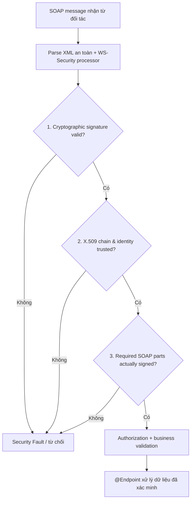
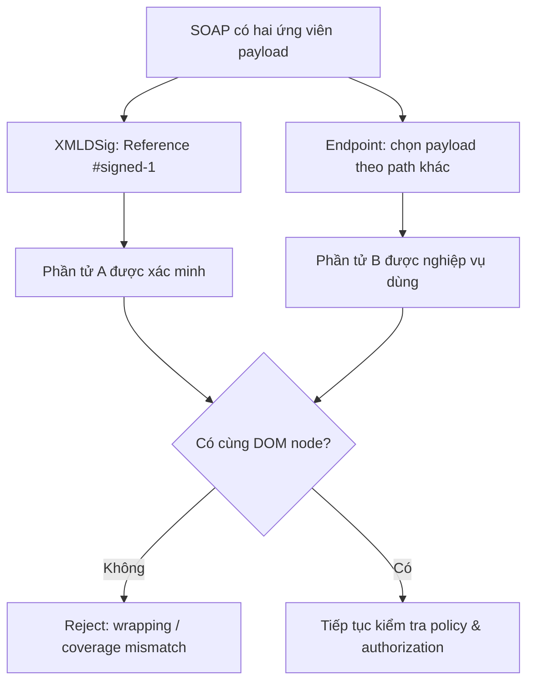
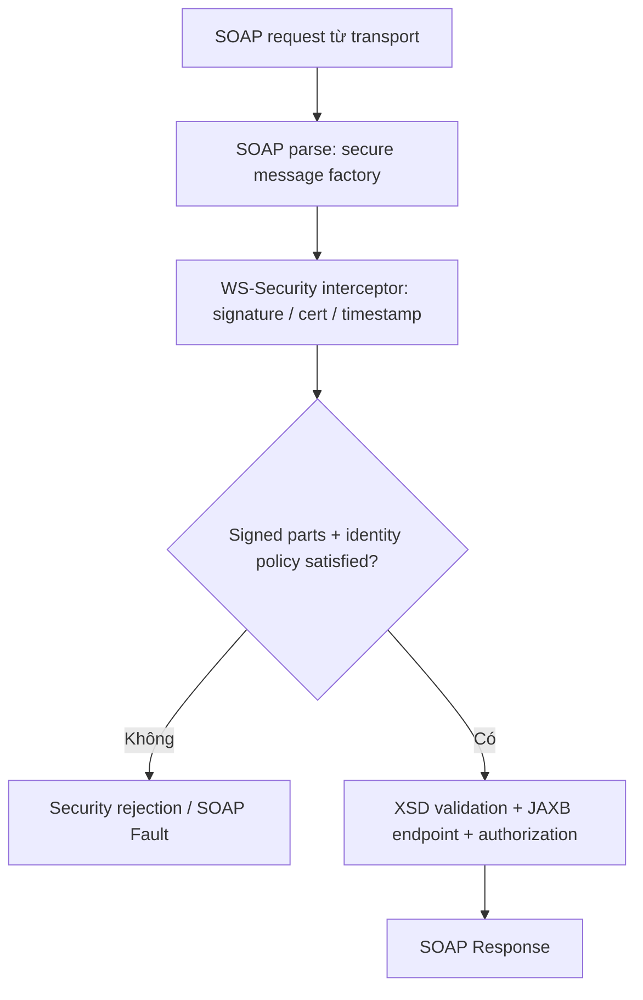

# Xác minh chữ ký, chuỗi tin cậy và phần thông điệp thực sự được ký

Trong tích hợp SOAP doanh nghiệp, việc thấy thẻ `<ds:Signature>` trong SOAP Header **không chứng minh** thông điệp đã an toàn. Chữ ký có thể được tạo bằng khóa của một đối tượng không đáng tin; nó có thể chỉ ký `Timestamp` mà bỏ qua SOAP Body; hoặc một kẻ tấn công có thể đưa thêm phần tử Body chưa được ký để ứng dụng xử lý nhầm. Một kết nối HTTPS hợp lệ cũng không thay thế xác minh chữ ký XML khi thông điệp đi qua gateway hoặc được lưu rồi chuyển tiếp.

Một dịch vụ triển khai WS-Security cần trả lời **ba câu hỏi độc lập**:

1. **Chữ ký có hợp lệ về mặt mật mã không?** Kiểm tra `ds:SignedInfo`, thuật toán, digest của các `ds:Reference` và `SignatureValue` bằng đúng public key.
2. **Public key/chứng chỉ đó có đáng tin cho mục đích này không?** Kiểm tra chuỗi chứng chỉ X.509, trust anchor, hiệu lực, thu hồi và chính sách danh tính của đối tác.
3. **Đúng những phần mà nghiệp vụ dùng có được bảo vệ không?** Kiểm tra SOAP Body, WS-Addressing `Action`/`To`, `Timestamp`, các Header quan trọng và các phần tử thực tế đã được xác minh, không chỉ nhìn thấy một chữ ký hợp lệ ở đâu đó.

Bài thuộc chương **WS-Security** của module **SPRING_WEB_SERVICES**. Trong quá trình xây dựng dịch vụ SOAP **contract-first** với Spring Web Services (Spring-WS), XSD/WSDL định nghĩa hợp đồng, JAXB/Spring OXM ánh xạ dữ liệu, endpoint và SOAP client thực thi yêu cầu, còn interceptor/security processor phải xác minh chữ ký, chứng chỉ và toàn vẹn thông điệp trước khi nghiệp vụ tin dữ liệu. Chủ đề liên quan trực tiếp đến **SOAP Fault, XML security, WS-Addressing, chứng chỉ TLS/mTLS, attachment và kiểm thử tương thích**.

Các ví dụ dùng SOAP 1.1 và WS-Security X.509 Token Profile, XML Signature, Java 17+ và một bản Spring-WS hiện đại dùng WSS4J. URI `example.org`, chứng chỉ và mã nhận dạng là dữ liệu minh họa; mọi cấu hình security phải được đối chiếu với **phiên bản thư viện và chính sách của đối tác**. Những chuỗi biểu diễn chữ ký trong XML dưới đây là **giá trị giả, không thể dùng để xác minh thật**.

## 1. Ba lớp kiểm tra: mật mã, niềm tin và phạm vi được ký



Phân biệt các kết quả:

| Kiểm tra | Xác nhận điều gì? | Không tự chứng minh |
| --- | --- | --- |
| `SignatureValue` đúng | `SignedInfo` được ký bởi khóa riêng tương ứng với public key được dùng | Khóa đó thuộc đối tác được phép |
| Các `DigestValue` đúng | Nội dung từng `ds:Reference` theo transforms đã được băm nhất quán | SOAP Body nghiệp vụ đang dùng chính là phần tử được tham chiếu |
| Chuỗi X.509 đạt PKIX | Chứng chỉ dẫn tới trust anchor theo chính sách được cấu hình | Chủ thể được phép thực hiện *mọi* operation/tenant |
| Chứng chỉ còn hiệu lực | Thời gian `NotBefore`/`NotAfter` phù hợp | Chứng chỉ chưa bị thu hồi |
| Certificate revocation đạt | Trạng thái CRL/OCSP theo cơ chế/policy đã bật | Mọi bước security khác tự động đúng |
| Body được bảo vệ | Nội dung Body cụ thể nằm trong tập phần được ký | Timestamp/Action/To/ReplyTo cũng được ký |
| Timestamp hợp lệ | Message phù hợp cửa sổ thời gian WS-Security đã định | Không có replay nếu chưa có cơ chế chống gửi lại |
| TLS/mTLS hợp lệ | Kênh tới peer transport đáp ứng chính sách trust/hostname/client cert | Chữ ký end-to-end trên SOAP Body hợp lệ |

Một hệ thống có thể vượt qua kiểm tra số 1 nhưng thất bại số 2 hoặc 3. **Không xử lý nghiệp vụ chỉ vì parser tìm thấy một `ds:Signature` và `verify(...)` của một thư viện thấp cấp trả `true` cho một reference nào đó.**

### 1.1. Ví dụ cụ thể

Đối tác gửi yêu cầu `TransferFundsRequest`. Chữ ký hợp lệ bảo vệ duy nhất `wsa:MessageID`, nhưng số tiền chuyển nằm trong SOAP Body **không được ký**. Một intermediary có thể sửa số tiền mà không làm sai chữ ký của MessageID. Nếu server chỉ kiểm tra “có chữ ký hợp lệ”, giao dịch có thể bị xử lý trên dữ liệu chưa bảo đảm toàn vẹn.

Giải pháp là quy định **Body phải được ký** và kiểm tra **đúng phần tử Body mà endpoint sẽ unmarshall** thuộc tập đã được bộ xử lý WS-Security xác nhận, cùng các header bắt buộc theo policy.

## 2. Các thành phần của chữ ký XML trong SOAP

WS-Security không phát minh lại thuật toán chữ ký số. Nó quy định cách đưa security tokens, chữ ký XML và metadata liên quan vào SOAP Header, kết hợp với chuẩn **XML Signature (XMLDSig)**.

Các tên quan trọng:

| Element | Namespace/prefix thường gặp | Vai trò |
| --- | --- | --- |
| `wsse:Security` | WS-Security Security Extension | SOAP Header block chứa token/chữ ký |
| `wsu:Id` | WS-Security Utility | Định danh phần tử để `ds:Reference` tham chiếu |
| `wsu:Timestamp` | WS-Security Utility | Thời gian tạo/hết hạn message |
| `wsse:BinarySecurityToken` | WS-Security | Có thể mang chứng chỉ X.509 dạng Base64 |
| `wsse:SecurityTokenReference` | WS-Security | Chỉ cách tìm token/khóa xác minh chữ ký |
| `ds:Signature` | XMLDSig | Chữ ký số XML |
| `ds:SignedInfo` | XMLDSig | Quy định canonicalization, signature algorithm và references |
| `ds:Reference` | XMLDSig | Chỉ đối tượng XML được ký và cách tính digest |
| `ds:Transforms` | XMLDSig | Biến đổi trước khi tính digest, ví dụ canonicalization |
| `ds:DigestMethod`/`DigestValue` | XMLDSig | Thuật toán băm và giá trị băm của reference |
| `ds:SignatureMethod`/`SignatureValue` | XMLDSig | Thuật toán ký và giá trị chữ ký |
| `ds:KeyInfo` | XMLDSig | Thông tin giúp tìm khóa, **không tự chứng minh khóa đáng tin** |

Namespace phổ biến:

```text
SOAP 1.1:
  http://schemas.xmlsoap.org/soap/envelope/
SOAP 1.2:
  http://www.w3.org/2003/05/soap-envelope

WS-Security Security Extension:
  http://docs.oasis-open.org/wss/2004/01/
  oasis-200401-wss-wssecurity-secext-1.0.xsd

WS-Security Utility:
  http://docs.oasis-open.org/wss/2004/01/
  oasis-200401-wss-wssecurity-utility-1.0.xsd

XML Signature:
  http://www.w3.org/2000/09/xmldsig#
```

Các URI `wsse`/`wsu` trên được xuống dòng **chỉ để dễ đọc trong tài liệu**; khi dùng trong XML, URI namespace là **một chuỗi liền**, không có ký tự xuống dòng hoặc khoảng trắng.

### 2.1. Một SOAP message có chữ ký minh họa

```xml
<?xml version="1.0" encoding="UTF-8"?>
<s:Envelope
    xmlns:s="http://schemas.xmlsoap.org/soap/envelope/"
    xmlns:o="https://example.org/orders/v1"
    xmlns:wsa="http://www.w3.org/2005/08/addressing"
    xmlns:wsse="http://docs.oasis-open.org/wss/2004/01/oasis-200401-wss-wssecurity-secext-1.0.xsd"
    xmlns:wsu="http://docs.oasis-open.org/wss/2004/01/oasis-200401-wss-wssecurity-utility-1.0.xsd"
    xmlns:ds="http://www.w3.org/2000/09/xmldsig#">
    <s:Header>
        <wsa:Action wsu:Id="action-1">urn:example:orders:GetOrder</wsa:Action>
        <wsa:To wsu:Id="to-1">https://service.example.org/orders</wsa:To>
        <wsse:Security s:mustUnderstand="1">
            <wsu:Timestamp wsu:Id="timestamp-1">
                <wsu:Created>2026-11-27T02:00:00Z</wsu:Created>
                <wsu:Expires>2026-11-27T02:05:00Z</wsu:Expires>
            </wsu:Timestamp>

            <wsse:BinarySecurityToken
                wsu:Id="cert-1"
                EncodingType="http://docs.oasis-open.org/wss/2004/01/oasis-200401-wss-soap-message-security-1.0#Base64Binary"
                ValueType="http://docs.oasis-open.org/wss/2004/01/oasis-200401-wss-x509-token-profile-1.0#X509v3">MIIB...CERTIFICATE_BASE64_ILLUSTRATION...</wsse:BinarySecurityToken>

            <ds:Signature>
                <ds:SignedInfo>
                    <ds:CanonicalizationMethod
                        Algorithm="http://www.w3.org/2001/10/xml-exc-c14n#"/>
                    <ds:SignatureMethod
                        Algorithm="http://www.w3.org/2001/04/xmldsig-more#rsa-sha256"/>

                    <ds:Reference URI="#body-1">
                        <ds:Transforms>
                            <ds:Transform Algorithm="http://www.w3.org/2001/10/xml-exc-c14n#"/>
                        </ds:Transforms>
                        <ds:DigestMethod
                            Algorithm="http://www.w3.org/2001/04/xmlenc#sha256"/>
                        <ds:DigestValue>BODY_DIGEST_ILLUSTRATION</ds:DigestValue>
                    </ds:Reference>

                    <ds:Reference URI="#timestamp-1">
                        <ds:Transforms>
                            <ds:Transform Algorithm="http://www.w3.org/2001/10/xml-exc-c14n#"/>
                        </ds:Transforms>
                        <ds:DigestMethod
                            Algorithm="http://www.w3.org/2001/04/xmlenc#sha256"/>
                        <ds:DigestValue>TIMESTAMP_DIGEST_ILLUSTRATION</ds:DigestValue>
                    </ds:Reference>

                    <ds:Reference URI="#action-1">
                        <ds:Transforms>
                            <ds:Transform Algorithm="http://www.w3.org/2001/10/xml-exc-c14n#"/>
                        </ds:Transforms>
                        <ds:DigestMethod
                            Algorithm="http://www.w3.org/2001/04/xmlenc#sha256"/>
                        <ds:DigestValue>ACTION_DIGEST_ILLUSTRATION</ds:DigestValue>
                    </ds:Reference>
                </ds:SignedInfo>
                <ds:SignatureValue>SIGNATURE_ILLUSTRATION</ds:SignatureValue>
                <ds:KeyInfo>
                    <wsse:SecurityTokenReference>
                        <wsse:Reference URI="#cert-1"
                            ValueType="http://docs.oasis-open.org/wss/2004/01/oasis-200401-wss-x509-token-profile-1.0#X509v3"/>
                    </wsse:SecurityTokenReference>
                </ds:KeyInfo>
            </ds:Signature>
        </wsse:Security>
    </s:Header>
    <s:Body wsu:Id="body-1">
        <o:GetOrderRequest>
            <o:orderId>ORD-1001</o:orderId>
        </o:GetOrderRequest>
    </s:Body>
</s:Envelope>
```

**Không copy XML này làm request thật:** `DigestValue`/`SignatureValue` và chứng chỉ cố ý không hợp lệ. Ví dụ chỉ minh họa rằng chữ ký có các references tới `body-1`, `timestamp-1`, `action-1`. `wsa:To` có `wsu:Id` nhưng **chưa xuất hiện trong các references**, do đó **To chưa được ký trong policy minh họa này**.

Đọc theo thứ tự:

1. `ds:SignedInfo` mô tả các tài liệu/phần tử tham chiếu và thuật toán.
2. Bộ xác minh tìm từng phần tử theo `Reference URI="#..."`, áp transforms được chấp nhận và tính lại digest.
3. Bộ xác minh canonicalize `SignedInfo` và xác minh `SignatureValue` bằng public key đã xác định.
4. Bộ xử lý xác minh trust/identity của khóa theo **truststore và chính sách**.
5. Ứng dụng/security policy kiểm tra **Body thật, Timestamp, Action và những header bắt buộc đã nằm trong tập references thành công**.

Một XML signature có thể dùng reference và transform khác; ví dụ minh họa tập hẹp dễ đọc. **Không viết engine XMLDSig mới để tự thực hiện các bước này**. Sử dụng WSS4J/XML security processor đã được duy trì và khóa tập thuật toán/reference theo chính sách.

### 2.2. Digest đúng không đủ

Digest là kết quả băm của nội dung referenced. Nếu một đối tượng tấn công sửa cùng lúc Body **và** DigestValue, phép băm đơn thuần có thể vẫn khớp. **`SignatureValue` mới ràng buộc `SignedInfo` vào khóa riêng**; đồng thời public key phải được tin cậy và signed parts phải đúng. Tách rời các bước này làm chính sách xác minh không có ý nghĩa.

### 2.3. Canonicalization và transforms

Canonical XML (C14N) chuẩn hóa những khác biệt biểu diễn XML theo thuật toán đã chọn, như xử lý namespace, attribute ordering và một số quy tắc whitespace. Nó **không có nghĩa mọi thay đổi văn bản XML đều vô hại**, cũng không cho phép sửa tùy ý nội dung sau khi ký.

Một số lỗi phổ biến:

- Serializer thay đổi node/namespace theo cách làm digest không khớp.
- Dùng kiểu canonicalization khác giữa các phía.
- Signature tham chiếu một phần tử không được endpoint tiêu thụ.
- Cho phép transform quá rộng hoặc external URI reference không cần thiết.
- Thêm hoặc di chuyển element mà bộ xử lý/ứng dụng chọn node khác nhau.

Với SOAP đã ký, tránh tự parse rồi serialize lại theo cách thay đổi phần được ký trước khi xác minh; sau khi xác minh, không được tự thay node nghiệp vụ sang một bản khác chưa được xác minh.

## 3. Chữ ký xác minh *những phần nào*?

Trong XMLDSig, `ds:Reference URI="#body-1"` chỉ định **một đối tượng được tham chiếu**; chữ ký có thể có nhiều `ds:Reference`. **Không có quy tắc phổ quát mọi XML Signature trong SOAP đều phải ký toàn bộ Envelope**. Phạm vi bắt buộc được xác định bởi WS-Security policy/hợp đồng.

Ví dụ hợp đồng `GetOrder`:

| Đối tượng | QName/ID minh họa | Có cần ký? | Vì sao? |
| --- | --- | --- | --- |
| SOAP Body chứa `GetOrderRequest` | `s:Body` / `body-1` | **Có** | Không cho đổi orderId |
| `wsu:Timestamp` | `wsu:Timestamp` / `timestamp-1` | **Có**, nếu policy yêu cầu | Ràng buộc thời gian vào thông điệp |
| WS-A `Action` | `wsa:Action` / `action-1` | **Có**, nếu dùng để route/authorize | Không cho đổi operation được định tuyến |
| WS-A `To` | `wsa:To` / `to-1` | **Có**, nếu là trường tin cậy định tuyến | Không cho đổi đích logic |
| WS-A `MessageID` | `wsa:MessageID` | Theo anti-replay/correlation policy | Ràng buộc ID vào message |
| WS-A `ReplyTo`/`FaultTo` | WS-A EPR headers | **Cần ký/kiểm soát chặt** nếu dùng callback | Ngăn redirect/rò phản hồi tới URL ngoài |
| Custom `TenantContext` | QName hợp đồng | Nếu dùng cho ủy quyền | Không cho sửa tenant được ứng dụng tin |
| `wsse:BinarySecurityToken` | `cert-1` | Không thay thế trust verification | Token cung cấp khóa/chứng chỉ tham chiếu |
| MIME attachment | MIME part/CID | Tùy hợp đồng attachment signature | XML Body signature không mặc nhiên bảo vệ mọi file |

**Không lấy bảng này làm chính sách mặc định cho mọi service.** Một hợp đồng có thể cần ký thêm/một phần khác, ví dụ SOAP Headers của giao dịch hoặc phần tử thuộc WS-Addressing. Nhưng bất kỳ dữ liệu nào được dùng cho **routing, identity binding, authorization hoặc quyết định nghiệp vụ quan trọng** phải được đánh giá về tính toàn vẹn.

### 3.1. Ký toàn bộ `s:Body` hay chỉ một phần tử con?

Giả sử SOAP Body:

```xml
<s:Body xmlns:s="http://schemas.xmlsoap.org/soap/envelope/"
        xmlns:o="https://example.org/orders/v1"
        wsu:Id="body-1"
        xmlns:wsu="http://docs.oasis-open.org/wss/2004/01/oasis-200401-wss-wssecurity-utility-1.0.xsd">
    <o:GetOrderRequest>
        <o:orderId>ORD-1001</o:orderId>
    </o:GetOrderRequest>
</s:Body>
```

Nếu policy yêu cầu **toàn bộ Body**, bộ xác minh phải chứng minh `s:Body` **đang được endpoint xử lý** thuộc signed data. Một signature chỉ bảo vệ `o:orderId` nhưng bỏ qua các phần tử nghiệp vụ khác **không tương đương ký toàn Body**.

Đừng chỉ so tên QName `{SOAP-ENV}Body`: attacker có thể dựng các phần tử cùng tên/ID ở vị trí khác trong DOM. Cần so **đối tượng DOM/node thực tế hoặc đường dẫn đã được bộ xử lý chữ ký xác minh**, và bảo đảm endpoint đọc đúng node đó.

### 3.2. `Element` và `Content` trong signed-parts policy

Một số WSS4J policy có khái niệm ký **element** hoặc **content** của element. Sự khác nhau tác động tới việc attribute của phần tử bao và các node con được ràng buộc như thế nào. Với một policy yêu cầu toàn bộ `s:Body`, cần quy định rõ dạng coverage, namespace, local name và vị trí. Không gán nhãn “Body đã ký” chỉ vì phát hiện một node con được ký.

### 3.3. Reference `URI` không chứng minh reference đã được chấp nhận

Một bước kiểm tra thô:

```java
// SAI: chỉ tìm chuỗi Reference URI mà không xác minh.
boolean signed = xml.contains("URI=\"#body-1\"");
```

không kiểm tra rằng digest đúng, SignatureValue đúng, token trusted, ID duy nhất hay node được tham chiếu chính là Body nghiệp vụ. Phải dựa trên **kết quả xử lý chữ ký đã xác minh** và chính sách signed parts, không dựa trên raw XML/string matching.

## 4. XML Signature Wrapping: chữ ký hợp lệ nhưng ứng dụng đọc sai dữ liệu

**XML Signature Wrapping (XSW)** là họ tấn công khai thác sự khác biệt giữa cách bộ xác minh tìm phần tử được ký và cách ứng dụng tìm phần tử để xử lý. Tấn công có thể đưa một phần tử mới không được ký vào vị trí mà endpoint/JAXB/XPath ưu tiên, trong khi phần tử gốc được ký vẫn tồn tại và chữ ký vẫn hợp lệ.

Sơ đồ:



### 4.1. Mô hình tấn công minh họa

Một message độc hại có thể giữ bản gốc được ký `GetOrderRequest(ORD-1001)` ở một vị trí không phải Body được xử lý, đồng thời đưa `GetOrderRequest(ORD-9009)` mới vào Body mà endpoint nhìn thấy. Nếu security layer cho phép vị trí đó và chỉ xác minh tham chiếu tới bản gốc, chữ ký vẫn có thể đúng trong khi endpoint xử lý dữ liệu khác.

Mẫu phác thảo (không phải SOAP envelope hợp lệ đầy đủ):

```xml
<!-- Chỉ để hiểu sự khác biệt giữa đối tượng được ký và được đọc. -->
<container>
    <previouslySignedPayload wsu:Id="signed-1">
        <orderId>ORD-1001</orderId>
    </previouslySignedPayload>
    <applicationBody>
        <orderId>ORD-9009</orderId>
    </applicationBody>
    <ds:Reference URI="#signed-1"/>
</container>
```

Không phải mọi XML với nhiều element sẽ qua được WSS4J hoặc SOAP parser hiện đại; ví dụ chỉ diễn giải **lỗi thiết kế nếu lớp xác minh và lớp nghiệp vụ không thống nhất đối tượng**. Không cần dựng payload tấn công thật để hiểu nguyên tắc.

### 4.2. Phòng chống XSW đúng tầng

1. Dùng **WS-Security/XMLDSig processor đáng tin cậy** (chẳng hạn WSS4J), không tự dựng hàm XPath tìm `Signature`/`wsu:Id`.
2. Chặn **duplicate XML IDs** và ID references mơ hồ, theo quy tắc mà security processor và XML parser hỗ trợ.
3. Không cho external reference/transforms tùy ý được thực thi; cấu hình parser DTD/XXE an toàn.
4. Kiểm tra **chính xác node đã được ký**, QName, vị trí và coverage mà policy yêu cầu; đừng chỉ kiểm tra một reference “có tên Body”.
5. Bảo đảm JAXB/endpoint nhận đúng SOAP Body đã đi qua security verification và không chọn một node khác bằng XPath quá rộng như `//*[local-name()='GetOrderRequest']`.
6. Kiểm tra `mustUnderstand`, SOAP actor/role và xử lý multiple `wsse:Security` headers theo policy.
7. Nếu xác minh một set các signed references, đừng xem một chữ ký yếu/không cần thiết “đã đủ” khi **Body thực** chưa được ký.
8. Test các biến thể duplicate `wsu:Id`, thêm Body/header thừa và thay thế payload **sau** khi ký.

**Chống XSW không đồng nghĩa tự viết lại việc verify SignatureValue**. Trách nhiệm application là khai báo **part bắt buộc** và kết nối kết quả xác minh của WSS4J tới đúng node được xử lý.

## 5. Chứng chỉ X.509 trong WS-Security: nguồn khóa không phải tự động là nguồn tin

Một message có thể chứa `wsse:BinarySecurityToken` là chứng chỉ X.509. Bộ xác minh có thể lấy public key từ chứng chỉ ấy để kiểm tra chữ ký. Nhưng **bất kỳ ai cũng có thể tự tạo cặp khóa và tự ký một SOAP message** rồi kèm chứng chỉ do họ tạo.

Do đó phải kiểm tra: chứng chỉ đại diện cho **đối tác được ủy quyền**, không chỉ là “chứng chỉ có thể parse được”.

### 5.1. Khác biệt giữa “Signature valid” và “Signer trusted”

| Trường hợp | Signature math | Trust/identity | Kết luận |
| --- | --- | --- | --- |
| Đối tác hợp lệ, cert đúng policy, Body đúng signed parts | Đúng | Đúng | Có thể tiếp tục authorization |
| Attacker ký bằng private key của họ | Đúng | Không tin | **Từ chối** |
| Cert của CA tin cậy nhưng không phải đối tác được cấp quyền | Đúng | Có thể có PKIX path | **Từ chối theo identity/authorization** |
| Cert đối tác đã hết hạn | Có thể vẫn đúng | Không đạt validity policy | **Từ chối** |
| Cert thu hồi nhưng hệ không kiểm tra revocation | Có thể đúng | Chưa đủ thông tin | Không được tuyên bố “đã kiểm tra thu hồi” |
| Đối tác tin cậy nhưng Body không được ký | Đúng cho phần khác | Đúng | **Từ chối do thiếu coverage** |
| Cert đúng, Body đúng nhưng timestamp sai/replay | Đúng | Đúng | **Từ chối theo freshness policy** |

Một dịch vụ nên có cấu hình rõ **ai được phép ký** và **certificate/path nào đáp ứng điều kiện tin cậy**; không dựa vào chuỗi `Subject CN` tự khai hoặc xuất hiện trong message để quyết định.

### 5.2. Chuỗi chứng chỉ và trust anchor

Ví dụ:

```text
Leaf signing certificate: Partner Orders Signing
    Issued by: Partner Integration Intermediate CA
        Issued by: Trusted Integration Root CA
            Trust anchor: nằm trong truststore được ứng dụng phê duyệt
```

Trong mô hình PKIX, verifier xây đường đi từ **leaf certificate** qua intermediate CA đến **trust anchor** được cấu hình. Tùy chính sách, verifier phải xem xét:

- Chữ ký trên chứng chỉ, basic constraints và khả năng CA của intermediates.
- `NotBefore`/`NotAfter` của các cert liên quan.
- `KeyUsage`, `ExtendedKeyUsage` và hạn chế đối tượng/mục đích sử dụng **nếu policy yêu cầu**.
- Path length/name constraints và chính sách chứng chỉ.
- Trạng thái thu hồi CRL/OCSP nếu được yêu cầu; định nghĩa rõ fail-open/fail-closed và độ trễ cập nhật.
- Thuật toán/chìa khóa đủ mạnh theo chính sách hiện hành.
- Danh tính leaf certificate có được ánh xạ tới đúng đối tác/tenant/operation không.

**Truststore** chứa trust anchors hoặc chứng chỉ đã được doanh nghiệp chọn để tin; **keystore ký outbound** chứa private key/certificate dùng để tạo chữ ký. Hai kho này có mục đích khác nhau, dù công nghệ `KeyStore` của Java có thể lưu nhiều loại entry.

### 5.3. Path validation không phải authorization

Ngay cả khi certificate chain dẫn tới một root CA tin cậy, root đó có thể cấp nhiều chứng chỉ cho nhiều công ty. **CA-trusted ≠ được gọi mọi operation**. Cần mapping identity từ kết quả xác thực tới partner/account/tenant đã đăng ký, ví dụ qua thumbprint/issuer+serial/SAN/subject khi các trường đó nằm trong chính sách được xác minh.

Đặc biệt, không dùng `wsse:UsernameToken`, `wsa:From`, `clientId` hay `tenantId` do client gửi làm quyền nếu chúng không được gắn với principal đã xác minh. Với B2B, có thể yêu cầu **certificate pinning** hoặc allowlist leaf/public key/certificate profile khi cần ràng buộc hẹp hơn việc chỉ tin một CA.

### 5.4. CRL, OCSP và chính sách lỗi tra cứu

“Chúng tôi có truststore” **không chứng minh chứng chỉ đã được kiểm tra thu hồi**. Tùy WSS4J Crypto provider và cấu hình, revocation checking có thể cần bật riêng, kèm nguồn CRL/OCSP đáng tin, cache, network egress và monitoring.

Quy tắc vận hành:

1. Xác định có bắt buộc kiểm tra CRL/OCSP không.
2. Kiểm tra policy khi nguồn revocation bị timeout/unavailable; không vô tình fail-open.
3. Giới hạn SSRF/network access đến CRL/OCSP endpoints và không lấy URI tùy ý từ input mà không kiểm soát.
4. Cảnh báo khi certificate sắp hết hạn hoặc bị thu hồi; có kế hoạch xoay vòng.
5. Test cả trạng thái chứng chỉ tốt, hết hạn, revoked, unknown và OCSP/CRL service unavailable.

Không tự tuyên bố ứng dụng “đã xác minh đầy đủ chuỗi tin cậy” chỉ vì `SignatureValue` đúng hoặc `Crypto.verifyTrust(...)` được gọi ở một nhánh mà không kiểm chứng provider/policy thực.

## 6. TLS/mTLS và WS-Security signing certificate là hai lớp khác nhau

Một kết nối từ đối tác đến SOAP endpoint có thể dùng mTLS và đồng thời mang SOAP message đã ký. Hai bằng chứng có phạm vi khác nhau:

| Lớp | Xác minh | Bị giới hạn bởi |
| --- | --- | --- |
| HTTPS/TLS server verification | Client xác minh certificate/hostname của server | **Kênh transport**; kết thúc ở TLS termination point |
| mTLS client authentication | Server/gateway xác minh client certificate trên kết nối | **Peer của hop TLS đó** |
| XML Signature/WS-Security | Signer ký những XML elements theo references và policy | **Các phần được ký trong SOAP message** |
| WS-Security encryption | Mã hóa các phần SOAP được policy chỉ định | Các phần đã được mã hóa, không phải toàn message theo mặc định |

Nếu TLS kết thúc ở API gateway rồi gateway chuyển SOAP vào service, backend có thể không thấy original TLS peer. Nếu cần identity từ gateway, phải dùng một **kênh truyền identity đã được tin cậy** và kiểm soát header spoofing. XML Signature có thể duy trì tính toàn vẹn các phần được ký khi message đi qua intermediary, nhưng chỉ khi intermediary không thay đổi các phần đó.

**Signing certificate không mặc nhiên là TLS server/client certificate.** Các chứng chỉ có thể khác nhau, mục đích, key usage, truststore, thời hạn và chính sách xoay vòng cũng khác. Không tái dùng private key chỉ để giảm số lượng file cấu hình nếu chính sách yêu cầu tách khóa.

## 7. Freshness, timestamp và chống replay

Chữ ký đúng chứng minh một thông điệp **không bị thay đổi so với nội dung đã ký**. Nó không tự bảo đảm thông điệp là *mới* hoặc chưa được gửi trước đó. Kẻ tấn công có thể phát lại **nguyên thông điệp đã ký** trong thời hạn được chấp nhận nếu hệ thống thiếu anti-replay.

Một timestamp WS-Security minh họa:

```xml
<wsu:Timestamp
    xmlns:wsu="http://docs.oasis-open.org/wss/2004/01/oasis-200401-wss-wssecurity-utility-1.0.xsd"
    wsu:Id="TS-18">
    <wsu:Created>2026-11-27T02:00:00Z</wsu:Created>
    <wsu:Expires>2026-11-27T02:05:00Z</wsu:Expires>
</wsu:Timestamp>
```

Nếu policy yêu cầu timestamp phải được ký, cần **kiểm tra đúng node `wsu:Timestamp` đã được ký** cùng với giới hạn skew, TTL/expiration. Một timestamp chưa được ký có thể bị thay đổi mà Body signature vẫn hợp lệ.

### 7.1. Timestamp có đủ ngăn replay không?

Không. Trong cửa sổ còn hiệu lực, cùng một message có thể được gửi lại. Với operation có side effect như `CreatePayment`, hệ thống có thể cần:

- Replay cache keyed theo `MessageID`/nonce/identity (chỉ dùng những giá trị đã được xác minh và buộc toàn vẹn theo policy).
- TTL và dung lượng replay cache, giải quyết race condition khi requests song song.
- Idempotency key ở nghiệp vụ, độc lập với `MessageID` WS-Addressing.
- Không cho hai message trùng business command tạo hai giao dịch nếu contract cam kết idempotency.
- Đồng hồ server đồng bộ an toàn; quy tắc chấp nhận skew không quá rộng.

**Replay protection và idempotency là hai nhiệm vụ khác nhau.** Replay cache thường chặn cùng một message gửi lại; idempotency xử lý nhiều message khác nhau biểu diễn **cùng một lệnh nghiệp vụ**.

## 8. Contract-first: định nghĩa policy ký ở cấp nào?

Một XSD `GetOrderRequest` chỉ mô tả trường `orderId`. Nó **không quy định certificate chain nào đáng tin, Body nào phải ký hoặc WS-Addressing header nào bắt buộc**. Một WSDL mô tả operation/binding, nhưng policy ký thường được biểu diễn thêm bằng **WS-SecurityPolicy**/metadata và tài liệu tích hợp đã thỏa thuận.

Ví dụ XSD Body:

```xml
<xs:schema xmlns:xs="http://www.w3.org/2001/XMLSchema"
           targetNamespace="https://example.org/orders/v1"
           xmlns:o="https://example.org/orders/v1"
           elementFormDefault="qualified">
    <xs:element name="GetOrderRequest">
        <xs:complexType>
            <xs:sequence>
                <xs:element name="orderId" type="xs:string"/>
            </xs:sequence>
        </xs:complexType>
    </xs:element>
</xs:schema>
```

Một chính sách an toàn cho operation có thể quy định:

```text
Contract: Orders SOAP 1.1 / GetOrder
Identity:
  - inbound signer = một đối tác được phép, qua PKIX/trust/pinning policy
  - principal mapping + authorization theo tenant
Message integrity:
  - SOAP Body: bắt buộc signed
  - wsu:Timestamp: bắt buộc signed
  - wsa:Action, wsa:To: bắt buộc signed nếu dùng cho routing/policy
  - các security-relevant custom headers: signed theo mục đích
Freshness:
  - timestamp expiration + skew được giới hạn
  - replay cache cho message IDs/nonces nếu yêu cầu
Cryptography:
  - allowlist signature/digest/c14n algorithms, key lengths
  - từ chối thuật toán deprecated/weak theo baseline
Certificate:
  - trust anchors, path validation, purpose và revocation policy rõ ràng
Failure:
  - security fault an toàn, không lộ private key/cert internals
```

Đây là **policy mẫu để học**, không phải file cấu hình WSS4J hoàn chỉnh. Khi hai hệ thống trao đổi WSDL và WS-SecurityPolicy, cần kiểm tra **algorithm suite**, **signed parts/elements**, **token inclusion**, **layout**, **timestamp**, **protection order**, **replay** và cơ chế xác thực được tuyên bố.

### 8.1. Đừng tin WSDL tự bật thực thi policy

WSDL hoặc WS-SecurityPolicy mô tả yêu cầu, nhưng việc kiểm tra thật phụ thuộc:

- Spring-WS/WSS4J interceptor và cấu hình validation.
- Crypto provider/truststore.
- Signed-parts enforcement thực sự (không chỉ “có Signature”).
- Authn/authz layer và policy về tenant/operation.
- Kiểm thử thực tế với client và server của đối tác.

Không kết luận `@PayloadRoot` + `Jaxb2Marshaller` + một WSDL có security assertion sẽ tự khiến endpoint từ chối mọi unsigned Body. Cần **chứng minh bằng negative tests**.

## 9. Spring-WS/WSS4J: xác minh chữ ký ở inbound interceptor

Spring-WS hỗ trợ WS-Security qua các thành phần tích hợp **Apache WSS4J**, trong đó `Wss4jSecurityInterceptor` có thể xử lý/kiểm tra security actions trong request/response.

Một cấu hình inbound minh họa:

```java
import java.util.List;
import org.apache.wss4j.common.crypto.Crypto;
import org.springframework.context.annotation.Bean;
import org.springframework.context.annotation.Configuration;
import org.springframework.ws.config.annotation.EnableWs;
import org.springframework.ws.config.annotation.WsConfigurer;
import org.springframework.ws.server.EndpointInterceptor;
import org.springframework.ws.soap.security.wss4j2.Wss4jSecurityInterceptor;

@Configuration
@EnableWs
public class OrdersWsSecurityConfiguration implements WsConfigurer {
    private final Crypto inboundSignatureTrustCrypto;

    public OrdersWsSecurityConfiguration(
            Crypto inboundSignatureTrustCrypto) {
        this.inboundSignatureTrustCrypto = inboundSignatureTrustCrypto;
    }

    @Bean
    public Wss4jSecurityInterceptor ordersSignatureValidator() {
        Wss4jSecurityInterceptor interceptor =
                new Wss4jSecurityInterceptor();

        interceptor.setValidationActions("Timestamp Signature");
        interceptor.setValidationSignatureCrypto(
                inboundSignatureTrustCrypto);
        return interceptor;
    }

    @Override
    public void addInterceptors(
            List<EndpointInterceptor> interceptors) {
        interceptors.add(ordersSignatureValidator());
    }
}
```

**Điều kiện để dùng:** `Crypto inboundSignatureTrustCrypto` phải được khai báo/cấu hình riêng với truststore và chính sách trust phù hợp. Ví dụ không tự tạo `Crypto` vì cơ chế nạp truststore, mật khẩu, issuer và thu hồi nên nằm trong **cấu hình bí mật được quản lý an toàn**. Đường import `wss4j2`, actions và setters được minh họa cho dòng Spring-WS/WSS4J tương ứng; kiểm tra lại API/dependency đang deploy trước khi dùng nguyên văn.

**Đặc biệt quan trọng:** `setValidationActions("Timestamp Signature")` **không chứng minh tự động tất cả Body/Header bắt buộc đã được ký**. Nó yêu cầu bộ xử lý xác minh các security actions đã cấu hình trong pipeline tương ứng; doanh nghiệp còn phải enforce đúng signed-parts/WS-SecurityPolicy và identity/authorization bằng cơ chế được hỗ trợ, rồi kiểm thử những message có signature hợp lệ nhưng Body không được ký.

### 9.1. Crypto inbound không giống private key outbound

| Vai trò | Thông thường chứa | Dùng khi |
| --- | --- | --- |
| Inbound signature validation crypto | Trust anchors/certificates cần kiểm tra theo policy | Xác minh signer có đáng tin |
| Outbound signature crypto | Private key của bên gửi + certificate chain được phép xuất trình | Tạo chữ ký cho request/response |
| Decryption crypto | Private key của bên nhận + cấu hình giải mã | Giải mã XML Encryption |
| Transport TLS truststore | CA/cert của peer TLS | Kiểm tra HTTPS/mTLS kênh truyền |

Tùy mô hình, cùng ứng dụng có thể cần cả bốn mục đích nhưng nên giữ ranh giới và quyền truy cập rõ. **Không truyền password private key vào SOAP Header**, không log keystore/truststore passwords và không lưu chúng trong source control.

### 9.2. Vị trí interceptor và ranh giới tin cậy



Thứ tự cụ thể của interceptors phải thống nhất với implementation: bước nào parse Header, decrypt, verify signature, validate schema, bind token và đưa principal vào ứng dụng. Đối với signed-and-encrypted message, **thứ tự encryption/signature và protection order** có thể làm thay đổi cách xác minh, không thể đơn giản đổi chỗ interceptor bằng một quy tắc chung.

XSD validation và JAXB unmarshal không được cho phép endpoint **bỏ qua security failure**. Ngược lại, verify XML Signature không tự xác thực XSD, không tự giới hạn business amount và không tự kiểm tra authorization.

### 9.3. Identity mapping và truststore rotation

Sau khi một signer được xác thực:

- Gắn verified identity/certificate profile với **một partner account** đã đăng ký.
- Kiểm tra partner đó được phép gọi **operation** nào, **tenant** nào và có hạn mức nào.
- Quản lý **certificate rollover** có thời gian giao nhau có kiểm soát giữa cert cũ và cert mới.
- Theo dõi cert sắp hết hạn, chain thay đổi, CA bị loại, truststore version và revocation.
- Kiểm thử “cert của đối tác A gọi API của đối tác B” phải thất bại ngay cả khi **cả hai chain đều PKIX-trusted**.

**Không lấy thumbprint từ SOAP Header do client khai báo mà không đối chiếu với certificate đã được WSS4J xác minh**, và không map quyền chỉ dựa trên một chuỗi `CN` dễ trùng hoặc không được chính sách kiểm tra.

## 10. Chính sách ký outgoing: Body, Timestamp và Header liên quan

Với SOAP client hoặc SOAP response cần ký, Spring-WS/WSS4J có thể cấu hình outbound security actions. Một mô hình đơn giản:

```text
JAXB marshal SOAP Body
   → Thêm SOAP Headers nghiệp vụ/WS-Addressing
   → Tạo Timestamp/WS-Security token
   → WSS4J ký chính xác Body + các Headers được policy yêu cầu
   → Serialize SOAP, gửi qua transport có TLS
```

Thứ tự là mô hình trách nhiệm: với `WebServiceTemplate`, callback và client interceptor có thứ tự chạy cụ thể do framework quản lý, phải **kiểm thử chính xác wire output**. Nếu Header `wsa:Action` được thêm **sau** khi chữ ký đã tính, nó không nằm trong signed parts dù message có chữ ký hợp lệ.

### 10.1. Ví dụ hành động ký ở phía gửi

```java
import org.apache.wss4j.common.crypto.Crypto;
import org.springframework.ws.soap.security.wss4j2.Wss4jSecurityInterceptor;

public final class OutboundSignaturePolicy {
    private OutboundSignaturePolicy() { }

    public static Wss4jSecurityInterceptor createSigner(
            Crypto outboundPrivateKeyCrypto,
            String privateKeyAlias,
            String keyPassword) {
        Wss4jSecurityInterceptor interceptor =
                new Wss4jSecurityInterceptor();
        interceptor.setSecurementActions("Timestamp Signature");
        interceptor.setSecurementUsername(privateKeyAlias);
        interceptor.setSecurementPassword(keyPassword);
        interceptor.setSecurementSignatureCrypto(outboundPrivateKeyCrypto);
        return interceptor;
    }
}
```

Đây là **cấu hình minh họa**, chưa thể coi là production-ready:

- `outboundPrivateKeyCrypto` phải có private key đúng alias và certificate chain.
- `keyPassword` lấy từ secret manager, không hard-code; phạm vi quyền phải tối thiểu.
- Chưa khai báo cụ thể **securement signature parts**, kiểu token reference, algorithm suite, digest/canonicalization và signed WS-A headers theo policy.
- Timestamp vừa thêm phải được ký nếu hợp đồng yêu cầu — hãy kiểm tra references thực tế.
- Không mặc định sign mọi header nhạy cảm nếu chưa thiết lập `securementSignatureParts`/cơ chế policy tương ứng.
- Phải kiểm tra version của WSS4J/Spring-WS về tên property, algorithm/token settings và hành vi default.

**Tạo chữ ký không chỉ là gọi `setSecurementActions("Signature")`.** Hãy chốt hợp đồng về parts, signer, trust, timestamp, signature method, digest, encryption và protection order, rồi test request/response trên wire.

### 10.2. Khóa riêng chỉ được dùng ở nơi ký

Mô hình đúng:

```text
Outbound signer:
  private key → tạo SignatureValue
  certificate/KeyInfo → giúp recipient tìm public key

Inbound verifier:
  message + public key → kiểm tra XMLDSig
  truststore/PKIX/policy → quyết định signer trusted
  signed parts policy → kiểm tra nội dung ứng dụng dùng
```

Không xuất private key sang client, không đưa private key vào `BinarySecurityToken` và không yêu cầu người nhận dùng mật khẩu private key để verify. **Public key** đủ cho xác minh phép ký; **niềm tin** vào key là vấn đề PKIX/pinning và identity policy.

## 11. Xác định signed parts từ *kết quả đã xác minh*, không tự nhìn XML

Một điểm khác biệt tinh tế nhưng thiết yếu: **danh sách các `ds:Reference` trong message là dữ liệu do bên gửi cung cấp**. Trước khi verification thành công, nó không phải một tuyên bố đáng tin về phần nào đã được bảo vệ.

Sau khi WSS4J xác minh signature/chain, security result cần cho phép chính sách xác định:

- Reference nào thực sự được xác minh thành công.
- Reference đó trỏ tới **DOM node/element cụ thể nào**.
- Node đó có QName, vị trí và loại coverage nào.
- Nó có phải chính SOAP Body/WS-A Header mà message dispatcher và ứng dụng sẽ sử dụng không.
- Nó có thuộc một chữ ký bởi **signer đã được tin cậy/ủy quyền** không.
- Có bao nhiêu chữ ký, token, security headers và tham chiếu; những thứ thừa/mâu thuẫn xử lý ra sao.

Trong Apache WSS4J, kết quả xử lý có các cấu trúc liên quan như `WSSecurityEngineResult` và `WSDataRef` để mô tả data references đã được xử lý. **Cách lấy/truyền result tới policy enforcement phụ thuộc integration layer và WSS4J version**. Một ứng dụng có thể sử dụng policy engine/profile phù hợp thay vì tự đọc những cấu trúc thấp cấp; không nên đoán rằng cứ có `setValidationActions("Signature")` là framework mặc nhiên enforce hết các phần trong bảng signed-parts ở mục 3.

### 11.1. Kiểm tra đúng node SOAP Body

Mẫu logic ý tưởng, **không phải lời gọi API WSS4J hoàn chỉnh**:

```java
// Pseudocode: hai đầu vào đã được tạo bởi các thành phần ĐÁNG TIN:
// actualSoapBody: DOM Node thuộc SOAP message mà dispatcher xử lý.
// verifiedTargets: tập DOM Nodes được security engine xác minh
//                 thành công, từ chữ ký của signer đã tin cậy.

boolean bodyCovered = verifiedTargets.stream()
        .anyMatch(verified -> verified.isSameNode(actualSoapBody));

if (!bodyCovered) {
    throw new SecurityException(
            "Required SOAP Body is not covered by a trusted signature");
}
```

Với policy yêu cầu **toàn bộ Body**, kiểm tra trên chính node Body (và coverage kiểu element theo profile) mạnh hơn việc chỉ so tên `Body` hoặc chỉ so có một node con nằm trong tập verified. **Không tự xây `verifiedTargets` bằng cách parse `ds:Reference URI` và tìm DOM node qua một XPath riêng**; đó chính là cách đưa rủi ro XSW quay trở lại.

### 11.2. Không chấp nhận signed part “gần giống”

Các trường hợp sau **không đáp ứng** policy “SOAP Body hiện tại phải được ký”:

| Chữ ký bảo vệ | Endpoint thực sự dùng | Kết luận |
| --- | --- | --- |
| `wsu:Timestamp` | `s:Body` không được ký | Không đạt |
| `wsa:Action` | Body chứa amount/orderId | Không đạt |
| Một bản copy `GetOrderRequest` nằm trong extension Header | `GetOrderRequest` khác trong Body | Không đạt |
| `o:orderId` đơn lẻ | Các field nghiệp vụ khác trong Body | Không đạt khi policy yêu cầu toàn Body |
| `s:Body` của một node khác/đường dẫn mơ hồ | Body thực mà adapter đọc | Không đạt |
| `s:Body` đúng, nhưng signer không đáng tin | Body thực | Không đạt trust |
| `s:Body` đúng, signer đáng tin | Body thực, các header bắt buộc cũng đạt | Có thể qua security gate, còn authorization |

Một cách kiểm tra sai khác là:

```java
// SAI: QName giống nhau không chứng minh là cùng node.
boolean appearsSigned = signedElementName.equals(
        new QName(SOAP_NS, "Body"));
```

Hai node có thể cùng QName nhưng khác vị trí, nội dung và quyền tin cậy. Đừng dùng `local-name()` để bỏ qua namespace khi tra các phần tử bảo mật.

### 11.3. Khi có nhiều chữ ký hoặc nhiều security headers

Một SOAP message có thể chứa nhiều chữ ký, nhiều token hoặc header dành cho SOAP role khác nhau. Chính sách cần xác định:

1. Chữ ký nào chứng minh **signer chính của nghiệp vụ**?
2. Có cho phép nhiều signer hay không, và có buộc tất cả đạt policy không?
3. Các reference có thể thuộc nhiều chữ ký khác nhau không, và nếu được thì identity binding ra sao?
4. Có security header trùng/có role không mong muốn không?
5. Có token ký Body từ partner A nhưng custom header `tenantId` từ partner B chưa được ký không?

Không chấp nhận “có một signature bất kỳ hợp lệ” để bỏ qua một chữ ký lỗi khác hoặc để dùng dữ liệu ngoài phạm vi được ký. Cách chấp nhận nhiều chữ ký phụ thuộc mô hình multi-party/intermediary đã được **quy định trước**, không nên tự suy diễn trong endpoint.

## 12. Ràng buộc WS-Addressing và custom SOAP Headers

Các header `wsa:Action`, `wsa:To`, `wsa:MessageID`, `wsa:ReplyTo`/`wsa:FaultTo` có thể ảnh hưởng **định tuyến**, **tương quan** hoặc **địa chỉ callback**. Nếu chúng không được bảo vệ theo policy, một intermediary có thể thay đổi hành vi request mà không làm sai chữ ký Body.

Ví dụ:

```xml
<wsa:Action
    xmlns:wsa="http://www.w3.org/2005/08/addressing"
    xmlns:wsu="http://docs.oasis-open.org/wss/2004/01/oasis-200401-wss-wssecurity-utility-1.0.xsd"
    wsu:Id="action-1">urn:example:orders:CancelOrder</wsa:Action>
```

Nếu server dùng `@Action` hoặc một interceptor để định tuyến theo WS-A Action, còn signature chỉ bảo vệ SOAP Body, thì Action có thể là **dữ liệu điều khiển chưa được ký**. Giải pháp có thể gồm:

- Bắt buộc ký `wsa:Action` và kiểm tra nó được verified như **đúng Header node** đang được dùng.
- Đối chiếu action với QName của Body và WSDL operation; từ chối mismatch.
- Kiểm tra authorization theo operation và principal đã xác minh.
- Bảo vệ `To` nếu nó quyết định endpoint hoặc tenant logic.
- Không gửi callback tới một `ReplyTo`/`FaultTo` tùy ý; phải kiểm tra allowlist, signed headers và TLS identity.

### 12.1. Signed WS-A Header vẫn không phải authorization

Nếu partner A đã ký `wsa:Action=CancelOrder`, chữ ký chứng minh partner A đã gửi/đồng ý với giá trị ấy (theo security assumptions); nó **không tự cho phép** A hủy bất kỳ đơn hàng nào. Authorization vẫn kiểm tra quyền đối tác đối với operation và từng resource/tenant.

### 12.2. SOAP Header có `mustUnderstand`

`wsse:Security s:mustUnderstand="1"` yêu cầu SOAP node được nhắm tới phải hiểu và xử lý header bắt buộc. Không viết `understands(...) { return true; }` cho mọi WS-Security/WS-A header chỉ để tránh Fault. **Hiểu và thực thi yêu cầu bảo mật** khác với “parser đọc được tên element”.

Khi SOAP đi qua intermediary, SOAP 1.1 `actor` và SOAP 1.2 `role` quyết định node chịu trách nhiệm với các Header blocks. Không xác minh một security header của node khác rồi lấy đó làm bằng chứng cho message đang xử lý.

## 13. XML parser, ID resolution và thuật toán: những rào chắn cần thiết

WS-Security dựa trên XML, vì vậy các điểm yếu **XML parsing** vẫn liên quan trực tiếp tới chữ ký và reference resolution.

### 13.1. Parse XML không tin cậy phải được khóa

Kiểm tra message factory, SAAJ, DOM/SAX/StAX readers, JAXB và các bộ xử lý transform có:

- Không chấp nhận DTD/external entities nếu hợp đồng không cần.
- Giới hạn tổng request bytes, độ sâu XML, số attributes/elements và chi phí parser.
- Giới hạn số chữ ký, references, transforms và reference dereferencing.
- Không resolve `file:`/`http:` references tùy ý trong XMLDSig; không cho truy cập ngoài chỉ vì `URI` được nêu trong message.
- Không đăng ký ID attributes mơ hồ hoặc cho phép nhiều element dùng cùng một `wsu:Id`.
- Cấu hình security parser thất bại thì **fail closed**, không tắt xác minh để dịch vụ “chạy tiếp”.

Một XML message có thể hợp lệ về mặt cú pháp nhưng vượt giới hạn tài nguyên hoặc có reference cấu trúc không hợp lệ; nên phân loại thành security/protocol fault an toàn.

### 13.2. Thuật toán mật mã theo allowlist

XML Signature cho phép khai báo `SignatureMethod`, `DigestMethod`, canonicalization và transforms. Một attacker có thể cố dùng **thuật toán yếu hoặc khác chính sách**. Mục tiêu là giới hạn những thuật toán được **runtime và đối tác thỏa thuận**:

| Loại | Ví dụ chính sách hiện đại | Không nên làm |
| --- | --- | --- |
| Signature method | RSA-SHA256 hoặc ECDSA-SHA256 khi được cả hai phía hỗ trợ | Tin mọi URI algorithm bên gửi khai |
| Digest | SHA-256 hoặc mạnh hơn theo baseline | Chấp nhận SHA-1/MD5 chỉ để tương thích mà không review |
| Key size | Theo baseline tổ chức và quy định hiện hành | Cho phép khóa yếu chỉ vì signature math chạy |
| Canonicalization | Chọn đúng URI theo WSDL/security policy | Cho phép transform tùy ý không giới hạn |
| Reference URI | Thường same-document, nội dung theo policy | Mở dereference file/network ngoài không cần |
| X.509 path | PKIX/truststore, policy thu hồi/mục đích | Chỉ so chuỗi Subject/CN hoặc parse cert |

**Không thể bảo đảm an toàn bằng cách kiểm tra chuỗi tên thuật toán trong XML trước khi gọi thư viện.** Bộ xác minh phải thực thi allowlist của security processor, và tests phải chứng minh message dùng thuật toán không được phép bị từ chối. Cần bảo đảm lớp WSS4J, XML Security provider, JVM/JCA policies và hạ tầng đối tác đồng thuận.

### 13.3. Không bỏ qua XML Encryption khi có chữ ký

Một message có thể vừa **ký** vừa **mã hóa** một số phần. Chính sách phải phân biệt:

- Ký rồi mã hóa hay mã hóa rồi ký.
- Phần XML nào được ký ở dạng plaintext/ciphertext theo profile.
- Phần nào phải giải mã trước khi endpoint unmarshal.
- Có được phép đổi thứ tự xử lý hoặc signature-encryption protection order không.
- Dữ liệu sau giải mã có được bind vào **chính signed parts** theo policy hay không.

Không sửa thứ tự bảo mật chỉ vì một test SOAP Body chưa ký “pass” khi đổi interceptor. Với các dịch vụ nhạy cảm, cần kiểm thử đúng **signed-and-encrypted scenarios** của WSDL/security policy.

## 14. SOAP Fault khi xác minh thất bại

Xác minh WS-Security không đạt phải chặn request **trước khi endpoint thực thi nghiệp vụ**. Tuy nhiên, phần lỗi công khai phải đủ để client xử lý theo hợp đồng mà **không tiết lộ** các chi tiết có thể hỗ trợ tấn công.

| Tình huống | Nguyên nhân nội bộ | Thông tin công khai nên giới hạn |
| --- | --- | --- |
| `DigestValue` không khớp | XML Body/Header đã bị sửa hoặc transform khác | Security validation failed |
| `SignatureValue` sai | Không xác minh được bằng public key | Security validation failed |
| Leaf cert không trusted | Không có đường PKIX tin cậy/không đúng pin | Security validation failed |
| Chứng chỉ hết hạn/thu hồi | Certificate status không đạt | Authentication/security fault theo policy |
| Body không nằm trong signed references | Signed-parts policy không đạt | Required security protection missing |
| Có duplicate `wsu:Id` | Reference mơ hồ/XSW | Invalid security header |
| `Timestamp` quá hạn | Freshness policy không đạt | Security validation failed/expired theo contract |
| Replay bị phát hiện | Message/nonce đã xử lý | Replayed request theo contract hoặc lỗi chung |
| WS-A `To`/`ReplyTo` không được tin | Header không ký/đích không được phép | Security/routing policy fault |
| Thuật toán bị cấm | Signature algorithm/digest không đạt policy | Security validation failed |
| Dữ liệu ký đúng nhưng operation không được phép | Authorization sau authentication | Access denied |

**Không trả về trong SOAP Fault**: private key alias, password, truststore path, chi tiết CRL/OCSP infrastructure, toàn certificate chain, bytes of signed canonicalized XML, raw SignatureValue, token, stack trace hoặc identity nội bộ không cần công bố.

### 14.1. Tách public Fault và log nội bộ

Một mẫu log nội bộ hợp lý:

```text
timestamp=...
correlationId=req-2026-601
operation=GetOrder
securityFailure=SIGNED_PARTS_MISSING
partnerAlias=registered-partner-42
action=DENY
```

Đây là ví dụ về **structured log với dữ liệu đã được phép ghi**, không phải kết quả có sẵn của Spring-WS. Không log raw SOAP Envelope mặc định, đặc biệt khi message chứa `wsse:BinarySecurityToken`, token, tài liệu ký hoặc PII. Tránh dùng `MessageID`/correlation ID chưa chuẩn hóa làm nhãn metric cardinality cao hoặc log injection.

### 14.2. Khi nào không có SOAP Fault?

Nếu TLS handshake thất bại **trước khi SOAP tới message factory**, hệ thống không thể nhất thiết tạo SOAP Fault; client nhận TLS/transport exception. Nếu SOAP parse thất bại rất sớm hoặc gateway HTTP từ chối request, response có thể là lỗi HTTP/HTML không thuộc SOAP. Phải cấu hình cả **servlet/container/gateway error handling** để không lộ debug page, không chỉ cấu hình WS-Security interceptor.

## 15. Kiểm thử ba lớp xác minh một cách độc lập

**Happy path chỉ cho biết một cấu hình có thể chấp nhận message hợp lệ.** Các lỗi bảo mật quan trọng thường nằm ở những trường hợp message có **một phần điều kiện đúng**, khiến bộ xử lý chấp nhận nhầm.

### 15.1. Ma trận test chữ ký và trust

| Ca thử | Cryptographic validity | Trust | Signed parts | Kỳ vọng |
| --- | --- | --- | --- | --- |
| Đối tác hợp lệ ký đúng parts | Đúng | Đúng | Đủ | Cho qua security, còn authorization |
| Sửa một byte trong Body **sau khi ký** | Sai digest | Có thể đúng | Không còn hợp lệ | Từ chối |
| Sửa `Timestamp` **sau khi ký** | Sai digest nếu timestamp được ký | Có thể đúng | Không còn hợp lệ | Từ chối |
| Ký bằng khóa attacker kèm self-signed cert | Đúng | Sai | Có thể đủ | Từ chối |
| Ký bằng cert CA-trusted của đối tác khác | Đúng | PKIX có thể đúng | Đủ | Từ chối identity/authorization |
| Ký bằng leaf cert hết hạn | Đúng | Sai validity policy | Đủ | Từ chối |
| Ký bằng cert bị thu hồi | Đúng | Sai nếu revocation được bật | Đủ | Từ chối |
| Signature dùng thuật toán bị cấm | Có thể đúng về mặt toán học | Có thể đúng | Đủ | Từ chối algorithm policy |
| Cert đúng, signature chỉ ký Timestamp | Đúng | Đúng | Thiếu Body | Từ chối coverage |
| Cert đúng, signature ký Body khác với Body endpoint đọc | Có thể đúng | Đúng | Mismatch node | Từ chối XSW |
| Cert đúng, ký Body nhưng không ký WS-A Action khi policy yêu cầu | Đúng | Đúng | Thiếu Action | Từ chối |
| Cert đúng, ký Body/Action nhưng `ReplyTo` chưa ký khi policy yêu cầu | Đúng | Đúng | Thiếu ReplyTo | Từ chối |
| Chữ ký đúng, timestamp hết hạn | Đúng | Đúng | Có thể đủ | Từ chối freshness |
| Chữ ký đúng, request đã thấy trong replay cache | Đúng | Đúng | Có thể đủ | Từ chối replay |
| Chữ ký đúng, người ký không có quyền truy cập order | Đúng | Đúng | Đủ | Từ chối authorization |

**Lưu ý về cách chuẩn bị fixture:** nếu muốn test “signature hợp lệ nhưng Body không được ký”, phải tạo một message **có signature math đúng trên phần khác**, không thể đơn giản sửa Body của một request đã ký rồi gọi đó là kiểm thử coverage. Hai loại test này kiểm tra hai lớp bảo vệ khác nhau.

### 15.2. Ma trận kiểm thử XML wrapping và reference

| Test | Mục tiêu |
| --- | --- |
| Hai element có cùng `wsu:Id` | Reference resolution phải từ chối ambiguity |
| Signed element được di chuyển, Body mới chèn vào | Endpoint không được tiêu thụ payload unsigned |
| Có element giả mang QName `Body`/`GetOrderRequest` | Chính sách so **node thực** thay vì chỉ QName |
| Signature tham chiếu element con thay vì `s:Body` | Không coi là full Body coverage |
| External URI reference `file:`/`http:` | Không mở file/network |
| Reference transform ngoài allowlist | Từ chối |
| Nhiều chữ ký với signer khác nhau | Enforce multi-signature/identity policy |
| Security Header dành cho SOAP role khác | Không coi nó bảo vệ node hiện tại |
| SOAP 1.1 vs SOAP 1.2 Body QName khác namespace | Check policy theo đúng SOAP version |
| WS-A `Action` bị thay nhưng Body giữ nguyên | Từ chối nếu action phải ký |
| Header `TenantContext` bị thay, Body không đổi | Không dùng tenant mới chưa được xác minh |

### 15.3. Ma trận certificate-chain và vận hành

| Test | Kỳ vọng |
| --- | --- |
| Chain thiếu intermediate cần thiết | Từ chối hoặc lấy intermediate chỉ từ nguồn được phép theo policy |
| Self-signed cert không được pin/trusted | Từ chối |
| Chứng chỉ hết hạn hoặc chưa có hiệu lực | Từ chối |
| CA intermediate không có quyền CA | PKIX path validation từ chối |
| `KeyUsage` không thỏa chính sách ký | Từ chối |
| Chứng chỉ bị thu hồi | Từ chối khi revocation bắt buộc |
| CRL/OCSP responder không khả dụng | Theo fail-closed policy đã định, có log/alert |
| Signing cert rollover có cert cũ/mới | Cả hai được xử lý đúng trong cửa sổ cho phép, không vô thời hạn |
| Trust anchor bị loại | Cert cũ không còn được tin |
| Hostname TLS sai | TLS thất bại; không trust-all |
| B2B partner dùng cert của partner khác | PKIX có thể pass, business identity mapping phải từ chối |

**Đừng dùng private keys hoặc chứng chỉ production thật làm test fixture**. Tạo PKI thử nghiệm riêng, ký message trong test harness an toàn, giới hạn quyền đọc keystore test và không xuất secrets ra build logs.

## 16. Kiểm thử trong Spring-WS

Spring-WS Test cung cấp `MockWebServiceClient` để gửi yêu cầu tới endpoint/message dispatcher qua ứng dụng test, không cần HTTP server thật. Với WS-Security, test nên tạo SOAP Envelope đã ký bằng **test key riêng**, khởi tạo context có WSS4J interceptor và kiểm tra:

1. Request hợp lệ đã ký đúng parts → endpoint được gọi.
2. Request không có signature → bị chặn nếu policy yêu cầu.
3. Request có signature hợp lệ nhưng chỉ ký Timestamp → **bị chặn**, chứng minh enforcement signed Body.
4. Request ký đúng Body nhưng cert không trusted → bị chặn.
5. Request có duplicate ID hoặc content wrapping → không được xử lý nghiệp vụ.
6. Timestamp quá hạn/replay → bị từ chối theo policy.
7. Fault response không chứa private key/path/stack trace.

### 16.1. Ví dụ cấu trúc kiểm thử

```java
import org.junit.jupiter.api.Test;
import org.springframework.xml.transform.StringSource;
import static org.springframework.ws.test.server.RequestCreators.*;
import static org.springframework.ws.test.server.ResponseMatchers.*;

class OrdersSecurityIntegrationTest {
    @Test
    void validSignedMessageCanReachEndpoint() {
        // Các đối tượng fixture được cấu hình trước:
        // mockClient = MockWebServiceClient với WSS4J interceptor.
        // validSignedSoapXml = SOAP Envelope đã ký bằng test private key
        // với Body + Timestamp + Action theo policy.

        mockClient.sendRequest(
                withSoapEnvelope(new StringSource(validSignedSoapXml)))
                .andExpect(noFault());
    }
}
```

Đây là **khung minh họa**, không phải test class chạy độc lập: `mockClient` và `validSignedSoapXml` phải được tạo bằng test context/fixture ký số phù hợp, và responder/endpoint phải có input/output contract hợp lệ. Khi Spring-WS Test không hỗ trợ dễ dàng một đường phát SOAP Envelope có security headers theo phiên bản đang dùng, có thể dùng request creator tùy chỉnh hoặc HTTP integration test có signing client thật.

**Không chỉ assert `noFault()` hoặc một SOAP Fault code.** Nên gắn spy vào business service/repository để chắc chắn **không có side effect** với request bị từ chối; test actual SOAP Body/Headers và outbound signature theo policy. Một negative test mà server trả Fault nhưng đã ghi database là thất bại bảo mật.

### 16.2. Spring-WS client và `MockWebServiceServer`

Với `WebServiceTemplate`, `MockWebServiceServer` có thể kiểm tra SOAP payload. Tuy nhiên, một matcher chỉ so `withPayload(...)`/`payload(...)` chưa chứng minh SOAP Header được ký. Khi test outbound WS-Security:

- Capture serialized SOAP Envelope sau interceptor.
- Xác minh cryptographic signature bằng **bộ xác minh độc lập/cấu hình kiểm thử**, tránh chỉ đếm `ds:Signature`.
- Kiểm tra trusted signer và tập `ds:Reference` thực tế.
- Assert Body, Timestamp và WS-A/custom headers bắt buộc được bảo vệ.
- Test không có private key/password trong outbound message.
- Kiểm tra SOAP version và signature algorithms đúng policy.

**Mock tests không đủ** cho TLS/mTLS, OCSP/CRL network, proxy reserialization, MTOM attachment signatures hoặc interoperability với stack SOAP khác. Cần integration/contract tests với môi trường đối tác và runtime security provider thật.

### 16.3. Vì sao phải có test “đúng chữ ký, thiếu Body”?

Giả sử interceptor mới chỉ xác minh chữ ký trên Timestamp. Một test sửa Body sau khi nó từng được ký **sẽ fail**, khiến nhóm nghĩ security đúng. Nhưng nếu attacker gửi một message **chưa bao giờ ký Body** mà lại có Timestamp signature hợp lệ, bộ xác minh quá dễ dãi có thể chấp nhận. Vì vậy **test coverage độc lập với test signature integrity** là bắt buộc.

## 17. Chẩn đoán các lỗi triển khai thường gặp

| Triệu chứng | Nguyên nhân khả dĩ | Cách xử lý |
| --- | --- | --- |
| `SignatureValue` không hợp lệ | Sai public key, signature algorithm, SignedInfo bị đổi | So config/cert và canonicalization, không tắt verification |
| Digest Body không khớp | SOAP bị sửa, QName/namespace hoặc C14N khác | Capture message đã redaction trước/sau transform |
| Signature hợp lệ nhưng service vẫn từ chối | Chain không trusted, timestamp hoặc signed parts thiếu | Kiểm tra ba lớp xác minh độc lập |
| Thêm cert vào truststore nhưng vẫn fail | Không phải truststore/crypto đang được dùng, chain thiếu, identity/pinning sai | Kiểm tra Crypto bean và trust/policy mapping |
| Đối tác A gọi operation B | CA-trusted bị xem như được toàn quyền | Ràng buộc signer identity với operation/tenant |
| Chứng chỉ đã thu hồi vẫn được nhận | Revocation chưa bật hoặc fail-open | Đánh giá PKIX/CRL/OCSP configuration |
| Request unsigned Body vẫn chạy | Chỉ kiểm tra presence of Signature | Enforce signed-parts policy, test coverage |
| Có duplicate `wsu:Id` nhưng endpoint chạy | Reference resolver/parser chấp nhận ambiguity | Cập nhật security engine, từ chối IDs trùng |
| WS-A `Action` thay đổi vẫn route | Action không được ký hoặc thiếu đối chiếu operation | Bảo vệ Action và kiểm tra WSDL/QName |
| `wsa:ReplyTo` gửi về host lạ | Header callback không trusted | Allowlist, ký header cần thiết, egress restrictions |
| Fault `MustUnderstand` | Header WS-Security/role chưa được xử lý | Kiểm tra interceptor, SOAP version, actor/role |
| Security processor báo algorithm rejected | Client dùng SHA-1/thuật toán ngoài baseline | Thống nhất thuật toán phù hợp, không mở allow-all |
| Signature fail sau khi gateway sửa Body | Proxy/interceptor thay nội dung đã ký | Dời biến đổi trước signing hoặc giữ nguyên signed bytes theo canonicalization |
| MTOM file bị thay không bị phát hiện | Chỉ ký SOAP Body, không ký attachment | Cấu hình attachment signature profile nếu bắt buộc |
| SOAP client không xác minh response signature | Chỉ bật outbound `securementActions` | Cấu hình inbound response validation và trust policy |
| TLS pass nhưng XML signature fail | Khác lớp trust/khóa; XML bị sửa hoặc signer cert không trusted | Kiểm tra riêng TLS truststore và WS-Security Crypto |
| Lỗi chỉ xảy ra trong production | Khác JVM provider, time skew, truststore/version, proxy | Đối chiếu runtime và security policies, test thật |

**Thứ tự chẩn đoán nên là:** SOAP parse/namespace → WS-Security Header/role → SignatureValue/digest → certificate chain/trust/identity → signed parts/actual DOM nodes → timestamp/replay → authorization/business. Không xem một lỗi `SignatureVerificationFailed` là lý do hợp lệ để vô hiệu security interceptor.

## 18. Checklist vận hành và review bảo mật

### 18.1. Trước khi đưa vào production

1. **Bắt buộc chữ ký ở các operation thích hợp**, không để endpoint dễ dàng chấp nhận bản unsigned khi hợp đồng yêu cầu signed.
2. **Enforce Body coverage** trên node SOAP Body được ứng dụng xử lý, không dựa vào tên QName/reference text.
3. **Ký và xác minh các Header được tin cậy** như Timestamp, WS-A Action/To/ReplyTo, tenant metadata khi chính sách cần.
4. **Truststore/PKIX hoặc pinning được quản lý rõ ràng**, có xác định signer identity và quyền theo operation/tenant.
5. **Chỉ dùng thuật toán/khóa được phép**, giới hạn transforms, external references, XML parsing và số lượng signed parts.
6. **Timestamp và anti-replay** được cấu hình riêng; không coi chữ ký đúng là message chưa từng được gửi.
7. **Xử lý XSW/duplicate IDs**, không cho endpoint/JAXB đọc một payload khác với verified node.
8. **Bảo vệ TLS/mTLS riêng**, không trộn transport credentials và WS-Security signing key một cách vô thức.
9. **Bảo vệ outbound message** với đúng phần được ký; client cũng kiểm tra inbound signed response nếu contract yêu cầu.
10. **Kết nối SOAP Fault an toàn**, không lộ cert details, token, truststore paths hoặc stack trace.
11. **Giám sát chứng chỉ và revocation**: hết hạn, rollover, CA bị loại, CRL/OCSP outage và đồng hồ lệch.
12. **Có negative tests bắt buộc** cho chữ ký sai, trust sai, Body unsigned, Action unsigned, duplicate ID và replay.

### 18.2. Khi đối tác thay chứng chỉ

Một kế hoạch rollover không làm gián đoạn service:

```text
1. Đối tác gửi metadata chứng chỉ mới qua kênh được xác thực.
2. Kiểm tra issuer/chain/identity/policy, không import mù cert gửi qua email.
3. Cập nhật trust anchors/pinning hoặc crypto config có version rõ.
4. Kiểm thử cert cũ và mới trong thời gian giao nhau đã thống nhất.
5. Deploy và theo dõi tỷ lệ signature/trust failures.
6. Thu hồi trust với cert cũ đúng thời hạn.
7. Bảo đảm logging/alert có correlation, không lộ secrets.
```

Nếu chỉ thay chứng chỉ mà **không cập nhật identity mapping hoặc revocation**, có thể vô tình tin sai đối tác. Nếu chỉ thay truststore của TLS mà không thay WSS4J Crypto, chữ ký SOAP vẫn có thể fail.

## 19. Bài tập tự kiểm tra

**Câu 1.** Một `ds:Signature` có `SignatureValue` hợp lệ nhưng chứng chỉ self-signed do client tự tạo. Có được xử lý request không?

**Đáp án:** Không mặc định. Phải xác minh signer theo truststore/PKIX/pinning và identity policy. Signature math đúng chỉ chứng minh holder của private key đã ký phần được tham chiếu, không chứng minh họ được phép.

**Câu 2.** Chữ ký hợp lệ bảo vệ `wsu:Timestamp`, nhưng không bảo vệ `s:Body`. Policy yêu cầu Body signed. Có hợp lệ không?

**Đáp án:** Không. Signed-parts policy thiếu coverage dù signature có thể hợp lệ và signer đáng tin. Cần negative test “valid signature, unsigned Body”.

**Câu 3.** `ds:Reference URI="#body-1"` xuất hiện trong XML. Có đủ kết luận Body đã được ký không?

**Đáp án:** Không. Phải xác minh digest, SignatureValue, trust và node thật được URI tham chiếu. Một chuỗi `URI` trong XML chưa xác minh không phải bằng chứng.

**Câu 4.** Chứng chỉ có đường PKIX hợp lệ tới một root CA được tin, nhưng người ký là đối tác B, còn request đòi đọc dữ liệu của đối tác A. Có được phép không?

**Đáp án:** Không. PKIX trust không thay thế authorization. Mapping identity sau xác minh phải giới hạn quyền theo partner, tenant, operation và resource.

**Câu 5.** SOAP Body được ký; `wsa:Action` không được ký. Service dùng `@Action` để dispatch. Rủi ro là gì?

**Đáp án:** Kẻ tấn công/intermediary có thể thay đổi Action và ảnh hưởng routing mà không làm hỏng chữ ký Body. Nếu Action ảnh hưởng quyết định quan trọng, policy cần ký nó, đối chiếu Body/WSDL và kiểm tra quyền.

**Câu 6.** Một attacker copy một phần tử đã được ký vào vị trí khác, thêm Body mới không được ký, endpoint đọc Body mới. Tên họ lỗ hổng là gì?

**Đáp án:** XML Signature Wrapping. Phải đảm bảo node được WSS4J xác minh chính là node mà dispatcher/JAXB/endpoint tiêu thụ, kiểm tra IDs trùng và cấu trúc SOAP.

**Câu 7.** Timestamp còn hạn năm phút và đã ký. Điều đó tự chặn replay trong khoảng năm phút không?

**Đáp án:** Không. Message có thể bị gửi lại trong cửa sổ còn hạn nếu thiếu replay cache/nonce/MessageID policy. Idempotency nghiệp vụ cũng là vấn đề khác.

**Câu 8.** Chứng chỉ nằm trong `wsse:BinarySecurityToken`, việc đọc được `Subject CN` có đủ làm xác thực không?

**Đáp án:** Không. Token do phía gửi có thể cung cấp. Phải xác minh chữ ký XML và đường tin cậy/identity policy rồi mới sử dụng trường danh tính phù hợp.

**Câu 9.** Một request ký đúng SOAP Body nhưng có PDF MIME attachment chưa ký. Signature Body có chứng minh PDF toàn vẹn end-to-end không?

**Đáp án:** Không mặc định. Cần chính sách bảo vệ attachment bằng cơ chế signature/integrity phù hợp với SwA/MTOM và đối tác nếu file cần chống sửa đổi.

**Câu 10.** Có thể tắt hostname verification của HTTPS nếu SOAP signature hợp lệ không?

**Đáp án:** Không. TLS và WS-Security bảo vệ các ranh giới khác nhau. Không bỏ các kiểm tra transport chỉ vì có chữ ký ở message.

**Câu 11.** Có nên log nguyên `SignatureValue`, certificate chain, private key alias và SOAP Header khi verify fail không?

**Đáp án:** Không. Public Fault và logs đều cần redaction/quyền truy cập. Log error category, partner alias đã kiểm soát, operation và correlation ID để chẩn đoán.

**Câu 12.** `setValidationActions("Timestamp Signature")` trên `Wss4jSecurityInterceptor` có chứng minh Body mà JAXB đọc đã được ký không?

**Đáp án:** Chưa đủ. Cần signed-parts enforcement trên đúng node Body/Header yêu cầu, cùng test message có signature hợp lệ trên phần khác nhưng Body không được ký.

**Câu 13.** Một truststore có root CA và một cert leaf hợp lệ nhưng checker không bật revocation. Có thể tuyên bố đã xác minh cert không bị thu hồi không?

**Đáp án:** Không. Revocation cần policy/cấu hình CRL/OCSP hoặc cơ chế phù hợp, kiểm thử cả revoked/unknown và thời điểm responder unavailable.

**Câu 14.** Nếu ký response SOAP nhưng client không xác minh chữ ký inbound, hệ thống có bảo vệ tính toàn vẹn đầu-cuối không?

**Đáp án:** Không thể khẳng định. Client phải xác minh cryptographic signature, signer trust và coverage của chính response mà nó dùng khi hợp đồng yêu cầu.

## Ghi nhớ

- **Có chữ ký XML không đồng nghĩa message đã đáng tin.** Phải xác minh **mật mã**, **chuỗi chứng chỉ/danh tính** và **đúng những phần được ký**.
- **`ds:Reference` xác định phạm vi chữ ký nhưng chưa tự chứng minh tính hợp lệ.** Chỉ tin kết quả verified references từ security processor sau khi qua trust policy.
- **Xác minh signed parts phải gắn với DOM node thực mà endpoint tiêu thụ.** Chỉ kiểm QName, tìm `ds:Signature` hoặc đếm `wsu:Id` là không đủ để chống XML Signature Wrapping.
- **PKIX/truststore là nền xác thực signer, không thay thế authorization** theo partner/tenant/operation. Revocation, certificate purpose và rollover phải có chính sách riêng.
- **SOAP Body, Timestamp, WS-A Action/To và custom security-relevant headers** cần được ký theo policy. TLS/mTLS bảo vệ transport, không thay thế XML Signature.
- **Chữ ký đúng chưa chống replay**. Cần timestamp đã ký, replay cache và business idempotency nếu phù hợp.
- **Spring-WS/WSS4J cần được cấu hình và kiểm thử theo policy thật**, không chỉ gọi `setValidationActions("Signature")`. Test bắt buộc gồm **valid signature + unsigned Body**, untrusted cert, XSW, header mismatch và ký thiếu parts.
- **SOAP Fault và logs phải an toàn**, không lộ bí mật/chi tiết chứng chỉ; bảo đảm request bị security rejection không gây side effect nghiệp vụ.
