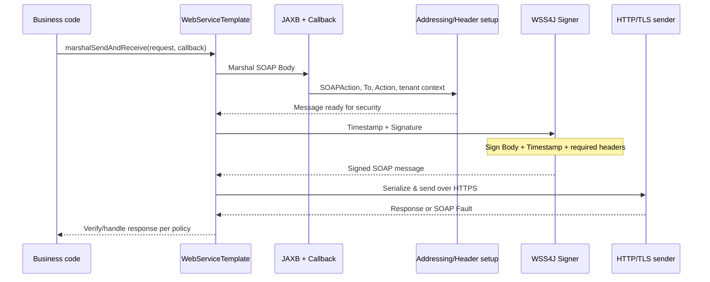

# Ký thông điệp gửi đi và lựa chọn các phần phải được bảo vệ

Trong tích hợp SOAP doanh nghiệp, gửi request qua HTTPS chưa đủ để chứng minh **những phần nào của SOAP message đã được bên gửi ký**, chữ ký còn hợp lệ khi đi qua trung gian, hay người nhận thực sự xử lý **chính nội dung đã được xác minh**. Một request có thể chứa SOAP Body, WS-Addressing headers, Timestamp, thông tin tenant, mã giao dịch và các phần đính kèm. Nếu ứng dụng ký nhầm phần tử — hoặc chỉ ký một header không liên quan — bộ kiểm chữ ký có thể trả “valid” nhưng dữ liệu quan trọng vẫn có nguy cơ bị thay đổi.

Bài học thuộc chương **WS-Security** của module **SPRING_WEB_SERVICES**, trong lộ trình phát triển dịch vụ SOAP theo hướng **contract-first** với XSD/WSDL, JAXB/OXM, endpoint và SOAP client, kết hợp SOAP Fault, interceptor, XML security, WS-Security, chứng chỉ và kiểm thử tương thích. Trọng tâm là **ký SOAP message gửi đi (outbound signing)** và **lựa chọn chính xác những phần cần được bảo vệ (signed parts)**: SOAP Body, Timestamp và các SOAP Header có ý nghĩa bảo mật hoặc định tuyến.

Chúng ta sẽ xây dựng một ví dụ `SubmitPayment`, phân tích XML Signature trên SOAP Envelope, cấu hình Spring-WS/WSS4J, tách quản lý private key khỏi truststore kiểm chữ ký, kiểm tra signed-parts policy ở bên nhận, xử lý MTOM/attachment và thiết kế kiểm thử chống signature wrapping/replay. Những đoạn code nêu rõ giả định phiên bản; **không sử dụng khóa thật, password thật hoặc chữ ký minh họa như tài liệu có hiệu lực mật mã**.

> **Nguyên tắc:** không chỉ kiểm “có `ds:Signature` và chữ ký hợp lệ”. Phải kiểm **ai ký, bằng khóa nào, thuật toán gì, những phần XML cụ thể nào được ký, timestamp/replay, và người xử lý nghiệp vụ có dùng đúng các phần đó hay không**.

## 1. Mục tiêu học tập

Sau bài này, bạn có thể:

1. Phân biệt HTTPS/mTLS với WS-Security XML Signature, XML Encryption, xác thực danh tính và phân quyền.
2. Xác định **signed parts** dựa vào contract và threat model: SOAP Body, `wsu:Timestamp`, WS-Addressing và các header nghiệp vụ ảnh hưởng quyền/định tuyến.
3. Đọc cấu trúc `wsse:Security`, `ds:Signature`, `SignedInfo`, `Reference`, `DigestValue`, `SignatureValue` và `SecurityTokenReference`.
4. Giải thích ID references, canonicalization, digest/signature algorithms và tác động của thay đổi namespace khi ký XML.
5. Cấu hình outbound signing bằng `Wss4jSecurityInterceptor` với private key/certificate và danh sách phần tử cần ký.
6. Phân biệt cấu hình **ký outbound** với **kiểm chữ ký inbound** và trust policy của đối tác.
7. Thiết kế kiểm tra chống **signature wrapping**, phần tử không được ký, replay, timestamp không hợp lệ và thuật toán yếu.
8. Xử lý SOAP 1.1/1.2, WS-Addressing, body JAXB, SOAP Fault và MTOM/attachment theo đúng khả năng tương thích.
9. Viết ma trận kiểm thử dương/âm xác nhận **chính xác phần được ký**, không chỉ xác nhận SOAP call thành công.
10. Vận hành khóa/chứng chỉ an toàn, không rò private key, token hoặc SOAP payload vào logs.

## 2. Tại sao cần ký thông điệp SOAP?

Giả sử dịch vụ nhận lệnh:

```xml
<pay:SubmitPaymentRequest
    xmlns:pay="urn:example:payments:v1">
    <pay:requestId>REQ-2026-001</pay:requestId>
    <pay:tenantId>TENANT-A</pay:tenantId>
    <pay:accountId>ACC-100</pay:accountId>
    <pay:amount>2500.00</pay:amount>
    <pay:currency>VND</pay:currency>
</pay:SubmitPaymentRequest>
```

Một request đi qua gateway, ESB hoặc hệ thống trung gian trước khi tới SOAP server. Các mục tiêu thường gặp:

- **Integrity:** giá trị `amount`, `accountId`, `tenantId` và các phần tử khác thuộc Body không bị thay đổi mà vẫn được chấp nhận như request gốc.
- **Message-level authentication:** bên nhận có thể kiểm chữ ký dựa trên public key/chứng chỉ của bên được cấp quyền ký.
- **Bảo vệ nội dung qua trung gian:** WS-Security signature có thể gắn với SOAP message thay vì chỉ một chặng TLS, nếu thông điệp không bị sửa ngoài những biến đổi được cho phép.
- **Định tuyến và ngữ cảnh:** nếu quyết định xử lý dựa trên `wsa:To`, `wsa:Action` hoặc tenant header, các giá trị đó cũng có thể cần được ký.
- **Chống replay:** một chữ ký hợp lệ trên nội dung cũ vẫn có thể bị gửi lại; cần Timestamp, replay cache, idempotency và policy thời gian.
- **Audit có thể xác minh:** hệ thống có thể ghi mã giao dịch, danh tính ký đã xác thực và digest an toàn theo policy, không cần lưu private key.

**Giới hạn:** chữ ký xác minh toàn vẹn của các phần đã ký và khả năng sử dụng private key; nó không tự chứng minh người có khóa **được phép** thực hiện mọi thao tác, không mã hóa dữ liệu và không ngăn replay nếu thiếu kiểm soát khác.

### 2.1. Một trường hợp ký “đúng” về mật mã nhưng sai về nghiệp vụ

SOAP Header có `ctx:TenantContext=TENANT-A` còn SOAP Body chứa `tenantId=TENANT-B`. Nếu chữ ký chỉ bảo vệ Body, nhưng server lại dùng Header để chọn database tenant, kẻ trung gian có thể thay đổi Header không được ký làm sai ngữ cảnh.

Đó là lý do policy không nên chỉ viết **“Require valid signature”**; nó phải nêu rõ **“Body và mọi header được tin để định tuyến/quyền phải được ký, phải khớp ngữ cảnh đã xác thực”**. Cũng cần bảo đảm **không có hai bản sao header cùng QName** khiến một phần được ký nhưng phần khác được business code sử dụng.

## 3. WS-Security khác HTTPS, mTLS và XML Encryption

| Cơ chế | Đối tượng bảo vệ | Bảo đảm chính | Không thay thế được |
|---|---|---|---|
| HTTPS/TLS | Kênh mạng giữa hai TLS peers | Bí mật/toàn vẹn khi truyền trên chặng đó, xác minh server | Chữ ký từng SOAP message qua nhiều trung gian |
| mTLS | Kênh TLS và certificate client | Xác thực peer TLS ở transport | Chứng minh Body/headers của message được ký riêng |
| WS-Security XML Signature | Các XML references được ký trong SOAP message | Toàn vẹn, bằng chứng sở hữu signing key theo trust policy | Mã hóa XML, chống replay tự động, authorization |
| WS-Security XML Encryption | Những XML elements/parts được mã hóa | Bí mật nội dung được chọn | Chữ ký/xác thực nếu không kết hợp |
| Timestamp + replay detection | Tính mới của message theo policy | Hạn chế replay trong cửa sổ thời gian | Kiểm toàn vẹn Body nếu Timestamp không được bảo vệ |
| Business authorization | Danh tính, tenant và quyền nghiệp vụ | Được phép thực hiện operation/tài nguyên | Tính toàn vẹn mật mã của SOAP message |
| XSD validation | SOAP Body/typed detail theo contract | Cấu trúc XML, kiểu, số phần tử, facet | Xác thực caller, kiểm signature hoặc quyền |

**Có thể cần TLS và WS-Security cùng lúc**: TLS bảo vệ kênh vận chuyển, WS-Security bảo vệ thông điệp theo chính sách giữa các bên. Không được tắt hostname verification vì “đã có XML Signature”; cũng không bỏ yêu cầu ký Body vì “mTLS đã xác thực đối tác”.

### 3.1. Ký không làm XML bí mật

`ds:Signature` thường có `DigestValue` và `SignatureValue`, nhưng SOAP Body có thể vẫn là XML **đọc được** nếu không có XML Encryption/transport encryption. Một bản SOAP chứa số tài khoản có chữ ký hợp lệ vẫn cần TLS, chính sách logging/retention và có thể cả XML Encryption khi qua nhiều trung gian không được phép đọc nội dung.

### 3.2. Không đồng nhất key sở hữu với phân quyền

Certificate ký chỉ hữu ích khi verifier:

1. Xác minh chữ ký bằng đúng public key.
2. Thiết lập trust tới đúng nhà phát hành/chứng chỉ/đối tác được phép.
3. Kiểm hiệu lực, mục đích sử dụng khóa, policy thu hồi nếu có.
4. Ánh xạ identity/trust sang role, tenant và operation được phép.
5. Đảm bảo nội dung Body/header đã ký tương ứng với identity và quyền ấy.

Chữ ký từ khóa hợp lệ của đối tác A không trao cho A quyền thay mặt mọi tenant.

## 4. Hợp đồng XSD/WSDL cho ví dụ SubmitPayment

Schema `payments-v1.xsd` rút gọn:

```xml
<?xml version="1.0" encoding="UTF-8"?>
<xs:schema xmlns:xs="http://www.w3.org/2001/XMLSchema"
           xmlns:pay="urn:example:payments:v1"
           targetNamespace="urn:example:payments:v1"
           elementFormDefault="qualified">

    <xs:simpleType name="RequestIdType">
        <xs:restriction base="xs:token">
            <xs:pattern value="REQ-[0-9]{4}-[0-9]{3}"/>
        </xs:restriction>
    </xs:simpleType>

    <xs:element name="SubmitPaymentRequest">
        <xs:complexType>
            <xs:sequence>
                <xs:element name="requestId"
                            type="pay:RequestIdType"/>
                <xs:element name="tenantId" type="xs:string"/>
                <xs:element name="accountId" type="xs:string"/>
                <xs:element name="amount" type="xs:decimal"/>
                <xs:element name="currency" type="xs:string"/>
            </xs:sequence>
        </xs:complexType>
    </xs:element>

    <xs:element name="SubmitPaymentResponse">
        <xs:complexType>
            <xs:sequence>
                <xs:element name="requestId"
                            type="pay:RequestIdType"/>
                <xs:element name="paymentId" type="xs:string"/>
                <xs:element name="accepted" type="xs:boolean"/>
            </xs:sequence>
        </xs:complexType>
    </xs:element>
</xs:schema>
```

Hợp đồng WSDL 1.1 có thể định nghĩa operation `SubmitPayment`, input part trỏ `pay:SubmitPaymentRequest`, output part trỏ `pay:SubmitPaymentResponse`, SOAP binding document/literal và action `urn:example:payments:SubmitPayment`.

```text
Business request QName:
  {urn:example:payments:v1}SubmitPaymentRequest

Business response QName:
  {urn:example:payments:v1}SubmitPaymentResponse

SOAP Body:
  {http://schemas.xmlsoap.org/soap/envelope/}Body (SOAP 1.1)

WS-Security Timestamp:
  {http://docs.oasis-open.org/wss/2004/01/
   oasis-200401-wss-wssecurity-utility-1.0.xsd}Timestamp
```

**XSD hợp lệ và chữ ký hợp lệ là hai kiểm tra độc lập.** WSDL/XSD không tự tạo WS-Security Signature. Nếu service yêu cầu signed parts, các bên phải thống nhất policy qua WS-SecurityPolicy, tài liệu tích hợp hoặc cấu hình profile có hợp đồng rõ ràng, rồi viết test xác minh wire message.

### 4.1. Khi có SOAP Header nghiệp vụ

Ví dụ thêm header:

```xml
<ctx:TenantContext
    xmlns:ctx="urn:example:context:v1">
    <ctx:tenantId>TENANT-A</ctx:tenantId>
    <ctx:channel>FINANCE</ctx:channel>
</ctx:TenantContext>
```

Header `TenantContext` thuộc **schema/policy riêng**; nó không được tự tạo trong Body XSD ở trên. Nếu endpoint dùng nó để quyết định tenant/quyền, phải ràng buộc với identity đã xác thực và **ký chính header này nếu yêu cầu toàn vẹn qua message**.

### 4.2. Không thay đổi XSD Body chỉ để chứa chữ ký

`ds:Signature` nằm trong `wsse:Security` của **SOAP Header**, không phải một field business như `pay:signature` trong `SubmitPaymentRequest`. Việc đưa một chuỗi `signature` vào Body tự chế **không tương đương WS-Security XML Signature** nếu không có chuẩn SignedInfo, Reference, canonicalization và trust policy đúng.

## 5. Mô hình SOAP Envelope trước và sau ký

Trước ký (SOAP 1.1):

```xml
<soap:Envelope xmlns:soap="http://schemas.xmlsoap.org/soap/envelope/"
               xmlns:pay="urn:example:payments:v1">
    <soap:Header/>
    <soap:Body>
        <pay:SubmitPaymentRequest>
            <pay:requestId>REQ-2026-001</pay:requestId>
            <pay:tenantId>TENANT-A</pay:tenantId>
            <pay:accountId>ACC-100</pay:accountId>
            <pay:amount>2500.00</pay:amount>
            <pay:currency>VND</pay:currency>
        </pay:SubmitPaymentRequest>
    </soap:Body>
</soap:Envelope>
```

Sau ký, một phiên bản **minh họa cấu trúc** có dạng:

```xml
<soap:Envelope
    xmlns:soap="http://schemas.xmlsoap.org/soap/envelope/"
    xmlns:wsse="http://docs.oasis-open.org/wss/2004/01/oasis-200401-wss-wssecurity-secext-1.0.xsd"
    xmlns:wsu="http://docs.oasis-open.org/wss/2004/01/oasis-200401-wss-wssecurity-utility-1.0.xsd"
    xmlns:ds="http://www.w3.org/2000/09/xmldsig#"
    xmlns:pay="urn:example:payments:v1">
    <soap:Header>
        <wsse:Security soap:mustUnderstand="1">
            <wsu:Timestamp wsu:Id="TS-1">
                <wsu:Created>2026-11-27T02:00:00Z</wsu:Created>
                <wsu:Expires>2026-11-27T02:05:00Z</wsu:Expires>
            </wsu:Timestamp>
            <ds:Signature>
                <ds:SignedInfo>
                    <ds:CanonicalizationMethod
                        Algorithm="http://www.w3.org/2001/10/xml-exc-c14n#"/>
                    <ds:SignatureMethod
                        Algorithm="http://www.w3.org/2001/04/xmldsig-more#rsa-sha256"/>
                    <ds:Reference URI="#Body-1">
                        <ds:Transforms>
                            <ds:Transform
                                Algorithm="http://www.w3.org/2001/10/xml-exc-c14n#"/>
                        </ds:Transforms>
                        <ds:DigestMethod
                            Algorithm="http://www.w3.org/2001/04/xmlenc#sha256"/>
                        <ds:DigestValue>BASE64_DIGEST_EXAMPLE</ds:DigestValue>
                    </ds:Reference>
                    <ds:Reference URI="#TS-1">
                        <ds:DigestMethod
                            Algorithm="http://www.w3.org/2001/04/xmlenc#sha256"/>
                        <ds:DigestValue>BASE64_DIGEST_EXAMPLE</ds:DigestValue>
                    </ds:Reference>
                </ds:SignedInfo>
                <ds:SignatureValue>BASE64_SIGNATURE_EXAMPLE</ds:SignatureValue>
                <ds:KeyInfo>
                    <wsse:SecurityTokenReference>
                        <wsse:Reference URI="#Cert-1"/>
                    </wsse:SecurityTokenReference>
                </ds:KeyInfo>
            </ds:Signature>
        </wsse:Security>
    </soap:Header>
    <soap:Body wsu:Id="Body-1">
        <pay:SubmitPaymentRequest>
            <pay:requestId>REQ-2026-001</pay:requestId>
            <pay:tenantId>TENANT-A</pay:tenantId>
            <pay:accountId>ACC-100</pay:accountId>
            <pay:amount>2500.00</pay:amount>
            <pay:currency>VND</pay:currency>
        </pay:SubmitPaymentRequest>
    </soap:Body>
</soap:Envelope>
```

**Quan trọng:** đây là **sơ đồ XML minh họa, không phải một chữ ký thực hoặc mẫu WS-Security có thể kiểm bằng mật mã**. Các URI namespace và thuật toán được giữ nguyên, nhưng `DigestValue`/`SignatureValue` chỉ là placeholder, `Cert-1` chưa có `BinarySecurityToken` tương ứng và chưa đầy đủ các transforms/metadata mà một profile có thể yêu cầu. **Chỉ dùng WSS4J/XML Security library để sinh chữ ký thực.**

### 5.1. Điều gì phải có trong message thật?

Tùy policy:

- `wsse:Security` được đặt trong SOAP Header dành cho vai trò/node thích hợp.
- `wsu:Timestamp` có `Created` và `Expires` phù hợp clock skew/lifetime.
- SOAP Body có reference ID được xử lý theo quy tắc XML ID.
- `ds:SignedInfo` chứa **một `Reference` cho mỗi phần được ký** (hoặc một reference bao phủ cấu trúc được yêu cầu).
- `SignatureValue` được tạo từ private key theo thuật toán đã thống nhất.
- `KeyInfo`/`SecurityTokenReference` giúp bên nhận tìm public key/certificate phù hợp; kiểu tham chiếu phụ thuộc policy.
- Người nhận **không chỉ xác minh toán học** mà còn kiểm certificate trust, thời gian, replay, signed parts và authorization.

**Không tự nối chuỗi XML ở trên rồi phát tới production.** Cần framework hỗ trợ chuẩn, canonicalization, key identifier, certificate chain và các biến thể SOAP version.

## 6. Chọn những phần nào phải được ký?

Câu hỏi “ký SOAP Body hay ký cả Envelope?” cần được thay bằng **“phần tử nào nếu bị thay đổi sẽ làm sai quyết định nhận, định tuyến, bảo mật hoặc nghiệp vụ?”**. Một policy tốt chọn rõ QName hoặc đường dẫn tham chiếu phù hợp, không đơn thuần ký mọi node để “cho chắc” mà bỏ qua khả năng tương thích của intermediaries.

| Phần SOAP/message | Có nên ký? | Tại sao/điều kiện |
|---|---|---|
| **SOAP Body** | **Gần như luôn có** trong operation bảo mật thông điệp | Bảo vệ request/response nghiệp vụ, amount, tài khoản, quyền liên quan |
| **`wsu:Timestamp`** | **Nên ký** khi dùng Timestamp chống sửa hạn hiệu lực | Không cho attacker kéo dài/ngắn thời gian mà vẫn hợp lệ |
| `wsa:To` | Khi routing/recipient policy dựa vào nó | Chặn sửa đích trong message |
| `wsa:Action` | Khi dispatcher/security dựa vào Action | Chặn sửa loại operation logic |
| `wsa:MessageID` | Khi dùng cho correlation/replay/dedup | Bảo vệ message identity |
| `wsa:ReplyTo`/`FaultTo` | Khi điều khiển kênh trả lời hoặc phân phối lỗi | Tránh redirect response/fault |
| `wsa:RelatesTo` trên response | Khi dùng để liên kết request/response | Tránh mix-up correlation |
| `ctx:TenantContext` | Khi ảnh hưởng tenant, quyền, dữ liệu | Bảo vệ identity context; vẫn phải xác thực nguồn |
| `ctx:BusinessApproval` | Khi ảnh hưởng workflow phê duyệt | Bảo vệ ý nghĩa chấp thuận |
| `wsse:SecurityTokenReference`/token | Theo WS-SecurityPolicy/profile | Cần ràng buộc đúng signing identity/token, tránh thay thế key/token |
| `SOAPAction` HTTP header | **Không thể coi như XML signed part** | Không nằm trong SOAP Envelope; cần kiểm nhất quán với signed `wsa:Action`/Body và transport |
| HTTP `Host`, request path | Không nằm trong XML Signature thông thường | Dùng TLS, HTTP routing/trust và gateway policy |
| MTOM/SwA binary attachments | **Phải xét riêng** nếu bytes là dữ liệu cần bảo vệ | Cần profile ký attachment/MTOM có hỗ trợ |
| XML namespace prefix | Không chọn bằng prefix text | Chính sách dựa namespace URI + local name/ID, không hard-code prefix |
| `soap:Envelope` toàn bộ | Không mặc định | Ký đúng Body/headers cần thiết thường kiểm soát hơn, tránh break do intermediary |

**Chỉ ký Body** có thể đủ cho một operation đơn giản nếu mọi header khác chỉ là metadata không ảnh hưởng bảo mật và không có replay risk. Với payment/service phê duyệt, **Body + Timestamp + header bảo mật/định tuyến cụ thể** thường là policy hợp lý hơn. Quyết định cuối phải dựa vào **hợp đồng đối tác và threat model** chứ không dựa vào thói quen cấu hình.

### 6.1. Signed parts là allowlist trách nhiệm, không phải danh sách trang trí

Nếu SOAP message có `ctx:TenantContext` chưa ký nhưng authentication interceptor lại lấy tenant từ đó, server có thể chấp nhận identity không ràng buộc với chữ ký. Ngược lại, thêm một header độc lập không được business dùng không nhất thiết phải ký; ký quá nhiều header mà intermediary có quyền cập nhật sẽ tạo lỗi liên thông. Mỗi header phải có **owner**, **ngữ nghĩa**, **policy bắt buộc ký hay không** và **test**.

## 7. Ký toàn bộ SOAP Body hay chỉ phần tử nghiệp vụ?

SOAP Body chứa phần tử nghiệp vụ `pay:SubmitPaymentRequest`. Có hai cách tư duy:

- **Ký SOAP Body element**: reference tới `{SOAP-ENVELOPE-NS}Body` (thường được WSS4J hỗ trợ bằng part selector), bao trùm cấu trúc Body phù hợp với SOAP processing model.
- **Ký riêng business payload root**: reference tới `{urn:example:payments:v1}SubmitPaymentRequest` nếu profile yêu cầu, nhưng phải đảm bảo verifier/endpoint không chấp nhận payload chưa ký hoặc một phần tử nghiệp vụ khác cùng tên.

Trong nhiều WS-Security integrations, **ký Body** là mục tiêu thông thường vì SOAP Body là phần sẽ được endpoint xử lý. Nếu ký đúng một node con nhưng server chấp nhận các node khác hoặc cách bọc khác, rủi ro **signature wrapping/element substitution** sẽ tăng.

**Không biến quy tắc thành “ký mọi descendant bằng từng Reference”**: reference XML Signature cho phần tử bao gồm nội dung descendant theo canonicalization đúng có thể bảo vệ cả nội dung. Điều quan trọng là **verifier phải kiểm đúng vị trí/ID của phần tử được ký** và endpoint dùng đúng node ấy.

### 7.1. SOAP 1.1 và SOAP 1.2 khác QName của Body

```text
SOAP 1.1 Body:
{http://schemas.xmlsoap.org/soap/envelope/}Body

SOAP 1.2 Body:
{http://www.w3.org/2003/05/soap-envelope}Body
```

Nếu cấu hình ký part theo SOAP 1.1 namespace mà message factory gửi SOAP 1.2, WSS4J có thể không tìm được Body theo selector hoặc policy không khớp. **Không chỉ đổi Content-Type**: kiểm Envelope namespace, WSDL binding và signed-parts selector cho đúng version.

## 8. Vì sao phải ký `wsu:Timestamp`?

Timestamp có thể có:

```xml
<wsu:Timestamp
    xmlns:wsu="http://docs.oasis-open.org/wss/2004/01/oasis-200401-wss-wssecurity-utility-1.0.xsd"
    wsu:Id="TS-101">
    <wsu:Created>2026-11-27T02:00:00Z</wsu:Created>
    <wsu:Expires>2026-11-27T02:05:00Z</wsu:Expires>
</wsu:Timestamp>
```

Timestamp giúp giới hạn tuổi đời message. Nhưng nếu **Timestamp không được ký**, một bên có khả năng sửa XML có thể thay `Created`/`Expires` mà chữ ký trên Body vẫn hợp lệ. Vì vậy, nếu Timestamp dùng để ra quyết định security, policy thường yêu cầu **Timestamp nằm trong signed parts**.

**Ký Timestamp không tự chống replay hoàn toàn.** Một attacker sao chép nguyên request đã ký và gửi lại trong cùng cửa sổ thời gian: chữ ký và Timestamp vẫn có thể hợp lệ. Bên nhận cần:

- Cửa sổ `Created/Expires` và clock skew hợp lý.
- Replay detection theo message ID, nonce/token/timestamp/digest theo profile.
- Định danh bên ký/tenant gắn với key của replay cache.
- **Idempotency** với operation có side effect như `SubmitPayment`.
- Giới hạn số lần, rate limit và audit anomaly.

### 8.1. Thời gian do ai quyết định?

Bên gửi tạo timestamp từ clock đồng bộ; bên nhận **xác minh** theo clock và policy của chính mình. Không lấy giá trị `Expires` do bên gửi khai rồi dùng làm thời hạn vô hạn. Nếu hệ thống đồng hồ lệch quá lớn, cần sửa NTP/clock skew policy có kiểm soát, không tắt Timestamp validation để các request “qua được”.

## 9. WS-Addressing: khi nào ký To, Action, MessageID, ReplyTo?

Các header WS-Addressing có namespace chuẩn phụ thuộc profile (thường dùng `http://www.w3.org/2005/08/addressing`). Ví dụ:

```xml
<wsa:To xmlns:wsa="http://www.w3.org/2005/08/addressing">
    https://partner.example.org/soap/payments
</wsa:To>
<wsa:Action xmlns:wsa="http://www.w3.org/2005/08/addressing">
    urn:example:payments:SubmitPayment
</wsa:Action>
<wsa:MessageID xmlns:wsa="http://www.w3.org/2005/08/addressing">
    urn:uuid:9f2e-example-id
</wsa:MessageID>
```

Đây là ví dụ nội dung header, **không phải một Envelope đầy đủ** và MessageID chỉ là chuỗi minh họa. Nếu một gateway dùng `wsa:To` để chọn đích hoặc backend dùng `wsa:Action` để quyết định operation, các giá trị này **cần được bảo vệ theo policy**; ký Body mà bỏ qua signed routing headers có thể để lộ lỗ hổng thay đổi đích/thao tác.

### 9.1. Liên hệ HTTP SOAPAction và WS-Addressing Action

SOAPAction (SOAP 1.1 HTTP header) và `wsa:Action` (SOAP Header) là **hai vị trí khác nhau**. XML Signature trên `wsa:Action` **không tự ký HTTP SOAPAction**. Một gateway/endpoint nên kiểm sự nhất quán theo binding và không thực thi operation chỉ dựa trên một HTTP header không được ràng buộc với signed SOAP content.

### 9.2. ReplyTo/FaultTo quan trọng nếu endpoint tin dùng

Với request–response thông thường, response có thể đi trên cùng HTTP connection. Nhưng khi dùng WS-Addressing asynchronous routing/callback, `ReplyTo` hoặc `FaultTo` có thể điều khiển nơi gửi kết quả/lỗi. **Nếu hệ thống tin các giá trị này**, phải có allowlist/authorization cho endpoint và yêu cầu ký header theo policy; ký header vẫn **không** cấp quyền tự do gửi data tới mọi URL bên ngoài.

### 9.3. Trên response ký những gì?

Nếu server ký response, thường cần bảo vệ **SOAP Body**, Timestamp và các header như `wsa:RelatesTo` khi client dùng chúng để ghép response với request. Client phải kiểm signature issuer và correlation context; không chỉ kiểm chữ ký có hợp lệ về toán học.

## 10. Header nghiệp vụ: đánh giá theo ảnh hưởng, không theo tên

Giả sử gateway gắn header:

```xml
<ctx:PaymentContext
    xmlns:ctx="urn:example:context:v1">
    <ctx:tenantId>TENANT-A</ctx:tenantId>
    <ctx:approvalLevel>2</ctx:approvalLevel>
</ctx:PaymentContext>
```

Policy cần trả lời:

1. **Ai tạo header?** Caller, gateway đáng tin hay server?
2. **Ai sử dụng?** Security filter, tenant resolver, business method hay chỉ logging?
3. **Giá trị có ảnh hưởng đến quyền, tiền, tài khoản, đích/operation hay không?**
4. **Header có thể được một intermediary được phép thay đổi không?** Nếu có, message-level signature cần được thiết kế theo vai trò và ký lại có kiểm soát.
5. **Một bản sao không ký có được accepted?** Nếu không, verifier phải kiểm đúng signed instance.
6. **Ngữ nghĩa có được mô tả trong WSDL/policy và kiểm bởi client?**

Không dùng một trường `ctx:tenantId` do client tự khai làm bằng chứng khách hàng đã xác thực. Dù header được **ký**, nó chỉ trở thành thông tin đáng tin khi signing identity được kiểm và được ủy quyền cho tenant tương ứng.

### 10.1. Không ký thông tin “được kỳ vọng thay đổi” giữa các node mà không thống nhất

Một intermediary hợp lệ có thể thêm tracing header riêng hoặc cập nhật hop-specific metadata. Nếu policy bắt buộc ký những header này ngay từ sender, một thay đổi hợp lệ sẽ phá chữ ký. Hãy phân biệt:

- **End-to-end protected:** Body, business-critical headers, Timestamp theo policy.
- **Hop-by-hop metadata:** HTTP headers/tracing được quản lý ở transport/trust zone.
- **Intermediary-signed:** mỗi bước ký thêm phần trách nhiệm của mình, cần policy rõ ai được ký/xác minh.

Không áp dụng “ký toàn bộ Envelope” như khẩu hiệu chung rồi gây lỗi tương thích khi proxy đổi SOAP Header không liên quan.

## 11. Cơ chế XML Signature bên trong WS-Security

Một `ds:Signature` thường chứa:

```text
ds:Signature
  ds:SignedInfo
    ds:CanonicalizationMethod
    ds:SignatureMethod
    ds:Reference URI="#Body-1"
      ds:Transforms
      ds:DigestMethod
      ds:DigestValue
    ds:Reference URI="#TS-1"
      ...
  ds:SignatureValue
  ds:KeyInfo
    wsse:SecurityTokenReference
```

Trình tự khái niệm:

1. Chọn các XML nodes phải ký; gán/nhận diện IDs phù hợp (thường `wsu:Id`).
2. Canonicalize dữ liệu của từng `Reference` theo transforms.
3. Tính digest cho mỗi Reference (ví dụ SHA-256).
4. Canonicalize `SignedInfo`.
5. Dùng **private key** của sender tạo `SignatureValue` theo thuật toán ký.
6. Đưa signature và key reference/certificate token vào `wsse:Security` theo profile.
7. Receiver resolve chính xác các Reference, tính lại digest, xác minh `SignatureValue` bằng public key rồi áp **signed-parts/trust/authorization/replay policy**.

### 11.1. Digest khác SignatureValue

- **DigestValue**: giá trị hash của từng phần tử đã được canonicalize; không phải chữ ký bằng private key.
- **SignatureValue**: kết quả phép ký trên `SignedInfo` đã canonicalize bằng private key.
- **KeyInfo/SecurityTokenReference**: cách tìm khóa/chứng chỉ; nội dung đó **không tự chứng minh trust**.

Một message có thể có SignatureValue hợp lệ với một certificate tự ký không được phê duyệt; verifier **phải từ chối** nếu certificate/trust policy không chấp nhận.

### 11.2. Canonicalization giải quyết bài toán nào?

XML có nhiều biểu diễn text tương đương về cấu trúc: thứ tự thuộc tính, cách khai báo namespace, khoảng trắng trong một số vị trí. **Canonical XML (C14N)** định nghĩa một cách biểu diễn có quy tắc để băm/ký. WSS4J thường hỗ trợ các biến thể exclusive canonicalization theo profile.

Tuy vậy:

- **Không mặc định mọi thay đổi prefix đều vô hại với signature**; namespace declarations và canonicalization context có thể ảnh hưởng byte canonicalized.
- **Không format lại signed message** tùy ý bằng DOM pretty-printer hoặc Transformer sau khi ký.
- **Không thay whitespace bên trong text node** của payload và hy vọng digest không đổi.
- **Không đổi ID/namespace/element order** sau ký.
- Dùng thư viện chuẩn xử lý transforms; không tự viết “chuyển XML thành String rồi SHA-256”.

## 12. ID references và nguy cơ XML Signature Wrapping

Trong ví dụ ký Body, `Reference URI="#Body-1"` thường trỏ tới phần tử có `wsu:Id="Body-1"`. Verifier phải xác định **duy nhất đúng phần tử đó** và đảm bảo nó là **Body thực mà SOAP endpoint sẽ xử lý**.

Một nguy cơ signature wrapping (minh họa ý tưởng, không phải payload exploit hoàn chỉnh):

```text
SOAP Header:
    một phần tử được ký, mang Id="Body-1"
SOAP Body:
    một phần tử nghiệp vụ khác, chưa được ký
Verifier:
    xác minh phần tử có Id="Body-1" -> valid
Application:
    lại xử lý SOAP Body chưa được ký
```

Những nguyên tắc phòng vệ:

1. **Không dùng XPath chỉ theo local-name** để chọn node nghiệp vụ; kiểm namespace URI và vị trí hợp lệ trong SOAP processing model.
2. Không chấp nhận ID trùng hoặc ID resolution mơ hồ.
3. Kiểm **signed part coverage**: SOAP Body được endpoint tiêu thụ thực sự nằm trong tập nodes được ký.
4. Kiểm header `mustUnderstand`/role/actor đúng quy tắc SOAP.
5. Không tự lựa chọn “node đầu tiên có tên SubmitPaymentRequest” trong bất kỳ vùng XML nào.
6. Dùng security library được duy trì và cấu hình policy ở receiver; **signature valid** chưa đủ nếu business layer chọn node khác.
7. Test thay đổi nội dung Body, duplicate headers và unsigned alternatives phải bị từ chối.

### 12.1. Tham chiếu ID không phải URL fetch schema

`URI="#Body-1"` là reference **nội bộ trong tài liệu**, không phải HTTP URL để tải schema. Nhưng XML Signature cũng có thể hỗ trợ các kiểu reference khác; ứng dụng phải **hạn chế dereferencing, transforms và external URI** theo policy, không cho một chữ ký do đối tác gửi buộc verifier tải tài nguyên ngoài hoặc chọn nguồn dữ liệu ngoài SOAP message.

Đây là bề mặt tấn công riêng với `xsi:schemaLocation`, cần cấu hình XML security engine phù hợp.

## 13. Ký SOAP 1.1 và SOAP 1.2: không chọn part theo prefix

SOAP 1.1 dùng:

```text
{http://schemas.xmlsoap.org/soap/envelope/}Body
```

SOAP 1.2 dùng:

```text
{http://www.w3.org/2003/05/soap-envelope}Body
```

Còn WS-Security utility Timestamp thường là:

```text
{http://docs.oasis-open.org/wss/2004/01/
 oasis-200401-wss-wssecurity-utility-1.0.xsd}Timestamp
```

**Các URI được ngắt dòng ở prose để dễ đọc; khi cấu hình QName phải dùng chuỗi liền không có dấu cách/ngắt dòng.**

Ví dụ một request dùng prefix `s` thay `soap` nhưng cùng namespace SOAP 1.1:

```xml
<s:Body
    xmlns:s="http://schemas.xmlsoap.org/soap/envelope/">
    <p:SubmitPaymentRequest
        xmlns:p="urn:example:payments:v1">
        <p:requestId>REQ-2026-001</p:requestId>
        <p:tenantId>TENANT-A</p:tenantId>
        <p:accountId>ACC-100</p:accountId>
        <p:amount>2500.00</p:amount>
        <p:currency>VND</p:currency>
    </p:SubmitPaymentRequest>
</s:Body>
```

Đây vẫn là cùng **expanded QName** của Body và payload. WSS4J part selector nên dùng namespace URI/local name hoặc ID reference chuẩn, không tìm một chuỗi literal `<soap:Body>`.

Không suy từ XML prefix rằng chữ ký chắc chắn vẫn hợp lệ sau mọi phép rewrite: **QName equivalence** liên quan schema/routing, còn **SignatureValue/digest** phụ thuộc canonicalization thực tế.

## 14. Khóa ký, certificate và truststore: tách ba trách nhiệm

Một SOAP signer có thể sử dụng private key nằm trong keystore PKCS#12, JKS hoặc một hệ thống HSM/KMS thông qua tích hợp tương thích. Để ký outbound, ứng dụng cần:

- **Private key** do bên gửi kiểm soát, với quyền truy cập hạn chế.
- **Alias/identifier** xác định khóa ký trong keystore/provider.
- **Password/unlock callback** nếu cơ chế lưu khóa yêu cầu.
- **Chứng chỉ/public key** gắn với private key, theo WS-SecurityPolicy.
- **Crypto provider** (ví dụ WSS4J `Crypto`) biết cách lấy khóa/chứng chỉ.
- **Rotation** và cơ chế thay chứng chỉ mà không để lộ key material.

Bên nhận cần:

- Cơ chế tìm public key/chứng chỉ của người gửi.
- **Trust anchors/pinning/allowlist** phù hợp với từng đối tác.
- Kiểm valid time, KeyUsage/EKU theo chính sách, revocation nếu yêu cầu.
- Bản đồ **certificate → partner/tenant/role** có kiểm soát.
- Cho phép **nhiều certificate** trong giai đoạn rotation nếu đã phê duyệt, không mở trust chung.
- Chặn key và thuật toán không còn được chấp nhận.

| Thành phần | Vai trò | Điều không được làm |
|---|---|---|
| Outbound private key | Tạo SignatureValue | Ghi private key/keystore password vào Git/log |
| Certificate/public key của signer | Giúp bên nhận xác minh | Coi certificate bất kỳ trong message là trusted |
| Truststore/anchors | Quyết định certificate nào được tin | Tin tất cả/self-signed bất kỳ để “pass test” |
| Key alias | Chọn key phù hợp đối tác/operation | Để caller tự chọn alias từ SOAP Header không tin cậy |
| Key password callback | Mở khóa private key | Trả secret cho mọi callback không xác định |
| Signature algorithm policy | Bảo đảm mức mật mã được hỗ trợ | Cho phép SHA-1/MD5 hoặc thuật toán yếu chỉ vì legacy |

**Private key ký** và **truststore xác minh** là hai trách nhiệm khác nhau. Không dùng password của keystore như secret đưa vào SOAP Body. Certificate trong `wsse:BinarySecurityToken` nếu có là thông tin public, nhưng vẫn phải được xác minh chain/trust; sự xuất hiện của nó không tự tạo quyền truy cập.

### 14.1. Thuật toán ký và digest

Trong tích hợp hiện đại, một lựa chọn phổ biến là **SHA-256 digest** và **RSA-SHA256 signature** với khóa đủ mạnh nếu hai bên hỗ trợ và policy cho phép. Các profile dùng ECDSA/RSA-PSS có thể có quy tắc và mức hỗ trợ khác nhau, cần interoperability test trước khi bật.

Không áp một thuật toán tùy tiện nếu đối tác chỉ hỗ trợ WS-SecurityPolicy cụ thể; nhưng cũng **không hạ thuật toán** theo một thông điệp yêu cầu không tin cậy. Những ngoại lệ legacy phải được phê duyệt, cô lập, có ngày bỏ và test rõ ràng.

## 15. Spring-WS/WSS4J: ký SOAP request ở phía client

Trên stack Spring-WS tương thích với Apache WSS4J 2 và Spring Boot 3/Jakarta, một interceptor thường dùng là:

```java
import org.springframework.ws.soap.security.wss4j2.Wss4jSecurityInterceptor;
```

Đây là lớp **WS-Security interceptor** có thể dùng trong client interceptor chain của `WebServiceTemplate`. Các API chi tiết cần được đối chiếu với Spring-WS/WSS4J version thực tế do BOM resolve; tránh trộn package `wss4j` cũ với `wss4j2` khi nâng cấp.

### 15.1. Cấu hình minh họa Body + Timestamp

```java
package org.example.payments.security;

import javax.security.auth.callback.CallbackHandler;

import org.apache.wss4j.common.crypto.Crypto;
import org.springframework.context.annotation.Bean;
import org.springframework.context.annotation.Configuration;
import org.springframework.ws.soap.security.wss4j2.Wss4jSecurityInterceptor;

@Configuration
public class OutboundWsSecurityConfiguration {

    private static final String SOAP11 =
        "http://schemas.xmlsoap.org/soap/envelope/";

    private static final String WSU =
        "http://docs.oasis-open.org/wss/2004/01/" +
        "oasis-200401-wss-wssecurity-utility-1.0.xsd";

    @Bean
    public Wss4jSecurityInterceptor paymentSigningInterceptor(
            Crypto outboundSigningCrypto,
            CallbackHandler signingKeyPasswordCallback) {

        Wss4jSecurityInterceptor interceptor =
            new Wss4jSecurityInterceptor();

        interceptor.setSecurementActions(
            "Timestamp Signature"
        );

        interceptor.setSecurementSignatureUser(
            "payment-client-signing-key"
        );

        interceptor.setSecurementSignatureCrypto(
            outboundSigningCrypto
        );

        interceptor.setSecurementCallbackHandler(
            signingKeyPasswordCallback
        );

        interceptor.setSecurementSignatureKeyIdentifier(
            "DirectReference"
        );

        interceptor.setSecurementSignatureParts(
            "{Element}{" + SOAP11 + "}Body;" +
            "{Element}{" + WSU + "}Timestamp"
        );

        return interceptor;
    }
}
```

Đây là **mẫu cấu hình theo API WSS4J2 ở mức học thuật**: `Crypto` và `CallbackHandler` được cấp thành bean riêng; không có private key/password trong source. `payment-client-signing-key` là **alias giả định**, phải khớp keystore/provider thật. Cấu hình `securementSignatureParts` chỉ định **hai phần tử** phải ký qua cú pháp lựa chọn phần tử của WSS4J: `{Element}{namespaceURI}localName`, phân tách bởi dấu `;`. Với SOAP 1.2, cần đổi SOAP Body namespace selector và test stack tương ứng.

**Cẩn trọng với thứ tự và khả năng hỗ trợ:** `"Timestamp Signature"` thể hiện ý định tạo Timestamp trước rồi ký, nhưng semantics cuối cùng phụ thuộc engine, version và outbound policy; hãy kiểm **raw SOAP message thực** có `Reference` tới đúng Body và Timestamp. Chỉ set một property trong bean không chứng minh toàn bộ policy đã đạt.

### 15.2. Đăng ký interceptor với `WebServiceTemplate`

```java
import org.springframework.context.annotation.Bean;
import org.springframework.context.annotation.Configuration;
import org.springframework.oxm.jaxb.Jaxb2Marshaller;
import org.springframework.ws.client.core.WebServiceTemplate;
import org.springframework.ws.client.support.interceptor.ClientInterceptor;
import org.springframework.ws.soap.security.wss4j2.Wss4jSecurityInterceptor;

@Configuration
public class PaymentClientConfiguration {

    @Bean
    public WebServiceTemplate paymentWebServiceTemplate(
            Jaxb2Marshaller paymentMarshaller,
            Wss4jSecurityInterceptor paymentSigningInterceptor) {

        WebServiceTemplate template =
            new WebServiceTemplate();

        template.setMarshaller(paymentMarshaller);
        template.setUnmarshaller(paymentMarshaller);

        template.setDefaultUri(
            "https://partner.example.org/soap/payments"
        );

        template.setInterceptors(
            new ClientInterceptor[] {
                paymentSigningInterceptor
            }
        );

        return template;
    }
}
```

Cấu hình `Jaxb2Marshaller` và generated JAXB request `SubmitPaymentRequest` theo XSD cần được tạo riêng. **ClientInterceptor** khác **server EndpointInterceptor**; không gắn trực tiếp `PayloadLoggingInterceptor` server vào client array.

Nếu đã có nhiều interceptors (WS-Addressing, metadata, signing, logging), **thứ tự tạo/sửa SOAP Header trước khi ký** rất quan trọng. Phải bảo đảm mọi header bắt buộc ký đã tồn tại **trước khi WSS4J tính digest**, và không interceptor sau đó sửa signed XML. Spring-WS xử lý thứ tự callback/interceptor theo stack/version; test wire là nguồn xác nhận cuối cùng.

### 15.3. SOAPAction không nằm trong XML Signature

Với SOAP 1.1, ứng dụng có thể đặt SOAPAction bằng callback:

```java
import org.springframework.ws.soap.SoapMessage;

Object result = paymentWebServiceTemplate.marshalSendAndReceive(
    request,
    message -> {
        if (message instanceof SoapMessage soap) {
            soap.setSoapAction(
                "urn:example:payments:SubmitPayment"
            );
        }
    }
);
```

Đây là đoạn client call giả định có `request` JAXB, `paymentWebServiceTemplate` đã inject. Đặt SOAPAction **không ký HTTP header** đó. Nếu operation routing cần chống sửa message-level, thêm WS-Addressing `Action` đã ký và kiểm tương quan với binding/Body theo policy.

## 16. Triển khai `Crypto` và callback mà không lộ private key

Các library có thể đọc keystore PKCS#12/JKS bằng provider `Crypto`. Quan trọng nhất là **phân tách cấu hình public, credential và policy**:

```text
Runtime configuration / secrets manager:
  signingKeyAlias          = payment-client-signing-key
  signingKeyStoreLocation  = protected resource or HSM reference
  signingKeyStoreType      = PKCS12 (nếu dùng file)
  signingKeyStorePassword  = secret injected securely
  signingPrivateKeyPassword= secret injected securely

Application beans:
  outboundSigningCrypto    -> giải quyết khóa ký
  signingKeyPasswordCallback -> chỉ trả password cho alias được phép

No secrets in:
  source code, YAML committed to git,
  exception message, SOAP Body, structured logs, test fixture.
```

### 16.1. Callback theo đúng alias và mục đích

Một password callback theo WSS4J có thể trông như sau:

```java
package org.example.payments.security;

import java.io.IOException;

import javax.security.auth.callback.Callback;
import javax.security.auth.callback.CallbackHandler;
import javax.security.auth.callback.UnsupportedCallbackException;

import org.apache.wss4j.common.ext.WSPasswordCallback;

public final class SigningPasswordCallback
        implements CallbackHandler {

    private final String approvedAlias;
    private final char[] signingKeyPassword;

    public SigningPasswordCallback(
            String approvedAlias,
            char[] signingKeyPassword) {

        this.approvedAlias = approvedAlias;
        this.signingKeyPassword =
            signingKeyPassword.clone();
    }

    @Override
    public void handle(Callback[] callbacks)
            throws IOException, UnsupportedCallbackException {

        for (Callback callback : callbacks) {
            if (!(callback instanceof WSPasswordCallback wss)) {
                throw new UnsupportedCallbackException(callback);
            }

            if (!approvedAlias.equals(wss.getIdentifier())
                    || wss.getUsage() !=
                       WSPasswordCallback.SIGNATURE) {

                throw new UnsupportedCallbackException(
                    callback,
                    "Unsupported signing callback"
                );
            }

            wss.setPassword(
                new String(signingKeyPassword)
            );
        }
    }
}
```

**Đây là ví dụ về giới hạn alias và mục đích callback, không phải một secret-storage implementation hoàn chỉnh.** Một số WSS4J providers/callback flows dùng usage values khác nhau theo operation/key loading; hãy kiểm đúng `WSPasswordCallback` contract trong runtime. `setPassword` dùng `String` theo API nên secret có thể tồn tại trong heap; không lưu callback/request trong logs, hạn chế lifetime và cân nhắc HSM/KMS nếu mức bảo vệ yêu cầu.

Cũng cần bảo vệ việc truy cập key alias: không để SOAP `tenantId` hay `KeyInfo` của request ngoài điều khiển lựa chọn private key ký. Nếu đa đối tác, map **đích/tenant đã được xác thực và được ủy quyền** sang signing identity qua cấu hình server-side có kiểm soát, không qua input tự khai.

### 16.2. Các môi trường phải tách key

- **Local/test:** keystore test ngắn hạn, không chứa private key production.
- **Staging:** key/certificate riêng, truststore/phân quyền riêng.
- **Production:** secrets manager/HSM hoặc keystore protected, RBAC và rotation.
- **CI:** test ký/verify bằng key synthetic, không in keystore/password vào build logs.
- **Certificate renewal:** hai bên phối hợp rotation; xác minh public key mới qua trust policy, không tắt certificate validation trong giai đoạn chuyển đổi.

Không commit chuỗi `changeit` hay một password mẫu vào YAML production. Một khóa bị lộ có thể cần thu hồi/rotation và đánh giá tất cả request đã ký bằng khóa đó.

## 17. Bổ sung header cần ký bằng `securementSignatureParts`

Mẫu mục 15 chỉ yêu cầu ký **SOAP Body và Timestamp**. Khi contract buộc ký thêm `wsa:Action`, `wsa:To` và `ctx:PaymentContext`, danh sách signed parts có thể mở rộng theo QName:

```java
private static final String SOAP11 =
    "http://schemas.xmlsoap.org/soap/envelope/";

private static final String WSU =
    "http://docs.oasis-open.org/wss/2004/01/" +
    "oasis-200401-wss-wssecurity-utility-1.0.xsd";

private static final String WSA =
    "http://www.w3.org/2005/08/addressing";

private static final String CTX =
    "urn:example:context:v1";

String parts =
      "{Element}{" + SOAP11 + "}Body"
    + ";{Element}{" + WSU + "}Timestamp"
    + ";{Element}{" + WSA + "}To"
    + ";{Element}{" + WSA + "}Action"
    + ";{Element}{" + CTX + "}PaymentContext";

interceptor.setSecurementSignatureParts(parts);
```

Đây là **trích đoạn phương thức cấu hình**, trong đó `interceptor` là bean `Wss4jSecurityInterceptor` đã tạo ở mục 15. Danh sách chỉ hợp lệ nếu request thực **chứa** các header tương ứng và WSS4J/WSDL policy hỗ trợ chọn part theo namespace/local name như trên. Nếu message không có `wsa:To` nhưng policy bắt buộc có, hệ thống phải fail có kiểm soát, không âm thầm bỏ part hoặc lặng lẽ ký một element cùng local name ở nơi khác.

### 17.1. Đừng dùng selector quá rộng

Không chọn `{Element}{urn:example:context:v1}*` hoặc “mọi phần tử tên TenantContext bất kể namespace” nếu API và threat model không định nghĩa rõ. Những selector mơ hồ dễ gây:

- Ký không đúng node cần bảo vệ.
- Bỏ sót header cùng tên nhưng namespace khác.
- Fail khi đối tác thêm header hợp lệ không liên quan.
- Không kiểm được duplicate header/element.
- Tốn CPU tăng theo số lượng nodes.

Danh sách QName phải là **chính sách versioned**, không phải một chuỗi do client cung cấp qua request. Sau khi sửa policy, cập nhật interoperability tests và hướng dẫn đối tác.

### 17.2. Có cần ký SOAP Security header không?

`wsse:Security` chứa các token, Timestamp, Signature và có thể encryption key references. Không nên tự tham chiếu ký toàn bộ `wsse:Security` một cách tùy ý vì phần tử Signature tự nằm bên trong và policy/transforms rất phức tạp. Thường có các cơ chế bảo vệ **Timestamp**, **token binding** và ký các SOAP Body/headers được lựa chọn thông qua chuẩn WS-Security. Cần làm theo WS-SecurityPolicy/profile đã thỏa thuận, không tự thêm một `Reference` với mục tiêu “ký cả Header” rồi hy vọng tương thích.

### 17.3. Chọn đúng namespace của SOAP Body

Khi nâng stack từ SOAP 1.1 sang SOAP 1.2:

```java
private static final String SOAP12 =
    "http://www.w3.org/2003/05/soap-envelope";

// Nếu message factory và WSDL binding thực dùng SOAP 1.2:
String partsSoap12 =
    "{Element}{" + SOAP12 + "}Body"
    + ";{Element}{" + WSU + "}Timestamp";
```

**Không đổi namespace selector mà giữ message factory SOAP 1.1**. Cùng lúc phải kiểm HTTP Content-Type `application/soap+xml`, Action binding, Fault Code/Reason và SOAP 1.2 role/mustUnderstand theo contract.

## 18. Tạo các header trước, ký sau và không sửa signed XML

Outbound request qua Spring-WS có thể gồm:



Sơ đồ mô tả **quan hệ nhân quả cần đảm bảo**, không phải cam kết callback order của mọi phiên bản/khung tích hợp. Trong thực tế, Spring-WS/WSS4J có thứ tự xử lý interceptors, message callbacks và WS-Addressing khác nhau theo cấu hình. Điều cần kiểm là **wire message cuối cùng có chữ ký bao trùm các header/Body sau mọi sửa đổi hợp lệ**.

### Các lỗi thường gặp khi sắp thứ tự

| Thứ tự lỗi | Hệ quả |
|---|---|
| WSS4J ký trước khi tạo `wsa:Action` | Action không nằm trong signature hoặc selector không tìm thấy |
| Header tenant được ghi sau khi ký | Receiver có thể xử lý header chưa được ký |
| Interceptor sửa `amount` sau ký | Digest mismatch, verification fail |
| Gateway pretty-print/rewrite signed XML | Có thể thay canonicalized bytes, gây sai digest |
| Security bị đăng ký trùng | Nhiều `wsse:Security`/signature không theo policy |
| Callback gắn header cùng QName hai lần | Ambiguous signed/processed header, nguy cơ wrapping |
| WS-Addressing và HTTP SOAPAction khác nhau | Dispatcher/gateway có thể định tuyến sai dù Body đã ký |

**Giải pháp:** khai báo một pipeline rõ ràng, chỉ một nơi sở hữu mỗi header, viết test assert số lượng/QName của header, ký ở đúng giai đoạn và không chỉnh signed XML sau đó. Nếu một proxy cần thay đổi header đã ký, phải điều chỉnh kiến trúc/chính sách ký, không tắt validation.

### 18.1. Endpoint response cũng có outbound signature

Nếu server ký SOAP response, tương tự phải marshal response Body và tạo các header cần ký trước khi tính chữ ký. Client **phải xác minh** chữ ký inbound theo key/trust/policy. Bên gửi ký request không có nghĩa mặc nhiên response được ký. Nếu contract yêu cầu two-way message security, hai chiều cần security configuration và tests riêng.

## 19. Xác minh chữ ký inbound khác với tạo chữ ký outbound

Một mistake nghiêm trọng là nghĩ: **“Client đã ký request, nên server chỉ cần có WSS4J là tin request.”** Thực tế, server phải cấu hình **inbound validation** tương ứng và áp signed-parts policy.

Trình tự khái quát:

```text
Incoming SOAP:
    1. Parse SOAP Envelope bằng XML parser an toàn
    2. Xác định wsse:Security, token/key references theo policy
    3. Verify cryptographic signature và digest References
    4. Verify certificate trust/allowed identity
    5. Check Timestamp và replay/idempotency policy
    6. Check Required Signed Parts:
         SOAP Body thực đang được xử lý?
         Timestamp thực?
         WS-Addressing/tenant header được tin?
    7. Map signer identity tới authorization rules
    8. Validate XSD/contract và xử lý nghiệp vụ
```

Thứ tự giữa các bước có thể khác do framework, decrypt/verify/validation pipeline; **không cho phép business side effect trước khi hoàn tất các điều kiện security liên quan**.

### 19.1. Ví dụ cấu hình inbound validation ở server

```java
import org.apache.wss4j.common.crypto.Crypto;
import org.springframework.context.annotation.Bean;
import org.springframework.context.annotation.Configuration;
import org.springframework.ws.soap.security.wss4j2.Wss4jSecurityInterceptor;

@Configuration
public class InboundWsSecurityConfiguration {

    @Bean
    public Wss4jSecurityInterceptor paymentValidationInterceptor(
            Crypto trustedPartnerVerificationCrypto) {

        Wss4jSecurityInterceptor interceptor =
            new Wss4jSecurityInterceptor();

        interceptor.setValidationActions(
            "Timestamp Signature"
        );

        interceptor.setValidationSignatureCrypto(
            trustedPartnerVerificationCrypto
        );

        return interceptor;
    }
}
```

Ví dụ chỉ tập trung vào **nhận diện hành động cần validate và vật liệu khóa tin cậy**. Nó **chưa triển khai trọn policy signed-parts coverage, revocation, identity mapping, replay cache và authorization**. Đừng kết luận rằng hai dòng `setValidationActions` và `setValidationSignatureCrypto` tự bắt buộc SOAP Body phải là phần được ký.

Trong Spring-WS server, interceptor được thêm vào `EndpointInterceptor` chain theo `WsConfigurer` hoặc cấu hình tương đương, và thứ tự với validation/callbacks phải được kiểm. Nếu một request hỏng XML, thiếu endpoint mapping hoặc fail ở HTTP/TLS trước hạ tầng này, WSS4J interceptor có thể chưa được gọi.

### 19.2. Vì sao “signature valid” vẫn chưa đủ?

Một XML signature có thể hợp lệ khi:

- Nó chỉ ký `Timestamp` mà **không ký Body**.
- Nó ký một `Body` được đặt sai vị trí, business đọc một node khác.
- Nó ký Body nhưng **không ký header tenant/recipient** mà server dùng để cấp quyền.
- Nó ký bằng key hợp lệ trong truststore nhưng **không được phép** gọi `SubmitPayment`.
- Nó ký response cũ vẫn trong timestamp window và bị replay.

Server phải kiểm tập **required signed elements** và identity/policy, không chỉ số lượng/crypto validation của signatures.

### 19.3. Bắt buộc coverage được kiểm ở đâu?

Tùy stack, có thể dùng:

- **WS-SecurityPolicy/WS-Policy enforcement** nếu framework hỗ trợ các assertion cần thiết.
- API kết quả xác minh/signature data của WSS4J để so **validated references** với nodes dự kiến, trong một lớp kiểm policy chuyên biệt.
- Integration tests bảo đảm server **từ chối một chữ ký hợp lệ nhưng không bao phủ Body**.
- Cơ chế chặn duplicate IDs, wrapping và element substitution của security implementation được hỗ trợ.

Đừng viết custom code chỉ duyệt `ds:Reference URI` như chuỗi rồi kết luận phần tử được ký là Body: cần dựa vào **trusted verification result và node identity thực tế**. Không giả định có một setter `setValidationSignatureParts(...)` trong mọi Spring-WS version; phải kiểm API/version và policy engine thực.

## 20. Private key, truststore và rotation trong doanh nghiệp

Ở chiều đi, service có thể dùng key trong keystore `payment-client-signing-key`. Ở chiều nhận, server kiểm chứng theo một trust policy đối với đối tác. Nếu cả request và response đều được ký, hai bên có thể cần:

| Vai trò | Nguồn khóa | Dùng để |
|---|---|---|
| SOAP client gửi request | Private key client | Tạo chữ ký request |
| SOAP server nhận request | Trusted client public key/cert | Xác minh request và map quyền |
| SOAP server gửi response | Private key server | Tạo chữ ký response |
| SOAP client nhận response | Trusted server public key/cert | Xác minh response |
| HTTPS client/server | TLS private keys/trust anchors | Tạo/xác minh kênh TLS |
| HSM/KMS | Key handle/chính sách ký | Bảo vệ private key, audit thao tác ký |

Một hệ thống có thể dùng cùng certificate cho nhiều mục đích nếu policy cho phép, nhưng **không mặc nhiên** tái sử dụng TLS key làm WS-Security signing key. Nên cân nhắc tách vòng đời, KeyUsage, phân quyền và rotation để giảm phạm vi ảnh hưởng khi một khóa lộ.

### 20.1. Quy trình rotation khuyến nghị

1. Phát hành certificate/key mới trong môi trường an toàn, đúng algorithm và usage.
2. Phê duyệt/public key/trust anchor mới ở phía đối tác.
3. Cho phép xác minh **khóa cũ và mới** trong cửa sổ chuyển tiếp có thời hạn.
4. Chuyển outbound signer dùng khóa mới theo deployment đã kiểm thử.
5. Theo dõi signature validation failures, key identifier mismatch và latency.
6. Ngừng tin khóa cũ sau khi các requests in-flight và retry windows kết thúc.
7. Thu hồi/xóa quyền truy cập khóa cũ theo chính sách; cập nhật runbook và audit.

Không chọn key mới theo `KeyInfo` của request chưa xác thực. Không tự động thêm mọi certificate lạ mà đối tác đính kèm vào truststore. Nếu khóa bị lộ, cần đánh giá replay, message validity và giao dịch đã xử lý trong khoảng thời gian liên quan.

## 21. Timestamp, replay và idempotency của SubmitPayment

Một SOAP request có chữ ký hợp lệ vẫn có thể được **gửi lặp lại**. Đối với operation `SubmitPayment`, điều này có thể gây thanh toán trùng nếu server chỉ kiểm signature rồi thực hiện nghiệp vụ.

Ví dụ cùng request:

```xml
<pay:SubmitPaymentRequest
    xmlns:pay="urn:example:payments:v1">
    <pay:requestId>REQ-2026-001</pay:requestId>
    <pay:tenantId>TENANT-A</pay:tenantId>
    <pay:accountId>ACC-100</pay:accountId>
    <pay:amount>2500.00</pay:amount>
    <pay:currency>VND</pay:currency>
</pay:SubmitPaymentRequest>
```

Nếu bên gửi retry vì không nhận được response, cần phân biệt:

- **Message replay attack:** attacker gửi lại một **SOAP message đã ký nguyên văn** để tạo side effect.
- **Legitimate retry:** client tạo/lặp lại request của cùng business operation vì timeout, với một **idempotency key** ổn định.
- **New legitimate operation:** client muốn tạo một giao dịch mới dù tài khoản/số tiền giống.

### 21.1. Replay detection

Policy có thể dựa vào `wsu:Timestamp`, `wsa:MessageID`, nonce/token identifier, signature value hoặc một fingerprint an toàn gắn với signer identity. Cửa sổ replay cache cần:

- Phù hợp timestamp lifetime và clock skew.
- Áp dụng **per signer/tenant** hoặc phạm vi identity thích hợp.
- Có TTL, giới hạn số entry và behavior khi cache backend unavailable.
- Chống race nếu nhiều replica SOAP server nhận cùng message đồng thời.
- Không chỉ cache tại mỗi JVM nếu hệ thống chạy sau load balancer và replay có thể đến replica khác.
- Ghi event an toàn khi bị từ chối, không log raw signed Body hoặc token.

### 21.2. Idempotency ở tầng nghiệp vụ

`requestId` cần được ràng buộc với **signer identity/tenant và payload semantics**, và dedup phải **atomic** ở database hoặc lớp giao dịch tương đương. Một retry hợp lệ dùng cùng idempotency key có thể nhận lại kết quả đã lưu (nếu policy cho phép), không tạo thanh toán thứ hai.

Không dùng `wsa:MessageID` làm business idempotency key khi mỗi SOAP retry sinh MessageID mới mà chưa có hợp đồng liên kết. Hai cơ chế có mục tiêu khác nhau: một là nhận dạng message/replay, một là nhận dạng thao tác nghiệp vụ.

### 21.3. Khi timestamp hết hạn nhưng client cần retry

Client nên phát sinh **một message mới có Timestamp/chữ ký mới** theo policy, nhưng giữ **cùng business requestId** nếu là retry cùng giao dịch. Không sao chép nguyên envelope ký từ nhiều giờ trước rồi sửa Timestamp (sẽ làm signature hỏng). Cũng không nới timestamp window vô hạn chỉ để xử lý retry.

## 22. XML Encryption và thứ tự ký–mã hóa

Một số đối tác yêu cầu **Sign + Encrypt** hoặc **Encrypt + Sign**, tùy WS-SecurityPolicy. Thứ tự ảnh hưởng phần XML nào được ký và phần nào verifier/decryptor xử lý.

| Chính sách | Khái niệm | Điểm cần kiểm |
|---|---|---|
| Sign rồi Encrypt | Ký logical content rồi mã hóa những phần cần bảo mật | Receiver thường cần decrypt đúng thứ tự rồi verify theo profile |
| Encrypt rồi Sign | Ký dữ liệu/ciphertext theo cấu trúc đã mã hóa | Signature references và coverage phù hợp policy |
| Sign only | Toàn vẹn/nguồn ký, không che nội dung | TLS/secret handling vẫn cần |
| Encrypt only | Che nội dung chọn lọc | Không thay signature validation/authentication |
| Token + Timestamp + Signature | Ràng buộc thời gian và khóa ký | Timestamp được ký, token trust, replay policy |
| Body + Header + Attachment signed | Bảo vệ dữ liệu qua nhiều vị trí | MTOM/attachment profile và transforms |

**Không tự kết luận thứ tự nào “luôn mạnh nhất”.** SecurityPolicy/profile, loại token, ký trên plaintext hay ciphertext, cách receiver xử lý và hỗ trợ interoperability mới quyết định. Một bên ký trước mã hóa nhưng bên kia chỉ hỗ trợ policy ngược có thể thất bại dù cả hai đều dùng thuật toán mạnh.

### 22.1. Không sửa dữ liệu đã ký để che PII trước khi ghi log

Một interceptor redaction có thể cần ẩn `accountId` trong log. Nhưng **không được sửa SOAP message gốc sau khi ký**, vì digest sẽ hỏng. Thay vào đó:

- Không log toàn Envelope/Body ở production.
- Nếu cần chẩn đoán, tạo **bản sao quan sát** được redaction theo QName và policy, không dùng bản đó làm message gửi.
- Chọn vị trí logging phù hợp trước/sau security mà không lộ private key/UsernameToken/plaintext nhạy cảm.
- Không coi payload encrypted thì mọi log đều an toàn: nội dung có thể đã được decrypt trong interceptor trước khi log.

## 23. MTOM/XOP và attachment: ký Body chưa chắc đã đủ

Trong tích hợp SOAP chuyển PDF, hình ảnh hoặc dữ liệu nhị phân lớn, payload XSD có thể dùng `xs:base64Binary` và truyền bằng **MTOM/XOP**. XML Body trên wire có thể chứa:

```xml
<doc:fileContent xmlns:doc="urn:example:documents:v1">
    <xop:Include
        xmlns:xop="http://www.w3.org/2004/08/xop/include"
        href="cid:document-1@example.org"/>
</doc:fileContent>
```

Binary bytes thực nằm trong MIME part có `Content-ID` tương ứng. **Không thể kết luận “đã ký tài liệu PDF” chỉ vì SOAP Body có chữ ký**. Cần xác định:

1. Chữ ký có bảo vệ **logical binary value** được MTOM tối ưu hay chỉ cấu trúc XML/`cid`?
2. Security implementation có hỗ trợ **XOP transform/canonicalization** cần thiết không?
3. Đối tác yêu cầu **WS-Security SOAP Messages with Attachments Profile** hay hình thức ký attachment riêng?
4. Có signed reference tới binary MIME part theo profile không?
5. Khi gateway chuyển MTOM ↔ Base64 inline, chữ ký có giữ validity không?
6. Có thể thay binary part mà `xop:Include href` giữ nguyên nhưng verifier vẫn báo signature valid không? Nếu có, đó là **policy failure**.
7. Attachment bytes có được đối chiếu checksum/signature và **được phép** truy cập bởi tenant đã xác thực không?

### 23.1. SwA khác MTOM

**SOAP with Attachments (SwA)** có thể đóng một file độc lập trong MIME package, được tham chiếu bằng `cid:` theo contract/profile. **MTOM/XOP** là tối ưu serialization cho logical `xs:base64Binary`. Hai cơ chế không tự tương đương về **phần tử nào được ký**.

Nếu operation tài chính yêu cầu bảo vệ attachments:

- Chọn profile ký attachments được cả hai stack hỗ trợ.
- Kiểm actual MIME bytes và WSS4J attachment callbacks/resource handling.
- Không thiết kế “ký String cid:... bằng tay” thay chuẩn ký bytes.
- Giới hạn attachment size/count, checksum, Content-ID uniqueness và stream lifecycle.
- Test trường hợp **chỉ sửa một byte của attachment** phải bị từ chối theo policy.
- Không log raw PDF hoặc toàn SOAP Envelope có binary data.

### 23.2. Attachment stream thuộc một lượt xử lý

Trong `WebServiceTemplate` hoặc server request, attachment stream có thể phụ thuộc response/message transport. Không lưu `DataHandler` lazy/`InputStream` vào queue để đọc sau khi message kết thúc. Nếu cần xử lý nền, **copy vào storage được bảo vệ trong vòng đời hợp lệ**, xác minh signed content/policy rồi mới đưa ID vào workflow.

Một signature verification trả “valid” nhưng business code đọc file khác từ một `cid` trùng/không được kiểm là vấn đề **mismatch giữa validated content và consumed content**, tương tự signature wrapping ở XML.

## 24. WS-Security Fault khác SOAP business Fault và HTTP transport error

Các lỗi có thể nằm ở nhiều tầng:

| Lỗi | Vị trí phát sinh | Phản hồi thường gặp | Có nên retry? |
|---|---|---|---|
| Không có `wsse:Security` khi bắt buộc | Security processing | Security SOAP Fault/rejection | Không retry nguyên request |
| Signature digest mismatch | WSS4J verification | Security Fault/rejection | Không; điều tra tamper/canonicalization |
| Certificate không được tin | Crypto/trust validation | Security Fault/rejection | Sửa trust/certificate rollout |
| Timestamp hết hạn | WS-Security validation | Security Fault/rejection | Tạo message mới theo policy, xét business idempotency |
| Body không được ký dù signature hợp lệ | Signed-parts enforcement | **Phải từ chối** theo policy | Không |
| Signed `wsa:Action` khác Body operation | Routing/authorization policy | Security/contract Fault | Không retry mù |
| `SubmitPayment` sai business rules | Endpoint/service | Business SOAP Fault theo contract | Theo business code |
| XML Body sai XSD | Validation interceptor/JAXB | Validation Fault | Sửa request |
| HTTP 401/403 trước SOAP | HTTP/gateway | Không chắc có SOAP Envelope | Sửa credential/authorization |
| TLS/mTLS handshake fail | Transport | Không có SOAP Fault | Sửa certificate/hostname |
| Read timeout sau gửi | Transport | Outcome có thể không rõ | Chỉ retry có idempotency/reconciliation |

### 24.1. Không tiết lộ lý do bảo mật quá chi tiết cho caller

Một SOAP Fault an toàn có thể báo nhóm lỗi “message security validation failed”, nhưng không nên trả private key alias, danh sách truststore entries, expected digest, stack trace hoặc nội dung token. Trong log nội bộ có kiểm soát, ghi event code ổn định và correlation ID thay vì dump XML Signature/UsernameToken toàn phần.

### 24.2. SOAP 1.1/1.2 còn khác Fault representation

SOAP 1.1 Fault có `faultcode`/`faultstring`/`detail`. SOAP 1.2 dùng `Code`/`Reason`/`Detail`, với fault classification Sender/Receiver và binding HTTP riêng. Security policy cần test **cả loại phản hồi và nội dung không lộ secret**, không assume HTTP 500 là mọi security failure.

### 24.3. Khi lỗi xảy ra trước endpoint

HTTP 401, TLS failure, SOAP Envelope parser error, thiếu endpoint mapping hoặc security interceptor chặn request có thể xảy ra **trước khi `@Endpoint` được gọi**. `@SoapFault` trên business exception không xử lý tất cả lỗi này. Cần metrics ở transport/security layer và kiểm endpoint service **không có side effect** khi signature invalid.

## 25. Khả năng tương thích giữa Spring-WS/WSS4J và đối tác

Khi hai SOAP stacks đều nói “hỗ trợ WS-Security Signature” nhưng không tương thích, thường là do **policy chi tiết**, không phải vì XML Signature nói chung không hoạt động.

| Chi tiết | Câu hỏi cần thống nhất |
|---|---|
| SOAP version | SOAP 1.1 hay 1.2? Body QName được ký thế nào? |
| WS-Security profile | Phiên bản WSS, WS-I Basic Security Profile, WSS4J policy? |
| Token | X.509 BinarySecurityToken, IssuerSerial, Thumbprint, KeyIdentifier? |
| Key reference | DirectReference/IssuerSerial/SKI theo profile? |
| Algorithms | RSA-SHA256, digest SHA-256, canonicalization/transforms nào? |
| Timestamp | Có required không, lifetime/clock skew ra sao? |
| Signed parts | Body, Timestamp, wsa:To, Action, MessageID, custom headers? |
| XPath/ID rules | Có duplicate ID handling và signed Body enforcement không? |
| Signing order | Timestamp trước Signature? Encryption order? |
| Encryption | Body/header nào mã hóa, AES modes, key wrapping? |
| Attachments | MTOM/SwA ký bytes theo profile nào? |
| Response | Server có ký response? Client có validate không? |
| Trust | Certificate chain/pinning, expiry/revocation, rotation window? |
| Replay | Cửa sổ cache, ID, nonce, idempotency semantics? |
| Error handling | SOAP Fault chi tiết nào được trả, HTTP status, timeout? |

### 25.1. Không xác định KeyIdentifier chỉ bằng sở thích

`DirectReference` có thể làm bên nhận tìm certificate token nhúng trong message; `IssuerSerial`/`SubjectKeyIdentifier` hoặc profile khác dựa vào keystore/trust config. **Không có một lựa chọn phù hợp mọi đối tác.** Cần kiểm chính xác những key identifier types được chấp nhận, certificate chain và security policy. Việc một certificate có mặt trong SOAP Header không chứng minh nó đáng tin.

### 25.2. Canonicalization và namespace khi qua gateway

Một số gateway ESB có thể:

- Thêm SOAP Header, cập nhật Addressing.
- Chuyển đổi SOAP 1.1/1.2.
- Rewrite namespace declarations hoặc serialize lại XML.
- Chuyển MTOM ↔ inline Base64.
- Xóa hoặc thay đổi `mustUnderstand`/role/actor.
- Thay đổi URI/action theo routing.

Nếu các thay đổi đụng **signed data**, chữ ký có thể hỏng. Cần thiết kế vùng message được phép intermediary sửa hoặc quy trình verify-and-re-sign của một **trusted intermediary**. Không bắt client vô hiệu signature checks để “hợp gateway”.

### 25.3. WSDL/XSD và policy version phải đồng bộ

Một thay đổi `v1 → v2` của Body QName mà giữ signature part selector cho `v1` có thể dẫn đến request được ký sai vùng hoặc signer fail. Khi nâng version, kiểm:

- WSDL input/output QName và SOAP version.
- Generated JAXB root QName.
- WSS4J signed parts expression.
- WS-Addressing Action URI.
- Certificate/trust role mapping.
- SOAP Fault behavior và client generated từ WSDL thật.
- Tests chống unsigned Body và wrong QName.

## 26. Kiểm thử: không chỉ assert “SOAP request thành công”

### 26.1. Unit test cấu hình signing

Một unit test nên xác nhận:

- Bean WSS4J interceptor có `Timestamp Signature` outbound actions.
- Key alias được cấu hình đúng và không lấy từ request XML.
- `securementSignatureParts` yêu cầu Body + Timestamp và header cần ký của operation.
- Crypto/password callback chỉ có test material, không lộ secret.
- Client interceptor chain có signer đúng một lần.
- Message factory SOAP 1.1/1.2 phù hợp QName selector.

Tuy nhiên, **assert Java setter values chưa chứng minh chữ ký hợp lệ**. Muốn kiểm crypto và signed parts, cần tạo SOAP message thật qua library rồi xác minh bằng độc lập hoặc server validation policy.

### 26.2. Kiểm thông điệp được ký sau marshal

Với Spring-WS client `WebServiceTemplate`, có thể dùng `MockWebServiceServer` để kiểm request Body/response và tiến hành cấu hình WSS4J trong test context. Nhưng matcher `payload(...)` thường tập trung **logical SOAP Body**, không nhất thiết assert tất cả `wsse:Security` và signed references.

Ví dụ test ý tưởng:

```java
import static org.springframework.ws.test.client.RequestMatchers.payload;
import static org.springframework.ws.test.client.ResponseCreators.withPayload;

import org.springframework.xml.transform.StringSource;
import org.springframework.ws.test.client.MockWebServiceServer;

MockWebServiceServer mock =
    MockWebServiceServer.createServer(paymentWebServiceTemplate);

mock.expect(payload(new StringSource("""
    <pay:SubmitPaymentRequest
        xmlns:pay="urn:example:payments:v1">
        <pay:requestId>REQ-2026-001</pay:requestId>
        <pay:tenantId>TENANT-A</pay:tenantId>
        <pay:accountId>ACC-100</pay:accountId>
        <pay:amount>2500.00</pay:amount>
        <pay:currency>VND</pay:currency>
    </pay:SubmitPaymentRequest>
    """)))
    .andRespond(withPayload(successResponseXml));

paymentClient.submitPayment(request);

mock.verify();
```

Đây là **test fragment**, không phải JUnit class biên dịch độc lập: `paymentWebServiceTemplate`, `successResponseXml`, `paymentClient` và JAXB `request` thuộc fixture test. Test này kiểm Body theo contract; để xác nhận signature, hãy thêm **message-level security matcher/verifier** hoặc integration test dùng receiver WSS4J độc lập.

### 26.3. Kiểm key trust khác signing success

Nên có ít nhất hai keystores/certificates dùng trong test:

- **Client A**: private signing key hợp lệ, public cert được verifier tin.
- **Client B**: private key khác, chữ ký **đúng về mật mã** nhưng certificate không có trong trust policy.

Test B phải bị từ chối. Đây là cách bắt lỗi “WSS4J verify signature mathematically nhưng service tin mọi signer”. Không tạo test bằng cách tắt certificate validation để “đơn giản hóa”.

## 27. Ma trận kiểm thử dương/âm cho signed parts

| ID | Điều kiện | Kết quả mong đợi |
|---|---|---|
| P01 | SOAP Body và Timestamp được ký đúng | Signature và signed-parts policy pass |
| P02 | Body dùng prefix khác nhưng QName hợp lệ, message được ký lại đúng | Verifier pass theo canonicalization/profile |
| P03 | Body + `wsa:Action`/`To` theo policy | Bảo vệ đúng routing headers |
| P04 | TenantContext được ký và signer được phép tenant | Authorization pass |
| P05 | Signed response từ trusted server | Client verify response, nhận typed JAXB result |
| P06 | Certificate mới trong rotation window | Verify theo allowlist chuyển tiếp |
| P07 | SOAP 1.2 với Body selector SOAP 1.2 | Signature coverage đúng Envelope version |
| P08 | Retry có timestamp/signature mới, cùng business requestId | Replay/idempotency xử lý theo policy, không thanh toán trùng |
| N01 | SOAP Body bị sửa một byte sau ký | Digest/signature verification fail |
| N02 | Timestamp bị sửa sau ký | Signature/validation fail |
| N03 | Chữ ký hợp lệ nhưng **chỉ ký Timestamp** | Signed-parts policy từ chối |
| N04 | Chữ ký hợp lệ nhưng không ký TenantContext bắt buộc | Policy từ chối |
| N05 | Chữ ký hợp lệ nhưng `wsa:Action` không ký theo contract | Policy từ chối |
| N06 | Chữ ký dùng certificate không đáng tin | Trust validation fail |
| N07 | Chữ ký dùng cert đúng nhưng signer không được phép TENANT-A | Authorization fail |
| N08 | Hai nodes có cùng `wsu:Id` | Reject ambiguous ID/signature wrapping |
| N09 | Chữ ký tham chiếu node ở Header, Body khác được xử lý | Reject unsigned/incorrect Body |
| N10 | SOAP Body namespace sai/Body selector không match | Signing/verification/contract fail |
| N11 | Timestamp hết hạn hoặc `Created` ở tương lai quá skew | Validation fail |
| N12 | Replay nguyên signed envelope trong cửa sổ hợp lệ | Replay policy từ chối khi yêu cầu |
| N13 | Thuật toán SHA-1/MD5 không được policy cho phép | Algorithm policy từ chối |
| N14 | KeyIdentifier khác profile đối tác | Interoperability/security fail |
| N15 | Interceptor sửa Body sau khi signer chạy | Digest mismatch |
| N16 | HTTP SOAPAction bị đổi nhưng signed Action/Body đúng | Routing consistency check phát hiện |
| N17 | MTOM attachment bị thay bytes nhưng reference XML không đổi | Signed-attachment policy từ chối |
| N18 | MTOM attachment missing/duplicate Content-ID | MIME/attachment processing từ chối |
| N19 | SOAP Header duplicate tenant hoặc Addressing Action | Reject ambiguity/theo policy |
| N20 | Lỗi TLS/mTLS trước SOAP | Không mong đợi business SOAP Fault |
| N21 | Business Fault từ endpoint không có signature khi response yêu cầu ký | Client từ chối theo response policy |
| N22 | Concurrent requests dùng chung mutable token/alias | Test phát hiện lẫn identity; thiết kế phải stateless |
| N23 | Key bị thu hồi sau rotation | Trust validation/revocation policy từ chối |
| N24 | Raw SOAP logging làm lộ KeyInfo/token/PII | Privacy test fail |

**Điểm cốt yếu của N03–N09:** **thành công của phép kiểm chữ ký không được xem là thành công của signed-parts policy**. Một test chỉ dùng `boolean signatureValid` sẽ bỏ lỡ các lỗi này.

## 28. Integration test với SOAP server thật

Các mock tests xác minh JAXB và phần message, nhưng không thay **HTTP/TLS/SOAP message factory/security stack thật**. Một bộ integration test nên tạo request từ Spring-WS client `WebServiceTemplate` và kiểm tại server được cấu hình với WSS4J.

### 28.1. Quy trình test dương

1. Tạo test keystore/certificate riêng, truststore chỉ chấp nhận client test.
2. Client marshals `SubmitPaymentRequest` theo XSD và thêm headers cần thiết.
3. WSS4J signer tạo `Timestamp` và chữ ký Body + required headers.
4. Server nhận request qua HTTP/TLS, xác minh WSS4J theo trust policy.
5. Lớp policy kiểm verified signed nodes trùng **Body/headers thực xử lý**.
6. Server kiểm XSD và authorization, trả `SubmitPaymentResponse`.
7. Nếu contract yêu cầu, server ký response và client xác minh.
8. Assert `requestId`, `paymentId` và kết quả đúng; không log raw signed Envelope.
9. Kiểm metrics signature validations/timestamps/trust, không ghi private key.
10. Kiểm kết nối/stream/crypto resources được giải phóng khi kết thúc.

### 28.2. Quy trình test âm quan trọng nhất

Tạo một request **được ký hợp lệ chỉ cho Timestamp** mà SOAP Body hoàn toàn chưa được ký. Nếu server vẫn thực thi `SubmitPayment`, đó là lỗi policy **dù `SignatureValue` có thể cryptographically valid**. Test phải assert:

```text
signature math:      VALID for its references
required Body sign:  MISSING
expected outcome:    REJECT
business side effect: NONE
```

Tương tự, tạo request có Body ký nhưng `TenantContext` chưa ký và đã bị thay. Nếu server dùng tenant từ header, phải **reject**. Không dựa chỉ vào SOAP Fault string: kiểm nghiệp vụ không chạy/không commit.

### 28.3. Chọn phạm vi lỗi cho test

Một số lỗi có thể bị chặn trước `@Endpoint` bởi HTTP auth, TLS, XML parser hoặc WS-Security interceptor. Test nên xác định đúng tầng rejection và không đòi mọi lỗi đều có SOAP Fault dạng giống nhau.

## 29. Thread safety và hiệu năng của outbound signer

Một `WebServiceTemplate`, WSS4J interceptor và `Crypto` provider có thể được cấu hình thành bean dùng chung tùy API/version và contract của provider. Nhưng **không giữ currentRequest/currentTenant/currentAlias/currentSoapMessage trong field mutable** của singleton.

Ví dụ phản mẫu:

```java
class UnsafeSignerState {
    private String currentTenant;
    private String signingAlias;

    void prepare(String tenant, String alias) {
        this.currentTenant = tenant;
        this.signingAlias = alias;
    }
}
```

Thread A chuẩn bị TENANT-A nhưng thread B có thể ghi TENANT-B trước khi A ký. Kết quả là **lẫn danh tính ký, có thể lộ dữ liệu chéo tenant**.

Cách phù hợp:

- Tạo SOAP request/callback/extractor **mỗi invocation**.
- Ánh xạ signer identity theo **cấu hình client bean riêng hoặc request context được bảo vệ**, không dùng mutable global field.
- Nếu mỗi đối tác có key/policy khác, tạo **client template/interceptor riêng theo đối tác** khi thích hợp.
- Cache metadata/schema/JAXB context đã cấu hình; không dùng chung `Marshaller`/`Unmarshaller` mutable per-call không an toàn.
- Kiểm các callback handlers/providers có thread-safety và state isolation phù hợp.
- Với crypto hardware/HSM, áp giới hạn concurrency và timeout cho thao tác ký; không block server vô hạn.
- Không cache `SoapMessage` hoặc `ds:Signature` mutable để “tiết kiệm CPU” rồi dùng lại cho request khác.

### 29.1. Chi phí ký SOAP

Một outbound signature có thể bao gồm canonicalization, hashing nhiều XML elements, ký private key và certificate/token insertion. Khi ký Body lớn, chi phí CPU/buffer tăng; với MTOM, signed parts coverage có thể đòi xử lý binary data đặc thù.

Theo dõi:

- P50/P95/P99 thời gian marshal, sign, send, verify.
- Số SOAP messages ký/giây theo operation.
- Signature failures theo category (digest, trust, timestamp, missing part, algorithm).
- Thread/crypto provider queue và thời gian lấy khóa/HSM signing.
- Heap/GC khi ký SOAP Body hoặc attachment lớn.
- Retry/replay rejects và cường độ gửi lại.
- Connection pool leased/pending và transport timeouts.

Không tối ưu bằng cách bỏ signature Body; nếu performance không đạt, cần review payload size/MTOM/crypto provider/cấu trúc contract và scaling, **không giảm yêu cầu signed-parts policy mà không đánh giá rủi ro**.

## 30. Logging, audit và phản hồi lỗi an toàn

Thông điệp WS-Security có thể chứa:

- Certificate, key identifier, signature value.
- UsernameToken, nonce, timestamp.
- SOAP Body có PII, số tiền, mã tài khoản.
- SOAP Header tenant/approval/WS-Addressing metadata.
- Binary MIME attachments.

**Không bật `SoapEnvelopeLoggingInterceptor` hoặc HTTP raw body logging trên production chỉ để nhìn `ds:Signature`**. Dữ liệu được gửi vào log tập trung thường được nhân bản, có retention dài và quyền truy cập rộng hơn hệ thống giao dịch.

Một event an toàn:

```text
event=soap_signature_outbound
service=payments
operation=SubmitPayment
partner=trusted-partner-A
contractVersion=payments-v1
signedPartsPolicy=Body+Timestamp+Action+TenantContext
signerAliasRef=client-key-v3
signatureAlgorithm=RSA-SHA256
result=SIGNED
durationMs=11
correlationId=corr-7f13
```

Đây là **format log giả định**, không phải log chuẩn của Spring-WS. `signerAliasRef` có thể là định danh nội bộ không nhạy cảm theo policy, không chứa private key/password. Khi key alias được coi là sensitive, dùng stable internal ID/redaction.

Một event inbound:

```text
event=soap_signature_validation
partner=trusted-partner-A
requiredPartsVerified=true
timestampAccepted=true
trustAccepted=true
authorizationAccepted=true
outcome=ACCEPTED
correlationId=corr-7f13
```

**Không log một bool “signatureValid=true” duy nhất** rồi bỏ qua required parts/trust/authorization. Ngược lại, không ghi raw exception từ XML Signature library nếu nó chứa XML fragment hoặc đường dẫn keystore. Dùng error codes ổn định và correlation ID.

### 30.1. Audit pháp lý không đồng nghĩa debug log

Một số lĩnh vực cần lưu bằng chứng giao dịch. Nếu giữ signed SOAP message cho audit, cần **kho lưu trữ hồ sơ riêng** có encryption-at-rest, phân quyền, integrity, retention, privacy/legal basis và quy trình replay-safe. Không dùng console logging như kho lưu trữ hồ sơ có giá trị pháp lý.

## 31. Chẩn đoán khi SOAP Signature không được chấp nhận

| Triệu chứng | Nguyên nhân có thể | Cách kiểm |
|---|---|---|
| WSS4J báo không tìm thấy Body để ký | SOAP 1.1/1.2 namespace selector sai | Kiểm Envelope namespace và `securementSignatureParts` |
| Timestamp có nhưng không có Reference | Timestamp được tạo nhưng không nằm trong signed parts | Kiểm `SignedInfo` references |
| Có `SignatureValue` nhưng server từ chối unsigned Body | Ký nhầm header/ID, policy coverage fail | Kiểm validated references và actual SOAP Body |
| Digest mismatch | Signed XML bị sửa sau ký, canonicalization khác | Kiểm thứ tự interceptors/gateway rewrite |
| Untrusted certificate | Truststore không có signer hoặc chain không hợp lệ | Kiểm trust policy, không tắt validation |
| KeyIdentifier không được hiểu | DirectReference/IssuerSerial/SKI không khớp profile | Thống nhất WS-SecurityPolicy với đối tác |
| Hết hạn Timestamp | Clock skew, request queue, TTL quá ngắn | NTP, policy, latency, không nới vô hạn |
| Signature algorithm bị từ chối | SHA-1/thuật toán hoặc transform khác policy | Kiểm algorithm suite và WSS4J configuration |
| SOAPAction khác signed `wsa:Action` | Header HTTP/WSA không nhất quán | Kiểm callback, gateway, action binding |
| Body ký đúng nhưng tenant sai | Header tenant không ký hoặc mapping identity sai | Kiểm signed header và authorization |
| SOAP request pass local nhưng fail gateway | Gateway sửa namespace, header hoặc XML | Capture synthetic wire trước/sau gateway |
| SOAP response pass khi không ký, fail khi ký | Client chưa có inbound verification trust/key | Thiết lập response verification policy |
| MTOM bật thì signature fail | XOP transform/attachment coverage không tương thích | Kiểm MTOM profile, bytes, signed references |
| Chữ ký hợp lệ nhưng operation bị replay | Timestamp window và replay/dedup thiếu | Replay cache, idempotency key |
| Lỗi chỉ khi hai tenant cùng gửi | Interceptor/callback mutable state | Tách client policy/key, test concurrent |
| Có duplicate `wsu:Id` hoặc body wrapping | Ambiguous reference selection | Reject, dùng verifier library cập nhật |
| HTTP 401/mTLS fail trước SOAP | Transport authentication | Kiểm TLS/client certificate, không sửa `SignedInfo` |
| Client không thấy SOAP Fault | Transport/parser/security fail sớm | Kiểm HTTP status/content type/response path |

### Quy trình debug từng bước

1. Kiểm request có qua TLS/mTLS và đúng URI/HTTP/SOAP version không.
2. Kiểm XSD root QName/operation và WS-Addressing Action có đúng contract.
3. Xác định `wsse:Security` có được gửi không và timestamp có được tạo theo policy.
4. Kiểm `SignedInfo/Reference` danh sách **Body + required headers** trên message thực.
5. Kiểm từng Reference resolve tới **đúng node** và không có duplicate IDs.
6. Kiểm algorithm suite, canonicalization, digest và key identifier theo profile.
7. Kiểm signer certificate trust/validity/authorization; không tin certificate tự đính kèm vô điều kiện.
8. Kiểm timestamp/replay cache và business idempotency.
9. Kiểm có interceptor/gateway nào sửa signed XML sau ký.
10. Nếu có MTOM, kiểm attachment bytes, Content-ID và signed attachment policy.
11. Phân biệt Fault bảo mật, Fault nghiệp vụ và HTTP/TLS transport error.
12. Thêm regression test âm cho case cụ thể thay vì chỉ đổi security flags cho đến khi “pass”.

## 32. Bài thực hành: lựa chọn signed parts cho ba operation

**Bối cảnh:** nền tảng tài chính có ba SOAP operations và các quy tắc khác nhau:

- `GetBalance`: chỉ đọc số dư, không có business Header ngoài `wsa:Action`; response chứa thông tin nhạy cảm.
- `SubmitPayment`: có side effect; SOAP Body chứa số tiền, tài khoản, `requestId`; Header có `wsa:To`/`Action`/`MessageID` và `ctx:TenantContext`; policy có Timestamp.
- `UploadPaymentDocument`: gửi PDF bằng MTOM; Body chứa document metadata và `xop:Include`, tệp nhị phân nằm trong MIME part.

### 32.1. Phân tích chính sách

| Operation | Signed parts tối thiểu theo giả định bảo mật trong bài | Kiểm bổ sung |
|---|---|---|
| GetBalance | Request Body + Timestamp nếu yêu cầu signed requests | Response Body ký nếu contract yêu cầu, confidentiality TLS/Encryption |
| SubmitPayment | Body + Timestamp + Action/To + TenantContext; MessageID theo replay policy | Signer authorization, replay cache, atomic idempotency |
| UploadPaymentDocument | Body + Timestamp + những business headers bắt buộc | **Ký binary attachment** theo profile nếu file cần integrity end-to-end |

Đây là **chính sách mẫu để thảo luận**, không tự thay WS-SecurityPolicy đã ký với đối tác. Với GetBalance, nếu WS-Addressing Action quyết định định tuyến thì nó cũng nên được ký; với upload, nếu `wsa:To` có ảnh hưởng routing thì phải bảo vệ.

### 32.2. Nhiệm vụ triển khai

1. Sinh JAXB request/response từ XSD và đối chiếu WSDL SOAP binding.
2. Liệt kê header/body field được server dùng cho quyết định quyền/định tuyến.
3. Thiết kế signed-parts policy theo QName, không theo XML prefix.
4. Cấu hình Wss4jSecurityInterceptor outbound với alias key test và `Crypto` thích hợp.
5. Thêm Timestamp và Body vào signature parts, rồi thêm các header required.
6. Cấu hình inbound validation trust policy ở test server.
7. Bổ sung kiểm **required signed parts coverage**, không chỉ crypto signature valid.
8. Test request chỉ ký Timestamp → phải bị từ chối.
9. Test sửa `amount` sau ký → phải bị từ chối.
10. Test sửa `ctx:TenantContext` sau ký → phải bị từ chối nếu Header required.
11. Test duplicate IDs và wrapping → phải bị từ chối.
12. Test expired Timestamp và replay nguyên message → phải bị từ chối.
13. Test client B dùng certificate không trusted → phải bị từ chối.
14. Test response đã ký từ đúng server được client chấp nhận.
15. Test SOAP 1.1/1.2 signed Body selectors riêng nếu service hỗ trợ cả hai.
16. Test MTOM binary bị sửa một byte → must fail signed-attachment policy.
17. Test concurrent tenant requests không lẫn key/alias/token và không tạo side effect trùng.
18. Test key rotation window, lỗi Fault bảo mật và log không chứa secrets.

### 32.3. Câu hỏi tự kiểm tra

1. HTTPS có thay WS-Security XML Signature khi SOAP đi qua nhiều intermediary không?
2. `ds:Signature` có tự bảo vệ mọi node trong SOAP Envelope không?
3. Vì sao chỉ ký Timestamp mà không ký Body vẫn có thể cho signature hợp lệ?
4. Vì sao Timestamp nên được ký?
5. Ký Timestamp có tự chặn một request bị replay trong cùng cửa sổ thời gian không?
6. Nếu `wsa:To` dùng để chọn endpoint, có nên ký nó không?
7. HTTP `SOAPAction` có nằm trong XML Signature trên `wsa:Action` không?
8. `ctx:TenantContext` do caller gửi và đã ký có tự trao quyền TENANT-A không?
9. Một certificate có mặt trong `wsse:BinarySecurityToken` có tự được tin không?
10. Phân biệt private signing key và certificate trust store?
11. Nếu SOAP 1.2 Body dùng namespace khác SOAP 1.1, selector cũ có còn đúng không?
12. Vì sao đổi XML prefix sau khi ký không nên mặc định an toàn?
13. Khi `Reference URI="#Body-1"` xác minh được, server phải kiểm thêm gì?
14. Ký SOAP Body có chắc đã ký PDF trong MTOM attachment không?
15. Tại sao một retry `SubmitPayment` cần business idempotency, không chỉ Timestamp?
16. Một verifier chỉ kiểm signature math nhưng không kiểm signed Body có đủ an toàn không?
17. Nếu gateway sửa header đã ký, giải pháp có phải tắt signature validation không?
18. Khi partner báo digest mismatch, vì sao không nên log toàn Envelope production?

### 32.4. Đáp án tham khảo

| Câu | Trả lời ngắn |
|---|---|
| 1 | Không; TLS là channel protection, XML Signature là message-level và signed-parts protection. |
| 2 | Không; chỉ những nodes được `Reference`/policy bao phủ. |
| 3 | Chữ ký có thể đúng với các reference của chính nó, dù Body không nằm trong danh sách. |
| 4 | Để không cho attacker sửa `Created/Expires` mà vẫn giữ chữ ký trên Body. |
| 5 | Không; phải có replay cache và idempotency theo business semantics. |
| 6 | Có khi quyết định routing/recipient dựa vào nó. |
| 7 | Không; đó là HTTP header tách khỏi SOAP XML, cần consistency check. |
| 8 | Không; signing identity phải được xác thực và ủy quyền cho tenant ấy. |
| 9 | Không; cần trust chain/pinning/authorization policy. |
| 10 | Private key ký outbound; truststore/public key xác minh signer inbound. |
| 11 | Không; phải đổi QName selector và SOAP binding/message factory. |
| 12 | Canonicalization và namespace context có thể ảnh hưởng digest. |
| 13 | Reference phải trỏ đúng SOAP Body thực được endpoint dùng, không ambiguous ID/wrapping. |
| 14 | Không; cần ký logical binary/attachment theo profile thích hợp. |
| 15 | Timeout/retry có thể thực hiện giao dịch hai lần dù message hợp lệ. |
| 16 | Không; thiếu signed-parts coverage/trust/authorization/replay checks. |
| 17 | Không; sửa kiến trúc, signing scope hoặc intermediary verify-and-resign được ủy quyền. |
| 18 | Raw log có thể chứa token, dữ liệu tài chính, certificate/signature và PII. |

### 32.5. Thử thách nâng cao

Một đối tác dùng SOAP 1.1 và `DirectReference`; đối tác khác dùng SOAP 1.2 và `IssuerSerial`. Cả hai gọi operation `SubmitPayment` nhưng có policy signed headers khác nhau. Hãy thiết kế **hai SOAP client beans** có:

- JAXB/contract versions và SOAP message factories rõ ràng.
- Crypto/key identifier/parts expressions theo từng partner.
- Truststore/response verification policy độc lập.
- Replay/idempotency semantics chung theo business operation.
- Không chia sẻ mutable current-partner/current-alias state giữa calls.
- Ma trận test của từng partner, gồm policy wrong-signer/cross-tenant/wrong SOAP version.
- Runbook rotation certificate và nguyên tắc audit không log secret.

## 33. Checklist production trước khi bật ký SOAP outbound

- [ ] Hợp đồng XSD/WSDL/QName và SOAP 1.1/1.2 binding đã được đối chiếu.
- [ ] Threat model chỉ rõ những dữ liệu/headers ảnh hưởng business security.
- [ ] `wsse:Security` được tạo đúng profile WS-Security của đối tác.
- [ ] `Timestamp` có thời gian sống hợp lý và **được ký** nếu dùng làm security decision.
- [ ] **SOAP Body thực** là signed part bắt buộc, không chỉ có `ds:Signature`.
- [ ] `wsa:To`, `Action`, `MessageID`, `ReplyTo`/`RelatesTo` được ký khi policy cần.
- [ ] Custom tenant/authorization headers được ký **và** ràng buộc với signer identity.
- [ ] Danh sách signed parts dùng namespace URI/local name/ID đúng, không dựa vào prefix.
- [ ] SignedInfo References được kiểm đúng IDs và actual consumed nodes, không cho duplicate/wrapping.
- [ ] Signature/canonicalization/digest algorithms đáp ứng policy hiện tại, không hạ cấp không kiểm soát.
- [ ] Private key/certificate được quản lý qua keystore/HSM/KMS phù hợp; không log/commit secrets.
- [ ] KeyIdentifier, certificate chain, trust anchors/pinning, validity, revocation và rotation đã test.
- [ ] WS-Security validation phía nhận kiểm **cryptographic signature + required parts + trust + authorization**.
- [ ] Replay cache và timestamp/clock skew có giới hạn; payment retry có idempotency.
- [ ] WS-Security và TLS/mTLS đều được kiểm đúng trách nhiệm.
- [ ] Signature verification cho **response** được bật nếu hợp đồng yêu cầu.
- [ ] WS-Security EncryptedData và signing order phù hợp partner policy nếu có Encryption.
- [ ] MTOM/SwA binary attachments được ký/xác minh khi policy bảo vệ file yêu cầu.
- [ ] XML parser, external entity/schema access và MIME size limits được harden.
- [ ] Không interceptor/gateway nào sửa signed XML sau khi ký ngoài biến đổi được policy cho phép.
- [ ] SOAP Fault/security error không tiết lộ stack trace, key alias secret, expected digest hoặc raw credentials.
- [ ] Mock tests kiểm Body; integration tests kiểm actual `wsse:Security` và signed references.
- [ ] Negative tests bắt unsigned Body, wrong tenant header, expired/replayed message, untrusted cert, wrapping.
- [ ] Key rotation/rollback, observability, performance, concurrent requests và graceful shutdown có runbook.

## 34. Tổng kết

**Ký SOAP message gửi đi** không chỉ là bật `securementActions="Signature"` hay tạo một thẻ `ds:Signature`. Người thiết kế phải quyết định **những phần nào cần bảo vệ** theo contract và threat model: thường là **SOAP Body + Timestamp**, cùng WS-Addressing và các business headers nếu chúng ảnh hưởng định tuyến, tenant, quyền hoặc correlation. Trên wire, WSS4J dùng `SignedInfo/Reference` và XML Signature để ký những nodes cụ thể; **QName, ID resolution, canonicalization và chính sách kiểm coverage** quyết định dữ liệu thực sự được bảo vệ.

Trong Spring Web Services, `Wss4jSecurityInterceptor` có thể ký outbound bằng `Crypto`/private key, `setSecurementSignatureParts(...)` và Timestamp; phía nhận phải thực hiện **cryptographic verification, certificate trust, required signed parts, replay/identity/authorization checks**. TLS/mTLS, XSD validation, SOAP Fault handling và WS-Security Signature là các lớp bổ sung, không thay thế nhau. Khi có MTOM/SwA, còn phải xác minh **binary attachment** theo profile thay vì suy luận từ chữ ký trên SOAP Body.

Một hệ thống **contract-first** an toàn cần đi xa hơn “SOAP response thành công”: có negative tests cho Body chưa ký, header tenant bị sửa, certificate không trusted, Timestamp quá hạn, duplicate IDs/signature wrapping, replay và attachment bị thay bytes. Kết hợp **signed-parts policy rõ ràng**, **khóa/chứng chỉ được quản lý**, **kiểm thử liên thông** và **quan sát không lộ dữ liệu** giúp tích hợp SOAP doanh nghiệp bảo toàn nội dung giao dịch và vận hành ổn định.

