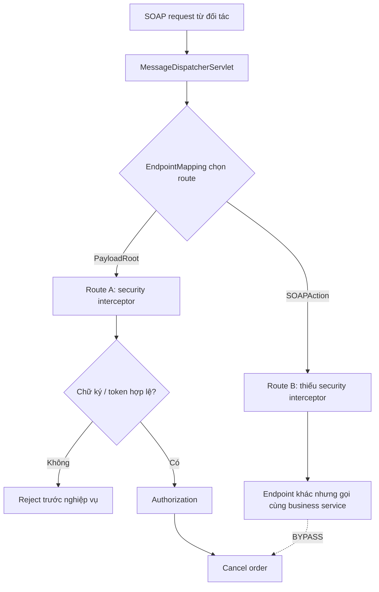
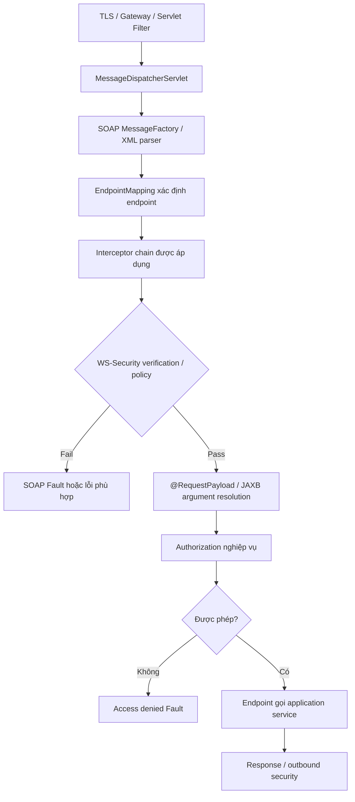
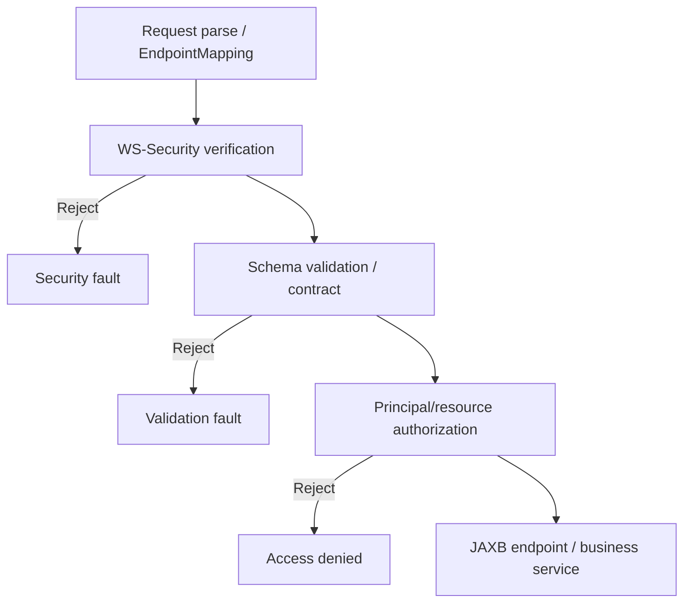
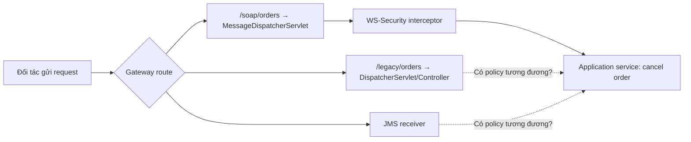

# Phạm vi interceptor bảo mật phải nhất quán với cơ chế định tuyến

Trong Spring Web Services (**Spring-WS**), một SOAP message không nhất thiết được tìm đến endpoint chỉ bằng một cách. Server có thể định tuyến theo **QName của phần tử gốc trong SOAP Body** bằng `@PayloadRoot`, **SOAPAction** bằng `@SoapAction`, **WS-Addressing Action** bằng `@Action`, hoặc sử dụng `EndpointMapping` tự viết. Nếu một đường đi kiểm tra WS-Security nghiêm ngặt nhưng đường khác lại tới cùng logic nghiệp vụ mà **không đi qua interceptor bảo mật tương đương**, attacker có thể chọn đường định tuyến yếu hơn để tránh xác thực hoặc chữ ký.

Vì thế, phạm vi của `Wss4jSecurityInterceptor`, các `EndpointInterceptor` liên quan, servlet/filter, gateway và chính sách phân quyền phải **phủ toàn bộ những đường có thể dẫn đến nghiệp vụ được bảo vệ**. Điều này không chỉ là câu chuyện “đăng ký một bean bảo mật”; đó là bài toán nối **điểm vào → cách chọn endpoint → chuỗi interceptor → dữ liệu đã xác minh → authorization → application service** một cách nhất quán.

Bài thuộc chương **WS-Security** trong module `SPRING_WEB_SERVICES`, theo hướng phát triển dịch vụ SOAP **contract-first** với XSD/WSDL, JAXB, endpoint, SOAP client, SOAP Fault, XML security, WS-Security và chứng chỉ. Các ví dụ minh họa nguyên tắc an toàn; khi sử dụng thực tế cần đối chiếu API của phiên bản Spring-WS/WSS4J, WSDL/WS-Policy và topology triển khai.

> **Nguyên tắc cốt lõi:** **Không để cách chọn endpoint quyết định có được bỏ qua an ninh hay không**, trừ khi đó là phân vùng chính sách đã được thiết kế, công bố và kiểm thử. **Một route chưa được kiểm tra phải bị từ chối**, không tự động rơi về profile bảo mật yếu hơn.

## 1. Bài toán thực tế: cùng nghiệp vụ có hai lối vào

Giả sử dịch vụ đơn hàng có operation `CancelOrder` yêu cầu SOAP Body được ký bởi certificate của đối tác, Timestamp hợp lệ và principal được phép hủy đơn trong tenant tương ứng.

Client hợp lệ gửi:

- SOAP Body `{https://example.com/orders/v1}CancelOrderRequest`.
- HTTP SOAPAction `urn:example:orders:v1:CancelOrder`.
- `wsa:Action` cùng action theo profile WS-Addressing nếu dùng.
- `wsse:Security` chứa Timestamp và XML Signature đúng signed-parts policy.

Server dùng `@PayloadRoot` cho endpoint A, nhưng một bean/endpoint mapping khác lại cho phép gọi cùng nghiệp vụ qua SOAPAction. Nếu chỉ endpoint A được gắn security interceptor, request **không có chữ ký** vẫn có thể tới business service qua mapping thứ hai.



**Điểm nguy hiểm không phải có nhiều cách mapping.** Nguy hiểm là có **ít nhất một đường đến tác dụng nghiệp vụ** không đáp ứng yêu cầu bảo mật tương ứng. Do đó, cần kiểm tra **tập tất cả routes hiệu lực**, bao gồm các route mới được thêm khi nâng cấp hoặc refactor.

## 2. Pipeline Spring-WS và vị trí của interceptor

Một request SOAP HTTP thường đi qua các thành phần sau, nhưng thứ tự chi tiết của parser, security/validation và endpoint adapter phụ thuộc cấu hình thực tế:



**Ranh giới quan trọng:** Với các endpoint interceptor gắn vào chuỗi của endpoint mapping, **endpoint thường đã được chọn trước khi `handleRequest` chạy**. Điều đó dẫn tới hai kết luận:

1. Interceptor **có thể từ chối request trước khi endpoint thực thi**, nhưng không thể giả định nó bảo vệ bước đã diễn ra trước đó như TLS handshake, HTTP parse, XML parser và một số quyết định mapping.
2. Nếu **không tìm thấy endpoint**, nếu request bị lỗi trước dispatch hoặc nếu request đi qua dispatcher/transport khác, interceptor của endpoint **có thể không được gọi**.

Một `Wss4jSecurityInterceptor` chỉ chặn những request **thực sự đi qua interceptor chain chứa nó**. Định nghĩa bean trong application context không tự bảo đảm rằng mọi SOAP route, mọi servlet hay mọi transport đều được bảo vệ.

### Điểm dừng khác nhau

| Giai đoạn | Ví dụ lỗi | Cơ chế bắt lỗi chính |
| --- | --- | --- |
| Trước TLS/HTTP | Client certificate không tin cậy | TLS endpoint/gateway, có thể không có SOAP Fault |
| HTTP filter | Giới hạn kích thước, rate limit, authentication | Servlet filter/gateway, có thể trả HTTP error |
| SOAP message factory | XML malformed, XXE/DTD bị chặn, sai SOAP version | Parser/message factory và quy tắc giao thức |
| Endpoint mapping | Không khớp `@PayloadRoot`/`@SoapAction` | Mapping/dispatcher; không mặc định là WS-Security fault |
| Security interceptor | Sai signature, timestamp, token | WS-Security Fault theo profile/cấu hình |
| Authorization | Đúng chữ ký nhưng không có quyền tenant/order | Access-denied/business fault |
| Endpoint + application | Business rule, database, downstream | Business fault hoặc server fault |

**Không dùng security interceptor để “vá” một parser trước đó**. Parser đầu tiên phải được harden, giới hạn byte/depth và external XML access độc lập.

## 3. Ba cơ chế định tuyến dễ bị nhầm

Spring-WS hỗ trợ các phương án endpoint mapping theo thông tin của SOAP message. Tên lớp/annotation dưới đây là những API tiêu biểu; cấu hình thực tế và thứ tự mapping phải được xác nhận theo phiên bản đang dùng.

| Cơ chế | Nguồn quyết định | Ví dụ | Điều kiện bảo mật còn thiếu |
| --- | --- | --- | --- |
| **PayloadRoot** | QName phần tử gốc SOAP Body | `@PayloadRoot(namespace=..., localPart=...)` | QName không xác thực người gửi |
| **SOAPAction** | Giá trị SOAPAction theo SOAP binding | `@SoapAction("urn:...:CancelOrder")` | Header/action có thể do client tự khai |
| **WS-Addressing** | `wsa:Action` trong SOAP Header | `@Action("urn:...:CancelOrder")` | WS-A Header không mặc định được ký |
| **Custom EndpointMapping** | Logic tự định nghĩa, có thể theo tenant/path/header | Mapping bean ứng dụng | Policy phải ràng buộc chính xác đường đi |
| **Transport/servlet route** | HTTP path, gateway route, JMS destination | `/soap/orders`, `/soap/admin` | Có thể bypass hoàn toàn một dispatcher/chain |

`@PayloadRoot`, `@SoapAction` và `@Action` **không phải annotation bảo mật**. Chúng là metadata để tìm endpoint. Một chuỗi mang tên `CancelOrder` hợp lệ về cú pháp không chứng minh token hợp lệ hay người gọi được phép hủy một order.

### SOAPAction và WS-Addressing Action khác nhau

- SOAP 1.1 có HTTP `SOAPAction`; SOAP 1.2 dùng media type `application/soap+xml` và các cơ chế action của binding.
- WS-Addressing dùng SOAP Header `wsa:Action` với namespace/profile riêng.
- SOAP Body root QName nhận diện request payload theo XSD.
- `WebServiceTemplate` có callback `SoapActionCallback` dành cho SOAPAction và `ActionCallback` dành cho WS-Addressing trong những phiên bản hỗ trợ.

**Không giả định ba giá trị phải luôn có cùng cú pháp**, nhưng nếu **hợp đồng của operation yêu cầu chúng tương thích**, hãy kiểm tra nhất quán ở một bước validation/policy đáng tin. Không được coi việc endpoint đã được chọn bằng một giá trị là bằng chứng các giá trị khác đã được xác minh.

## 4. Mẫu hợp đồng contract-first: operation cần ký SOAP Body

Ví dụ namespace dịch vụ đơn hàng:

```text
https://example.com/orders/v1
```

Một XSD rút gọn:

```xml
<?xml version="1.0" encoding="UTF-8"?>
<xs:schema xmlns:xs="http://www.w3.org/2001/XMLSchema"
           xmlns:ord="https://example.com/orders/v1"
           targetNamespace="https://example.com/orders/v1"
           elementFormDefault="qualified">

  <xs:element name="CancelOrderRequest">
    <xs:complexType>
      <xs:sequence>
        <xs:element name="orderId" type="xs:positiveInteger"/>
        <xs:element name="reason" type="xs:string"
                    minOccurs="0"/>
      </xs:sequence>
    </xs:complexType>
  </xs:element>

  <xs:element name="CancelOrderResponse">
    <xs:complexType>
      <xs:sequence>
        <xs:element name="orderId" type="xs:positiveInteger"/>
        <xs:element name="status" type="xs:string"/>
      </xs:sequence>
    </xs:complexType>
  </xs:element>
</xs:schema>
```

WSDL 1.1 có thể mô tả binding/action của operation, và WS-Policy/SecurityPolicy hoặc thỏa thuận tích hợp nêu yêu cầu **ký Body + Timestamp + certificate hợp lệ**. Fragment sau chỉ minh họa action trong SOAP 1.1:

```xml
<!-- Fragment trong một wsdl:binding có namespace đã khai báo -->
<wsdl:operation name="CancelOrder">
    <soap:operation
        soapAction="urn:example:orders:v1:CancelOrder"/>
    <wsdl:input><soap:body use="literal"/></wsdl:input>
    <wsdl:output><soap:body use="literal"/></wsdl:output>
</wsdl:operation>
```

**XSD chỉ ràng buộc hình dạng XML**, WSDL định nghĩa operation/binding, còn **WS-SecurityPolicy/runtime policy** phải quy định và thực thi những phần được ký/kiểm tra. Chỉ vì `CancelOrderRequest` đúng XSD không có nghĩa sender đã ký hoặc có quyền.

### Minh họa SOAP request chưa có chữ ký

```xml
<soap:Envelope
    xmlns:soap="http://schemas.xmlsoap.org/soap/envelope/"
    xmlns:ord="https://example.com/orders/v1">
  <soap:Header/>
  <soap:Body>
    <ord:CancelOrderRequest>
      <ord:orderId>42</ord:orderId>
    </ord:CancelOrderRequest>
  </soap:Body>
</soap:Envelope>
```

Request trên **well-formed và có thể đúng XSD**, nhưng phải bị từ chối nếu operation yêu cầu WS-Security signature. Không dùng việc đã route thành công để bỏ qua kiểm tra chữ ký.

## 5. Mô hình an toàn: Route × Policy × Business effect

Nên xây bảng kiểm kê dưới dạng:

| Route hiệu lực | Mapping đưa đến đâu? | Policy tối thiểu | Business effect |
| --- | --- | --- | --- |
| `/soap/orders` + QName `CancelOrderRequest` | `OrdersEndpoint.cancel` | Signature + Timestamp + authorization | Hủy đơn, có thể hoàn tiền |
| `/soap/orders` + SOAPAction CancelOrder | Endpoint tương ứng, nếu có | **Cùng policy** | Hủy đơn |
| `/soap/orders` + WS-A Action CancelOrder | Endpoint tương ứng, nếu có | **Cùng policy** | Hủy đơn |
| `/soap/orders` + QName `GetOrderRequest` | `OrdersEndpoint.get` | Authentication/authorization theo contract | Đọc dữ liệu |
| `/soap/admin` + operation cấp quyền cao | Administrative endpoint | Strong identity + signed parts + admin authorization | Thay đổi dữ liệu nhạy cảm |
| `/soap/public` + Health/ping được thiết kế công khai | Public diagnostics endpoint riêng | Giới hạn public policy rõ, không tiết lộ bí mật | Không gây side effect |

**Một operation không nên nhận policy yếu hơn chỉ vì route chọn nó thay đổi.** Nếu business effect là “CancelOrder”, việc đổi `SOAPAction` hoặc namespace alias không được biến nghiệp vụ đó thành anonymous operation.

### Bất biến bảo mật cần diễn đạt như một công thức

Gọi `R` là tập routes có thể đưa request vào operation `O`, `P(r)` là các kiểm tra bảo mật thực tế trên route `r` và `Required(O)` là chính sách cần có cho operation đó:

```text
For every route r that can invoke operation O:
    EffectivePolicy(r) satisfies Required(O)
    AND actor is authorized for (O, tenant, resource)
    AND the application consumes the verified payload
```

Chỉ kiểm tra `P(route chính)` là chưa đủ. Test phải duyệt cả `R`, bao gồm mapping tùy chỉnh, alias, đường servlet phụ và route gateway sau các thay đổi deploy.

## 6. `WsConfigurer#addInterceptors`: một điểm đăng ký thông dụng

Với cấu hình annotation-based của Spring-WS, `@EnableWs` và `WsConfigurer` cho phép đăng ký `EndpointInterceptor` vào infrastructure do cấu hình Spring-WS quản lý.

Ví dụ:

```java
import java.util.List;
import org.springframework.context.annotation.Configuration;
import org.springframework.ws.config.annotation.EnableWs;
import org.springframework.ws.config.annotation.WsConfigurer;
import org.springframework.ws.server.EndpointInterceptor;
import org.springframework.ws.soap.security.wss4j2.Wss4jSecurityInterceptor;

@Configuration
@EnableWs
public class SoapInterceptorConfiguration implements WsConfigurer {
    private final Wss4jSecurityInterceptor security;

    public SoapInterceptorConfiguration(
            Wss4jSecurityInterceptor security) {
        this.security = security;
    }

    @Override
    public void addInterceptors(
            List<EndpointInterceptor> interceptors) {
        interceptors.add(security);
    }
}
```

Điều này thiết lập một **điểm cấu hình tập trung**. Nhưng **đừng suy ra chỉ từ đoạn code** rằng:

- Mọi `MessageDispatcherServlet` trong hệ đều dùng cùng application context.
- Một `EndpointMapping` tự định nghĩa, khác cấu hình mặc định, chắc chắn kế thừa interceptor chain.
- Một HTTP controller hoặc JMS listener không thuộc dispatcher vẫn được bảo vệ.
- Message lỗi trước khi mapping cũng chạy interceptor.
- Interceptor dùng chính sách ký đúng cho **mọi operation** có mức bảo mật khác nhau.

**Phải kiểm tra cấu hình hiệu lực và kiểm thử runtime**. Nếu có nhiều dispatcher, mapping, version SOAP hoặc transport, hãy audit từng đường. Đây là điểm cốt yếu của “phạm vi interceptor nhất quán với định tuyến”.

## 7. Cấu hình `Wss4jSecurityInterceptor` phía server

Ở những phiên bản Spring-WS có integration Apache WSS4J package `wss4j2`, một cấu hình inbound điển hình có thể khai báo yêu cầu Timestamp và Signature:

```java
import org.apache.wss4j.common.crypto.Crypto;
import org.springframework.context.annotation.Bean;
import org.springframework.context.annotation.Configuration;
import org.springframework.ws.soap.security.wss4j2.Wss4jSecurityInterceptor;

@Configuration
public class OrdersSecurityBeans {

    @Bean
    public Wss4jSecurityInterceptor ordersInboundSecurity(
            Crypto trustedPartnerVerificationCrypto) {

        Wss4jSecurityInterceptor interceptor =
                new Wss4jSecurityInterceptor();

        interceptor.setValidationActions("Timestamp Signature");
        interceptor.setValidationSignatureCrypto(
                trustedPartnerVerificationCrypto);

        return interceptor;
    }
}
```

`trustedPartnerVerificationCrypto` phải được cấu hình từ trust material đã duyệt; code mẫu không tạo truststore hay thiết lập mọi signed-parts/algorithm assertions. **`setValidationActions` chưa phải bằng chứng đầy đủ rằng SOAP Body, Timestamp và headers yêu cầu đều được ký bởi một đối tác được phép.** Cần enforcement của signed-parts/algorithm/token policy ở cấu hình phiên bản thực tế và test node-level.

**Đặc biệt:** Interceptor xác minh chữ ký không thay cho **authorization**. Một certificate đúng có thể thuộc partner A nhưng request lại muốn hủy đơn của partner B.

### Lỗi khi chỉ đăng ký bean

```java
@Bean
public Wss4jSecurityInterceptor security() {
    return new Wss4jSecurityInterceptor();
}
```

Bean như trên còn thiếu validation policy và chưa chứng minh interceptor nằm trong chain được thực thi. Nếu endpoint vẫn trả success khi request thiếu `wsse:Security`, cần kiểm tra **cả hai khả năng**: bean không chạy, hoặc policy/cấu hình không yêu cầu những thành phần bắt buộc.

## 8. EndpointMapping tự viết: xem interceptor chain là một phần của contract

Khi dùng custom `EndpointMapping`, có thể tạo đường định tuyến ưu tiên cao hoặc xử lý một phần thông điệp theo cách không được default mappings bao phủ. Nếu mapping đó có interceptor chain riêng, không được bỏ qua security interceptor.

Checklist khi thêm mapping:

1. **Mapping nào được gọi trước?** Kiểm tra `Ordered`/`order` và cạnh tranh giữa các mapping.
2. **Mapping chọn endpoint dựa vào gì?** Payload QName, action, Header, transport URI, tenant, message source?
3. **Route được bảo vệ bằng interceptor chain nào?** Dùng introspection/test của mapping đang chạy, không chỉ kiểm tra bean tồn tại.
4. **Có đường fallback?** Chẳng hạn mapping chưa có signature vẫn chọn endpoint default.
5. **Endpoint cuối gọi service gì?** Hai endpoint khác nhau có thể dùng **cùng** application service thay đổi dữ liệu.
6. **Interceptor có bị giới hạn bằng path/header/endpoint matcher không?** Điều kiện giới hạn có thể bỏ sót alias hoặc endpoint mới.
7. **Mapping mới nằm trong application context nào?** Tránh servlet khác lách security chain.
8. **Request lỗi trước mapping** bị chặn ở lớp parser/gateway/filter nào?

Không đưa một custom mapping “cực nhanh” vào production khi chưa xác minh **cùng bảo mật với đường chính**, đặc biệt với operation ghi dữ liệu hoặc trả dữ liệu nhạy cảm.

## 9. `EndpointInterceptor` chạy khi nào và dừng nghiệp vụ ra sao?

Interface `EndpointInterceptor` thường có các callback:

| Callback | Mục đích | Ý nghĩa trong security flow |
| --- | --- | --- |
| `handleRequest(context, endpoint)` | Trước khi endpoint xử lý | Có thể xác minh/đánh chặn request, return `false` khi từ chối |
| `handleResponse(context, endpoint)` | Sau response thường | Không dùng thay verification inbound |
| `handleFault(context, endpoint)` | Khi response là SOAP Fault | Quan sát/áp outbound policy khi phù hợp |
| `afterCompletion(context, endpoint, ex)` | Sau chu trình xử lý tương ứng | Dọn context/tài nguyên theo contract callback |

**Security enforcement inbound nên xảy ra trước business effect**. Trong Spring-WS, một `handleRequest` trả `false` có thể dừng xử lý endpoint theo semantics interceptor chain. Tuy nhiên:

- Trả `false` **không tự động tạo SOAP Fault chuẩn**; interceptor/handler phải tạo response/fault phù hợp.
- Nếu security validation ném exception, phải kiểm tra resolver và fault policy thực sự áp dụng.
- Nếu application có side effect trong interceptor đứng **trước** security interceptor, request xấu vẫn có thể gây tác dụng.
- Callback sau response/fault không thể “hoàn tác” tác dụng nghiệp vụ đã commit khi inbound authorization bị bỏ qua.

### Thứ tự interceptor: bảo mật và validation

Một pipeline ví dụ về mặt khái niệm:



**Không phải một thứ tự duy nhất đúng cho mọi SOAP profile.** Nếu Body đã mã hóa, có thể phải giải mã trước schema validation; nếu có XML Signature cần xác minh node, không được để một transformer tùy ý sửa dữ liệu đã ký. Điều bất biến là: **không được thực thi nghiệp vụ trước khi các kiểm tra bắt buộc cho operation hoàn tất**.

## 10. `SmartEndpointInterceptor` và giới hạn theo endpoint

Spring-WS có abstraction `SmartEndpointInterceptor` cho phép quyết định interceptor có áp cho một endpoint/message cụ thể hay không, qua logic `shouldIntercept(...)` trong những cấu hình hỗ trợ.

Giới hạn theo endpoint có thể hữu ích, nhưng **một predicate sai tạo bypass**:

```text
shouldIntercept(request, endpoint) = false
    nếu endpoint thuộc package *.public.*
```

Nếu team sau đó chuyển một operation nhạy cảm vào package `public`, hoặc endpoint được proxy/wrap khiến so class không đúng, route sẽ không còn bị kiểm tra.

Một cách an toàn hơn là:

- Dùng **default-deny** cho mọi endpoint trên dispatcher nhạy cảm.
- Chỉ exempt những operation **được đánh giá công khai rõ ràng** và không có tác dụng riêng tư.
- Kiểm tra allowlist miễn trừ theo **định danh operation ổn định**, không theo substring/header do client tự gửi.
- Phân loại operation bằng metadata do server quản lý; không cho request tự chọn profile bằng `SecurityLevel=NONE`.
- Test từ mỗi mapping và mỗi đường servlet để chắc chắn exemption không mở rộng ngoài dự kiến.

**Chú ý đặc biệt:** `shouldIntercept` được đánh giá trong ngữ cảnh endpoint đã được mapping chọn. Nếu endpoint mapping chọn sai vì header/action do client tự khai, predicate dựa trên endpoint phải được thiết kế cẩn trọng; **không lấy lựa chọn route làm bằng chứng authorization**.

## 11. Tách hai loại policy: xác minh danh tính và authorization

Một deployment có thể định nghĩa các loại operation:

| Nhóm operation | Authentication/integrity | Authorization |
| --- | --- | --- |
| `GetOrder` | Xác minh token/chữ ký theo profile | Caller được đọc đúng order/tenant |
| `CancelOrder` | Chữ ký và Timestamp bắt buộc | Caller được hủy order đang thuộc quyền |
| `SubmitPayment` | Chữ ký/mã hóa các phần nhạy cảm theo contract | Caller được dùng payment account/merchant cụ thể |
| `HealthProbe` công khai | Có thể không yêu cầu WS-Security nếu được thiết kế riêng | Không được trả dữ liệu nhạy cảm |
| Administrative operation | Chính sách mạnh được công bố | Quyền admin cụ thể, tách role không do client tự khai |

**Một signature hợp lệ không tự cho quyền**. Signed Body chứng minh nội dung được ký bởi một key theo trust policy; application vẫn phải đối chiếu verified principal với operation, tenant và resource.

### Vì sao security profile không được chọn bởi request?

Một anti-pattern:

```text
if SOAP Header SecurityLevel == "PUBLIC":
    skip WS-Security validation
else:
    require signature
```

Header đó do attacker có thể tạo và thường chưa được ký khi ta quyết định có cần verify hay không. Đây là **cơ chế downgrade do request điều khiển**.

Thay vào đó, định nghĩa profile **server-side** theo path/operation/contract và chứng minh mọi đường đến operation đều enforce profile đó. Nếu có operation public, nó phải **độc lập và bị giới hạn** để không gọi business effect nhạy cảm.

## 12. Cặp annotation không có nghĩa là yêu cầu AND

Một endpoint method có thể được mô tả bằng các metadata như:

```java
@PayloadRoot(namespace = NS, localPart = "CancelOrderRequest")
@SoapAction("urn:example:orders:v1:CancelOrder")
@ResponsePayload
public CancelOrderResponse cancel(
        @RequestPayload CancelOrderRequest request) {
    return application.cancel(request);
}
```

Đoạn code là fragment: `NS`, JAXB classes và `application` là dependencies ứng dụng phải định nghĩa; imports annotation của Spring-WS cũng chưa hiển thị.

**Không được suy rằng framework bắt buộc đồng thời PayloadRoot và SOAPAction cùng khớp chỉ vì method có cả hai annotation.** Các `EndpointMapping` khác nhau có thể lựa chọn method theo từng tiêu chí và thứ tự ưu tiên. Khi hợp đồng yêu cầu consistency:

1. Mapping có thể dùng một tiêu chí để tìm endpoint.
2. Một **consistency validator** chạy trước nghiệp vụ so sánh payload QName, SOAPAction và WS-Addressing Action theo hợp đồng.
3. WS-Security xác minh **những dữ liệu cần bảo vệ đã thực sự được ký**; nếu action header là đầu vào quyết định quyền, cần chính sách bảo vệ thích hợp.
4. Authorization xác minh principal được quyền thực hiện **business operation đã xác định**.

Lặp lại hai annotation không thay cho bất kỳ bước nào ở trên.

## 13. Không lấy action hoặc header làm bằng chứng identity

Một request SOAP 1.1:

```http
POST /soap/orders HTTP/1.1
Host: api.example.com
Content-Type: text/xml; charset=utf-8
SOAPAction: "urn:example:orders:v1:CancelOrder"
```

Nếu một layer dùng SOAPAction để chọn `CancelOrder`, điều đó chỉ cho biết **client đã khai giá trị action**. Không chứng minh nó được ký hoặc caller có quyền với order 42.

Tương tự, WS-Addressing Header:

```xml
<wsa:Action
    xmlns:wsa="http://www.w3.org/2005/08/addressing">
    urn:example:orders:v1:CancelOrder
</wsa:Action>
```

không thể được coi là chứng cứ xác thực. Nếu profile yêu cầu `wsa:Action` nằm trong **signed parts**, phải xác minh reference của XML Signature trên đúng Header đó, đồng thời kiểm tra consistency với operation.

**HTTP SOAPAction thường không phải phần tử XML trong SOAP Envelope**, nên chữ ký XML trên SOAP Body **không tự bảo vệ HTTP header SOAPAction**. Việc so action với Body đã được xác minh và kiểm tra phiên bản/binding cần làm rõ trong policy.

## 14. Kết quả xác minh phải gắn với **node được sử dụng**

Một rủi ro đáng chú ý là **XML Signature Wrapping**:

- SOAP Body A có `wsu:Id="body-1"` và được ký đúng.
- Attacker thêm/chèn một vùng XML B cùng local name hoặc cấu trúc mà code endpoint đọc.
- Security processor xác minh A, nhưng endpoint đọc B.

Dù interceptor được đăng ký đúng ở mọi mapping, ứng dụng vẫn **không an toàn** nếu “signature verified” bị áp sai cho node không được ký.

Các yêu cầu tối thiểu:

1. Xác minh đúng XML Signature reference URI, ID, transforms và trust/algorithm policy.
2. Kiểm tra **Body/Header bắt buộc** thực sự nằm trong signed parts.
3. Từ chối duplicate ID, cấu trúc SOAP mơ hồ và các biến thể trái policy.
4. Đảm bảo node được endpoint/JAXB sử dụng là node mà security processor đã xác minh.
5. Không biến XML thành string, log/transform rồi parse lại theo cách làm mất tương quan node/ID mà vẫn giữ cờ “verified”.
6. Kiểm thử namespace giả, multiple Body-like nodes, Header trùng, reference tới node khác operation Body.

**Interceptor có chạy không?** và **đã verify đúng dữ liệu không?** là hai câu hỏi riêng phải được chứng minh bằng test.
## 15. Một entrypoint chưa bảo vệ có thể nằm **ngoài** SOAP dispatcher

Đường đến cùng application service có thể không chỉ gồm các Spring-WS endpoint:



Một interceptor của Spring-WS **không tự áp dụng** cho REST controller, gRPC endpoint, scheduled job, JMS listener hoặc một SOAP servlet khác không cùng mapping. Nếu các kênh đó có thể kích hoạt **cùng tác dụng nghiệp vụ**, phải có kiểm soát tương đương theo **trust boundary của mỗi kênh**.

Ví dụ:

- Legacy SOAP adapter có thể dùng message parser/security riêng.
- Gateway route cũ vẫn trỏ tới servlet khác sau khi chuyển dịch vụ.
- Một JMS listener nội bộ có quyền thực thi `CancelOrder` nhưng broker ACL quá rộng.
- Internal controller dùng `X-User` từ HTTP Header thay vì verified principal.
- Health/status endpoint vô tình gọi lại hàm nghiệp vụ qua shortcut.

**Không nhất thiết gắn WSS4J vào mọi entrypoint phi SOAP.** Điều bắt buộc là mọi đường đến business effect đều **xác thực, ủy quyền và bảo vệ dữ liệu tương đương với chính sách của route đó**. WS-Security có ý nghĩa trên SOAP message; entrypoint khác có thể dùng mTLS/OAuth2/JMS ACL, nhưng không được mặc định đường “nội bộ” là đáng tin.

## 16. Nhiều `MessageDispatcherServlet` và nhiều application context

Một ứng dụng có thể có các servlet mappings:

```text
/soap/orders/*    → MessageDispatcherServlet A
/soap/billing/*   → MessageDispatcherServlet B
/legacy/soap/*    → MessageDispatcherServlet C
```

Nếu A dùng Spring-WS config có `WsConfigurer#addInterceptors`, còn C tải một context khác hoặc dùng `EndpointMapping` tùy chỉnh, C không chắc đã được bảo vệ. Tương tự, servlet B có thể dùng SOAP version/message factory khác.

Cần kiểm tra:

1. **Đường HTTP thực tế** sau proxy rewrite, context-path và servlet mapping.
2. Bean `MessageDispatcherServlet` nào xử lý request.
3. Application context nào chứa `EndpointMapping` và interceptor.
4. Mapping nào thắng khi có nhiều mapping tương thích.
5. Operation/endpoint nào được chọn và chain thực sự nào chạy.
6. Transport khác (ví dụ JMS) có đi qua dispatcher này hay không.
7. Policy của response/fault có được áp dụng cho mọi path hay không.

**Đừng suy từ số bean `Wss4jSecurityInterceptor` là số entrypoint đã được bảo vệ.** Thay vào đó, phải có bằng chứng runtime cho **tất cả đường vào khả dĩ**.

### Đường nội bộ cũng là boundary

Một request từ cluster nội bộ không tự động an toàn chỉ vì không ra Internet. Network policy, mTLS, service identity, gateway header propagation và authorization phải được xác định. Kẻ xâm nhập một service bên trong hoặc cấu hình sai proxy có thể dùng đường nội bộ yếu hơn để gọi nghiệp vụ bảo vệ.

## 17. Nhiều SOAP version và namespace: không cho phép downgrade

Một hệ có thể hỗ trợ SOAP 1.1 và SOAP 1.2 hoặc nhiều version business contract:

```text
SOAP 1.1 + orders/v1 + SOAPAction
SOAP 1.2 + orders/v2 + action parameter / WS-A Action
Legacy partner + orders/v0 + custom mapping
```

Từng tổ hợp có thể cần **profile WS-Security khác nhau**. Điều nguy hiểm là “v2 yêu cầu chữ ký, nhưng v1 còn route không ký mà cùng xử lý CancelOrder với quyền rộng”.

| Trường hợp | Rủi ro | Phòng ngừa |
| --- | --- | --- |
| SOAP 1.1 route và SOAP 1.2 route cùng nghiệp vụ | Một version vô tình không áp policy | Test cả version và message factory |
| QName `CancelOrderRequest` ở `orders/v1`, `orders/v2` | Version cũ có rule yếu hơn | Contract/version migration có chính sách rõ |
| Legacy SOAPAction còn được chấp nhận | Bypass qua endpoint mapping ưu tiên cao | Audit route alias và chính sách theo business operation |
| WS-A Action namespace/phiên bản cũ | Mapping đi tới handler không mong muốn | Profile version pinning/validation |
| Client gửi Body v2 với Action v1 | “Chắp vá” metadata để chọn route yếu hơn | Kiểm tra consistency theo binding đã công bố |
| Fallback mapping khi không tìm thấy route | Request lạ tới handler mặc định | Fail closed, không dispatch tới nghiệp vụ nhạy cảm |

**Không tự xóa v1 chỉ vì không thích legacy**; nếu hợp đồng cần tương thích, hãy xác định chính sách tối thiểu phù hợp và thời gian sunset. Nhưng **không để compatibility trở thành con đường lách xác thực/ủy quyền**.

## 18. WS-Security Signed Parts và định tuyến theo SOAPAction/WS-A

Một chính sách ký SOAP Body thường cần thêm các trường liên quan định tuyến khi chúng có ý nghĩa an ninh:

| Thông tin | Nằm ở đâu? | Nếu bị sửa có ảnh hưởng gì? |
| --- | --- | --- |
| Payload QName | SOAP Body root | Có thể đổi operation được mapping chọn |
| `wsa:Action` | SOAP Header | Có thể đổi routing/semantics của request |
| `wsa:To` | SOAP Header | Có thể đổi đích logic, tenant/service |
| `wsa:ReplyTo`/`FaultTo` | SOAP Header | Có thể đưa response/Fault tới đích ngoài ý muốn |
| Tenant/resource hint | Header hoặc Body | Có thể đổi phạm vi dữ liệu mục tiêu |
| HTTP SOAPAction | HTTP metadata | Có thể đổi mapping nếu server chỉ dựa vào header |
| `wsu:Timestamp` | SOAP Security Header | Ảnh hưởng cửa sổ thời gian, replay policy |

**Khác biệt quan trọng:** HTTP `SOAPAction` không phải một XML element có thể được bảo vệ bằng XML Signature thông thường. Khi SOAPAction được dùng để định tuyến, phải có **consistency check** với thông tin trong SOAP Body/Header đã verify theo profile, hoặc policy khác bảo vệ tính toàn vẹn tương đương trong trust boundary.

Ví dụ một rule nghiệp vụ:

```text
Effective operation = CancelOrder
AND verified SOAP Body root = {orders/v2}CancelOrderRequest
AND expected action for this binding = urn:orders:v2:CancelOrder
AND client authenticated by approved certificate
AND signed parts include required Body and WS-A headers
AND principal authorized to cancel referenced order
```

Nếu chỉ một điều kiện sai, server cần từ chối theo loại lỗi thích hợp; **không fallback sang một operation có security policy nhẹ hơn**.

### Signature hợp lệ có đủ khi route được chọn trước khi verify?

Mapping dựa trên action/Body untrusted có thể chọn một candidate endpoint **trước** verification; đó là bình thường trong kiến trúc dispatcher. Nhưng khi operation cần security mạnh, candidate đó **không được thực thi** đến khi security processor và authorization đã xác nhận thông điệp phù hợp. Route được chọn chỉ là **ứng viên xử lý**, không phải phán quyết tin cậy.

## 19. Multi-tenant routing và rủi ro “confused deputy”

Giả sử backend có service credential cho tất cả tenants; client chỉ có quyền tenant A. Nếu server dùng SOAP Header `TenantId=B` để chọn database/schema hoặc endpoint mapping trước khi xác thực, nó có thể trở thành **confused deputy**.

Mẫu sai:

```java
// Anti-pattern: header do client tự khai trở thành quyền truy cập.
String tenant = soapHeader.readText("TenantId");
ordersApplication.cancelOrder(tenant, request.getOrderId());
```

Mẫu xử lý an toàn hơn ở mức ý tưởng:

```java
// Types bên dưới là abstraction ứng dụng cần tự định nghĩa.
VerifiedActor actor = securityContext.requireVerifiedActor();
RequestedTenant tenant = requestContext.requestedTenant();
AuthorizedScope scope =
        authorization.requirePermission(actor, tenant, "CancelOrder");

ordersApplication.cancelOrder(
        scope.tenantId(), request.getOrderId());
```

Bốn điều phải tách:

1. **Routing hint** có thể được lấy từ header/request để tìm một nhóm endpoint.
2. **Verified identity** đến từ token/chữ ký/mTLS policy đã xác thực.
3. **Authorization** đối chiếu identity với operation/tenant/resource.
4. **Business effect** sử dụng phạm vi đã được phép, không dùng lại header untrusted.

Nếu tenant header là **nguồn quyết định route bảo mật**, profile có thể yêu cầu nó nằm trong signed parts; dù đã ký, tenant vẫn phải được ủy quyền. **Signed claim không tự trở thành authorized claim**.

## 20. Thiết kế profile theo operation mà không tạo đường “public” giả

Có những dịch vụ thực sự có cả operation public và private. Cách thiết kế rõ nhất thường là **tách endpoint/dispatcher hoặc transport path** theo chính sách và không chia sẻ business effect nhạy cảm vào nhóm public.

Ví dụ:

```text
/soap/public/health      → Không cần WS-Security; response tối giản
/soap/partner/orders     → Signature + Timestamp + partner authorization
/soap/admin/billing      → Strong authentication + signed/encrypted parts
```

Đây là **phân vùng kiến trúc minh họa**, không phải khuyến nghị rằng URL path tự cung cấp security. Phải có:

- Route mapping/policy do **server quản lý**, không do client Header lựa chọn.
- Endpoint public không gọi được internal service thay đổi dữ liệu vượt scope.
- Không có fallback từ private sang public khi thiếu signature.
- Separate servlet filter/gateway limits và security interceptors áp đúng chain.
- Unit/integration tests bảo đảm URL/Action/QName không bị phối hợp để chạy nhầm endpoint.
- WSDL và security policy công bố nhất quán với endpoint thực.

### Security decision table

| Group | Signed Body? | Authentication? | Authorization? | Fallback khi không match? |
| --- | --- | --- | --- | --- |
| Public status có giới hạn | Theo policy public | Có thể không | Chỉ đọc dữ liệu công khai | **Không** đến private operation |
| Partner read | Theo hợp đồng | Bắt buộc | Theo order/tenant | Fail closed |
| Partner write | Thường bắt buộc ký theo policy | Bắt buộc | Theo operation/resource | Fail closed |
| Administrative | Policy mạnh riêng | Bắt buộc | Quyền admin + audit | Fail closed |

Một cách an toàn là mọi private operation đều chịu **điều kiện tối thiểu giống nhau ở ingress**, sau đó những operation đặc biệt có thể yêu cầu **thêm** signed parts, encryption hoặc role. Không tự hạ mức bảo mật dựa trên action do client chọn.

## 21. SOAP Fault và hành vi khi request bị từ chối

Một security control tốt phải không chỉ từ chối, mà còn **từ chối trước tác dụng nghiệp vụ** và phản hồi đúng tầng.

| Lỗi | Phát hiện ở đâu? | Định hướng phản hồi |
| --- | --- | --- |
| TLS handshake/mTLS certificate fail | Transport/gateway | Có thể không có SOAP Envelope; thường lỗi kết nối/HTTP |
| XML không well-formed hoặc DTD bị chặn | SOAP parser | Parser/protocol rejection; có thể không tạo được Fault |
| Không tìm được endpoint mapping | Dispatcher | Routing/protocol failure, không mặc định là security Fault |
| Action/Body QName không tương thích contract | Consistency validation | Request/contract Fault theo SOAP version |
| Thiếu `wsse:Security` khi policy bắt buộc | WS-Security interceptor | Security Fault, không chạy endpoint |
| Signature không hợp lệ, sai certificate | WS-Security processor | Security Fault, không tiết lộ key/trust internals |
| Chữ ký hợp lệ nhưng signed parts thiếu | Policy check | Security Fault/policy rejection |
| Chữ ký hợp lệ nhưng thiếu quyền tenant | Application authorization | Access-denied business Fault |
| Business rule không cho hủy | Application service | Business Fault đã công bố |
| Lỗi marshal response/outbound signature | Server | Server/Receiver Fault hoặc transport error tùy giai đoạn |

SOAP 1.1 thường dùng `Client/Server`; SOAP 1.2 dùng `Sender/Receiver`, và các WS-Security profiles có thể bổ sung fault code/subcode riêng. Không chỉ map mọi lỗi thành `Server` rồi khiến client không phân loại được.

**Lưu ý:** Một Fault do security interceptor tạo ra có thể **không đi qua cùng chu trình outbound interceptor như response thành công** trong mọi cấu hình. Nếu chính sách yêu cầu ký SOAP Fault, phải **kiểm thử thực sự** các lỗi trước endpoint và lỗi từ exception resolver. Không giả định chỉ vì response thường được ký thì mọi Fault cũng được ký.

### Không để Fault tiết lộ kiểm tra nào đã thành công

Thông điệp ngoài nên tuân security profile và tránh tiết lộ private key alias, truststore path, stack trace, SQL, user/tenant tồn tại hay không hoặc giá trị token. Internal trace ID giúp nhóm vận hành điều tra mà không cần đưa chi tiết nhạy cảm vào `faultstring`/`Reason`.

## 22. Client Spring-WS cũng phải nhất quán theo destination

Server routing không phải nơi duy nhất có thể mất bảo mật. Phía client, `WebServiceTemplate` có thể dùng URI mặc định hoặc overload nhận URI cho từng call. Nếu cùng template gắn WSS4J outbound interceptor ký request bằng certificate của đối tác A, nhưng code chuyển URI sang đối tác B, có thể:

- Gửi thông tin định danh/token tới endpoint ngoài phạm vi cho phép.
- Ký Body bằng key sai profile, đối tác B từ chối.
- Dùng recipient encryption certificate sai, đối tác B không giải mã được.
- Dùng SOAPAction/WS-A Action của version cũ ở URL mới.
- Tạo request hợp lệ về XSD nhưng sai security policy tại nơi nhận.

Ví dụ code client:

```java
import org.springframework.ws.client.core.WebServiceTemplate;
import org.springframework.ws.soap.client.core.SoapActionCallback;

public final class OrdersPartnerClient {
    private final WebServiceTemplate ordersTemplate;

    public OrdersPartnerClient(WebServiceTemplate ordersTemplate) {
        this.ordersTemplate = ordersTemplate;
    }

    public Object cancel(
            CancelOrderRequest request) {
        // URI mặc định, JAXB và WS-Security interceptors
        // đã được cấu hình đồng bộ cho đối tác.
        return ordersTemplate.marshalSendAndReceive(
            request,
            new SoapActionCallback(
                "urn:example:orders:v1:CancelOrder"));
    }
}
```

`CancelOrderRequest` được giả định sinh từ XSD; bean template phải thực sự có marshaller/unmarshaller, URI, sender và security interceptors đúng đối tác. Code này **không tự tạo chữ ký**.

**Cách tổ chức:** Nếu các đích có chính sách TLS/mTLS, truststore, signing key, WS-Security actions hoặc SOAP version khác nhau, nên dùng **template/gateway riêng theo security profile** hoặc một policy/credential resolver server-side được thiết kế rõ. Không dùng `template.setDefaultUri(...)` mutable theo mỗi request trên singleton và mong security interceptor tự chọn đúng certificate.

## 23. Kiểm thử coverage: bắt đầu từ bảng routes thật

Để chứng minh không có đường bypass, cần xây **ma trận route × policy** dựa trên:

1. HTTP path, servlet mapping và gateway route.
2. SOAP version/Content-Type.
3. SOAP Body QName (namespace URI + local name).
4. HTTP SOAPAction.
5. WS-Addressing Action và các header phục vụ route nếu có.
6. `EndpointMapping` được chọn và thứ tự của mapping.
7. `EndpointInterceptor` chain thực tế.
8. Signed parts và actor identity được verify.
9. Business authorization và side effect.
10. Fault/response behavior.

Từng entry trong bảng phải có **kiểm thử có/chưa có security**. Không chỉ kiểm tra case happy-path với chữ ký đúng.

### Test nên quan sát ba kết quả độc lập

```text
1. Effective route:
   Which endpoint/operation was selected?

2. Security enforcement:
   Was the required WSS policy actually enforced,
   and which message parts were verified?

3. Business outcome:
   Was the application service invoked or side effect committed?
```

Request thiếu signature nhận HTTP 500 **chưa chứng minh** không có side effect: có thể endpoint vẫn hủy đơn rồi sau đó một outbound interceptor phát sinh lỗi. Test phải assert repository/application service **không chạy** hoặc không có committed effect trái policy.

### Tạo request test thế nào?

- Sinh JAXB request đúng XSD theo WSDL và marshal qua client được cấu hình.
- Với negative tests, tạo SOAP Envelope fixture với Header/Body/QName/action có chủ đích.
- Dùng `MockWebServiceClient` để kiểm tra endpoint/mapping/interceptor khi bộ mock chạy cùng context.
- Dùng `MockWebServiceServer` để kiểm tra outbound `WebServiceTemplate` và SOAP Action/headers khi cần.
- Có **HTTP/TLS integration test thật** để kiểm tra servlet mapping, proxy rewrite, certificate, Content-Type và các lỗi trước interceptor.
- Với WSS4J, dùng test certificate/private key **không phải production**, ký message theo đúng profile để so positive và negative signatures.

**Không dùng XML string có phần tử `<ds:Signature>` giả rồi kết luận đã thử chữ ký hợp lệ.** Phải dùng WS-Security signer thực sự, chọn key/trust và signed references được kiểm tra.

## 24. Ma trận 48 ca kiểm thử security coverage và routing

| Mã | Tình huống | Điều phải chứng minh |
| --- | --- | --- |
| C01 | `@PayloadRoot` CancelOrder + chữ ký/Token hợp lệ | Endpoint đúng; interceptor verify; được phép mới chạy nghiệp vụ |
| C02 | `@PayloadRoot` CancelOrder thiếu Security Header | Từ chối trước application service |
| C03 | `@PayloadRoot` CancelOrder có chữ ký sai | Không chạy nghiệp vụ |
| C04 | SOAPAction CancelOrder route khác nhưng thiếu chữ ký | Không bypass bằng SOAPAction mapping |
| C05 | SOAPAction CancelOrder với chữ ký đúng | Cùng policy và quyền như PayloadRoot |
| C06 | WS-A Action CancelOrder nhưng thiếu chữ ký | Không bypass bằng WS-A mapping |
| C07 | WS-A Action CancelOrder với chữ ký đúng | Đúng signed parts và authorization |
| C08 | SOAPAction CancelOrder, Body QName GetOrder | Consistency check từ chối theo contract |
| C09 | WS-A Action CancelOrder, Body QName GetOrder | Không chọn route được phép yếu hơn |
| C10 | HTTP SOAPAction khác WS-A Action | Từ chối nếu binding/policy yêu cầu nhất quán |
| C11 | SOAPAction bị sửa trên đường truyền còn Body vẫn ký | Không tin action như signed claim |
| C12 | WS-A Action bị sửa nhưng không nằm trong signed parts | Không coi Action đã được verify |
| C13 | SOAP 1.1 và SOAP 1.2 cùng operation | Mỗi binding áp đủ security policy |
| C14 | SOAP Envelope version sai | Từ chối protocol trước business |
| C15 | QName đúng local name nhưng sai namespace | Không route vào endpoint hợp lệ |
| C16 | QName version cũ `orders/v1` có legacy mapping | Không bypass policy của nghiệp vụ hiện hành |
| C17 | Mapping `order` tùy chỉnh ưu tiên cao | Không được bỏ qua interceptor chain |
| C18 | Mapping fallback cho mọi action | Không route tới operation nhạy cảm khi không match |
| C19 | `SmartEndpointInterceptor` bỏ qua public health | Chỉ health được miễn, không miễn endpoint nhạy cảm |
| C20 | Endpoint sensitive được chuyển package/class | Policy vẫn bảo vệ, không dựa tên package dễ thay |
| C21 | Endpoint alias có cùng business method | Tất cả alias có policy tương đương |
| C22 | Custom `EndpointMapping` trong context phụ | Có security chain hoặc fail closed |
| C23 | Dispatcher servlet khác dưới `/legacy/*` | Không có đường bypass |
| C24 | REST adapter gọi cùng service hủy đơn | Có authentication/authorization tương đương |
| C25 | JMS listener gọi cùng service hủy đơn | Broker identity/ACL và business policy được enforce |
| C26 | HTTP public path trỏ nhầm private endpoint | Không xử lý operation được bảo vệ |
| C27 | Client mTLS fail tại gateway | Không có nghiệp vụ; có thể không có SOAP Fault |
| C28 | Gateway header `X-Authenticated-User` giả | Không nâng thành verified principal |
| C29 | TLS terminate ở gateway, backend HTTP không được phép | Từ chối topology sai chính sách |
| C30 | Timestamp thiếu/hết hạn | Security reject trước endpoint |
| C31 | Certificate không được trust | Signature verification/trust từ chối |
| C32 | Chữ ký hợp lệ nhưng chỉ ký Timestamp | Signed Body policy từ chối |
| C33 | Chữ ký hợp lệ trên Body, header TenantId bị thay | Header không nâng thành trusted/authorized |
| C34 | Duplicate `wsu:Id`/wrapping node | Từ chối ambiguity hoặc dùng đúng verified node |
| C35 | Certificate partner A, request tenant B | Authorization từ chối nếu không được cấp quyền |
| C36 | Body đúng XSD nhưng order không thuộc caller | Từ chối, không đọc dữ liệu chéo tenant |
| C37 | Có Security Header giả không có proof | Không coi là đã authenticated |
| C38 | SOAP message có DTD/XXE | Parser đầu tiên chặn external entity |
| C39 | Payload vượt byte/depth limit | Chặn tài nguyên trước nghiệp vụ |
| C40 | Schema validator đọc Source one-shot | Endpoint vẫn đọc đúng Body hoặc fail an toàn |
| C41 | Fault sinh từ security interceptor | Không lộ secret, đúng SOAP version/profile |
| C42 | Business Fault sau endpoint | Không tiết lộ dữ liệu trái quyền; outbound policy đúng |
| C43 | SOAP response thiếu chữ ký khi policy bắt buộc | Client từ chối hoặc test phát hiện vi phạm |
| C44 | WS-Security ký response nhưng không ký Fault | Test tìm gap outbound Fault |
| C45 | Client đổi URI sang partner khác | Credential/trust/key/policy không rò sang host sai |
| C46 | Client SOAPAction đúng nhưng ký bằng key sai | Partner reject; không tự bỏ yêu cầu ký |
| C47 | Concurrent requests nhiều tenants/mappings | Không lẫn principal, signed metadata, authorization |
| C48 | Client Java/.NET sinh từ WSDL/WS-Policy | Security action/mapping/Fault interoperable |

Ma trận không nhằm tuyên bố framework đã tự thực hiện mọi policy. Nó chỉ ra **những hành vi cần xác minh trên một deployment cụ thể**. Ca C17–C26 kiểm tra **phạm vi interceptor so với route**, C32–C35 kiểm tra **phần XML thật sự được bảo vệ**, C41–C44 kiểm tra **đường lỗi/response**, còn C45–C48 kiểm tra **khả năng tích hợp và trạng thái dùng chung**.

## 25. Trình tự kiểm tra khi nghi có security bypass

Một sự cố có thể được phát hiện qua log “request không có signature nhưng vẫn hủy được đơn”. Đừng chỉ tìm lỗi trong hàm WSS4J; trước tiên cần xác định **đường đi thực tế**.

| Dấu hiệu | Giả thuyết | Cần kiểm tra |
| --- | --- | --- |
| Request không ký vẫn thành công ở một URL | Servlet/mapping khác không có chain | Path, dispatcher, endpoint mappings |
| Chỉ SOAPAction route không ký thành công | Mapping theo action không áp security | Mapping order/interceptor binding |
| Thêm custom mapping thì security ngừng chạy | Không kế thừa/interceptor bị bỏ qua | Cấu hình mapping thực tế |
| Có bean WSS4J nhưng endpoint vẫn chạy | Chưa đăng ký hoặc actions chưa enforce | Interceptor chain và negative test |
| Signature PASS nhưng order tenant khác bị đọc | Thiếu authorization | Principal → tenant/resource permission |
| Signature PASS nhưng Body đã bị thay | XML Signature Wrapping/signed parts yếu | Reference/ID/node identity |
| SOAPAction và `wsa:Action` mâu thuẫn | Thiếu consistency check | Binding/profile mapping |
| Legacy namespace vào handler v2 | Alias/fallback route | WSDL/XSD version và endpoint map |
| Fault không được ký | Fault path qua outbound chain khác | Exception resolver/WS-Security outbound |
| SOAP client đổi URI rồi lộ token | Template/sender dùng chung credentials | Destination allowlist và per-target profile |
| Gateway báo authenticated nhưng backend tin header giả | Identity header spoofing | Proxy strip/rewrite, mutual trust |
| Request XML khổng lồ làm server quá tải trước WSS4J | Parser/transport limits thiếu | Body size, DTD, XML parser đầu tiên |

### Quy trình điều tra 9 bước

1. Xác định **HTTP/JMS entrypoint** và môi trường (gateway route, servlet, message receiver).
2. Ghi SOAP version, root QName, SOAPAction và WS-Addressing Action của request dưới dạng metadata đã lọc.
3. Xác định chính xác **EndpointMapping nào chọn handler** và thứ tự các mappings.
4. Xác minh **interceptor chain thật sự** áp cho endpoint đó, không chỉ tồn tại bean.
5. Kiểm tra WS-Security actions, trust material, signed parts, encryption và Timestamp policy.
6. Kiểm tra **principal** được xác minh rồi authorization theo operation–tenant–resource.
7. Kiểm tra endpoint/application đã chạy hay có transaction commit trước khi bị từ chối.
8. Kiểm tra Fault/response không tiết lộ dữ liệu và có outbound security tương ứng.
9. Thêm regression test qua **chính đường đã bypass**, bao gồm request không có chữ ký và request ký sai.

**Nhật ký điều tra** không nên chứa raw SOAP Body, UsernameToken password, private key, certificate secret, full SAML token hoặc thông tin khách hàng nhạy cảm. Dùng internal trace ID và thống kê status/route/policy thay vì dữ liệu bí mật.

## 26. Case study: nâng cấp SOAPAction mapping làm mất bảo mật

**Bối cảnh:** Hệ thống đơn hàng dùng `@PayloadRoot` cho `CancelOrderRequest` với `Wss4jSecurityInterceptor`. Đối tác cũ chỉ gửi SOAPAction nên team thêm `SoapActionAnnotationMethodEndpointMapping` được cấu hình riêng. Lúc đầu các request SOAPAction hoạt động tốt, nhưng sau một thời gian phát hiện một số request **không có Security Header** vẫn hủy đơn.

**Nguyên nhân cấu trúc có thể xảy ra:**

1. Mapping mới có độ ưu tiên cao hơn và **không dùng interceptor chain an toàn**.
2. Endpoint method mới gọi thẳng `OrderApplication.cancel` mà thiếu authorization riêng.
3. SOAPAction route chấp nhận Body QName/namespace không đúng contract.
4. Có đường servlet legacy được gateway public expose mà team không kiểm kê.
5. Negative tests trước đó chỉ chạy **PayloadRoot route** và không đo business side effect.

**Hướng sửa theo nguyên tắc:**

- Kiểm kê mọi endpoint mapping/servlet, xác định route nào chọn operation hủy đơn.
- Đặt yêu cầu bảo mật **ở mọi đường dẫn vào operation**, không chỉ ở annotation.
- Nếu mapping cần riêng, cấu hình interceptor chain phù hợp hoặc đưa nó vào cơ sở hạ tầng chung có coverage được chứng minh.
- Thêm consistency check SOAPAction/Body QName theo WSDL; xác minh chính xác signed Body/signed headers yêu cầu.
- Bắt buộc authorization trong application service bằng verified principal và order/tenant scope.
- Đảm bảo SOAP Fault được tạo trước side effect; chặn retry không có idempotency.
- Kiểm thử không signature, signature sai, action mismatch, XML wrapping và redirect sang legacy path.
- Quan sát các kết quả: route được chọn, security executed, domain service not invoked khi reject.

**Điểm học tập:** Cách vá an toàn không phải “tắt SOAPAction mapping” trong mọi trường hợp, mà là **khôi phục bất biến security coverage của tất cả routes** và ngăn implementation mới tự phá bất biến đó.

## 27. Bài tập: xây bảng policy cho ba operation

**Đầu bài:** Một SOAP application có `GetPublicStatus`, `GetOrder` và `CancelOrder`. Server cho phép routing theo `@PayloadRoot` và SOAPAction; một số clients gửi thêm WS-Addressing. Yêu cầu:

- `GetPublicStatus` có thể được gọi không cần WS-Security, nhưng không truy cập dữ liệu riêng.
- `GetOrder` yêu cầu certificate/token đối tác hợp lệ và quyền trên order cụ thể.
- `CancelOrder` yêu cầu ký SOAP Body + Timestamp và quyền hủy order.
- Một custom mapping `LegacyCancelOrder` gọi cùng application service với `CancelOrder`.

Hãy hoàn thành bảng:

| Operation / route | Authentication | Signed parts | Authorization | Kết quả nếu không đạt |
| --- | --- | --- | --- | --- |
| `GetPublicStatus` / QName | Public profile theo thiết kế | Theo profile public | Không đọc tài nguyên riêng | Không truy cập business private |
| `GetOrder` / QName | Bắt buộc | Theo WSDL/policy | Principal được đọc order/tenant | Access/contract/security rejection |
| `GetOrder` / SOAPAction | **Giống operation GetOrder** | **Giống operation GetOrder** | **Giống operation GetOrder** | Không bypass |
| `CancelOrder` / QName | Bắt buộc | Body + Timestamp, và Header bắt buộc theo policy | Principal được hủy order | Security/access/business Fault |
| `CancelOrder` / SOAPAction | **Giống operation CancelOrder** | **Giống operation CancelOrder** | **Giống operation CancelOrder** | Không bypass |
| `LegacyCancelOrder` / custom | Bắt buộc | Tối thiểu đáp ứng CancelOrder | **Không yếu hơn CancelOrder** | Reject nếu không đáp ứng |
| `CancelOrder` / WS-A Action | Bắt buộc | Signed parts theo profile | **Không yếu hơn CancelOrder** | Không bypass |

**Yêu cầu thực hành:** thiết kế các tests so sánh thành công/thất bại trên **cùng payload** nhưng đổi cách mapping, không chỉ đổi method Java. Với negative tests, assert **không có đơn nào bị hủy**. Với positive tests, assert certificate/actor được phép và chỉ resource thuộc quyền bị thay đổi. Thử thêm SOAP 1.1/1.2, namespace cũ, SOAPAction/WS-A Action mâu thuẫn và WS-Security signature chỉ ký Timestamp.

**Lời giải cốt lõi:** Nhóm public được **cô lập và giới hạn nghiệp vụ**; mọi route đến private operation phải có **security requirements tối thiểu như nhau**; và application service phải tự kiểm tra quyền để không phụ thuộc một routing convention đơn lẻ.

## 28. Checklist khi phát hành hoặc nâng cấp SOAP endpoint

1. **Liệt kê tất cả entrypoints**: gateway URLs, `MessageDispatcherServlet`, các context/dispatcher khác và transport không phải HTTP.
2. **Liệt kê tất cả `EndpointMapping` có hiệu lực**, kể cả custom, order/priority và fallback.
3. **Xác định mọi alias của cùng business operation**, kể cả SOAPAction/WS-A Action/legacy QName.
4. **Gán security policy theo operation và trust boundary**, không chọn theo Header do client có thể tự tạo.
5. **Cấu hình `WsConfigurer#addInterceptors`** và audit custom mappings để biết interceptor chain thực sự.
6. **Thử request thiếu/sai WS-Security trên từng route**, assert business service không chạy.
7. **Kiểm tra các Signed Parts bắt buộc**, không chỉ verify một chữ ký bất kỳ.
8. **Ràng buộc Body/Header được verify với dữ liệu endpoint đọc**, chống XML Signature Wrapping.
9. **Kiểm tra SOAPAction, Payload QName và WS-A Action consistency** theo WSDL/binding.
10. **Không tin HTTP SOAPAction như signed SOAP Header**, dùng consistency/policy đúng ranh giới.
11. **Không lấy tenant/role/action do client tự khai làm quyền**, luôn dùng verified principal + authorization.
12. **Bảo vệ operation cùng tác dụng qua REST/JMS/legacy entrypoints**, không chỉ SOAP dispatcher.
13. **Kiểm thử SOAP 1.1/1.2 và schema/namespace versions riêng**, tránh policy downgrade qua v1/legacy.
14. **Harden parser đầu tiên**, request size/depth, DTD/XXE và resource limits trước interceptor.
15. **Bảo đảm outbound security cho response và Fault** theo contract, nhất là security faults.
16. **Tách SOAP Fault, parser error và TLS/HTTP rejection**, không kỳ vọng mọi lỗi là XML Fault.
17. **Thiết kế cấu hình chứng chỉ/truststore theo đối tác**, không chuyển credential sang URI khác ngoài policy.
18. **Kiểm soát callback/ReplyTo/redirect** bằng allowlist/authorization/egress để ngăn SSRF.
19. **Không dùng `SmartEndpointInterceptor` exemption rộng** theo class name, prefix hoặc Header chưa xác thực.
20. **Đo route, policy và business outcome**, hạn chế log raw SOAP/token/private data.
21. **Có integration test qua gateway và dispatcher thật**, vì mock không chứng minh TLS/routing phía ngoài.
22. **Thêm test hồi quy khi thay @Endpoint/EndpointMapping/interceptor**, không chỉ sau thay business method.
23. **Giữ contract-first XSD/WSDL/WS-Policy nhất quán** với SOAP client và server security runtime.
24. **Không suy security từ HTTP 200/500**: phải chứng minh validation và authorization hoàn tất trước tác dụng.
25. **Với operation thay đổi trạng thái, thêm idempotency/reconciliation**, vì bảo mật không ngăn duplicate effects khi timeout.

**Kết luận:** **Phạm vi `Wss4jSecurityInterceptor` không được hẹp hơn tập các đường định tuyến có thể kích hoạt operation cần bảo vệ**. Trong Spring-WS, `@PayloadRoot`, `@SoapAction`, `@Action` và `EndpointMapping` tùy chỉnh có thể chọn cùng nghiệp vụ theo những tín hiệu khác nhau; chúng **không tự xác thực** người gửi. Hệ thống an toàn cần kiểm kê toàn bộ routes, bảo đảm interceptor chain và signed-parts policy được enforce nhất quán, liên kết dữ liệu đã verify với dữ liệu endpoint đọc, rồi kiểm tra quyền theo principal–operation–tenant–resource. Tất cả những điều đó phải được chứng minh bằng **negative tests trên từng entrypoint**, bao gồm URL/namespace legacy, WS-Addressing, SOAPAction và đường lỗi/Fault. Khi đó, thay đổi routing sẽ không vô tình trở thành thay đổi chính sách bảo mật.
