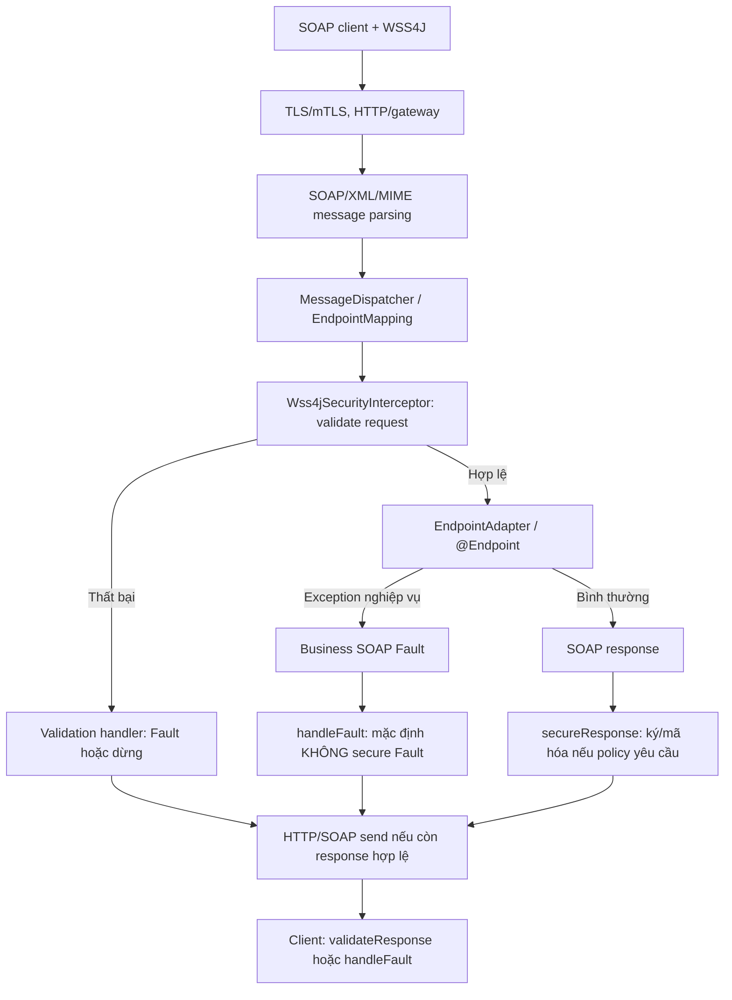

# Lỗi xác minh, SOAP Fault và bảo vệ phản hồi theo khả năng hỗ trợ

## Mục tiêu học tập

Bài học thuộc chương **WS-Security** trong module **SPRING_WEB_SERVICES**. Bối cảnh là một SOAP service theo hướng **contract-first**: XSD/WSDL định nghĩa request, response và typed Fault; JAXB ánh xạ XML thành Java; Spring-WS sử dụng `MessageDispatcher`, endpoint/interceptor và `WebServiceTemplate`; Apache WSS4J xử lý chữ ký XML, mã hóa, UsernameToken, timestamp và chứng chỉ.

Trọng tâm không phải “thêm `wsse:Security` cho đủ header”, mà là **xử lý chính xác khi bảo mật thất bại**: ai phát hiện, ai tạo SOAP Fault, Fault có được bảo vệ bằng chữ ký/mã hóa hay không, và client có đủ khả năng xác minh phản hồi đó không. Hai điều rất dễ bị nhầm là **ký phản hồi thành công** và **ký SOAP Fault**; trong Spring-WS 4.1.4, chúng không có cùng đường xử lý mặc định.

Sau bài học, bạn có thể:

1. Phân biệt lỗi xác minh WS-Security, lỗi tạo bảo mật cho phản hồi, SOAP protocol Fault, lỗi nghiệp vụ và lỗi HTTP/TLS.
2. Mô tả vòng đời `Wss4jSecurityInterceptor` trên **server** và **client**, gồm `validateRequest`, `secureResponse`, `secureRequest`, `validateResponse`.
3. Hiểu các callback `handleValidationException`, `handleSecurementException` và `handleFaultException`; biết tại sao chúng khác `EndpointExceptionResolver` nghiệp vụ.
4. Đọc **SOAP Fault 1.1/1.2** do lỗi xác minh và các lỗi WS-Security theo OASIS, không nhầm `Client/Sender` với subcode chuyên biệt.
5. Giải thích vì sao mặc định `handleFault(...)` trên server **không secure SOAP Fault** và phía client `handleFault(...)` **không validate SOAP Fault** trong Spring-WS 4.1.4.
6. Xây dựng chính sách **fail closed** khi không có private key ký phản hồi hoặc không có public key tin cậy để mã hóa cho người nhận.
7. Cấu hình WSS4J validation, ký response thành công và mã hóa response theo chính sách phù hợp, tránh tắt kiểm tra bảo mật để “sửa lỗi”.
8. Tạo SOAP Fault reason công khai không lộ token, private key, keystore path, thông tin xác minh chữ ký hay danh tính tài nguyên.
9. Thiết kế test xác minh lỗi chữ ký, timestamp, replay, mã hóa, response signing, fault security và tương thích với client được sinh từ WSDL.
10. Có checklist vận hành về certificate trust, WS-SecurityPolicy, attachment, message size, audit log, retry/idempotency và nâng cấp thư viện.

## 1. Tình huống: request bị từ chối nhưng client không đọc được Fault

Ứng dụng đối tác gọi operation `GetOrder` qua HTTPS. WSDL document/literal công bố phần tử `GetOrderRequest`, `GetOrderResponse` và `OrderNotFoundFault`. Bên gửi thêm:

- `wsu:Timestamp` với thời điểm tạo và hết hạn.
- `wsse:BinarySecurityToken` hoặc tham chiếu tới chứng chỉ ký.
- `ds:Signature` bao phủ SOAP Body và những header mà policy yêu cầu.
- Có thể có `xenc:EncryptedData` nếu request phải mã hóa.

Nếu chữ ký không hợp lệ, bạn có thể thấy ba hiện tượng rất khác:

1. **Server từ chối request và gửi SOAP 1.1 Client / SOAP 1.2 Sender Fault**.
2. **Server từ chối nhưng không tạo/gửi được SOAP Fault** vì lỗi ở transport, parser hoặc key material.
3. **Server đã gửi Fault hợp lệ dưới dạng SOAP XML, nhưng client yêu cầu response phải có chữ ký/mã hóa**, nên client từ chối Fault đó.

Hiện tượng thứ ba không thể giải quyết bằng cách chỉ thay `faultstring`. Cần hiểu chính sách bảo vệ **normal response**, **business Fault** và **security Fault** là các trường hợp riêng.

### 1.1. Hợp đồng nghiệp vụ và security policy không đồng nhất

WSDL/XSD có thể mô tả typed `OrderNotFoundFault`, nhưng:

- Nó **không tự quy định** mọi lỗi chữ ký sẽ là `OrderNotFoundFault`.
- WSDL 1.1 chỉ mô tả security requirements chi tiết khi có extension/policy phù hợp, chẳng hạn WS-Policy/WS-SecurityPolicy.
- Một client được sinh từ WSDL có thể giải mã typed business Fault nhưng chưa có WSS4J/certificate/trust configuration.
- Một `wsse:Security` header xuất hiện không chứng minh XML đã được ký/mã hóa đúng **signed parts** hoặc bên nhận có thể giải mã.

**Nguyên tắc:** chức năng tạo Fault, tính đúng của Fault với SOAP version và khả năng tin cậy vào Fault phải được kiểm chứng độc lập.

## 2. Bốn ranh giới trong một lời gọi SOAP bảo mật



**Đây là sơ đồ trách nhiệm**, không phải bảo đảm mỗi request đi qua tất cả các ô. Đường kiểm tra SOAP header có thể không chạy nếu TLS handshake thất bại, HTTP 413 bị gateway chặn hoặc XML parser từ chối trước khi `MessageContext` được tạo.

### 2.1. Transport và WS-Security bảo vệ thứ gì?

| Lớp | Bảo vệ | Không tự giải quyết |
| --- | --- | --- |
| HTTPS/TLS | Bảo mật, toàn vẹn và chứng thực peer trên các hop TLS được cấu hình. | Không bảo đảm SOAP XML có chữ ký end-to-end sau gateway terminate TLS. |
| mTLS | Bổ sung client certificate authentication ở hop TLS. | Không thay authorization trên tenant/resource và signed SOAP Body. |
| WS-Security Signature | Xác minh tính toàn vẹn/xuất xứ của **các phần XML đã ký** theo trust policy. | Không tự mã hóa dữ liệu hay bảo đảm mọi attachment được ký. |
| WS-Security Encryption | Giữ bí mật các phần SOAP đã mã hóa cho recipient phù hợp. | Không tự xác thực caller nếu không có kiểm tra khác. |
| Timestamp + replay cache | Giới hạn cửa sổ thời gian và phát hiện một số replay. | Không thay signature, authentication, authorization hoặc idempotency. |
| XSD/WSDL/JAXB | Contract của operation/payload. | Không chứng minh caller có quyền hoặc chữ ký hợp lệ. |

### 2.2. Thứ tự kiểm tra có ý nghĩa an toàn

Có thể chọn endpoint trước khi interceptor chạy. Do đó, `@PayloadRoot` hoặc `@SoapAction` mapping **không phải bước xác thực**, và một số thông tin routing có thể đến từ input chưa tin cậy. Sau khi WSS4J xác minh, authorization cần dùng principal/trust data đã được xác thực để quyết định operation, tenant và resource.

Không đặt xử lý nghiệp vụ tạo side effects trước khi authentication/authorization hợp lệ. Cũng không tin rằng WS-Security interceptor giúp chống HTTP body quá lớn nếu message factory đã buffer XML trước khi interceptor được gọi.

## 3. Chính xác `Wss4jSecurityInterceptor` làm gì?

Trong Spring-WS 4.1.4, class nằm tại:

```java
org.springframework.ws.soap.security.wss4j2.Wss4jSecurityInterceptor
```

Nó kế thừa `AbstractWsSecurityInterceptor` và triển khai cả **`EndpointInterceptor`** (server) lẫn **`ClientInterceptor`** (client). Cùng một class nhưng phương thức được gọi theo hai hướng khác nhau.

### 3.1. Ma trận callback server và client

| Phía | Callback | Khi nào | Công việc mặc định theo flag |
| --- | --- | --- | --- |
| Server inbound | `handleRequest(MessageContext, Object)` | Request đã được dispatcher đưa tới endpoint interceptor. | `validateRequest=true` → xác minh WS-Security request. |
| Server normal outbound | `handleResponse(MessageContext, Object)` | Endpoint có response bình thường. | `secureResponse=true` → secure response. |
| Server Fault outbound | `handleFault(MessageContext, Object)` | Dispatcher đi vào đường SOAP Fault thông thường. | **Trả `true`, không secure Fault**. |
| Client outbound | `handleRequest(MessageContext)` | Client chuẩn bị gửi request. | `secureRequest=true` → secure request. |
| Client normal inbound | `handleResponse(MessageContext)` | Client nhận response thường. | `validateResponse=true` → xác minh response. |
| Client Fault inbound | `handleFault(MessageContext)` | Client xử lý response SOAP Fault. | **Trả `true`, không validate Fault**. |

Các boolean trên là **flag bật/tắt đường xử lý**, không tự cung cấp keystore, recipient certificate, WSS4J actions hoặc SecurityPolicy. Tài liệu API nêu rằng bốn flag `validateRequest`, `secureResponse`, `secureRequest`, `validateResponse` mặc định đều **`true`**. Muốn xác minh/ký/mã hóa thật sự còn phải cấu hình `validationActions`, `securementActions`, `Crypto` và callback/keystore phù hợp.

### 3.2. Mặc định về Fault là điểm giới hạn quan trọng

Javadoc `AbstractWsSecurityInterceptor` 4.1.4 ghi rõ:

- Server `handleFault(MessageContext,Object)`: trả `true` và **fault responses are not secured**.
- Client `handleFault(MessageContext)`: trả `true` và **fault responses are not validated**.

Vì vậy câu “`secureResponse=true` nên cả SOAP Fault đều được ký” là **sai đối với hành vi mặc định**. Tương tự “`validateResponse=true` nên client đã xác minh chữ ký của mọi Fault” cũng sai.

**Không suy diễn rằng chỉ cần đặt `setSecureResponse(true)` hoặc `setValidateResponse(true)` là có fault signing/validation.** Nếu profile thực sự yêu cầu signed/encrypted Fault, cần thiết kế và kiểm chứng **đường riêng hỗ trợ Fault**, không âm thầm gửi Fault không được bảo vệ.

### 3.3. Cơ chế mặc định có bao giờ phù hợp không?

Có. Chẳng hạn một giao thức tích hợp dùng HTTPS/mTLS, yêu cầu chữ ký trên **normal response** nhưng cho phép **security rejection Fault không ký**, với reason chung không tiết lộ dữ liệu. Tuy nhiên, điều đó phải là **chính sách được hai bên thỏa thuận**, có test, không phải lựa chọn ngầm chỉ vì thư viện có mặc định ấy.

## 4. Các nhóm lỗi xác minh WS-Security

Không nên trả cùng một typed business fault cho tất cả sự cố.

| Nhóm lỗi | Ví dụ | Nơi phát hiện | Phản ứng mong muốn |
| --- | --- | --- | --- |
| Thiếu security header | `wsse:Security` không có dù policy bắt buộc. | WSS4J/interceptor. | Từ chối; không gọi endpoint. |
| UsernameToken sai | Password digest/nonce không hợp lệ. | Callback + WSS4J. | Từ chối, không lộ password/username validity. |
| Chữ ký sai | Digest/reference mismatch, certificate không đáng tin. | WSS4J signature validation. | Từ chối, log loại lỗi nội bộ an toàn. |
| Timestamp/replay | `Expires` đã qua, `Created` quá xa, nonce trùng. | WSS4J timestamp/replay cache. | Từ chối, không side effect. |
| Mã hóa/giải mã | Không có decryption private key, decrypt thất bại. | WSS4J XML Encryption. | Từ chối; phân biệt lỗi request với lỗi server configuration. |
| Policy mismatch | Dùng algorithm, token, signed parts hoặc action khác yêu cầu. | WSS4J + application policy. | Từ chối, không tự giảm chuẩn bảo mật. |
| XML parser, SOAP version | Malformed Envelope, `VersionMismatch`. | Parser/SOAP layer. | Không cam kết interceptor WS-Security chạy. |
| HTTP/TLS | HTTP 413, mTLS handshake failure, timeout. | Transport/gateway. | Không mặc định có SOAP Fault. |
| Business exception | `OrderNotFoundException` sau khi request hợp lệ. | Application service/resolver. | Typed business Fault theo WSDL. |
| Response securement | Keystore không đọc được hoặc private key hết hạn/mất. | Outbound WSS4J. | **Không gửi plaintext/success response thay thế**. |

### 4.1. Đừng dùng exception message làm public reason

Một exception validation có thể chứa class name, certificate Subject DN, đường dẫn keystore, algorithm, digest/reference ID hoặc chi tiết phân biệt “tài khoản có tồn tại không”. Những thông tin đó hữu ích trong logs nội bộ, **không nhất thiết được phép gửi cho caller**.

### 4.2. Authentication khác authorization

Chữ ký hợp lệ chứng minh một khóa được chấp nhận theo trust policy đã ký các phần dữ liệu xác minh được. Nó không chứng minh caller có quyền đọc `orderId=ORD-000042` của tenant khác. Authorization thuộc application/security domain, thực hiện sau khi nhận principal/identity đã được xác thực.

## 5. Các callback xử lý lỗi của `AbstractWsSecurityInterceptor`

Đây là phần dễ nhầm với một `@ControllerAdvice` hoặc `EndpointExceptionResolver` thông thường.

### 5.1. `handleValidationException`

Chữ ký protected:

```java
protected boolean handleValidationException(
        WsSecurityValidationException ex,
        MessageContext messageContext);
```

Theo Javadoc Spring-WS 4.1.4, implementation mặc định:

1. Ghi log lỗi.
2. Nếu đã cung cấp `exceptionResolver` bằng `setExceptionResolver(...)` thì **ủy quyền resolver xử lý**.
3. Nếu không có resolver được cấu hình, tạo SOAP 1.1 **Client** hoặc SOAP 1.2 **Sender** Fault.
4. Reason mặc định có thể lấy **exception message**.
5. Trả `false`, tức không tiếp tục endpoint processing.

**Hệ quả bảo mật:** nếu exception message chứa chẩn đoán quá chi tiết, Fault mặc định có thể làm lộ thông tin. Cấu hình custom resolver hoặc custom protected handler để trả reason chung, kiểm thử response thực tế theo Spring-WS version của bạn.

### 5.2. `handleSecurementException`

```java
protected boolean handleSecurementException(
        WsSecuritySecurementException ex,
        MessageContext messageContext);
```

Mặc định **ghi log và trả `false`**, dừng xử lý. Điều đó **không có nghĩa** framework chắc chắn tạo SOAP Fault mô tả “cannot sign response”. Lý do: chính bước securement đã thất bại; thậm chí tạo một Fault khác và ký lại bằng cùng private key lỗi cũng không khả thi.

**Tuyệt đối không** catch securement exception rồi bật `secureResponse=false` để phát đi plaintext business data thay cho response đã hứa sẽ được ký/mã hóa.

### 5.3. `handleFaultException`

```java
protected boolean handleFaultException(
        WsSecurityFaultException ex,
        MessageContext messageContext);
```

Đây là nhóm exception WSS4J cần tạo Fault chuyên biệt. Implementation mặc định log và tạo SOAP Fault từ các thuộc tính exception, rồi trả `false`. Nó khác `WsSecurityValidationException` thông thường.

Nếu cần chuẩn hóa thông tin công khai hoặc tuân thủ WS-Security Fault codes, phải đánh giá **cả hai loại đường xử lý**. Không cho rằng một `EndpointExceptionResolver` xử lý domain sẽ bắt mọi `WsSecurityFaultException` theo đúng cách.

### 5.4. `true`/`false` ở handler không phải code kết quả nghiệp vụ

- `false` ở `handleValidationException` thường nghĩa là **dừng chuỗi trước endpoint**; SOAP Fault có thể đã được tạo.
- `false` ở `handleSecurementException` thường nghĩa là **dừng gửi response không được secure**.
- `true` do một override tùy ý trả về có thể tiếp tục xử lý request/response trong điều kiện chưa xác thực: cực kỳ nguy hiểm.
- `EndpointExceptionResolver.resolveException(...)` dùng `true`/`false` theo nghĩa **resolver đã xử lý hay chưa**; đây là hợp đồng API khác.

Vì vậy **không sao chép ngữ nghĩa boolean từ resolver sang interceptor handler** mà không đọc đúng Javadoc/callback.

## 6. WS-Security SOAP Fault không giống business Fault

Giả sử WSDL công bố:

```xml
<wsdl:operation name="GetOrder">
    <wsdl:input message="tns:GetOrderInput"/>
    <wsdl:output message="tns:GetOrderOutput"/>
    <wsdl:fault name="OrderNotFound"
                message="tns:OrderNotFoundMessage"/>
</wsdl:operation>
```

Đây là **trích đoạn** thuộc một `wsdl:portType` hợp lệ; cần khai báo namespaces, messages, binding/fault, service và schema. Nó mô tả **lỗi nghiệp vụ** `OrderNotFound`, không mô tả mọi lỗi ở `wsse:Security`.

Một request có signature sai phải bị chặn **trước** application service, không thử tìm order rồi trả `OrderNotFound`. Làm ngược lại có thể tạo leak về tài nguyên của tenant khác hoặc mở đường gọi nghiệp vụ không xác thực.

### 6.1. SOAP 1.1 Fault do policy từ chối

Ví dụ biểu diễn **Fault code chung** mà Spring-WS có thể tạo theo mặc định:

```xml
<?xml version="1.0" encoding="UTF-8"?>
<soap:Envelope
    xmlns:soap="http://schemas.xmlsoap.org/soap/envelope/">
  <soap:Body>
    <soap:Fault>
      <faultcode>soap:Client</faultcode>
      <faultstring>Security validation failed</faultstring>
    </soap:Fault>
  </soap:Body>
</soap:Envelope>
```

Đoạn XML trên dùng **reason cố định được khuyến nghị**; trong Spring-WS mặc định, reason thực tế có thể mang exception message nếu không tùy biến. Không coi ví dụ này là transcript mặc định từ server bạn.

### 6.2. SOAP 1.2 Fault tương đương

```xml
<?xml version="1.0" encoding="UTF-8"?>
<env:Envelope
    xmlns:env="http://www.w3.org/2003/05/soap-envelope"
    xmlns:xml="http://www.w3.org/XML/1998/namespace">
  <env:Body>
    <env:Fault>
      <env:Code>
        <env:Value>env:Sender</env:Value>
      </env:Code>
      <env:Reason>
        <env:Text xml:lang="en">
          Security validation failed
        </env:Text>
      </env:Reason>
    </env:Fault>
  </env:Body>
</env:Envelope>
```

SOAP 1.2 có cấu trúc `Code/Reason` và có thể có `Subcode`; SOAP 1.1 dùng `faultcode/faultstring`. **SOAP 1.1 và 1.2 không chỉ khác tên fault code**; Envelope namespace và HTTP Content-Type/binding cũng khác.

### 6.3. SOAP Fault không phải HTTP status

Một HTTP response có thể mang SOAP Fault; nhưng mTLS thất bại, 413 từ gateway hoặc HTTP 502 không nhất thiết có SOAP Envelope. Một SOAP client production phải xử lý riêng **transport error**, **SOAP Fault** và **WS-Security verification error**.

## 7. WS-Security-specific Fault codes của OASIS

OASIS WS-Security SOAP Message Security định nghĩa các mã lỗi, khác việc chỉ trả `soap:Client` chung.

| Nhóm | OASIS fault code | Ý nghĩa |
| --- | --- | --- |
| Unsupported | `wsse:UnsupportedSecurityToken` | Token type không được hỗ trợ. |
| Unsupported | `wsse:UnsupportedAlgorithm` | Thuật toán signature/encryption không hỗ trợ. |
| Failure | `wsse:InvalidSecurity` | Lỗi xử lý `wsse:Security` header. |
| Failure | `wsse:InvalidSecurityToken` | Security token không hợp lệ. |
| Failure | `wsse:FailedAuthentication` | Token không xác thực/ủy quyền được. |
| Failure | `wsse:FailedCheck` | Chữ ký hoặc giải mã không hợp lệ. |
| Failure | `wsse:SecurityTokenUnavailable` | Không tìm thấy token được tham chiếu. |
| Failure | `wsse:MessageExpired` | Thông điệp hết hạn (theo phiên bản đặc tả). |

**Đây là các mã được đặc tả, không phải cam kết Spring-WS mặc định phát đúng mọi mã chuyên biệt.** Default validation handler của Spring-WS có thể chỉ dùng Client/Sender. Muốn WSS Fault chuyên biệt, cần profile và cơ chế tạo Fault tương thích được kiểm thử.

### 7.1. SOAP 1.2 Subcode theo WS-Security

OASIS mô tả việc map các mã `wsse:...` vào SOAP 1.2 `env:Code/env:Subcode` dưới `env:Sender`.

Ví dụ **chỉ để đọc cấu trúc theo profile**, không khẳng định Spring-WS default tự sinh:

```xml
<env:Fault
    xmlns:env="http://www.w3.org/2003/05/soap-envelope"
    xmlns:wsse="http://docs.oasis-open.org/wss/2004/01/oasis-200401-wss-wssecurity-secext-1.0.xsd"
    xmlns:xml="http://www.w3.org/XML/1998/namespace">
  <env:Code>
    <env:Value>env:Sender</env:Value>
    <env:Subcode>
      <env:Value>wsse:FailedCheck</env:Value>
    </env:Subcode>
  </env:Code>
  <env:Reason>
    <env:Text xml:lang="en">Security validation failed</env:Text>
  </env:Reason>
</env:Fault>
```

Trong SOAP 1.1, WS-Security code chuyên biệt có thể xuất hiện ở `faultcode` theo WS-Security specification/profile. Đừng lấy QName `wsse:FailedCheck` rồi chỉ thay chuỗi `faultstring` của Fault generic mà cho rằng đã đáp ứng conformance.

### 7.2. Nên trả loại lỗi nào?

OASIS mô tả một số hệ thống **có thể chọn không gửi phản hồi** cho security failure để tránh cung cấp oracle hoặc khuếch đại DoS. Nếu gửi Fault, phải theo SOAP/WS-Security profile đã thỏa thuận. Không nên trả thông tin quá chi tiết kiểu “password đúng nhưng nonce sai” hoặc “certificate chain hợp lệ nhưng Subject DN không khớp chính sách”.

## 8. Đường securement phản hồi: vì sao có thể không tạo được Fault?

Giả sử endpoint tạo `GetOrderResponse` hợp lệ, nhưng WSS4J cần ký theo `securementActions="Signature"`. Nếu private key không có, key password sai hoặc crypto provider lỗi:

```text
Business method thành công
 → JAXB tạo SOAP response
 → WSS4J secureResponse cố ký
 → WsSecuritySecurementException
 → handleSecurementException: log, return false
 → không cam kết có signed SOAP Fault hay success reply
```

**Không** thực hiện:

```java
try {
    signResponse();
} catch (Exception ex) {
    sendUnprotectedResponse();
}
```

Đây là **anti-pattern cố ý**: phản hồi chứa dữ liệu nghiệp vụ đã được contract yêu cầu ký/mã hóa mà lại gửi plaintext/unsigned khi securement thất bại.

### 8.1. Lỗi cần chặn ngay tại startup

- Keystore không mở được.
- Alias private key không tồn tại.
- Key password sai hoặc đã được revoke bởi secret manager.
- Certificate hết hạn hoặc không còn được đối tác tin cậy.
- Thuật toán bị tắt/bị từ chối trong runtime.
- Không có recipient public certificate tin cậy để mã hóa.

Nếu cấu hình tạo chữ ký là yêu cầu bắt buộc cho operation, **startup/integration readiness** nên kiểm tra trước key material/certificate profile, không để lần gọi đầu tiên trong production mới phát hiện.

### 8.2. Đã ký Body có chắc đủ không?

WSS4J mặc định có thể ký SOAP Body nếu `securementSignatureParts` không chỉ định. Nhưng hợp đồng có thể yêu cầu ký:

- SOAP Body.
- `wsu:Timestamp`.
- `wsa:Action`/`wsa:To`.
- Một số custom headers.
- Attachments theo security profile.

Cấu hình `Signature` thành công mà thiếu một signed part bắt buộc **vẫn không đáp ứng policy**. Cần test chính xác QName và reference URIs được ký.
## 9. Bảo vệ phản hồi “theo khả năng hỗ trợ” nghĩa là gì?

**Theo khả năng hỗ trợ** không có nghĩa client nào không biết xác minh chữ ký thì server sẽ tự động tắt chữ ký cho client đó. Nghĩa đúng là **trước khi mở kết nối tích hợp**, hai bên cần thỏa thuận rõ:

- Loại request nào phải ký, mã hóa, gắn Timestamp, UsernameToken.
- Normal response có bắt buộc signed/encrypted không; client có public/private keys thích hợp không.
- Business Fault và security Fault có được phép không ký không, hoặc phải có một cơ chế bảo vệ chuyên biệt.
- Khi thiếu một khả năng cần thiết, **từ chối an toàn** hay dùng một profile riêng đã được thỏa thuận và thử nghiệm.
- SOAP version, WS-Addressing, WSS4J algorithms, certificate rotation và trust policy nào áp dụng.

**Không bao giờ** cho phép một request header không được xác minh lựa chọn profile bảo mật yếu hơn.

### 9.1. Ma trận quyết định

| Tình huống | Phản ứng thích hợp | Điều không được tự suy luận |
| --- | --- | --- |
| Request hợp lệ, normal response phải ký và server có private key. | Tạo chữ ký đúng các signed parts. | `Signature` tự ký cả SOAP Header/attachment. |
| Normal response phải mã hóa, recipient certificate đã được provision/trusted. | Mã hóa theo policy đã đàm phán. | Có thể dùng certificate do request **chưa xác minh** cung cấp. |
| Request có chữ ký sai, chưa có identity đáng tin. | Dừng hoặc trả generic security Fault nếu policy cho phép. | Có thể mã hóa cho bất kỳ certificate nào tự khai. |
| Request hợp lệ nhưng business service ném exception. | Typed SOAP Fault theo WSDL; bảo vệ Fault bằng **đường riêng** nếu bắt buộc. | `secureResponse=true` tự ký Fault. |
| Server mất private key/không ký được. | Dừng response, ghi sự cố nội bộ, fail closed. | Gửi plaintext success response để “tránh lỗi”. |
| Client nhận SOAP Fault từ bên ngoài chưa qua Fault verification. | Xử lý như thông điệp **chưa có bảo đảm WS-Security end-to-end**. | `validateResponse=true` đã xác minh Fault. |

### 9.2. Ví dụ profile hợp đồng

```yaml
# Chỉ minh họa profile đã thỏa thuận;
# KHÔNG phải cấu hình Spring-WS tự động nạp.
partner: approved-erp
soapVersion: SOAP_11
request:
  requireSignature: true
  requireTimestamp: true
  bodyMustBeSigned: true
normalResponse:
  requireSignature: true
  requireEncryption: false
securityFault:
  mayBeUnsignedOverAuthenticatedTls: true
  publicReason: "Security validation failed"
businessFault:
  requireSignature: false
unknownRecipient:
  action: REJECT
```

Trên production, profile phải gắn với **endpoint/partner/tenant đã cấu hình và xác thực**, version hóa, và được thực thi bằng WSS4J/transport/application policy. Đây không phải cách để tắt kiểm tra trong từng request.

## 10. Cấu hình server xác minh chữ ký và Timestamp

Spring-WS 4.1.4 dùng class:

```java
org.springframework.ws.soap.security.wss4j2.Wss4jSecurityInterceptor
```

Ví dụ `@Configuration` dùng `WsConfigurer` đăng ký interceptor để chặn request thiếu chữ ký/timestamp.

**`InboundWsSecurityConfig.java`**:

```java
package com.example.orders.soapsecurity;

import java.util.List;

import org.apache.wss4j.common.crypto.Crypto;
import org.springframework.context.annotation.Bean;
import org.springframework.context.annotation.Configuration;
import org.springframework.ws.config.annotation.EnableWs;
import org.springframework.ws.config.annotation.WsConfigurer;
import org.springframework.ws.server.EndpointInterceptor;
import org.springframework.ws.soap.security.wss4j2.Wss4jSecurityInterceptor;

@Configuration
@EnableWs
public class InboundWsSecurityConfig implements WsConfigurer {

    private final Crypto trustedPartnerCrypto;

    public InboundWsSecurityConfig(Crypto trustedPartnerCrypto) {
        this.trustedPartnerCrypto = trustedPartnerCrypto;
    }

    @Bean
    public Wss4jSecurityInterceptor inboundSecurity() {
        Wss4jSecurityInterceptor security =
                new Wss4jSecurityInterceptor();

        security.setValidationActions("Timestamp Signature");
        security.setValidationSignatureCrypto(trustedPartnerCrypto);
        security.setValidateRequest(true);
        security.setSkipValidationIfNoHeaderPresent(false);

        // CHỈ cho profile mà normal response không phải ký.
        security.setSecureResponse(false);

        security.setExceptionResolver(
                new SafeWsSecurityFaultResolver());
        security.setOrder(-200);

        return security;
    }

    @Override
    public void addInterceptors(
            List<EndpointInterceptor> interceptors) {
        interceptors.add(inboundSecurity());
    }
}
```

Đây là ví dụ **inbound-only policy**, không phải cấu hình đáp ứng yêu cầu ký phản hồi. Bean `trustedPartnerCrypto` phải được cung cấp từ truststore/provisioning riêng. Cần cấu hình rõ caller identity, signed parts, Timestamp TTL, replay cache, certificate constraints, authorization; không được coi `validationActions` là bằng chứng mọi yêu cầu trên đã được đáp ứng.

### 10.1. Cờ tùy chọn có thể khiến tuyến bảo vệ yếu đi

- `setSkipValidationIfNoHeaderPresent(true)`: cho phép bỏ validation khi header không có; **không phù hợp** với operation luôn bắt buộc bảo mật.
- `setStrictActionChecking(false)`, có từ 4.1.4: cho phép extra security actions trong thông điệp; **không có nghĩa** bỏ qua required Signature/Timestamp.
- `setValidateRequest(false)`: bỏ kiểm tra request trong interceptor; chỉ có lý do hợp lệ nếu route đã được bảo vệ ở cơ chế khác và policy cho phép.
- `setBspCompliant(false)`: nới WS-I Basic Security Profile; không bật chỉ vì một client không tương thích mà chưa review rủi ro.
- `setAllowRSA15KeyTransportAlgorithm(true)`: cho phép thuật toán truyền khóa cũ mà default có chủ đích từ chối; đòi risk acceptance.

**Đừng đặt interceptor ở sau một interceptor có side effect**, ghi dữ liệu hoặc trả response trước khi xác minh security header. Hãy kiểm tra thứ tự interceptor/mapping và log những trường hợp bảo mật bị chặn.

## 11. Tùy biến public SOAP Fault reason an toàn

Tài liệu API của Spring-WS 4.1.4 cho phép `AbstractWsSecurityInterceptor.setExceptionResolver(...)` để xử lý validation exceptions qua resolver được cấu hình trực tiếp. Đây **không đồng nghĩa** với việc global domain exception resolver tự động bắt mọi WS-Security failure.

**`SafeWsSecurityFaultResolver.java`**:

```java
package com.example.orders.soapsecurity;

import java.util.Locale;

import org.springframework.ws.context.MessageContext;
import org.springframework.ws.server.EndpointExceptionResolver;
import org.springframework.ws.soap.SoapMessage;
import org.springframework.ws.soap.security.WsSecurityValidationException;

public final class SafeWsSecurityFaultResolver
        implements EndpointExceptionResolver {

    @Override
    public boolean resolveException(
            MessageContext context,
            Object endpoint,
            Exception exception) {

        if (!(exception instanceof WsSecurityValidationException)) {
            return false;
        }

        if (!(context.getResponse() instanceof SoapMessage soap)) {
            return false;
        }

        soap.getSoapBody().addClientOrSenderFault(
                "Security validation failed", Locale.ENGLISH);

        return true;
    }
}
```

Code này **chỉ tạo một Fault reason chung**, không tự validate chữ ký. `getResponse()` của `MessageContext` có thể tạo một response lazily; `addClientOrSenderFault` tạo SOAP 1.1 Client hoặc SOAP 1.2 Sender Fault. Nếu resolver trả `true`, nó nói **đã xử lý exception**, không nói “request đã được xác minh”. `handleValidationException` mặc định vẫn dừng request bằng `false`.

### 11.1. Các giới hạn của custom resolver

- `WsSecurityFaultException` có `handleFaultException` riêng; không khẳng định mọi security failure đều đi qua resolver ở trên.
- XML parsing, TLS hoặc gateway errors có thể xảy ra trước khi security interceptor hoạt động.
- Fault reason chung không tự bảo đảm **WS-Security signed/encrypted Fault**.
- Không đưa `exception.getMessage()`, certificate Subject DN, alias, đường dẫn keystore, stack trace hoặc token vào public SOAP Fault.
- Nếu policy yêu cầu OASIS-specific fault codes/subcodes, cần implementation và test riêng; class trên chỉ tạo generic Client/Sender Fault.

### 11.2. Vì sao không cho `handleValidationException` trả `true`?

Ở interceptor handler, `true` có thể cho phép tiếp tục xử lý request, dù security validation đã thất bại. Trả `false` theo mặc định **ngăn endpoint/business service chạy**; không đổi thành true chỉ vì đã ghi Fault.

### 11.3. Không tạo Fault quá chi tiết để giúp attacker

Reason như `"Certificate alias partner-prod-a not found"` hoặc `"Incorrect nonce for existing account"` cung cấp tín hiệu có thể khai thác. Dùng generic reason; phân loại nguyên nhân sâu ở **security audit logs** có kiểm soát, gắn correlation ID do server tạo.

## 12. Ký normal response khi policy yêu cầu

Nếu đã có trust configuration inbound và server signing key, bean cấu hình có thể thêm:

```java
@Bean
public Wss4jSecurityInterceptor signedResponseSecurity(
        Crypto trustedCallerCrypto,
        Crypto serverSigningCrypto,
        @Value("${soap.signing.alias}") String signingAlias,
        @Value("${soap.signing.key-password}") String keyPassword) {

    Wss4jSecurityInterceptor security =
            new Wss4jSecurityInterceptor();

    security.setValidationActions("Timestamp Signature");
    security.setValidationSignatureCrypto(trustedCallerCrypto);

    security.setSecureResponse(true);
    security.setSecurementActions("Timestamp Signature");
    security.setSecurementSignatureCrypto(serverSigningCrypto);
    security.setSecurementSignatureUser(signingAlias);
    security.setSecurementPassword(keyPassword);

    security.setExceptionResolver(
            new SafeWsSecurityFaultResolver());

    return security;
}
```

Đây là **bean thay thế cấu hình mục 10**, không phải interceptor thứ hai được gắn đồng thời vào cùng chain. Phải đăng ký nó bằng `WsConfigurer` hoặc endpoint mapping được áp dụng; khi có nhiều `Crypto` beans, sử dụng `@Qualifier` để phân biệt truststore và signing keystore.

**Imports của đoạn rút gọn:** `org.springframework.context.annotation.Bean`, `org.springframework.beans.factory.annotation.Value`, `org.apache.wss4j.common.crypto.Crypto`, `Wss4jSecurityInterceptor`. Biến password được nạp qua secret manager/environment, **không hard-code** trong Java hoặc tài liệu cấu hình được commit.

### 12.1. Signing key khác truststore inbound

- `validationSignatureCrypto`: xác minh signature của caller bằng certificate/trust policy được cho phép.
- `securementSignatureCrypto`: tìm private key/certificate của **server** để ký response.
- `securementSignatureUser`: alias của key dùng ký.
- `securementPassword`: credential mở khóa private key (cần bảo vệ trong secret manager).
- `setSecureResponse(true)`: cho phép đường securement normal response.
- `securementActions="Timestamp Signature"`: các action được thực hiện theo thứ tự cấu hình.

**Không** kết luận đã hoàn tất khi message chỉ có thẻ `ds:Signature`. Phải kiểm tra signature đúng và **các QName/IDs được ký** đúng hợp đồng. WSS4J mặc định thường ký SOAP Body nếu không có `securementSignatureParts`, nhưng security policy có thể còn yêu cầu ký Timestamp hoặc WS-Addressing Header.

### 12.2. Nếu cần chỉ định signed parts

API có `setSecurementSignatureParts(String)`. Ví dụ minh họa SOAP 1.1 Body:

```java
security.setSecurementSignatureParts(
    "{}{http://schemas.xmlsoap.org/soap/envelope/}Body");
```

**Không copy namespace SOAP 1.1 cho SOAP 1.2**; SOAP 1.2 dùng `http://www.w3.org/2003/05/soap-envelope`. Nếu policy cần `Timestamp`, `wsa:Action`, `wsa:To` hoặc attachments cũng được ký, phải bổ sung parts/attachment callback phù hợp và kiểm tra trên wire.

### 12.3. Khi ký response thất bại

`handleSecurementException` mặc định ghi log rồi dừng. **Không bắt lỗi đó để gửi normal response không ký**. Thiết kế health/readiness kiểm tra private key, alias, certificate expiry/rotation, HSM hoặc Crypto provider trước khi nhận traffic.

## 13. Cấu hình `CryptoFactoryBean` và vòng đời chứng chỉ

Spring-WS 4.1.4 cung cấp `org.springframework.ws.soap.security.wss4j2.support.CryptoFactoryBean`, một Spring `FactoryBean<Crypto>`.

Ví dụ bean lấy keystore/truststore từ nguồn cấu hình:

```java
import java.io.IOException;

import org.springframework.beans.factory.annotation.Value;
import org.springframework.context.annotation.Bean;
import org.springframework.core.io.Resource;
import org.springframework.ws.soap.security.wss4j2.support.CryptoFactoryBean;

@Bean("trustedPartnerCrypto")
public CryptoFactoryBean trustedPartnerCrypto(
        @Value("${soap.truststore.location}") Resource store,
        @Value("${soap.truststore.password}") String password)
        throws IOException {

    CryptoFactoryBean factory = new CryptoFactoryBean();
    factory.setKeyStoreLocation(store);
    factory.setKeyStorePassword(password);
    factory.setKeyStoreType("PKCS12");
    return factory;
}
```

Đây là **trích đoạn bean**, không phải file Spring configuration hoàn chỉnh. Để chạy thực, cần keystore/truststore đã được cấp phát, policy xác minh certificate chain/issuer/subject/revocation và password từ secret manager. Không dùng các mật khẩu mẫu của documentation để triển khai.

### 13.1. Thông tin trên certificate do client gửi chưa được tin cậy

Một `wsse:BinarySecurityToken` có thể mang chứng chỉ tự khai. Server chỉ tin identity sau khi kiểm tra signature, trust chain, certificate constraints/usage và các phần XML thực được endpoint xử lý. Không dùng chứng chỉ trong request **chưa xác minh** làm căn cứ chọn recipient cho encryption hoặc cấp quyền tenant.

### 13.2. Chuyển khóa và certificates không chỉ là thay file

- Cần overlap trust trong khoảng xoay vòng đã thỏa thuận.
- Cần kiểm tra certificate expiry và revocation policy.
- Nếu alias signing key đổi, update ở các node/containers đúng thứ tự.
- Test cả client đang dùng certificate mới và cũ trong giai đoạn tương thích.
- Không log private key, key password, token hoặc raw `wsse:Security`.
- Nếu key bắt buộc không sẵn sàng, route nên **fail readiness/không xử lý**, thay vì chạy unprotected.

## 14. Mã hóa normal response chỉ khi có recipient đáng tin

WSS4J có `Encrypt` action và hai setter chính:

```java
security.setSecurementEncryptionCrypto(recipientCrypto);
security.setSecurementEncryptionUser(recipientAlias);
```

Khi profile yêu cầu cả ký và mã hóa response:

```java
security.setSecureResponse(true);
security.setSecurementActions("Timestamp Signature Encrypt");

// Phải cấu hình đầy đủ signing key như mục 12.
security.setSecurementEncryptionCrypto(recipientCrypto);
security.setSecurementEncryptionUser(recipientAlias);
```

`recipientCrypto` phải chứa **public certificate được provision/trusted của đối tác**, không phải certificate tùy ý trong unverified request. Trong một hệ thống multi-tenant, ánh xạ principal/partner đã xác thực tới certificate đúng phải được review và test kỹ để không mã hóa dữ liệu cho sai người nhận.

### 14.1. Thuật toán và thứ tự xử lý là một phần của profile

Chọn encryption algorithms, key transport (thường ưu tiên RSA-OAEP trong các profile phù hợp), canonicalization, signing/encryption parts và thứ tự actions theo chính sách/compliance và hỗ trợ thực tế của hai bên. Chỉ có `setSecurementActions("Encrypt")` không chứng minh mọi dữ liệu phải bảo mật đã nằm trong encrypted parts.

Trong Spring-WS 4.1.4, inbound RSA PKCS#1 v1.5 key transport không mặc nhiên được chấp nhận; không hạ bảo mật bằng `setAllowRSA15KeyTransportAlgorithm(true)` nếu không có risk acceptance.

### 14.2. Không có recipient certificate thì sao?

Khi server không xác định được người nhận đáng tin để mã hóa:

- **Không** tắt Encrypt và gửi plaintext.
- **Không** dùng server signing certificate làm recipient tùy tiện.
- **Không** lấy public certificate bất kỳ từ XML request chưa xác minh.
- Dừng response/mark integration unavailable; giải quyết trust/key provisioning rồi retry theo policy.

Một Fault có thể không mã hóa được nếu chính request bị từ chối trước khi server xác minh recipient identity. Đây là lý do nhiều security profile dùng generic Fault qua transport tin cậy hoặc không trả response cho một số security failures.

## 15. `handleFault` mặc định không bảo vệ Fault

Tài liệu API `AbstractWsSecurityInterceptor` 4.1.4 ghi rõ:

```text
Server handleResponse(context, endpoint)
  → normal response được secure nếu secureResponse=true.

Server handleFault(context, endpoint)
  → mặc định return true, Fault KHÔNG được secure.

Client handleResponse(context)
  → normal response được validate nếu validateResponse=true.

Client handleFault(context)
  → mặc định return true, Fault KHÔNG được validate.
```

### 15.1. Đường normal response so với đường business Fault

```text
GetOrder thành công:
  endpoint tạo response
  → server handleResponse → ký/mã hóa (nếu cấu hình)
  → client handleResponse → xác minh

OrderNotFoundException:
  EndpointExceptionResolver tạo SOAP Fault
  → server handleFault → WSS4J default KHÔNG ký/mã hóa
  → client handleFault → WSS4J default KHÔNG xác minh
```

Nếu security policy yêu cầu **business Fault cũng được ký**, chỉ cấu hình `secureResponse=true` ở interceptor là **chưa đủ**.

### 15.2. Security validation Fault có thể không đi qua chuỗi callback tương tự

Khi security validation thất bại trong `handleRequest`, interceptor có thể tạo Fault và trả `false` trước khi endpoint được gọi. Đừng giả định mọi downstream `handleFault` callback hoặc custom post-processing đều sẽ chạy trong trường hợp này.

### 15.3. Nếu policy yêu cầu signed/encrypted Fault

Phải thiết kế **đường xử lý Fault riêng**:

1. Xác định rõ những loại Fault cần bảo vệ (business, security, SOAP protocol).
2. Bảo đảm có server signing key độc lập với việc caller đã được xác minh hay chưa.
3. Nếu cần mã hóa, chỉ sử dụng recipient public key đã tin cậy/được provision.
4. Chọn thành phần ký/mã hóa sau khi Fault được tạo nhưng **trước khi gửi**, không tự tạo vòng ký lại vô hạn nếu securement thất bại.
5. Bao phủ cả Fault khi thiếu WS-Security header, signature invalid, business exception và lỗi outbound securement mà kiến trúc có thể xử lý.
6. Trên client, tạo **Fault verification path** tương ứng; stock `handleFault` của WSS4J interceptor không tự validate.
7. Test signature references, signed/unsigned tampering, keystore outage, SOAP 1.1/1.2 và interoperability với stack đối tác.
8. Nếu stack hiện tại **không đáp ứng được policy**, không tuyên bố conformance hoặc mở route bắt buộc protected Fault.

**Không** chỉ override `handleFault` rồi gọi bừa `handleResponse` mà không kiểm tra lifecycle/final methods, double signing, fault representation và trust. Đây không phải một cơ chế mặc định được Spring-WS hứa hẹn.

## 16. Fault không ký: có thể chấp nhận trong profile nào?

Một số tích hợp B2B thỏa thuận generic security Fault không mang WS-Security signature khi request không có authenticated identity. Điều này có thể chấp nhận **chỉ khi**:

- Kênh transport được bảo vệ đúng mức theo policy và mọi hop được đánh giá.
- Fault không chứa dữ liệu nghiệp vụ, thông tin người dùng/tenant hay chi tiết crypto.
- Client biết đó là **Fault chưa được xác minh end-to-end**, không dùng làm bằng chứng quyền.
- Profile mô tả rõ các trường hợp unsigned Fault được phép.
- Không có downgrade do một request header tự khai từ caller.

Ví dụ reason đủ chung:

```xml
<faultstring>Security validation failed</faultstring>
```

Nhưng một reverse proxy có thể kết thúc TLS rồi mở kết nối nội bộ khác; nhận Fault trên HTTPS không mặc nhiên chứng minh chữ ký end-to-end của SOAP message.

### 16.1. Khi OASIS cho phép không gửi Fault

OASIS WS-Security thừa nhận một số security failures có thể **không phản hồi** để giảm nguy cơ oracle hoặc Denial of Service. Nếu profile của bạn yêu cầu SOAP Fault cụ thể, cần bảo đảm implementation thật sự hỗ trợ và các giao thức transport không chặn nó từ trước.

### 16.2. Khi nào không thể dùng unsigned Fault

Nếu hợp đồng/WS-SecurityPolicy nói **mọi response bao gồm Fault đều phải ký**, không được âm thầm gửi unsigned Fault chỉ vì library default làm như vậy. Cần giải pháp đúng profile hoặc từ chối hỗ trợ integration ấy cho đến khi hai bên thống nhất contract mới.

## 17. Fault signing phải đi đôi với Fault verification phía client

Đầu ra có chữ ký chỉ là **một nửa** của chính sách.

Spring-WS 4.1.4 phía client mặc định có `handleFault(MessageContext)` trả true mà **không chạy validation**. Vì thế:

- Fault có `ds:Signature` không chứng minh client đã kiểm tra chữ ký.
- `SoapFaultClientException` có thể được ném khi parser thấy SOAP Fault; exception này không có nghĩa Fault đã trusted.
- Nếu Fault ảnh hưởng quyết định thanh toán, trạng thái giao dịch hoặc retry, yêu cầu verification độc lập trước khi tin detail.

### 17.1. Hướng tiếp cận khi signed Fault bắt buộc

Phải triển khai và kiểm thử **security-aware fault-processing component** ở cấp client trước khi diễn giải Fault, tương ứng security policy đã thỏa thuận. Có thể là custom `ClientInterceptor.handleFault`, security adapter riêng hoặc SOAP stack/profile hỗ trợ đầy đủ. Việc gọi API WSS4J cần xác minh signed parts theo chính sách, không chỉ sự tồn tại của Signature element.

Nếu không verify được, **fail closed**: không sử dụng Fault detail chưa trusted cho quyết định nghiệp vụ.

### 17.2. Không tắt `validateResponse` để chữa lỗi tương thích

Tắt validation làm suy yếu bảo mật của **normal response**, trong khi stock client Fault vốn đã theo đường khác. Giải quyết bằng profile được thỏa thuận, cấu hình đúng key/algorithm và Fault verification path; không tự giảm chuẩn bảo mật.

## 18. Cấu hình WS-Security phía SOAP client

`WebServiceTemplate` có thể đăng ký `Wss4jSecurityInterceptor` như `ClientInterceptor`. Cấu hình rút gọn:

```java
Wss4jSecurityInterceptor clientSecurity =
        new Wss4jSecurityInterceptor();

clientSecurity.setSecureRequest(true);
clientSecurity.setSecurementActions("Timestamp Signature");
clientSecurity.setSecurementSignatureCrypto(clientSigningCrypto);
clientSecurity.setSecurementSignatureUser(clientSigningAlias);
clientSecurity.setSecurementPassword(clientKeyPassword);

clientSecurity.setValidateResponse(true);
clientSecurity.setValidationActions("Timestamp Signature");
clientSecurity.setValidationSignatureCrypto(serverTrustCrypto);

template.setInterceptors(
        new org.springframework.ws.client.support.interceptor.ClientInterceptor[] {
            clientSecurity
        });
```

Đây là ví dụ đặt trong một method/config đã có `template`, `Crypto`, alias, password và dependency injection; **chưa phải file Java độc lập**. Cần thêm cấu hình sender/TLS, WSDL binding, JAXB, SOAPAction, timestamp strictness và keystore trust.

### 18.1. Khi server trả SOAP Fault

`SoapFaultMessageResolver` có thể ném:

```java
org.springframework.ws.soap.client.SoapFaultClientException
```

Với object đó, client đọc được SOAP Fault code/reason ở mức XML parser, **không mặc định có bằng chứng WS-Security signature đã được xác minh**. Đừng catch exception rồi trả một `GetOrderResponse` rỗng. Tách security validation, business Fault và HTTP/TLS errors.

### 18.2. Replay và idempotency khác nhau

Timestamp/nonce/replay cache chặn một số replay cùng thông điệp. Nhưng một client có thể tạo **hai request hợp lệ mới** cho cùng thao tác ghi. Vì vậy `SubmitOrder`/`CancelOrder` vẫn cần idempotency key, transaction boundaries và reconciliation khi bị timeout, nhận Fault hoặc mất kết nối.
## 19. Tương tác với `EndpointExceptionResolver` nghiệp vụ

Một lỗi WS-Security xảy ra trong interceptor **trước endpoint**. Một business exception thường phát sinh **sau khi request đã được xác minh**. Do đó đường xử lý và chính sách thông tin khác nhau.

### 19.1. Cùng một SOAP Body nhưng hai lỗi khác nhau

Giả sử:

```xml
<ord:GetOrderRequest xmlns:ord="urn:example:orders:v1">
    <ord:orderId>ORD-000042</ord:orderId>
</ord:GetOrderRequest>
```

- **Chữ ký sai**: request bị security interceptor từ chối; không gọi `OrderLookupService`.
- **Chữ ký hợp lệ nhưng order không tồn tại**: application service có thể ném `OrderNotFoundException`, được domain `EndpointExceptionResolver` map thành `OrderNotFoundFault`.
- **Chữ ký hợp lệ nhưng caller không có quyền tenant**: authorization layer từ chối theo chính sách, không vô tình tiết lộ order tồn tại hay không.
- **Request bị gateway chặn 413**: Spring-WS không có cơ hội đọc SOAP request để tạo Fault ứng dụng.

### 19.2. Không tái sử dụng business Fault cho lỗi security

Ví dụ chống chỉ định:

```text
Wss4jSecurityValidationException
    → OrderNotFoundFault
```

Sai ở hai điểm: làm lẫn nguyên nhân bảo mật với lỗi nghiệp vụ, đồng thời có thể cho attacker suy ra tài nguyên hoặc hành vi hệ thống dựa trên phản hồi. Tạo policy riêng cho security failures.

### 19.3. Exception resolver nghiệp vụ không tự bao phủ tất cả lỗi

`Wss4jSecurityInterceptor` xử lý một số lỗi bằng protected handlers của chính nó. Spring-WS API có `setExceptionResolver(...)` dùng cho validation failures, nhưng điều đó không biến mọi exception transport/XML/securement thành domain exception. Khi gặp lỗi, xác định **callback thực sự được gọi** trước khi sửa global resolver order.

## 20. Vai trò của `mustUnderstand`, actor và role

Một SOAP header `wsse:Security` thường có `soap:mustUnderstand`:

```xml
<soap:Header
    xmlns:soap="http://schemas.xmlsoap.org/soap/envelope/"
    xmlns:wsse="http://docs.oasis-open.org/wss/2004/01/oasis-200401-wss-wssecurity-secext-1.0.xsd">
  <wsse:Security soap:mustUnderstand="1">
    <!-- Timestamp, BinarySecurityToken, Signature... -->
  </wsse:Security>
</soap:Header>
```

Nếu một SOAP node nhận header bắt buộc dành cho mình nhưng không hiểu được, SOAP protocol có thể yêu cầu **MustUnderstand Fault**. Đó không nhất thiết là chữ ký sai. Khi sử dụng actor/role để định tuyến security headers, bảo đảm server xử lý **đúng header dành cho node**, không xem một `wsse:Security` ở role khác là bằng chứng request đã được xác minh.

### 20.1. Phân biệt hai trường hợp

| Tình huống | Bản chất |
| --- | --- |
| Node không hiểu header có `mustUnderstand` | SOAP protocol/header processing; có thể là MustUnderstand Fault. |
| Node hiểu WS-Security header nhưng signature/digest/timestamp sai | WS-Security validation failure; Fault hoặc reject theo policy. |

### 20.2. Đừng sửa bằng cách tắt `mustUnderstand` tùy tiện

`Wss4jSecurityInterceptor.setSecurementMustUnderstand(boolean)` điều khiển thuộc tính mustUnderstand trên outbound security header. Đổi nó để đối tác hết lỗi có thể che đi vấn đề **role, namespace, SOAP version hoặc thiếu WSS4J support**. Phải đánh giá profile trước khi đổi.

## 21. WS-Addressing và bảo vệ thông tin định tuyến

Nhiều tích hợp dùng cả:

- HTTP `SOAPAction` của SOAP 1.1.
- SOAP Header `wsa:Action`, `wsa:To` hoặc `wsa:ReplyTo` của WS-Addressing.
- WS-Security signature trên SOAP Body và một số headers.

### 21.1. Action không phải chứng cứ xác thực

Client có thể tự đặt chuỗi `SOAPAction`. Nếu gateway dựa vào action để chọn operation có chính sách khác nhau, phải kiểm tra **action/payload/signed headers** nhất quán. Không cho request chọn nhánh bypass security chỉ bằng cách đổi header.

### 21.2. Nếu security profile yêu cầu ký `wsa:Action`

`setSecurementSignatureParts(...)` phải chỉ định đúng QName/namespace và URI references theo WSS4J conventions; không chỉ ký Body rồi cho rằng header định tuyến cũng được bảo vệ. Với SOAP 1.1 và SOAP 1.2, header namespaces và binding có thể khác nhau.

### 21.3. Out-of-band reply/fault

Nếu `wsa:ReplyTo` hoặc `wsa:FaultTo` yêu cầu gửi response sang một endpoint khác, đó không còn là phản hồi chỉ đi trên kết nối HTTP ban đầu. Phải áp **allowlist đích**, policy client certificate/HTTP sender và chống SSRF; không gửi signed/encrypted data tới URI tự khai trước khi xác minh sender/trust và quy tắc routing.

Một Fault được ký nhưng gửi sai recipient vẫn là lỗi bảo mật.

## 22. MTOM/attachments và lỗi xác minh

Trong SOAP with Attachments hoặc MTOM/XOP, binary bytes có thể ở MIME parts. Một `ds:Signature` trên SOAP Body chứa:

```xml
<xop:Include
    href="cid:pdf-42@example.test"
    xmlns:xop="http://www.w3.org/2004/08/xop/include"/>
```

không tự bảo đảm PDF attachment đã được ký theo security profile.

### 22.1. Các failure modes

- Attachment thiếu hoặc Content-ID bị tráo.
- SOAP Body có signature hợp lệ nhưng binary part bị sửa.
- Một trong nhiều MIME parts dùng duplicate Content-ID khiến parser/security validator xử lý khác nhau.
- XML Signature Wrapping dẫn tới validator kiểm tra phần tử khác phần tử business sử dụng.
- File lớn hoặc compressed archive tiêu thụ bộ nhớ trước khi WSS4J xác minh.
- Response signing/encryption fail khi MTOM serializer chưa hỗ trợ signed attachments theo profile yêu cầu.

### 22.2. Phải xác minh những gì?

1. Dữ liệu/part nào nằm trong signature reference set?
2. ID/CID/QName có được canonicalize và xử lý nhất quán không?
3. Nếu dùng attachment signature profile, callback/config có được thiết lập đúng và test bytes thật chưa?
4. Nếu dùng signed hash của file, hash có được tính từ bytes thật và so với metadata đã ký không?
5. MIME package/HTTP transport có giới hạn size và số parts chưa?

Spring-WS 4.1.4 có `Wss4jSecurityInterceptor.setAttachmentCallbackHandler(...)`, nhưng chỉ có setter không bảo đảm mọi WS-Security attachment scenario đều được triển khai đúng. Cần test với WSS4J/MTOM/security profile thực tế.

## 23. Logging, metrics và khả năng chẩn đoán an toàn

Một ứng dụng cần biết lỗi nào xảy ra để sửa keystore/clock/trust, nhưng **không được biến SOAP Fault thành kênh tiết lộ chi tiết xác minh**.

### 23.1. Mẫu sự kiện audit nội bộ

```text
correlationId=d841...
operation=GetOrder
stage=WS_SECURITY_REQUEST_VALIDATION
outcome=REJECTED
internalCategory=SIGNATURE_VERIFICATION_FAILED
partnerAlias=approved-erp
soapVersion=SOAP_11
durationMs=18
```

Một ví dụ khác:

```text
correlationId=d842...
stage=WS_SECURITY_RESPONSE_SECUREMENT
outcome=FAILED
internalCategory=SERVER_SIGNING_KEY_UNAVAILABLE
responseReleased=false
```

**Đây chỉ là mẫu log**; không ghi nguyên chữ ký XML, raw UsernameToken, secret, key password, private key, SOAP payload nhạy cảm hoặc certificate bytes. Alias/partner reference cũng cần theo chính sách dữ liệu cá nhân và log retention.

### 23.2. Metric nên dùng

| Metric | Ý nghĩa |
| --- | --- |
| `soap_wssec_validation_failed_total` | Số request không qua validation, phân nhóm lý do nội bộ an toàn. |
| `soap_wssec_securement_failed_total` | Số response không secure được. |
| `soap_wssec_unsigned_fault_total` | Fault được gửi không có WS-Security protection nếu profile cho phép. |
| `soap_wssec_invalid_signed_parts_total` | Request bị reject vì signed parts không đúng. |
| `soap_wssec_replay_rejected_total` | Bị từ chối do replay/nonce/timestamp policy. |
| `soap_wssec_key_readiness` | Tình trạng key material/trust setup của server. |
| `soap_fault_verification_failed_total` | Phía client từ chối Fault ký không hợp lệ khi có đường xác minh riêng. |

Metric labels chỉ nên có operation/profile/error-class đã chuẩn hóa. Không đưa raw token, certificate Subject DN đầy đủ, Content-ID, request UUID hay error message vào metric label vì có thể gây lộ dữ liệu hoặc bùng cardinality.

### 23.3. Public Fault và internal audit khác nhau

| Thuộc tính | Public SOAP Fault | Server audit |
| --- | --- | --- |
| Có lỗi bảo mật? | Có thể nói chung “Security validation failed”. | Nêu loại lỗi nội bộ theo policy. |
| Certificate alias/path? | Không. | Có thể nêu alias đã chuẩn hóa, không log password/private key. |
| User/tenant identity? | Chỉ khi đã xác minh và hợp đồng cho phép. | Hạn chế theo quyền và retention. |
| Correlation ID? | Có thể có ID server tạo nếu contract cho phép. | Có ID để đối chiếu. |
| Full raw request? | Không. | Mặc định không; chỉ có quy trình capture được phê duyệt. |

## 24. Kiểm thử SOAP security failure trên server

### 24.1. Kiểm thử với `MockWebServiceClient`

Spring-WS Test hỗ trợ `withSoapEnvelope(Source)` để gửi SOAP Envelope gồm cả Header, thay vì chỉ gửi Payload. Ví dụ:

```java
import static org.springframework.ws.test.server.RequestCreators.withSoapEnvelope;
import static org.springframework.ws.test.server.ResponseMatchers.clientOrSenderFault;

import org.junit.jupiter.api.Test;
import org.springframework.beans.factory.annotation.Autowired;
import org.springframework.context.ApplicationContext;
import org.springframework.test.context.junit.jupiter.SpringJUnitConfig;
import org.springframework.ws.test.server.MockWebServiceClient;
import org.springframework.xml.transform.StringSource;

@SpringJUnitConfig(classes = TestSoapSecurityConfiguration.class)
class WsSecurityFaultTest {

    @Autowired
    ApplicationContext context;

    @Test
    void rejectsMissingRequiredSecurityHeader() {
        String envelope = """
            <soap:Envelope
              xmlns:soap="http://schemas.xmlsoap.org/soap/envelope/"
              xmlns:ord="urn:example:orders:v1">
              <soap:Body>
                <ord:GetOrderRequest>
                  <ord:orderId>ORD-000042</ord:orderId>
                </ord:GetOrderRequest>
              </soap:Body>
            </soap:Envelope>
            """;

        MockWebServiceClient client =
                MockWebServiceClient.createClient(context);

        client.sendRequest(
                withSoapEnvelope(new StringSource(envelope)))
              .andExpect(clientOrSenderFault(
                      "Security validation failed"));
    }
}
```

**Điều kiện:** `TestSoapSecurityConfiguration` là context thực của test có `@EnableWs`, endpoint mapping cho `GetOrderRequest`, WSS4J interceptor như mục 10, trust Crypto test và `SafeWsSecurityFaultResolver`. Nó không được định nghĩa đầy đủ trong code block nên đây là **khung integration test cần ghép với test configuration của project**, không phải một file độc lập có thể chạy ngay.

Để test bảo mật thực sự chặt, thêm một `spy/mock` application service và xác nhận `getOrder` **không được gọi** khi WS-Security validation thất bại. Chỉ khẳng định HTTP/SOAP Fault là chưa đủ để chứng minh không có side effects.

### 24.2. Negative tests dùng dữ liệu tổng hợp

| Test | Thay đổi | Kỳ vọng |
| --- | --- | --- |
| Missing security header | Bỏ `wsse:Security` khỏi request bắt buộc signed. | Reject, không chạy endpoint. |
| Invalid signature | Tạo chữ ký hợp lệ bằng test key, rồi sửa nội dung Body đã ký. | Reject, không side effect. |
| Wrong certificate | Dùng key không thuộc trust policy. | Reject; không tiết lộ chứng chỉ tin cậy nào. |
| Wrong signed parts | Ký Header tùy ý nhưng không ký Body mà policy yêu cầu. | Reject mặc dù XML có `ds:Signature`. |
| Expired Timestamp | `Expires` quá khứ. | Reject theo timestamp policy. |
| Future Timestamp | `Created` vượt allowed clock skew. | Reject. |
| Replay | Gửi lại cùng token/signature trong replay window. | Reject theo replay policy nếu được yêu cầu. |
| Invalid UsernameToken | Password digest/nonce không hợp lệ. | Reject, không cho biết username nào đúng. |
| Missing decryption key | Server không có private key cần thiết. | No fallback plaintext; readiness/secure failure. |
| Unsupported key transport | Dùng thuật toán bị profile từ chối. | Reject; không bật thuật toán yếu tự động. |
| SOAP 1.2 vs SOAP 1.1 | Đổi Envelope/binding không phù hợp. | Protocol/transport error đúng lớp, không giả là domain Fault. |
| Business Fault sau valid signature | Service ném `OrderNotFoundException`. | Typed Fault theo WSDL và Fault security đúng profile. |

**Không** dùng các payload có certificate/private key production để tạo negative tests. Các test này nên chạy với key tạm/test keystore, stub HTTP và message sizes hữu hạn trong môi trường được phép.

### 24.3. Test reason không lộ dữ liệu

Giả sử validation exception chứa message `"Cannot open C:/secrets/server-sign.p12"`. Public SOAP Fault chỉ được chứa reason chung. Test nên xác nhận response **không có** chuỗi `C:/secrets`, token, SQL, stack trace hoặc raw username. Không thay public reason bằng exception message để dễ chẩn đoán.

## 25. Kiểm thử phản hồi thành công phải có signature/encryption đúng

Sau khi tạo normal response bằng endpoint:

1. Client test gửi signed request hợp lệ bằng WSS4J/keystore test.
2. Server xác minh thành công và application service chạy.
3. Server `handleResponse` tạo chữ ký và/hoặc mã hóa theo `securementActions`.
4. Client giải mã nếu profile yêu cầu, xác minh signature bằng **truststore test độc lập**.
5. Kiểm tra signed reference URIs trỏ tới **đúng SOAP Body và Header** mà application sử dụng.
6. Sửa một byte/field đã ký trên wire rồi xác minh client **reject**.
7. Thử certificate hết hạn/chưa trusted hoặc signing key vắng mặt.
8. Thử parallel requests, timestamp skew và replay/nonce cache đúng phạm vi.

**Không chỉ dùng XPath `//*[local-name()='Signature']` để kiểm tra có chữ ký.** Bất kỳ client nào cũng có thể tự thêm một thẻ có tên Signature. Phải thực sự chạy WSS4J signature validation theo security profile.

### 25.1. Kiểm thử Fault có bảo vệ hay không theo đúng profile

Bảng test cần ghi rõ:

| Fault loại nào? | Server có ký? | Client có xác minh? | Kỳ vọng |
| --- | --- | --- | --- |
| Generic security Fault, profile cho unsigned | Không | Không, nhưng client biết Fault chưa verified | Chỉ báo lỗi chung, không tin detail như dữ liệu authenticated. |
| Business Fault, profile không yêu cầu signed Fault | Không | Không | Client xử lý typed Fault, giữ giới hạn tin cậy. |
| Business Fault, profile **bắt buộc** signed | Có qua đường riêng đã triển khai | Có qua Fault verification path | Verify pass; tampering test fail. |
| Security Fault bắt buộc signed nhưng server không có signing key | Không thể phát protected Fault | Không áp dụng | Fail closed/không claim conformance; không gửi plaintext data. |
| Fault encrypted, recipient cert chưa verified | Không đủ cơ sở chọn key | Không áp dụng | Từ chối thay vì mã hóa sai recipient. |

Không thay đổi kỳ vọng ở bên client mà không thử tương thích với các SOAP stacks khác nhau (Apache CXF/JAX-WS/.NET WCF) khi đó là đối tác thực.

## 26. Kiểm thử qua HTTP/TLS/MTOM thực, không chỉ mock dispatcher

`MockWebServiceClient` kiểm tra Spring ApplicationContext và dispatcher, nhưng **không tạo HTTP/TLS socket thực**. Nó có thể không bao phủ:

- mTLS handshake, truststore/keystore ở reverse proxy.
- HTTP 400/401/403/413, `Content-Type`/SOAPAction và gateway redirects.
- WS-Addressing ReplyTo/FaultTo gửi qua một transport khác.
- Chunked/framing, SOAP 1.1/1.2 binding interoperability.
- Key rotation và một số HSM/remote-signing provider.
- MTOM attachments/signature references trên MIME wire.
- Client-side `handleFault` validation **vốn không có trong stock behavior**.

Vì vậy cần test end-to-end với sender/receiver thực, test keystores và profile đối tác; ghi lại nguyên nhân khi không có SOAP Fault để tránh sửa nhầm `EndpointExceptionResolver`.

### 26.1. Phân loại kết quả khi debug client

```text
Client nhận lỗi
  ↓
Có HTTP response không?
  ├─ Không: TLS/connection/timeout/transport failure.
  └─ Có:
      ├─ HTTP error không có SOAP Envelope:
      │     gateway/transport policy.
      └─ Có SOAP Envelope:
          ├─ Normal response:
          │     validateResponse / decrypt / verify signed parts.
          └─ SOAP Fault:
                stock handleFault không validate.
                profile có cho unsigned Fault không?
                nếu không, Fault-specific verification bắt buộc.
```

### 26.2. Chú ý trạng thái thao tác ghi

Với `SubmitOrder` hoặc `CancelOrder`, nếu server commit xong rồi response signing thất bại, client có thể chỉ thấy timeout/connection closed. Không suy ra transaction đã rollback. Thiết kế idempotency key, trạng thái truy vấn và reconciliation; không retry vô hạn chỉ vì không nhận được signed normal response.

## 27. Troubleshooting theo lớp và callback

| Triệu chứng | Nguyên nhân khả dĩ | Kiểm tra đầu tiên |
| --- | --- | --- |
| SOAP Fault `Security validation failed` ngay cả request hợp lệ | ValidationActions/part order/algorithm hoặc trust config sai. | WSS4J secure debug logs an toàn, test signed references. |
| Không có WS-Security header mà endpoint vẫn chạy | Bỏ validate, skip-if-no-header bật hoặc interceptor không được áp dụng. | `WsConfigurer`/endpoint mapping, bean order và negative test. |
| Chữ ký hiện diện nhưng Body bị sửa vẫn được xử lý | Body không nằm trong signed parts hoặc XML Signature Wrapping. | Xác minh reference IDs và phần tử application dùng. |
| Signature validation fail dù certificate có trong request | Certificate không trusted, signature sai hoặc constraints không khớp. | Truststore/chain/validation policy. |
| Timestamp mới nhưng bị reject | Clock skew, TTL, timestamp strictness hoặc replay. | Đồng bộ thời gian và configured limits. |
| Replay qua node khác vẫn thành công | Cache chỉ local trong cluster. | Kiểm tra replay cache sharing/TTL. |
| SOAP Fault lộ đường dẫn keystore | Default validation Fault reason lấy exception message. | Dùng generic safe resolver/handler; response redaction tests. |
| Security Fault đúng nhưng không được ký | `handleFault` mặc định không secure Fault. | Xem contract/profile; cần đường bảo vệ Fault riêng nếu bắt buộc. |
| Client nhận Fault có chữ ký nhưng không reject khi sửa | `handleFault` client mặc định không validate Fault. | Fault-specific verification path/test tampering. |
| Server success response không có signature | Thiếu securementActions/crypto hoặc interceptor không chạy. | `secureResponse`, `handleResponse`, bean chain. |
| Response signing fail nhưng client thấy success plaintext | Insecure fallback custom code. | Bỏ plaintext fallback; fail closed. |
| Mã hóa cho sai client | Chọn recipient cert từ input chưa xác minh. | Recipient mapping theo authenticated partner. |
| Client không decrypt được response | Wrong recipient cert/private key/algorithm profile. | Encryption user, Crypto, key transport, signed/encrypted parts. |
| SOAP 1.1 test pass, SOAP 1.2 fail | Fault XML/binding/namespace/role khác. | Envelope version, Content-Type, Code/Subcode. |
| `MustUnderstand` Fault thay vì `FailedCheck` | SOAP node không hiểu hoặc role/actor chưa đúng. | WS-Security Header namespace/role/mustUnderstand. |
| HTTP 413, không có SOAP Fault | Gateway/connector chặn trước dispatcher. | HTTP request size policy, proxy logs. |
| mTLS handshake fail | TLS trust, client cert/expiry/protocol. | TLS transport, không phải WSS4J resolver. |
| SOAP Fault đã gửi nhưng client vẫn retry vô hạn | Client coi mọi Fault là transient. | Fault taxonomy + retry policy + idempotency. |
| MTOM có chữ ký nhưng binary không protected | Signature chỉ bao phủ Body/reference. | Attachment signature/hash policy và MIME tests. |
| `SoapFaultClientException` bị hiểu là trusted Fault | Parser chỉ đọc Fault, không xác minh WS-Security. | Xem ClientInterceptor Fault callback và trust boundary. |

### 27.1. Trình tự điều tra ngắn gọn

```text
1. Error từ HTTP/TLS hay từ SOAP Envelope?
2. Endpoint được mapping và WSS4J interceptor có chạy?
3. ValidationActions có đúng contract?
4. Body + required headers có thật sự được ký?
5. Certificate chain/alias, clock skew, replay cache có đúng?
6. Lỗi đi vào handleValidationException, handleFaultException,
   handleSecurementException hay business resolver?
7. Fault code/reason có phù hợp SOAP version và public policy?
8. Fault này có phải được ký/mã hóa theo contract không?
9. Nếu đã có, client có THỰC SỰ verify/decrypt Fault?
10. Side effects, rollback, retry/idempotency có an toàn không?
```

## 28. Những anti-pattern cần tránh

### 28.1. “Có `ds:Signature` nghĩa là thông điệp đã xác thực”

Sai: signature có thể giả, invalid, ký sai phần hoặc certificate không trusted. Phải kiểm tra WSS4J signature, signed parts và authenticated identity.

### 28.2. “WS-Security sai thì catch exception rồi cho endpoint chạy”

Sai: xác minh thất bại phải **chặn** xử lý nghiệp vụ. Không override `handleValidationException` để trả `true`.

### 28.3. “Mọi Fault đều qua `EndpointExceptionResolver` domain”

Sai: WSS4J có các protected handlers riêng; HTTP/TLS/parse failures có thể ở ngoài Spring-WS SOAP dispatcher.

### 28.4. “`secureResponse=true` ký cả SOAP Fault”

Sai đối với stock `AbstractWsSecurityInterceptor.handleFault` của Spring-WS 4.1.4.

### 28.5. “`validateResponse=true` xác minh cả SOAP Fault”

Sai đối với stock client `handleFault` của Spring-WS 4.1.4.

### 28.6. “Không có trusted recipient cert thì cứ gửi plaintext”

Sai nếu policy bắt buộc Encrypt. Phải fail closed, không downgrade.

### 28.7. “Client truyền `X-Allow-Unsigned-Fault` thì cho phép”

Sai: một untrusted request header không được thay đổi security policy của server.

### 28.8. “Log raw Security Header để debug nhanh”

Có thể lộ UsernameToken, certificate, secret hoặc payload nhạy cảm. Dùng reason category, correlation ID, log masking và retention.

### 28.9. “TLS certificate là WS-Security signature certificate”

Không nhất thiết. TLS bảo vệ kênh/hop, XML signature bảo vệ selected message parts; key/trust policy có thể khác.

### 28.10. “Bật WSS4J đủ để bảo vệ mọi attachment”

Không đúng nếu attachment bytes không nằm trong signed parts/attachment security profile.

### 28.11. “Tắt BSP, RSA policy hoặc strict checks để tăng tương thích”

Đó là policy change có tác động bảo mật, chỉ làm sau risk assessment và regression tests, không dùng như workaround mặc định.

### 28.12. “SOAP Fault có nghĩa transaction rollback”

Không. Server có thể commit trước khi securement response fail. Cần idempotency và reconciliation.

## 29. Bài tập thực hành và đáp án

### Bài 1 — Validation vs securement

Một request ký sai và một response không ký được vì server mất private key. Hai lỗi thuộc handler nào?

**Đáp án:** Request validation failure đi qua `handleValidationException` (hoặc `handleFaultException` với loại lỗi chuyên biệt). Response signing failure qua `handleSecurementException`. Không mặc định cả hai đều tạo SOAP Fault.

### Bài 2 — SOAP 1.1/1.2

Default validation handler tạo Client Fault ở SOAP 1.1. Trong SOAP 1.2, code tương ứng là gì?

**Đáp án:** `Sender`. SOAP 1.2 dùng `env:Code/env:Value` và `env:Reason/env:Text`, khác `faultcode/faultstring` của SOAP 1.1.

### Bài 3 — OASIS-specific subcode

Một đối tác yêu cầu SOAP 1.2 `env:Sender` với `wsse:FailedCheck` subcode. Chỉ cấu hình `SafeWsSecurityFaultResolver` như mục 11 đã đủ chưa?

**Đáp án:** Chưa. Ví dụ tạo **generic Sender Fault**. Để có `wsse:FailedCheck` subcode cần implement đúng SOAP 1.2 Fault profile và test, không chỉ đổi reason.

### Bài 4 — Fault signature

Server đặt `secureResponse=true`, `securementActions="Signature"`. Có thể khẳng định Fault từ `OrderNotFoundException` đã được ký không?

**Đáp án:** Không. `handleFault` mặc định không secure Fault; cần đường xử lý riêng nếu policy yêu cầu.

### Bài 5 — Client verification

Client đặt `validateResponse=true` và nhận một SOAP Fault chứa `ds:Signature`. Có thể coi chữ ký đã được xác minh không?

**Đáp án:** Không. Stock client `handleFault` trả true mà không validate. Nếu policy yêu cầu, phải có Fault-specific verification path.

### Bài 6 — Thiếu WS-Security Header

Route yêu cầu signature nhưng `setSkipValidationIfNoHeaderPresent(true)`. Rủi ro?

**Đáp án:** Có thể bỏ validation khi header thiếu, làm endpoint xử lý request không đáp ứng policy. Phải đặt false và có negative test.

### Bài 7 — Private key bị mất

Endpoint trả dữ liệu khách hàng, securement ký response thất bại. Có nên trả unsigned SOAP response để client vẫn dùng được?

**Đáp án:** Không. Nếu contract yêu cầu signature, phải dừng/fail closed và báo lỗi vận hành, không gửi dữ liệu không được bảo vệ.

### Bài 8 — Lựa chọn recipient

Client signature invalid nhưng có `BinarySecurityToken` chứa public certificate. Server có nên mã hóa Fault cho certificate đó?

**Đáp án:** Không thể xem certificate tự khai chưa trusted là danh tính recipient đáng tin. Chỉ dùng key mapping đã xác minh/provision theo policy; có thể trả generic Fault hoặc dừng theo profile.

### Bài 9 — Kiểu lỗi WSDL

`OrderNotFoundException` do nghiệp vụ ném và `Wss4jSecurityValidationException` do signature sai. Có nên đều trả `OrderNotFoundFault`?

**Đáp án:** Không. Business Fault theo WSDL chỉ dành cho lỗi nghiệp vụ sau khi request được xác minh; security failures xử lý riêng, tránh leak về order/tenant.

### Bài 10 — Caller authenticated nhưng không authorized

Chữ ký hợp lệ, certificate trusted, nhưng caller không có quyền hủy order. Có được gọi `CancelOrder` không?

**Đáp án:** Không. Xác thực chữ ký chưa phải authorization trên operation, tenant và resource.

### Bài 11 — Timestamp replay

Một SOAP request cũ có chữ ký hợp lệ nhưng timestamp đã hết hạn. Có nên cho qua vì signature đúng?

**Đáp án:** Không. Phải thực thi thời gian hợp lệ/replay cache theo security profile, không chỉ kiểm tra signature bytes.

### Bài 12 — Signed parts

SOAP Body có hai phần tử dùng cùng ID hoặc chứa payload attacker tự thêm, trong khi signature chỉ bao phủ một bản sao không được endpoint dùng. Nguy cơ gì?

**Đáp án:** XML Signature Wrapping/ID ambiguity. Phải xác minh các phần XML application thực xử lý khớp signed references, không chỉ tìm thấy Signature node.

### Bài 13 — HTTPS và signed Fault

Đối tác yêu cầu Fault có chữ ký end-to-end, nhưng ứng dụng chỉ chạy HTTPS qua gateway rồi trả unsigned Fault. Đã đáp ứng chưa?

**Đáp án:** Chưa. HTTPS chỉ bảo vệ các hop TLS; nó không thay SOAP Fault signature yêu cầu trong contract.

### Bài 14 — SOAP Fault hay TLS error

mTLS handshake fail và client không nhận SOAP Envelope. Có phải `handleValidationException` chưa được cấu hình đúng?

**Đáp án:** Không nhất thiết. Lỗi xảy ra ở TLS trước SOAP processing; không thể dựa vào WSS4J interceptor để tạo Fault.

### Bài 15 — Signature confirmation

WSS4J bật signature confirmation theo mặc định. Có nên tắt nếu client legacy không tương thích?

**Đáp án:** Chỉ sau khi kiểm tra WS-Security profile, interoperability và rủi ro. Không tắt vô điều kiện; nên đồng bộ khả năng hỗ trợ của cả hai bên.

### Bài 16 — Việc trả Fault có tiết lộ gì?

Một Fault trả chi tiết “Certificate alias client-a trusted, nonce expired” khác Fault “username not found”. Rủi ro?

**Đáp án:** Cung cấp oracle phân biệt credential/account trạng thái; dùng public reason chung, giữ chi tiết ở logs có kiểm soát.

### Bài 17 — Business commit và response signing

`SubmitOrder` commit database xong, ký response thất bại. Client timeout rồi retry. Có thể xuất hiện order trùng không?

**Đáp án:** Có. WS-Security securement failure không tự rollback giao dịch đã commit; cần idempotency key và reconciliation.

### Bài 18 — MTOM signed attachment

SOAP Body đã ký, `xop:Include` trỏ tới một PDF. Có tự kết luận PDF bytes đã được bảo vệ không?

**Đáp án:** Không. Phải kiểm tra attachment signature policy hoặc signed hash đã được verify với bytes thực.

## 30. Checklist trước khi đưa WS-Security vào production

- [ ] XSD/WSDL/WS-SecurityPolicy mô tả rõ yêu cầu request, normal response, business Fault và security Fault.
- [ ] Đã chọn SOAP 1.1/1.2 binding, WS-Addressing Action, actor/role và mustUnderstand tương thích.
- [ ] Có WSS4J interceptor ở đúng route/endpoint mapping, thứ tự trước side effects.
- [ ] `validationActions` kiểm tra đúng required Signature, Timestamp, UsernameToken, Encrypt theo profile.
- [ ] Header thiếu bị reject, không bật skip-if-no-header cho protected operation.
- [ ] Không hạ BSP/strict action/RSA key transport policy không qua risk acceptance.
- [ ] Chữ ký inbound được verify bằng trust configuration đúng caller; certificate chain/constraints/revocation được xem xét.
- [ ] Signed parts đúng SOAP Body và những headers application thực xử lý, chống XML Signature Wrapping.
- [ ] Timestamp TTL/clock skew/replay cache phù hợp cluster và profile.
- [ ] Principal đã xác minh được ánh xạ tới operation/tenant/resource authorization.
- [ ] Public validation Fault reason không chứa exception message, keystore alias/path hoặc token.
- [ ] Đã kiểm tra `handleValidationException`, `handleFaultException` và `handleSecurementException`.
- [ ] Không dựa vào global domain resolver để bắt HTTP/TLS/parse/security exceptions.
- [ ] Normal response required to be signed/encrypted có `securementActions`, Crypto, key alias và recipient certificate đúng.
- [ ] Không có plaintext/unsigned fallback khi securement bắt buộc thất bại.
- [ ] Readiness/monitoring phát hiện certificate expiry/key absence/HSM outage và hỗ trợ rotation.
- [ ] Đã hiểu `handleFault` server mặc định không secure Fault.
- [ ] Đã hiểu `handleFault` client mặc định không validate Fault.
- [ ] Nếu signed Fault là bắt buộc, **cả server và client đều có đường xử lý riêng và test tampering**.
- [ ] Nếu generic unsigned Fault được phép, profile nêu rõ giới hạn tin cậy và thông tin công khai.
- [ ] Không dùng certificate hoặc policy do request chưa xác minh tự khai để chọn encryption recipient.
- [ ] SOAP Fault codes/reasons tuân thủ SOAP version và WS-Security profile, không nhầm business Fault.
- [ ] Có negative tests cho signature invalid, certificate untrusted, timestamp expired/future, replay, missing header và policy mismatch.
- [ ] Có positive tests cho signed/encrypted normal response và đúng signed parts/algorithms.
- [ ] Có tests SOAP 1.1/1.2, MTOM/attachments, mTLS/gateway và các client SOAP đối tác.
- [ ] Có giới hạn XML/MIME body size, tránh parser OOM trước security interceptor.
- [ ] Logging/metrics không lưu raw `wsse:Security`, private keys, SOAP payload hay PII không cần thiết.
- [ ] Thao tác ghi có idempotency, transaction/reconciliation khi response bị mất hoặc securement fail.
- [ ] Khi nâng Spring-WS/WSS4J/JDK, regression suite xác minh lại Fault handling và protection behavior.

## 31. Tài liệu tham khảo chính thức

Các hành vi WSS4J/interceptor ở bài này được đối chiếu với **Spring Web Services 4.1.4**. Khi dự án dùng version khác, hãy đọc Javadocs của đúng version và kiểm tra các thay đổi liên quan đến `handleFault`, thuật toán, SecurityPolicy và message factories.

1. [Spring Web Services 4.1.4 Reference — Securing Your Web services with Spring-WS](https://docs.spring.io/spring-ws/docs/4.1.4/reference/html/#security) — `Wss4jSecurityInterceptor`, validation/securement actions, certificates, signatures, encryption và `Security Exception Handling`.
2. [Spring-WS 4.1.4 — AbstractWsSecurityInterceptor API](https://docs.spring.io/spring-ws/docs/4.1.4/api/org/springframework/ws/soap/security/AbstractWsSecurityInterceptor.html) — bốn flags, `handleRequest`, `handleResponse`, `handleFault` server/client và error handlers.
3. [Spring-WS 4.1.4 — Wss4jSecurityInterceptor API](https://docs.spring.io/spring-ws/docs/4.1.4/api/org/springframework/ws/soap/security/wss4j2/Wss4jSecurityInterceptor.html) — `validationActions`, `securementActions`, signature/encryption Crypto, timestamp, signature confirmation, strict action checking.
4. [Spring-WS 4.1.4 — WsSecurityValidationException](https://docs.spring.io/spring-ws/docs/4.1.4/api/org/springframework/ws/soap/security/WsSecurityValidationException.html) — nhóm lỗi xác minh.
5. [Spring-WS 4.1.4 — WsSecuritySecurementException](https://docs.spring.io/spring-ws/docs/4.1.4/api/org/springframework/ws/soap/security/WsSecuritySecurementException.html) — nhóm lỗi tạo bảo mật outbound.
6. [Spring-WS 4.1.4 — WsSecurityFaultException](https://docs.spring.io/spring-ws/docs/4.1.4/api/org/springframework/ws/soap/security/WsSecurityFaultException.html) — nhóm lỗi tạo Fault theo WS-Security.
7. [Spring-WS 4.1.4 — CryptoFactoryBean](https://docs.spring.io/spring-ws/docs/4.1.4/api/org/springframework/ws/soap/security/wss4j2/support/CryptoFactoryBean.html) — tạo WSS4J Crypto từ keystores/truststores.
8. [Spring-WS 4.1.4 — SoapBody API](https://docs.spring.io/spring-ws/docs/4.1.4/api/org/springframework/ws/soap/SoapBody.html) — tạo SOAP 1.1 Client/SOAP 1.2 Sender Fault.
9. [Spring-WS 4.1.4 — MessageContext API](https://docs.spring.io/spring-ws/docs/4.1.4/api/org/springframework/ws/context/MessageContext.html) — request/response lazily created.
10. [Spring-WS 4.1.4 — MockWebServiceClient và RequestCreators](https://docs.spring.io/spring-ws/docs/4.1.4/api/org/springframework/ws/test/server/MockWebServiceClient.html) — test Spring-WS dispatcher với full SOAP Envelope.
11. [Spring-WS 4.1.4 — ResponseMatchers](https://docs.spring.io/spring-ws/docs/4.1.4/api/org/springframework/ws/test/server/ResponseMatchers.html) — `clientOrSenderFault`, `serverOrReceiverFault`, XPath, SOAP Envelope tests.
12. [Spring-WS 4.1.4 — SoapFaultClientException](https://docs.spring.io/spring-ws/docs/4.1.4/api/org/springframework/ws/soap/client/SoapFaultClientException.html) — SOAP Fault được client parser nhận, không tự là proof of signature validation.
13. [OASIS — WS-Security: SOAP Message Security 1.1.1](https://docs.oasis-open.org/wss-m/wss/v1.1.1/cs01/wss-SOAPMessageSecurity-v1.1.1-cs01.html) — WS-Security error codes, SOAP 1.1 Fault codes, SOAP 1.2 Subcodes và bảo mật thông điệp.
14. [OASIS — WS-Security X.509 Token Profile](https://docs.oasis-open.org/wss-m/wss/v1.1.1/os/wss-X509TokenProfile-v1.1.1-os.html) — certificate references/trust.
15. [OASIS — WS-SecurityPolicy 1.3](https://docs.oasis-open.org/ws-sx/ws-securitypolicy/200702/ws-securitypolicy-1.3-spec-os.html) — policy assertions và protection requirements.
16. [W3C — SOAP 1.2 Part 1](https://www.w3.org/TR/soap12-part1/) — Fault `Code/Reason/Subcode`, header roles.
17. [W3C — WSDL 1.1](https://www.w3.org/TR/wsdl11/) — typed business Fault và SOAP service contract.
18. [Apache WSS4J Documentation](https://ws.apache.org/wss4j/) — token validation, signatures, encryption, trust, replay cache và security interoperability.
19. [OWASP — XML Security Cheat Sheet](https://cheatsheetseries.owasp.org/cheatsheets/XML_Security_Cheat_Sheet.html) — phòng chống XXE, XML Signature Wrapping và XML resource exhaustion.

**Giới hạn ví dụ:** Các class `Crypto`, keystores, `@Endpoint` nghiệp vụ và test context cần được cung cấp trong project thật. Code blocks là tài liệu học, chưa chạy Maven/Gradle/JUnit hoặc xác minh bằng SOAP runtime trong workspace. Trước triển khai, phải thử interoperability end-to-end với versions/certificates/profile đúng của đối tác.

## Tổng kết

**Lỗi xác minh WS-Security, lỗi securement của phản hồi và SOAP Fault không nằm trên cùng một đường xử lý.** Trong Spring-WS 4.1.4, `Wss4jSecurityInterceptor` chặn request không đạt validation bằng handlers riêng; mặc định có thể tạo SOAP Client/Sender Fault với exception message, vì vậy cần kiểm soát thông tin công khai. Khi không thể ký/mã hóa normal response, phải **fail closed**, không gửi dữ liệu không được bảo vệ.

Quan trọng nhất: **`secureResponse=true` không tự bảo vệ SOAP Fault và `validateResponse=true` không tự xác minh SOAP Fault** trong stock `AbstractWsSecurityInterceptor.handleFault`. Mọi yêu cầu signed/encrypted Fault phải được thiết kế, thực thi và kiểm thử riêng ở cả server và client; khi chưa hỗ trợ, chỉ chọn generic Fault không ký hoặc dừng phản hồi **nếu profile đã thỏa thuận cho phép**. Hợp đồng WSDL, WS-SecurityPolicy, trust/certificate, authenticated principal, authorization, HTTP/TLS và idempotency phải kết hợp rõ ràng để dịch vụ SOAP hoạt động an toàn và tương thích với hệ thống doanh nghiệp.


