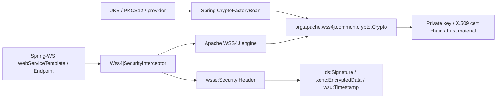
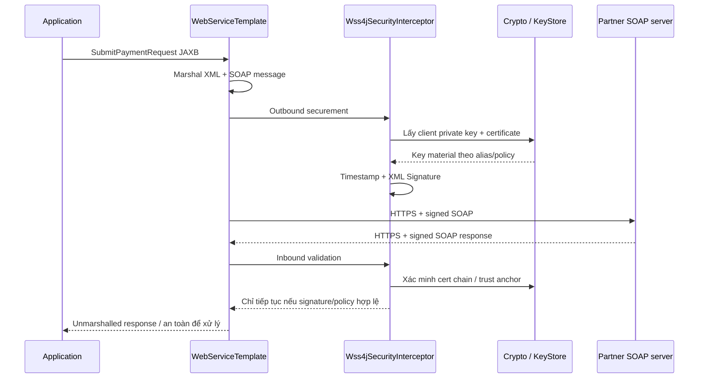
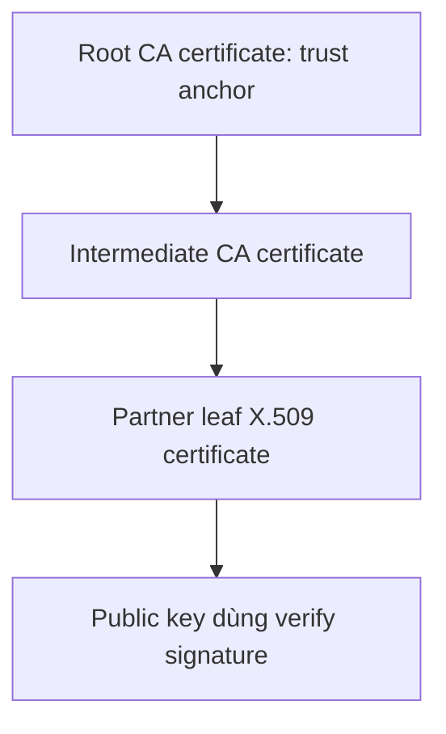
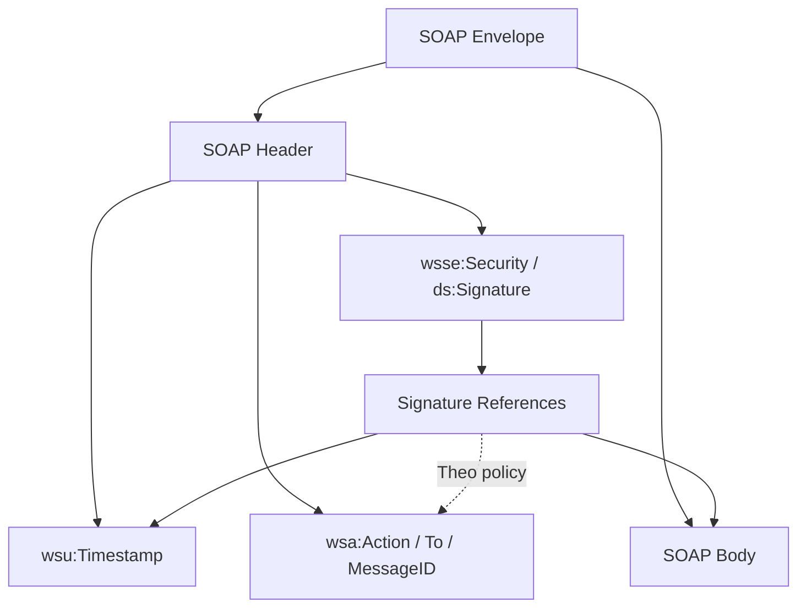
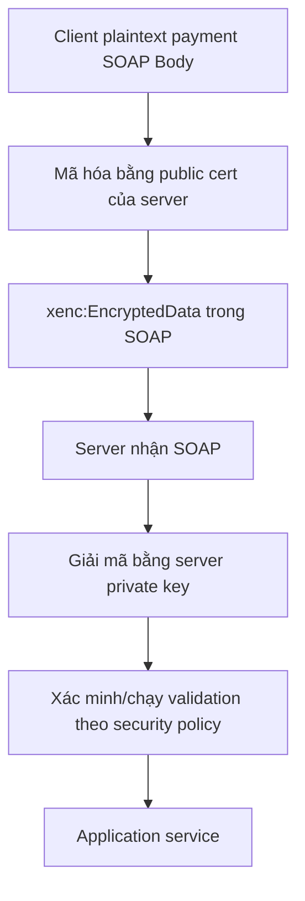
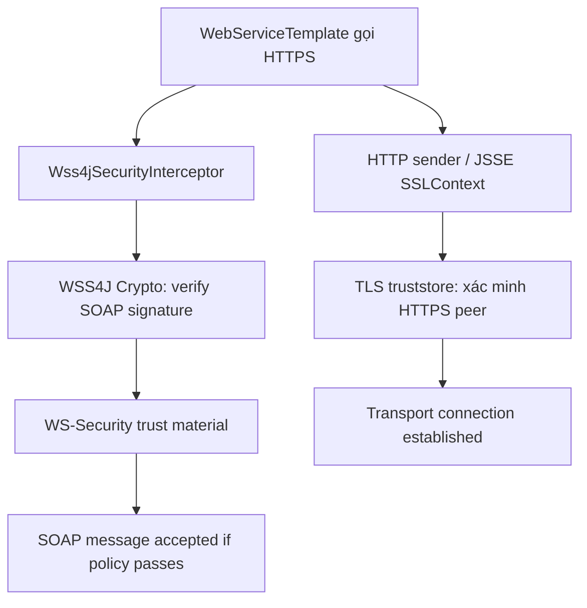
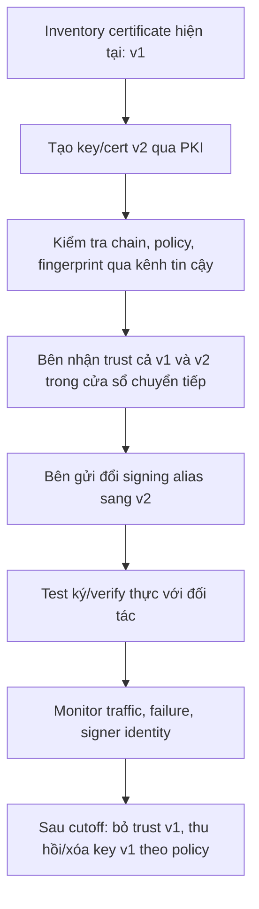
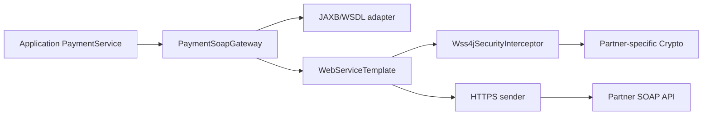
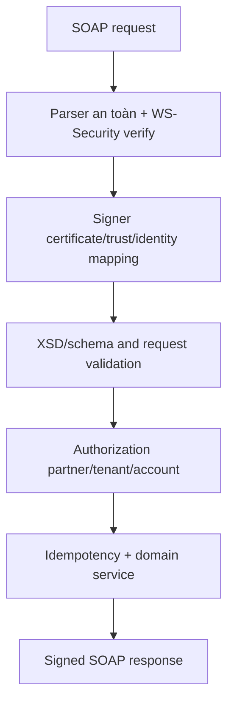

# CryptoFactoryBean và cấu hình Crypto cho WSS4J

## 1. Bài toán: SOAP cần ký, xác minh và đôi khi mã hóa ở mức thông điệp

Giả sử một ứng dụng Spring Boot tích hợp với hệ thống thanh toán của đối tác qua **Spring Web Services (Spring-WS)**. XSD/WSDL mô tả `SubmitPaymentRequest`, `SubmitPaymentResponse` và SOAP Fault. JAXB chuyển Java DTO thành XML, `WebServiceTemplate` gửi request qua HTTPS và `@Endpoint` xử lý phía nhận.

Đối tác yêu cầu thêm **WS-Security**:

- Client phải gắn timestamp và **ký SOAP Body** bằng private key thuộc chứng chỉ client.
- Server phải **xác minh chữ ký** từ chứng chỉ client nằm trong vùng tin cậy được cấu hình.
- Response của server cũng có chữ ký để client xác minh trước khi dùng dữ liệu.
- Một operation nhạy cảm còn yêu cầu **XML Encryption** cho nội dung thanh toán, với chứng chỉ công khai của bên nhận.
- Các khóa/chứng chỉ phải được xoay vòng khi hết hạn hoặc bị thu hồi mà không làm ngưng toàn bộ tích hợp.

Trong kiến trúc này, `org.apache.wss4j.common.crypto.Crypto` của **Apache WSS4J** là abstraction giúp WSS4J truy cập material mật mã: khóa, chứng chỉ, chuỗi chứng chỉ và các thao tác tin cậy theo implementation. **`CryptoFactoryBean` của Spring-WS** giúp tạo/configure một WSS4J `Crypto` như **Spring bean**, thường từ Java keystore.

Bài học thuộc chương **Chứng chỉ và khóa** của module **SPRING_WEB_SERVICES**, tập trung vào đề mục **“CryptoFactoryBean và cấu hình Crypto cho WSS4J”**. Module theo hướng **SOAP contract-first** với XSD/WSDL, JAXB, endpoint/client, SOAP Fault, interceptor, XML security, WS-Security, chứng chỉ và kiểm thử tương thích để tích hợp hệ thống doanh nghiệp ổn định.

Sau bài học, bạn sẽ:

1. Phân biệt private key, public key, certificate chain, trust anchor, keystore và truststore.
2. Giải thích vai trò `Crypto`, `CryptoFactoryBean`, `Wss4jSecurityInterceptor` và password/alias.
3. Cấu hình **outbound signature** và **inbound signature validation** đúng ranh giới trust.
4. Phân biệt Crypto cho **ký**, **xác minh**, **mã hóa** và **giải mã**.
5. Hiểu quan hệ giữa WS-Security và TLS/mTLS nhưng không đồng nhất hai lớp này.
6. Thiết kế quản lý secrets, certificate rotation, lỗi fail-closed và kiểm thử chứng chỉ thực.

**Phạm vi ví dụ:** các alias, tên keystore và URI dưới đây là dữ liệu thử nghiệm. Không sử dụng private key sản xuất, password thật hoặc certificate của đối tác trong tài liệu.

## 2. Lược đồ trách nhiệm của WSS4J Crypto



**Ranh giới quan trọng:**

| Thành phần | Trách nhiệm | Không đảm nhiệm |
|---|---|---|
| `Wss4jSecurityInterceptor` | Gọi WSS4J để secure outbound và validate inbound message | Không tự quyết định domain authorization |
| `Crypto` (WSS4J) | Truy cập khóa/cert và chức năng xác minh trust theo provider | Không phải HTTP sender hay JAXB marshaller |
| `CryptoFactoryBean` (Spring-WS) | Tạo bean `Crypto` từ cấu hình được cung cấp | Không tự xoay vòng certificate hoặc đọc secret manager |
| `KeyStore` của JDK | Container cho private keys, certificate chains và trusted certificate entries | Không tự biết certificate nào thuộc đúng partner nghiệp vụ |
| `WSPasswordCallback` hoặc password configuration | Cung cấp secret để lấy private key/UsernameToken khi được yêu cầu | Không thay thế credential vault/rotation policy |
| `Trust material` | Định nghĩa chứng chỉ/CA được tin cậy để xác minh peer/signature | Không tự thực hiện authorization trên tài khoản thanh toán |
| `SaajSoapMessageFactory` | Tạo/đọc SOAP Envelope và Header | Không xác minh chữ ký |
| `Jaxb2Marshaller` | Java DTO ↔ XML Body payload | Không ký message mặc định |
| `WebServiceMessageSender` | HTTP(S) transport, timeouts và TLS tùy implementation | Không tự ký XML Signature |

### 2.1. Hai hướng xử lý trong một client



Đây là **sơ đồ logic**, không phải cam kết thứ tự gọi từng method cho mọi phiên bản Spring-WS. Vị trí callback, security interceptor, XML transform và JAXB được xác định bởi pipeline cụ thể; **kiểm thử message thực** là bắt buộc.

## 3. Nền tảng mật mã: private key, public key và chứng chỉ X.509

### 3.1. Private key khác certificate

Một cặp khóa bất đối xứng có:

- **Private key:** giữ bí mật, được dùng để tạo chữ ký hoặc giải mã dữ liệu được mã hóa tới public key tương ứng.
- **Public key:** được phân phối cho bên nhận để xác minh chữ ký hoặc dùng mã hóa đến bên sở hữu private key.
- **X.509 certificate:** gắn public key với identity và các thuộc tính như subject, issuer, serial, thời hạn, extensions và chữ ký của bên cấp chứng chỉ.

Một chứng chỉ X.509 **không chứa private key**. Có certificate của đối tác để xác minh chữ ký **không đồng nghĩa** bạn được phép ký thay đối tác.

### 3.2. Chuỗi chứng chỉ và trust anchor



Một đơn vị có thể pin **leaf certificate** cụ thể hoặc tin **CA chain** theo policy. Cách thiết lập ảnh hưởng mạnh tới rotation:

- Pin leaf giúp giới hạn đúng certificate nhưng cần cập nhật khi leaf certificate đổi.
- Trust CA có thể linh hoạt hơn nhưng cần ràng buộc subject/SAN, issuer, key usage, certificate policy và identity partner theo yêu cầu.
- Trong bối cảnh WS-Security, **một certificate hợp lệ theo chuỗi CA chưa đủ** để khẳng định signer có quyền thực hiện một operation hoặc thuộc đúng tenant.

### 3.3. Các thuộc tính X.509 nên kiểm tra

| Thuộc tính | Ý nghĩa trong review |
|---|---|
| `Subject` / `SAN` | Identity được công bố; dùng theo policy của hệ thống |
| `Issuer` | CA hoặc đơn vị cấp certificate |
| `Serial number` | Định danh chứng chỉ trong phạm vi issuer |
| `NotBefore / NotAfter` | Thời gian chứng chỉ có hiệu lực |
| `KeyUsage` | Mục đích public key như digitalSignature/keyEncipherment |
| `ExtendedKeyUsage` | Các mục đích bổ sung khi profile/policy yêu cầu |
| `BasicConstraints` | Leaf hay CA; khả năng cấp chứng chỉ |
| `Signature algorithm` | Thuật toán dùng ký certificate |
| `Authority/Subject Key Identifier` | Thông tin nhận dạng khóa/chuỗi |
| `Revocation information` | CRL/OCSP endpoints hoặc policy tương ứng |

Không tự suy diễn identity business chỉ từ chuỗi `CN`; chính sách xác thực phải quy định certificate binding và cách xử lý certificate renewal.

## 4. KeyStore và truststore: khác về chức năng, có thể cùng định dạng

**Java KeyStore** là API/container lưu các loại entries. **Keystore** và **truststore** thường là cách gọi theo vai trò:

| Vật chứa | Entry thường có | Vai trò điển hình |
|---|---|---|
| Client signing keystore | `PrivateKeyEntry`: private key + certificate chain | Ký SOAP request outbound |
| Partner verification store | `trustedCertEntry` hoặc trust material theo provider | Xác minh chữ ký SOAP từ đối tác |
| Partner encryption cert store | Certificate/public key của đối tác | Mã hóa SOAP outbound cho đối tác |
| Server decryption keystore | Private key của server + certificate chain | Giải mã message gửi tới server |
| TLS truststore | Root/intermediate CA/cert của HTTPS server | Kiểm tra peer trong TLS handshake |
| TLS identity keystore | Private key + client TLS certificate | mTLS client authentication |

Không có yêu cầu keystore và truststore phải là **hai file khác nhau**, nhưng phân tách vật lý/logical giúp giảm phạm vi quyền truy cập và tránh đưa private key tới nơi chỉ cần public certificate.

### 4.1. JKS và PKCS#12

- **JKS:** định dạng truyền thống của Java KeyStore.
- **PKCS#12** (`.p12`, `.pfx`): container chuẩn phổ biến có thể giữ private key/cert chain và được hỗ trợ rộng rãi.
- **PKCS#11/HSM:** key material có thể nằm trong thiết bị/crypto provider; ứng dụng sử dụng abstraction mà **không xuất private key** ra file.

Java `KeyStore.getDefaultType()` có thể khác giữa các JDK hoặc cấu hình; với ứng dụng quan trọng, phải kiểm tra **provider + store type** thực sự thay vì đoán từ extension `.jks` hoặc `.p12`.

### 4.2. Alias là tên entry, không phải certificate identity

Ví dụ một signing keystore có:

```text
Alias: outbound-client-v1
Entry type: PrivateKeyEntry
Certificate chain length: 2
```

WSS4J cần biết **entry private key nào dùng để ký**. Trong một số cấu hình, alias được chọn qua `securementUsername` hoặc các thuộc tính/key resolver liên quan. Alias **không** tự là subject, hostname, SAN hay ID nghiệp vụ đã được tin cậy.

Một truststore có:

```text
Alias: partner-2026-verification
Entry type: trustedCertEntry
```

Alias đó chỉ là tên quản lý certificate entry. Nếu đối tác đổi certificate, alias vẫn có thể giữ hoặc thay; điều quyết định tin cậy là **certificate, trust policy và đối tượng được phép ký**.

## 5. WSS4J `Crypto` thực hiện những gì?

Interface WSS4J hiện đại nằm ở:

```java
import org.apache.wss4j.common.crypto.Crypto;
```

Đây là abstraction được WSS4J dùng để tương tác key/certificate/trust. Ví dụ một implementation thường thấy là **Merlin** của Apache WSS4J:

```text
org.apache.wss4j.common.crypto.Merlin
```

`Crypto` giúp WSS4J làm những việc như:

- Tìm certificate theo alias, issuer/serial hoặc đặc điểm nhận dạng được cấu hình.
- Truy xuất private key từ keystore khi cần ký hoặc giải mã.
- Xây dựng/truy xuất certificate chain.
- Kiểm tra trust của một certificate/chain theo quy tắc provider và cấu hình.

**Crypto không phải một thiết bị HSM**. Một implementation dùng keystore file có thể tải private key vào memory của JVM; một provider khác có thể dùng token/HSM. Không suy ra khóa “không thể xuất” chỉ vì API Java đặt tên `Crypto`.

### 5.1. Nhiều vai trò, nhiều Crypto

Trong một tích hợp hai chiều, ít nhất có hai *vai trò* rõ:

```text
Outbound request signature:
  Crypto có private key của CLIENT và certificate chain.

Inbound response signature validation:
  Crypto có trust material để kiểm tra certificate của PARTNER.
```

Nếu dùng WS-Security Encryption:

```text
Outbound encryption:
  Có certificate/public key của PARTNER.

Inbound decryption:
  Có private key của CLIENT, được phép giải mã.
```

Trong code thực, một Crypto có thể đóng nhiều vai trò khi trust/key material và chính sách cho phép, nhưng **không nên dùng một keystore chứa mọi khóa để “cho dễ cấu hình”**. Quyền chỉ đọc public certificates khác quyền lấy private key.

### 5.2. `CryptoFactoryBean` giúp được gì?

`CryptoFactoryBean` là một Spring `FactoryBean`: bean được khai báo là factory nhưng **object mà Spring inject vào nơi yêu cầu `Crypto`** là sản phẩm do factory tạo ra.

Package thường gặp ở dòng Spring-WS/WSS4J2:

```java
import org.springframework.ws.soap.security.wss4j2.support.CryptoFactoryBean;
```

Không nhầm với WSS4J `CryptoFactory` tự cung cấp cơ chế tạo `Crypto` từ properties, hoặc các package `wss4j` cũ thuộc thế hệ dùng WSS4J 1.x. **Kiểm tra artifact/Javadoc trong phiên bản Spring-WS thực tế** khi chuyển Spring Boot đời cũ sang stack Jakarta hiện đại.

## 6. Tạo keystore/certificate thử nghiệm mà không đưa password vào command history

Để minh họa signing flow, có thể tạo **key pair và self-signed X.509 certificate riêng cho test** bằng `keytool` của JDK. Test certificate không dùng cho production.

### 6.1. Tạo một PKCS#12 test keystore

```bash
keytool -genkeypair \
  -alias outbound-client-v1 \
  -keyalg RSA \
  -keysize 3072 \
  -sigalg SHA256withRSA \
  -validity 30 \
  -dname "CN=SOAP Client TEST,OU=Integration,O=Example Test,L=Test,C=VN" \
  -storetype PKCS12 \
  -keystore client-signing-test.p12
```

`keytool` sẽ yêu cầu password tương tác nếu chưa được cung cấp. **Không đặt password thật trực tiếp ở tham số `-storepass` hoặc `-keypass` trong command history, file README hoặc CI logs.** Dữ liệu này chỉ dùng trong test, với secret do test harness cấp an toàn.

### 6.2. Xuất public certificate để chia sẻ trust

```bash
keytool -exportcert \
  -rfc \
  -alias outbound-client-v1 \
  -keystore client-signing-test.p12 \
  -storetype PKCS12 \
  -file client-public-test.pem
```

File `client-public-test.pem` chỉ chứa **public certificate**; không chia sẻ `client-signing-test.p12` cho đối tác vì có private key. Dù public cert có thể chia sẻ, vẫn phải xác minh fingerprint/nguồn phát hành qua kênh đáng tin để chống thay thế certificate.

### 6.3. Nhập certificate vào truststore test

```bash
keytool -importcert \
  -alias trusted-client-test \
  -file client-public-test.pem \
  -keystore server-trust-test.p12 \
  -storetype PKCS12
```

Khi import, xác minh fingerprint/issuer/subject với giá trị đã nhận qua kênh tin cậy. **Không tự trả lời “yes” với mọi chứng chỉ mà không đối chiếu**.

### 6.4. Kiểm tra entries

```bash
keytool -list -v \
  -keystore client-signing-test.p12 \
  -storetype PKCS12

keytool -list -v \
  -keystore server-trust-test.p12 \
  -storetype PKCS12
```

Kỳ vọng:

| Store | Entry | Ý nghĩa |
|---|---|---|
| `client-signing-test.p12` | `PrivateKeyEntry` tại alias ký | Có private key để tạo SOAP Signature |
| `server-trust-test.p12` | `trustedCertEntry` | Có public certificate để xác minh signature |

Các lệnh trên chỉ là công cụ thao tác ban đầu. **Không cần chạy keytool hoặc tạo file test trong STEP 4 viết bài**; phần thực thi thuộc môi trường học/lab sau này.

## 7. Cấu hình `CryptoFactoryBean` cho khóa ký outbound

### 7.1. Bean từ Java keystore

Ví dụ Spring-WS hiện đại dùng WSS4J2:

```java
package com.example.payment.soap.security;

import org.springframework.beans.factory.annotation.Value;
import org.springframework.context.annotation.Bean;
import org.springframework.context.annotation.Configuration;
import org.springframework.core.io.Resource;
import org.springframework.ws.soap.security.wss4j2.support.CryptoFactoryBean;

@Configuration
public class SoapSigningCryptoConfiguration {

    @Bean("clientSigningCrypto")
    public CryptoFactoryBean clientSigningCrypto(
            @Value("${partner.soap.signing.store-location}")
            Resource storeLocation,
            @Value("${partner.soap.signing.store-password}")
            String storePassword) {

        CryptoFactoryBean factory = new CryptoFactoryBean();
        factory.setKeyStoreLocation(storeLocation);
        factory.setKeyStorePassword(storePassword);
        factory.setKeyStoreType("PKCS12");
        return factory;
    }
}
```

**Ý nghĩa từng thiết lập:**

| Thiết lập | Ví dụ | Mục đích |
|---|---|---|
| `setKeyStoreLocation(...)` | `Resource` trỏ file được cấp quyền | Xác định keystore WSS4J cần tải |
| `setKeyStorePassword(...)` | Secret lấy từ runtime | Mở keystore; không phải certificate alias |
| `setKeyStoreType("PKCS12")` | Store type theo file/provider | Bảo đảm Crypto mở đúng định dạng |
| `@Bean("clientSigningCrypto")` | Spring factory bean name | Các interceptor có thể inject object `Crypto` được tạo |

**Quan trọng về phiên bản:** ví dụ minh họa API của dòng `wss4j2`; nếu dự án dùng Spring-WS/WSS4J đời khác, tên package hoặc setter có thể khác. Kiểm tra **chữ ký thật** của `CryptoFactoryBean` trong dependency đã khóa, không ghép tên setter từ WSS4J1 và WSS4J2.

### 7.2. Spring `FactoryBean` được inject như thế nào?

`CryptoFactoryBean` triển khai cơ chế factory của Spring: tên `clientSigningCrypto` thông thường tham chiếu **sản phẩm là `Crypto`**, không phải chính factory object.

```java
import org.apache.wss4j.common.crypto.Crypto;
import org.springframework.beans.factory.annotation.Qualifier;

public SecurityService(
        @Qualifier("clientSigningCrypto") Crypto signingCrypto) {
    this.signingCrypto = signingCrypto;
}
```

Đây là phần trích constructor của một service có field `Crypto signingCrypto`. Trong Spring, nếu cần truy cập **bản thân factory bean**, cú pháp tra cứu bean có thể dùng prefix `&` trong BeanFactory; tuy nhiên, cấu hình security interceptor nên inject **`Crypto`**, không cần lấy factory thủ công.

### 7.3. Không ghi password trực tiếp vào mã nguồn

Anti-pattern:

```java
// KHÔNG DÙNG TRONG PRODUCTION.
factory.setKeyStorePassword("changeit");
```

Thay vào đó, dùng secret manager, mounted secrets hoặc biến môi trường được cung cấp bởi runtime:

```yaml
partner:
  soap:
    signing:
      store-location: file:/run/secrets/soap/client-signing.p12
      store-password: ${SOAP_SIGNING_STORE_PASSWORD}
      key-alias: outbound-client-v1
      key-password: ${SOAP_SIGNING_KEY_PASSWORD}
```

Các key `partner.soap.*` là **cấu hình tự định nghĩa** của ứng dụng, không phải properties auto-configuration mặc định của Spring-WS. **File YAML chỉ chứa tham chiếu**, không được commit password thật. Nếu environment variable không tồn tại, application phải **fail startup** hoặc báo secret resolution failure rõ ràng, không dùng giá trị mặc định nguy hiểm.

**Lưu ý:** `store-password` mở keystore; `key-password` mở private key entry khi hai password khác nhau. Với một số định dạng/provider, chúng có thể giống nhau hoặc có hạn chế riêng. Đừng đoán và đừng đưa một mật khẩu vào tất cả nơi theo thói quen.

### 7.4. Không giữ public/private key thành log metadata

`Resource#getURI()`, exception từ keystore provider hoặc diagnostic configuration có thể lộ mount path. Tránh đưa đường dẫn chi tiết của secret volume, password hoặc nội dung keystore vào SOAP Fault hoặc application log tập trung.

Khi cần metrics, ghi:

```text
crypto_role = client_signing
crypto_store_alias = current
crypto_health = initialized
```

Chỉ ghi **alias nội bộ đã sanitize** và trạng thái tổng hợp. Nếu alias hoặc certificate subject chứa dữ liệu nhạy cảm, mã hóa thành tên profile/ID nội bộ được cho phép.

## 8. Crypto cho xác minh chữ ký inbound của đối tác

Crypto ký outbound có private key của mình; Crypto xác minh inbound cần **tin đúng signer được ủy quyền**. Hai vai trò không nên bị hoán đổi.

### 8.1. Cấu hình verification Crypto riêng

Giả sử partner public certificate hoặc CA đã được nhập vào `partner-verification.p12`:

```java
package com.example.payment.soap.security;

import org.springframework.beans.factory.annotation.Value;
import org.springframework.context.annotation.Bean;
import org.springframework.context.annotation.Configuration;
import org.springframework.core.io.Resource;
import org.springframework.ws.soap.security.wss4j2.support.CryptoFactoryBean;

@Configuration
public class PartnerVerificationCryptoConfiguration {

    @Bean("partnerVerificationCrypto")
    public CryptoFactoryBean partnerVerificationCrypto(
            @Value("${partner.soap.verification.store-location}")
            Resource storeLocation,
            @Value("${partner.soap.verification.store-password}")
            String storePassword) {

        CryptoFactoryBean factory = new CryptoFactoryBean();
        factory.setKeyStoreLocation(storeLocation);
        factory.setKeyStorePassword(storePassword);
        factory.setKeyStoreType("PKCS12");
        return factory;
    }
}
```

Đây là ví dụ dùng một **Java keystore chứa trusted certificate entries** làm nguồn trust cho provider Crypto. Một số cấu hình WSS4J Merlin cho phép truststore riêng bằng properties và các setter tương ứng; hãy đối chiếu implementation/provider để chắc rằng **trust anchors được WSS4J thực sự sử dụng khi verify**. Không coi việc một file certificate có mặt trên classpath là bằng chứng WSS4J đã tin nó.

### 8.2. Xác minh chữ ký không chỉ bằng public key có trong message

Một SOAP message có thể tự kèm certificate:

```xml
<wsse:BinarySecurityToken
    xmlns:wsse="http://docs.oasis-open.org/wss/2004/01/oasis-200401-wss-wssecurity-secext-1.0.xsd"
    wsu:Id="partner-cert-token"
    xmlns:wsu="http://docs.oasis-open.org/wss/2004/01/oasis-200401-wss-wssecurity-utility-1.0.xsd">
  ...Base64 DER certificate...
</wsse:BinarySecurityToken>
```

Và chữ ký có `ds:KeyInfo` trỏ tới token đó. Để tránh mô hình “người gửi tự cung cấp khóa rồi tự được tin”, validator phải:

1. Xác minh chữ ký XML đúng thuật toán/tham chiếu/canonicalization.
2. Kiểm tra **trust** của certificate/signer theo truststore, pinning hoặc CA policy.
3. Kiểm tra identity được chứng chỉ thể hiện đúng partner dự kiến.
4. Kiểm tra certificate validity/revocation theo policy khi cần.
5. Kiểm tra Body/headers quan trọng thực sự nằm trong vùng được ký.
6. Chỉ sau đó map signer identity sang quyền nghiệp vụ.

**Có certificate trong SOAP Header không đồng nghĩa certificate đã được tin cậy.** Trong một số cấu hình, validator có thể xác minh tính toán chữ ký nhưng thiếu các ràng buộc identity hoặc trust mà business cần.

### 8.3. Trust-all và implicit fallback là lỗi cấu hình

Không làm:

```text
If certificate validation fails:
  accept any presented X.509 certificate
  skip verifyTrust
  continue processing payment
```

Khi không mở được truststore, certificate hết hạn hoặc signer chưa được ủy quyền, **fail closed**. Chuyển thành security SOAP Fault chung chung, không trả toàn bộ đường dẫn store, alias hay nội dung chain ra caller.

## 9. `Wss4jSecurityInterceptor` sử dụng `Crypto` như thế nào?

Spring-WS hỗ trợ tích hợp Apache WSS4J bằng `Wss4jSecurityInterceptor`. Package thường gặp ở stack WSS4J2:

```java
import org.springframework.ws.soap.security.wss4j2.Wss4jSecurityInterceptor;
```

Interceptor cấu hình hai nhóm hành vi:

- **Securement actions:** thêm bảo vệ cho **message outbound**, ví dụ `Timestamp` và `Signature`.
- **Validation actions:** yêu cầu/kiểm tra bảo vệ của **message inbound**, ví dụ `Timestamp` và `Signature`.

Trên **SOAP client**, outbound là request tới đối tác, inbound là response nhận từ đối tác. Trên **SOAP server**, inbound là request từ đối tác, outbound là response về client.

### 9.1. Client: ký request, xác minh response

```java
package com.example.payment.soap.security;

import org.apache.wss4j.common.crypto.Crypto;
import org.springframework.beans.factory.annotation.Qualifier;
import org.springframework.beans.factory.annotation.Value;
import org.springframework.context.annotation.Bean;
import org.springframework.context.annotation.Configuration;
import org.springframework.ws.soap.security.wss4j2.Wss4jSecurityInterceptor;

@Configuration
public class PartnerSoapSecurityConfiguration {

    @Bean("partnerWss4jInterceptor")
    public Wss4jSecurityInterceptor partnerWss4jInterceptor(
            @Qualifier("clientSigningCrypto") Crypto signingCrypto,
            @Qualifier("partnerVerificationCrypto")
            Crypto verificationCrypto,
            @Value("${partner.soap.signing.key-alias}") String keyAlias,
            @Value("${partner.soap.signing.key-password}")
            String privateKeyPassword) {

        Wss4jSecurityInterceptor interceptor =
                new Wss4jSecurityInterceptor();

        // Outbound request: tạo Timestamp và XML Signature.
        interceptor.setSecurementActions("Timestamp Signature");
        interceptor.setSecurementUsername(keyAlias);
        interceptor.setSecurementPassword(privateKeyPassword);
        interceptor.setSecurementSignatureCrypto(signingCrypto);

        // Inbound response: yêu cầu và xác minh Timestamp/Signature.
        interceptor.setValidationActions("Timestamp Signature");
        interceptor.setValidationSignatureCrypto(verificationCrypto);

        return interceptor;
    }
}
```

**Điều kiện tiên quyết:** keystore thực sự chứa một `PrivateKeyEntry` ở `keyAlias` và key password đúng; verification store/provider chứa certificate/CA đáng tin cậy của đối tác. `Timestamp`/`Signature` trong chuỗi actions phải phù hợp **WS-SecurityPolicy của đối tác**, không sao chép từ ví dụ cho mọi service.

### 9.2. Gắn vào `WebServiceTemplate`

```java
package com.example.payment.soap.client;

import org.springframework.beans.factory.annotation.Qualifier;
import org.springframework.context.annotation.Bean;
import org.springframework.context.annotation.Configuration;
import org.springframework.oxm.jaxb.Jaxb2Marshaller;
import org.springframework.ws.client.core.WebServiceTemplate;
import org.springframework.ws.client.support.interceptor.ClientInterceptor;
import org.springframework.ws.soap.saaj.SaajSoapMessageFactory;
import org.springframework.ws.soap.security.wss4j2.Wss4jSecurityInterceptor;

@Configuration
public class PartnerSoapClientConfiguration {

    @Bean("paymentWebServiceTemplate")
    public WebServiceTemplate paymentWebServiceTemplate(
            SaajSoapMessageFactory messageFactory,
            @Qualifier("paymentMarshaller")
            Jaxb2Marshaller marshaller,
            @Qualifier("partnerWss4jInterceptor")
            Wss4jSecurityInterceptor security) {

        WebServiceTemplate template =
                new WebServiceTemplate(messageFactory);
        template.setMarshaller(marshaller);
        template.setUnmarshaller(marshaller);
        template.setDefaultUri(
                "https://partner.example.org/soap/payments");
        template.setInterceptors(new ClientInterceptor[] {
            security
        });
        return template;
    }
}
```

Đây là **wiring của client**, không phải cấu hình hoàn chỉnh cho production. `paymentMarshaller`, message factory và HTTP sender phải được khai báo đúng JAXB package/SOAP version/transport. **Đăng ký một `Crypto` bean không tự bật chữ ký** nếu interceptor không được đưa vào chain của template.

### 9.3. Server: xác minh request trước khi gọi endpoint

Server có thể cấu hình interceptor riêng:

```java
@Bean("serverRequestSecurity")
public Wss4jSecurityInterceptor serverRequestSecurity(
        @Qualifier("trustedClientCrypto") Crypto clientTrust,
        @Qualifier("serverSigningCrypto") Crypto serverSigning,
        @Value("${server.soap.signing.key-alias}") String alias,
        @Value("${server.soap.signing.key-password}") String keyPassword) {

    Wss4jSecurityInterceptor interceptor =
            new Wss4jSecurityInterceptor();

    interceptor.setValidationActions("Timestamp Signature");
    interceptor.setValidationSignatureCrypto(clientTrust);

    interceptor.setSecurementActions("Timestamp Signature");
    interceptor.setSecurementUsername(alias);
    interceptor.setSecurementPassword(keyPassword);
    interceptor.setSecurementSignatureCrypto(serverSigning);
    return interceptor;
}
```

Đây là **snippet trong class `@Configuration`** có imports của `Crypto`, `Wss4jSecurityInterceptor`, `@Bean`, `@Qualifier` và `@Value` như ví dụ client. Phải đăng ký interceptor với **server endpoint chain** phù hợp, không chỉ tạo bean.

Một ví dụ với `WsConfigurer`:

```java
import java.util.List;
import org.springframework.beans.factory.annotation.Qualifier;
import org.springframework.context.annotation.Configuration;
import org.springframework.ws.config.annotation.EnableWs;
import org.springframework.ws.config.annotation.WsConfigurer;
import org.springframework.ws.server.EndpointInterceptor;
import org.springframework.ws.soap.security.wss4j2.Wss4jSecurityInterceptor;

@EnableWs
@Configuration
public class PaymentWsConfiguration implements WsConfigurer {
    private final Wss4jSecurityInterceptor security;

    public PaymentWsConfiguration(
            @Qualifier("serverRequestSecurity")
            Wss4jSecurityInterceptor security) {
        this.security = security;
    }

    @Override
    public void addInterceptors(List<EndpointInterceptor> interceptors) {
        interceptors.add(security);
    }
}
```

Nếu ứng dụng có nhiều endpoint mappings hoặc cấu hình security khác nhau theo SOAP operation, cần **kiểm tra interceptor thực sự áp dụng** cho mọi operation cần bảo vệ. Một endpoint không đi qua security chain là một bypass, kể cả khi `@Endpoint` trả response hợp lệ.

### 9.4. Đừng dùng một interceptor stateful cho mọi đối tác

Hầu hết `WebServiceTemplate` và interceptor nên được **cấu hình một lần** ở startup, không đổi alias, password hoặc truststore giữa các request:

```java
// ANTI-PATTERN: singleton interceptor bị mutate per request.
security.setSecurementUsername(currentPartnerAlias);
return template.marshalSendAndReceive(request);
```

Hai lời gọi đồng thời có thể dùng sai alias/khóa. Tạo **template/interceptor theo partner profile** hoặc chọn một cơ chế key resolution per-invocation được framework hỗ trợ rõ, có kiểm thử concurrency và không làm rò secret.

## 10. Signature key alias, password và cách certificate xuất hiện trong SOAP

Khi WSS4J ký request:

1. Chọn private key entry thích hợp.
2. Truy xuất private key theo password/callback.
3. Tính digest cho các XML nodes được ký.
4. Tạo XML Signature với thuật toán/canonicalization theo policy.
5. Thêm `wsse:Security` và thông tin `KeyInfo`/SecurityTokenReference để receiver tìm public certificate.

### 10.1. Một SOAP Header signature (đã rút gọn)

```xml
<soap:Envelope
    xmlns:soap="http://schemas.xmlsoap.org/soap/envelope/"
    xmlns:wsse="http://docs.oasis-open.org/wss/2004/01/oasis-200401-wss-wssecurity-secext-1.0.xsd"
    xmlns:wsu="http://docs.oasis-open.org/wss/2004/01/oasis-200401-wss-wssecurity-utility-1.0.xsd"
    xmlns:ds="http://www.w3.org/2000/09/xmldsig#">
  <soap:Header>
    <wsse:Security soap:mustUnderstand="1">
      <wsu:Timestamp wsu:Id="ts-id">
        <wsu:Created>2026-11-27T02:00:00Z</wsu:Created>
        <wsu:Expires>2026-11-27T02:05:00Z</wsu:Expires>
      </wsu:Timestamp>
      <ds:Signature>
        <ds:SignedInfo>
          <!-- CanonicalizationMethod, SignatureMethod, Reference ... -->
        </ds:SignedInfo>
        <ds:SignatureValue>TEST_ONLY_NOT_A_REAL_SIGNATURE</ds:SignatureValue>
        <!-- KeyInfo/SecurityTokenReference ... -->
      </ds:Signature>
    </wsse:Security>
  </soap:Header>
  <soap:Body wsu:Id="body-id">
    <!-- Payload do JAXB marshal theo XSD -->
  </soap:Body>
</soap:Envelope>
```

Đây là **sơ đồ XML rút gọn**, không phải chữ ký hợp lệ có thể gửi. **Không tự dựng `ds:SignatureValue` bằng chuỗi**, không xóa/reorder references hoặc thay node đã ký sau khi WSS4J tạo chữ ký.

### 10.2. Certificate KeyInfo được tham chiếu như thế nào?

WS-Security có một số cách nhận diện khóa/chứng chỉ, như:

- `BinarySecurityToken` kèm X.509 certificate, được `SecurityTokenReference` trỏ tới.
- `IssuerSerial` (issuer name + serial number).
- `ThumbprintSHA1` theo profile tương ứng.
- Một số hình thức key identifier khác tùy policy/version.

Hình thức **KeyIdentifier** phải tương thích giữa client và server; không tự đổi sang kiểu “nhỏ hơn” nếu đối tác đang yêu cầu một kiểu cụ thể. Việc tham chiếu cert chỉ giúp receiver **tìm khóa cần dùng**, còn trust validation vẫn phải dựa trên policy.

### 10.3. Alias nhầm nhưng password đúng vẫn có thể sai

Nếu keystore chứa hai private keys:

```text
outbound-client-v1 -> key/cert đời cũ
outbound-client-v2 -> key/cert đời mới
```

và interceptor vẫn chọn `outbound-client-v1`, chữ ký có thể **hợp lệ về mặt toán học** nhưng server đã ngừng tin certificate đời cũ. Lúc đó lỗi là **certificate trust/rotation**, không phải XML syntax hay WSDL.

Test phải kiểm tra **certificate nào đã thực sự ký request**, không chỉ `securementPassword` được inject khác rỗng.

## 11. Ký gì trong SOAP? XML Signature coverage và wrapping risk

Một XML Signature chỉ bảo vệ **những node được tham chiếu**, không mặc nhiên bảo vệ mọi byte của HTTP request hoặc toàn bộ SOAP Envelope.

### 11.1. Các mục thường cần ký

Tùy WS-SecurityPolicy, có thể cần ký:

- SOAP Body.
- `wsu:Timestamp`.
- WS-Addressing `wsa:Action`, `wsa:To`, `wsa:MessageID` khi policy yêu cầu.
- Các header chứa partner identity, routing hoặc giao dịch quan trọng.
- MIME attachments khi profile/policy bảo vệ file đính kèm.



### 11.2. Signature parts không được đoán từ JAXB class

XSD/JAXB xác định payload XML, nhưng **không tự đảm bảo `ds:Reference` trỏ đúng Body/Header cần bảo vệ**. Spring-WS/WSS4J có các cấu hình signature parts, callback và policy theo từng phiên bản.

Hướng cấu hình cần kiểm tra:

1. SOAP 1.1 hay SOAP 1.2, vì namespace Body khác nhau.
2. Ký **Content** hay **Element** theo yêu cầu bảo mật.
3. Những phần tử WS-Addressing/WS-Security phải có ID và được ký.
4. XSLT hoặc interceptor nào có thể sửa message **sau bước ký**.
5. Endpoint sau verify sử dụng **đúng node đã được xác minh**.

**Không mặc định ký Body = ký cả HTTP `SOAPAction` hoặc MIME part.** HTTP header không phải XML node, và attachment signature có profile/transforms riêng.

### 11.3. Bảo vệ chống XML Signature Wrapping

Một vấn đề bảo mật riêng với XML Signature là attacker có thể đưa nhiều node tương tự nhau vào message: verifier xác minh một node, nhưng application xử lý node khác nếu routing/ID resolution không chặt.

Để phòng vệ:

- Dùng WSS4J/library đã cập nhật, có chính sách ID/reference và duplicate ID đúng.
- Bắt buộc Body/headers thực sự được ký khi policy yêu cầu.
- Kiểm tra XML schema và namespace, không xử lý node cùng local name ngoài vị trí hợp lệ.
- Không tạo một secondary parser không kiểm chứng rồi đọc một node khác sau signature verification.
- Test payload với duplicate IDs hoặc unsigned duplicate Body trong môi trường test cách ly.

Không thể xem một test `signature.verify() == true` là bằng chứng đủ về authorization và vùng dữ liệu mà ứng dụng đã xử lý.

## 12. Crypto cho XML Encryption khác Crypto dùng ký SOAP

Một đối tác có thể yêu cầu mã hóa dữ liệu nhạy cảm trong SOAP Body. Ví dụ ứng dụng gửi số tài khoản hoặc thông tin thanh toán cho backend, nhưng muốn nội dung chỉ được **bên nhận có private key** giải mã.

### 12.1. Trình tự khóa ở hai chiều



**Nguyên tắc crypto:**

- **Ký outbound:** cần **private key của người gửi**; phía nhận dùng public certificate của người gửi để verify.
- **Mã hóa outbound:** thường dùng **public certificate của người nhận**; phía nhận dùng private key tương ứng để decrypt.
- **Xác minh inbound:** cần trust material của người gửi.
- **Giải mã inbound:** cần private key của chính bên nhận.

| Action | Bên giữ private key | Bên cần public cert |
|---|---|---|
| Client ký request | Client | Server để verify |
| Server ký response | Server | Client để verify |
| Client mã hóa request cho server | Server để decrypt | Client phải biết cert server |
| Server mã hóa response cho client | Client để decrypt | Server phải biết cert client |

**Đừng dùng private key của client để “mã hóa cho server”**. Public/private key của các bên phải được chọn theo **mục đích của operation** và WS-SecurityPolicy.

### 12.2. Các điểm cấu hình WSS4J thường dùng

Trong dòng WSS4J2, các vai trò liên quan thường được cấu hình bằng các setter:

```java
// Phác thảo bên gửi: certificate của BÊN NHẬN để mã hóa.
interceptor.setSecurementActions("Timestamp Signature Encrypt");
interceptor.setSecurementSignatureCrypto(ownSigningCrypto);
interceptor.setSecurementEncryptionCrypto(recipientCrypto);
interceptor.setSecurementEncryptionUser("recipient-certificate-alias");

// Phác thảo bên nhận: private key của CHÍNH MÌNH để giải mã.
receiverInterceptor.setValidationActions(
        "Timestamp Signature Encrypt");
receiverInterceptor.setValidationSignatureCrypto(senderTrustCrypto);
receiverInterceptor.setValidationDecryptionCrypto(ownDecryptionCrypto);
```

**Đây là các dòng minh họa**, không phải toàn bộ class cấu hình. Khi dùng thật còn cần signing alias/key password, password callback để WSS4J mở khóa giải mã, thuật toán mã hóa key/data, certificate reference, signature parts, action order và security policy. **Tên setter, thứ tự action và giá trị action** phải đối chiếu với bản Spring-WS/WSS4J đã khóa; test bằng message thật.

### 12.3. Ký rồi mã hóa hay mã hóa rồi ký?

WS-Security có nhiều cách kết hợp, ví dụ *sign-before-encrypt* và *encrypt-before-sign*. Chúng có ảnh hưởng đến:

- Những XML nodes được ký là plaintext hay ciphertext.
- Những headers được nhìn thấy ngoài lớp mã hóa.
- Khả năng gateway trung gian đọc/routing message.
- Chính sách xử lý SOAP Fault và logging.
- Tương thích với WS-SecurityPolicy của đối tác.

**Không tự đảo `"Signature Encrypt"` thành `"Encrypt Signature"` chỉ để một test hết lỗi**, vì thay action order có thể làm thay đổi ý nghĩa bảo mật. Hãy đọc policy chính thức, kiểm tra thứ tự WSS4J xử lý và dùng interop tests với đối tác.

### 12.4. Crypto giải mã không nên là truststore public-only

Nếu receiver cấu hình `validationDecryptionCrypto` bằng store **chỉ chứa `trustedCertEntry`**, WSS4J không có private key để giải mã. Có thể gặp lỗi kiểu *cannot find private key* hoặc *decryption failure*.

Phải chuẩn bị `PrivateKeyEntry` của **recipient**, cùng password callback/credential phù hợp; tách rõ identity của recipient với signer của request.

## 13. Hai đường cấu hình: Spring `CryptoFactoryBean` và WSS4J `CryptoFactory`

**Không nên nhầm hai tên gần giống nhau.**

| Thành phần | Thuộc thư viện | Đầu vào điển hình | Kết quả |
|---|---|---|---|
| `CryptoFactoryBean` | Spring-WS | Spring `Resource`, store password/type và cấu hình được hỗ trợ | Sản phẩm `Crypto` qua Spring FactoryBean |
| `CryptoFactory` | Apache WSS4J | `Properties`, config file/crypto provider | Instance `Crypto` |
| `Merlin` | Apache WSS4J | Key/trust stores và provider properties | Crypto implementation |

Spring cách 1 giúp wiring rõ với `@Bean`/`@Qualifier`, còn cách 2 phù hợp khi cần cấu hình provider đặc biệt, chuyển từ hệ thống WSS4J cũ hoặc tích hợp HSM.

### 13.1. WSS4J Merlin properties (khung tham khảo)

Các property thường gặp của WSS4J2 Merlin:

```properties
org.apache.wss4j.crypto.provider=org.apache.wss4j.common.crypto.Merlin
org.apache.wss4j.crypto.merlin.keystore.type=pkcs12
org.apache.wss4j.crypto.merlin.keystore.alias=outbound-client-v1
org.apache.wss4j.crypto.merlin.keystore.file=security/client-signing-test.p12
```

**Không đưa password thật vào file `.properties` commit trong Git.** Nếu provider cần property password, hãy tạo `Properties` **ở runtime** từ secret manager hoặc dùng abstraction hỗ trợ secret loading. Cũng cần phân biệt resource path được provider đọc theo classpath hay filesystem.

Các property name và provider behavior có thể khác giữa WSS4J 1.x và 2.x, nhất là phần **keystore/truststore/password callback**. Đừng trộn các ví dụ của hai dòng lớn vào cùng một stack.

### 13.2. Khởi tạo qua API WSS4J (ví dụ hướng dẫn)

```java
import java.util.Properties;
import org.apache.wss4j.common.crypto.Crypto;
import org.apache.wss4j.common.crypto.CryptoFactory;

Properties properties = new Properties();
properties.setProperty(
        "org.apache.wss4j.crypto.provider",
        "org.apache.wss4j.common.crypto.Merlin");
properties.setProperty(
        "org.apache.wss4j.crypto.merlin.keystore.type",
        "pkcs12");
properties.setProperty(
        "org.apache.wss4j.crypto.merlin.keystore.file",
        "security/client-signing-test.p12");

// Bổ sung password/alias theo provider bằng một secret source tin cậy.
Crypto crypto = CryptoFactory.getInstance(properties);
```

Đây là **mẫu cấu hình API**, không phải snippet đủ khởi chạy: nếu keystore có mật khẩu và Crypto provider yêu cầu nó, code phải cung cấp secret phù hợp trước khi đọc file. Đừng chạy đoạn code thiếu password rồi xử lý bằng fallback keystore trống.

### 13.3. Khi nào không nên tự dựng `Crypto`?

Nếu mục tiêu chỉ là ký và verify SOAP qua một PKCS#12/JKS đơn giản, `CryptoFactoryBean` có lợi:

- Bean lifecycle và dependency injection rõ ràng.
- Tách profile signing, verifying, encryption.
- Test Spring context fail khi store thiếu/sai.
- Không lặp logic mở keystore ở nhiều endpoint.

Chỉ chuyển sang custom WSS4J Crypto factory/provider khi có yêu cầu thật, như HSM/PKCS#11, trust policy chuyên biệt hoặc tương thích hệ thống legacy. Customization tăng bề mặt kiểm thử và quản lý key material.

## 14. TLS/mTLS và WS-Security Crypto không phải một cấu hình

Một câu hỏi hay gặp: “Tôi đã cấu hình truststore cho HTTPS rồi, tại sao WSS4J vẫn báo không tin certificate trong SOAP?”

Vì đây là **hai luồng xác thực khác nhau**.



### 14.1. Bảng so sánh

| Mục tiêu | HTTPS/mTLS | WS-Security signature/encryption |
|---|---|---|
| Vị trí | TLS transport connection | SOAP XML message/headers |
| Identity | Hostname/server cert, tùy chọn client cert | Signer certificate/Subject/claims theo policy |
| Key material | JSSE `KeyManager`/`TrustManager`/SSLContext | WSS4J `Crypto`/keystore/trust |
| Bảo vệ dữ liệu | Mã hóa kênh giữa hai TLS endpoints | XML Signature/Encryption theo references/parts |
| Hệ thống trung gian | TLS có thể bị terminate rồi mở kết nối mới | Bảo vệ message xuyên nhiều hop khi signature còn nguyên |
| HTTP SOAPAction | Được TLS bảo vệ trên kết nối; không là XML node | Không tự nằm trong XML Signature |
| Authorization nghiệp vụ | Không tự đảm nhiệm | Cũng không tự đảm nhiệm |

### 14.2. Chứng chỉ có thể dùng chung không?

Về mặt kỹ thuật, một tổ chức có thể dùng cùng key pair/certificate cho TLS và ký SOAP nếu key usage/policy cho phép. Nhưng thường nên **tách vai trò và vòng đời** để:

- Giảm blast radius khi một key bị lộ.
- Tách hệ thống quản lý TLS rotation với WS-Security integration contracts.
- Tránh nhầm certificate TLS có `serverAuth` với identity signer SOAP.
- Phân quyền ai được đọc private key và ai chỉ được đọc trust material.

Không quyết định dùng chung chỉ vì “ít file cấu hình hơn”. Chính sách bảo mật và PKI phải xác định.

### 14.3. Lỗi `SSLHandshakeException` không phải `FailedCheck` SOAP

| Triệu chứng | Tầng có khả năng |
|---|---|
| `javax.net.ssl.SSLHandshakeException` | JSSE/TLS: trust, hostname, mTLS, protocol/cipher |
| `SoapFaultClientException` với security fault | SOAP/WS-Security: signature, timestamp, decryption, trust |
| `WSSecurityException` trong server logs | WSS4J processing bên nhận |
| `Keystore was tampered with, or password was incorrect` | Store/provider/secret configuration |
| `Cannot find key for alias` | WSS4J Crypto/alias/private key access |

Hai loại truststore có thể dùng cùng định dạng JKS/PKCS#12, nhưng **chỗ inject khác nhau**. Không bật `javax.net.ssl.trustStore` trong JVM rồi giả định `setValidationSignatureCrypto` đã nhận truststore tương ứng.

## 15. Password callbacks, private key access và HSM

### 15.1. Có nhiều loại secret

| Secret | Vai trò |
|---|---|
| Keystore password | Mở container keystore |
| Private key entry password | Lấy private key theo alias |
| PKCS#11 token PIN | Truy cập key material trong token/HSM |
| UsernameToken password | Xác thực WS-Security UsernameToken nếu policy yêu cầu |
| TLS client key password | Mở private key dùng trong mTLS |

Hai hoặc nhiều secret có thể trùng về giá trị trong một môi trường test, nhưng **không được suy ra chúng có cùng mục đích**.

### 15.2. `setSecurementPassword` là ví dụ đơn giản, không phải thiết kế secret hoàn chỉnh

Việc truyền một `String` password vào interceptor:

```java
interceptor.setSecurementPassword(privateKeyPassword);
```

có thể phù hợp với ví dụ và một số stack. Trong production cần xem xét:

- Nguồn secret manager/vault và quyền đọc.
- Secret được cấp lúc khởi động hay per operation.
- Password callback handler do WSS4J yêu cầu cho key/UsernameToken.
- Khả năng rotate/reload secret mà không mutate singleton sai cách.
- Không in secret trong lỗi khởi tạo hay thread dump.
- Không dùng giá trị mặc định như `"password"` hoặc `"changeit"`.

Không có bảo đảm xóa hoàn toàn `String` bí mật khỏi heap trong Java; giảm thời gian tồn tại/privilege, áp dụng runtime protection và xem xét HSM khi có yêu cầu cao.

### 15.3. `WSPasswordCallback` (ý tưởng callback)

Trong WSS4J2, callback xử lý password có thể được xây dựng với `WSPasswordCallback` và `CallbackHandler`:

```java
import java.io.IOException;
import javax.security.auth.callback.Callback;
import javax.security.auth.callback.CallbackHandler;
import javax.security.auth.callback.UnsupportedCallbackException;
import org.apache.wss4j.common.ext.WSPasswordCallback;

public final class ManagedKeyPasswordCallback
        implements CallbackHandler {

    private final KeyPasswordResolver passwords;

    public ManagedKeyPasswordCallback(KeyPasswordResolver passwords) {
        this.passwords = passwords;
    }

    @Override
    public void handle(Callback[] callbacks)
            throws IOException, UnsupportedCallbackException {
        for (Callback callback : callbacks) {
            if (!(callback instanceof WSPasswordCallback request)) {
                throw new UnsupportedCallbackException(callback);
            }

            String secret = passwords.passwordFor(
                    request.getIdentifier(), request.getUsage());
            if (secret == null) {
                throw new IOException("Unknown cryptographic key alias");
            }
            request.setPassword(secret);
        }
    }
}
```

`KeyPasswordResolver` là interface do ứng dụng định nghĩa, truy vấn vault theo **alias và usage được phép**. Code minh họa không chứa implementation của resolver. Khi áp dụng cần kiểm tra **loại callback usage** mà WSS4J truyền để phân biệt signing/decryption/UsernameToken; không trả cùng một secret cho mọi request chỉ dựa trên alias text.

Password callback phải fail closed nếu alias không được phép; không đưa identifier nội bộ, secret hoặc callback state ra SOAP Fault.

### 15.4. HSM/PKCS#11 không phải `setKeyStoreLocation("hsm")`

Nếu yêu cầu private key không được rời thiết bị, cần một crypto provider hỗ trợ PKCS#11/HSM. Bài toán bao gồm:

- Provider được cài và cấu hình đúng, token/slot, PIN và access controls.
- Key alias/identifier mapping và khả năng ký/giải mã của provider.
- Throughput/latency và lỗi token tạm thời.
- Phân quyền và audit truy cập khóa.
- Key rotation, failover và disaster recovery.

`CryptoFactoryBean` tạo Crypto, nhưng **không tự chuyển mọi file keystore thành HSM**. Tùy khả năng abstraction/provider, có thể cần cấu hình Merlin/JCA provider chuyên biệt hoặc một `Crypto` implementation được hỗ trợ, kèm tests PKCS#11 thật.

## 16. Thuật toán: tránh để mặc định quyết định chính sách bảo mật

Một thông điệp signed SOAP có nhiều thuật toán:

- **Digest algorithm:** hash nội dung XML reference.
- **Signature algorithm:** ký `SignedInfo` bằng private key.
- **Canonicalization algorithm:** chuẩn hóa XML trước hashing/signing.
- **Transformation algorithms:** chuẩn hóa/biến đổi nodes theo reference.
- **Encryption algorithm:** mã hóa dữ liệu và/hoặc khóa khi dùng XML Encryption.

### 16.1. Không nhầm `SHA1` trong KeyIdentifier với chữ ký SHA-1

Ví dụ tên `ThumbprintSHA1` chỉ mô tả phương thức nhận dạng certificate theo một profile; nó **không đồng nghĩa** chữ ký XML đang sử dụng thuật toán `RSA-SHA1`. Nhưng với hệ thống hiện đại, những thuật toán SHA-1 cho chữ ký/hashing và các scheme yếu cần được xem xét hạn chế theo security policy.

Các cấu hình như **RSA-SHA256**, các digest SHA-2 và thuật toán mã hóa được hỗ trợ theo policy thường được cân nhắc. **Không chọn thuật toán chỉ vì máy Java chấp nhận**: đối tác có thể bị ràng buộc bởi WS-SecurityPolicy, khả năng WSS4J/provider hoặc quy định nội bộ.

### 16.2. Algorithm downgrade là lỗi interoperability và security

Một client không nên “tự động thử SHA-1 nếu SHA-256 không chạy” mà không được phê duyệt. Nếu phía đối tác từ chối signature:

1. Xác định algorithm URI từ policy và message capture.
2. Kiểm tra keystore key algorithm/size.
3. Kiểm tra JCA provider hỗ trợ algorithm.
4. Kiểm tra WSS4J config/BSP profile.
5. Từ chối khi policy không được đáp ứng, thay vì vô hiệu hóa validation.

### 16.3. BSP compliance và WS-SecurityPolicy

WS-I Basic Security Profile (BSP) và WS-SecurityPolicy đặt thêm quy tắc cho cấu trúc message, các token, reference, algorithm và timestamp. Một chữ ký XML có thể **hợp lệ về mặt mật mã** nhưng vi phạm profile interoperability.

Đừng tắt BSP compliance hoặc timestamp checks như một giải pháp mặc định. Chỉ điều chỉnh theo **hợp đồng được chấp thuận và phân tích rủi ro**, kèm negative tests chứng minh không mở rộng trust ngoài dự kiến.

## 17. Timestamp, clock skew và replay protection

`wsu:Timestamp` chứa thời gian tạo/hết hạn của SOAP message. Nó giúp bên nhận từ chối message quá cũ hoặc ở thời điểm không hợp lệ theo chính sách.

```xml
<wsu:Timestamp
    xmlns:wsu="http://docs.oasis-open.org/wss/2004/01/oasis-200401-wss-wssecurity-utility-1.0.xsd"
    wsu:Id="ts-1001">
  <wsu:Created>2026-11-27T02:00:00Z</wsu:Created>
  <wsu:Expires>2026-11-27T02:05:00Z</wsu:Expires>
</wsu:Timestamp>
```

**Đây chỉ là ví dụ thời gian.** Trong một SOAP message thật, timestamp phải được tạo dựa trên clock thực, mức skew và TTL theo policy; không hardcode giá trị từ tài liệu.

### 17.1. Những điều cần kiểm tra

- Timestamp tồn tại khi policy yêu cầu, có `Created`/`Expires` hợp lệ.
- Không chấp nhận message đã hết hạn.
- Có giới hạn clock skew được thỏa thuận; không cho phép chênh lệch vô hạn.
- Timestamp được **ký** khi policy yêu cầu, chống attacker sửa thời hạn.
- Replay cache/nonce/message identity được cấu hình khi cần.
- Retry một operation có side effect phải có **idempotency key nghiệp vụ** riêng.

### 17.2. Timestamp không tự chống replay hoàn toàn

Một attacker có thể gửi lại **cùng một SOAP message đã ký** khi timestamp còn hiệu lực nếu hệ thống không có replay defense. Vì vậy policy có thể cần:

- Replay cache cho UsernameToken nonce hoặc message identity, tùy token type.
- Các TTL/skew constraints hợp lý.
- Deduplication ở lớp nghiệp vụ cho command có side effect.
- Identity binding giữa signer, message và tài nguyên.

Không coi `wsu:Timestamp`, `wsa:MessageID` hoặc correlation ID tự là idempotency key của `SubmitPayment`.

## 18. Certificate rotation: thay khóa mà không tạo sự cố liên thông

Chứng chỉ và private keys đều có vòng đời. Một certificate có thể hết hạn, được cấp lại, đổi key pair hoặc bị thu hồi do nghi ngờ lộ private key.

**CryptoFactoryBean không tự xoay vòng** certificate hay làm mới file đang dùng trong JVM theo lịch. Bean có thể đã tải keystore trong lúc startup; thay file trên đĩa **không đảm bảo** các instance Crypto/WSS4J đang dùng sẽ nhận material mới.

### 18.1. Kế hoạch xoay vòng theo hai giai đoạn



### 18.2. Phân biệt rotate signing với rotate verification

**Khi client đổi signing certificate:**

1. Client tạo private key/certificate mới.
2. Server import/trust certificate/CA mới đúng policy.
3. Client triển khai signing alias mới.
4. Kiểm tra request ký bằng cert mới được server chấp nhận.
5. Chỉ loại cert cũ sau thời gian overlap/cutoff được thống nhất.

**Khi partner đổi certificate ký response:**

1. Partner cung cấp certificate/chain mới qua kênh tin cậy.
2. Client cập nhật verification trust material để tin cả certificate hợp lệ trong cửa sổ chuyển tiếp.
3. Partner chuyển sang ký bằng key mới.
4. Client giám sát validation failures, signer fingerprint và certificate expiry.
5. Gỡ certificate cũ theo policy.

**Khi partner đổi certificate encryption:**

- Bên gửi phải dùng public cert mới của bên nhận tại thời điểm gửi.
- Bên nhận cần giữ private key cũ tạm thời nếu còn messages hợp lệ đã mã hóa tới cert cũ cần xử lý.
- Xác định cửa sổ decrypt backlog và cutoff; không xóa private key cũ trước khi hoàn tất migration nếu có nghiệp vụ chưa giải mã.

### 18.3. Không rotate bằng cách thay field singleton giữa request

Anti-pattern:

```java
// KHÔNG NÊN: thay key alias trên interceptor đang xử lý traffic.
interceptor.setSecurementUsername(nextAlias);
// Những request cùng lúc có thể dùng cấu hình không đồng nhất.
```

Hướng an toàn hơn:

- Triển khai cấu hình **immutable theo version**.
- Tạo Crypto/interceptor/template mới cùng key material mới.
- Chuyển traffic qua canary/rolling deployment hoặc cơ chế profile switching đã được thiết kế.
- Cho request đang chạy với version cũ hoàn tất rồi retire resources.
- Đo tỷ lệ lỗi chứng chỉ trước/sau chuyển.

Nếu dùng KMS/HSM hoặc dynamic provider hỗ trợ reload, phải kiểm chứng **hành vi atomicity/consistency theo invocation**, không suy từ việc thư viện có method reload.

### 18.4. Theo dõi expiry trước khi đứt kết nối

Một certificate inventory nên chứa:

| Thuộc tính | Ví dụ |
|---|---|
| Certificate purpose | SOAP request signing |
| Partner/profile | payment-partner-a |
| Cert fingerprint SHA-256 | Lấy từ certificate chính thức |
| Alias | outbound-client-v2 |
| NotAfter | Ngày giờ hết hạn thực |
| Issuer / serial | Từ certificate chain |
| Key store owner | Platform security team |
| Rotation lead time | Theo SLA/PKI policy |
| Distribution channels | Secret store, certificate management |
| Break-glass plan | Quy trình ứng phó khi cert bị thu hồi |

Thông tin inventory không chứa private key hay password. Không dùng SHA-1 fingerprint làm security proof mới khi policy yêu cầu SHA-256. Alert phải kích hoạt **trước** ngày hết hạn đủ thời gian để đối tác cập nhật trust.

### 18.5. Revocation và clock validity

`X509Certificate#checkValidity()` chỉ kiểm tra khoảng `NotBefore/NotAfter` với thời điểm hiện tại; nó **không tự chứng minh certificate chưa bị thu hồi**.

Revocation có thể yêu cầu CRL/OCSP hoặc pinning/trust update theo chính sách PKI. WSS4J Crypto/provider **không nên bị mặc định coi là bật revocation enforcement** chỉ vì đọc được certificate chain.

Nếu OCSP/CRL được sử dụng, cần kiểm tra:

- Có cho phép outbound network tới endpoints cần thiết?
- Cache/timeout khi revocation service down?
- Soft-fail hay hard-fail theo security policy?
- Trong môi trường offline, có CRL được cập nhật không?
- Logs/Fault có lộ URL nội bộ, certificate chain hoặc secret không?

**Không bật egress tùy ý từ XML parser để “cho OCSP hoạt động”.** Revocation network của PKI và external entity resolution của XML là **hai luồng khác nhau**, cần quyền mạng tách biệt.

## 19. Certificate và key lifecycle trong môi trường nhiều đối tác

Một ứng dụng có thể gọi ERP A, ngân hàng B và hệ thống chứng từ C, mỗi bên có:

- Keystore signing identity riêng.
- Trust anchors/certificate pinning riêng.
- WS-Security action profile khác nhau.
- SOAP version/WSDL binding khác nhau.
- Certificate rotation và SLA khác nhau.

### 19.1. Profile rõ ràng theo partner

```text
Partner A
  paymentClientTemplate
  paymentSigningCryptoA
  paymentResponseTrustCryptoA
  paymentSecurityInterceptorA

Partner B
  bankingClientTemplate
  bankingSigningCryptoB
  bankingResponseTrustCryptoB
  bankingSecurityInterceptorB
```

**Không nối mọi CA/certificate của mọi partner vào một truststore chung** nếu policy cần tách tenant/partner. Nếu signer của Partner B được chấp nhận tại route của Partner A chỉ vì certificate chain được tin chung, hệ thống có thể bị nhầm identity.

### 19.2. Chọn profile bằng allowlist, không bằng URL tùy ý

```java
public enum PartnerProfile {
    PAYMENT_A,
    BANKING_B
}
```

Application có thể dùng `PartnerProfile` đã được xác thực để chọn gateway/template được cấu hình sẵn. Không dùng:

```java
// ANTI-PATTERN: partner đầu vào tự chỉ định keystore/endpoint.
String trustStore = request.getTrustStorePath();
String endpoint = request.getEndpointUrl();
```

Việc cho caller quyết định truststore path, keystore alias hoặc outbound URL có thể dẫn đến **confused deputy, SSRF hoặc dùng nhầm signer**.

### 19.3. Mapper nghiệp vụ vẫn độc lập certificate

Phần domain như `PaymentCommand` hoặc `PaymentReceipt` không nên giữ `X509Certificate`, `Crypto` hoặc `Wss4jSecurityInterceptor`. Ranh giới đề xuất:



Nhờ vậy có thể rotate certificate hoặc đổi WSS4J provider mà không làm domain model phụ thuộc mật mã.

## 20. Các lớp kiểm thử: từ đọc keystore đến SOAP liên thông

**Không thể kết luận cấu hình WS-Security đúng chỉ vì `CryptoFactoryBean` khởi tạo được.** Một keystore đúng password vẫn có thể thiếu private key alias, certificate hết hạn hoặc được sử dụng sai mục đích.

### 20.1. Bảng test coverage

| Lớp test | Điều cần chứng minh |
|---|---|
| Keystore unit | Store type/password, alias, `PrivateKeyEntry`, cert validity |
| Crypto factory | Tạo được `Crypto` thực từ file/provider đúng |
| Outbound WSS4J | SOAP request chứa Timestamp/Signature đúng profile |
| Inbound WSS4J | Response signed/trusted được verify và chấp nhận |
| Negative signature | Sửa byte/XML signed node phải bị từ chối |
| Negative trust | Signer lạ với chữ ký toán học hợp lệ vẫn bị từ chối |
| Negative validity | Cert hết hạn/not-yet-valid xử lý theo policy |
| Negative key | Sai alias/password hoặc thiếu private key → fail-closed |
| Negative timestamp | Hết hạn/future timestamp → reject theo policy |
| XML parser | XXE/DTD/XInclude/external resource bị chặn trước security processing |
| SOAP Fault | Lỗi bảo mật không lộ private key/path/stack trace |
| TLS/mTLS | Peer certificate/hostname/client key được kiểm tra độc lập |
| Integration interop | Client Spring-WS và partner/.NET/stack khác trao đổi đúng |
| Rotation | v1/v2 overlap rồi retire có kiểm soát |
| Concurrency | Không gửi nhầm signer/secret khi nhiều request song song |

### 20.2. JUnit 5: kiểm tra một PKCS#12 test fixture

```java
package com.example.payment.soap.security;

import static org.junit.jupiter.api.Assertions.*;

import java.io.InputStream;
import java.security.KeyStore;
import java.security.cert.X509Certificate;
import java.util.Arrays;
import java.util.Date;
import org.junit.jupiter.api.Test;

class TestSigningKeyStoreTest {

    @Test
    void testStoreContainsUsableSigningEntry() throws Exception {
        String value = System.getenv("TEST_SIGNING_STORE_PASSWORD");
        assertNotNull(value, "Missing test-only signing store secret");
        char[] password = value.toCharArray();

        try {
            KeyStore store = KeyStore.getInstance("PKCS12");
            try (InputStream input = getClass().getResourceAsStream(
                    "/security/client-signing-test.p12")) {
                assertNotNull(input, "Missing test-only keystore fixture");
                store.load(input, password);
            }

            assertTrue(store.isKeyEntry("outbound-client-v1"));
            assertTrue(store.entryInstanceOf(
                    "outbound-client-v1",
                    KeyStore.PrivateKeyEntry.class));

            X509Certificate cert = (X509Certificate) store.getCertificate(
                    "outbound-client-v1");
            assertNotNull(cert);
            cert.checkValidity(new Date());
            assertNotNull(cert.getPublicKey());
        } finally {
            Arrays.fill(password, '\0');
        }
    }
}
```

Đây là **test cho keystore thử nghiệm** đã được tạo trước bằng `keytool`, không chạy được nếu fixture hoặc `TEST_SIGNING_STORE_PASSWORD` chưa được cấu hình. Test **không** chứng minh private key password đã đúng khi key entry dùng password khác store password; phần đó phải được kiểm bằng WSS4J signing test.

Test cũng chưa xác minh KeyUsage/EKU, chain trust, revocation hoặc certificate gắn với đúng partner. Những thuộc tính đó cần policy checks riêng.

### 20.3. Test Spring context tạo Crypto

Một bean test khởi chạy cấu hình thật:

```java
import static org.junit.jupiter.api.Assertions.assertNotNull;

import org.apache.wss4j.common.crypto.Crypto;
import org.junit.jupiter.api.Test;
import org.springframework.beans.factory.annotation.Autowired;
import org.springframework.beans.factory.annotation.Qualifier;
import org.springframework.boot.test.context.SpringBootTest;

@SpringBootTest
class CryptoFactoryBeanContextTest {

    @Autowired
    @Qualifier("clientSigningCrypto")
    private Crypto signingCrypto;

    @Autowired
    @Qualifier("partnerVerificationCrypto")
    private Crypto verificationCrypto;

    @Test
    void initializesBothCryptographicRoles() {
        assertNotNull(signingCrypto);
        assertNotNull(verificationCrypto);
    }
}
```

Test này chỉ chứng minh Spring context tạo được hai `Crypto`. Với test profile, keystore/certificates và secrets phải là **fixtures riêng**, không dùng key production. **Một bean khác null không đồng nghĩa chữ ký đã hợp lệ**; cần integration tests.

### 20.4. Ký thử và xác minh bằng hai trust profiles độc lập

Thiết kế môi trường test:

```text
CLIENT test:
  PrivateKeyEntry: client-test
  Signs SubmitPaymentRequest

SERVER test:
  TrustedCertEntry: client-test public certificate
  Validates request signature

SERVER response:
  PrivateKeyEntry: server-test
  Signs SubmitPaymentResponse

CLIENT validation:
  TrustedCertEntry: server-test public certificate
  Validates response signature
```

Với bộ fixture này, test:

1. SOAP request đúng XSD + chữ ký client hợp lệ → endpoint được gọi.
2. SOAP response đúng XSD + chữ ký server hợp lệ → client unmarshal thành công.
3. Xóa `wsse:Security` khỏi request → server reject.
4. Sửa một node đã ký (ví dụ `amount` trong `SubmitPaymentRequest`) → reject.
5. Dùng cert của client **khác** không nằm trong trust policy → reject.
6. Chữ ký dùng key hợp lệ nhưng `@Endpoint` không có quyền trên account → **authorization** reject.
7. Response signed bằng cert chưa được tin → client reject, dù JAXB payload hợp lệ.

**Đừng lấy một message mẫu chưa ký rồi assert nó pass khi `validationActions="Timestamp Signature"` đang bật.** `MockWebServiceServer.withPayload(...)` trả payload XML nhưng không tự tạo chữ ký WSS4J. Test ở mức SOAP security cần một peer giả có khả năng **ký/verify thật**, hoặc các signed fixtures thích hợp với message factory.

### 20.5. Test XML Signature không giống so chuỗi XML

Với chữ ký số, thay đổi whitespace, namespace prefixes, canonicalization, thuộc tính ID hoặc thứ tự nodes có thể ảnh hưởng digest, tùy transforms. Cần dùng **XML-aware assertions** và WSS4J validation, không chỉ:

```java
assertTrue(soapXml.contains("<ds:Signature>"));
```

Prefix có thể khác; một tag `Signature` xuất hiện **không chứng minh chữ ký hợp lệ**. Negative tamper test và trust verification mới chứng minh behavior bảo mật thực.

### 20.6. HTTP/SOAP integration test vẫn cần thiết

`MockWebServiceClient` kiểm tra inbound endpoint; `MockWebServiceServer` kiểm tra outbound template. Cả hai hữu ích nhưng có thể bypass network/TLS và một số transport behaviors.

Để kiểm tra đúng production path:

- Gửi SOAP 1.1/1.2 qua HTTP(S) tới local test server.
- Xác minh Content-Type, SOAPAction/WS-Addressing headers theo WSDL.
- Kiểm tra message được ký/verify trước application side effects.
- Chạy với certificate truststore và mTLS đúng.
- Chặn access file/network ngoài của XML parser.
- Đo timeout/read/connect và SOAP Fault response.

**SOAP signature không thay thế contract validation:** dù signature hợp lệ, JAXB payload sai XSD vẫn phải được từ chối ở appropriate layer.

## 21. Contract-first: XSD/WSDL và WS-SecurityPolicy không thay thế nhau

**Contract-first** nghĩa là XML contract được thiết kế/chốt trước rồi JAXB code được sinh hoặc cấu hình để ánh xạ theo contract. Nhưng một XSD mô tả `SubmitPaymentRequest` **không tự nói** SOAP request bắt buộc phải có signature/encryption/timestamp.

### 21.1. XSD mô tả dữ liệu thanh toán

```xml
<?xml version="1.0" encoding="UTF-8"?>
<xs:schema
    xmlns:xs="http://www.w3.org/2001/XMLSchema"
    targetNamespace="urn:example:payments:v1"
    xmlns:pay="urn:example:payments:v1"
    elementFormDefault="qualified">

  <xs:element name="SubmitPaymentRequest">
    <xs:complexType>
      <xs:sequence>
        <xs:element name="clientRequestId" type="xs:string"/>
        <xs:element name="accountId" type="xs:string"/>
        <xs:element name="amount" type="xs:decimal"/>
        <xs:element name="currency" type="xs:string"/>
      </xs:sequence>
    </xs:complexType>
  </xs:element>

  <xs:element name="SubmitPaymentResponse">
    <xs:complexType>
      <xs:sequence>
        <xs:element name="paymentId" type="xs:string"/>
        <xs:element name="status" type="xs:string"/>
      </xs:sequence>
    </xs:complexType>
  </xs:element>
</xs:schema>
```

XSD trên **chưa có business facets đầy đủ** như amount positive, currency ISO list hoặc ID constraints. Chúng phải được định nghĩa thêm theo hợp đồng thật. `xs:decimal` nên được JAXB mapping phù hợp với `BigDecimal`, tránh tự chuyển tiền sang `double`.

### 21.2. WSDL binding công bố SOAPAction và endpoint

```xml
<!-- Trích đoạn minh họa; không phải WSDL hoàn chỉnh. -->
<wsdl:binding
    name="PaymentsSoap11Binding"
    type="tns:PaymentsPortType">
  <soap:binding
      style="document"
      transport="http://schemas.xmlsoap.org/soap/http"/>
  <wsdl:operation name="SubmitPayment">
    <soap:operation
        soapAction="urn:example:payments:v1:SubmitPayment"/>
    <wsdl:input><soap:body use="literal"/></wsdl:input>
    <wsdl:output><soap:body use="literal"/></wsdl:output>
  </wsdl:operation>
</wsdl:binding>
```

Ở đây `wsdl` là namespace WSDL 1.1; `soap` là `http://schemas.xmlsoap.org/wsdl/soap/`; `tns` là namespace của WSDL.

WSDL binding này xác định **SOAP version/binding và action transport**, nhưng một SOAP request không tự có `wsse:Security` chỉ vì nó theo WSDL. Hành vi an ninh có thể được công bố thêm bằng **WS-SecurityPolicy** hoặc thỏa thuận tích hợp riêng được tài liệu hóa.

### 21.3. Chính sách an ninh cần tách thành điều kiện kiểm thử

Ví dụ một security profile có thể quy định:

```text
Operation: SubmitPayment
SOAP: 1.1 document/literal
Client request:
  Timestamp required
  XML Signature required
  Signed SOAP Body and Timestamp
  X.509 signer certificate must belong to registered partner identity
  Reject expired/not-yet-valid timestamp/cert
Response:
  Timestamp + XML Signature required
  Signer must belong to registered server identity
Transport:
  HTTPS with server certificate validation
  mTLS only if partner policy requires it
```

Những dòng trên là **profile minh họa**, không phải một WS-SecurityPolicy XML document chuẩn. Để triển khai thật, lấy assertions và thuật toán từ policy chính thức: algorithm suite, signed parts, token references, timestamp/nonce, encryption requirements và trust/identity binding.

**Một cấu hình WSS4J có thể tạo chữ ký thành công nhưng vẫn không khớp policy đối tác** do phần tử được ký, thứ tự action, KeyIdentifier, algorithm hoặc certificate identity khác kỳ vọng. Kiểm thử liên thông bằng client độc lập giúp phát hiện.

### 21.4. Không để SOAP KeyStore điều khiển quyền thanh toán

Ví dụ hai client có chứng chỉ tin cậy từ cùng CA nhưng chỉ Client A được phép gọi `SubmitPayment` cho tài khoản của Tenant A. **Một signature hợp lệ của Client B không cho Client B quyền thanh toán thay A**.

Luồng đúng:



Thứ tự cụ thể trong framework có thể khác, nhưng **không thực thi side effects** trước khi các bước xác minh bắt buộc hoàn tất. Đồng thời, XML parser phải an toàn ngay từ ingress vì một XML độc hại có thể được parse **trước** interceptor WS-Security.

## 22. Chẩn đoán lỗi `CryptoFactoryBean` và WSS4J theo từng tầng

| Triệu chứng | Vùng nguyên nhân thường gặp | Hướng kiểm tra |
|---|---|---|
| `ClassNotFoundException` cho WSS4J2 classes | Thiếu dependency hoặc nhầm version | Spring-WS/WSS4J compatibility và package |
| Không tìm thấy `CryptoFactoryBean` | Nhầm `wss4j` cũ với `wss4j2` | Kiểm tra artifact/API đang dùng |
| Bean `Crypto` không được inject | Nhầm FactoryBean với sản phẩm hoặc qualifier | `@Bean` name, `@Qualifier`, context creation |
| `FileNotFoundException` keystore | `Resource` sai/secret chưa mount | Mounted path, permission, startup configuration |
| `IOException` khi load PKCS#12 | Store password sai/corrupt/type/provider | Keystore type, password, file integrity |
| `UnrecoverableKeyException` | Key entry password sai | So store password và private key password |
| Alias không tồn tại | `securementUsername` khác alias thật | `keytool -list` trên test/store an toàn |
| Alias là `trustedCertEntry` | Không có private key để ký | Dùng `PrivateKeyEntry` cho signing/decryption |
| Dùng verification truststore để ký | Chỉ có public cert | Tách Crypto theo role |
| Server từ chối chứng chỉ đã ký | Cert không thuộc trust anchor/pin policy | Truststore, chain, signer identity |
| Signature được tạo nhưng server báo invalid | Signed parts, canonicalization, transforms, action order | WSS4J config và captured XML references |
| Response signed nhưng client vẫn fail | Client chưa trust partner signer hoặc response thiếu required actions | `validationSignatureCrypto`, timestamp, trust |
| Chữ ký đúng toán học nhưng business reject | Authorization theo partner/tenant/account | Signer identity mapping và domain ACL |
| `CertificateExpiredException` | Cert đã quá `NotAfter` | Certificate inventory, rotation/overlap |
| `CertificateNotYetValidException` | Clock/cert `NotBefore` | Đồng bộ clock và validity |
| Timestamp expired/future | Skew/TTL không khớp policy | NTP, timestamp configuration, signed timestamp |
| Mã hóa được nhưng server không giải mã | Sai recipient cert hoặc thiếu private key | Encryption alias/recipient decryption Crypto |
| Dùng action `Encrypt` sai profile | Action order/encryption config | WSS4J supported actions/WS-SecurityPolicy |
| `wsse:Security` không xuất hiện | Interceptor không gắn vào chain | Client `setInterceptors` / server `WsConfigurer` |
| `wsse:Security` có nhưng chưa đủ | Chưa ký Body/Timestamp, sai KeyIdentifier | Signed references, BSP compliance, policy |
| XML Signature thay sau XSLT | Transform được chạy sau securement | Thứ tự interceptor/callback, sign last |
| SOAP Fault tiết lộ file path | Exception resolver in raw error | Generic security Fault và redacted logs |
| `SSLHandshakeException` | TLS trust/mTLS sai | JSSE SSLContext, hostname, cert chain |
| SOAP Fault `FailedCheck` sau HTTPS thành công | WS-Security Crypto/trust/signature sai | Không nhầm TLS trust với WSS4J trust |
| MTOM attachment bị thay nhưng Body signature vẫn pass | Attachment không được ký theo policy | Attachment Signature/Encryption profile |
| Lỗi chỉ xuất hiện khi nhiều request cùng lúc | Interceptor/alias mutable per call | Immutable profiles, concurrency test |
| Lỗi sau certificate rotation | Chưa overlap trust, alias vẫn cũ, Crypto không reload | Plan v1/v2 và rolling deployment |
| HSM/token unavailable | PKCS#11 provider/session/permission | HSM diagnostics không lộ PIN/key |

### 22.1. Quy trình debug sáu bước

1. **Xác minh contract/policy:** SOAP version, action, XSD, WS-SecurityPolicy, signed parts và algorithms.
2. **Xác minh key material:** path, store type, alias, entry type, cert chain, expiry và secret injection.
3. **Xác minh Crypto bean:** bean được tạo thành công, đúng provider và role, truststore chứa đối tác mong muốn.
4. **Xác minh interceptor chain:** securement chạy outbound; validation chạy inbound; không có endpoint bỏ qua interceptor.
5. **Xác minh message on-wire:** `wsse:Security`, timestamp, signature references, KeyInfo/cert token và encryption parts.
6. **Xác minh failure semantics:** unsigned/tampered/untrusted message bị từ chối, không business side effect và không lộ secret.

Không bắt đầu bằng cách vô hiệu hóa `validationActions` hoặc trust checks. Nếu tắt kiểm tra để “gọi SOAP được”, bạn có thể đã bỏ rào chắn quan trọng nhất.

### 22.2. Mã lỗi phải được phân loại, không in raw private information

Một security failure nên được phân loại thành metadata an toàn, ví dụ:

```text
category=WS_SECURITY_REJECTED
operation=submit-payment
partnerAlias=partner-a
correlation=integration-test-1001
```

Không log:

```text
key-store password
private key PEM/DER
UsernameToken password
raw SOAP Header containing tokens
full keystore filesystem path if restricted
unredacted certificate subject / identity when sensitive
```

SOAP Fault nên dùng reason và fault detail theo hợp đồng với mô tả công khai an toàn; không trả provider stack traces, nội dung secret mount hoặc certificate chain riêng tư.

## 23. Vận hành Crypto trong môi trường doanh nghiệp

### 23.1. Secret injection và permissions

Một ứng dụng production cần:

- Mount secret bằng permission tối thiểu; chỉ application process được đọc.
- Không commit keystore chứa private key vào Git/artifact công khai.
- Không truyền password bằng command-line argument có thể lộ qua process listing.
- Hạn chế quyền truy cập secret manager và audit mỗi lần truy xuất.
- Tách profiles staging, test và production; không tái sử dụng private key giữa chúng.
- Định nghĩa cách recovery nếu signing key bị mất và cách revoke nếu bị lộ.

Đối với file-mounted keystore, kiểm tra **owner/permission/readonly policy**. Nếu container orchestration thay file bằng symlink trong quá trình rotate, verify cách Crypto/provider load/reload và đảm bảo không dùng một file đang được ghi dở.

### 23.2. Health check và fail-closed

Một health indicator có thể kiểm tra:

- Signing Crypto đã khởi tạo và alias tồn tại.
- Certificate chưa hết hạn và còn thời gian rotation theo SLA.
- Trust material có signer đúng dự kiến.
- HSM provider đang sẵn sàng nếu bắt buộc.

**Không đưa raw secret/certificate chain vào health endpoint public.** Hệ thống không nên đánh dấu “READY” nếu private key cần ký mọi request không thể đọc hoặc truststore đang trống theo policy.

### 23.3. Metrics hữu ích

| Metric | Mục đích |
|---|---|
| `soap_ws_security_validation_failure_total{reason}` | Theo dõi signature/trust/timestamp failures |
| `soap_ws_security_securement_failure_total{type}` | Phát hiện lỗi ký/mã hóa |
| `soap_certificate_days_until_expiry{profile}` | Cảnh báo vòng đời chứng chỉ |
| `soap_signature_latency_seconds{operation}` | Hiểu chi phí ký XML |
| `soap_decryption_latency_seconds{profile}` | Hiểu chi phí encryption |
| `soap_crypto_provider_unavailable_total` | Theo dõi lỗi HSM/keystore/provider |
| `soap_outbound_request_total{partner,operation}` | Tỷ lệ request và lỗi theo integration |

**Metrics labels phải có cardinality hữu hạn.** Không đưa toàn bộ certificate subject, request body, password, MessageID tự do hoặc lỗi raw của provider vào labels.

### 23.4. Backup và disaster recovery

Keystore chứa private key không nên chỉ tồn tại trên một host:

- Nếu dùng filesystem/Vault, cần backup được mã hóa và kiểm tra restore theo chính sách.
- Nếu dùng HSM, dựa trên quy trình backup/quorum/replication của nhà cung cấp.
- Có runbook cho mất key, revoke, đổi certificate và thông báo partner.
- Định kỳ tập diễn tập rotation và khôi phục trong môi trường riêng.

Tuy nhiên, **không backup private key bừa bãi** vào object storage không được kiểm soát chỉ vì muốn dễ restore. Chính sách bảo vệ khóa có thể yêu cầu HSM non-exportable keys và quy trình thay khóa thay vì export backup.

### 23.5. Logging và quyền riêng tư của người dùng SOAP

Một SOAP payment có thể chứa số tài khoản, mã khách hàng và dữ liệu giao dịch. **Không bật raw SOAP message tracing trên production** như một biện pháp debug thông thường; nó có thể ghi cả payload nhạy cảm lẫn security tokens.

Khi cần chẩn đoán chữ ký:

- Dùng synthetic signed fixtures trong môi trường test.
- Log error category, signer profile alias và algorithm metadata được cho phép.
- Kiểm tra signed XML reference paths mà không dump data.
- Mask/redact token, PII và private material.
- Đặt retention/access control cho logs/traces.

### 23.6. Performance và tính đồng thời

XML Signature thường cần canonicalize/hash và ký các node XML. XML Encryption có thêm thao tác mã hóa đối xứng/bất đối xứng; khi SOAP message lớn hoặc chứa MTOM attachments, chi phí có thể đáng kể.

Hãy đo:

- p50/p95/p99 latency của ký và verify.
- CPU/heap/GC với nhiều SOAP requests đồng thời.
- Thời gian lấy private key từ HSM.
- Max in-flight calls và thread pool saturation.
- Failure rate khi HSM/token bị tắc hoặc hết session.

Một `CryptoFactoryBean` trả về bean `Crypto` dùng chung không cho phép tự suy ra mọi implementation/provider/HSM client đều **thread-safe** theo cách sử dụng mong muốn. Kiểm tra contract/provider và test concurrency thực tế; tránh mutable alias/password trên interceptor dùng chung.

## 24. Checklist cấu hình `CryptoFactoryBean`/WSS4J trước production

### Hợp đồng và thư viện

- [ ] XSD/WSDL hợp lệ; các operation, SOAPAction, namespaces và SOAP version được chốt.
- [ ] WS-SecurityPolicy xác định chính xác các actions, signed parts, algorithms và token references.
- [ ] Spring-WS, Spring Framework, WSS4J, JAXB và SAAJ là các phiên bản tương thích.
- [ ] Dùng đúng `wss4j2` `CryptoFactoryBean`/`Wss4jSecurityInterceptor`, không trộn API WSS4J1 cũ.
- [ ] SOAP Body có QName/schema phù hợp; signature/encryption không che lỗi contract.

### Keystore và Crypto

- [ ] Signing store có `PrivateKeyEntry` ở đúng alias, không chỉ `trustedCertEntry`.
- [ ] Certificate chain, validity, KeyUsage và identity phù hợp profile.
- [ ] Store type JKS/PKCS#12/provider được khai báo/kiểm chứng đúng.
- [ ] Store password, key password, callback usage khác nhau khi policy yêu cầu.
- [ ] Secrets đến từ vault/runtime bảo mật, không xuất hiện trong repository/log.
- [ ] Verification Crypto dùng trust anchors phù hợp **đúng partner**.
- [ ] Không chấp nhận certificate tự khai trong SOAP Header khi chưa kiểm tra trust.
- [ ] Encryption Crypto có recipient public certificate đúng; decryption Crypto có private key đúng.
- [ ] Revocation/pinning/chain policy đã được định nghĩa; không mặc định “tự động an toàn”.
- [ ] Crypto initialization failure không được fallback thành insecure mode.

### Spring-WS interceptor và message

- [ ] `Wss4jSecurityInterceptor` thật sự nằm trong client và/hoặc server chain cần bảo vệ.
- [ ] `securementActions`/`validationActions` đúng chiều request–response.
- [ ] Private key alias và password callback đúng; không mutate interceptor per-call.
- [ ] Timestamp, signature, encryption và key identifiers đúng policy.
- [ ] Signature bảo vệ SOAP Body/headers cần thiết; kiểm tra duplicate IDs/wrapping.
- [ ] Khi dùng WS-Addressing, `wsa:Action`/`To` có coverage đúng policy.
- [ ] XML parser, JAXB, XSD validation và XSLT đã được harden.
- [ ] Không có interceptor/XSLT thay XML đã ký sau securement hoặc trước verify sai policy.
- [ ] SOAP Fault trên đường lỗi an toàn, không chứa raw keystore path/password/token.

### Transport, rotation và vận hành

- [ ] HTTPS/mTLS được cấu hình **riêng** với WSS4J Crypto, kiểm tra hostname và trust.
- [ ] Certificate inventory và expiry alert có owner, SLA và runbook.
- [ ] Có kế hoạch overlap trust v1/v2, cutoff, revoke và cleanup key cũ.
- [ ] Không giả định thay file là Crypto đang dùng tự reload.
- [ ] Có regression tests signing, verify, encryption, decryption và policy mismatch.
- [ ] Có negative tests: unknown cert, expired cert, wrong alias, tampered signed data, replay.
- [ ] Có HTTP/TLS test với partner stack độc lập và test concurrency.
- [ ] Trạng thái lỗi được giám sát theo category, không dump SOAP raw hay private material.

## 25. Bài tập thực hành

### Bài tập 1 — Nhận diện đúng bốn loại material

Cho các file test:

```text
client-signing-test.p12
client-public-test.pem
server-trust-test.p12
server-decryption-test.p12
```

Hãy xác định:

1. File nào có thể chứa **private key của client** để ký request?
2. File nào chỉ nên chứa **public certificate của client** được chia sẻ cho server?
3. Store nào được server dùng để **verify signature** của client?
4. Store nào có **private key server** để giải mã request mã hóa cho server?
5. Vì sao certificate public trong SOAP Header không tự tạo trust?

Viết sơ đồ hai chiều request/response và đặt vai trò tương ứng cho mỗi `Crypto`.

### Bài tập 2 — Tạo hai `CryptoFactoryBean` trong Spring

Sử dụng fixture PKCS#12 test, cấu hình:

```text
@Bean("clientSigningCrypto") -> private key/cert của client
@Bean("partnerVerificationCrypto") -> trusted partner cert/CA
```

Yêu cầu:

- Đọc store path và password qua test profile/secret injection.
- Không hardcode password trong source.
- Inject hai `Crypto` bằng `@Qualifier`.
- Chạy context test fail khi store file sai, password sai hoặc store type không phù hợp.
- Dùng `keytool -list` đối chiếu alias và entry type.
- Giải thích vì sao mỗi Crypto có trust/key role riêng.

### Bài tập 3 — Ký SOAP request và xác minh response

Thiết lập một `WebServiceTemplate` có `Jaxb2Marshaller`, `SaajSoapMessageFactory` và `Wss4jSecurityInterceptor`:

```text
Outbound actions: Timestamp Signature
Outbound Crypto:  clientSigningCrypto
Outbound alias:   outbound-client-v1

Inbound actions:  Timestamp Signature
Inbound Crypto:   partnerVerificationCrypto
```

Gửi request `SubmitPaymentRequest` từ XSD mẫu đến một SOAP test server:

1. Kiểm tra `wsse:Security` tồn tại.
2. Kiểm tra Body và Timestamp được ký theo policy.
3. Server verify signer nằm trong truststore.
4. Response được server ký bằng key của server.
5. Client chỉ unmarshal response sau khi WSS4J validation pass.

Không dùng một response XML unsigned làm fixture khi client bắt buộc `Signature`. Hãy dùng test peer có ability ký response hoặc generated signed fixture phù hợp.

### Bài tập 4 — Tamper test chữ ký

Tạo một SOAP message **hợp lệ và được ký** bằng key test; sau đó thử từng thay đổi trong môi trường cách ly:

- Thay `amount` trong SOAP Body nhưng giữ nguyên `SignatureValue`.
- Thay `clientRequestId` trong một node đã ký.
- Thay `wsa:Action` sau ký khi policy quy định action phải ký.
- Xóa hoặc sửa `wsu:Timestamp` đã ký.
- Nhân đôi XML ID của node đã ký hoặc thêm node cùng QName ngoài vùng ký.

Đặt assertions:

1. Message bị reject hoặc xử lý đúng theo policy.
2. Không có business side effect trước security validation.
3. SOAP Fault không trả raw exception/provider stack.
4. Test xác minh **đúng signed reference**, không chỉ thấy một `ds:Signature` tag.

### Bài tập 5 — Mã hóa và giải mã SOAP

Đối tác yêu cầu mã hóa Body:

1. Tạo public certificate server test và private key server test.
2. Client cấu hình Crypto dùng **public certificate server** để encrypt.
3. Server cấu hình decryption Crypto dùng **private key server**.
4. Test server giải mã thành đúng JAXB payload.
5. Thay encryption recipient alias sang cert không khớp, xác nhận server reject.
6. Kiểm tra action order theo WS-SecurityPolicy; không đảo signing/encryption tùy ý.

Giải thích sự khác nhau giữa **private key ký outbound** và **private key giải mã inbound** trong cùng ứng dụng.

### Bài tập 6 — Phân biệt TLS và WS-Security

Tạo HTTPS test server với certificate test. Sau đó chạy bốn trường hợp:

| TLS | SOAP Signature | Kỳ vọng |
|---|---|---|
| Hợp lệ | Hợp lệ, signer trusted | Pass nếu các policy khác thỏa |
| Hợp lệ | Không có signature | Reject nếu WS-Security bắt buộc |
| Hợp lệ | Signature hợp lệ toán học nhưng signer không trusted | Reject |
| TLS certificate không được tin cậy | Signature SOAP hợp lệ | Kết nối TLS bị từ chối trước SOAP |

Kết luận vì sao `javax.net.ssl.trustStore` không thay `validationSignatureCrypto` và ngược lại.

### Bài tập 7 — Xoay vòng certificate không downtime

Giả sử client đang ký bằng `outbound-client-v1` nhưng certificate hết hạn sau 20 ngày. Thiết kế kế hoạch:

1. Tạo `outbound-client-v2` với key pair mới.
2. Bên nhận trust certificate mới trước khi client chuyển traffic.
3. Cấu hình hai profile immutable và rolling/canary deployment.
4. Kiểm tra tỷ lệ xác minh, signer fingerprint và SOAP Fault.
5. Chuyển 100% traffic sang v2.
6. Sau cutoff, retire v1, cập nhật inventory và revoke theo policy.

Phân biệt rotation **signing certificate**, **verification truststore** và **encryption recipient certificate**. Với encryption, tính tới backlog messages cần private key đời cũ để decrypt.

### Bài tập 8 — Tách nhiều partner để tránh nhầm trust

Một ứng dụng gọi hai đối tác A và B, đều có certificates hợp lệ từ cùng một CA. Chứng minh:

- Request từ A chỉ được xử lý ở endpoint/profile của A.
- Certificate của B không được dùng để chứng minh quyền của A.
- Không thay `securementUsername` trên một singleton interceptor khi request đồng thời.
- Domain authorization vẫn kiểm tra tenant và account sau signature validation.
- Các truststore/profiles có owner và chính sách rotation độc lập.

Thiết kế negative test cho signer B gọi operation chỉ dành cho A.

### Bài tập 9 — Troubleshooting theo biểu hiện

Một SOAP client xuất hiện lần lượt:

```text
1. UnrecoverableKeyException
2. Signature invalid
3. SSLHandshakeException
4. SOAP security Fault: timestamp expired
5. Cannot find certificate for alias
```

Với mỗi lỗi, hãy xác định:

- Tầng gây lỗi: keystore, XML signature, TLS, timestamp hay alias.
- Cấu hình cần kiểm tra đầu tiên.
- Test độc lập chứng minh nguyên nhân.
- Thông tin được phép log và điều phải che.
- Có được retry không? Nếu có, điều kiện nào làm retry an toàn?

Không sửa bằng cách tắt TLS verification hoặc `validationActions`.

### Bài tập 10 — Từ XSD tới kiểm thử security contract

Tạo XSD `SubmitPaymentRequest` tương tự phần 21; WSDL SOAP 1.1 document/literal với `soapAction` đã định nghĩa. Sau đó:

1. Generate JAXB request/response.
2. Cấu hình Spring-WS client, endpoint và `CryptoFactoryBean` test.
3. Công bố một security profile có Timestamp + Signature và signed Body.
4. Chạy request hợp lệ; xác minh XML Body schema và WSS4J verification.
5. Chạy request sai XSD nhưng có chữ ký hợp lệ: phải bị từ chối vì **contract validation**.
6. Chạy request đúng XSD nhưng signer không trusted: phải bị từ chối vì **security validation**.
7. Chạy request từ signer trusted nhưng không có quyền thanh toán: phải bị từ chối vì **authorization**.
8. Chạy test timeout/retry để kiểm tra `clientRequestId`/idempotency, không đồng nhất với `wsu:Timestamp`.

Mục tiêu là chứng minh **XSD/WSDL, WS-Security và business authorization** là ba lớp kiểm tra khác nhau, tất cả đều bắt buộc trong một SOAP operation nhạy cảm.

## 26. Tổng kết

**`CryptoFactoryBean` giúp Spring-WS tạo và quản lý một bean `Crypto` của Apache WSS4J từ cấu hình keystore/provider.** `Crypto` cung cấp khả năng truy xuất khóa/chứng chỉ và kiểm tra trust, còn `Wss4jSecurityInterceptor` điều phối **securement outbound** và **validation inbound** theo WS-Security actions đã thống nhất với đối tác.

Điểm cần nhớ nhất là **đúng khóa cho đúng hướng và đúng mục đích**: private key của mình dùng ký outbound hoặc giải mã inbound; public certificate của đối tác dùng verify signature hoặc encrypt outbound, nhưng **xác minh chữ ký phải gắn với trust và identity policy**, không chỉ kiểm tra toán học. Signing alias, key password, KeyStore type, certificate chain và truststore là những chi tiết vận hành phải được test, không suy đoán.

**TLS/mTLS và WS-Security là hai lớp khác nhau.** HTTPS bảo vệ kết nối; XML Signature/Encryption bảo vệ những phần SOAP message được chỉ định theo policy. XSD/WSDL vẫn quyết định XML contract, JAXB ánh xạ payload, endpoint/service thực thi validation và authorization, còn SOAP Fault chỉ nên công bố thông tin lỗi an toàn. Không ký rồi cho XSLT thay nội dung, không tin một certificate chỉ vì nó nằm trong SOAP Header và không xem timestamp như idempotency key.

Một tích hợp doanh nghiệp ổn định cần thêm **certificate rotation có overlap, secret management, monitoring expiry, fail-closed configuration, kiểm thử chữ ký bị sửa, signer không đáng tin, SOAP Fault không lộ secret, interop test và kiểm thử concurrency**. Khi những điều này được chứng minh bằng test trên Spring-WS/WSS4J thật, `CryptoFactoryBean` không chỉ là cấu hình mở một file chứng chỉ, mà trở thành thành phần được kiểm soát trong ranh giới tin cậy của dịch vụ SOAP.
