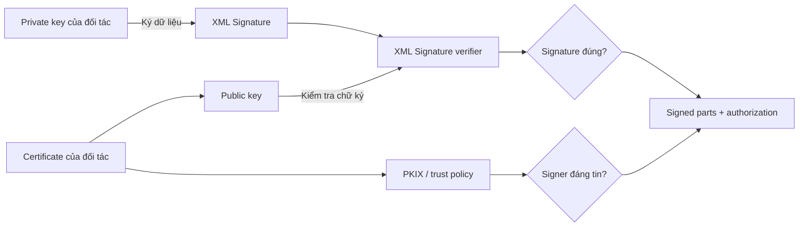
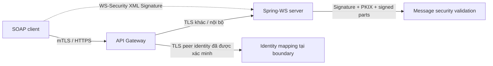
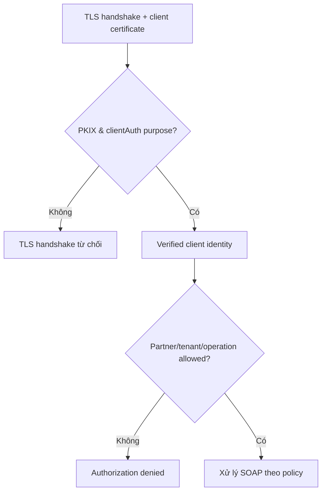
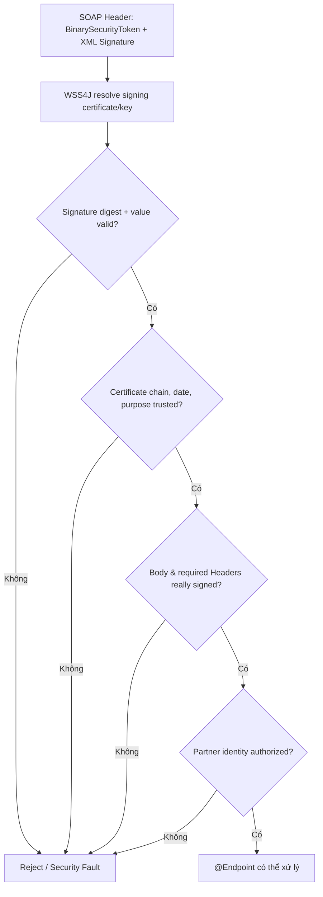
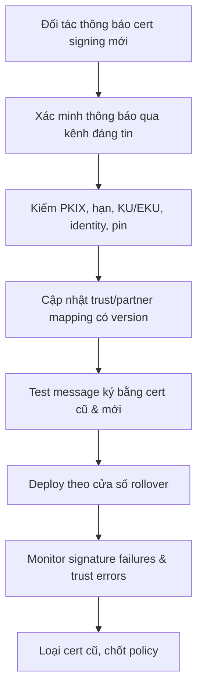

# Kiểm tra chuỗi chứng chỉ, thời hạn và mục đích sử dụng khóa

Trong hệ thống SOAP doanh nghiệp, một chứng chỉ X.509 có thể xuất hiện ở nhiều vị trí: certificate của máy chủ HTTPS, certificate của client trong kết nối mTLS, hoặc certificate chứa **public key dùng để xác minh XML Signature** trong WS-Security. Việc đọc được file `.cer` hoặc xác minh được một chữ ký bằng public key trong certificate **chưa chứng minh certificate đó đáng tin**. Một certificate có thể đã hết hạn, do CA không được phép cấp, dùng cho mục đích khác, bị thu hồi hoặc thuộc một đối tác không có quyền gọi dịch vụ.

Để sử dụng certificate đúng cách, ứng dụng cần kiểm tra ba lớp:

1. **Chuỗi tin cậy:** certificate đích có xây được đường chứng thực hợp lệ đến **trust anchor** mà hệ thống chủ động tin không?
2. **Thời hạn và trạng thái:** tại thời điểm kiểm tra, certificate còn trong khoảng `NotBefore`–`NotAfter` và đáp ứng chính sách **thu hồi/CRL/OCSP** không?
3. **Mục đích sử dụng khóa và danh tính:** extensions `BasicConstraints`, `KeyUsage`, `ExtendedKeyUsage` và các ràng buộc định danh có cho phép dùng khóa cho **TLS server**, **mTLS client** hay **ký SOAP** như yêu cầu hợp đồng không?

Bài thuộc chương **Chứng chỉ và khóa** của module **SPRING_WEB_SERVICES**. Trong lộ trình xây dựng SOAP service theo hướng **contract-first** bằng Spring Web Services (Spring-WS), XSD/WSDL mô tả hợp đồng, JAXB ánh xạ dữ liệu, endpoint và SOAP client truyền thông điệp, còn WS-Security, chữ ký XML, interceptor, certificate và TLS bảo vệ kênh/tính toàn vẹn thông điệp. Bài tập trung vào **đánh giá certificate**; các bước xử lý SOAP Fault, signed-parts và kiểm thử tương thích được nối vào đúng ranh giới của chúng.

Các tên certificate, đường dẫn và URI `example.org` chỉ dùng để minh họa. Java dùng Java 17+; Spring-WS ở hệ Jakarta. Các đoạn mã minh họa thuật toán kiểm tra, **không thay thế cấu hình PKI và chính sách bảo mật đã được phê duyệt**. Khi đưa vào production, cần đối chiếu phiên bản JDK, security provider, WSS4J và yêu cầu cụ thể của đối tác.

## 1. Chứng chỉ là gì và thực sự chứng minh điều gì?

Một X.509 certificate chứa public key, thông tin về chủ thể, issuer, thời hạn, các extensions và chữ ký của CA/issuer.

| Trường | Ý nghĩa | Sai lầm thường gặp |
| --- | --- | --- |
| `Subject` | Danh tính được thể hiện trong certificate | Chỉ đọc `CN` rồi tin đó là đối tác |
| `Issuer` | Chủ thể ký/cấp certificate | Thấy tên CA quen là kết luận trusted |
| `Serial Number` | Định danh certificate trong phạm vi issuer | Dùng serial đơn lẻ làm định danh toàn cầu |
| `SubjectPublicKeyInfo` | Public key và thuật toán khóa | Nhầm public key với private key |
| `NotBefore`/`NotAfter` | Cửa sổ thời gian hiệu lực | Chỉ xem hạn của leaf mà bỏ qua các certificate khác |
| `BasicConstraints` | CA hay end-entity, giới hạn độ sâu CA | Chấp nhận intermediate không được phép làm CA |
| `KeyUsage` | Các **chức năng mật mã** mà khóa có thể dùng | Cho certificate ký dữ liệu dù `digitalSignature` bị cấm |
| `ExtendedKeyUsage` (EKU) | **Mục đích ứng dụng** như TLS server/client | Cho certificate `serverAuth` làm SOAP signer mà không có policy |
| `SubjectAlternativeName` (SAN) | DNS/IP/URI và các tên khác gắn với chủ thể | Bỏ qua hostname verification HTTPS |
| `CRL Distribution Points`/`AIA` | Metadata hỗ trợ thu hồi/issuer | Cho URL trong cert tự do truy cập mạng nội bộ |
| `Certificate Signature` | Chữ ký chứng thực từ issuer | Nghĩ rằng cert tự ký là trusted vì chữ ký kiểm được |

Certificate **không chứa private key**. Private key thuộc người sở hữu và cần được bảo vệ riêng; chứng chỉ cho bên nhận public key và metadata để quyết định có nên tin khóa ấy hay không.

### 1.1. Public key, private key và chứng chỉ



Một signature có thể đúng về mặt toán học nhưng do một certificate **không thuộc đối tác hợp lệ** ký. Ngược lại, certificate có chuỗi tin cậy hợp lệ nhưng chữ ký dữ liệu bị hỏng. Cả hai đều phải bị từ chối.

### 1.2. Root CA không tự động là “root của internet”

**Trust anchor** là điểm bắt đầu niềm tin do ứng dụng/tổ chức cấu hình. Nó có thể là một root CA công khai, một root CA doanh nghiệp hoặc đối tượng trust anchor được biểu diễn bằng tên và public key. Niềm tin phát sinh từ **cấu hình của hệ thống nhận**, không phát sinh chỉ vì certificate có `BasicConstraints: CA=TRUE`.

Với tích hợp B2B, truststore chỉ nên chứa những anchors phù hợp với mục đích tích hợp. Tin toàn bộ các CA của hệ điều hành có thể quá rộng nếu hợp đồng yêu cầu certificate của **một đối tác cụ thể**.

## 2. Xây dựng chuỗi chứng chỉ X.509 theo mô hình PKIX

Một đường chứng thực điển hình:

```text
Leaf certificate:  soap-signer.partner.example.org
       │ Issuer: Partner Integration Intermediate CA
       ▼
Intermediate CA:   Partner Integration Intermediate CA
       │ Issuer: Enterprise Trusted Root CA
       ▼
Trust anchor:      Enterprise Trusted Root CA
       ▲
       └─ Được cấu hình trong truststore/PKIX policy
```

Certificate của **leaf** được cấp bởi **intermediate CA**; intermediate được cấp bởi root CA hoặc một CA ở tầng cao hơn. Certificate của root có thể self-signed, nhưng **không cần giả định mọi trust anchor đều bắt buộc là self-signed root certificate**.

### 2.1. Kiểm tra gì ở mỗi mắt xích?

Một đường PKIX thông thường cần xem xét:

1. **Issuer/Subject relationship:** issuer của certificate cấp dưới tương ứng với subject/định danh của CA cấp trên; việc khớp tên **không thay thế xác minh chữ ký issuer**.
2. **Cryptographic certificate signatures:** chứng chỉ cấp dưới được xác minh bằng public key của CA cấp trên theo thuật toán được phép.
3. **Validity:** các certificate trong đường chứng thực chưa hết hạn và chưa có hiệu lực trong tương lai tại thời điểm kiểm tra.
4. **BasicConstraints:** các intermediate thực sự được phép đóng vai trò CA.
5. **KeyUsage:** CA có quyền `keyCertSign` khi extension `KeyUsage` hiện diện; leaf có quyền dùng khóa theo operation.
6. **Path length constraints:** CA không được cấp chuỗi các intermediate vượt giới hạn được chứng chỉ CA cho phép.
7. **Name constraints/policies:** ràng buộc tên, certificate policies và các giới hạn PKIX khác được thực thi khi cần.
8. **Revocation:** CRL/OCSP theo policy của hệ thống (xem mục 5), không suy đoán là luôn bật.
9. **Algorithm constraints:** loại bỏ signature/key algorithm và key size yếu theo security baseline.
10. **Trust anchor:** đường đi kết thúc tại anchor chủ động được cấu hình và được sử dụng cho đúng bối cảnh.

**Chuỗi certificate là một tập bằng chứng**, không phải một chuỗi các tên issuer được nối bằng dấu mũi tên. Không tự cài bộ xác minh bằng cách so `getIssuerX500Principal()` với `getSubjectX500Principal()` rồi chấp nhận.

### 2.2. Leaf, intermediate và trust anchor

| Đối tượng | Vai trò | Nguồn thường gặp |
| --- | --- | --- |
| **Leaf/end-entity** | Chứa public key của server TLS, client mTLS hoặc SOAP signer | TLS handshake, WS-Security token, kho cấu hình |
| **Intermediate CA** | Chứng thực leaf/CA cấp dưới | Chuỗi đối tác gửi, store trung gian, nguồn được quản lý |
| **Trust anchor** | Điểm đặt niềm tin của hệ thống nhận | Truststore/policy nội bộ được phê duyệt |

Thông thường certificate chain mà server gửi qua TLS **không cần chứa root**; client có root/trust anchor được cấu hình sẵn. Tương tự, WS-Security `BinarySecurityToken` có thể gửi một hoặc vài certificate phục vụ định vị signer, nhưng **không được lấy những certificate bên gửi tự đính kèm làm trust anchors**.

### 2.3. Missing intermediate và AIA fetching

Nếu đối tác chỉ gửi leaf và thiếu intermediate, việc xây chuỗi có thể thất bại. Một số môi trường/provider có khả năng lấy intermediate qua **Authority Information Access (AIA)** hoặc nguồn khác, nhưng không nên phụ thuộc vào truy cập mạng không kiểm soát:

- Thỏa thuận đối tác gửi đủ intermediates cần thiết hoặc cung cấp chúng qua nguồn được kiểm duyệt.
- Không tự cho bộ xây chuỗi truy cập tùy ý vào địa chỉ trong certificate nếu vi phạm chính sách outbound/SSRF.
- Kiểm tra cache, proxy, DNS, latency, certificate revocation và vận hành khi mất mạng.
- Không “sửa” lỗi thiếu intermediate bằng cách import **mọi leaf certificate nhận được** làm trust anchor.

### 2.4. Giới hạn `BasicConstraints` và `pathLenConstraint`

Intermediate CA phải có `BasicConstraints` hợp lệ, bao gồm `cA=true`. `pathLenConstraint` giới hạn số **CA không phải self-issued** có thể xuất hiện phía dưới CA đó trong đường hợp lệ theo quy tắc PKIX; nó **không đơn giản là số certificate bất kỳ** và không được đếm leaf end-entity như một intermediate.

Ví dụ minh họa:

```text
Root CA (trust anchor)
  └── Intermediate A: CA=true, pathLen=0
        └── Leaf signing certificate                ✅ kiểu chuỗi mong muốn
        └── Intermediate B (CA)
              └── Leaf certificate                  ❌ có thể vi phạm pathLen của A
```

Không tự tính path length bằng `chain.length - 2` để thay thế PKIX validator; quy tắc self-issued certificates và policy extensions có chi tiết quan trọng.

## 3. Kiểm tra thời hạn: `NotBefore` và `NotAfter`

Một chứng chỉ có **khoảng hiệu lực**, không chỉ có một ngày hết hạn:

```text
NotBefore            thời điểm kiểm tra                  NotAfter
    │                        │                              │
    ├────────────────────────┼──────────────────────────────┤
    Chưa đến NotBefore: không hợp lệ
    Giữa hai mốc: qua điều kiện thời gian
    Sau NotAfter: đã hết hạn
```

Định nghĩa logic:

```text
Valid at time T ⇔ NotBefore ≤ T ≤ NotAfter
```

**Qua điều kiện thời gian không đồng nghĩa đáng tin toàn diện.** Chứng chỉ còn hạn vẫn có thể bị thu hồi, không thuộc trust anchor, sai KeyUsage/EKU hoặc signer không được phép.

### 3.1. Java API kiểm tra thời hạn

```java
import java.security.cert.CertificateExpiredException;
import java.security.cert.CertificateNotYetValidException;
import java.security.cert.X509Certificate;
import java.time.Clock;
import java.util.Date;

public final class CertificateValidity {
    private CertificateValidity() { }

    public static void requireCurrentlyValid(
            X509Certificate certificate, Clock clock)
            throws CertificateExpiredException,
                   CertificateNotYetValidException {
        certificate.checkValidity(
                Date.from(clock.instant()));
    }
}
```

Ưu điểm của `Clock` là test có thể cố định thời gian mà không phụ thuộc đồng hồ máy CI. `X509Certificate#checkValidity` **chỉ kiểm thời gian của chính một certificate**; nó **không xây chuỗi, không xác minh issuer, không kiểm EKU, CRL/OCSP hay danh tính đối tác**.

### 3.2. Thời hạn của leaf và CA intermediates

Một leaf có `NotAfter` năm sau vẫn có thể thất bại vì intermediate hết hạn. Bộ kiểm tra PKIX đánh giá các certificate **nằm trong certification path** theo thời điểm đã chọn, cùng nhiều ràng buộc khác.

**Lưu ý về trust anchor:** khi một certificate/key được cấu hình trực tiếp làm trust anchor, PKIX không xử lý nó như một certificate thông thường trong `CertPath`; vì vậy **không nên mặc nhiên nói Java sẽ tự kiểm ngày hết hạn của mọi root certificate trong truststore giống như leaf/intermediate**. Tổ chức vẫn cần quản trị vòng đời, hạn sử dụng và loại bỏ root/trust anchor theo policy riêng.

### 3.3. Thời gian kiểm tra và độ lệch đồng hồ

Chứng chỉ dùng mốc thời gian tuyệt đối, thường hiển thị theo UTC. Hệ thống cần:

- Đồng bộ thời gian bằng nguồn tin cậy (NTP/chrony hoặc cơ chế tương đương).
- Không sử dụng timezone local như một cách cộng/trừ thời hạn tùy ý.
- Phân biệt **certificate validity** với **WS-Security `wsu:Timestamp`** của một SOAP message.
- Tránh tăng “clock skew” vô hạn chỉ để chấp nhận chứng chỉ chưa có hiệu lực.
- Kiểm tra riêng giới hạn thời gian của CRL/OCSP và replay cache nếu được bật.

Với **historical signature/long-term validation**, việc xác định một chữ ký được tạo **khi nào**, timestamp do nguồn đáng tin ký và trạng thái chứng chỉ tại thời điểm ký là bài toán khác với xác minh một yêu cầu SOAP đang đến **tại thời điểm hiện tại**. Không tự dùng trường `Created` do client gửi làm thời điểm kiểm PKIX đáng tin nếu nó không được xác thực theo đúng policy.

## 4. `KeyUsage`: khóa được làm phép mật mã nào?

`KeyUsage` là extension dạng bit flags. Nó mô tả **mục đích sử dụng khóa ở mức cơ chế mật mã**. Một số bit:

| Bit (vị trí từ 0) | Tên `KeyUsage` | Ý nghĩa khái quát |
| --- | --- | --- |
| 0 | `digitalSignature` | Ký dữ liệu/hoạt động xác thực phù hợp |
| 1 | `nonRepudiation` / `contentCommitment` | Phục vụ cam kết nội dung theo profile |
| 2 | `keyEncipherment` | Mã hóa/đóng gói khóa trong các giao thức phù hợp |
| 3 | `dataEncipherment` | Mã hóa dữ liệu trực tiếp bằng khóa |
| 4 | `keyAgreement` | Thỏa thuận khóa |
| 5 | `keyCertSign` | Ký/cấp certificate của CA |
| 6 | `cRLSign` | Ký certificate revocation list |
| 7 | `encipherOnly` | Giới hạn khi `keyAgreement` được dùng |
| 8 | `decipherOnly` | Giới hạn khi `keyAgreement` được dùng |

### 4.1. Một số tình huống thường gặp

| Vai trò | `KeyUsage` có liên quan | Lưu ý |
| --- | --- | --- |
| CA ký certificate | `keyCertSign` | Đồng thời phải đáp ứng `BasicConstraints: CA=true` |
| CA/issuer ký CRL | `cRLSign` | Phải phù hợp CRL issuer/signature validation |
| SOAP XML Signature | `digitalSignature` nếu KU extension yêu cầu | Không suy từ `serverAuth` của EKU |
| TLS 1.3 certificate authentication | Thường `digitalSignature` | Còn cần profile TLS/JSSE và EKU phù hợp |
| TLS 1.2 RSA key exchange kiểu cũ | Có thể liên quan `keyEncipherment` | Không áp quy tắc cũ cho mọi TLS cipher suite |
| mTLS client authentication | Thường `digitalSignature` | Còn cần EKU `clientAuth` khi policy bắt buộc |
| XML Encryption | Phụ thuộc thuật toán quản lý khóa/mã hóa | Không mặc định certificate ký SOAP cũng được phép giải mã |

Chỉ nhìn `digitalSignature=true` chưa đủ xác định certificate được phép làm **SOAP signer**: ứng dụng còn cần chain, mục đích ký được thỏa thuận, danh tính và authorization. Ngược lại, không được yêu cầu `keyEncipherment` với mọi khóa ECDSA dùng để ký vì nó không diễn tả đúng cơ chế.

### 4.2. Java đọc `KeyUsage`

```java
import java.security.cert.CertificateException;
import java.security.cert.X509Certificate;

public final class KeyUsagePolicy {
    private static final int DIGITAL_SIGNATURE = 0;
    private static final int KEY_CERT_SIGN = 5;

    private KeyUsagePolicy() { }

    public static void requireDigitalSignature(
            X509Certificate cert) throws CertificateException {
        boolean[] usage = cert.getKeyUsage();

        // Quy tắc nghiêm ngặt của ví dụ: yêu cầu KU phải hiện diện.
        if (usage == null
                || usage.length <= DIGITAL_SIGNATURE
                || !usage[DIGITAL_SIGNATURE]) {
            throw new CertificateException(
                    "Digital signature usage is not permitted");
        }
    }

    public static void requireCaCertificate(
            X509Certificate issuer) throws CertificateException {
        if (issuer.getBasicConstraints() < 0) {
            throw new CertificateException(
                    "Issuer is not a CA");
        }
        boolean[] usage = issuer.getKeyUsage();
        if (usage != null &&
                (usage.length <= KEY_CERT_SIGN
                || !usage[KEY_CERT_SIGN])) {
            throw new CertificateException(
                    "CA key cannot sign certificates");
        }
    }
}
```

Trong X.509, `getKeyUsage() == null` có nghĩa **không có extension `KeyUsage`**, không tương đương mọi bit đều `false`. Ví dụ chọn policy nghiêm ngặt cho **leaf SOAP signer**: nếu KU thiếu thì từ chối. Một profile TLS/PKIX khác có thể cho phép KU không hiện diện nếu không bị ràng buộc; cần theo hợp đồng và chuẩn áp dụng, **không áp một policy máy móc cho mọi loại certificate**.

Trong validation thực tế, **không thay thế PKIX path checking bằng helper `requireCaCertificate`**. PKIX provider còn đánh giá path length, name constraints, policies, signatures và các ràng buộc khác.

## 5. `ExtendedKeyUsage`: ứng dụng nào được phép dùng khóa?

`ExtendedKeyUsage` (EKU) biểu diễn mục đích ở mức **ứng dụng/protocol** bằng các OID.

| EKU | OID | Trường hợp sử dụng |
| --- | --- | --- |
| `serverAuth` | `1.3.6.1.5.5.7.3.1` | TLS WWW server authentication |
| `clientAuth` | `1.3.6.1.5.5.7.3.2` | TLS WWW client authentication, mTLS |
| `codeSigning` | `1.3.6.1.5.5.7.3.3` | Ký mã phần mềm |
| `emailProtection` | `1.3.6.1.5.5.7.3.4` | S/MIME/email protection |
| `timeStamping` | `1.3.6.1.5.5.7.3.8` | Time-stamping theo profile |
| `OCSPSigning` | `1.3.6.1.5.5.7.3.9` | OCSP responder được ủy quyền theo quy tắc |

Ngoài các OID tiêu chuẩn, một tổ chức/PKI có thể quy định **private EKU OID** cho mục đích ký tài liệu/WS-Security. **Không có một EKU `soapSigning` phổ quát bắt buộc với mọi hệ thống Spring-WS**. Phải xác định mục đích certificate ký SOAP từ policy/hợp đồng thực, thay vì bắt buộc `serverAuth` hoặc `clientAuth` chỉ vì thông điệp được truyền qua HTTPS.

### 5.1. `KeyUsage` và `ExtendedKeyUsage` phải cùng phù hợp

Ví dụ một TLS server certificate nên đáp ứng:

```text
Certificate path: tới CA đã được tin
Validity:         trong NotBefore..NotAfter
Identity:         SAN khớp hostname server TLS
EKU:              serverAuth theo profile/policy
KU:               phù hợp với TLS authentication/key algorithm
Revocation:       theo policy có hiệu lực
Algorithms:       đáp ứng baseline TLS/JVM
```

Với một **mTLS client certificate**, EKU tương ứng là `clientAuth` nếu profile yêu cầu. Với một **SOAP XML signing certificate**, ứng dụng cần `digitalSignature` và **EKU phù hợp với chính sách ký thông điệp được thỏa thuận**, không tự giả định `clientAuth` là mục đích ký XML.

### 5.2. Java đọc và kiểm tra EKU có chủ đích

```java
import java.security.cert.CertificateException;
import java.security.cert.CertificateParsingException;
import java.security.cert.X509Certificate;
import java.util.List;

public final class ExtendedKeyUsagePolicy {
    public static final String TLS_SERVER_AUTH =
            "1.3.6.1.5.5.7.3.1";
    public static final String TLS_CLIENT_AUTH =
            "1.3.6.1.5.5.7.3.2";

    private ExtendedKeyUsagePolicy() { }

    public static void requireExtendedUsage(
            X509Certificate certificate,
            String expectedOid)
            throws CertificateException {
        final List<String> usages;
        try {
            usages = certificate.getExtendedKeyUsage();
        } catch (CertificateParsingException ex) {
            throw new CertificateException(
                    "Unable to parse certificate EKU", ex);
        }

        // Policy ví dụ: EKU bắt buộc và phải có OID chính xác.
        if (usages == null || !usages.contains(expectedOid)) {
            throw new CertificateException(
                    "Required extended key usage is absent");
        }
    }
}
```

`getExtendedKeyUsage() == null` biểu thị extension EKU **không hiện diện**. Một số ứng dụng theo profile có thể xem “không có EKU” là không giới hạn mục đích, nhưng policy mẫu trên **cố ý yêu cầu EKU phải có**. Tương tự `anyExtendedKeyUsage` không được tự hiểu là thay thế mọi OID cụ thể nếu policy nghiêm ngặt yêu cầu `serverAuth` hay `clientAuth`.

### 5.3. Mục đích kiểm tra khác nhau theo context

**Certificate ký SOAP có thể khác certificate TLS của cùng đối tác.** Đừng lấy một chứng chỉ `serverAuth` trên HTTPS server rồi mặc định dùng nó xác minh SOAP Signature. Đừng áp `serverAuth` cho khóa private của một hệ thống đóng vai trò **mTLS client**. Điều cần kiểm là **vai trò ở ranh giới đang xác minh**, không phải nhãn chung “certificate của đối tác”.

## 6. Revocation: certificate còn hạn vẫn có thể không còn tin cậy

Một certificate có thể bị thu hồi trước `NotAfter` khi private key bị lộ, đối tác bị chấm dứt quyền hoặc CA phát hiện cấp sai. Các cơ chế thường gặp:

| Cơ chế | Cách hoạt động | Điểm vận hành |
| --- | --- | --- |
| **CRL** (Certificate Revocation List) | CA công bố danh sách serial certificates bị thu hồi, có chữ ký | Cần xác minh CRL signer, issuer, `thisUpdate`/`nextUpdate`, phân phối và cache |
| **OCSP** | Hỏi responder về trạng thái certificate cụ thể | Cần tin responder, kiểm thời gian response, availability/cache, privacy/network policy |
| **OCSP stapling** | TLS server mang OCSP response trong handshake nếu được hỗ trợ | Không thay cơ chế WS-Security revocation cho signer khác |
| **Pinning/short-lived certs** | Giới hạn tập certificate/public key và vòng đời | Có thể bổ sung, không mặc định thay toàn bộ revocation policy |

**Đã có truststore không có nghĩa đã bật revocation.** `X509Certificate#checkValidity` chỉ kiểm thời gian. `CertPathBuilder`/`CertPathValidator` có thể được cấu hình kiểm tra revocation, nhưng các nguồn CRL/OCSP, hành vi lỗi và tùy chọn provider phải được xác định.

### 6.1. Hành vi khi responder không khả dụng

| Chính sách | Khi không lấy được CRL/OCSP | Đánh đổi |
| --- | --- | --- |
| **Fail closed** | Từ chối hoặc trì hoãn xác thực theo policy | An toàn nghiêm ngặt hơn, có nguy cơ gián đoạn |
| **Soft fail** | Chấp nhận có điều kiện khi trạng thái không xác định | Tăng availability nhưng chấp nhận rủi ro certificate đã thu hồi |
| Cache có thời hạn | Sử dụng thông tin revocation còn hạn | Giảm phụ thuộc network; cần quản lý freshness |

Không thay đổi từ fail closed sang soft fail **âm thầm** để xử lý một sự cố mạng. Cần chấp thuận mức rủi ro, cảnh báo, giới hạn thời gian và tài liệu hóa. Với thao tác nhạy cảm như thanh toán hoặc ký số, chính sách có thể nghiêm ngặt hơn một API công khai ít rủi ro.

### 6.2. Bảo vệ nguồn CRL/OCSP và AIA

Certificate có thể chứa URI CRL Distribution Points, Authority Information Access (AIA) hoặc OCSP responder. Một ứng dụng xử lý certificate do client gửi phải tránh dùng các địa chỉ ấy như nguồn mở HTTP **không giới hạn**:

- Kiểm soát outbound egress, DNS, proxy và private network access.
- Giới hạn timeout, response size, protocol và number of redirects.
- Kiểm tra chữ ký/chuỗi tin của CRL/OCSP response chứ không chỉ HTTP status.
- Không log toàn certificate hoặc dữ liệu định danh không cần thiết.
- Kiểm thử outage, revoked, unknown, stale cache và certificate rollover.

Đặc biệt với WS-Security, một chứng chỉ được gắn vào SOAP Header **không tự cho nó quyền chọn arbitrary network host** cho server.

## 7. Truststore, keystore và chuỗi tin cậy: ai sở hữu gì?

Hai file `.p12` có thể cùng dùng định dạng PKCS#12 nhưng mục đích hoàn toàn khác:

| Kho | Dữ liệu chính | Ai sử dụng | Hành động |
| --- | --- | --- | --- |
| **Truststore inbound SOAP** | Trust anchors, certificate được phê duyệt | SOAP server/WSS4J | Kiểm tra certificate người ký message |
| **Truststore HTTPS client** | CA/cert tin cậy của SOAP server | SOAP client/JSSE | Xác thực server TLS và hostname |
| **Keystore outbound SOAP signer** | Private key và certificate chain của ứng dụng | SOAP client/server gửi message ký | Tạo `SignatureValue` |
| **Keystore mTLS client** | Private key và client cert | HTTP client/JSSE | Chứng thực client trong TLS handshake |
| **Keystore HTTPS server** | Private key và server cert | Web server/ingress | Chứng thực server TLS |
| **Truststore mTLS server** | CA/cert được phép làm client | HTTPS server/ingress | Kiểm tra client certificate tại TLS boundary |

Đừng nhầm **certificate có public key** với **`PrivateKeyEntry` chứa private key**. Một service chỉ **xác minh** SOAP signatures không cần giữ private key của đối tác. Một service **ký** response hoặc **giải mã** XML Encryption mới cần khóa riêng tương ứng với tác vụ.

### 7.1. Nội dung truststore phải được lựa chọn có chủ đích

Quy tắc quan trọng:

1. Truststore được tạo/quản lý qua kênh cấu hình đã xác thực, không import cert tùy ý từ SOAP request.
2. Root CA doanh nghiệp khác root CA hệ thống; quyết định rõ tập anchor nào dùng cho dịch vụ nào.
3. Nếu pin leaf/public key của một đối tác, phải có cơ chế **pin rollover** và kế hoạch thay certificate.
4. Chỉ PKIX chain pass chưa đủ phân biệt nhiều đối tác dưới cùng CA; cần **partner identity mapping**.
5. Phân tách TLS truststore khỏi WS-Security Crypto khi policy/identity khác.
6. Bảo vệ mật khẩu store và private key bằng secret manager/keystore/HSM phù hợp; không hard-code trong Java/YAML được commit.

### 7.2. TLS trust không thay thế message trust

Nếu TLS kết thúc tại gateway:



TLS xác minh **peer của từng hop**. XML Signature có thể bảo vệ các phần SOAP xuyên nhiều hop, miễn ký và xác minh đúng nodes. Nếu backend nhận identity từ gateway, phải bảo vệ đường truyền identity, loại bỏ header giả mạo và kiểm tra policy ủy quyền; không tin một `X-Client-Cert` do Internet client tự thêm.

## 8. Lỗi certificate thường bị bỏ qua khi chỉ chạy happy path

| Triệu chứng | Nguyên nhân gốc có thể | Cần kiểm gì? |
| --- | --- | --- |
| Chữ ký SOAP hợp lệ nhưng server vẫn từ chối | Signer không trusted, EKU/purpose sai, revoked hoặc thiếu signed parts | PKIX + policy + actual SOAP signed data |
| Leaf còn hạn nhưng validation fail | Intermediate hết hạn, wrong CA, pathLen, key usage | Toàn bộ certification path |
| Root truststore có tên giống issuer nhưng fail | Thiếu đúng key/cert, trust anchor sai hoặc alg constraint | Dùng public key/signature/path, không tên text |
| Cert có `digitalSignature` nhưng không được chấp nhận TLS server | EKU `serverAuth`/SAN/hostname không phù hợp | Mục đích và định danh TLS |
| Cert có EKU `serverAuth` nhưng XML signer bị từ chối | Policy SOAP signing khác TLS server | Soap signer EKU/KU/trust/partner identity |
| Cert self-signed ký được payload | Signature math pass, trust không pass | Trust anchor/pin policy |
| Client mTLS pass nhưng server SOAP bảo chữ ký sai | mTLS và SOAP signer keys khác | WSS4J Crypto/WS-Security coverage |
| OCSP/CRL outage làm requests fail | Revocation fail closed hoặc cache hết hạn | Responder/egress/availability policy |
| Certificate rollover gây lỗi | Cert mới chưa trusted/identity-mapped hoặc stale cache | Cập nhật trust/pin + overlap có hạn |
| Một đối tác khác cùng CA gọi được operation nhạy cảm | Không ràng buộc cert identity với partner/tenant | Authorization sau PKIX |

Thông điệp chính: **không sửa lỗi chứng chỉ bằng cách bật “trust all”, bỏ hostname verification hay tắt XML Signature validation**. Phải xác định chính xác lớp kiểm tra đang fail và xử lý đúng nguyên nhân.

## 9. Dùng Java PKIX API để xây đường chứng thực

Java cung cấp các API chuẩn để xử lý X.509 và PKIX:

| API | Vai trò |
| --- | --- |
| `KeyStore` | Nạp trust anchors và key entries do hệ thống quản lý |
| `CertificateFactory` | Đọc X.509 certificate/CRL, tạo `CertPath` |
| `X509Certificate` | Đọc thời hạn, KU, EKU, SAN và certificate extensions |
| `X509CertSelector` | Xác định certificate mục tiêu khi xây path |
| `PKIXBuilderParameters` | Trust anchors, candidate certificates, thời điểm, revocation và ràng buộc xây đường |
| `CertStore` | Nguồn leaf/intermediate certificates và CRLs cho path building |
| `CertPathBuilder` | Tìm một đường từ leaf tới trust anchor đáp ứng PKIX |
| `CertPathValidator` | Xác minh một `CertPath` đã được cung cấp theo PKIX |
| `PKIXRevocationChecker` | Tùy chỉnh kiểm tra CRL/OCSP trong provider hỗ trợ |
| `PKIXCertPathBuilderResult` | Kết quả gồm certificate path, trust anchor và policy tree/public key liên quan |

**Phân biệt `build` và `validate`:** `CertPathBuilder` tìm một đường hợp lệ từ candidates; `CertPathValidator` đánh giá đường được truyền vào theo thứ tự. Không có bảo đảm một certificate `Subject` có tên đẹp sẽ dẫn tới một anchor hợp lệ.

### 9.1. Nạp truststore PKCS#12 an toàn

```java
import java.io.InputStream;
import java.nio.file.Files;
import java.nio.file.Path;
import java.security.KeyStore;

public final class TrustStoreLoader {
    private TrustStoreLoader() { }

    public static KeyStore loadPkcs12(
            Path trustedStorePath, char[] password) throws Exception {
        KeyStore store = KeyStore.getInstance("PKCS12");
        try (InputStream input = Files.newInputStream(
                trustedStorePath)) {
            store.load(input, password);
        }
        return store;
    }
}
```

`trustedStorePath` phải đến từ **cấu hình được quản trị**, không phải đường dẫn lấy từ SOAP Body hoặc HTTP request. `password` cần lấy từ secret manager/đầu vào an toàn, không hard-code; sau khi dùng có thể xóa mảng mật khẩu khi lifecycle cho phép. Mật khẩu file truststore bảo vệ tính toàn vẹn/truy cập của kho, **không phải một bằng chứng rằng mọi certificate bên trong đều là đối tác hợp lệ**.

Nếu truststore chứa quá nhiều CA và ứng dụng không ràng buộc partner identity, một certificate lạ nhưng do một CA trong tập đó cấp có thể vượt qua PKIX. Đây là **policy trust quá rộng**, không phải lỗi thuật toán PKIX.

### 9.2. Ví dụ xây đường với `CertPathBuilder` và kiểm tra thu hồi

```java
import java.security.GeneralSecurityException;
import java.security.KeyStore;
import java.security.cert.CertPathBuilder;
import java.security.cert.CertStore;
import java.security.cert.CollectionCertStoreParameters;
import java.security.cert.PKIXBuilderParameters;
import java.security.cert.PKIXCertPathBuilderResult;
import java.security.cert.X509CRL;
import java.security.cert.X509CertSelector;
import java.security.cert.X509Certificate;
import java.time.Clock;
import java.util.ArrayList;
import java.util.Collection;
import java.util.Date;
import java.util.List;

public final class PartnerCertificatePathBuilder {
    private PartnerCertificatePathBuilder() { }

    public static PKIXCertPathBuilderResult verifyPath(
            KeyStore trustedAnchors,
            X509Certificate leaf,
            Collection<X509Certificate> intermediates,
            Collection<X509CRL> trustedSourceCrls,
            Clock clock) throws GeneralSecurityException {

        X509CertSelector target = new X509CertSelector();
        target.setCertificate(leaf);

        PKIXBuilderParameters policy =
                new PKIXBuilderParameters(trustedAnchors, target);
        policy.setDate(Date.from(clock.instant()));

        List<Object> sources = new ArrayList<>();
        sources.add(leaf);
        sources.addAll(intermediates);
        sources.addAll(trustedSourceCrls);

        CertStore candidates = CertStore.getInstance(
                "Collection",
                new CollectionCertStoreParameters(sources));
        policy.addCertStore(candidates);

        // Quan trọng: không tắt revocation chỉ để test pass.
        // Bài học giả định provider + CRL/OCSP được cấu hình
        // đủ để xác nhận mọi certificate theo revocation policy.
        policy.setRevocationEnabled(true);

        CertPathBuilder builder =
                CertPathBuilder.getInstance("PKIX");
        return (PKIXCertPathBuilderResult) builder.build(policy);
    }
}
```

Giải thích:

1. `trustedAnchors` chứa các trust anchors đã được **chọn trước**. Nó không được tạo bằng cách tự động trust `leaf` vừa nhận.
2. `X509CertSelector` chọn đúng **leaf certificate** cần xây đường.
3. `CertStore` chứa intermediate candidates và CRLs từ **nguồn được quản trị**; path builder có thể chọn một đường phù hợp trong những candidates được cung cấp.
4. `setDate` làm rõ thời điểm đánh giá. Đồng hồ cần đáng tin.
5. `setRevocationEnabled(true)` yêu cầu revocation checking theo cấu hình/provider. **Không có CRL/OCSP đáng tin, path building có thể thất bại**, và đó là hành vi đúng khi policy yêu cầu fail closed.
6. Kết quả `PKIXCertPathBuilderResult` xác nhận việc xây đường theo PKIX parameters; nó **chưa tự chứng minh** hostname TLS, business partner identity, XML signed parts và **mục đích EKU cụ thể** mà ứng dụng yêu cầu.

**Ranh giới quan trọng:** đoạn code không tự thiết lập network fetching, trust policy OCSP/CRL, timeout, certificate pinning, partner mapping hoặc security providers. Những phần ấy phải được cấu hình và kiểm thử ở hệ thống thật. Nếu certificate đang được JSSE/TLS hoặc WSS4J xử lý, ưu tiên tận dụng **certificate-validation pipeline được hỗ trợ của stack đó**, thay vì xây thêm một pipeline độc lập không đồng bộ policy.

### 9.3. Đọc kết quả và áp mục đích riêng

Sau khi PKIX xây đường:

```java
PKIXCertPathBuilderResult pathResult =
        PartnerCertificatePathBuilder.verifyPath(
                trustStore,
                signingLeaf,
                intermediateCerts,
                crls,
                clock);

// Đã có đường PKIX hợp lệ theo các parameters ở trên.
System.out.println(
        "Certification path certificates: "
        + pathResult.getCertPath().getCertificates().size());

// Bước tiếp theo: kiểm mục đích của leaf signer.
KeyUsagePolicy.requireDigitalSignature(signingLeaf);

// Với SOAP signer, kiểm tra EKU theo OID của HỢP ĐỒNG nếu bắt buộc.
// Không dùng serverAuth/clientAuth mặc định cho mọi signer SOAP.
```

Các biến `trustStore`, `signingLeaf`, `intermediateCerts`, `crls`, `clock` được tạo trước từ nguồn tin cậy; đây là fragment tích hợp, không phải một `main` class tự chạy. `getCertPath()` trả certificate path **không gồm trust anchor như một member bắt buộc**; trust anchor có thể được xem riêng qua `getTrustAnchor()`. Không dùng độ dài path để quyết định partner identity.

### 9.4. Một kiểm tra riêng về EKU và certificate identity

Nếu đây là **TLS server certificate**, ngoài PKIX path còn cần:

```java
// Trong security policy nghiêm ngặt cho TLS server:
ExtendedKeyUsagePolicy.requireExtendedUsage(
        tlsServerLeaf,
        ExtendedKeyUsagePolicy.TLS_SERVER_AUTH);

// Hostname/SAN phải được JSSE TLS endpoint identification
// hoặc một verified hostname checker phù hợp xử lý.
```

Nếu đây là **mTLS client certificate**, áp chính sách client:

```java
ExtendedKeyUsagePolicy.requireExtendedUsage(
        tlsClientLeaf,
        ExtendedKeyUsagePolicy.TLS_CLIENT_AUTH);
```

Các ví dụ `requireExtendedUsage` dùng policy yêu cầu EKU hiện diện. Một profile TLS có thể cho phép certificate thiếu EKU nếu không bị hạn chế, và JSSE/TLS thực tế có các quy tắc riêng theo authentication/cipher suite. **Đừng thay validator của TLS stack bằng việc chỉ gọi hai helper EKU này.**

### 9.5. Tại sao không tự gọi `certificate.verify(issuer.getPublicKey())` là đủ?

`X509Certificate#verify(PublicKey)` chỉ xác minh **chữ ký của certificate** bằng public key cung cấp. Nó không tự:

- Xây đường PKIX đầy đủ.
- Xác minh issuer là CA, keyCertSign, path length, name constraints.
- Kiểm tra leaf purpose/EKU.
- Chọn trust anchor đã được doanh nghiệp tin.
- Kiểm tra thu hồi hoặc xác thực hostname/partner.
- Ràng buộc certificate với SOAP signed parts/authorization.

Vì vậy dùng `CertPathBuilder`/`CertPathValidator` hoặc TLS/WSS4J trust processor phù hợp, không tự dựng chuỗi bằng vòng lặp `verify`.

## 10. `CertPathValidator` khi đã có chuỗi certificate

Nếu đối tác/cấu hình đã cung cấp **một chuỗi đúng thứ tự leaf → intermediate(s)** và ta có trust anchors tin cậy, Java có thể tạo `CertPath` rồi validate:

```java
import java.security.KeyStore;
import java.security.cert.CertPath;
import java.security.cert.CertPathValidator;
import java.security.cert.CertificateFactory;
import java.security.cert.PKIXParameters;
import java.security.cert.X509Certificate;
import java.time.Clock;
import java.util.Date;
import java.util.List;

public final class ProvidedChainValidator {
    private ProvidedChainValidator() { }

    public static void validate(
            List<X509Certificate> leafThenIntermediates,
            KeyStore trustedAnchors,
            Clock clock) throws Exception {

        CertificateFactory factory =
                CertificateFactory.getInstance("X.509");
        CertPath path = factory.generateCertPath(
                leafThenIntermediates);

        PKIXParameters policy =
                new PKIXParameters(trustedAnchors);
        policy.setDate(Date.from(clock.instant()));
        policy.setRevocationEnabled(true);

        CertPathValidator validator =
                CertPathValidator.getInstance("PKIX");
        validator.validate(path, policy);
    }
}
```

**Lưu ý cần thiết:** ví dụ giả định chuỗi certificate đã có đủ dữ liệu cho provider thực hiện validation, đặc biệt CRL/OCSP khi bật revocation. Nếu cần nguồn certificate/CRL, dùng `policy.addCertStore(...)` với nguồn được quản lý và cấu hình provider tương ứng. Khi dữ liệu thu hồi thiếu, hành vi mong muốn theo chính sách nghiêm ngặt là **không chấp nhận**; không bỏ `setRevocationEnabled(true)` để che lỗi.

Chuỗi trong `generateCertPath` thường **không chứa trust anchor**. Không thêm root tự cung cấp từ message vào cuối path rồi coi đó là trusted: trust chỉ được thiết lập từ `PKIXParameters`/`KeyStore` đã chọn.

### 10.1. Khi nào chọn builder, khi nào validator?

| Bài toán | API thích hợp | Vì sao? |
| --- | --- | --- |
| Có leaf và tập intermediates chưa biết thứ tự/đường nào | `CertPathBuilder` | Tìm certification path phù hợp trust anchors |
| Đã có path đúng thứ tự và đủ intermediates | `CertPathValidator` | Xác minh path đã chọn theo PKIX |
| HTTPS server/mTLS certificate do JSSE xử lý | `TrustManager`/JSSE TLS stack | Thực hiện chain+purpose/identity trong bối cảnh TLS |
| SOAP XML Signature do WSS4J xử lý | WSS4J `Crypto`/trust processor | Xác minh signer trong message-security pipeline |

Điểm chung: **PKIX đúng chỉ là một phần của authentication policy**. Hệ thống vẫn cần kiểm đối tác/tenant, host identity, allowed operations, signed SOAP parts và replay policy.

## 11. TLS server: certificate còn hạn vẫn chưa đủ cho hostname

Khi SOAP client POST tới:

```text
https://soap.partner.example.org/services/orders
```

TLS server certificate phải thỏa chain, thời hạn, KU/EKU **và danh tính hostname**. DNS name có thể nằm trong `SubjectAlternativeName` (SAN).

**Ví dụ:**

| Certificate SAN | URL client gọi | Theo thông thường |
| --- | --- | --- |
| `DNS:soap.partner.example.org` | `https://soap.partner.example.org` | Khớp |
| `DNS:api.partner.example.org` | `https://soap.partner.example.org` | Không khớp |
| `DNS:*.partner.example.org` | `https://soap.partner.example.org` | Có thể khớp theo quy tắc wildcard áp dụng |
| `DNS:*.partner.example.org` | `https://a.b.partner.example.org` | Không khớp một cấp tùy profile, thường không khớp |
| `IP:203.0.113.20` | `https://203.0.113.20` | Cần SAN loại IP phù hợp |

Đừng tự viết hostname matching bằng `certificate.getSubjectDN().getName().contains(host)`. Cần xử lý SAN, wildcard, IDNA, IP address và các quy tắc name matching đúng TLS profile.

### 11.1. JSSE endpoint identification

Với Java TLS, **endpoint identification** phải được bật bởi HTTP client/JSSE implementation hoặc configuration tương ứng. Trong một đường socket JSSE tự quản lý, một ví dụ sử dụng:

```java
import javax.net.ssl.SSLParameters;
import javax.net.ssl.SSLSocket;

void requireHttpsEndpointIdentity(SSLSocket socket) {
    SSLParameters parameters = socket.getSSLParameters();
    parameters.setEndpointIdentificationAlgorithm("HTTPS");
    socket.setSSLParameters(parameters);
}
```

Đây là **fragment cấu hình một socket SSL do ứng dụng sở hữu trước handshake**, không phải ví dụ dựng SOAP client hoàn chỉnh. Với Spring-WS `WebServiceTemplate`, TLS do `WebServiceMessageSender` và HTTP client (JDK, Apache HttpClient hoặc provider khác) quản lý; nên cấu hình truststore, hostname verification và client certificate **trên sender/TLS stack thật**. Không giả định đoạn socket trên tự áp dụng cho mọi sender.

**Không tắt hostname verification hoặc dùng trust-all `X509TrustManager`** để xử lý lỗi certificate. Điều đó làm mất khả năng chống MITM, ngay cả khi một số SOAP operations còn được ký bằng XML Signature.

### 11.2. `soap:address`, hostname và certificate

Trong WSDL 1.1, `soap:address location` công bố endpoint. Nếu WSDL nói `https://internal-host:8443/soap` nhưng production công bố `https://soap.partner.example.org/soap`, cần cấu hình rewrite/public URL phù hợp. Một certificate chỉ có SAN `soap.partner.example.org` không hợp lệ khi client thực sự kết nối tới `internal-host` và xác minh hostname cho host đó.

Sự cố có thể nằm ở **WSDL address rewriting/reverse proxy**, không phải certificate sai. Tuy nhiên, **không sửa bằng cách bỏ hostname check**; sửa đường dẫn/địa chỉ hợp đồng và cấu hình proxy.

## 12. mTLS client: chứng chỉ hợp lệ nhưng đối tác nào được phép?

Khi một Spring-WS server đòi mTLS, TLS termination point xác minh **client certificate**. Sau khi chain/EKU/validity hợp lệ, ứng dụng vẫn cần ánh xạ client identity:



Các ví dụ:

- Partner A và B đều có certificate do cùng Integration CA cấp; chỉ A được phép gọi `CancelOrder`. **PKIX pass của B không cho phép B hủy đơn của A**.
- Gateway TLS xác minh client nhưng backend không có identity channel tin cậy; backend không nên đọc một HTTP header `X-Client-Cert` do client tự khai.
- Partner dùng cert cũ và mới trong giai đoạn rollover; mapping phải cho phép cả hai **trong thời hạn đã phê duyệt**, rồi loại cert cũ.
- Client certificate `clientAuth` không chứng minh SOAP Body được ký, vì **mTLS chỉ bảo vệ một hop transport**.

### 12.1. Identity mapping cần tránh phụ thuộc chuỗi tên đơn giản

Không dùng `CN` dạng text làm định danh duy nhất nếu chính sách không ràng buộc issuer và các thuộc tính khác. Tùy PKI, có thể dùng:

- Certificate fingerprint (pin certificate chính xác).
- Public key pin/SPKI fingerprint, khi có chính sách key rotation rõ ràng.
- Issuer + serial number, hiểu issuer được xác minh qua PKIX.
- SAN DNS/URI/otherName do PKI cấp và chính sách tổ chức quản lý.
- Subject DN profile đã được kiểm soát, không chỉ một substring.

**Một certificate mới có Subject giống certificate cũ không tự có cùng quyền.** Mục tiêu là xác minh danh tính theo tiêu chí đã thỏa thuận và gắn với registry đối tác có quản trị.

## 13. WS-Security XML Signature: certificate signer phải dùng đúng mục đích

Trong Spring-WS, `Wss4jSecurityInterceptor` và Apache WSS4J có thể xác minh chữ ký SOAP dùng certificate X.509. Bên gửi có thể đưa `wsse:BinarySecurityToken` hoặc `wsse:SecurityTokenReference` trong SOAP Header; việc token hiện diện **không tự được tin cậy**.

Quy trình khái niệm:



**Phạm vi:** kiểm certificate signer và signed SOAP parts là hai rào chắn độc lập. Một certificate đạt PKIX/KU/EKU không chứng minh người gửi đã ký đúng `s:Body`; một chữ ký Body đúng không chứng minh người ký có quyền với tenant.

### 13.1. Bean Spring-WS minh họa kiểm chữ ký

```java
import org.apache.wss4j.common.crypto.Crypto;
import org.springframework.context.annotation.Bean;
import org.springframework.context.annotation.Configuration;
import org.springframework.ws.soap.security.wss4j2.Wss4jSecurityInterceptor;

@Configuration
public class SoapSignatureValidationConfig {
    @Bean
    public Wss4jSecurityInterceptor inboundSignatureValidator(
            Crypto partnerSigningTrustCrypto) {

        Wss4jSecurityInterceptor interceptor =
                new Wss4jSecurityInterceptor();
        interceptor.setValidationActions("Timestamp Signature");
        interceptor.setValidationSignatureCrypto(
                partnerSigningTrustCrypto);
        return interceptor;
    }
}
```

Đây là **một phần cấu hình**, không phải chương trình standalone: cần bean `Crypto` được nạp từ **truststore/policy** phù hợp, đăng ký interceptor trong `WsConfigurer#addInterceptors(...)` hoặc cấu hình framework tương đương, xử lý lỗi và signed-parts policy. Tên package/setting thuộc dòng Spring-WS/WSS4J được minh họa; cần kiểm tra API của phiên bản đang dùng.

**Đừng suy luận `setValidationActions("Timestamp Signature")` tự xác thực mọi certificate purpose, revocation và signed SOAP part bắt buộc**. Tùy crypto provider và cấu hình, có thể phải kiểm soát bổ sung:

- Certificate signer có chain tới đúng trust anchors.
- `KeyUsage` và EKU đúng chính sách ký SOAP.
- Kiểm tra thu hồi được bật/thực thi đúng.
- Identity/cert pin được ánh xạ partner được phép.
- Signed `Body`, `Timestamp` và các SOAP Header dùng cho routing/authorization thật sự được xác minh.
- Timestamp không hết hạn và policy anti-replay hoạt động.

Spring-WS exception resolver hoặc JAXB schema validation **không thay thế các điều kiện trên**.

### 13.2. Không nhầm certificate của signer với certificate trong TLS

Một SOAP client B2B có thể có:

```text
HTTPS connection:
  TLS server certificate → host soap.partner.example.org
  mTLS client certificate  → identity gateway của checkout-app

SOAP message:
  WS-Security XML signing certificate → signer partner-checkout
  Signature references → SOAP Body, Timestamp, WS-A Action...
```

Ba certificate có thể khác nhau và được kiểm qua **ba kho/crypto policies** khác nhau. Đừng ép chúng giống nhau vì “đều là chứng chỉ”, và đừng dùng kết quả TLS pass để bỏ qua signer certificate trust ở WS-Security.

### 13.3. Certificate dùng ký SOAP không mặc nhiên cho phép encryption

`digitalSignature` và certificate purpose cho SOAP signing không đồng nghĩa khóa được dùng giải mã/đóng gói khóa. Nếu SOAP message dùng WS-Security Encryption, phải có **decryption key/certificate** phù hợp thuật toán và chính sách, cùng quyền đọc private key. Nên xem xét tách key sử dụng cho signing và decryption để giảm phạm vi ảnh hưởng khi lộ khóa.

## 14. Inspect certificate bằng công cụ CLI trong môi trường kiểm soát

Trong quá trình vận hành, `keytool` và `openssl` giúp kiểm tra metadata/chuỗi của test hoặc certificate công khai. **Chúng là công cụ hỗ trợ chẩn đoán**, không phải bằng chứng production runtime đang dùng cùng truststore/purpose/checker.

### 14.1. Đọc leaf certificate

```bash
openssl x509 -in partner-leaf.pem -noout -subject -issuer -dates
openssl x509 -in partner-leaf.pem -noout -text
```

Các trường cần nhìn: `Not Before`, `Not After`, `Basic Constraints`, `Key Usage`, `Extended Key Usage`, `Subject Alternative Name`, `Authority Key Identifier` và `Subject Key Identifier`. Không kết luận cert trusted chỉ vì `openssl x509 -text` hiển thị thông tin hợp lệ về cú pháp.

### 14.2. Xác minh một đường TLS server trong test

```bash
openssl verify \
  -CAfile trusted-roots.pem \
  -untrusted partner-intermediates.pem \
  -purpose sslserver \
  -verify_hostname soap.partner.example.org \
  partner-server-leaf.pem
```

Command minh họa **môi trường test có file PEM tin cậy**. `-CAfile` xác định anchors, `-untrusted` cung cấp candidates/intermediates, `-purpose sslserver` đánh giá purpose theo OpenSSL, `-verify_hostname` kiểm tên host. Kết quả chỉ phản ánh cấu hình/libraries của lệnh này; **không tự chứng minh đã kiểm CRL/OCSP hoặc chính sách authorization của ứng dụng Java**.

### 14.3. Xem truststore PKCS#12 bằng `keytool`

```bash
keytool -list -v -storetype PKCS12 -keystore partner-truststore.p12
```

Command có thể yêu cầu password theo cách an toàn của công cụ. Không truyền password bí mật dưới dạng shell history/CI logs. `keytool -list` giúp biết alias, loại entry, subject/issuer/validity/extensions; nhưng nó **không tự tạo một SOAP connection** hoặc chứng minh bean WSS4J/JSSE đang dùng đúng kho ấy.

### 14.4. Kiểm tra sắp hết hạn

```bash
# 2.592.000 giây ≈ 30 ngày
openssl x509 -in partner-leaf.pem -noout -checkend 2592000
```

`-checkend` hữu ích để kiểm tra leaf có hết hạn trong khoảng thời gian định sẵn. Trong hệ thống doanh nghiệp, cần kiểm **intermediates, trust anchors theo policy, certificate đang pin và các mốc rollover**, không chỉ một file leaf nằm trên ổ đĩa. Alert nên nêu certificate alias được quản lý, purpose và thời hạn, tránh làm lộ key/material nhạy cảm.

### 14.5. Test revocation bằng OpenSSL không tự bật mặc định

Ví dụ khi có CRL test đã xác minh nguồn tin:

```bash
openssl verify \
  -CAfile trusted-roots.pem \
  -untrusted partner-intermediates.pem \
  -crl_check \
  -CRLfile test-issuer-crl.pem \
  partner-leaf.pem
```

`-crl_check` trong lệnh chỉ minh họa kiểm tra CRL cho một phạm vi nhất định; nếu policy yêu cầu kiểm cả chuỗi, cần cấu hình CRLs/`-crl_check_all` theo OpenSSL version và dữ liệu đúng. **Không mặc định command này đã giải quyết OCSP, trạng thái của mọi intermediate hoặc mọi ràng buộc TLS/WS-Security**.

## 15. Ma trận kiểm thử chứng chỉ

### 15.1. Chuỗi tin cậy và các giới hạn CA

| Tình huống | Kỳ vọng |
| --- | --- |
| Leaf do intermediate hợp lệ, anchor đúng | Qua kiểm tra chain, còn purpose/identity |
| Leaf ký bởi CA không có trong truststore | Từ chối |
| Leaf self-signed không được pin/trusted | Từ chối |
| Intermediate bị thiếu | Không tự import leaf làm anchor; build path thất bại nếu không có nguồn tin cậy |
| Intermediate `BasicConstraints: CA=false` | Từ chối vai trò issuer |
| CA có KU nhưng không có `keyCertSign` | Từ chối chứng thực certificate cấp dưới |
| `pathLenConstraint` bị vi phạm | Từ chối |
| CA name constraints không đáp ứng | Từ chối |
| Chữ ký trên một certificate bị sửa | Từ chối |
| Certificate có thuật toán/khóa yếu ngoài baseline | Từ chối |
| Root/trust anchor bị loại khỏi truststore | Certificate từng được tin không còn được nhận |

### 15.2. Thời hạn và trạng thái thu hồi

| Tình huống | Kỳ vọng |
| --- | --- |
| Leaf `NotBefore` ở tương lai | Từ chối |
| Leaf hết hạn | Từ chối |
| Intermediate hết hạn | Từ chối PKIX path |
| Cert còn hạn nhưng revoked | Từ chối khi policy kiểm revocation |
| CRL đã hết `nextUpdate` | Không tin dữ liệu CRL hết hạn |
| OCSP trả `revoked` | Từ chối |
| OCSP trả `unknown` | Xử lý theo policy, không coi là `good` |
| Revocation responder unavailable | Fail closed/soft fail đúng chính sách đã duyệt |
| Đồng hồ hệ thống sai | Có giám sát/alert; không nới hạn vô điều kiện |
| Leaf sắp hết hạn | Có cảnh báo và rollover plan |
| Cert rollover giữa hai leaf | Cert mới được nhận đúng giai đoạn; cert cũ bị loại đúng hạn |

### 15.3. KeyUsage, EKU, SAN và partner identity

| Trường hợp | Kỳ vọng |
| --- | --- |
| TLS server cert không có `serverAuth` trong profile yêu cầu | Từ chối |
| mTLS client cert chỉ có `serverAuth`, thiếu `clientAuth` | Từ chối |
| SOAP signer thiếu `digitalSignature` theo strict policy | Từ chối |
| SOAP signer có `serverAuth` nhưng không đáp ứng signer policy | Từ chối |
| CA issuer thiếu `keyCertSign` trong KU extension | Từ chối |
| TLS server SAN không khớp hostname | Handshake/endpoint identity fail |
| Cert hợp lệ nhưng thuộc partner B gọi API của partner A | Authorization từ chối |
| Cert do CA hợp lệ nhưng signer chưa được đăng ký | Identity mapping/pin policy từ chối |
| Cert ký SOAP hợp lệ nhưng SOAP Body unsigned | Signed-parts enforcement từ chối |
| Client certificate mTLS hợp lệ nhưng SOAP token/chữ ký sai | SOAP security từ chối |
| Signing cert đúng nhưng key dùng cho encryption sai | Decryption/security policy từ chối |

### 15.4. Kiểm thử thực thi chứ không chỉ kiểm metadata

Một test chứng chỉ đúng nên có **test fixtures kiểm soát được**:

1. PKI test riêng: test root CA, intermediates và leaf certificates có profiles rõ.
2. Các chứng chỉ cố ý hết hạn, chưa có hiệu lực, revoked hoặc sai KU/EKU.
3. Truststore test riêng cho TLS server, client mTLS và WSS4J signer.
4. TLS test server thật với hostname/SAN phù hợp và không phù hợp.
5. SOAP request có chữ ký test key, signed Body/Header đúng hoặc thiếu theo policy.
6. Spy/mock business service để chứng minh **bị từ chối trước khi thực hiện side effect** khi certificate/signature/security không đạt.

Không dùng **private key production** trong test resources hoặc CI logs. Khóa test có thể được tạo bởi tooling test PKI rồi lưu và cấp quyền trong phạm vi test; không dùng certificate tự ký được tạo ở production chỉ để “cho app chạy”.

### 15.5. Phân lớp kiểm thử trong Spring-WS

Các công cụ test kiểm tra **những ranh giới khác nhau**:

| Công cụ | Nên kiểm gì? | Không thể tự chứng minh |
| --- | --- | --- |
| JUnit + Java `CertPathBuilder`/`CertPathValidator` | PKIX, validity, KU/EKU với PKI fixture | TLS hostname thật, SOAP signed parts |
| `MockWebServiceClient` | Server-side WS-Security interceptor từ chối request ký bằng cert sai khi dùng test context thích hợp | TLS/mTLS handshake thật |
| `MockWebServiceServer` | SOAP client gửi đúng message/headers và xử lý phản hồi mock | HTTP sender tin đúng CA và certificate của endpoint production |
| HTTP/TLS integration test | Truststore, hostname/SAN, mTLS và request routing thực | Tự động xác minh toàn bộ SOAP Body/Header được ký |
| WSS4J SOAP contract test | Signer trust, signature verification, signed Body/Headers và Fault | Business authorization nếu không test role/tenant |

Một test đáng có là **request ký đúng bằng khóa của đối tác B, certificate B có chain hợp lệ nhưng cố truy cập tài liệu của A**. Test chỉ đạt khi lớp authentication chấp nhận được *danh tính B* rồi lớp authorization **từ chối quyền của B**. Ngược lại, certificate signer không thuộc trust policy phải bị loại ngay ở security layer và không gây side effect.

Khi viết test với `MockWebServiceClient`, đừng chỉ assert “server trả SOAP Fault”; cần dùng spy/mocked business service để chứng minh endpoint **không thực thi** sau khi WSS4J/PKIX từ chối. Với `MockWebServiceServer`, không kết luận TLS hợp lệ chỉ từ một test marshalling thành công: mock không tạo handshake với certificate thật.

## 16. Certificate lifecycle trong tích hợp doanh nghiệp

Certificate luôn có vòng đời. Một hệ thống có thể đang hoạt động ổn định nhưng gặp lỗi đồng loạt sau khi leaf/intermediate hết hạn hoặc đối tác xoay khóa.

### 16.1. Các mốc quản lý nên theo dõi

| Mốc | Việc làm |
| --- | --- |
| Khi onboarding đối tác | Xác minh nguồn cấp cert/issuer/profile, đăng ký identity và trust/pin |
| Khi nhận chain lần đầu | Kiểm PKIX, KU, EKU, SAN và policy revocation |
| Trước `NotAfter` | Cảnh báo sớm, đề nghị cấp cert mới, kiểm chain mới |
| Giai đoạn rollover | Cho phép cert cũ/mới theo cửa sổ có kiểm soát, test hai hướng SOAP |
| Sau khi cert mới ổn định | Loại bỏ cert/pin cũ đúng thời điểm, kiểm logs |
| Khi private key bị lộ | Thu hồi/quarantine, vô hiệu mapping/pin, rotate khẩn cấp |
| Khi CA/algorithm bị loại | Cập nhật trust anchors, cipher/security policies và hợp đồng |

### 16.2. Ví dụ thay certificate ký SOAP



Khi thay leaf certificate nhưng **giữ cùng public key**, certificate pin và key pin có thể ứng xử khác nhau. Nếu pin **toàn certificate fingerprint**, leaf mới phải được đưa vào allowlist; nếu pin **public key/SPKI**, rotation giữ khóa có thể vẫn khớp pin cũ nhưng có rủi ro kéo dài việc dùng một khóa. Chọn chính sách theo rủi ro và yêu cầu xoay private key, không chỉ để giảm thao tác vận hành.

### 16.3. Không “trust on first use” một cách vô thức

Một ứng dụng nhận cert từ SOAP Header lần đầu và tự lưu làm trusted cho các lần sau có thể bị **kẻ tấn công chiếm quyền ngay lần đầu** nếu kênh onboarding không được xác thực. Nếu cần TOFU cho môi trường đặc biệt, đó phải là một quyết định kiến trúc có quản trị, xác minh ngoài băng và kế hoạch khôi phục, **không phải mặc định cho dịch vụ tài chính/B2B**.

## 17. SOAP Fault, log và điều tra certificate failure

Khi certificate validation thất bại, không nên gửi nguyên exception Java/PKIX stack trace hoặc chi tiết truststore ra SOAP client.

| Lỗi nội bộ | Public SOAP Fault gợi ý | Điều cần giữ riêng |
| --- | --- | --- |
| Certificate chain không trusted | `Security validation failed` | Trust anchor và path-building diagnostics |
| Certificate hết hạn | Lỗi bảo mật theo hợp đồng | Subject/issuer/serial, ngày hết hạn trong log kiểm soát |
| Purpose/EKU sai | Lỗi xác thực/bảo mật theo hợp đồng | OID dự kiến và OID thực tế |
| Certificate revoked | Lỗi xác thực/bảo mật | CRL/OCSP responder và kết quả xác minh |
| TLS hostname mismatch | Thường là TLS/transport error, **không nhất thiết SOAP Fault** | Hostname, SAN và TLS stack diagnostics |
| Signer cert đúng nhưng Body không ký | `Required security protection missing` | Signed parts policy và verified references |
| Partner cert hợp lệ nhưng không có quyền | `Access denied` hoặc lỗi không tiết lộ sự tồn tại | Partner principal/tenant/business authorization |
| Truststore/keystore cấu hình lỗi | Server-side lỗi an toàn/fail startup | Đường dẫn nội bộ/secret access/trust policy configuration |

**Không trả public:** private key alias, keystore password, truststore path, raw certificate chain khi không cần, CRL/OCSP URL nội bộ, chi tiết security library hoặc stack trace.

Một log nội bộ có thể ghi:

```text
time=2026-11-27T03:15:00Z
correlationId=req-2026-714
operation=GetOrder
securityStage=CERTIFICATE_PURPOSE
partnerAlias=partner-A
result=DENY
```

Đây là **mẫu structured log minh họa**, không phải dữ liệu đã phát sinh. Dùng correlation ID đã chuẩn hóa, phân quyền đọc log, loại bỏ PII/secrets và giới hạn retention. Không ghi certificate/private key raw vào log chỉ vì thất bại bảo mật khó chẩn đoán.

### 17.1. Vì sao có lỗi TLS nhưng không có SOAP Fault?

TLS handshake xảy ra **trước** khi byte SOAP được truyền tới `MessageDispatcherServlet`. Nếu JSSE từ chối certificate/hostname, client có thể nhận `SSLHandshakeException` hoặc transport error mà không có SOAP Envelope. Với lỗi certificate ký SOAP **sau khi TLS đã thành công**, WSS4J có thể tạo SOAP security Fault theo cấu hình. Chẩn đoán cần phân biệt hai giai đoạn.

### 17.2. Đừng làm “retry” thành cách chữa certificate failure

Certificate expired, wrong EKU hoặc untrusted issuer thường là **lỗi cấu hình/trust**; retry ngay nhiều lần không làm cert trở nên hợp lệ. Với OCSP/CRL service unavailable, chính sách fail closed có thể khiến nhiều request fail; xử lý bằng vận hành/availability controls đã được phê duyệt, không tự sửa TLS trust hay bỏ revocation khi đang có outage.

## 18. Checklist áp dụng cho Spring-WS

1. **Xác định vai trò của từng certificate:** HTTPS server, mTLS client, SOAP signer, XML decryption hoặc CA.
2. **Không chấp nhận certificate chỉ vì parse được hoặc có `SignatureValue` đúng.**
3. **Xây/validate PKIX path** đến trust anchors do bên nhận chủ động phê duyệt; không trust certificate được gửi kèm một cách tự động.
4. **Kiểm `NotBefore`/`NotAfter`** của leaf và certification path; quản lý vòng đời trust anchors riêng.
5. **Enforce `BasicConstraints`, `keyCertSign`, pathLen/name constraints** cho CA theo PKIX.
6. **Kiểm `KeyUsage` và EKU theo đúng role**; TLS serverAuth không mặc nhiên bằng mTLS clientAuth hay quyền ký SOAP.
7. **Bật và kiểm thử revocation** theo policy: CRL/OCSP, availability, cache và fail-open/fail-closed.
8. **Kiểm identity riêng:** TLS hostname/SAN, business partner/tenant/operation; PKIX trusted không tự bằng authorized.
9. **Tách truststore và private-key keystore theo mục đích**, secrets dùng nguồn quản trị, không log hoặc commit.
10. **Trên Spring-WS/WSS4J, kiểm signed SOAP parts sau khi trust signer**; certificate đúng không bảo đảm Body, Timestamp/Action đã ký.
11. **Đừng bypass TLS identity hoặc WSS4J verification** để xử lý lỗi nhất thời.
12. **Test certificate âm tính và rollover** trước deploy; theo dõi ngày hết hạn, CA changes và security failures.
13. **Không lộ thông tin nội bộ qua SOAP Fault**, phân biệt TLS failure với SOAP security Fault.
14. **QA cả client lẫn server:** client xác minh response signer khi hợp đồng yêu cầu; server xác minh inbound signer và các quyền nghiệp vụ.

## 19. Bài tập tự kiểm tra

**Câu 1.** Một certificate có `NotAfter` còn sáu tháng. Có thể kết luận nó đáng tin và an toàn không?

**Đáp án:** Không. Cần xây đường tới trust anchor, kiểm thời điểm `NotBefore`, KU/EKU, revocation, thuật toán và identity/authorization cho đúng mục đích.

**Câu 2.** Certificate leaf có issuer tên giống CA trong truststore, nhưng chữ ký leaf không kiểm được bằng public key của CA. Có được nhận không?

**Đáp án:** Không. PKIX cần xác minh chữ ký certificate và toàn bộ constraints, không chỉ so `Issuer`/`Subject` text.

**Câu 3.** `X509Certificate#checkValidity()` có kiểm tra revocation và KeyUsage không?

**Đáp án:** Không. Nó chỉ kiểm thời gian của certificate ở thời điểm yêu cầu. Revocation/PKIX/KU/EKU/identity là các bước riêng.

**Câu 4.** Một intermediate có `BasicConstraints: CA=false` nhưng public key của nó verify được chữ ký leaf. Có đủ làm issuer không?

**Đáp án:** Không. Nó không được phép làm CA theo BasicConstraints; PKIX phải từ chối chuỗi này.

**Câu 5.** Một certificate dùng làm TLS server có EKU `clientAuth` nhưng không có `serverAuth`, trong profile đòi serverAuth. Được chấp nhận không?

**Đáp án:** Không. Mục đích của certificate không phù hợp role TLS server.

**Câu 6.** Certificate có `KeyUsage.digitalSignature=true`. Có thể dùng nó ký SOAP cho mọi đối tác và tenant không?

**Đáp án:** Không. Còn phải xác minh trust chain, mục đích EKU của signer theo hợp đồng và authorization theo partner/operation/tenant.

**Câu 7.** Một SOAP request có XML Signature hợp lệ, leaf cert self-signed do attacker tạo. Phải xử lý thế nào?

**Đáp án:** Từ chối nếu cert/public key không được phê duyệt làm trusted theo policy. Chữ ký đúng chỉ chứng minh khóa tương ứng đã ký, không xác thực đối tác.

**Câu 8.** WSS4J `setValidationActions("Timestamp Signature")` có tự chứng minh certificate signer chưa bị thu hồi và SOAP Body được ký không?

**Đáp án:** Chưa thể kết luận. Cần kiểm cấu hình revocation/crypto provider và signed-parts enforcement trên node Body/Headers thực tế, cùng negative tests.

**Câu 9.** Một chứng chỉ PKIX-trusted thuộc đối tác B, nhưng SOAP Body yêu cầu đọc dữ liệu của A. Có được cho phép không?

**Đáp án:** Không. Trust của certificate không cấp quyền nghiệp vụ. Identity binding và authorization phải giới hạn tenant/resource/operation.

**Câu 10.** HTTPS server certificate hợp lệ và còn hạn, nhưng SAN không có hostname mà client đang gọi. Cách sửa đúng là gì?

**Đáp án:** Sửa endpoint URL/hostname hoặc certificate SAN theo hợp đồng; không tắt hostname verification.

**Câu 11.** Truststore chứa một root CA. Có thể giả định root certificate đó sẽ luôn bị Java PKIX kiểm `NotAfter` như intermediate không?

**Đáp án:** Không. Trust anchor là cấu hình niềm tin và có ngữ nghĩa xử lý khác với certificate trong path; vòng đời root/anchor cần được quản trị riêng.

**Câu 12.** CRL/OCSP responder không truy cập được. Hệ thống có nên bỏ qua revocation check để giảm lỗi production không?

**Đáp án:** Không tự ý. Hành vi fail closed/soft fail phải được định nghĩa và phê duyệt trước, có monitoring và phương án xử lý availability/cache.

**Câu 13.** Certificate `serverAuth` được dùng để ký SOAP Body. Có thể kết luận EKU phù hợp chỉ vì SOAP chạy trên HTTPS không?

**Đáp án:** Không. TLS server certificate và SOAP signing certificate phục vụ hai role khác nhau; phải đối chiếu mục đích SOAP signer theo policy và KU `digitalSignature`.

**Câu 14.** Khi xoay certificate, đối tác mới dùng Subject DN giống hệt cert cũ. Hệ thống có nên tự tin cert mới mà không onboarding không?

**Đáp án:** Không. Phải kiểm chain/trust, certificate identity/pinning và quyền đối tác qua quy trình rollover đã xác thực.

**Câu 15.** Tại sao test `openssl verify` có thể pass nhưng `WebServiceTemplate` tới production vẫn thất bại?

**Đáp án:** Runtime có thể dùng truststore khác, hostname/URL khác, TLS provider/cipher policy khác, certificate chain khác, hoặc bên SOAP còn yêu cầu WS-Security signature/purpose độc lập. Kiểm actual sender và WSS4J configuration.

**Câu 16.** Khi PKIX validation thất bại, có nên trả path đến `partner-truststore.p12` và nội dung exception đầy đủ trong SOAP Fault để client tự debug không?

**Đáp án:** Không. Trả lỗi bảo mật công khai an toàn và correlation ID; ghi chi tiết chẩn đoán vào log nội bộ được bảo vệ và lọc bí mật.

## Ghi nhớ

- **Chứng chỉ X.509 chỉ đáng tin trong một ngữ cảnh cụ thể** khi chuỗi PKIX đến trust anchor được phê duyệt, thời hạn/thu hồi hợp lệ và certificate đáp ứng đúng mục đích, danh tính.
- **`NotBefore` và `NotAfter` là điều kiện cần, không đủ.** `checkValidity` không thay thế PKIX, revocation, KU/EKU hoặc authorization.
- **`BasicConstraints`/`keyCertSign`/`pathLenConstraint` kiểm soát CA; `KeyUsage` kiểm soát phép mật mã; `ExtendedKeyUsage` kiểm soát mục đích ứng dụng.** Không trộn các ý nghĩa.
- **TLS `serverAuth`, mTLS `clientAuth` và WS-Security SOAP signing là những mục đích khác nhau.** Không có một EKU SOAP signing duy nhất bắt buộc cho mọi hợp đồng.
- **Certificate chain trusted không bảo đảm đúng hostname hoặc đúng đối tác có quyền.** TLS cần SAN/endpoint identity; business cần partner identity mapping và authorization.
- **CRL/OCSP phải có policy rõ ràng**, bao gồm lỗi mạng, cache và trạng thái revoked/unknown; có truststore không có nghĩa đã kiểm revocation.
- **Spring-WS/WSS4J cần xác minh thêm XML Signature và signed SOAP parts**. Certificate của signer hợp lệ không đồng nghĩa SOAP Body/Headers đã được ký.
- **Không tắt hostname verification, trust validation hoặc revocation tùy tiện**. Kiểm thử các certificate lỗi và quản lý rollover trước khi sản phẩm chạy production.
