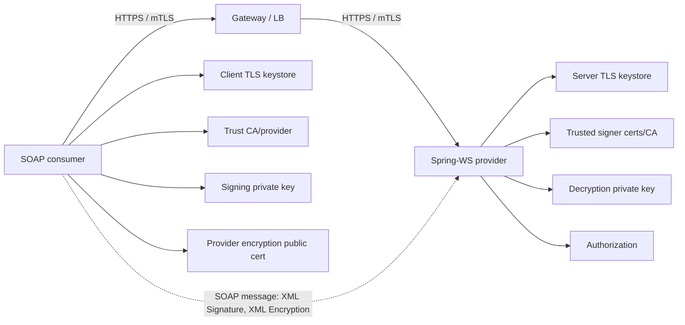
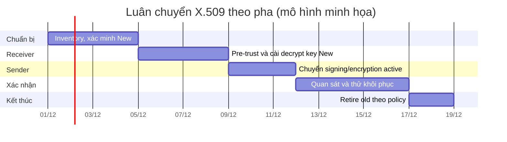
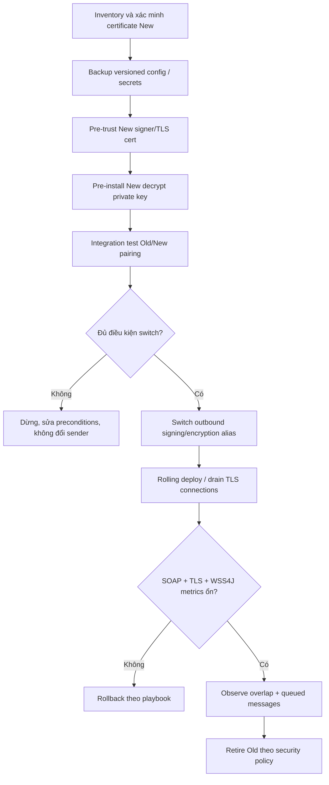
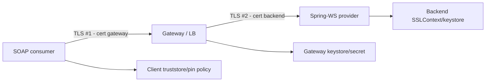
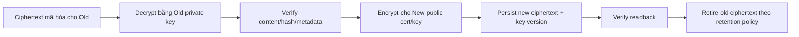

# Luân chuyển chứng chỉ, giai đoạn chuyển tiếp và khôi phục cấu hình

## 1. Vì sao thay chứng chỉ trong hệ thống SOAP là một thay đổi có rủi ro?

Trong hệ thống **Spring Web Services (Spring-WS)** tích hợp theo hướng **contract-first**, XSD/WSDL đảm bảo cấu trúc SOAP request/response, nhưng tính liên tục của tích hợp còn phụ thuộc **chứng chỉ X.509, khóa riêng, keystore, truststore, TLS/mTLS và WS-Security**. Một chứng chỉ có hạn sử dụng; một khóa có thể bị lộ; một CA bị thay; đối tác thay máy chủ hoặc đổi chính sách thuật toán. Nếu hệ thống chỉ chạy được với **một chứng chỉ duy nhất** và đợi đến ngày hết hạn mới thay, một lần chuyển đổi không đồng bộ có thể khiến mọi SOAP call thất bại.

Các tình huống thực tế:

- Đối tác đổi **HTTPS server certificate** trước khi ứng dụng cập nhật truststore/pinning: HTTP handshake thất bại, request chưa tới SOAP endpoint.
- Ứng dụng đổi **mTLS client certificate** nhưng phía đối tác chưa thêm identity mới vào allowlist: TLS handshake hoặc authorization bị từ chối.
- SOAP provider thay **chứng chỉ/khóa để ký XML**; SOAP client vẫn chỉ tin signer cũ: `wsse:Security` signature hợp lệ về mặt toán học nhưng bị reject vì trust policy.
- SOAP client bắt đầu **mã hóa SOAP Body bằng public key mới của provider**, trong khi provider chưa có private key tương ứng: `xenc:EncryptedKey` không giải mã được.
- Key cũ bị xóa ngay sau rollout, nhưng các SOAP messages trong queue vẫn được mã hóa cho public key cũ: nội dung tồn đọng có thể **không thể giải mã**.
- Rollback một application version nhưng không khôi phục đồng bộ certificate alias, secret version, WSS4J Crypto, HTTP client TLS context và proxy route: phiên bản cũ khởi động nhưng tích hợp vẫn hỏng.

Vì vậy, luân chuyển chứng chỉ (*certificate/key rotation*) phải được xem là **thay đổi giao thức bảo mật có phối hợp**, không chỉ là thay một tệp `.p12`.

### Mục tiêu

Sau bài, bạn có thể:

1. Phân biệt chứng chỉ/khóa cho HTTPS, mTLS, XML Signature và XML Encryption.
2. Lập inventory: key alias, thumbprint, issuer, SAN, EKU, `notBefore/notAfter`, trust anchors, đối tác, nơi triển khai.
3. Thiết kế **giai đoạn chuyển tiếp/overlap**: thêm khả năng tin cậy và giải mã trước khi đổi bên phát hành/ký/mã hóa.
4. Thực hiện luân chuyển theo pha **prepare → pre-trust → switch → verify → retire**.
5. Hiểu vì sao **ký bằng một khóa nhưng xác minh bằng nhiều khóa**, và **mã hóa cho một người nhận nhưng phải tạm giữ nhiều private keys để giải mã**.
6. Cấu hình Spring-WS/WSS4J, Java keystore/truststore và HTTP TLS client theo phiên bản đang chạy.
7. Thiết kế rollback và khôi phục an toàn, kể cả khi chứng chỉ bị lộ hoặc hết hạn.
8. Kiểm thử positive/negative cases, certificate rotation trong multi-instance, SOAP Fault và interoperability.
9. Tạo runbook vận hành với monitoring, security owner, change window và bằng chứng hoàn tất.

**Phạm vi:** bài tập trung vào việc **luân chuyển và khôi phục chứng chỉ/khóa trong SOAP integration**. Các giá trị alias, tên file, certificate fingerprint và URL đều minh họa; không dùng khóa thật hay mật khẩu thật trong source. Các API và cơ chế reload có thể khác theo phiên bản Spring Boot, Spring-WS, Apache WSS4J, servlet container và HSM. Phải kiểm chứng trên BOM và hạ tầng thực.

## 2. Bốn đường sử dụng chứng chỉ thường bị nhầm lẫn

Một SOAP service có thể cần bốn loại identity/trust trên những đường khác nhau:

| Tình huống | Ai giữ private key? | Ai giữ/trust public cert? | Được dùng lúc nào? |
|---|---|---|---|
| HTTPS server certificate | SOAP provider hoặc gateway/load balancer | SOAP client tin qua CA/PKIX hoặc pinning policy | TLS handshake tới endpoint |
| mTLS client certificate | SOAP client | SOAP server/gateway tin qua CA/allowlist/identity policy | TLS handshake xác thực client |
| WS-Security XML Signature | Bên **ký** SOAP request/response | Bên **nhận** dùng signer cert + trust policy để xác minh | WSS4J sign/verify SOAP message |
| WS-Security XML Encryption | Bên **nhận** giữ private decrypt key | Bên **gửi** dùng public encryption cert của receiver | Mã hóa/gỡ mã hóa SOAP parts |

Điểm khác biệt lớn nhất:

- **Ký:** sender dùng **private key của sender**, receiver dùng **public key/certificate của sender** để xác minh.
- **Mã hóa:** sender dùng **public key/certificate của receiver**, receiver dùng **private key của receiver** để giải mã.
- **TLS server cert:** người gọi xác minh danh tính HTTPS server thông qua trust/hostname.
- **mTLS client cert:** server xác minh client ở tầng kết nối, có thể khác với chứng chỉ ký XML trong SOAP Header.

Một cặp khóa có thể được tái sử dụng trong nhiều mục đích ở hệ thống legacy, nhưng điều đó **không phải mặc định tốt**. Nên phân tách khóa TLS, signing và encryption theo key usage/EKU, scope và blast radius, nếu policy/đối tác hỗ trợ. Không dùng certificate cấp cho `serverAuth` để tự động hợp thức hóa XML signing chỉ vì key material trông giống nhau.

### 2.1. Sơ đồ các trust boundaries



Gateway có thể **terminate TLS**, nghĩa là chứng chỉ được trình bày ở biên ngoài không nhất thiết được cấu hình tại Spring-WS servlet. Trong khi đó, **WS-Security là ở mức SOAP message** và có thể được provider/WSS4J kiểm tra sau gateway. Vì vậy, trước khi luân chuyển cần biết chính xác **chứng chỉ nằm ở đâu và được dùng cho đường nào**.

### 2.2. Không đồng nhất chứng chỉ với private key

Một `.crt`/`.cer` thường chỉ chứa **public certificate**. Một `.p12`/`.pfx` có thể chứa private key, certificate chain và các entries khác, tùy cách tạo. `.jks` là keystore format truyền thống của Java. PEM có thể chứa certificate, chain hoặc key, cần phân biệt rõ.

- Thêm certificate mới vào truststore **không đồng nghĩa** có private key để ký/giải mã.
- Cài private key mới trong keystore **không đồng nghĩa** đối tác đã trust certificate tương ứng.
- Một certificate mới có cùng Subject CN **không phải** cùng khóa hay cùng identity đã được đối tác cho phép.
- Một certificate còn trong hạn **không chắc** thỏa chính sách tên miền, EKU, key usage hoặc revocation.

## 3. Luân chuyển không chỉ do hết hạn

Các tác nhân thường kích hoạt rotation:

1. **Sắp hết hạn:** `notAfter` đang tiến gần ngày hiệu lực cuối.
2. **Thay khóa chủ động:** giảm thời gian sử dụng private key, nâng thuật toán/kích thước khóa.
3. **Nghi ngờ lộ khóa:** private key hoặc keystore password có thể bị truy cập trái phép.
4. **Đổi CA:** CA cũ sắp hết hạn/bị thu hồi, chuyển trust chain.
5. **Đổi hostname/endpoint:** SAN của TLS certificate cần đổi.
6. **Đổi partner identity:** service account, tenant, certificate pinning hay issuer policy mới.
7. **Nâng security profile:** thay thuật toán XML Signature, encryption key-transport hoặc WS-SecurityPolicy.
8. **Đổi môi trường:** chuyển SOAP endpoint sang gateway, service mesh, HSM/KMS hay cloud LB.
9. **Thu hồi bắt buộc:** cert bị revoke hoặc policy cấm key/algorithm yếu.
10. **Diễn tập khôi phục:** xác nhận khả năng phục hồi dù key store bị hỏng/mất.

Không dùng một runbook duy nhất cho mọi tác nhân. Với **rotation thông thường**, overlap giúp tránh gián đoạn. Với **compromise**, giữ khóa/cert bị lộ hoạt động trong overlap có thể không chấp nhận được; ưu tiên thu hồi, cô lập và xử lý incident theo policy ngay cả khi cần downtime có kiểm soát.

### 3.1. Hai rủi ro cần quản trị riêng

- **Availability:** ứng dụng và đối tác có thể tiếp tục gọi SOAP trong giai đoạn thay certificate?
- **Security:** việc chấp nhận cả old/new có kéo dài tuổi thọ một chứng chỉ bị lộ, yếu hoặc bị thu hồi không?

Thiết kế chuyển tiếp phải cân bằng cả hai, có *expiry of the overlap* rõ ràng và bằng chứng mọi bên đã chuyển xong.

## 4. Inventory và ownership trước khi thay đổi

Trước khi tạo khóa/chứng chỉ mới, phải biết những đối tượng nào đang phụ thuộc vào certificate hiện tại. Một bảng inventory mẫu:

| Trường | Ví dụ minh họa | Ý nghĩa |
|---|---|---|
| Partner/Service | `OrderPartner-A` | Đối tác tích hợp |
| Contract/endpoint | `CancelOrder v1`, `https://partner.example.org/ws` | Operation/URL liên quan |
| Purpose | `TLS server` / `mTLS client` / `XML sign` / `XML decrypt` | Không thay nhầm loại |
| Owner | Platform Security + Integration Team | Người phê duyệt/triển khai |
| Deployment point | LB, Spring Boot, WSS4J, sidecar, HSM | Nơi thực dùng khóa |
| Key alias | `signing-2026a` | Tên để chọn private key/public cert |
| Certificate serial | Serial từ X.509 | Định danh certificate theo issuer |
| SHA-256 fingerprint | Fingerprint được tính lại | Đối chiếu cert nhận từ đối tác |
| Subject/SAN/Issuer | Host/partner identity | Xác minh danh tính và chain |
| `notBefore/notAfter` | Thời hạn thực của certificate | Lịch rotation/cảnh báo |
| Key usage/EKU | digitalSignature, keyEncipherment, clientAuth/serverAuth... | Mục đích được phép |
| Trust source | CA bundle, pinned certificate | Policy tin cậy |
| Password source | Secret manager/HSM | Tuyệt đối không lưu plaintext trong bảng |
| Consumers | Các SOAP clients/providers/reports | Ai bị ảnh hưởng |
| Rotation deadline | Trước hết hạn và trước change freeze | Kế hoạch deployment |
| Rollback artifact | Phiên bản keystore/truststore/secret | Khôi phục cấu hình đồng bộ |

**Không đặt password hoặc private key vào inventory.** Chỉ lưu secret *reference* (tên secret/version ID với kiểm soát truy cập), certificate fingerprints và metadata đủ để xác minh.

### 4.1. Fingerprint không thay thế trust validation

SHA-256 fingerprint giúp xác nhận tệp certificate nhận được đúng bản đã được trao đổi qua kênh xác thực. Nhưng fingerprint không tự chứng minh certificate chain được chấp thuận, hostname hợp lệ, issuer được tin, revocation OK hoặc private key không bị lộ.

Nếu dùng certificate pinning, fingerprint/thay key phải được cập nhật **có overlap** hoặc policy pin set được chuyển trước, tránh tự khóa tất cả SOAP clients.

### 4.2. WSDL và policy có thể ảnh hưởng rotation

XSD/WSDL thường mô tả **SOAP Body và binding**, không mang private key. Tuy nhiên, một số WSDL/policy metadata, security bootstrap hoặc partner config **có thể công bố certificate identity/policy**.

Do đó phải rà xem:

- WS-SecurityPolicy có yêu cầu riêng về X.509 token, signed/encrypted parts, algorithms hay issuer?
- WSDL hoặc policy có nhúng/tham chiếu cert công khai nào cần cập nhật?
- Partner có pin một leaf cert/subject/issuer/serial/thumbprint trong cấu hình riêng không?
- Endpoint address/SNI có đổi cùng certificate hay không?
- Generated SOAP clients có đóng gói truststore trong artifact không?

Không thay đổi XSD/WSDL chỉ để «đổi khóa» khi hợp đồng message không đổi; nhưng nếu policy/identity được publish, phải version và đồng bộ metadata có liên quan.

## 5. Quy tắc nền tảng: bên nhận phải sẵn sàng trước khi bên gửi đổi

Trong rotation thông thường không bị compromise, nguyên tắc quan trọng nhất:

> **Pre-trust / pre-decrypt trước, switch sender sau, retire old cuối.**

### 5.1. Với XML Signature

Bên gửi **chỉ chọn một active signing key** cho từng message trong nhiều hệ thống, nhưng bên nhận có thể cấu hình **tin cả signer cũ và mới** trong overlap (khi chính sách cho phép).

```text
Ban đầu:
  Sender signs Old
  Receiver verifies Old

Giai đoạn pre-trust:
  Sender signs Old
  Receiver verifies Old + New

Giai đoạn switch:
  Sender signs New
  Receiver verifies Old + New

Giai đoạn kết thúc:
  Sender signs New
  Receiver verifies New
```

**Nếu sender đổi sang New trước khi receiver tin New**, WSS4J sẽ từ chối ngay cả khi chữ ký hợp lệ về mặt mật mã.

### 5.2. Với XML Encryption

Bên gửi **mã hóa cho public key của receiver**. Trong overlap, receiver phải có **private decrypt key tương ứng với cả Old và New** nếu còn messages được mã hóa bằng hai khóa.

```text
Ban đầu:
  Sender encrypts for Receiver Old public key
  Receiver decrypts with Old private key

Chuẩn bị:
  Receiver installs Old + New private keys
  Sender still encrypts for Old public key

Switch:
  Sender encrypts for New public key
  Receiver can decrypt Old + New messages

Kết thúc:
  Sender encrypts for New
  Receiver removes Old decrypt key only after drain/retention policy
```

Khác biệt quan trọng: **xác minh chữ ký** chỉ cần public cert/trust, nhưng **giải mã messages lịch sử/tồn đọng** cần private decrypt key cũ. Nếu xóa key cũ quá sớm mà không có key escrow/retention được bảo vệ theo policy, những messages tồn đọng có thể mất khả năng phục hồi.

### 5.3. Với TLS server certificate

Bên xác minh (SOAP client) cần tin CA/chain/leaf mới theo trust/pinning policy **trước** khi HTTPS endpoint thay certificate. Trong thời gian triển khai phân tán, các LB nodes có thể trình bày cert Old hoặc New; client phải xử lý được cả hai nếu overlap được cho phép.

Mỗi TLS connection được xác thực khi handshake. Keep-alive connections đã thiết lập **không tự động handshake lại** ngay khi server đổi certificate. Kiểm thử phải tạo **new TLS connections** để xác minh cert mới, không chỉ tái sử dụng connection pool cũ.

### 5.4. Với mTLS client certificate

SOAP provider/gateway phải cập nhật CA/allowlist/identity mapping để chấp nhận **New client certificate** trước khi client chuyển key alias active. Nếu client rollout theo nhiều replicas, trong overlap các replicas có thể trình bày Old/New cùng lúc. Server phải chấp nhận đúng hai identity đó theo policy, **không mở trust wildcard** cho mọi client cert.

## 6. Giai đoạn chuyển tiếp (overlap) gồm những trạng thái nào?

Một kế hoạch rotation có thể diễn tả bằng ma trận:

| Trạng thái | Đang ký request | Receiver trust signer | Bên gửi mã hóa tới | Receiver có decrypt key | Kết quả |
|---|---|---|---|---|---|
| S0 — ban đầu | Old | Old | Old | Old | Hoạt động |
| S1 — pre-provision | Old | Old + New | Old | Old + New | Hoạt động; sẵn sàng đổi |
| S2 — rolling switch | Old hoặc New | Old + New | Old hoặc New | Old + New | Hoạt động nếu hai phía đủ khả năng |
| S3 — ổn định | New | Old + New | New | Old + New | Quan sát và xác nhận |
| S4 — retire | New | New | New | New* | Hoạt động, đã dọn Old |

Dấu `*`: chỉ được bỏ old decrypt key khi **không còn bất kỳ message phải giải mã bằng Old** trong các queue, retry, storage, disaster recovery hay retention path. Một số hệ thống phải giữ old private key ở **kho lưu trữ bảo mật phục vụ giải mã dữ liệu lịch sử** lâu hơn thời gian chấp nhận old signer cho request mới.

### 6.1. Timeline minh họa



Các ngày là **giả định minh họa**; production phải tính theo `notAfter`, chứng chỉ đối tác thực, thời gian cần cho change approvals, buffer trước expiry, phân phối cho nhiều regions/replicas và độ trễ queue.

### 6.2. Không coi overlap là chấp nhận vô thời hạn

- Đặt ngày bắt đầu và **điều kiện kết thúc** overlap.
- Giới hạn trust chỉ với old/new certs/trust anchors được phê duyệt.
- Tăng giám sát nếu old signer còn xuất hiện sau switch.
- Khi thực sự xác nhận migration, thu hồi quyền sử dụng signing alias old, loại old trust khỏi active verification policy theo lịch.
- Lưu bằng chứng khả năng giải mã dữ liệu lịch sử trước khi hủy decrypt key.
- Nếu phát hiện compromise, đổi sang incident response thay vì giữ overlap «để an toàn vận hành».

## 7. Runbook tổng thể: prepare → pre-trust → switch → verify → retire



### 7.1. Pha 0 — Phê duyệt, inventory, chuẩn bị khôi phục

1. Xác định **owner** của SOAP client/server, gateway, certificates, secrets, WSS4J crypto, key management và đối tác.
2. Thu thập SHA-256 fingerprint, serial, Subject, SAN, issuer, `notAfter`, key usage/EKU và alias hiện tại.
3. Chụp inventory đầy đủ routes/operations/partners phụ thuộc; kiểm tra signed/ encrypted message policy.
4. Lấy xác nhận từ partner về lịch đổi, cert mới, trust profile và acceptance test.
5. Tạo **versioned immutable artifacts**: keystore/truststore mới, config commit/secret version reference, rollback version.
6. Backup old keys/config **theo security policy** (encrypted, least privilege), không copy private keys ra chat/log hoặc máy không được quản lý.
7. Lập thời gian change window, go/no-go criteria, metrics trước thay đổi và người có quyền rollback.
8. Kiểm tra thời hạn old certificate còn đủ cho rollback trong một khoảng xác định; **đừng dùng expired/revoked key làm rollback plan**.

### 7.2. Pha 1 — Sinh và xác minh New

1. Sinh **keypair mới** theo chính sách (không chỉ reissue cert với khóa cũ nếu rotation yêu cầu đổi key).
2. Tạo CSR với Subject/SAN/KeyUsage/EKU đúng mục đích.
3. CA/PKI cấp chứng chỉ, xuất public cert+chain.
4. Xác minh fingerprint qua kênh độc lập đáng tin.
5. Kiểm tra chứng chỉ và private key matching; kiểm tra trust path, algorithm, EKU, hostname/partner identity.
6. Lưu New key trong HSM/KMS hoặc keystore bảo vệ, alias rõ ràng như `signing-2026b`.
7. Không thay alias Old đang dùng trước khi readiness hoàn tất.

### 7.3. Pha 2 — Cập nhật bên nhận trước

- SOAP receiver validation: thêm New signer certificate/CA hoặc pin thích hợp; giữ Old khi overlap cho phép.
- SOAP receiver decryption: cài New private decrypt key, **giữ Old** để xử lý messages đang chờ.
- HTTPS SOAP client: cập nhật trust chain/pin policy để chấp nhận New TLS server cert.
- mTLS provider: cập nhật allowlist/CA/client identity mapping để chấp nhận New client cert.
- Kiểm tra config propagation ở **tất cả** regions/replicas/gateway nodes và không tự dùng trust-all fallback.
- Chạy positive/negative tests cho Old/New và untrusted signer.

### 7.4. Pha 3 — Đổi bên gửi

- Switch alias signing key active từ Old sang New.
- Switch receiver public encryption cert từ Old sang New sau khi receiver xác nhận có private key.
- Switch mTLS client key alias sau khi phía server đã pre-trust.
- Gateway đổi TLS server certificate sau khi các clients đã hỗ trợ New trust chain.
- Dùng rolling/canary deployment và đánh dấu identity/certificate version trong telemetry **không lộ secret**.
- Đảm bảo SOAP action, JAXB/XSD, WSDL publication, SOAP endpoint URL và WS-Security signed parts không vô tình thay đổi khi chỉ rotate certificate.

### 7.5. Pha 4 — Verify và đo lường

- Test handshake **mới** của TLS/mTLS từ các client locations thực.
- Gửi signed/encrypted SOAP request từ canary, xác minh cả SOAP response/Fault.
- Theo dõi invalid signature, untrusted cert, decrypt failure, TLS handshake, expired timestamp, replay, 4xx/5xx/SOAP Fault rates.
- Kiểm tra queues/retries/async pipeline còn messages mã hóa cho Old không.
- Kiểm tra partner đã chuyển New ở tất cả sources và có thể gọi qua cả region/failover endpoint.
- Không kéo sang retire cho đến khi dữ liệu và kết quả test chứng minh tất cả điều kiện đã đạt.

### 7.6. Pha 5 — Retire Old

1. Chặn sinh chữ ký mới bằng old signing alias.
2. Loại Old khỏi **active signer trust** khi không còn nguồn hợp lệ sử dụng Old và policy cho phép.
3. Loại old TLS pin/identity allowlist theo kế hoạch.
4. Ngừng cấp Old encryption cert cho outbound messages.
5. Giữ old decrypt key trong kho bảo mật nếu cần giải mã historical/queued payloads; không dùng nó để ký message mới.
6. Cập nhật inventory, audit trail, certificate expiry alerts và runbook.
7. Xóa/archive secrets/version theo retention/incident response policy, không xóa khóa không thể khôi phục một cách tùy tiện.

## 8. Kiểm tra chứng chỉ/keystore không làm lộ private key

### 8.1. Quan sát certificate metadata với OpenSSL

Ví dụ kiểm tra public certificate trên máy được phép vận hành:

```bash
openssl x509 -in partner-new.crt \
  -noout -subject -issuer -serial -dates \
  -fingerprint -sha256

openssl x509 -in partner-new.crt \
  -noout -ext subjectAltName

openssl x509 -in partner-new.crt \
  -noout -ext keyUsage

openssl x509 -in partner-new.crt \
  -noout -ext extendedKeyUsage
```

Các lệnh trên chỉ đọc **public cert**. Với certificate chain, kiểm tra chữ ký/path với CA được cấp phát theo chính sách, không kết luận «trusted» từ thông tin `issuer` chỉ vì Subject khớp tên.

### 8.2. Quan sát HTTPS certificate thực của đối tác

```bash
openssl s_client \
  -connect partner.example.org:443 \
  -servername partner.example.org \
  -showcerts \
  -verify_hostname partner.example.org \
  -verify_return_error \
  -CAfile trusted-ca-chain.pem
```

Lệnh trên giúp quan sát TLS handshake và certificate chain với **trust anchors đã được xác thực**. Khi server yêu cầu mTLS, cần thêm client cert/key hợp lệ theo profile; không lưu private key ở đường dẫn hoặc thư mục không được phép. Kiểm tra rằng endpoint đã kết nối là đúng SNI/hostname, không chỉ một IP mặc định.

**Không đánh đồng** thành công TLS handshake với thành công WS-Security XML Signature; hai lớp hoạt động độc lập.

### 8.3. Kiểm tra metadata Java PKCS#12 keystore

```bash
keytool -list -v \
  -storetype PKCS12 \
  -keystore /secure/config/soap-client-keys.p12 \
  -alias signing-2026b
```

`keytool` sẽ yêu cầu password nếu cần; **không đưa password vào shell command history** dưới dạng `-storepass plaintext`. Đầu ra có thể gồm certificate chains và metadata; không đưa lên ticket/chat công khai nếu policy cấm.

### 8.4. Kiểm tra serial, fingerprint và key matching

Một chứng chỉ mới cần được đối chiếu:

- SHA-256 fingerprint do người/PKI đáng tin gửi qua kênh độc lập.
- Subject/SAN đúng service/partner identity.
- Issuer và chain tới CA được chấp thuận.
- `notBefore` đã hiệu lực, `notAfter` cho đủ thời gian rollout.
- KeyUsage/EKU đúng TLS client/server hoặc XML signing/encryption purpose.
- Public key trong certificate khớp private key entry dự kiến ở keystore/HSM.
- Alias/token reference được SOAP/WSS4J chọn là đúng key, không phải một entry trùng tên khác.

**Không xuất private key ra file chỉ để «đối chiếu cho nhanh»**. Dùng keystore/HSM API để kiểm tra sở hữu khóa bằng operation sign/verify trên dữ liệu test, hoặc dùng quy trình PKI được phê duyệt.

## 9. Versioned configuration và bí mật: không sửa file sống trực tiếp

Trong triển khai ổn định, tránh ghi đè trực tiếp keystore đang được ứng dụng sử dụng bằng một thao tác «copy file» chưa atomic.

Một layout khái niệm:

```text
/secure/soap/
  keystores/
    soap-keys-v2026a.p12
    soap-keys-v2026b.p12
  trust/
    partners-v2026a.p12
    partners-v2026b.p12

Externalized config (secret references):
  signingKeyAlias: signing-2026b
  keyStoreRef: secret://soap-client-keys/v2026b
  verifyTrustRef: secret://partner-trust/v2026b
  encryptRecipientAlias: partner-encrypt-2026b
```

Các đường dẫn, secret refs là **mô tả mô hình**, không phải syntax mặc định của Spring Boot/WSS4J. Ứng dụng phải có binding và khả năng đọc secret store tương ứng.

### 9.1. Tính atomic của rollout

Một switch cần đổi đồng bộ:

- Phiên bản keystore/truststore.
- Key alias đang được WSS4J dùng.
- Encryption recipient certificate alias.
- TLS SSLContext/trust manager/key manager hoặc SSL bundle reference.
- Container/ingress/gateway secrets và reload policy.
- Monitoring label và deployment revision.

Nếu đổi alias trước khi bản keystore chứa alias đó xuất hiện trên tất cả replicas, một số nodes sẽ fail signing. Nếu chỉ cập nhật truststore nhưng HttpClient vẫn giữ SSLContext cũ, HTTPS requests có thể tiếp tục bị từ chối khi tạo connection mới.

### 9.2. Không tự giả định live reload

Các thay đổi trên đĩa hoặc Secret Manager **không chắc được JVM áp dụng ngay**:

- Java `KeyStore` đã load có thể vẫn là object cũ trong memory.
- WSS4J `Crypto` instance có thể giữ keystore/cert lookup đã khởi tạo.
- SSLContext/KeyManager/TrustManager có thể đã được tạo từ store cũ.
- Existing pooled HTTPS connections không tự handshake lại.
- Gateway/Ingress có cơ chế reload certificate riêng.
- Spring Boot SSL bundles có khả năng hỗ trợ reload ở một số versions/stacks, nhưng **không phải mọi consumer tự reload**.

Phải xác định rõ transport/WS-Security component hỗ trợ **hot reload**, **atomic swap**, **rolling restart** hay **full restart**. Sau reload, test một **new TLS handshake** và một **new SOAP message signature**, không chỉ gọi lại operation trên connection keep-alive cũ.

### 9.3. Đừng lưu secrets trong properties thường

Anti-pattern:

```yaml
# Không làm: ví dụ không an toàn
soap:
  keystore-password: "plaintext-production-password"
  private-key-password: "same-password-in-git"
```

Dùng secret manager/HSM hoặc encrypted configuration với quyền truy cập hẹp, audit và rotation secret credentials. Không in đường dẫn private key, keystore passwords hoặc toàn WSS4J Crypto properties vào debug logs.

## 10. Cấu hình Spring-WS/WSS4J theo alias cũ/mới

Với Spring-WS sử dụng Apache WSS4J, certificate rotation có thể ảnh hưởng **hai cấu hình khác nhau**: chọn local private key khi securement và chọn trusted partner certificates khi validation. Chúng không thay thế lẫn nhau.

### 10.1. Phía client: signing alias active

Một cấu hình minh họa (Spring-WS/WSS4J; tên API cần kiểm tra trên phiên bản sử dụng):

```java
import org.apache.wss4j.common.crypto.Crypto;
import org.springframework.context.annotation.Bean;
import org.springframework.ws.soap.security.wss4j2.Wss4jSecurityInterceptor;

@Bean
public Wss4jSecurityInterceptor outboundWss4j(
        Crypto localSigningCrypto) {

    Wss4jSecurityInterceptor interceptor =
        new Wss4jSecurityInterceptor();

    interceptor.setSecurementActions("Timestamp Signature");
    interceptor.setSecurementSignatureCrypto(localSigningCrypto);

    // Tùy giai đoạn rollout, alias sẽ là Old hoặc New.
    interceptor.setSecurementSignatureUser("signing-2026b");

    // Password callback/private key unlock do secret manager cấp.
    // Không hard-code private key password ở đây.
    return interceptor;
}
```

Tại thời điểm pre-trust, receiver đã chấp nhận signer New, nhưng client còn dùng `signing-2026a`. Chỉ khi partner readiness và canary test PASS mới đổi sang `signing-2026b`.

**`setSecurementSignatureUser(...)` chọn alias ký outbound**; nó không tự thêm signer New vào truststore của SOAP partner. Để đổi trust, phải cập nhật **validation Crypto** ở phía nhận.

### 10.2. Phía provider: validate nhiều signer trong overlap

```java
@Bean
public Wss4jSecurityInterceptor inboundWss4j(
        Crypto trustedOldAndNewSigners) {

    Wss4jSecurityInterceptor interceptor =
        new Wss4jSecurityInterceptor();

    interceptor.setValidationActions("Timestamp Signature");
    interceptor.setValidationSignatureCrypto(
        trustedOldAndNewSigners);

    return interceptor;
}
```

`trustedOldAndNewSigners` là một `Crypto` được provision theo chính sách tin cậy **chỉ những identities/CA/leaf certs được phê duyệt**. Tên «OldAndNew» mô tả mục tiêu; nó **không phải** lệnh WSS4J tự động chấp nhận mọi certificate trong một directory.

Ngoài xác minh chữ ký, phải xác nhận:

- SOAP Body thực và headers cần thiết thuộc signed parts.
- Cert New đại diện **cùng partner identity được ủy quyền** hoặc partner ID mới đã được duyệt.
- Chuỗi cert và key usage/EKU/revocation phù hợp.
- Timestamp, nonce và replay checks chạy đúng.
- Operation cụ thể được principal xác thực cho phép.

Một signature hợp lệ theo một certificate self-signed do attacker gửi lên **không được** coi là trusted.

### 10.3. Outbound encryption: recipient cert alias

Nếu SOAP client encrypt Body cho provider:

```java
interceptor.setSecurementActions(
    "Timestamp Signature Encrypt");
interceptor.setSecurementSignatureCrypto(localSigningCrypto);
interceptor.setSecurementSignatureUser("signing-2026b");

interceptor.setSecurementEncryptionCrypto(
    trustedRecipientEncryptionCrypto);
interceptor.setSecurementEncryptionUser(
    "partner-encrypt-2026b");
```

Fragment này giả định crypto/alias đã được xác minh, và việc sign/encrypt parts + action order phù hợp WS-SecurityPolicy. Nó **không cung cấp private key của provider**; bên gửi chỉ cần public encryption certificate của đối tác.

### 10.4. Inbound decryption: giữ private keys cần thiết

```java
interceptor.setValidationActions(
    "Timestamp Signature Encrypt");
interceptor.setValidationSignatureCrypto(
    trustedOldAndNewSigners);
interceptor.setValidationDecryptionCrypto(
    localDecryptionCrypto);
```

Trong overlap, `localDecryptionCrypto` cần có khả năng tìm đúng private key **Old hoặc New** theo key identifier/alias/reference nằm trong inbound message, và password/unlock callbacks tương ứng. Việc đưa **hai** private keys vào keystore không đủ nếu resolver/callback/provider luôn trả một alias cứng: phải kiểm thử giải mã thật cả hai cipher payload types.

### 10.5. WSS4J `Crypto` và TLS `SSLContext` là hai cấu hình khác nhau

Ngay cả khi cùng file PKCS#12 được dùng cho cả hai, `Wss4jSecurityInterceptor` và Apache HTTP client/embedded server SSLContext thường có **object lifecycle khác nhau**. Thay WSS4J Crypto không tự reload TLS client cert; thay TLS keystore không tự đổi XML Signature alias.

Vì vậy, runbook phải liệt kê riêng **WSS4J signing/decryption** và **TLS/mTLS** cùng các kiểm thử sau switch.

### 10.6. Truststore không tự tạo «dual signing»

Một SOAP message thường chỉ có một signer chính theo profile đang dùng. Giữ hai signer certificates trong truststore chỉ cho phép **xác minh** Old/New, không khiến sender đồng thời ký hai signatures. Nếu một đối tác yêu cầu dual signatures trong một message, đó là **một thay đổi security profile khác**, cần thiết kế WS-SecurityPolicy và interoperability tests, không suy ra từ dual-trust rotation.

## 11. Luân chuyển TLS server certificate qua gateway và Spring Boot

Với nhiều triển khai SOAP, TLS kết thúc ở **ingress, API gateway hoặc load balancer**, không phải tại `MessageDispatcherServlet`. Vì vậy, trước khi thay keystore cần biết chính xác certificate được trình bày tại **TLS termination point** nào.



Nếu provider sử dụng TLS ở cả hai hops, việc thay cert ở gateway chưa chắc thay cert ở backend. Mỗi hop có SNI, chain/CA, hostname validation, private key, server trust policy và reload lifecycle riêng.

### 11.1. Spring Boot SSL bundle (ví dụ minh họa)

Khi ứng dụng trực tiếp lắng nghe HTTPS, một số phiên bản Spring Boot hỗ trợ SSL Bundles:

```yaml
spring:
  ssl:
    bundle:
      jks:
        soap-server:
          keystore:
            location: file:/secure/tls/soap-server-2026b.p12
            password: ${SOAP_TLS_KEYSTORE_PASSWORD}
            type: PKCS12
server:
  port: 8443
  ssl:
    bundle: soap-server
```

Đây là ví dụ **phụ thuộc phiên bản Spring Boot** và cấu trúc keystore. Một keystore có nhiều private-key entries có thể cần chỉ định alias ở cấu hình SSL bundle/container phù hợp. Không đồng thời khai báo nguồn cấu hình TLS khác như `server.ssl.key-store` rồi giả định framework tự chọn đúng.

- Nếu TLS kết thúc ở gateway, hãy sửa secret/certificate của **gateway** thay vì chỉ sửa bundle ở Spring Boot.
- Nếu cần mTLS, bổ sung trust policy/client-auth đúng stack; ví dụ trên **không tự bật mTLS**.
- Thay tệp PKCS#12 trên đĩa **không bảo đảm** SSLContext hay embedded server đang chạy reload.
- Không dùng trust-all SSL hoặc tắt hostname verification khi đổi CA/certificate.

### 11.2. Kiểm chứng bằng TLS handshake mới

Sau khi server/gateway switch certificate:

1. Mở **TLS connection mới** từ caller dùng truststore giống production; không chỉ gọi qua HTTP keep-alive cũ.
2. Kiểm tra certificate chain, SAN/hostname, issuer, expiry và fingerprint của **certificate trên wire**.
3. Nếu mTLS, kiểm tra server nhận được New client certificate và map đúng account/authorization.
4. Gửi SOAP operation thật với WSDL/QName/SOAPAction phù hợp để xác minh tầng SOAP.
5. Thử trên tất cả ingress nodes, availability zones và failover endpoints.
6. Kiểm tra các TLS pools được drain/refresh theo kế hoạch, không cắt ngang các calls đang xử lý.

**TLS certificate được chọn ở handshake.** Existing pooled connections có thể tiếp tục hoạt động sau khi certificate mới được cài, nên một request thành công trên socket cũ không chứng minh rotation thành công.

### 11.3. Nếu đổi CA/trust anchor

- Pre-provision New CA/intermediate chain trong client truststore trước khi gateway chuyển certificate.
- Với certificate pinning, chuẩn bị pin set Old+New hoặc chuyển pin theo policy, thay vì mở trust wildcard.
- Kiểm tra SAN và key usage/EKU theo server authentication, không chỉ Subject CN.
- Với cross-signed intermediates, Java/JDK và các HTTP clients khác có thể xây trust path khác nhau: test **actual JVM**.
- Khi CA Old bị thu hồi/không còn tin cậy, không giữ lại vô thời hạn vì muốn giảm downtime.

## 12. mTLS client certificate: trust và identity mapping

Khi SOAP client trình bày mTLS client certificate:

```text
Client private key + client certificate
    ↓ TLS handshake
Partner gateway/server validates CA/allowlist + identity
    ↓
SOAP request delivered to Spring-WS endpoint
```

Một trình tự an toàn:

1. Partner pre-register New client certificate hoặc CA/identity mapping, vẫn chấp nhận Old trong overlap nếu policy cho phép.
2. Xác minh New cert có chain, key usage và `clientAuth` EKU đúng; subject/SAN/identity mapping được phê duyệt.
3. Client chuẩn bị versioned keystore chứa New private key + certificate chain.
4. Chọn New key alias trên một canary, tạo **new TLS handshake**.
5. Kiểm tra partner không chỉ xác thực chain mà còn cấp đúng account/tenant/operation permissions.
6. Rolling deploy các replicas; partner chấp nhận cả Old/New đúng danh sách.
7. Quan sát authentication/authorization errors và các SOAP calls.
8. Chỉ sau khi hết sử dụng Old mới loại Old khỏi allowlist/trust theo lịch.

**Một certificate chain hợp lệ chưa chứng minh client được phép gọi operation.** Nhiều gateways pin certificate theo serial/fingerprint, Subject hoặc một account mapping; cert New cần được đăng ký tường minh nếu dùng pinning.

### 12.1. Chọn alias mTLS không phải chọn alias WSS4J

Trong Java, `KeyManager`/`SSLContext` có thể chọn client certificate theo issuer/key algorithm và keystore configuration. WSS4J lại chọn private key dùng XML Signature bằng `securementSignatureUser`. Hai cơ chế có thể dùng **các certificates khác nhau** dù chung một tệp PKCS#12.

Không tự coi việc đổi XML signing alias là đã đổi mTLS certificate. Nếu cần chọn mTLS alias có chủ đích, kiểm tra cấu hình SSL bundle/container/custom KeyManager đúng phiên bản; không dùng một `X509TrustManager` «tin mọi server» để chữa lỗi alias.

## 13. Rollback hay roll forward khi switch thất bại?

**Rollback cấu hình** không đồng nghĩa luôn được quay lại **khóa/certificate cũ**. Điều kiện phụ thuộc certificate Old có còn hợp lệ, còn được trust và không bị compromise hay không.

### 13.1. Điều kiện bắt đầu switch (go/no-go)

| Preconditions | Nếu không đạt |
|---|---|
| Fingerprint và identity New xác minh độc lập | Không dùng New |
| Có New private key đúng alias/không lộ | Không chuyển ký/giải mã |
| Receiver pre-trust signer New | Không đổi signing alias |
| Receiver đã cài New decrypt private key | Không đổi recipient encryption cert |
| SOAP client đã tin TLS server cert/chain New | Không đổi gateway TLS cert |
| mTLS partner đã allowlist cert New | Không đổi client TLS alias |
| Reload/rolling restart plan có test | Không chuyển |
| Positive + negative integration tests PASS | Không chuyển |
| Monitoring/runbook và owner sẵn sàng | Không chuyển |

### 13.2. Khi rollback về Old còn được phép

Có thể rollback signer/transport sang Old **chỉ khi** Old chưa hết hạn, không bị revoke/compromised và partner còn chấp nhận Old. Các bước:

1. Dừng canary/rolling rollout.
2. Đổi active signing alias về Old bằng **bản cấu hình/secret version đã duyệt**.
3. Giữ receiver trust Old+New trong khi New-signed messages có thể vẫn đang đến.
4. Nếu đã mã hóa cho New recipient, vẫn **giữ New private decrypt key** để nhận messages New bị trễ.
5. Nếu TLS/mTLS alias rollback, kiểm tra bằng handshake mới, không dựa trên keep-alive cũ.
6. Xác minh SOAP signature/encryption, response/Fault và domain operation thành công.
7. Theo dõi metrics đến khi ổn định; ghi root cause và timestamps của thay đổi.

**Không** xóa New decrypt key ngay khi rollback outbound encryption alias, vì queue có thể còn ciphertext được mã hóa cho New.

### 13.3. Khi không được quay lại Old

Nếu Old đã hết hạn, bị revoke hoặc nghi lộ private key:

- Không «bật lại» Old trust/signing bằng cách bỏ qua validation.
- Cô lập traffic và kích hoạt incident response theo mức độ.
- Phát hành Emergency/New certificate, trao đổi fingerprint/trust an toàn với partner.
- Kiểm tra nội dung đã ký/mã hóa bằng khóa bị ảnh hưởng, phát hiện forgery/replay nếu cần.
- Chuyển sang **roll forward** với cấu hình được khắc phục, hoặc chấp nhận planned downtime có kiểm soát.
- Đưa việc khôi phục ciphertext/keys cũ vào quy trình chuyên biệt với phê duyệt security.

Không dùng trust-all hoặc tắt WS-Security validation để «khôi phục» bằng mọi giá.

### 13.4. Roll forward đôi khi ít rủi ro hơn

Nếu New cert hợp lệ nhưng một vài nodes phía đối tác chưa pre-trust, team có thể:

1. Dừng mở rộng canary.
2. Bổ sung New trust ở các nodes còn thiếu.
3. Xác minh toàn bộ regions.
4. Tiếp tục rollout nếu security profile và change owner chấp thuận.

Quyết định phải dựa trên root cause/capacity/security incident status, không phải một nút «revert deployment» chung cho mọi tình huống.

## 14. Giữ khóa giải mã cũ cho messages tồn đọng

Khác với xác minh chữ ký (dùng **public cert**), giải mã message đã mã hóa cần **private key tương ứng với public cert đã được dùng**.

Các nơi còn ciphertext mã hóa cho Old:

- Message broker queues, delayed/retry queues và dead-letter queues.
- Database outbox hoặc SOAP request/response archives được lưu encrypted.
- Scheduled batch jobs chưa chạy.
- Backup/snapshot hoặc disaster-recovery region.
- In-flight requests khi receiver đổi keys.
- MTOM/WS-Security encrypted attachments khi security profile có bảo vệ attachment.

### 14.1. Tiêu chí retire private decrypt key

Không xóa Old private decrypt key chỉ vì các clients đã bắt đầu dùng New. Trước khi retire cần xác minh:

1. Không còn outbound producers phát hành ciphertext cho Old.
2. Queues/retries đã drain, hoặc có cơ chế nhận Old đến khi TTL kết thúc.
3. Dữ liệu lịch sử cần decrypt được xử lý theo retention/policy.
4. Nếu chuyển dữ liệu, việc decrypt → re-encrypt đã đối chiếu checksum/size.
5. HSM/KMS/keystore backup và disaster-recovery restore đã được test.
6. Khóa Old không bị compromise; nếu bị lộ, incident response có thể yêu cầu ưu tiên containment khác.
7. Có bằng chứng owners đã chấp thuận xóa/archival Old.

Có thể **ngừng sử dụng Old để ký** từ sớm nhưng vẫn giữ private decrypt key Old trong **restricted archive/recovery role** lâu hơn. Điều đó không có nghĩa tiếp tục tin mọi chữ ký mới từ cert Old.

### 14.2. Mẫu re-encryption có kiểm soát



Không xóa dữ liệu cũ trước khi xác minh bản mới được ghi durable; jobs phải idempotent và có audit. Private keys trong HSM có thể **không exportable**, nên recovery phải sử dụng HSM backup/replication APIs chứ không mặc định copy file `.p12`.

## 15. Khôi phục cấu hình có thể tái lập

Một backup chỉ có `keystore-old.p12` là **chưa đủ**. Cần biết alias, trust policy, WSS4J Crypto config, SSLContext/bundle version, partner identity mapping và deployment revision để dựng lại đúng hệ thống.

### 15.1. Recovery manifest (không chứa secret)

```yaml
# Mô hình minh họa, không phải secret:// syntax mặc định của Spring.
environment: production
service: orders-soap-client
deploymentRevision: release-2026-12-r4
tls:
  clientKeyStoreRef: secret://orders-mtls/v2026b
  trustStoreRef: secret://partner-ca/v2026b
  expectedServerName: partner.example.org
wsSecurity:
  signingKeyStoreRef: secret://orders-signing/v2026b
  signingAlias: signing-2026b
  verificationTrustRef: secret://partner-signers/v2026b
  recipientEncryptionCertRef: secret://partner-encrypt/v2026b
  recipientAlias: partner-encrypt-2026b
  profileRevision: wssecurity-orders-v1-r7
rollback:
  previousApprovedRevision: release-2026-12-r3
  requiresOldCertificateStillTrusted: true
```

Mỗi `secret://...` ở đây là **reference minh họa**. Spring Boot/WSS4J không tự hiểu namespace này: cần secret integration của application/platform. Manifest không bao giờ chứa private key hoặc password.

### 15.2. Recovery drill

1. Dựng instance sạch ở môi trường DR/staging được kiểm soát.
2. Lấy manifest và secret versions đã phê duyệt.
3. Khởi tạo keystore, truststore, WSS4J Crypto, SSLContext mà không log secrets.
4. Kiểm tra X.509 fingerprints, aliases và private key access bằng thao tác ký/giải mã test.
5. Mở TLS/mTLS handshake **mới** tới stub hoặc partner được phép.
6. Gửi signed SOAP request và xác minh signed response nếu policy yêu cầu.
7. Giải mã messages thử nghiệm bằng Old và New decrypt keys.
8. Test signer untrusted, timestamp expired và XML Signature Wrapping bị từ chối.
9. Đo thời gian khôi phục, queues/retries và đối chiếu RTO/RPO.
10. Cập nhật runbook và owner, không giữ các secrets tạm sau drill.

Không restore mù một certificate bị revoked/compromised hoặc truststore cũ đã bị loại vì security incident, ngay cả khi manifest cũ vẫn còn.

## 16. Theo dõi thời hạn chứng chỉ và bằng chứng rotation thành công

Có hai câu hỏi khác nhau:

1. **Certificate trong keystore/secret manager** sẽ hết hạn lúc nào?
2. **Certificate thực được phát ra trên wire** bởi gateway, mTLS client hoặc XML Signature là certificate nào?

Chúng có thể khác nhau nếu application chưa reload SSLContext/WSS4J Crypto, alias cấu hình sai, các replicas sử dụng secret version cũ, hoặc HTTP client đang tái sử dụng TLS connection có sẵn.

### 16.1. Kiểm tra certificate metadata với Java

Đoạn Java dưới đây minh họa đọc ngày hết hạn certificate theo alias mà **không đọc private key**:

```java
import java.io.InputStream;
import java.nio.file.Files;
import java.nio.file.Path;
import java.security.KeyStore;
import java.security.cert.Certificate;
import java.security.cert.X509Certificate;
import java.time.Duration;
import java.time.Instant;
import java.util.Arrays;

public final class CertificateExpiryProbe {

    public static long secondsUntilExpiry(
            Path keyStorePath,
            char[] passwordOwnedByCaller,
            String alias) throws Exception {

        char[] password = passwordOwnedByCaller.clone();
        try {
            KeyStore keyStore = KeyStore.getInstance("PKCS12");
            try (InputStream input = Files.newInputStream(keyStorePath)) {
                keyStore.load(input, password);
            }

            Certificate cert = keyStore.getCertificate(alias);
            if (!(cert instanceof X509Certificate x509)) {
                throw new IllegalArgumentException(
                    "Configured X.509 certificate is missing");
            }

            Instant expires = x509.getNotAfter().toInstant();
            return Duration.between(
                Instant.now(), expires).getSeconds();
        } finally {
            Arrays.fill(password, '\0');
        }
    }
}
```

Ví dụ Java 17+ này chỉ kiểm tra **certificate entry được lưu tại alias**, không chứng minh đã trust PKIX/hostname, key usage, revocation hoặc certificate đang được WSS4J/TLS sử dụng. `passwordOwnedByCaller` không bị method xóa vì method tạo bản sao để clear; bản gốc cần được owner của secret quản lý theo lifecycle và không lưu vào log.

### 16.2. Thiết lập cảnh báo theo mốc

Một policy **minh họa**, thay đổi theo thời gian cần CA cấp certificate và partner approval:

| Còn lại trước expiry | Hành động |
|---|---|
| 90 ngày | Xác nhận owner, CA/partner readiness và lịch rotation |
| 60 ngày | Bắt đầu issuance và tổ chức integration tests |
| 30 ngày | Hoàn tất pre-trust + pre-decrypt, sẵn sàng switch |
| 14 ngày | Escalate nếu chưa có New active hoặc blocked |
| 7 ngày | Chuẩn bị emergency change window/contingency |
| 1 ngày | Kích hoạt xử lý khẩn cấp; không chờ chu kỳ vận hành tiếp theo |
| Hết hạn | Không tiếp tục chấp nhận/ký bằng expired certificate ngoài policy; xử lý outage/incident |

Đây **không phải SLA phổ quát**. Với certificates có vòng đời ngắn (ví dụ ACME hoặc tự động cấp), mốc có thể khác; cần giám sát và tự động hóa theo certificate lifetime thực.

### 16.3. Monitoring sau switch

| Metric/signal | Nhóm vấn đề |
|---|---|
| `tls.handshake.failure` | Server trust chain, client identity hoặc proxy |
| `mtls.client.cert.rejected` | mTLS allowlist/client certificate mismatch |
| `soap.security.invalid_signature` | XML signing alias/trust/signed parts |
| `soap.security.untrusted_signer` | Certificate chain, issuer/pin/identity |
| `soap.security.decrypt_failure` | Chọn sai recipient cert/decrypt key |
| `soap.security.timestamp_expired` | Queue delay/clock skew/TTL |
| `soap.security.replay_rejected` | Nonce/message ID cache behavior |
| `soap.client.transport_error` | TLS/HTTP error, chưa chắc có SOAP Fault |
| `soap.client.fault_rate` | SOAP Fault nhận được từ partner |
| `cert.seconds_to_expiry` | Thời hạn certificate version |
| `cert.active.version` | Phiên bản certificate thực đang phục vụ |
| `old.signer.usage` | Vẫn còn nguồn tạo old signatures |
| `old.decrypt.messages.pending` | Chưa thể retire old decrypt key |

Không nên gán full raw certificate, Subject DN có PII hay SOAP message ID ngẫu nhiên vào metric labels. Dùng stable partner ID/certificate version ID có quản trị. Nếu theo dõi fingerprint, cân nhắc security/privacy policy và cardinality; chỉ cung cấp cho vai trò cần thiết.

### 16.4. Nhìn vào wire, không chỉ file secret

- **TLS:** dùng một new handshake với SNI và hostname verification để đọc cert chain thực của endpoint.
- **mTLS:** phía provider ghi nhận certificate identity đã xác minh ở handshake, không lấy từ untrusted HTTP headers.
- **XML Signature:** xác minh Certificate/KeyInfo reference trong SOAP message do WSS4J tạo và signer certificate phiên bản nào được receiver chấp nhận.
- **XML Encryption:** kiểm tra `EncryptedKey`/recipient key reference và thử giải mã bằng New private key.
- **Server pool:** sau khi reload, xác nhận New TLS connections, vì các existing keep-alive connections có thể giữ session cũ.
- **Multi-region:** kiểm tra canary và production nodes theo từng region, không dựa vào một gateway node duy nhất.

## 17. Rolling deployment, failover và multi-instance consistency

Một rollout thường đi qua nhiều replicas và regions, ví dụ:

```text
Region A:
  instance 1 -> signs New
  instance 2 -> signs New
  instance 3 -> signs Old

Region B:
  instance 1 -> signs Old
  instance 2 -> signs Old

Receiver during overlap:
  verify Old + New
  decrypt Old + New where encrypted messages exist
```

Nếu receiver retire Old khi còn Region B ký Old, các SOAP calls có thể fail **ngẫu nhiên theo routing**, rất khó chẩn đoán nếu không có version metrics.

### 17.1. Checklist rolling/canary

1. Mỗi deployment phải công bố **configuration/secret version** qua metadata an toàn.
2. Canary với New signing alias, encryption recipient hoặc TLS cert, gửi SOAP request thật.
3. Xác minh partner chấp nhận đúng identity và các signed parts.
4. Chạy negative test chắc chắn untrusted certificate vẫn bị từ chối; không mở rộng trust bừa.
5. Tăng traffic theo các mốc được duyệt; kiểm tra failover routes, SNI, proxy và TLS pools.
6. Theo dõi queue/retries, cả những background consumers/producers không thuộc đường HTTP chính.
7. Khi mọi replicas/scheduled jobs chuyển New, giữ overlap theo cửa sổ an toàn.
8. Chỉ retire Old sau khi xác minh không còn Old usage và không mất khả năng giải mã historical data.

### 17.2. Autoscales và recovery image là những nguồn Old ít được chú ý

Một application autoscaling có thể khởi động từ secret reference cũ nếu Helm values/ConfigMap/TaskDefinition chưa được cập nhật. Tương tự, DR region có thể dùng config snapshot cũ.

Cần test:

- Scale từ 0 lên nhiều instances sau rotation.
- Rollback code deployment nhưng vẫn giữ **current security material** khi Old đã bị revoke.
- Chuyển failover sang secondary region rồi gửi signed/encrypted requests.
- Job scheduled chạy lại sau downtime có sử dụng alias New không?
- Long-lived HTTP connections/new handshakes nhận cert theo revision nào?

### 17.3. Zero-downtime chỉ là mục tiêu, không phải bảo đảm

Nếu stack hỗ trợ reload/rolling restart và partner có overlap, có thể chuyển gần như không gián đoạn. Nhưng nếu:

- Old cert đã compromise và bị revoke ngay,
- HSM key unavailable,
- Partner không cho dual-trust,
- SecurityPolicy thay thuật toán không tương thích,
- Gateway không hỗ trợ atomic reload,

thì planned downtime/fail-closed có thể **an toàn hơn** việc bỏ qua xác minh bảo mật.

## 18. Hai tình huống khôi phục quan trọng

### 18.1. Tình huống A — Partner đổi signer cert quá sớm

**Hiện tượng:** SOAP client/provider báo Invalid Signature hoặc Untrusted Certificate ngay sau khi partner bắt đầu ký bằng New. XSD/WSDL và SOAP Body không đổi.

Phân tích theo thứ tự:

1. Kiểm tra partner đang ký bằng signer cert nào (serial/fingerprint/identity).
2. Xác minh signer certificate có trust chain, validity, key usage và identity đúng.
3. Đối chiếu receiver validation Crypto/truststore có New hay chưa.
4. Xác định một số application replicas có còn WSS4J Crypto cached Old-only không.
5. Kiểm tra timestamp/signed parts để phân biệt lỗi cryptographic với lỗi trust.
6. Nếu New hợp lệ nhưng receiver chưa reload trust, **pre-trust New** trên mọi replicas rồi thử lại.
7. Nếu không thể cập nhật kịp và Old còn hợp lệ, partner có thể quay về ký Old theo kế hoạch rollback.
8. Nếu Old bị compromise/revoke, không bật lại Old trust; thực hiện roll forward/incident response.

**Không chữa bằng cách:** tắt Signature validation, trust-all signer certificate, đổi SOAPAction bừa hoặc gửi private key cho đối tác.

### 18.2. Tình huống B — SOAP Body không giải mã được sau rollback

**Hiện tượng:** partner/client đã gửi một số SOAP messages encrypt cho New receiver cert. Receiver rollback code cùng keystore Old và chỉ còn private key Old, nên `EncryptedKey` trỏ đến New key không còn được giải mã.

Đường xử lý:

1. Dừng việc xóa queue/DLQ hoặc bỏ message gây lỗi.
2. Xác định key identifier/recipient cert version của ciphertext, không log plaintext.
3. Khôi phục New private decrypt key từ **secret version/HSM backup hợp lệ**; chỉ cấp quyền decrypt cần thiết.
4. Kiểm tra integrity/WS-Security validation sau decryption; không bỏ chữ ký/authorization.
5. Xử lý lại messages theo idempotency key và business transaction rules.
6. Nếu đã re-encrypt cho New, xác minh hashes/record counts và storage consistency.
7. Giữ Old+New decrypt capability cho đến khi hoàn tất drain/retention.
8. Cập nhật rollback manifest: code rollback **không được** làm mất New decrypt key.

Nếu private key New không thể phục hồi và không có bản plaintext/escrow/recovery policy phù hợp, một số ciphertext có thể **không thể giải mã bằng tính toán thông thường**. Đừng hứa rằng đổi truststore sẽ sửa được lỗi này.

### 18.3. Khi sự cố là certificate compromise

Chứng chỉ bị lộ **public part** không đồng nghĩa private key bị compromise; cần phân biệt sự cố. Nếu **private key** bị lộ hoặc nghi ngờ bị chiếm dụng:

- Phối hợp Security/PKI owner; đánh giá phạm vi khóa dùng cho signing/decryption/TLS.
- Vô hiệu hóa/revoke theo policy và phát hành khóa mới.
- Không dùng overlap kéo dài với compromised signer chỉ để tránh outage.
- Kiểm tra signatures có thể bị giả mạo, replay hoặc quyền đã bị lạm dụng.
- Khóa archive/historical decrypt access theo incident protocol; cân nhắc re-encrypt dữ liệu.
- Lưu bằng chứng phục vụ audit/forensics, không lan truyền private key ra ticket/chat.
- Nếu cần dùng khóa cũ để cứu ciphertext, phải có **phương án recovery có phê duyệt và isolation**, không khôi phục nó làm active signing key.

## 19. Ma trận kiểm thử trước/sau luân chuyển

| # | Test case | Expected |
|---|---|---|
| 1 | Old signer → receiver Old trust | PASS trước rotation |
| 2 | Old signer → receiver Old+New trust | PASS trong overlap |
| 3 | New signer → receiver Old trust | FAIL như dự kiến; dùng phát hiện pre-trust thiếu |
| 4 | New signer → receiver Old+New trust | PASS |
| 5 | New signer → receiver New-only trust | PASS sau retire |
| 6 | Old signer → receiver New-only trust | FAIL sau retire |
| 7 | Untrusted self-signed signer | FAIL ở mọi giai đoạn |
| 8 | Certificate expired/not-yet-valid | FAIL theo policy |
| 9 | Certificate có key usage/EKU sai | FAIL theo policy |
| 10 | New signer có identity chưa được authorization | Không chạy domain dù chữ ký hợp lệ |
| 11 | Ciphertext for Old → Old decrypt private key | PASS |
| 12 | Ciphertext for New → New decrypt private key | PASS |
| 13 | Ciphertext for Old → chỉ có New private key | FAIL nếu không có recovery |
| 14 | Ciphertext for New → rollback Old-only keystore | FAIL; runbook phải phát hiện |
| 15 | Decrypt thành công nhưng signature/timestamp sai | FAIL trước domain processing |
| 16 | TLS server cert Old/New, client trust cả hai | New handshakes thành công |
| 17 | New TLS cert có SAN sai | FAIL hostname validation |
| 18 | mTLS client cert New chưa được allowlist | FAIL như dự kiến |
| 19 | mTLS client cert New đã được pre-trust | New handshake + SOAP call PASS |
| 20 | TLS connection reuse qua cert switch | Không dùng reuse làm bằng chứng New |
| 21 | WSS4J Crypto không reload | Monitoring/test phát hiện Old alias đang dùng |
| 22 | Một replica Old còn lại sau switch | Không được retire Old sớm |
| 23 | DR/failover region dùng secret version cũ | Readiness/rotation test phát hiện |
| 24 | SOAP Fault business với signed response | Client verify response theo contract |
| 25 | SOAP security fault cho invalid signature | Không gọi domain endpoint |
| 26 | SOAP 1.1/1.2 và WS-SecurityPolicy liên thông | PASS đúng binding, không silent downgrade |
| 27 | Queue có ciphertext Old sau switch | Old decrypt key còn khả dụng |
| 28 | Rollback trước Old expiry/revocation | Chỉ PASS khi Old vẫn được phép dùng |
| 29 | Old private key bị revoke/compromised | Không dùng Old để active sign |
| 30 | Một service auto-scale khởi động sau rotation | Dùng New approved secret revisions |
| 31 | Certificate fingerprint trên disk khác on-wire | FAIL rollout verification |
| 32 | XSD/WSDL unchanged khi chỉ đổi cert | Contract regression PASS |

**Kiểm thử cần chứng minh trạng thái bảo mật**, không chỉ HTTP status 200. Một SOAP Fault có thể trả qua HTTP 500; một TLS handshake failure có thể xảy ra trước khi có HTTP/SOAP XML; cần phân loại đúng.

### 19.1. Tối thiểu phải có negative tests

- Chữ ký đúng toán học nhưng signer cert không trusted.
- Signer trusted nhưng không được phép gọi operation/tenant.
- Signature bị sửa, missing signature hoặc wrong signed Body.
- Timestamp hết hạn hoặc replay.
- Decryption với wrong key/algorithm.
- New TLS cert có SAN/chain không đúng.
- mTLS identity không nằm trong allowlist.
- Rollback khi Old đã bị revoke phải bị chặn.
- Deployment vẫn chứa secret version cũ phải bị fail readiness/release gate.

### 19.2. Đừng chỉ kiểm thử bằng Spring-WS mock

`MockWebServiceClient`/`MockWebServiceServer` có thể test SOAP XML, WSS4J interceptor và Faults trong ApplicationContext nhưng thường **không mô phỏng đầy đủ TLS handshake, cert chain của gateway, HTTP connection pooling hoặc external partner behavior**.

Cần ít nhất:

1. Unit test configuration/alias metadata.
2. Spring context integration test WSS4J signed/encrypted SOAP.
3. HTTP/TLS/mTLS tests với servlet hoặc stub server thật.
4. Partner staging/interoperability test với SOAP toolkit ngoài Spring-WS khi tích hợp đa công nghệ.
5. Canary production verification (thực handshake và SOAP call).
6. DR recovery drill từ manifest và secret versions.

## 20. Các lỗi thiết kế lặp lại

### 20.1. Đổi sender trước receiver

Signer New hoặc encryption recipient New được sử dụng trước khi receiver tin New/có decrypt key New → SOAP security failure. Sửa bằng **receiver readiness trước sender switch**, không bằng việc tắt validation.

### 20.2. Loại khóa cũ ngay sau canary PASS

Canary chỉ chứng minh một đường đã chạy New. Replicas, queue, scheduled jobs, DR region hoặc external clients có thể còn Old. Dùng inventory/metrics/queue drain + overlap exit criteria trước retire.

### 20.3. Tin rằng keystore file mới đã được runtime dùng

`KeyStore`, WSS4J `Crypto`, SSLContext, HTTP sender hoặc gateway có thể vẫn cache cấu hình cũ. Xác minh reload/restart trên mỗi thành phần và test **on-wire certificate**.

### 20.4. Cho tất cả certificates chung vào truststore và xem là an toàn

Một truststore quá rộng có thể vô tình tin các identities/CA không được duyệt. Giới hạn trusted cert/CA, dùng partner identity mapping, key usage, algorithm policy và authorization. Không tin mọi certificate chỉ vì signature cryptographically valid.

### 20.5. Dùng lại private key cho mọi mục đích

Reuse TLS signing key làm XML encryption/signing key kéo theo blast radius rộng và vòng đời khó quản lý. Khi có thể, dùng keypairs riêng theo purpose, EKU và rotation window.

### 20.6. Backup plaintext private key ra nơi không kiểm soát

Một backup hữu ích nhưng để private key trong shared folder/chat/ticket sẽ làm hỏng security model. Dùng secret manager/HSM, encryption at rest, least privilege, audit và DR process được phê duyệt.

### 20.7. Rollback vào chứng chỉ đã revoked/expired

Thao tác này có thể gây outage tiếp hoặc mở lại rủi ro compromise. Rollback phải kiểm tra **policy status of Old key**; khi không hợp lệ, roll forward hoặc incident recovery.

### 20.8. Không giữ key để giải mã messages lịch sử

Đổi encryption recipient về New, xóa Old decrypt key rồi mới thấy DLQ chứa encrypted Old messages. Phòng bằng queue inventory, restricted archive key, retention và recovery tests.

### 20.9. Không test hostname/SNI và chỉ xem issuer

Một TLS cert chain tin cậy vẫn có thể không hợp lệ cho `partner.example.org` nếu SAN không khớp. Test new handshake với đúng hostname/SNI, không dùng trust-all hoặc tắt hostname verification.

### 20.10. Gộp SOAP Fault, TLS lỗi và ký số lỗi làm «lỗi chứng chỉ»

Một SOAP Fault nghiệp vụ như `ORDER_ALREADY_CANCELLED` không cần sửa truststore. Mỗi tầng có metric và log nguyên nhân riêng; không kéo dài outage bằng cách đổi certificate khi vấn đề thực nằm ở JAXB/XSD hoặc domain.

## 21. Bài thực hành: luân chuyển Old → New không gián đoạn

Thực hiện trên môi trường **local/staging cô lập** có Spring-WS SOAP provider/client, XSD/WSDL contract-first và WSS4J, không sử dụng production keys hoặc partner credentials.

### 21.1. Chuẩn bị một bộ khóa/chứng chỉ test

1. Tạo test CA và hai cặp khóa **Old** và **New** cho SOAP client signing.
2. Tạo Old/New receiver encryption keys riêng.
3. Nếu bài thực hành có HTTPS/mTLS, cấp thêm test TLS server certificate và clientAuth certificate với SAN/EKU đúng.
4. Lưu các test private keys trong keystore PKCS#12 có password từ test secret store, không commit password/key vào repo.
5. Ghi fingerprint/serial/issuer/subject/SAN/EKU/`notBefore/notAfter` và key alias vào inventory **không chứa secret**.
6. Tạo XSD/WSDL cho `CancelOrderRequest`, `CancelOrderResponse` và business fault; sinh JAXB classes.
7. Tạo SOAP endpoints/test partners chạy qua HTTP/TLS stack phù hợp.
8. Bật WSS4J securement/validation cho Timestamp và Signature, và Encryption trong một profile có kiểm thử riêng.

### 21.2. Xác nhận baseline Old

9. Client ký SOAP request bằng Old private key.
10. Provider xác minh Old signer bằng Old trust policy và xử lý operation hợp lệ.
11. Client mã hóa một message cho Old recipient public key; provider giải mã bằng Old private key.
12. Nếu có mTLS, test handshake client cert Old và provider allowlist Old.
13. Nếu có HTTPS server cert, test client trust/hostname với Old.
14. Lưu baseline metrics: SOAP success/fault, signature errors, TLS handshakes, response times và current cert version.

### 21.3. Pre-trust/pre-decrypt New

15. Thêm New signing certificate hoặc CA/trust policy ở receiver; **giữ Old** nếu overlap được cho phép.
16. Cài New private decrypt key vào receiver, vẫn giữ Old decrypt key.
17. Pre-trust New HTTPS server certificate chain ở client.
18. Pre-allowlist New mTLS client cert ở gateway/provider.
19. Test Old-signed message và New-signed **fixture** đều được xác minh; untrusted signer vẫn bị từ chối.
20. Test ciphertext mã hóa cho Old và New đều được giải mã trên receiver khi policy yêu cầu.
21. Kiểm tra tất cả replicas/regions dùng đúng secret versions.

### 21.4. Switch sender theo canary

22. Đổi active signing alias trên một canary từ Old sang New.
23. Gửi SOAP request ký New, xác minh SOAP response/Fault và domain outcome.
24. Đổi encryption recipient certificate sang New khi receiver đã có key.
25. Nếu có mTLS, đổi client key alias và tạo new TLS handshake.
26. Nếu có HTTPS server cert, đổi gateway/server certificate và test SNI/hostname trên new handshake.
27. Quan sát invalid signature/decrypt/TLS errors và so sánh baseline.
28. Rolling deploy các replicas còn lại; đảm bảo background jobs/DR regions không dùng Old.
29. Thử failover và autoscale sau khi switch để bắt stale secret references.

### 21.5. Tình huống lỗi và khôi phục

30. Cố tình triển khai New signer trước pre-trust trên một test receiver; xác nhận **bị từ chối**.
31. Restore receiver trust Old+New, kiểm tra request New thành công.
32. Cố tình rollback receiver về Old-only decrypt key khi queue còn ciphertext New; xác nhận decryption failure.
33. Khôi phục New private decrypt key từ secret version **được phê duyệt**, xử lý lại messages theo idempotency.
34. Thử recovery manifest trên instance sạch, kiểm tra cả TLS handshake mới và XML Signature/Encryption.
35. Thử signer cert bị revoke/compromised (mô phỏng bằng policy); khẳng định rollback sang Old **không được phép**.
36. Lập runbook roll forward/emergency certificate, không bật trust-all.
37. Thử signed SOAP request với XML Signature Wrapping hoặc missing signed Body; phải bị WSS4J từ chối.
38. Tạo một SOAP Fault nghiệp vụ sau khi request đã được xác minh, đảm bảo client xử lý đúng contract.

### 21.6. Hoàn tất và retire Old

39. Chứng minh không còn production-like replicas/jobs phát Old signatures.
40. Chứng minh không còn producer mới encrypt cho Old.
41. Liệt kê queues/DLQs/archives còn Old ciphertext; quyết định giữ restricted decrypt key hoặc re-encrypt.
42. Loại Old khỏi active signer trust/pin/allowlist khi đủ điều kiện và policy cho phép.
43. Kiểm tra New-only success, Old signer rejection và untrusted signer rejection.
44. Cập nhật inventory, alert expiry, configuration manifest và recovery test results.
45. Ghi một báo cáo change với timeline, cert versions, rollback decisions và bằng chứng acceptance.

### 21.7. Câu hỏi tự kiểm tra

1. Vì sao phải thêm New signer certificate vào receiver trust trước khi sender ký New?
2. Khi bên gửi encrypt bằng New public key, receiver bắt buộc có loại key nào?
3. Có thể loại Old signer cert khỏi active trust trước khi loại Old private decrypt key không? Khi nào?
4. Tại sao chỉ nhìn `.p12` trên đĩa không chứng minh WSS4J đang ký bằng New?
5. TLS connection pool có thể khiến kiểm thử rotation bị dương tính giả như thế nào?
6. Tại sao gateway TLS cert và backend TLS cert có thể cần kế hoạch rotation riêng?
7. Việc New cert có cùng Subject DN với Old có bảo đảm mTLS identity mapping không?
8. Khi nào rollback về Old là **không an toàn**?
9. Nếu Old cert expired nhưng ứng dụng chạy lại code cũ, điều gì xảy ra với TLS/WS-Security?
10. Khi dùng certificate pinning, vì sao cần New pin được provision trước?
11. Khi nào việc đổi CA trust chain ảnh hưởng nhiều service hơn việc đổi một leaf cert?
12. Nếu queue có ciphertext New nhưng receiver rollback Old-only, cách khôi phục đúng là gì?
13. Vì sao non-exportable HSM key cần DR plan khác file PKCS#12?
14. Có thể xóa Old private decrypt key ngay sau khi không còn Old signer không?
15. Khác biệt giữa **certificate trusted** và **partner authorized**?
16. Những logs/metrics nào cho thấy traffic vẫn dùng certificate Old?
17. Làm sao kiểm chứng New signer trên SOAP wire thực, không chỉ bằng tên alias?
18. Khi WSS4J Signature validation thành công nhưng SOAP Fault XSD invalid xảy ra, có nên đổi cert không?
19. Vì sao cần test cả SOAP 1.1/1.2 và client ngoài Spring-WS nếu hai phía hỗ trợ?
20. Bằng chứng nào đủ để quyết định retire Old sau overlap?

## 22. Definition of Done — Rotation, overlap và recovery

Một thay đổi certificate/key ở Spring-WS được xem là hoàn tất về mặt kỹ thuật **chỉ khi các tiêu chí dưới đây được xác minh**, không phải chỉ vì secret mới đã được deploy.

### 22.1. Chuẩn bị và phê duyệt

- [ ] Xác định scope: HTTPS server, mTLS client, SOAP Signature, XML Encryption hoặc nhiều loại.
- [ ] Có owners và danh sách partners/services/operations/endpoints bị ảnh hưởng.
- [ ] Có inventory old/new serial, fingerprints, issuer, SAN, EKU, purpose, aliases và expiry.
- [ ] Chứng chỉ New được kiểm tra qua kênh đáng tin, private key đúng alias và được bảo vệ.
- [ ] Keystore/truststore/secret references được version hóa; không ghi đè file sống không kiểm soát.
- [ ] Có security/partner approvals, change window, rollback/roll-forward policy.
- [ ] XSD/WSDL, SOAPAction, WS-SecurityPolicy được đối chiếu để phát hiện yêu cầu identity/algorithm/endpoint metadata liên quan.

### 22.2. Giai đoạn chuyển tiếp

- [ ] Receiver pre-trust signer New trong trust policy giới hạn, vẫn giữ Old khi overlap được phép.
- [ ] Receiver có khả năng decrypt Old + New trước khi sender đổi encryption recipient.
- [ ] Client trust New HTTPS server chain trước khi server/gateway switch.
- [ ] Provider allowlist/trust New mTLS client cert trước khi client đổi alias.
- [ ] Overlap có ngày kết thúc, giới hạn trust và cơ chế ghi nhận Old usage.
- [ ] Không có silent downgrade: untrusted/expired/revoked cert luôn bị từ chối.
- [ ] Các regions/replicas/gateways đã triển khai receiver readiness trước sender switch.

### 22.3. Cutover và runtime

- [ ] Active signing alias thực dùng là New; đã xác minh thông qua SOAP message.
- [ ] Encryption recipient certificate là New; receiver giải mã được bằng New private key.
- [ ] TLS/mTLS certificate New được quan sát qua **new handshake**, đúng hostname/SNI/identity.
- [ ] WSS4J Crypto, SSLContext, KeyManager/TrustManager và gateway secrets đã reload/restart theo API thực.
- [ ] Existing HTTP connection pools được xử lý theo kế hoạch, không cắt ngang in-flight operations.
- [ ] Có canary và rolling deployment; background jobs/DR/autoscale không hồi sinh Old.
- [ ] SOAP success, business fault, WSS4J validation, encryption/decryption và HTTP/TLS metrics đúng baseline/SLO.
- [ ] Có test positive và negative paths trên SOAP 1.1/1.2 theo binding và partner interoperability.

### 22.4. Khôi phục và kiểm soát lịch sử

- [ ] Rollback chỉ được phép nếu Old chưa expired/revoked/compromised và partner còn trust.
- [ ] Có roll-forward/emergency procedure khi Old không thể dùng lại.
- [ ] Rollback code/config **không làm mất New decrypt private key** khi queue còn ciphertext New.
- [ ] Đã kiểm tra queues/DLQs/retries/archives/backups còn Old encrypted messages.
- [ ] Old private decrypt key được archive/restrict hoặc re-encrypt/hủy theo retention/security policy.
- [ ] HSM/non-exportable keys có DR replication/recovery plan phù hợp.
- [ ] Có recovery manifest không chứa secrets và diễn tập restore trên instance sạch.
- [ ] RTO/RPO và khả năng xử lý business/idempotency được kiểm tra sau khôi phục.

### 22.5. Kết thúc và vận hành

- [ ] Không còn sources hợp lệ phát Old signatures hoặc encrypt cho Old (trừ retention ngoại lệ đã phê duyệt).
- [ ] Đã loại Old khỏi active trust/pinning/allowlist theo kế hoạch, không để dual-trust vô thời hạn.
- [ ] Certificate expiry monitoring đo cả inventory và certificate **trên wire**.
- [ ] Secret/key access, rotation event, signing/decrypt usage được audit an toàn.
- [ ] Không có private keys, keystore passwords, WS-Security tokens hoặc decrypted payloads trong logs/tickets.
- [ ] Đã cập nhật inventory, change record, cert fingerprints, owners, incident playbook và test fixtures.
- [ ] Đã có test cảnh báo stale config, duplicate IDs, invalid signature, wrong recipient cert, expired/revoked cert, wrong SAN, SOAP fault và rollback invalid.

**Ghi nhớ:** luân chuyển chứng chỉ an toàn là một **chuỗi thay đổi trạng thái có phối hợp**, không phải một lần thay file. Hãy **chuẩn bị bên nhận trước, đổi bên gửi sau, giữ khả năng xử lý Old/New trong overlap đã giới hạn, rồi retire Old chỉ khi có bằng chứng**. Với sự cố khóa bị lộ hoặc bị thu hồi, ưu tiên **khôi phục an toàn/roll forward**, không âm thầm tái kích hoạt khóa cũ để đạt uptime.

## 23. Tài liệu tham khảo

- [Spring Web Services — Reference Documentation](https://docs.spring.io/spring-ws/docs/current/reference/html/): Spring-WS SOAP contract-first, client/server, message security và WSS4J integration.
- [Spring-WS — Wss4jSecurityInterceptor API](https://docs.spring.io/spring-ws/docs/current/api/org/springframework/ws/soap/security/wss4j2/Wss4jSecurityInterceptor.html): securement/validation actions, Crypto, signing và encryption settings.
- [Apache WSS4J — Official Project](https://ws.apache.org/wss4j/): WS-Security implementation và Crypto/key/trust configuration.
- [Apache WSS4J — Configuration](https://ws.apache.org/wss4j/config.html): security actions, crypto properties, signing/encryption aliases và callbacks.
- [Spring Boot — SSL Bundles](https://docs.spring.io/spring-boot/reference/features/ssl.html): cấu hình SSL bundles và liên hệ với TLS consumers theo phiên bản.
- [Oracle/OpenJDK — JSSE Reference Guide](https://docs.oracle.com/en/java/javase/21/security/java-secure-socket-extension-jsse-reference-guide.html): SSLContext, key/trust managers, certificate validation và TLS.
- [Oracle/OpenJDK — keytool](https://docs.oracle.com/en/java/javase/21/docs/specs/man/keytool.html): kiểm tra và quản lý Java keystores/certificates.
- [RFC 5280 — Internet X.509 Public Key Infrastructure Certificate and CRL Profile](https://www.rfc-editor.org/rfc/rfc5280): X.509 chain, extensions, validity và revocation.
- [RFC 9525 — Service Identity in TLS](https://www.rfc-editor.org/rfc/rfc9525): hostname/service identity verification.
- [RFC 8446 — TLS Protocol Version 1.3](https://www.rfc-editor.org/rfc/rfc8446): TLS handshakes và certificate authentication.
- [OASIS — WS-Security SOAP Message Security 1.1.1](https://docs.oasis-open.org/wss-m/wss/v1.1.1/os/wss-SOAPMessageSecurity-v1.1.1-os.html): SOAP tokens, Signature, Encryption và references.
- [OASIS — WS-SecurityPolicy 1.3](https://docs.oasis-open.org/ws-sx/ws-securitypolicy/200702/ws-securitypolicy-1.3-spec-os.html): security bindings, signed/encrypted parts, X.509 token requirements.
- [W3C — XML Signature Syntax and Processing 1.1](https://www.w3.org/TR/xmldsig-core1/): chữ ký XML và references.
- [W3C — XML Encryption Syntax and Processing 1.1](https://www.w3.org/TR/xmlenc-core1/): encryption keys và encrypted data.
- [OWASP — Key Management Cheat Sheet](https://cheatsheetseries.owasp.org/cheatsheets/Key_Management_Cheat_Sheet.html): quản lý vòng đời khóa, backup, rotation và compromise.
- [OWASP — Transport Layer Security Cheat Sheet](https://cheatsheetseries.owasp.org/cheatsheets/Transport_Layer_Security_Cheat_Sheet.html): TLS configuration, certificate validation và vận hành.
- [OWASP — Web Service Security Cheat Sheet](https://cheatsheetseries.owasp.org/cheatsheets/Web_Service_Security_Cheat_Sheet.html): SOAP authentication, message security và input validation.


