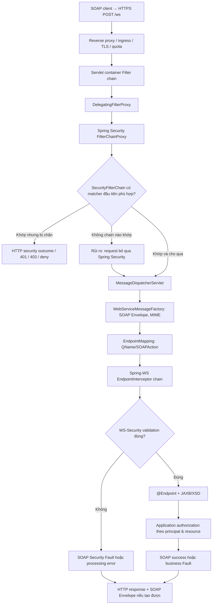
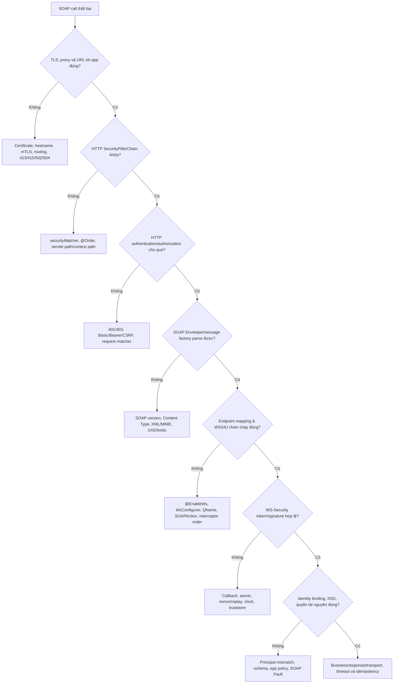
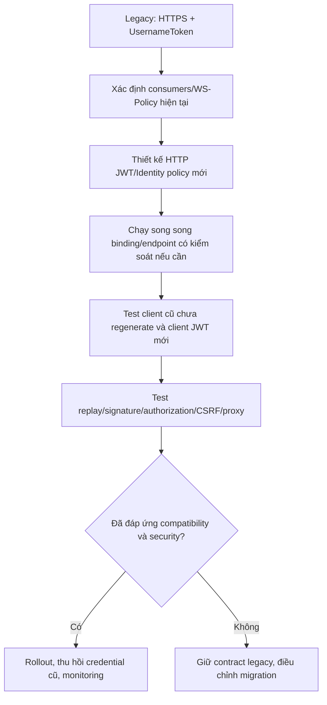

# SecurityFilterChain ở tầng HTTP và interceptor ở tầng SOAP

## 1. Vì sao một dịch vụ SOAP có thể cần hai lớp bảo mật?

Trong module **SPRING_WEB_SERVICES**, chúng ta xây dịch vụ SOAP theo hướng **contract-first**: XSD/WSDL xác định hợp đồng, JAXB/OXM ánh xạ XML, Spring-WS dùng `MessageDispatcherServlet` và `@Endpoint` để xử lý nghiệp vụ; các tích hợp doanh nghiệp còn cần SOAP Fault, interceptor, XML security, WS-Security, chứng chỉ và kiểm thử tương thích. Khi đưa dịch vụ lên HTTPS, câu hỏi xuất hiện:

> Đã cấu hình Spring Security `SecurityFilterChain` để yêu cầu HTTP authentication thì có còn cần `Wss4jSecurityInterceptor` không? Ngược lại, SOAP đã có UsernameToken thì có thể bỏ qua HTTP security filters không?

**Không có câu trả lời “luôn cần cả hai” hoặc “một lớp thay thế hoàn toàn lớp kia”.** Hai thành phần bảo vệ **hai ranh giới khác nhau**:

- **Spring Security `SecurityFilterChain` ở tầng HTTP/Servlet:** chọn URL, HTTP method, authentication như HTTP Basic/Bearer, TLS/channel policy, CSRF, request/session security, response security headers và quyết định request có được đi tiếp tới servlet hay không.
- **Spring-WS `EndpointInterceptor` ở tầng SOAP:** truy cập `MessageContext`, xử lý SOAP Header/Body trong luồng dispatcher; `Wss4jSecurityInterceptor` có thể kiểm tra WS-Security UsernameToken, chữ ký, mã hóa, timestamp, nonce/replay và những yêu cầu của SOAP security policy.

Một request có thể **vượt qua HTTP Basic** nhưng **bị WS-Security từ chối** vì thiếu chữ ký. Hoặc request có **SOAP UsernameToken hợp lệ** nhưng bị **Spring Security trả 401** trước khi SOAP parser nhìn thấy byte nào. Hai lớp này không tự chia sẻ danh tính hoặc chính sách cấp quyền nếu chưa thiết kế rõ.

### Mục tiêu học tập

Sau bài thuộc chương **Tích hợp Spring Security**, bạn có thể:

1. Giải thích đường đi `HTTP request → DelegatingFilterProxy/FilterChainProxy → SecurityFilterChain → MessageDispatcherServlet → EndpointMapping → EndpointInterceptor → @Endpoint`.
2. Phân biệt `Filter`, Spring Security filter, Spring MVC `HandlerInterceptor`, Spring-WS `EndpointInterceptor` và `Wss4jSecurityInterceptor`.
3. Cấu hình `SecurityFilterChain` **giới hạn cho `/ws/**`**, xử lý WSDL GET, SOAP POST, authentication và CSRF có cân nhắc.
4. Đăng ký `Wss4jSecurityInterceptor` trong Spring-WS; hiểu rõ callback xác thực, WS-Security Header, signature, timestamp và replay.
5. Quyết định khi nào dùng **HTTP authentication**, **WS-Security**, hoặc **cả hai** mà không vô tình bỏ lọt request.
6. Thiết kế cách chuyển `Authentication`/principal giữa HTTP và SOAP layers, phân quyền operation/tài nguyên và tránh nhầm identity của hai nguồn.
7. Phân loại HTTP 401/403, SOAP Security Fault, SOAP business Fault, lỗi parser/gateway/TLS theo **đúng tầng**.
8. Viết unit/integration/wire tests để chứng minh HTTP chain và SOAP interceptor đều chạy trong triển khai thực.

**Nguyên tắc trung tâm:** `authenticated()` ở HTTP chỉ xác nhận điều kiện của **HTTP chain**. Một `UsernameToken` hợp lệ ở SOAP chỉ chứng minh điều kiện của **WS-Security policy**. Cả hai **không tự chứng minh** quyền truy cập một đơn hàng cụ thể, và cũng không thay thế XSD validation.

## 2. Đường đi của một SOAP request qua Spring Security và Spring-WS

### 2.1. Sơ đồ ranh giới



Sơ đồ mô tả **luồng logic**. `EndpointMapping` thường xảy ra trước việc gọi `EndpointInterceptor.handleRequest(...)`; một mapping theo `@PayloadRoot` có thể cần xem phần đầu của Body để tìm QName. Vì vậy **không khẳng định rằng WSS4J luôn xác thực trước mọi thao tác parse hoặc đọc XML**. Giới hạn kích thước, bảo vệ XML parser và các kiểm soát HTTP tại edge cần hoạt động **trước** hoặc độc lập với SOAP-level validation.

### 2.2. Ai gọi ai?

| Thành phần | Được gọi ở đâu? | Làm việc với dữ liệu nào? |
| --- | --- | --- |
| **Servlet Filter** | Trước/sau servlet theo filter chain của container. | HTTP request/response; URL, method, headers, transport metadata. |
| **DelegatingFilterProxy** | Cầu nối filter container sang bean Spring Security. | Giao request cho `springSecurityFilterChain` bean. |
| **FilterChainProxy** | Bộ chọn danh sách filters của Spring Security. | Chọn **SecurityFilterChain đầu tiên khớp** và chạy các security filters. |
| **SecurityFilterChain** | Một chuỗi bảo vệ HTTP được cấu hình bằng `HttpSecurity`. | HTTP authentication, authorization, CSRF, session, HTTP error handling. |
| **MessageDispatcherServlet** | Servlet nhận SOAP request ở `/ws/*` hoặc path tương đương. | Chuyển HTTP entity thành SOAP message và dispatch tới endpoint. |
| **WebServiceMessageFactory** | Bên trong Spring-WS transport. | SOAP 1.1/1.2, Envelope và có thể MIME attachments. |
| **EndpointMapping** | Trước endpoint invocation. | QName `@PayloadRoot`, `@SoapAction` hoặc strategy đã cấu hình. |
| **EndpointInterceptor** | Trong chuỗi xử lý endpoint của Spring-WS. | `MessageContext`/SOAP Header, Body, Fault; có thể chặn endpoint invocation. |
| **Wss4jSecurityInterceptor** | Một implementation của Spring-WS interceptor. | WS-Security elements: UsernameToken, Timestamp, XML Signature/Encryption. |
| **@Endpoint + service** | Sau các bước thích hợp ở dispatcher/adapter. | JAXB payload, authenticated principal và business authorization. |

**Điểm dễ nhầm:** `Spring MVC HandlerInterceptor` của `DispatcherServlet` xử lý MVC controllers, **không phải mặc định** interceptor của `MessageDispatcherServlet`. Khi ứng dụng có cả REST/MVC và SOAP, phải cấu hình đúng từng hệ dispatcher.

### 2.3. HTTP Header khác SOAP Header

Một request SOAP 1.1 có thể có:

```http
POST /ws HTTP/1.1
Host: api.example.com
Content-Type: text/xml; charset=utf-8
SOAPAction: "https://example.com/orders/GetOrder"
Authorization: Basic <base64-of-test-credentials>
```

Trong HTTP entity body:

```xml
<soap:Envelope
    xmlns:soap="http://schemas.xmlsoap.org/soap/envelope/"
    xmlns:wsse="http://docs.oasis-open.org/wss/2004/01/oasis-200401-wss-wssecurity-secext-1.0.xsd"
    xmlns:wsu="http://docs.oasis-open.org/wss/2004/01/oasis-200401-wss-wssecurity-utility-1.0.xsd"
    xmlns:ord="https://example.com/orders/v1">
  <soap:Header>
    <wsse:Security soap:mustUnderstand="1">
      <wsse:UsernameToken>
        <wsse:Username>partner-demo</wsse:Username>
        <wsse:Password
          Type="http://docs.oasis-open.org/wss/2004/01/oasis-200401-wss-username-token-profile-1.0#PasswordText">DEMO-ONLY-NOT-SECRET</wsse:Password>
      </wsse:UsernameToken>
    </wsse:Security>
  </soap:Header>
  <soap:Body>
    <ord:GetOrderRequest>
      <ord:orderId>ORD-000123</ord:orderId>
    </ord:GetOrderRequest>
  </soap:Body>
</soap:Envelope>
```

**Chỉ là ví dụ cấu trúc:** `Authorization` hiển thị placeholder, mật khẩu SOAP là dữ liệu giả, không được dùng trong production. Request có thể thất bại trước endpoint nếu một trong hai lớp yêu cầu credentials hợp lệ. Trong thực tế cần **Nonce/Created/replay policy** và TLS phù hợp; ví dụ cố ý không trình bày một UsernameToken có thể dùng làm chứng từ xác thực thật.

| Dữ liệu | Được kiểm tra chủ yếu ở đâu? | Đừng kết luận sai |
| --- | --- | --- |
| `Authorization: Basic ...` | Spring Security/HTTP security. | Không phải `wsse:Password`. |
| `Content-Type` và `SOAPAction` HTTP | HTTP/SOAP binding, sender/message factory/gateway. | Không phải bằng chứng người dùng có quyền. |
| `wsse:UsernameToken` | WSS4J/WS-Security interceptor. | Không tự tạo `Authentication` trong mọi Spring Security context. |
| `ds:Signature` trên Body/Headers | WSS4J XML Signature validation. | Không xác minh được chỉ vì có một element `Signature`. |
| `ord:orderId` | JAXB/XSD, application authorization. | Không được tin chỉ vì token hoặc HTTP Basic đúng. |

## 3. Hai bộ lọc khác nhau, không đăng ký nhầm

### 3.1. SecurityFilterChain không phải EndpointInterceptor

Spring Security `SecurityFilterChain` được tạo từ `HttpSecurity`:

```java
@Bean
SecurityFilterChain soapHttpChain(HttpSecurity http) throws Exception {
    // Chọn HTTP paths, methods và authentication policy.
    // Không trực tiếp đọc SOAP WS-Security XML.
    return http.build();
}
```

Spring-WS `EndpointInterceptor` có dạng khái niệm:

```java
public interface EndpointInterceptor {
    boolean handleRequest(MessageContext context, Object endpoint)
        throws Exception;
    boolean handleResponse(MessageContext context, Object endpoint)
        throws Exception;
    boolean handleFault(MessageContext context, Object endpoint)
        throws Exception;
    void afterCompletion(MessageContext context, Object endpoint,
                         Exception exception) throws Exception;
}
```

Đoạn thứ hai là **hình thức API rút gọn để học vai trò**, không phải yêu cầu tự tạo lại interface này trong source code; ứng dụng dùng `org.springframework.ws.server.EndpointInterceptor` hoặc các implementation/adapters sẵn có.

### 3.2. Vì sao không thể chỉ dùng Servlet Filter để kiểm tra WS-Security XML?

`HttpServletRequest` cho bạn quyền đọc HTTP headers/body stream, nhưng đọc SOAP Body ở filter có thể:

- Tiêu thụ `ServletInputStream` khiến Spring-WS không còn byte để parse.
- Buộc tự xây XML parser/namespace handling dễ sai, đặc biệt MTOM/attachments.
- Gây **XML Signature wrapping** nếu tự lấy một UsernameToken/Signature khác với node WSS4J sẽ kiểm tra.
- Bỏ qua SOAP role/actor, `mustUnderstand`, signed references và WS-SecurityPolicy.
- Ghi nhầm raw token vào log hoặc error response.

**Cho HTTP Filter xử lý HTTP security; cho Spring-WS/WSS4J xử lý WS-Security.** Nếu cần custom SOAP token validation, sử dụng extension points đúng của WSS4J/interceptor và không tự dựng cryptographic verification bằng string matching.

### 3.3. Vì sao không thể chỉ dùng EndpointInterceptor cho mọi bảo vệ HTTP?

Một request sai TLS/client certificate, HTTP URL, body size hoặc `Authorization` có thể bị chặn **trước khi** Spring-WS tạo SOAP message. EndpointInterceptor không xử lý mọi HTTP call tới servlet, nhất là request malformed, WSDL GET hoặc không tìm thấy endpoint mapping.

Do đó thường cần:

- **HTTPS/mTLS, network segmentation, proxy limits** ở transport/edge.
- **SecurityFilterChain** cho HTTP auth, URL/method policy và CSRF khi phù hợp.
- **Wss4jSecurityInterceptor** khi contract yêu cầu WS-Security Header.
- **XSD validation + application authorization** cho dữ liệu nghiệp vụ.

### 3.4. FilterChainProxy chọn chuỗi đầu tiên khớp

Nếu Spring Security có nhiều `SecurityFilterChain`, `FilterChainProxy` **không ghép tất cả chains lại**. Nó chọn **chain đầu tiên có `RequestMatcher` khớp** theo `@Order`/thứ tự đã xác lập, rồi chạy những filters của chain đó.

Ví dụ:

```text
@Order(1): /ws/**    → SOAP HTTP policy
@Order(2): /api/**   → REST OAuth2/Bearer policy
@Order(3): catch-all → application policy / deny by default
```

Nếu một catch-all chain `/**` có thứ tự cao hơn `/ws/**`, SOAP request có thể không bao giờ đi qua policy dự kiến. Nếu không có chain nào khớp, request có thể **không được Spring Security bảo vệ**; không coi đó là lỗi HTTP 403 được sinh tự động.

**Luôn có fallback policy rõ ràng** và integration test HTTP thực cho từng URL/HTTP method.

## 4. Thiết kế HTTP policy trước khi viết cấu hình

Ví dụ một dự án dùng các đường dẫn:

```text
GET  /ws/orders.wsdl   → WSDL cho đối tác
GET  /ws/orders.xsd    → XSD import/include nếu được công bố
POST /ws               → SOAP operation
POST /ws/              → Có thể tới cùng servlet tùy mapping/container
POST /ws/anything      → Tùy quy tắc URL của servlet/proxy
GET  /api/orders/...   → REST nếu ứng dụng còn MVC controllers
GET  /actuator/health  → Monitoring có policy riêng
```

Chọn policy một cách tường minh:

| Đường dẫn/method | Ví dụ lựa chọn | Vì sao phải quyết định? |
| --- | --- | --- |
| `GET /ws/orders.wsdl` | Public **hoặc** protected theo hợp đồng. | Codegen client cần tải WSDL và XSD imports; có thể lộ endpoint metadata. |
| `GET /ws/*.xsd` | Public/protected đồng nhất với WSDL. | Đối tác có thể tải XSD riêng để validate/generated code. |
| `POST /ws` và các SOAP URL thực sự | Yêu cầu HTTP auth, **hoặc** cho qua HTTP nếu WS-Security được thiết kế làm auth bắt buộc. | Không vô ý tạo đường bypass vào endpoint. |
| `GET /ws/*` không phải WSDL/XSD | Deny nếu không được công bố. | Tránh service discovery/debug endpoint không cần thiết. |
| `OPTIONS /ws` | Từ chối hoặc policy CORS cụ thể. | SOAP M2M thường không cần CORS; browser clients là trường hợp khác. |
| `/api/**` | REST policy độc lập. | Không áp dụng cấu hình SOAP CSRF/auth toàn ứng dụng. |
| `/actuator/**` | Monitoring/admin policy riêng. | Không vô tình lộ diagnostics hoặc credential data. |

**Điểm cấu hình dễ sai:** `MessageDispatcherServlet` thường đăng ký với servlet mapping `"/ws/*"`. Đây là **quy tắc Servlet**, trong khi `securityMatcher("/ws/**")` là request matcher của Spring Security, có quy tắc context path, servlet path và pattern cụ thể theo phiên bản. **Phải test `/ws`, `/ws/`, `/ws/orders.wsdl` và mọi URL mà proxy thực sự forward.** Không kết luận chúng đồng nhất chỉ từ chuỗi pattern.

### 4.1. WSDL có thể được bảo vệ như một resource riêng

Với WSDL công khai, client đối tác dễ generate code và liên kết XSD; với WSDL private, phải chuẩn bị HTTP authentication/credential provisioning cho **GET WSDL và XSD**. Không để WSDL public nhưng XSD import bắt buộc trả `401` mà client không biết cách lấy.

Một số dịch vụ dùng **static WSDL** đã version hóa, một số dùng `DefaultWsdl11Definition` và location transformation. Nếu reverse proxy terminate TLS, cần kiểm tra public `soap:address` và trusted forwarded headers để không phát hành địa chỉ `http://internal-host:8080/ws`.

Không xem WSDL public là lỗ hổng mặc định cũng không xem nó không nhạy cảm trong mọi hệ thống: chính sách công bố API metadata do doanh nghiệp/thỏa thuận đối tác quyết định.

## 5. Ví dụ SecurityFilterChain cho SOAP HTTP endpoints

### 5.1. HTTP Basic cho đối tác machine-to-machine qua TLS

Ví dụ sau dành cho ứng dụng **Spring Boot 3 / Spring Security 6 kiểu API lambda** với servlet HTTP stack, có giả định rõ:

- SOAP endpoint `/ws` chỉ được gọi bởi **clients machine-to-machine** được kiểm soát.
- HTTP Basic credential được cung cấp qua identity provider hoặc `UserDetailsService`/password store bên ngoài đoạn cấu hình; **không hard-code mật khẩu**.
- TLS được cấu hình ở server/ingress và các hop theo policy.
- WSDL/XSD được phép tải công khai để đơn giản hóa ví dụ; production có thể chọn authenticated GET.
- CSRF được miễn **chỉ cho scope SOAP** sau khi đánh giá không dùng cookie/session/browser ambient credentials cho thao tác nhạy cảm.

```java
import org.springframework.context.annotation.Bean;
import org.springframework.context.annotation.Configuration;
import org.springframework.core.annotation.Order;
import org.springframework.http.HttpMethod;
import org.springframework.security.config.Customizer;
import org.springframework.security.config.annotation.web.builders.HttpSecurity;
import org.springframework.security.config.annotation.web.configuration.EnableWebSecurity;
import org.springframework.security.config.http.SessionCreationPolicy;
import org.springframework.security.web.SecurityFilterChain;

@Configuration
@EnableWebSecurity
public class SoapHttpSecurityConfiguration {

    @Bean
    @Order(1)
    SecurityFilterChain soapHttpChain(HttpSecurity http)
            throws Exception {

        http
            .securityMatcher("/ws/**")
            .authorizeHttpRequests(auth -> auth
                .requestMatchers(
                    HttpMethod.GET, "/ws/orders.wsdl"
                ).permitAll()
                .requestMatchers(
                    HttpMethod.GET, "/ws/orders.xsd"
                ).permitAll()
                .requestMatchers(
                    HttpMethod.POST, "/ws/**"
                ).authenticated()
                .anyRequest().denyAll()
            )
            .httpBasic(Customizer.withDefaults())
            .sessionManagement(session -> session
                .sessionCreationPolicy(SessionCreationPolicy.STATELESS))
            .csrf(csrf -> csrf
                .ignoringRequestMatchers("/ws/**"))
            .requestCache(cache -> cache.disable());

        return http.build();
    }

    @Bean
    @Order(2)
    SecurityFilterChain fallbackHttpChain(HttpSecurity http)
            throws Exception {

        http.authorizeHttpRequests(auth -> auth
            .anyRequest().denyAll());
        return http.build();
    }
}
```

**Đây là hai beans trong cùng một cấu hình**, không phải toàn bộ dự án. Để thử thật còn cần `MessageDispatcherServlet`, `@EnableWs`, SOAP factory, JAXB endpoint, account/password verification provider và HTTPS.

**Giải thích từng điểm:**

1. `@Order(1)` đặt chuỗi SOAP trước fallback. `securityMatcher("/ws/**")` giới hạn **toàn bộ chain**; các `requestMatchers(...)` phía trong chỉ chọn quy tắc authorization cho request **đã khớp chain**.
2. `GET /ws/orders.wsdl` và `GET /ws/orders.xsd` được phép tải **không có nghĩa SOAP POST được phép ẩn danh**.
3. `POST /ws/**` cần authenticated HTTP principal. Nếu matchers không khớp servlet path thực tế, `anyRequest().denyAll()` phải chặn; test cần phát hiện sớm mọi route khác.
4. `.httpBasic(...)` chỉ kích hoạt HTTP Basic processing; không tự cấp username/password. Dùng password encoder và credential store được quản trị an toàn, không `withDefaultPasswordEncoder()` trong production.
5. `SessionCreationPolicy.STATELESS` là lựa chọn cho M2M HTTP auth không cần session; nó không có nghĩa ứng dụng/ngăn khác **tuyệt đối không tạo session** nếu có code riêng.
6. `.csrf(...ignoringRequestMatchers("/ws/**"))` là **ngoại lệ có phạm vi**, không phải một yêu cầu mặc định cho mọi SOAP service. Xem cảnh báo mục 6.
7. Fallback `denyAll()` là nguyên tắc **không để một request ngoài `/ws/**` đi vào ứng dụng không được bảo vệ**. Nếu project có REST/UI/Actuator, thay fallback bằng chain chính sách phù hợp trước khi triển khai.

**Cảnh báo về matcher:** Trong các phiên bản Spring Security và cấu hình có **nhiều servlet** (Spring MVC và Spring-WS), overload sử dụng string matcher có thể cần thông tin servlet mapping cụ thể hoặc matcher tường minh. Không khẳng định `"/ws/**"` luôn khớp mọi container và context path; hãy kiểm tra phiên bản matcher, servlet path, forward/proxy rules và chạy integration tests trên đường URL thật. Với ứng dụng có nhiều servlet, lựa chọn `RequestMatcher` phù hợp với Servlet path thay vì chỉ sao chép pattern từ controller.

### 5.2. Nếu có REST, đừng biến fallback thành public

Một ứng dụng thực tế có thể cần:

```text
@Order(1) SOAP: /ws/**   → HTTP Basic hoặc Bearer
@Order(2) REST: /api/**  → OAuth2 Resource Server/JWT
@Order(3) Web UI: /**    → form login + CSRF
```

Mỗi chain có authentication mechanism, matcher, session/CSRF/error handling khác nhau. Không dùng một `http.csrf(csrf -> csrf.disable())` toàn ứng dụng để chữa một SOAP client không gửi CSRF token, vì nó có thể phá bảo vệ của **web UI dùng cookies/session**.

### 5.3. Nếu dùng Bearer/JWT thay HTTP Basic

Với đối tác có OAuth2 access token, HTTP chain có thể dùng:

```java
// Chỉ là fragment thay thế .httpBasic(...), không đặt
// song song nếu không có ý đồ đa cơ chế.
http.oauth2ResourceServer(oauth2 -> oauth2
    .jwt(Customizer.withDefaults()));
```

Điều này yêu cầu dependency **Spring Security OAuth2 Resource Server/JWT** và cấu hình issuer/JWK/trust, audience, expiry, signing algorithms, scopes và principal mapping. `.authenticated()` đơn thuần chỉ yêu cầu token đã được Spring Security chấp nhận; nếu operation cần `SCOPE_order.read` hoặc authority riêng, thiết kế **authorization rules có ý nghĩa nghiệp vụ** và kiểm tra tại service.

HTTP Bearer/JWT không tự cung cấp **WS-Security Signature** trên SOAP Body. Nếu hợp đồng yêu cầu cả Bearer và signed SOAP Body, cần cấu hình hai lớp một cách tường minh.

### 5.4. Đăng ký MessageDispatcherServlet

Ví dụ servlet Spring Boot:

```java
import org.springframework.boot.web.servlet.ServletRegistrationBean;
import org.springframework.context.ApplicationContext;
import org.springframework.context.annotation.Bean;
import org.springframework.context.annotation.Configuration;
import org.springframework.ws.config.annotation.EnableWs;
import org.springframework.ws.transport.http.MessageDispatcherServlet;

@EnableWs
@Configuration
public class OrderSoapServletConfiguration {

    @Bean
    ServletRegistrationBean<MessageDispatcherServlet> soapServlet(
            ApplicationContext context) {

        MessageDispatcherServlet servlet =
            new MessageDispatcherServlet();
        servlet.setApplicationContext(context);
        servlet.setTransformWsdlLocations(true);
        return new ServletRegistrationBean<>(servlet, "/ws/*");
    }
}
```

Đây là **mã riêng cho servlet registration**, không tự sinh WSDL/XSD hoặc authentication provider. `@EnableWs` kích hoạt Spring-WS infrastructure; không tự tạo HTTP `SecurityFilterChain`, không tự cấu hình TLS và không mặc nhiên bật WSS4J.

Ở dự án dùng auto-configuration để đăng ký SOAP servlet, **không đăng ký thêm một servlet trùng URL**. Điều quan trọng là biết request thực đi tới servlet nào, và security matcher có bảo vệ đường đi đó không.

## 6. CSRF của Spring Security trong SOAP HTTP POST

### 6.1. CSRF là vấn đề của browser credentials, không phải riêng REST

**Cross-Site Request Forgery (CSRF)** xảy ra khi trình duyệt của nạn nhân tự đính kèm credential được lưu theo origin/cookie/chế độ browser vào một request ngoài ý muốn. SOAP qua HTTP POST **không tự miễn nhiễm** chỉ vì gửi XML thay vì HTML form.

Hai trường hợp khác nhau:

| Mô hình gọi SOAP | Đánh giá CSRF |
| --- | --- |
| **M2M**: backend đối tác gọi bằng mTLS/Bearer riêng, không có browser, không dựa vào cookie/ambient browser credentials | Có thể cân nhắc **CSRF exemption đúng scope** khi các cơ chế xác thực/authorization, TLS, quota và kiểm soát nguồn phù hợp. |
| **Trình duyệt** gọi SOAP với cookie session hoặc HTTP Basic credentials được trình duyệt tự gửi | **Có thể bị CSRF**; không tắt kiểm tra chỉ vì URL có `/ws`. Cần thiết kế CSRF token/origin/same-site policy phù hợp. |
| Browser gọi qua proxy JavaScript và Bearer token gắn có chủ đích | Đánh giá chi tiết token storage/CORS/cookie; không khẳng định an toàn chỉ vì dùng Bearer. |
| SOAP service nhận cả browser UI lẫn M2M trên cùng URL | Nên cân nhắc **tách endpoint/host/policy**, tránh một exemption lớn áp dụng cho cả hai. |

**HTTP Basic trong browser có thể là ambient credential** sau khi trình duyệt đã xác thực. Vì vậy `SessionCreationPolicy.STATELESS` **không tự loại bỏ CSRF risk**. Nếu client là M2M thuần túy, cấu hình trong mục 5 phải đi cùng một ranh giới triển khai chứng minh không có browser flows/cookie auth đang lợi dụng cùng endpoint.

### 6.2. Vì sao không gọi csrf.disable() toàn hệ thống?

Ví dụ phản diện:

```java
// PHẢN DIỆN nếu cùng ứng dụng có MVC/UI dùng cookie:
http.csrf(csrf -> csrf.disable());
```

Một ứng dụng Spring Boot có thể phục vụ đồng thời:

```text
/ws/**          SOAP machine-to-machine
/api/**         REST với bearer hoặc cookie
/admin/**       Web UI với session cookie
```

Tắt CSRF trên chain bao phủ toàn ứng dụng có thể khiến `/admin/**` dễ bị request giả mạo. **Cách tốt hơn** là dùng các `SecurityFilterChain` giới hạn scope hoặc `CsrfConfigurer.ignoringRequestMatchers(...)` cho đúng traffic M2M đã được đánh giá. Không thay HTTP authentication bằng CSRF token: hai biện pháp giải quyết hai rủi ro khác nhau.

### 6.3. CORS không phải “bảo vệ CSRF đã đủ”

**CORS** quyết định trình duyệt có cho JavaScript của origin khác đọc response hoặc gửi một số cross-origin requests hay không. Nó **không phải** cơ chế xác thực danh tính và không thay thế CSRF controls trong mọi trường hợp. Một số request có thể gây side effect dù browser không được đọc response.

SOAP M2M thường không cần mở CORS, nhất là với credentials. Nếu có browser SOAP client thật, cấu hình **allowlist origins, methods, headers, credentials policy** cùng CSRF và token storage đúng thay vì `allowedOrigins("*")` rồi dùng credentials.

### 6.4. `permitAll` khác `web.ignoring`

Đối với WSDL GET công khai:

```java
.requestMatchers(HttpMethod.GET, "/ws/orders.wsdl").permitAll()
```

vẫn để request đi qua **Spring Security filter chain** phù hợp (ví dụ security headers, firewall, correlation xử lý ở chain). Ngược lại, cấu hình `WebSecurityCustomizer` dùng `web.ignoring()` có thể bỏ qua Spring Security filters cho URL đó. **Không dùng `ignoring` chỉ để công bố WSDL**, trừ khi có lý do đặc biệt và đã xét các security protections bị bỏ qua.

## 7. Spring-WS EndpointInterceptor xử lý lớp SOAP

### 7.1. Interceptor trước/sau endpoint

Một Spring-WS `EndpointInterceptor` có thể:

- Kiểm tra SOAP Header cần được hiểu, correlation ID, WS-Addressing/WS-Security theo API.
- Validate một số điều kiện xử lý message trước `@Endpoint`.
- Xem SOAP response hoặc Fault để áp dụng policy thích hợp.
- Bổ sung metrics/tracing an toàn, không ghi payload/secret tùy tiện.

`handleRequest(...)` trả `true` để tiếp tục hoặc `false` khi interceptor đã xử lý request và dừng chain. `handleResponse(...)`/`handleFault(...)` được gọi trong luồng response/Fault; nếu trả `false`, response có thể không được tiếp tục gửi theo quy tắc dispatcher. **Đừng trả false để “giả vờ thành công” sau một lỗi xác thực** — cần xử lý Fault/HTTP outcome rõ.

### 7.2. Wss4jSecurityInterceptor cho UsernameToken

Một service theo hợp đồng yêu cầu **UsernameToken PasswordDigest** có thể dùng:

```java
import javax.security.auth.callback.CallbackHandler;
import org.springframework.beans.factory.annotation.Qualifier;
import org.springframework.context.annotation.Bean;
import org.springframework.context.annotation.Configuration;
import org.springframework.ws.soap.security.wss4j2.Wss4jSecurityInterceptor;

@Configuration
public class SoapMessageSecurityConfiguration {

    @Bean
    Wss4jSecurityInterceptor soapInboundSecurity(
            @Qualifier("partnerSecretCallback")
            CallbackHandler callback) {

        Wss4jSecurityInterceptor security =
            new Wss4jSecurityInterceptor();

        security.setValidationActions("UsernameToken");
        security.setValidationCallbackHandler(callback);
        security.setValidateRequest(true);
        security.setSkipValidationIfNoHeaderPresent(false);
        security.setBspCompliant(true);
        return security;
    }
}
```

Giải thích:

- `validationActions("UsernameToken")` yêu cầu WSS4J xử lý một UsernameToken action, **không tự yêu cầu Signature/Encryption**.
- `partnerSecretCallback` phải là **bean thực** trả credential hoặc tiến hành verification đúng cơ chế WSS4J/credential provider; không lấy password từ file source cứng.
- `setValidateRequest(true)` kích hoạt validation cho inbound request.
- `setSkipValidationIfNoHeaderPresent(false)` giúp tránh việc bỏ qua validation vì thiếu Security Header, **nhưng phải test hành vi thực tế của cả chain và endpoint mapping**.
- `setBspCompliant(true)` giữ yêu cầu WS-I Basic Security Profile; không nới lỏng profile chỉ để nhận một client không tuân thủ.

**Quan trọng:** chỉ khai báo bean `Wss4jSecurityInterceptor` **chưa đủ**. Phải gắn nó vào Spring-WS endpoint interceptor chain, phải có SOAP message factory phù hợp và phải kiểm thử request thật.

### 7.3. Callback handler không phải PasswordEncoder đơn giản

Ví dụ một `CallbackHandler` có thể cấp shared secret cho WSS4J:

```java
import java.io.IOException;
import javax.security.auth.callback.Callback;
import javax.security.auth.callback.CallbackHandler;
import javax.security.auth.callback.UnsupportedCallbackException;
import org.apache.wss4j.common.ext.WSPasswordCallback;

public final class PartnerSecretCallback implements CallbackHandler {
    private final PartnerSecretStore secrets;

    public PartnerSecretCallback(PartnerSecretStore secrets) {
        this.secrets = secrets;
    }

    @Override
    public void handle(Callback[] callbacks)
            throws IOException, UnsupportedCallbackException {
        for (Callback item : callbacks) {
            if (!(item instanceof WSPasswordCallback pwd)
                    || pwd.getUsage() !=
                        WSPasswordCallback.USERNAME_TOKEN) {
                throw new UnsupportedCallbackException(item);
            }

            String sharedSecret =
                secrets.forPartner(pwd.getIdentifier());
            if (sharedSecret == null) {
                throw new IOException("Invalid UsernameToken");
            }
            pwd.setPassword(sharedSecret);
        }
    }
}
```

`PartnerSecretStore` là **abstraction do ứng dụng định nghĩa**, không phải Spring interface có sẵn. Trong source thực, nó phải có implementation dùng secret manager/credential store, phân biệt realm/tenant và quản trị rotation, expiry, rate limits. Callback không dùng trực tiếp `wsse:Username` làm bằng chứng authorization; WSS4J cần kiểm tra **password/digest** và các quy tắc nonce, timestamp, replay.

**Đánh đổi thiết kế:** UsernameToken `PasswordDigest` theo profile OASIS dùng shared secret để verify; một backend chỉ giữ BCrypt/Argon2id salted hash **không thể trực tiếp tái tính digest** từ password gốc. Không “chữa” bằng cách cấp password hash đã lưu cho client dùng như shared secret. Chọn PasswordText qua TLS với verifier phù hợp, credential tương đương được bảo vệ, hoặc X.509/mTLS/signature theo threat model và hợp đồng.

### 7.4. Replay cache và thời gian

Nếu policy yêu cầu UsernameToken Nonce/Created:

- Nonce do client sinh mới, có entropy cao;
- Created phải nằm trong freshness/future-skew window;
- Server không được chấp nhận lại nonce trong window;
- **Multi-node** phải dùng cache phù hợp dùng chung và xử lý race/failure; local map ở node A không biết nonce node B đã chấp nhận;
- Khi cache unavailable, tránh **fail-open** làm request bypass replay detection;
- Application vẫn cần **idempotency** với operation có side effect như `CancelOrder` hoặc `ChargePayment`.

Spring-WS các phiên bản có API `setValidationReplayCache(ReplayCache)` có thể cấu hình:

```java
import org.apache.wss4j.common.cache.ReplayCache;

// Trong bean soapInboundSecurity, nếu version hỗ trợ:
security.setValidationReplayCache(distributedReplayCache);
```

`distributedReplayCache` là bean WSS4J `ReplayCache` đã được kiểm thử với backend/configuration thực của deployment; **không có adapter nào biến cache local thành cache phân tán chỉ bằng tên bean**. `setValidationReplayCache` có trong Spring-WS **4.1.4** và cần đối chiếu version hiện hữu trước khi copy cấu hình.

**Không nhầm `wsu:Created` trong UsernameToken với một `wsu:Timestamp` action riêng.** Nếu yêu cầu cả `UsernameToken` và `Timestamp`, validation policy phải cấu hình/kiểm tra **cả hai** theo WSDL/WS-SecurityPolicy; một action không thay thế việc validate action kia.

### 7.5. Đăng ký interceptor đúng vào Spring-WS

```java
import java.util.List;
import org.springframework.beans.factory.annotation.Qualifier;
import org.springframework.context.annotation.Configuration;
import org.springframework.ws.config.annotation.WsConfigurer;
import org.springframework.ws.server.EndpointInterceptor;
import org.springframework.ws.soap.security.wss4j2.Wss4jSecurityInterceptor;

@Configuration
public class SoapInterceptorsConfiguration implements WsConfigurer {
    private final Wss4jSecurityInterceptor security;

    public SoapInterceptorsConfiguration(
            @Qualifier("soapInboundSecurity")
            Wss4jSecurityInterceptor security) {
        this.security = security;
    }

    @Override
    public void addInterceptors(
            List<EndpointInterceptor> interceptors) {
        interceptors.add(security);
    }
}
```

Ứng dụng cần **một `@EnableWs` cấu hình Spring-WS** (ví dụ mục 5.4) để `WsConfigurer` được sử dụng. Không nhầm `addInterceptors(...)` ở đây với `HttpSecurity.addFilterBefore(...)`; đó là hai extension points của **hai hệ thống khác nhau**.

Nếu có interceptor xác thực, XSD validation, logging, tracing, hãy thiết kế **thứ tự xử lý** để không ghi payload nhạy cảm trước kiểm tra; bảo vệ parser và quotas ở HTTP/mime parser phải ở lớp sớm hơn. Khi nhiều `WsConfigurer` đóng góp interceptors, cần kiểm tra order thực tế. Chỉ dựa vào `interceptors.add(security)` không chứng minh một validator khác không chạy trước nó.

### 7.6. Signature, encryption và attachment security

Nếu contract yêu cầu chữ ký SOAP Body, `validationActions` có thể cần `Signature` và một truststore/`Crypto` được cấu hình:

```java
// Minh họa policy thay thế/đầy đủ hơn;
// chưa có validationSignatureCrypto/WS-SecurityPolicy nên
// KHÔNG phải cấu hình production hoàn chỉnh.
security.setValidationActions("UsernameToken Timestamp Signature");
```

Đây **không phải** chỉ việc thêm ba từ cho đẹp: cần certificate trust, signed-parts policy, replay/timestamp, KeyInfo/reference checks, XML canonicalization và đúng WSS4J configuration.

**UsernameToken PasswordDigest không ký Body.** TLS bảo vệ dữ liệu trên **mỗi TLS hop**, nhưng nếu có SOAP intermediaries chấm dứt TLS rồi sửa XML, cần XML Signature kiểm tra **đúng node được sử dụng**; đối với MTOM/SwA attachments còn phải xác định **bytes tệp có được bao phủ bởi chữ ký hay không**. Không mặc định một `ds:Signature` bất kỳ đã bảo vệ toàn bộ message.

## 8. Ba mô hình bảo vệ SOAP cần phân biệt

Một dịch vụ có thể chọn **HTTP-only authentication**, **WS-Security-only authentication qua HTTPS**, hoặc **kết hợp**. Quyết định phải được thỏa thuận trong hợp đồng/policy và kiểm thử end-to-end.

### 8.1. Mô hình A — xác thực HTTP, không bắt UsernameToken

```text
HTTPS / mTLS tùy policy
    ↓
SecurityFilterChain /ws/**:
    HTTP Basic hoặc OAuth2 Bearer token → authenticated
    ↓
MessageDispatcherServlet / EndpointInterceptor
    (logging an toàn, validation, SOAPAction policy ...)
    ↓
@Endpoint / application authorization
```

Mô hình này hợp lý khi hai phía thống nhất **HTTPS + HTTP authentication** và không có yêu cầu WS-Security Message Security trong contract. **Không cần thêm UsernameToken chỉ để “có hai lớp”**, vì có thể làm phức tạp credential lifecycle mà không giải quyết một rủi ro cụ thể.

**Nhưng HTTP authentication không ký SOAP Body end-to-end** khi request đi qua intermediary có thể thay đổi XML ngoài TLS hop. Nếu cần tính toàn vẹn thông điệp xuyên nhiều hop, phải thêm chữ ký/chính sách phù hợp hoặc thay kiến trúc trust boundary.

### 8.2. Mô hình B — HTTP permitAll cho POST nhưng WS-Security bắt buộc

Một hệ thống legacy có thể quy định partner chỉ gửi `wsse:UsernameToken` hoặc SOAP Signature, không gửi HTTP Basic/Bearer. Khi đó HTTP layer **không yêu cầu một HTTP principal**, nhưng vẫn có thể giữ Spring Security filters cho protection headers/firewall, scope/method restrictions. Thực hiện authentication ở WSS4J:

```java
// PHƯƠNG ÁN THAY THẾ cấu hình HTTP Basic ở mục 5.
// Không đăng ký đồng thời hai @Order(1) chains cho /ws/**.
@Bean
@Order(1)
SecurityFilterChain soapWsSecurityOnlyHttpChain(HttpSecurity http)
        throws Exception {
    http.securityMatcher("/ws/**")
        .authorizeHttpRequests(auth -> auth
            .requestMatchers(HttpMethod.GET, "/ws/orders.wsdl")
                .permitAll()
            .requestMatchers(HttpMethod.POST, "/ws/**")
                .permitAll() // Chỉ là HTTP entry; SOAP auth vẫn bắt buộc.
            .anyRequest().denyAll())
        .sessionManagement(session -> session
            .sessionCreationPolicy(SessionCreationPolicy.STATELESS))
        .csrf(csrf -> csrf.ignoringRequestMatchers("/ws/**"));
    return http.build();
}
```

Đây là **một snippet cấu hình thay thế**, sử dụng import/annotations của mục 5, không phải bean thêm vào cùng ứng dụng. SecurityFilterChain ở HTTP cho SOAP POST đi tiếp **không có nghĩa endpoint công khai** nếu **WSS4J interceptor được áp dụng bắt buộc cho mọi protected operation**.

Rủi ro lớn nhất của mô hình này là:

- Bỏ quên một `@Endpoint`/operation không được gắn interceptor;
- `skipValidationIfNoHeaderPresent=true` hoặc header không hợp lệ nhưng vẫn xử lý;
- Có đường URL/servlet khác đi tới cùng business service mà bỏ qua WS-Security;
- Một endpoint không được mapping hoặc XML malformed xảy ra trước SOAP security, gây tiêu thụ tài nguyên;
- Principal của WSS4J không được đưa vào application authorization đúng cách;
- Replay cache/clock policy không hoạt động qua nhiều node.

**Nên tách các SOAP endpoints public và protected thành servlet/binding riêng hoặc cấu hình mapping/interceptor có kiểm chứng.** Không dùng `permitAll` vì tiện rồi để application service tự “tin” `wsse:Username`.

### 8.3. Mô hình C — yêu cầu cả HTTP và WS-Security

```text
HTTPS / mTLS
    ↓
HTTP Basic hoặc Bearer
  → HTTP principal = partner-gateway-A
    ↓
WSS4J UsernameToken/Signature
  → SOAP security identity = partner-business-A
    ↓
Identity binding policy:
  HTTP partner A ↔ SOAP partner A được phép kết hợp?
    ↓
Application authorization
    ↓
SOAP response / Fault
```

Mô hình này có thể phù hợp khi:

- Gateway đòi OAuth2/Bearer/mTLS để cho vào private API;
- SOAP contract của đối tác **vẫn bắt WS-Security UsernameToken/Signature**;
- Có nhu cầu xác thực **transport client** và **business sender** tách biệt;
- Cần integrity end-to-end qua intermediaries.

Nhưng **hai credential không tự tạo “bảo mật gấp đôi”** nếu chúng dùng chung secret, bị log cùng chỗ, có cùng đường bypass hoặc principal không được đối chiếu. Nếu HTTP principal là partner A nhưng SOAP Header khai partner B, hệ thống cần **identity binding policy rõ** (cho phép, map, hoặc từ chối), thay vì âm thầm lấy token nào xử lý sau cùng.

### 8.4. Ma trận chọn kiến trúc

| Nhu cầu | Mô hình cân nhắc | Bảo vệ còn phải bổ sung |
| --- | --- | --- |
| M2M internal, client có OAuth2 access token, chỉ cần TLS từng hop | HTTP-only có thể đủ. | Rate limit, authorization, XSD, trust proxy, TLS, observability. |
| Đối tác legacy quy định UsernameToken và không hỗ trợ HTTP credentials | WS-Security-only ở SOAP + HTTPS. | SOAP interceptor bắt buộc, replay cache, XML parser/quota, principal mapping. |
| Gateway yêu cầu mTLS/Bearer, hợp đồng SOAP yêu cầu Signature | Kết hợp HTTP/transport + WS-Security. | Truststore, signature signed-part checks, identity binding, authorization. |
| Nhiều node nhận UsernameToken PasswordDigest | Mô hình có WS-Security + distributed replay cache. | Created/future-skew validation, cache failure mode, idempotency. |
| Web UI dùng cookie gọi SOAP | Không miễn CSRF chỉ vì SOAP; có thể tách API. | CSRF token, browser cookie/session/CORS policy, origin testing. |
| Data nhạy cảm qua SOAP intermediaries | WS-Security Signature/Encryption phù hợp, có thể cùng HTTPS. | Node trust, key/certificate lifecycle, signed-attachment coverage. |

**Không áp một mô hình bảo vệ cho mọi dịch vụ chỉ vì stack hỗ trợ nó.** Chọn theo network trust model, đối tác, WSDL/WS-SecurityPolicy, loại dữ liệu, hậu quả side effect và khả năng vận hành.

## 9. Ai là principal? Không trộn HTTP Authentication và SOAP UsernameToken

### 9.1. Spring SecurityContextHolder phản ánh authentication mà HTTP chain thiết lập

Khi HTTP Basic/Bearer validation thành công, Spring Security có thể lưu `Authentication` đã xác minh trong `SecurityContext` của request. Application service thường có thể đọc qua:

```java
import org.springframework.security.core.Authentication;
import org.springframework.security.core.context.SecurityContextHolder;

Authentication authentication =
    SecurityContextHolder.getContext().getAuthentication();

if (authentication == null || !authentication.isAuthenticated()) {
    throw new SecurityException("HTTP principal chưa xác thực");
}
```

Đây chỉ là **fragment về API**, không phải authorization đầy đủ. Một số context có thể chứa `AnonymousAuthenticationToken` mà `isAuthenticated()` có thể trả true; để yêu cầu identity thực, phải dùng Spring Security authorization rules hoặc check loại/principal/authorities phù hợp, **không dựa vào boolean đơn độc**.

**Cảnh báo quan trọng:** Nếu HTTP chain cấu hình `permitAll` và server **chỉ** xác thực bằng WSS4J callback đơn giản, `SecurityContextHolder` **không tự động** chứa principal từ SOAP UsernameToken. Một callback chỉ cung cấp password cho WSS4J có thể xác minh token mà không tạo `Authentication` cho Spring Security.

### 9.2. Khi dùng Spring Security integration cho WSS4J

Spring-WS cung cấp `SpringSecurityPasswordValidationCallbackHandler` (theo phiên bản tương ứng), giúp tích hợp credential validation với Spring Security `UserDetailsService` và thông tin principal. Nhưng:

- Phải đối chiếu **hành vi xác thực thực tế** và cấu hình `PasswordEncoder`/`UserDetailsService`.
- PasswordDigest có yêu cầu shared secret/equivalent khác với salted password hash một chiều; không giả định mọi user store đều xác minh được Digest.
- Phải kiểm tra **roles/authorities/tenant context** và lifecycle security context xuyên các callbacks.
- Nếu application có **hai authentication sources**, cần quy định identity priority/binding, không để SOAP callback vô tình thay thế HTTP principal của người gọi khác mà thiếu đối chiếu.

Một số kiến trúc có thể **giữ hai identities riêng** và tạo một `EffectivePartnerIdentity` đã được kiểm chứng bằng policy trước khi vào domain service, thay vì ghi đè `SecurityContextHolder` giữa chừng.

### 9.3. Mẫu identity binding khi có hai nguồn

Giả sử:

```text
HTTP JWT principal = gateway-client-17
SOAP UsernameToken principal = supplier-A
Allowed binding table:
  gateway-client-17  → supplier-A
  gateway-client-18  → supplier-B
```

Ứng dụng cần chứng minh **cả hai identities đều được xác minh bởi nguồn có thẩm quyền**, rồi kiểm tra `(httpPrincipal, soapPrincipal)` trong allowlist mapping. Chỉ khớp tên chuỗi từ request chưa đủ:

```java
// Pseudocode có typed abstractions của ứng dụng:
public EffectivePartnerIdentity resolve(
        VerifiedHttpIdentity httpIdentity,
        VerifiedSoapIdentity soapIdentity) {
    if (!bindingPolicy.isAllowed(
            httpIdentity.clientId(), soapIdentity.partnerId())) {
        throw new PartnerIdentityMismatchException();
    }
    return new EffectivePartnerIdentity(
        soapIdentity.partnerId(),
        httpIdentity.clientId());
}
```

`VerifiedHttpIdentity`/`VerifiedSoapIdentity`/`bindingPolicy` là các kiểu **do hệ thống định nghĩa**, không phải Spring beans dựng sẵn. Đầu vào phải đến từ **kết quả validation**, không parse raw `Authorization` hoặc `wsse:Username` rồi tự gắn nhãn “Verified”.

Khi không có WS-Security authentication trong contract, không tạo một `VerifiedSoapIdentity` giả chỉ để dùng logic này. Chỉ áp binding giữa các nguồn thực sự có và đã được kiểm chứng.

### 9.4. Authorization theo operation và tài nguyên

Giả sử partner A có quyền `ORDER_READ` nhưng chỉ được xem đơn của chính họ. Có thể dùng Spring Method Security ở **application service layer**:

```java
import org.springframework.security.access.prepost.PreAuthorize;
import org.springframework.stereotype.Service;

@Service
public class OrderApplicationService {
    private final OrderRepository orders;
    private final PartnerAuthorizationPolicy policy;

    public OrderApplicationService(
            OrderRepository orders,
            PartnerAuthorizationPolicy policy) {
        this.orders = orders;
        this.policy = policy;
    }

    @PreAuthorize("hasAuthority('ORDER_READ')")
    public OrderSummary findVisibleOrder(
            String orderId, AuthenticatedPartner partner) {
        if (!policy.mayRead(partner.partnerId(), orderId)) {
            throw new AccessDeniedOrderException();
        }
        return orders.findVisibleForPartner(orderId, partner.partnerId());
    }
}
```

Đây là **ví dụ minh họa tách thành các lớp Java riêng**; `OrderRepository`, `PartnerAuthorizationPolicy`, `AuthenticatedPartner`, `OrderSummary` và `AccessDeniedOrderException` là các abstraction ứng dụng. Muốn `@PreAuthorize` hoạt động cần **`@EnableMethodSecurity`** và gọi qua Spring-managed proxy phù hợp; không tự kết luận annotation có tác dụng nếu gọi `this.method(...)` nội bộ/self-invocation.

Mẫu trên có **hai ràng buộc độc lập**:

1. Quyền tổng quát `ORDER_READ` từ security context đã được xác thực.
2. Quyền **ở cấp resource** dựa trên partner đã được map hợp lệ.

Ở mô hình **WS-Security-only**, nếu chưa bridge principal/authorities vào Spring Method Security, `@PreAuthorize` có thể thấy anonymous/không có authority. Khi đó phải thiết kế integration chính xác hoặc thực hiện authorization ở application service bằng `AuthenticatedPartner` đã được xác minh, không tự tắt method security cho request SOAP.

### 9.5. Principal context và async execution

`SecurityContextHolder` dùng strategy quản lý context theo thread trong nhiều cấu hình Servlet. Khi endpoint chuyển sang `@Async`, executor, reactive pipeline hoặc background job, **không được giả định context tự đi theo**. Có thể dùng cơ chế ủy quyền context được Spring Security hỗ trợ hoặc truyền **partner identity đã rút gọn/được xác thực** dưới dạng tham số business; cần dọn context và tránh rò principal giữa requests.

**Không dùng một field singleton `currentPartner`** bên trong interceptor để chứa danh tính mỗi request. Server xử lý song song sẽ gây race và lộ dữ liệu chéo tenant.

## 10. Một HTTP security rule không thay SOAP security policy

### 10.1. HTTP path/method chưa đủ để phân quyền operation

Nhiều SOAP services dùng **cùng một `POST /ws`** cho hàng chục operations:

```text
POST /ws: GetOrder
POST /ws: CancelOrder
POST /ws: ChargePayment
POST /ws: UploadDocument
```

Vì URL giống nhau, `requestMatchers(HttpMethod.POST, "/ws/**").authenticated()` chỉ biết user **có HTTP identity**, không biết họ được thực hiện operation nào. Không cố tạo bốn URL patterns giả định chỉ vì có bốn Java methods. Phân quyền operation ở **application/endpoint layer**, dựa trên QName/WSDL operation và identity đã xác thực, sau đó kiểm tra quyền dữ liệu.

### 10.2. SOAPAction không phải authorization

`SOAPAction` là metadata của SOAP 1.1 HTTP binding; SOAP 1.2 thường sử dụng `action` parameter của `Content-Type`. Các giá trị này có thể bị client đặt tùy ý và không chứng minh một operation đã được phép.

Nếu hệ thống định tuyến bằng `@SoapAction` hoặc gateway chặn theo action, cần kiểm tra action/Body QName/WS-Addressing action **nhất quán theo contract** và vẫn bắt buộc authorization. **Không cho rằng SOAPAction đúng đồng nghĩa payload đã được ký/xác thực.**

### 10.3. XSD validation vẫn là bước độc lập

Một request có cả HTTP Bearer hợp lệ và UsernameToken hợp lệ vẫn có thể thiếu field bắt buộc, sai QName, vi phạm `xs:sequence` hoặc chứa XML quá lớn. `PayloadValidatingInterceptor` hoặc validation layer phải kiểm tra dữ liệu theo XSD, còn application service kiểm tra domain invariants.

**Không suy rằng WSS4J validation thành công cũng validate XSD payload.** Ngược lại, XSD hợp lệ không chứng minh caller đã được xác thực.

### 10.4. Vì sao phạm vi một SOAP interceptor cần được kiểm tra?

`WsConfigurer.addInterceptors(...)` thường bổ sung interceptors vào những endpoint mappings do `@EnableWs` quản lý. Nếu dự án có:

- SOAP operations công khai và SOAP operations bảo vệ;
- Nhiều servlet/context có policies khác nhau;
- Custom endpoint mappings hoặc raw `WebServiceMessageReceiver`;
- SOAP message đi qua proxy trước dispatcher;

thì không được giả định một bean WSS4J sẽ tự bảo vệ **mọi đường gọi tới business code**. Tốt nhất **tách protected endpoint group/servlet** hoặc thiết kế endpoint-specific mapping của interceptor với test bao phủ; tránh đặt `setSkipValidationIfNoHeaderPresent(true)` toàn cục rồi hy vọng operation nào nhạy cảm sẽ tự từ chối.

### 10.5. Không đăng ký cùng một lớp bảo mật ở hai nơi vì tên giống nhau

`EndpointInterceptor` không phải `jakarta.servlet.Filter`. Cố gọi:

```java
// Sai về kiến trúc/type: Wss4jSecurityInterceptor
// không được đưa thẳng vào Servlet FilterChainProxy.
http.addFilterBefore(wss4jSecurityInterceptor, SomeServletFilter.class);
```

sẽ không tạo một WS-Security pipeline đúng. Dùng `WsConfigurer.addInterceptors` hoặc cấu hình endpoint mapping của **Spring-WS** cho WSS4J; dùng Spring Security filters cho HTTP.

## 11. HTTP 401/403 khác SOAP Security Fault và business SOAP Fault

### 11.1. HTTP layer có thể chặn trước khi có SOAP Envelope

Khi request thiếu HTTP Basic credentials và chain yêu cầu `authenticated()`, Spring Security có thể trả:

```http
HTTP/1.1 401 Unauthorized
WWW-Authenticate: Basic realm="..."
Content-Length: 0
```

**Đây là response minh họa**, không bảo đảm mọi Spring Security entry point trả `Content-Length: 0`; có deployment trả HTML/JSON error body hoặc headers khác. Điểm quan trọng: **HTTP 401 không bắt buộc có SOAP Envelope**. Client không được cố parse `401` không có SOAP như `GetOrderResponse` hoặc SOAP Fault.

Trường hợp HTTP principal đã xác thực nhưng không đủ quyền theo HTTP rule, hoặc bị CSRF filter từ chối, response có thể là **HTTP 403 Forbidden**, cũng không nhất thiết là SOAP.

### 11.2. Lỗi WS-Security xảy ra khi đã có SOAP message

Nếu HTTP chain cho request đi tiếp nhưng `Wss4jSecurityInterceptor` phát hiện missing/invalid UsernameToken hoặc Signature, Spring-WS có thể tạo **SOAP Security Fault** phù hợp:

```xml
<soap:Envelope
    xmlns:soap="http://schemas.xmlsoap.org/soap/envelope/">
  <soap:Body>
    <soap:Fault>
      <faultcode>soap:Client</faultcode>
      <faultstring>Security validation failed</faultstring>
    </soap:Fault>
  </soap:Body>
</soap:Envelope>
```

Đây là **hình thức an toàn mang tính minh họa**, không phải mẫu XML cố định do mọi WSS4J version sinh ra. Fault code có thể là QName WS-Security cụ thể (ví dụ `FailedAuthentication`/`InvalidSecurity`), và SOAP 1.2 dùng `Code`/`Reason`/`Detail` thay cấu trúc SOAP 1.1. HTTP status cho SOAP Fault cũng phụ thuộc SOAP version/binding/message receiver và lỗi cụ thể; **không ép mọi WSS4J fault trả 401**.

Client cần phân biệt:

- Không thể kết nối/TLS certificate failure → **transport error**.
- HTTP 401/403/413/415 do filter/ingress → **HTTP boundary error**, có thể không có SOAP.
- SOAP Header/Signature/UsernameToken sai → **WS-Security SOAP Fault** nếu hạ tầng đã tạo được SOAP message.
- XSD hoặc business policy sai → **SOAP validation/business Fault** theo hợp đồng.
- SOAP response thành công → xử lý JAXB/XSD payload như bình thường.

### 11.3. ExceptionTranslationFilter không tự hiểu business SOAP Fault contract

Spring Security `ExceptionTranslationFilter` xử lý các `AuthenticationException`/`AccessDeniedException` đi qua HTTP security filter chain để tạo HTTP authentication/authorization response. Nó **không** phải `SoapFaultMappingExceptionResolver` và không tự tạo XML `OrderFaultDetail` trong SOAP Body.

Với SOAP application service dùng `@PreAuthorize` hoặc ném `AccessDeniedException`, kết quả phụ thuộc:

1. Exception có được một Spring-WS exception resolver phù hợp **chuyển thành SOAP Fault** không?
2. Hay nó thoát ra khỏi Spring-WS và được HTTP/Spring Security error handling xử lý?
3. Message đã commit header/Body chưa?

**Không hứa rằng mọi `@PreAuthorize` deny trong SOAP endpoint đều tự trở thành SOAP Fault với mã đã công bố.** Nếu contract yêu cầu typed `AccessDeniedFault` hoặc `OrderFaultDetail`, cần cấu hình và test exception mapping ở Spring-WS; đồng thời không để raw exception message, role list, account existence hoặc stack trace lộ ra ngoài.

### 11.4. Ma trận lỗi theo từng tầng

| Tình huống | Tầng thường xử lý | Output có thể có | Business endpoint chạy? |
| --- | --- | --- | --- |
| Thiếu HTTP Basic header | SecurityFilterChain | HTTP `401` + challenge, không SOAP. | Không. |
| HTTP bearer token sai/hết hạn | HTTP authentication | HTTP `401`/token error theo resource server. | Không. |
| HTTP principal thiếu authority cho URL | HTTP authorization | HTTP `403`. | Không. |
| CSRF token thiếu ở browser endpoint cần CSRF | `CsrfFilter` | HTTP `403`. | Không. |
| TLS/mTLS certificate không hợp lệ | TLS/ingress | Kết nối bị từ chối, chưa có HTTP/SOAP. | Không. |
| HTTP qua được nhưng thiếu `wsse:Security` bắt buộc | WSS4J interceptor | SOAP Security Fault nếu message parse/map được. | Không. |
| Sai UsernameToken password/digest | WSS4J interceptor | SOAP Security Fault. | Không. |
| Replay nonce/Created quá cũ | WSS4J/policy | SOAP Security Fault. | Không. |
| SOAP XML malformed hoặc XML entity nguy hiểm | XML parser/message factory | HTTP/protocol error hoặc Fault tùy tầng. | Không. |
| SOAP Body sai XSD | `PayloadValidatingInterceptor` hoặc validation layer | SOAP validation Fault. | Không nên. |
| Token đúng nhưng request truy cập order không thuộc quyền | Application authorization | Business/security Fault theo contract, hoặc HTTP error nếu exception mapping khác. | Có thể vào service nhưng phải **không thực hiện side effect trái quyền**. |
| Lỗi JDBC bất ngờ | Application/exception resolver | Server/Receiver Fault với message công khai chung. | Có thể đã vào service; cần rollback. |
| SOAPAction đúng nhưng Body QName sai | EndpointMapping | No endpoint mapping/protocol error; không tự được phân quyền. | Không đúng operation. |
| Gateway `413/415/502/504` | Proxy/transport | HTTP status, HTML/JSON/empty body có thể có. | Có thể chưa tới server; timeout có thể xảy ra sau khi server đã xử lý. |

### 11.5. Chặn request không nên lộ trạng thái tài nguyên

Ví dụ partner A cố truy vấn `orderId` thuộc partner B. Một SOAP Fault:

```xml
<err:code>ORDER_OWNED_BY_ANOTHER_PARTNER</err:code>
```

có thể tiết lộ rằng tài nguyên **tồn tại và thuộc người khác**. Với những nghiệp vụ nhạy cảm, hợp đồng có thể dùng lỗi không tiết lộ sự tồn tại như `ORDER_NOT_FOUND` hoặc một generic access error. Lựa chọn phụ thuộc threat model/product policy; **không tự trả internal ID, SQL, role names hoặc raw UsernameToken** chỉ để client dễ debug.

## 12. Kết hợp đúng với TLS, proxy, chứng chỉ và XML security

### 12.1. TLS và channel requirements

Spring Security có thể áp chính sách HTTPS ở HTTP layer, ví dụ `requiresChannel(...requiresSecure())` theo API tương ứng. Tuy nhiên, nếu proxy **terminate TLS**, backend Servlet có thể nhìn thấy kết nối HTTP nội bộ; cấu hình yêu cầu secure ở backend thiếu trusted-forwarded-header handling có thể gây **redirect loop** hoặc chặn request hợp lệ.

Chọn một thiết kế rõ:

- TLS/mTLS tại gateway/ingress và bảo vệ backend hops theo network policy, hoặc
- TLS trực tiếp ở container, hoặc
- Cả hai theo chuẩn an toàn của tổ chức.

Nếu dùng `Forwarded`/`X-Forwarded-Proto`, chỉ tin headers từ **proxy được chỉ định**, không nhận chúng như chứng cứ secure channel do client bên ngoài tự cung cấp. Kiểm tra `Host`, SNI, certificate hostname và WSDL `soap:address` từ public URL.

### 12.2. mTLS không tự tạo authenticated Spring Security principal

Một gateway xác minh client certificate có thể biết một client là “partner A”. Nhưng Spring Security trên backend **không mặc định** nhận cùng certificate chain hoặc một `Authentication` đã xác minh. Muốn dùng X.509 authentication ở Servlet layer, phải cấu hình HTTP X.509/mTLS mapping đúng với transport. Nếu identity được truyền qua header do proxy bổ sung, **backend chỉ được tin khi kết nối đến từ proxy tin cậy và header client tự gửi đã bị loại bỏ/ghi đè**.

**Không dùng `X-Client-Cert` hoặc `X-Forwarded-User` công khai như credential**. Một header tùy ý không có trust boundary rõ ràng có thể bị giả mạo.

### 12.3. XML parser phải được bảo vệ trước/độc lập WSS4J

Trước khi WSS4J xác minh chữ ký/token, SOAP factory có thể phải parse Envelope và endpoint mapping có thể xem Body QName. Do đó cần:

- Giới hạn HTTP body/header bytes, tốc độ nhận, timeout, concurrency và XML depth/nodes.
- Tắt hoặc giới hạn DTD/external entity resolution, `SchemaFactory`/`TransformerFactory` access to external resources.
- Kiểm soát entity expansion, oversize Base64, `Nonce`/`Username` quá dài và namespace abuse.
- Giới hạn MIME parts/MTOM attachment bytes và decompression ratio.
- Kiểm soát `wsu:Id` duplicate, signed references, XML Signature wrapping và canonicalization.
- Không sửa SOAP XML sau signature validation theo cách ứng dụng dùng một node khác chưa được xác minh.

Một filter **không nên tự đọc toàn bộ SOAP Body để ghi log**, vì điều đó có thể tiêu thụ `ServletInputStream`, giữ secrets/PII trong heap và gây lỗi khi `MessageDispatcherServlet` parse tiếp.

### 12.4. SOAP WS-SecurityPolicy và HTTP contract độc lập

| Hợp đồng HTTP/transport | Hợp đồng SOAP/message |
| --- | --- |
| HTTPS, mTLS, HTTP Basic/Bearer | UsernameToken, Timestamp, XML Signature/Encryption |
| URL/method, `Content-Type`, `SOAPAction` | SOAP Header role, `mustUnderstand`, signed parts |
| Proxy, ingress auth, HTTP 401/403/413/415 | SOAP Fault, QName, typed detail |
| Request size/rate-limit, TLS certificate trust | XSD/WSDL, JAXB, token replay, signature trust |

**Không giả định `DefaultWsdl11Definition` tự công bố hết SecurityFilterChain HTTP policy hoặc WS-SecurityPolicy.** Cần tài liệu contract/WS-Policy và môi trường đối tác kiểm thử rõ: WSDL mô tả SOAP binding, nhưng HTTP gateway security và WS-Security assertions cần được quản trị riêng.

### 12.5. Credential lifecycle và hardening HTTP/SOAP

Trong production:

- HTTP Basic secrets, JWT issuer/JWK config, WS-Security shared secrets và private keys có **vòng đời/rotation khác nhau**.
- Không đặt password/key vào literal Java code, Git, Markdown fixture hoặc logs.
- Không dùng cùng một shared secret cho nhiều partners nếu có thể tránh.
- Bật monitoring authentication failure, replay detection, certificate expiry, authz denied, cache unavailable và rate-limit.
- Không tự cho phép authentication thành công khi secret manager hoặc replay cache lỗi.
- Phân biệt `WWW-Authenticate` HTTP header với SOAP Fault detail chứa thông tin hỗ trợ chẩn đoán.
- Giữ audit theo correlation ID đã chuẩn hóa; tránh username/token/`SOAPAction` tùy ý thành metric label có cardinality cao.

## 13. Kiểm thử từng lớp: tránh cảm giác an toàn giả

### 13.1. Test pyramid theo ranh giới

| Kiểu test | Xác minh được | Chưa xác minh được |
| --- | --- | --- |
| **Spring Security filter tests** | HTTP chain matcher, 401/403, auth provider/CSRF, role rules. | WSS4J token, XML Signature, endpoint JAXB. |
| **MockWebServiceClient** | Spring-WS endpoint mapping, `EndpointInterceptor`, SOAP Header/Fault, JAXB. | Servlet `SecurityFilterChain` và HTTP TLS/proxy thực. |
| **MockWebServiceServer** | `WebServiceTemplate` SOAP request, callback/interceptor client, SOAP Header. | HTTP wire headers, certificate trust và gateway routing. |
| **Servlet HTTP integration test** | Request đi qua filter chain + servlet + SOAP stack, status, MIME, SOAP response. | Có thể chưa kiểm tra TLS/mTLS nếu chạy localhost HTTP. |
| **Full HTTPS/proxy/mTLS integration** | Certificate/hostname, real routes, forwarded headers, WS-Security và SOAP outcome. | Security/load của file lớn nếu chỉ dùng fixture nhỏ. |
| **Security/load test** | Replay cache cluster, XML abuse quotas, identity mismatch, resource pressure. | Không tự chứng minh client WSDL/XSD legacy tương thích. |

**Không dùng `MockMvc` trên Spring MVC `DispatcherServlet` rồi kết luận nó đã exercise `MessageDispatcherServlet`**. Nếu cần kiểm tra Servlet HTTP + SOAP thực, dùng ứng dụng chạy trên random port/embedded container hoặc test harness đủ đại diện cho SOAP servlet registration.

### 13.2. Ma trận HTTP × SOAP

| HTTP credentials | SOAP Security | Body/authorization | Kết quả mong muốn |
| --- | --- | --- | --- |
| Thiếu | Bất kỳ | Hợp lệ hay không | HTTP chain **không cho vào SOAP servlet** trong mô hình yêu cầu HTTP auth. |
| Sai HTTP Basic | SOAP token hợp lệ | Hợp lệ | HTTP 401; không chấp nhận SOAP token để bỏ qua HTTP policy. |
| Đúng HTTP Basic | Thiếu WSSE Header | Hợp lệ | SOAP security reject nếu WSS4J bắt buộc. |
| Đúng HTTP Basic | Digest sai | Hợp lệ | SOAP security reject, không gọi nghiệp vụ. |
| Đúng HTTP Basic | Nonce trùng | Hợp lệ | SOAP security reject replay. |
| Đúng HTTP Basic | WSSE hợp lệ | Body QName sai | Không dispatch nhầm operation. |
| Đúng HTTP Basic | WSSE hợp lệ | XSD sai | Schema/business validation reject. |
| Đúng HTTP Basic | WSSE hợp lệ | Không có quyền order | Application authorization reject. |
| Đúng HTTP Basic | WSSE hợp lệ | HTTP A/WSSE B không khớp binding policy | Identity mismatch reject. |
| Đúng HTTP Basic | WSSE hợp lệ | Có quyền, XSD đúng | Response success theo WSDL. |
| Không HTTP auth (mô hình SOAP-only) | WSSE hợp lệ | Có quyền | Success sau WSS4J + app authorization. |
| Không HTTP auth (mô hình SOAP-only) | Thiếu WSSE | Bất kỳ | Reject trước business, dù HTTP `permitAll`. |

**Cảnh báo:** Không test bằng một token tĩnh và mong request thành công nhiều lần nếu có replay cache. Với request hợp lệ mới, WSS4J client phải tạo **Nonce/Created mới**; để test replay, gửi lại **nguyên envelope/token đã dùng**, không gọi client interceptor lần hai để sinh token mới.

### 13.3. HTTP integration test cho chain

Ví dụ Java 17+ và Spring Boot **3.x** test chạy Servlet container ở cổng ngẫu nhiên. Test chỉ minh họa **HTTP 401** trong cấu hình mục 5; không chứng minh HTTPS vì local test dùng HTTP:

```java
import java.net.URI;
import java.net.http.HttpClient;
import java.net.http.HttpRequest;
import java.net.http.HttpResponse;
import java.nio.charset.StandardCharsets;

import org.junit.jupiter.api.Test;
import org.springframework.boot.test.context.SpringBootTest;
import org.springframework.boot.test.web.server.LocalServerPort;

import static org.junit.jupiter.api.Assertions.*;

@SpringBootTest(
    webEnvironment = SpringBootTest.WebEnvironment.RANDOM_PORT)
class SoapHttpBoundaryIT {
    @LocalServerPort
    int port;

    @Test
    void unauthenticatedSoapPostIsChallenged() throws Exception {
        String xml = """
            <soap:Envelope
              xmlns:soap="http://schemas.xmlsoap.org/soap/envelope/">
              <soap:Body/>
            </soap:Envelope>
            """;

        HttpRequest request = HttpRequest.newBuilder(
                URI.create("http://localhost:" + port + "/ws/"))
            .header("Content-Type", "text/xml; charset=utf-8")
            .POST(HttpRequest.BodyPublishers.ofString(
                xml, StandardCharsets.UTF_8))
            .build();

        HttpResponse<String> response =
            HttpClient.newHttpClient().send(
                request, HttpResponse.BodyHandlers.ofString());

        assertEquals(401, response.statusCode());
        assertTrue(
            response.headers().firstValue("WWW-Authenticate").isPresent());
    }
}
```

Đây là **integration-test minh họa**: test context cần chứa HTTP Basic security chain, servlet mapping và một authentication provider thích hợp. Nếu test trả 403 hoặc 404, hãy kiểm tra **matcher `/ws/**` có khớp `/ws/` hay không**, fallback chain, method và servlet; đừng tự sửa assertion thành 403/404 để che bug.

**Điều kiện cần thêm:** nếu ứng dụng buộc HTTPS ở local container, ví dụ HTTP phải được thay bằng HTTPS test client/truststore hợp lệ. Đây là bài test **chain logic** khi local HTTP được phép, không phải khuyến nghị triển khai SOAP Basic qua plaintext ở production.

### 13.4. Test SOAP Security interceptor mà không qua HTTP FilterChain

`MockWebServiceClient` tạo request trực tiếp cho Spring-WS dispatcher trong test context. Ví dụ gửi Envelope SOAP 1.1 **thiếu WS-Security Header**:

```java
import org.springframework.xml.transform.StringSource;
import org.springframework.ws.soap.SoapMessage;
import org.springframework.ws.test.server.MockWebServiceClient;

import static org.junit.jupiter.api.Assertions.*;
import static org.springframework.ws.test.server.RequestCreators.withSoapEnvelope;

MockWebServiceClient client =
    MockWebServiceClient.createClient(applicationContext);

StringSource message = new StringSource("""
    <soap:Envelope
      xmlns:soap="http://schemas.xmlsoap.org/soap/envelope/"
      xmlns:ord="https://example.com/orders/v1">
      <soap:Body>
        <ord:GetOrderRequest>
          <ord:orderId>ORD-000123</ord:orderId>
        </ord:GetOrderRequest>
      </soap:Body>
    </soap:Envelope>
    """);

client.sendRequest(withSoapEnvelope(message))
    .andExpect((request, response) -> {
        assertInstanceOf(SoapMessage.class, response);
        assertNotNull(
            ((SoapMessage) response).getSoapBody().getFault());
    });
```

**Đây là thân test**, giả định `applicationContext` có `@EnableWs`, WSS4J validation interceptor bắt buộc, SOAP factory và endpoint phù hợp. Đoạn test **không** chứng minh `SecurityFilterChain` chạy, vì mock không gửi HTTP request qua servlet filter. Test đầy đủ cần spy/mock business service để xác nhận nó **không được gọi** khi WSSE thiếu.

SOAP Fault code cụ thể do WSS4J/exception resolver tạo phải được kiểm tra theo deployment/contract, không mặc định nó luôn là `soap:Client` chỉ vì Header thiếu.

### 13.5. Test SOAP client securement trước khi gửi HTTP

`MockWebServiceServer` có thể kiểm tra client `WebServiceTemplate` đã chạy securement interceptor và tạo SOAP Header:

```java
import javax.xml.namespace.QName;
import org.springframework.xml.transform.StringSource;
import org.springframework.ws.test.client.MockWebServiceServer;

import static org.springframework.ws.test.client.RequestMatchers.soapHeader;
import static org.springframework.ws.test.client.ResponseCreators.withPayload;

MockWebServiceServer server =
    MockWebServiceServer.createServer(securedTemplate);

QName wsse = new QName(
    "http://docs.oasis-open.org/wss/2004/01/oasis-200401-wss-wssecurity-secext-1.0.xsd",
    "Security");

server.expect(soapHeader(wsse))
    .andRespond(withPayload(new StringSource("""
        <ord:GetOrderResponse
          xmlns:ord="https://example.com/orders/v1">
          <ord:orderId>ORD-000123</ord:orderId>
          <ord:status>CONFIRMED</ord:status>
        </ord:GetOrderResponse>
        """)));

GetOrderRequest request = new GetOrderRequest();
request.setOrderId("ORD-000123");
securedTemplate.marshalSendAndReceive(
    "https://api.example.com/ws", request);
server.verify();
```

Đây là **phần thân test minh họa**: `securedTemplate` đã được cấu hình JAXB và WSS4J `securementActions` phía client; request/response classes sinh từ XSD. `soapHeader(...)` chỉ cho thấy **Header tồn tại**; chưa chứng minh password/digest đúng, nonce mới, chữ ký bao phủ Body, TLS hoạt động hay server chấp nhận principal.

### 13.6. Kiểm thử hai lớp trong cùng một HTTP request

Đây là phép thử quan trọng nhất của bài:

1. Gọi **POST /ws/** không HTTP credential nhưng SOAP Header hợp lệ. Nếu HTTP auth bắt buộc, phải bị chặn **ở HTTP**.
2. Gọi với HTTP credential hợp lệ nhưng không có `wsse:Security`. Nếu WSSE bắt buộc, phải bị chặn **ở SOAP**.
3. Gọi với HTTP credential và WSSE hợp lệ nhưng khác partner identity; nếu có identity binding policy, phải bị từ chối.
4. Gọi với cả hai identity hợp lệ, Body hợp XSD, nhưng không có quyền với `orderId`; application authorization phải từ chối mà không lộ tài nguyên.
5. Gọi hợp lệ đầy đủ, xác minh endpoint trả đúng JAXB success response, headers và SOAP version.
6. Gửi lại **nguyên token nonce** đã sử dụng; phải bị chặn theo replay policy dù HTTP credential không đổi.
7. Tắt hoặc làm hỏng một filter/interceptor **chỉ trong test cách ly**; bộ test phải phát hiện bypass, chứng minh các assertions có khả năng thất bại khi bảo vệ bị vô hiệu hóa.

**Không đánh giá một hệ thống là đã an toàn vì hai mock tests riêng đều pass**. Phải có ít nhất một **integration test qua HTTP servlet thật** chứng minh filters và SOAP interceptors cùng có hiệu lực, kể cả khi reverse proxy đổi route.

### 13.7. Negative tests thêm cho CSRF và matcher

| Test | Rủi ro được bắt |
| --- | --- |
| `GET /ws/orders.wsdl`, `GET /ws/orders.xsd` theo access policy | WSDL/XSD imports bị 401 hoặc public ngoài chủ ý. |
| `POST /ws`, `/ws/`, `/ws/anything` theo URL thực | Một alias URL không được bảo vệ vì matcher khác servlet. |
| `POST /api/**` khi SOAP CSRF exempt | Ngoại lệ CSRF không vô tình áp cho REST/UI. |
| Browser cookie vào SOAP endpoint có side effect | Đánh giá lại CSRF threat model, không dựa vào STATELESS. |
| `GET /ws/**` không phải WSDL/XSD | `anyRequest().denyAll()` hoạt động. |
| Request tới unknown path | Fallback SecurityFilterChain không bỏ lọt. |
| HTTP OPTIONS/preflight ngoài policy | CORS/HTTP method không tự mở rộng quyền SOAP. |
| Two servlet contexts hoặc context path khác | Matcher có thực sự bao trùm đường tới MessageDispatcherServlet? |
| HTTP Basic user A + WSSE partner B | Binding policy phát hiện mismatch. |
| Proxy thêm `X-Forwarded-User` giả | Backend không chấp nhận làm authenticated principal. |
| HTTP auth valid, SOAP payload malformed | XML parser từ chối an toàn, không gọi business. |

## 14. Chẩn đoán theo tầng thay vì sửa nhầm cấu hình

### 14.1. Sơ đồ tìm nguyên nhân



**Một lưu ý về nhánh “SecurityFilterChain không khớp”:** HTTP request vẫn có thể tới servlet khi không có chain nào khớp. Đó có thể là **bypass bảo mật**, không phải cứ không khớp sẽ trả 404/403. Nên có fallback deny chain và test alias paths.

### 14.2. Bảng sự cố thường gặp

| Triệu chứng | Khả năng nguyên nhân | Kiểm tra đầu tiên |
| --- | --- | --- |
| `POST /ws` trả `401` dù UsernameToken đúng | HTTP Basic/Bearer policy yêu cầu credential riêng. | `SecurityFilterChain` của `/ws/**`, HTTP Authorization, authentication entry point. |
| SOAP security thiếu nhưng endpoint vẫn chạy | WSS4J interceptor không được gắn, route bypass, `skipValidation` sai. | `WsConfigurer.addInterceptors`, missing-header negative test, application spy. |
| `GET /ws/orders.wsdl` trả 401 | WSDL chưa `permitAll` hoặc contract yêu cầu auth; pattern/URL sai. | GET path, `@Order`, XSD imports và policy xuất bản. |
| `GET /ws/orders.wsdl` trả 404 | WSDL bean/servlet registration/proxy path sai. | `MessageDispatcherServlet` và `DefaultWsdl11Definition`, không sửa SOAP Header. |
| `POST /ws` 403 dù Basic đúng | CSRF active, URL/method authority hoặc fallback deny. | Log security decision, matcher và CSRF policy. |
| `POST /ws/` được phép nhưng `POST /ws` khác | Servlet mapping/URL matcher không đồng nhất. | Wire path và context/servlet mapping. |
| REST UI mất CSRF sau sửa SOAP | `csrf.disable()` hoặc exemption quá rộng. | Tách chains và bật CSRF trên browser policy. |
| SOAP Fault `InvalidSecurity` dù HTTP Basic đúng | WSS4J validation độc lập với HTTP. | WS-Security Header/action/profile/credential. |
| WSS4J token đúng nhưng `@PreAuthorize` thấy anonymous | WSSE callback không bridge principal vào SecurityContext. | Authentication source và context lifecycle. |
| HTTP identity A, SOAP identity B vẫn xử lý | Không có cross-layer identity binding. | Map authenticated principal pairs/tenant policy. |
| Business data lộ giữa tenants | Chỉ check `authenticated()`, không check quyền resource. | Application authorization, repository filtering, principal mapping. |
| SOAP 1.2 báo VersionMismatch | Message factory/binding/Content-Type sai. | SOAP version, Envelope namespace, MIME action parameter. |
| XML Signature hợp lệ nhưng Body ứng dụng thấy khác | Signed reference/wrapping hoặc node mutation sai. | WSS4J signed-parts policy và ID uniqueness. |
| SOAP request không vào interceptor khi malformed | Parser/endpoint mapping lỗi xảy ra trước interceptor. | Harden SOAP factory/parser; đừng xem WSS4J là request-size gate. |
| MTOM file lớn làm OOM trước auth | Proxy/SAAJ buffering, multipart parse, không có quota. | Gateway max bytes, MIME caps, AXIOM caching, memory profile. |
| WSDL public trả `http://internal-host` | Proxy forwarding/URL transformation sai. | Trusted forwarded headers, `soap:address`, public scheme. |
| HTTP JWT expired được chấp nhận trong SOAP-only route | HTTP chain permitAll theo policy; JWT không được sử dụng. | Xác nhận chọn đúng mô hình; không dựa vào header bearer không được verify. |
| Replay request đi sang node B vẫn chạy | Replay cache local hoặc không được gắn vào WSS4J. | Distributed cache, TTL, concurrency, WSS4J config. |
| `AccessDeniedException` bị biến thành HTTP 403 thay SOAP Fault | Spring-WS resolver không bắt exception trước HTTP error translation. | Exception mapping/handler chain và contract mong muốn. |
| HTTP 500 có HTML thay SOAP Fault | Container/proxy đã tạo error response, không SOAP message. | Response Content-Type, status, servlet logs, parser/error path. |
| Token/password hiện trong debug log | SOAP payload logging/filter đọc Header. | Redaction, trace configuration, access control. |

### 14.3. Cách bật chẩn đoán mà không rò secrets

Khi cần tìm chain nào áp dụng, Spring Security có logging hữu ích về `DefaultSecurityFilterChain`/`FilterChainProxy`, request matchers và filters. Spring-WS có diagnostic logging cho dispatcher/mapping/interceptors. Chỉ bật mức log chi tiết trong **môi trường kiểm soát**.

Ví dụ metadata nên lưu:

```text
request_method=POST
request_path=/ws/
http_security_policy=soap-http-basic
http_auth_outcome=accepted
soap_operation=GetOrder
ws_security_outcome=rejected
public_reason=INVALID_SECURITY
correlation_id=req-20261127-001
duration_ms=31
```

Đây là **các trường log đề xuất**, không phải dữ liệu Spring tự sinh. Không đưa `Authorization`, Cookie, `wsse:Password`/Nonce/Digest, XML Signature raw, private keys, toàn SOAP Header hoặc stack trace chứa secrets vào logs. Tránh dùng `orderId`, username, correlation ID làm metric labels có cardinality cao.

### 14.4. Phân biệt HTTP filter metrics và SOAP business metrics

Vì HTTP filter chạy **trước SOAP dispatcher**, một HTTP 401 request có thể không có `operation` thực sự. Không cố parse SOAP Body tại filter chỉ để tạo metric label; hãy ghi `http_path`/`http_outcome` ở HTTP layer, còn khi dispatcher đã nhận ra QName thì ghi `soap_operation` ở SOAP layer.

Ví dụ counters:

```text
http_security_requests_total{policy, method, outcome}
soap_ws_security_total{operation, outcome, public_code}
soap_business_authorization_total{operation, outcome}
soap_fault_total{operation, category}
```

Đây là **tên metrics minh họa**. Chỉ dùng giá trị label từ danh mục đã kiểm soát, không lấy nguyên URI do client cung cấp làm label.

## 15. Case study: “Có JWT rồi sao SOAP vẫn bị lỗi WS-Security?”

### 15.1. Bối cảnh hệ thống

Một công ty có gateway hỗ trợ OAuth2 access tokens và một hệ thống đối tác legacy gửi SOAP 1.1 với UsernameToken:

```text
Partner Java client
  Authorization: Bearer <test-token>
  SOAP Header: wsse:UsernameToken partner-A
  SOAP Body: GetOrderRequest
      ↓
HTTPS / company gateway
      ↓
SecurityFilterChain (JWT)
      ↓
MessageDispatcherServlet / Wss4jSecurityInterceptor
      ↓
@Endpoint / OrderApplicationService
```

Team backend cấu hình:

```java
http.securityMatcher("/ws/**")
    .authorizeHttpRequests(a -> a.anyRequest().authenticated())
    .oauth2ResourceServer(oauth2 -> oauth2.jwt(Customizer.withDefaults()));
```

Nhưng khi chạy thử, partner gửi JWT hợp lệ nhưng SOAP Header thiếu UsernameToken nên nhận SOAP Security Fault. Một developer muốn sửa bằng:

```java
// PHẢN DIỆN: Bỏ qua auth khi thiếu WS-Security Header
security.setSkipValidationIfNoHeaderPresent(true);
```

Điều này sẽ phá **hợp đồng yêu cầu hai danh tính/chữ ký** nếu mô hình C đã được thỏa thuận.

### 15.2. Phân tích

1. JWT hợp lệ → chỉ chứng minh **HTTP security rule** đã đạt, không chứng minh WS-Security policy.
2. SOAP Header thiếu → WSS4J từ chối đúng khi contract quy định token bắt buộc.
3. Nếu doanh nghiệp **thực sự muốn chỉ dùng JWT**, phải thỏa thuận **mô hình A**, cập nhật chính sách tích hợp/WSDL/WS-Policy và gỡ WS-Security validation bắt buộc một cách có kiểm soát.
4. Nếu doanh nghiệp muốn **cả hai**, phải cấu hình client gửi UsernameToken/Signature đúng, quản trị hai credential và **map HTTP principal ↔ SOAP principal**.
5. Dù cả hai hợp lệ, một request xem order khác tenant vẫn phải bị ứng dụng từ chối.

**Cách sửa không phải lựa chọn mặc định “cho qua” bất cứ lớp nào đang báo lỗi**. Trước tiên xác nhận security policy, sau đó chọn một kiến trúc nhất quán.

### 15.3. Lộ trình xử lý khi chuyển đổi từ legacy sang JWT



Một giải pháp tốt có thể là **hai endpoints versioned**: legacy `/ws/legacy` yêu cầu WS-Security, endpoint mới `/ws/v2` dùng JWT + mTLS và có WS-Security Signature nếu cần. Nhưng **đó là một quyết định contract/kiến trúc mới**, không phải Spring-WS tự cho phép chạy hai chính sách chỉ bằng việc thay `securityMatcher`.

### 15.4. Rủi ro khi fallback công khai nhầm policy

Giả sử chain `@Order(1)` chỉ match `/ws/legacy/**`, còn request `/ws/new` đi vào fallback `permitAll()` vì team nghĩ SOAP interceptor luôn xác thực. Nếu interceptor mới chưa được đăng ký, một đường xử lý có thể **không có HTTP auth lẫn WS-Security validation**.

Kiểm thử phải bao phủ:

- Mỗi đường URL public và internal qua reverse proxy;
- Cả HTTP `GET` WSDL và `POST` SOAP;
- Sai/mất mọi credential yêu cầu;
- SOAP Body QName đúng nhưng action/header sai;
- Request có JWT A và WSSE B;
- Endpoint bị chuyển folder/path/servlet mapping;
- Nonce replay qua nhiều nodes và cache unavailable.

**Kiến trúc có nhiều chains càng cần deny-by-default fallback và kiểm thử tất cả routes.**

## 16. Những ngộ nhận và anti-pattern cần tránh

| Ngộ nhận/cách làm sai | Vì sao sai? | Cách đúng |
| --- | --- | --- |
| “`SecurityFilterChain` và `EndpointInterceptor` là một.” | Một cái ở Servlet HTTP, một cái ở Spring-WS dispatcher. | Cấu hình riêng, test cả hai. |
| “Có `@EnableWs` thì HTTP đã được Spring Security bảo vệ.” | `@EnableWs` cấu hình Spring-WS, không mặc định tạo HTTP authentication. | Định nghĩa/bật đúng `SecurityFilterChain` hoặc bảo vệ edge theo kiến trúc. |
| “Khai báo bean `Wss4jSecurityInterceptor` là đủ.” | Bean có thể chưa được đăng ký vào `EndpointMapping`. | `WsConfigurer.addInterceptors`/mapping phù hợp và test missing-header. |
| “Spring Security filters chạy sau JAXB.” | HTTP filters chạy trước Servlet SOAP; JAXB xảy ra ở SOAP processing. | Phân loại request theo tầng. |
| “HTTP Basic đúng nghĩa là SOAP UsernameToken đúng.” | Hai loại credential, format và validation khác nhau. | Chọn chính sách A/B/C tường minh. |
| “SOAP UsernameToken đúng thì HTTP chain phải cho qua.” | HTTP security có thể yêu cầu Basic/Bearer độc lập. | Gửi đủ credentials hoặc đổi contract/policy có chủ đích. |
| “UsernameToken tạo sẵn Spring Security `Authentication`.” | Callback WSS4J đơn giản có thể chỉ verify shared secret. | Bridge identity có kiểm tra, test Spring Security context. |
| “Có HTTP auth thì không cần resource authorization.” | Một partner có thể thao tác tài nguyên không thuộc quyền. | Authorize operation và tenant/resource ở service. |
| “`@PreAuthorize` trên mọi method sẽ tự chạy.” | Cần `@EnableMethodSecurity`, Spring proxy đúng, tránh self-invocation. | Test denies trên Spring-managed service. |
| “`authenticated()` trong `/ws/**` phân biệt `GetOrder` và `CancelOrder`.” | Nhiều SOAP operations dùng cùng một URL POST. | Dùng operation/business authorization ở SOAP/service layer. |
| “`SOAPAction` đúng là có quyền operation.” | Action do client cung cấp, không phải credential. | Kiểm tra action/QName binding cùng authz thật. |
| “Tắt CSRF là luôn đúng cho SOAP.” | Browser có cookie hoặc Basic credentials vẫn có CSRF risk. | Đánh giá client, áp exemption đúng M2M scope. |
| “`STATELESS` nghĩa là không thể bị CSRF.” | Stateless HTTP Basic vẫn có thể là browser ambient authentication. | Xem browser behavior và CSRF threat model. |
| “CORS thay được CSRF token.” | CORS không ngăn mọi cross-origin side effects. | Dùng đúng CORS/CSRF/session policy. |
| “`web.ignoring()` và `permitAll()` như nhau.” | `ignoring` bỏ qua Security filters, `permitAll` vẫn trong chain. | Ưu tiên `permitAll` cho WSDL khi phù hợp. |
| “`securityMatcher` với `/**` và `requestMatchers` giống nhau.” | `securityMatcher` chọn cả chain, `requestMatchers` phân quyền trong chain đó. | Đặt `@Order`/scopes và fallback rõ. |
| “Có fallback 403 thì chain SOAP chắc chắn đã chạy.” | Fallback có thể bắt URL SOAP không khớp chain, che matcher bug. | Assert đúng 401/403/headers và chain logs, test route. |
| “`MockWebServiceClient` kiểm tra được HTTP 401.” | Mock chạy Spring-WS dispatcher, bỏ qua servlet security filter. | HTTP integration test random port/HTTPS. |
| “`MockMvc` MVC test chứng minh SOAP servlet được bảo vệ.” | Có thể chỉ chạy `DispatcherServlet` MVC, không đi qua `MessageDispatcherServlet`. | E2E qua SOAP servlet thật. |
| “SOAP Security Fault luôn phải có HTTP 401.” | Nó có thể là SOAP Fault theo binding với status khác. | Phân loại SOAP vs HTTP đúng, test deployment. |
| “`AccessDeniedException` tự thành typed SOAP Fault.” | Còn phụ thuộc Spring-WS resolver/exception translation. | Cấu hình mapping công khai và test cả HTTP/SOAP outcomes. |
| “UsernameToken PasswordDigest ký SOAP Body.” | Digest chỉ dựa trên Nonce/Created/shared secret. | Dùng WS-Security Signature khi cần integrity. |
| “Local replay cache đủ cho cluster.” | Node khác không biết nonce đã dùng. | Shared replay cache hoặc kiến trúc phân tán đã kiểm chứng. |
| “mTLS ở proxy có nghĩa backend đã có `Authentication`.” | Identity propagation cần trust boundary và mapping. | X.509/binding policy, proxy stripping headers và test. |
| “SecurityInterceptor ngăn mọi XML bomb.” | SOAP XML có thể bị parse trước interceptor. | Quota/XXE hardening ở ingress/parser. |
| “Header `X-Forwarded-User` luôn đáng tin.” | Client ngoài có thể giả mạo nếu proxy không kiểm soát. | Chỉ tin từ trusted proxy, sanitize/overwrite. |
| “Dùng một static partner field trong interceptor là được.” | Singleton có thể phục vụ nhiều requests đồng thời. | Per-request context/verified identity abstraction. |
| “Tăng logging SOAP Header giúp debug an toàn.” | Header có password, digest, token/chữ ký và PII. | Redact và chỉ log metadata an toàn. |

## 17. Checklist triển khai SecurityFilterChain và SOAP interceptor

### HTTP / Servlet boundary

- [ ] Đã xác định **tất cả SOAP URLs và HTTP methods thực tế**, kể cả alias, context path và reverse-proxy rewrites.
- [ ] Có `SecurityFilterChain` chọn đúng `/ws/**` hoặc matcher tường minh theo servlet mapping/phiên bản.
- [ ] Thứ tự `@Order` đúng; `FilterChainProxy` chọn chain dự kiến cho từng URL.
- [ ] Có **fallback deny-by-default** hoặc policy độc lập rõ cho REST/UI/Actuator; không để request unmatched bypass.
- [ ] `GET WSDL/XSD` public/protected được quyết định theo contract, kiểm tra import links.
- [ ] `POST SOAP` có policy HTTP auth rõ: Basic/Bearer/mTLS hoặc permitAll **chỉ khi** WS-Security là auth bắt buộc theo thiết kế.
- [ ] HTTP Basic secrets/JWT/certificates được quản lý an toàn, không hard-code test credentials trong production.
- [ ] TLS/hostname verification/mTLS, trusted proxy, forwarded headers được cấu hình đúng, không trust raw `X-Forwarded-User`.
- [ ] CSRF exemption chỉ được dùng cho M2M scope sau threat assessment; browser endpoints vẫn được bảo vệ.
- [ ] HTTP `401/403` và `WWW-Authenticate` được kiểm tra; không giả định có SOAP Envelope.
- [ ] Quota HTTP request/headers, timeouts, rate limits và parser hardening tồn tại trước SOAP processing.

### SOAP / Spring-WS boundary

- [ ] `MessageDispatcherServlet` được đăng ký **một lần** và nhận đúng URL.
- [ ] `@EnableWs`, `WebServiceMessageFactory`, `EndpointMapping` và `@Endpoint` hoạt động theo WSDL/XSD contract.
- [ ] `Wss4jSecurityInterceptor` không chỉ là bean; đã được thêm vào Spring-WS interceptor chain của protected operations.
- [ ] Có test **thiếu `wsse:Security` vẫn bị từ chối** nếu operation bắt buộc WSSE.
- [ ] `validationActions` khớp WS-SecurityPolicy, không chỉ check có tag `Signature`/`UsernameToken`.
- [ ] Callback/truststore chứng thực mật khẩu/keys đúng và không lộ secret.
- [ ] Nonce/Created/replay cache hoạt động; multi-node dùng thiết kế phân tán và fail-closed khi cache lỗi.
- [ ] SOAP 1.1/1.2 Envelope/Header/Fault được kiểm thử theo đúng factory/binding.
- [ ] XML Signature bảo vệ **đúng Body/Headers/attachments** mà application sử dụng nếu contract yêu cầu.
- [ ] XSD validation và parser/MTOM limits hoạt động **độc lập** với authentication.
- [ ] SOAP Fault công khai không lộ stack trace, token, certificate private key, đường dẫn secret store hoặc SQL.

### Identity, authorization, integration và test

- [ ] Đã chọn rõ HTTP-only, WS-Security-only hoặc combined model và giải thích lý do cho đối tác.
- [ ] Nếu có hai identities, có **binding/mapping policy** và test khi chúng không khớp.
- [ ] Chỉ sử dụng **verified principal**, không tin raw HTTP header/SOAP UsernameToken/Body field.
- [ ] Spring Method Security được bật/kiểm tra nếu dùng `@PreAuthorize`.
- [ ] Operation authority và resource/tenant authorization được bảo vệ riêng.
- [ ] Context identity không rò qua thread pool, singleton state hoặc async work.
- [ ] HTTP errors khác SOAP Security Fault và business Fault được client phân loại đúng.
- [ ] Có `MockWebServiceClient` cho SOAP interceptor và **HTTP random-port/HTTPS E2E** cho filter chain.
- [ ] Có test HTTP 401, Basic/Bearer đúng, SOAP Header thiếu/sai, XSD sai, wrong tenant, replay, cache failure.
- [ ] Có test `GET WSDL`/XSD import, path alias, fallback chain, CSRF scope và reverse proxy.
- [ ] Có test các client **chưa regenerate từ WSDL cũ** sau khi thay authentication/binding.
- [ ] Monitoring auth failures/replay/matcher denies/logging được redaction và không tăng metric cardinality.
- [ ] Khi nâng Spring-WS/Spring Security, Javadoc, package Jakarta, HTTP matchers, callback và WSS4J APIs được đối chiếu đúng phiên bản.

## 18. Câu hỏi tự kiểm tra

1. Vai trò của `DelegatingFilterProxy`, `FilterChainProxy` và `SecurityFilterChain` trong một SOAP HTTP request là gì?
2. Tại sao `EndpointInterceptor` của Spring-WS không phải một Servlet `Filter`?
3. `MessageDispatcherServlet` khác Spring MVC `DispatcherServlet` thế nào?
4. Vì sao `@PayloadRoot` mapping có thể đọc XML trước khi `Wss4jSecurityInterceptor.handleRequest` chạy?
5. `http.securityMatcher("/ws/**")` và `authorizeHttpRequests(...requestMatchers(...))` khác nhau như thế nào?
6. Nếu không có `SecurityFilterChain` nào khớp một request, Spring Security có tự trả HTTP 403 không?
7. Vì sao chain catch-all phải đứng sau chain dành cho `/ws/**`?
8. Với WSDL GET public, `permitAll` và `web.ignoring` có hệ quả khác nhau thế nào?
9. Vì sao `SessionCreationPolicy.STATELESS` không tự chứng minh SOAP POST an toàn khỏi CSRF khi browser dùng HTTP Basic?
10. Tại sao không nên tắt CSRF cho toàn bộ MVC/REST chỉ để phục vụ một SOAP M2M endpoint?
11. Khi nào chỉ cần HTTP Basic/Bearer, khi nào cần UsernameToken/Signature, và khi nào cần cả hai?
12. Nếu HTTP Basic hợp lệ nhưng SOAP Header thiếu, request có nên chạy endpoint khi WS-Security là yêu cầu contract không?
13. `setValidationActions("UsernameToken")` có tự xác minh XML Signature trên SOAP Body không?
14. Một Spring bean WSS4J đã được tạo nhưng chưa được thêm vào `WsConfigurer` có bảo vệ endpoint không?
15. Tại sao một SOAP UsernameToken đã được WSS4J verify không nhất thiết xuất hiện thành Spring Security `Authentication`?
16. Nếu HTTP principal là partner A nhưng SOAP username là partner B, server cần quyết định gì?
17. Vì sao `@PreAuthorize` có thể không được kích hoạt khi self-invocation trên một bean?
18. `GetOrder` và `CancelOrder` cùng `POST /ws`: HTTP route-based authorization có đủ phân biệt quyền không?
19. HTTP `SOAPAction` có thể được coi là credential/authorization token không?
20. HTTP 401 thiếu Basic credentials khác SOAP Security Fault do WSS4J như thế nào?
21. Một `AccessDeniedException` phát sinh từ service SOAP có chắc thành SOAP Fault theo WSDL không? Vì sao?
22. Khi TLS terminate ở reverse proxy, backend nên tin `X-Forwarded-Proto` và `X-Client-Cert` trong điều kiện nào?
23. Vì sao bảo vệ XXE/oversize XML vẫn cần trước WS-Security validation?
24. `MockWebServiceClient` có kiểm tra được `SecurityFilterChain` HTTP không?
25. Vì sao gửi hai lần bằng client WSS4J tự tạo nonce mới không phải replay test hợp lệ?
26. Làm thế nào để chứng minh một URL alias không bypass cả HTTP chain lẫn SOAP interceptor?

## 19. Bài tập thực hành: bảo vệ GetOrder và CancelOrder theo hai lớp

### Bối cảnh

Bạn xây một SOAP service bằng **Spring Web Services**, có WSDL/XSD contract-first và hai operations:

```text
GetOrderRequest(orderId)
    → GetOrderResponse(orderId, status)

CancelOrderRequest(orderId, reason)
    → CancelOrderResponse(orderId, cancellationStatus)
```

Hai operations được gửi qua **SOAP 1.1 HTTP POST /ws**. Mỗi partner chỉ được xem/hủy các đơn họ có quyền. Giả định hợp đồng tích hợp doanh nghiệp quy định **HTTPS + HTTP Basic tại gateway/backend và WS-Security UsernameToken PasswordDigest** trong SOAP Header. Đây là **mô hình C** có hai danh tính; không bỏ một cơ chế chỉ vì cái còn lại đã hoạt động.

### Phần A — Contract và HTTP chain

1. Thiết kế `orders-v1.xsd` cho request/response và Fault public model `ORDER_NOT_FOUND`/`ORDER_CONFLICT`/`ACCESS_DENIED`; công bố WSDL SOAP 1.1 và `soapAction` phù hợp.
2. Đăng ký `MessageDispatcherServlet` ở `/ws/*`, cấu hình SOAP 1.1 message factory, JAXB marshaller và `@Endpoint` theo `@PayloadRoot`.
3. Cấu hình `SecurityFilterChain` `@Order(1)` cho `/ws/**`. Chỉ `GET orders.wsdl` và các XSD import đã công bố được `permitAll`; `POST` cần HTTP Basic authentication.
4. Tạo fallback chain **denyAll** cho unknown routes; nếu có `/api/**` hoặc web UI, viết chain riêng đúng auth/CSRF policy.
5. Cấu hình test HTTP credentials qua nguồn secret giả/trusted test provider; **không** ghi mật khẩu vào Git hoặc project docs.
6. Kiểm tra qua HTTP thật: `POST /ws/` thiếu Basic → HTTP 401 với challenge; GET WSDL theo policy → 200; unknown GET/POST paths bị từ chối.
7. Thử `/ws`, `/ws/`, `/ws/orders` và URL qua reverse proxy; ghi nhận SecurityFilterChain nào được chọn.

### Phần B — WS-Security và SOAP interceptor

8. Tạo `Wss4jSecurityInterceptor` inbound `validationActions="UsernameToken"` và callback xác minh credential của partner, bắt buộc Security Header.
9. Đăng ký qua `WsConfigurer.addInterceptors`; gửi request HTTP Basic hợp lệ nhưng SOAP Header thiếu → phải bị SOAP security reject, endpoint không chạy.
10. Client `WebServiceTemplate` thêm WS-Security securement interceptor để tạo UsernameToken PasswordDigest/Nonce/Created mới mỗi message.
11. Test sai password, sai digest, thiếu nonce/Created, stale token, timestamp tương lai và profile/namespace sai.
12. Cấu hình replay cache dùng chung nếu server có nhiều instances; gửi **nguyên token** hai lần và xác nhận token lặp bị từ chối.
13. Nếu policy còn yêu cầu Signature, cấu hình truststore, signed parts và test sửa một byte của Body làm chữ ký thất bại; không coi PasswordDigest là chữ ký.

### Phần C — Danh tính và quyền tài nguyên

14. Định nghĩa `VerifiedHttpIdentity` và `VerifiedSoapIdentity` từ **kết quả xác thực**, không từ raw headers; ánh xạ hai identities theo allowlist.
15. HTTP principal A + SOAP principal A → tiếp tục; HTTP A + SOAP B → bị từ chối trước thao tác nghiệp vụ.
16. Bật `@EnableMethodSecurity` nếu dùng `@PreAuthorize` và đảm bảo Spring-managed service proxy được gọi thật; test role thiếu.
17. Kiểm tra partner A không thể xem/hủy order của partner B, kể cả khi HTTP credentials và UsernameToken của A đều hợp lệ.
18. `CancelOrder` phải có idempotency/transaction semantics và không bị thực hiện hai lần do retry/timeout/replay.
19. Đưa `AccessDeniedException` và business errors vào exception resolver theo Fault contract an toàn, không lộ tài nguyên bị cấm.

### Phần D — Kiểm thử end-to-end và báo cáo

20. Dùng `MockWebServiceClient` kiểm tra SOAP interceptor và `MockWebServiceServer` kiểm tra WSS4J client securement; ghi rõ hai mocks **không thay thế HTTP filter test**.
21. Dùng embedded HTTP container và một test HTTPS/proxy tương đương production để kiểm tra filters **và** SOAP interceptor trong cùng request.
22. Test CSRF scope: SOAP M2M exemption không ảnh hưởng CSRF của web UI/cookie endpoints.
23. Test body malformed/oversize, MIME attachment sai, SOAP 1.2 gửi vào endpoint chỉ hỗ trợ 1.1, TLS certificate sai và security replay cache unavailable.
24. Chạy client Java/.NET legacy đã sinh từ **WSDL cũ**, không regenerate, xác minh SOAP Header/HTTP auth/WS-Policy compatibility.
25. Tạo bảng kết quả theo các cột: `HTTP path`, `HTTP auth`, `WS-Security state`, `SOAP Body/XSD`, `effective principal`, `authorization`, `HTTP/SOAP outcome`, `business call count` và `replay result`.

### Ma trận nghiệm thu mẫu

| ID | HTTP | WSSE | Quyền dữ liệu | Outcome kỳ vọng | Business effect |
| --- | --- | --- | --- | --- | --- |
| `TC-01` | Thiếu Basic | Token hợp lệ | Hợp lệ | HTTP 401; không SOAP success. | Không. |
| `TC-02` | Basic hợp lệ | Thiếu token | Hợp lệ | SOAP Security Fault hoặc security processing error đúng policy. | Không. |
| `TC-03` | Basic hợp lệ | Digest sai | Hợp lệ | SOAP Security Fault. | Không. |
| `TC-04` | Basic hợp lệ | Nonce đã dùng | Hợp lệ | Replay bị từ chối. | Không. |
| `TC-05` | HTTP A | WSSE B | Hợp lệ khác nhau | Identity binding reject. | Không. |
| `TC-06` | HTTP A | WSSE A | Order của B | Authorization reject. | Không. |
| `TC-07` | HTTP A | WSSE A | Order của A | SOAP success. | Chỉ effect hợp lệ. |
| `TC-08` | Basic hợp lệ | WSSE A | Body sai XSD | SOAP validation failure. | Không. |
| `TC-09` | HTTP auth hợp lệ | WSSE thiếu | URL alias bypass path dự kiến | **Test fail nếu request vào nghiệp vụ.** | Phải bằng 0. |
| `TC-10` | Basic hợp lệ | WSSE A | CancelOrder timeout sau commit | Không tự retry không idempotency; tra cứu transaction state. | Không trùng. |

**Tiêu chí hoàn thành:** Có thể chứng minh **tầng HTTP đã áp đúng chain cho từng đường dẫn, tầng SOAP đã chạy security interceptor cho đúng operation**, và application authorization không bị vượt qua dù một hoặc cả hai authentication methods thành công. Không lộ token/secret ở SOAP Fault và logs.

## 20. Tài liệu chính thức để đối chiếu phiên bản

Các nguồn sau hỗ trợ kiểm tra kiến trúc và API cụ thể khi triển khai:

- [Spring Security — Java Configuration, Multiple HttpSecurity, securityMatcher vs requestMatchers](https://docs.spring.io/spring-security/reference/servlet/configuration/java.html): phạm vi của `SecurityFilterChain`, `@Order`, request matcher và fallback.
- [Spring Security — Servlet Architecture](https://docs.spring.io/spring-security/reference/servlet/architecture.html): `DelegatingFilterProxy`, `FilterChainProxy`, filter ordering và lifecycle.
- [Spring Security — CSRF](https://docs.spring.io/spring-security/reference/servlet/exploits/csrf.html): CSRF cho unsafe HTTP methods và cân nhắc về browser credentials.
- [Spring Security — Authorize HTTP Requests](https://docs.spring.io/spring-security/reference/servlet/authorization/authorize-http-requests.html): HTTP request authorization và đường đi của security decisions.
- [Spring Web Services — Reference Documentation 4.1.4](https://docs.spring.io/spring-ws/docs/4.1.4/reference/html/): `MessageDispatcherServlet`, `EndpointInterceptor`, WSS4J security và `WebServiceTemplate`.
- [Spring-WS — WsConfigurer 4.1.4 API](https://docs.spring.io/spring-ws/docs/4.1.4/api/org/springframework/ws/config/annotation/WsConfigurer.html): `addInterceptors(List<EndpointInterceptor>)`.
- [Spring-WS — EnableWs API](https://docs.spring.io/spring-ws/docs/4.1.x/api/org/springframework/ws/config/annotation/EnableWs.html): bật Spring-WS infrastructure, giới hạn cấu hình `@EnableWs`.
- [Spring-WS — Wss4jSecurityInterceptor 4.1.4 API](https://docs.spring.io/spring-ws/docs/4.1.4/api/org/springframework/ws/soap/security/wss4j2/Wss4jSecurityInterceptor.html): `validationActions`, `securementActions`, callback/replay/signature options.
- [Spring-WS — MockWebServiceClient API](https://docs.spring.io/spring-ws/docs/4.1.x/api/org/springframework/ws/test/server/MockWebServiceClient.html): kiểm thử dispatcher/endpoint và SOAP Header/Fault.
- [Spring-WS — MockWebServiceServer API](https://docs.spring.io/spring-ws/docs/4.1.x/api/org/springframework/ws/test/client/MockWebServiceServer.html): kiểm thử SOAP client và securement callbacks.
- [OASIS WS-Security UsernameToken Profile 1.1.1](https://docs.oasis-open.org/wss-m/wss/v1.1.1/os/wss-UsernameTokenProfile-v1.1.1-os.html): PasswordText/PasswordDigest, Nonce/Created và replay security considerations.

**Lưu ý phiên bản:** các liên kết 4.1.4 là ví dụ **Javadoc được kiểm chứng cho một release cụ thể**, không chứng minh project đang chạy Spring-WS 4.1.4. Spring Boot 3/Spring Security 6, Boot 4/Spring Security 7, các bản Spring-WS và Jakarta/SAAJ/WSS4J có thể khác dependency/package/setter/matcher behaviors. Đọc đúng API mà build đang dùng, và **kiểm chứng bằng integration tests qua Servlet/HTTP thật**. Đừng nâng version hoặc sửa hàng loạt imports chỉ vì một đoạn ví dụ không compile.

## 21. Tổng kết

**`SecurityFilterChain` và Spring-WS `EndpointInterceptor` là hai cơ chế bổ sung nhau nhưng không đồng nhất.** Spring Security ở tầng Servlet **chọn request HTTP nào được qua**, áp authentication/authorization, session/CSRF và security response; Spring-WS ở tầng SOAP **đọc và xử lý một thông điệp SOAP đã nhận được**, bao gồm WS-Security UsernameToken, Timestamp, XML Signature/Encryption, SOAP Header policy và các SOAP Fault.

Trong dịch vụ SOAP **contract-first**, mô hình an toàn đòi hỏi lựa chọn rõ **HTTP-only, WS-Security-only hay combined security**; đăng ký đúng filter chain và interceptor; phân loại HTTP 401/403 khác SOAP Fault; ánh xạ verified identities mà không tin raw headers; kiểm tra authorization từng operation/tài nguyên; bảo vệ parser/transport/TLS/chứng chỉ; và chạy cả **HTTP E2E tests lẫn SOAP dispatcher tests**.

**Ghi nhớ:** một request vượt qua `authenticated()` chưa chắc được phép vào nghiệp vụ; một `UsernameToken` đã xác minh chưa chắc bảo vệ SOAP Body hoặc cấp quyền với đơn hàng. **Bảo mật chỉ hoàn chỉnh khi tất cả ranh giới được kiểm tra trên đúng dữ liệu, đúng thứ tự, đúng hợp đồng và đúng môi trường triển khai.**
