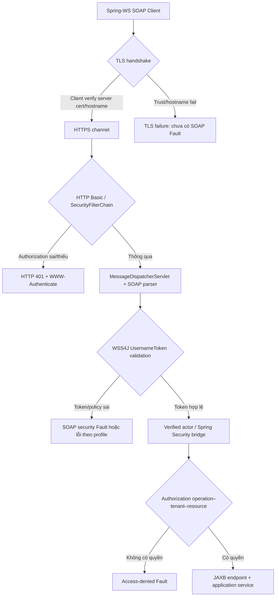
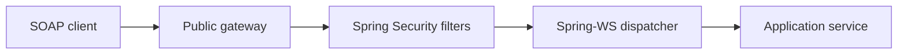
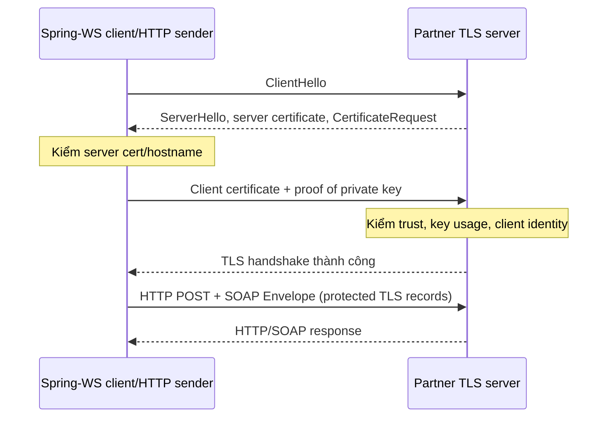

# Xác thực HTTP Basic, TLS phía máy khách và WS-Security UsernameToken

Trong hệ thống SOAP phát triển bằng **Spring Web Services (Spring-WS)**, ba khái niệm **HTTP Basic**, **TLS phía máy khách** và **WS-Security UsernameToken** thường xuất hiện cạnh nhau trong yêu cầu tích hợp đối tác. Chúng đều liên quan đến danh tính hoặc mật khẩu, nhưng được thực thi ở **những tầng khác nhau**. Vì vậy, việc bật một cơ chế không tự kích hoạt hai cơ chế còn lại, và một yêu cầu “cần xác thực” chưa đủ để xác định phải cấu hình ở đâu.

- **HTTP Basic Authentication:** HTTP client gửi `Authorization: Basic …`; Spring Security filter chain hoặc gateway kiểm tra thông tin xác thực **trước khi SOAP endpoint thực thi**.
- **TLS phía máy khách:** SOAP client xác minh danh tính **TLS server** qua chứng chỉ, hostname và truststore. Khi dùng **mutual TLS (mTLS)**, client còn trình chứng chỉ của mình để TLS server/gateway xác thực **TLS peer phía client**.
- **WS-Security UsernameToken:** SOAP message mang `wsse:UsernameToken` trong `soap:Header`; một WS-Security processor như Apache WSS4J tích hợp với Spring-WS kiểm tra token **theo chính sách message-level**, không dựa vào HTTP Basic.

Bài thuộc chương **Tích hợp Spring Security** của module `SPRING_WEB_SERVICES`. Ta sẽ xây dựng tư duy **contract-first** dựa trên XSD/WSDL/JAXB, phân biệt trách nhiệm HTTP filter, HTTPS client, `Wss4jSecurityInterceptor` và application authorization; tìm hiểu PasswordText/PasswordDigest, nonce/Created, certificate, SOAP Fault, proxy, thời gian chờ, kiểm thử tương thích và các lỗi cấu hình nguy hiểm.

> **Nguyên tắc:** “HTTP 401”, “TLS handshake failure” và “SOAP security Fault” là **ba lớp lỗi khác nhau**. Xác thực ở bất cứ lớp nào cũng **không tự cấp quyền** trên operation, tenant hoặc order. Luôn kiểm tra **danh tính đã được xác minh ở đâu**, **được chuyển tiếp qua ranh giới nào**, và **business service lấy principal từ nguồn nào**.

## 1. Bản đồ ba tầng xác thực trong một SOAP call

Một request từ đối tác có thể đi qua cả ba lớp trước khi tới endpoint nghiệp vụ:



Sơ đồ mô tả **hệ thống dùng đủ cả ba lớp**; không phải SOAP API nào cũng buộc dùng đồng thời HTTP Basic, mTLS và UsernameToken. Có hệ chỉ dùng HTTPS + HTTP Basic; có hệ dùng HTTPS + UsernameToken; có hệ cần mTLS + chữ ký SOAP. Lựa chọn phải theo **threat model, hợp đồng đối tác và chính sách tổ chức**.

Trong kiến trúc có API gateway, **HTTP Basic và mTLS có thể được kiểm tra ở gateway** thay vì Spring-WS application. Khi đó phải định nghĩa cách gateway truyền kết quả xác thực tới backend bằng **kênh đáng tin**, tránh tin một HTTP header do public client tự khai.

## 2. So sánh phạm vi bảo vệ và nơi xử lý

| Tiêu chí | HTTP Basic | TLS từ client; mTLS nếu được yêu cầu | WS-Security UsernameToken |
| --- | --- | --- | --- |
| Vị trí thông tin | HTTP `Authorization` header | TLS handshake, certificate và proof-of-possession | `wsse:Security/wsse:UsernameToken` trong SOAP Header |
| Thành phần xác minh | HTTP gateway, `SecurityFilterChain`, authentication provider | TLS server/client, SSL context, trust/key managers | WS-Security processor, WSS4J callback/validator |
| Xác thực danh tính nào | HTTP account/credential | TLS peer/server; thêm client peer qua mTLS | Username trong SOAP token theo credential/policy |
| Tính bí mật password | **Không**, vì Base64 chỉ encoding | TLS bảo vệ byte **trên chặng TLS** | Phụ thuộc PasswordText/Digest và bảo vệ kênh/message |
| Bảo vệ SOAP Body khỏi sửa trên nhiều hop | Không | Chỉ tính toàn vẹn của byte trên chặng TLS | UsernameToken **một mình không ký Body** |
| Cần XSD/WSDL để xác minh? | Không | Không | Không nhất thiết; hợp đồng/profile WS-Security cần rõ |
| Kết quả lỗi thông dụng | HTTP 401/403 | TLS handshake/connection exception | SOAP Fault nếu đã tạo/parse được SOAP |
| Tự tạo `SecurityContextHolder`? | Có thể qua Spring Security filter | Không mặc định nếu terminate ở gateway | **Không được giả định**, cần integration/bridge |
| Tự cấp quyền `CancelOrder`? | Không | Không | Không |
| Chống XXE/DTD và XML bomb? | Không | Không | Không; parser đầu tiên vẫn phải bảo vệ |
| Ngăn retry tạo giao dịch trùng? | Không | Không | Không; cần business idempotency |

### Ba câu hỏi cần hỏi khi tiếp nhận yêu cầu đối tác

1. Đối tác yêu cầu **HTTP Basic** hay **SOAP UsernameToken**? Cùng username/password **không có nghĩa là cùng protocol**.
2. “TLS phía client” nghĩa là **client phải tin server certificate** (luôn cần với HTTPS bảo mật đúng) hay **client phải xuất trình certificate để mTLS**? Đây là hai trách nhiệm khác nhau.
3. Ai phải kiểm tra danh tính: **gateway**, **Spring Security HTTP filter**, **WS-Security interceptor** hay kết hợp? Ai chịu trách nhiệm **authorization** ở application service?

Nếu tài liệu chỉ ghi “SOAP security: username/password”, cần đối chiếu **đúng HTTP header hay WS-Security SOAP Header** trong hợp đồng tích hợp; không tự suy đoán một trong hai.

## 3. HTTP Basic thực sự gửi những gì?

HTTP Basic là cơ chế xác thực của **HTTP**, thường theo mẫu:

```http
POST /services/orders HTTP/1.1
Host: api.partner.example
Content-Type: text/xml; charset=utf-8
SOAPAction: "urn:example:orders:v1:GetOrder"
Authorization: Basic <base64-encoded-credentials>
```

Phần giá trị `Basic` là Base64 của biểu diễn `username:password` theo quy tắc của HTTP Basic. **Base64 không phải mã hóa bảo mật**; bất kỳ bên nào đọc được header đều có thể decode credential. Vì thế, chỉ dùng Basic qua **HTTPS được xác minh đầy đủ**, không gửi credential qua HTTP plaintext.

Nếu credential sai hoặc thiếu, phía server/gateway thường trả challenge trước khi xử lý SOAP:

```http
HTTP/1.1 401 Unauthorized
WWW-Authenticate: Basic realm="soap-partner"
Cache-Control: no-store
```

Response HTTP 401 **không buộc chứa SOAP Envelope**; client Spring-WS có thể gặp lỗi HTTP/transport/authentication chứ **không** phải `SoapFaultClientException`.

### Các vấn đề cần lưu ý với Basic

- Basic gửi lại credential trên các request HTTP có authentication phù hợp; secret phải được quản lý như **mật khẩu dài hạn hoặc credential có thời hạn**, không log.
- HTTP client có thể sử dụng **challenge–response** hoặc **preemptive Basic** tùy cấu hình. Không phải mọi HTTP sender đều tự gửi header Authorization ngay lần đầu.
- Định tuyến qua proxy hoặc HTTP redirect có thể làm credential bị chuyển sai hostname nếu HTTP client cấu hình không an toàn.
- Khi Basic được kiểm tra ở gateway, SOAP application phía sau cần một cơ chế **truyền danh tính được xác thực** chứ không tự tin giá trị `X-User` từ bên ngoài.
- HTTP Basic phân biệt trạng thái “chưa xác thực” và “đã xác thực nhưng không có quyền”; **401** và **403** có ý nghĩa HTTP khác nhau, nhưng endpoint có thể có chính sách Fault riêng.

**Không đưa credential Basic vào SOAP Body hoặc SOAPAction.** HTTP client/message sender chịu trách nhiệm tạo HTTP Authorization, còn JAXB marshaller xử lý SOAP payload.

## 4. Spring Security `SecurityFilterChain` cho HTTP Basic

Trong Spring Security hiện đại, HTTP Basic thường được bảo vệ bằng một `SecurityFilterChain`. Đoạn Java sau là **ví dụ cấu hình servlet**, áp cho SOAP POST dưới đường `/services/**` và giả định `MessageDispatcherServlet` đã được đăng ký vào đường đó:

```java
import org.springframework.context.annotation.Bean;
import org.springframework.context.annotation.Configuration;
import org.springframework.core.annotation.Order;
import org.springframework.http.HttpMethod;
import org.springframework.security.config.Customizer;
import org.springframework.security.config.annotation.web.builders.HttpSecurity;
import org.springframework.security.config.http.SessionCreationPolicy;
import org.springframework.security.web.SecurityFilterChain;

@Configuration
public class SoapHttpSecurityConfiguration {

    @Bean
    @Order(1)
    SecurityFilterChain soapHttpSecurity(HttpSecurity http)
            throws Exception {

        http.securityMatcher("/services/**");

        http.authorizeHttpRequests(authorize -> authorize
                .requestMatchers(HttpMethod.POST, "/services/**")
                .authenticated()
                .anyRequest().denyAll());

        http.httpBasic(Customizer.withDefaults());

        http.sessionManagement(session -> session
                .sessionCreationPolicy(SessionCreationPolicy.STATELESS));

        // Chỉ xem xét cấu hình CSRF cho SOAP API stateless không
        // dùng browser cookie/session như một credential tự động.
        // Xem giải thích riêng ở phần dưới.

        return http.build();
    }
}
```

**Ví dụ không tự định nghĩa user store**. Cần cấu hình `AuthenticationProvider`, `UserDetailsService`/password encoder hoặc provider tương ứng để Spring Security kiểm tra tài khoản thật. Không hard-code người dùng/mật khẩu trong source code. Với một ứng dụng có nhiều `SecurityFilterChain`, phải bảo đảm không có một chain khác ưu tiên cao hơn cho phép request đi vào SOAP servlet mà không xác thực.

### Phạm vi của filter chain và servlet mapping phải khớp

Giả sử SOAP servlet có hai đường vào: `/services/orders` và `/legacy/ws/orders`. Chain ở trên chỉ bảo vệ `/services/**`; nếu legacy path vẫn trỏ vào cùng endpoint thì có thể tạo **đường bỏ qua HTTP Basic**.

Cần kiểm tra thực tế:

1. URL public sau gateway/reverse proxy.
2. `contextPath` và `servletPath` của Spring MVC/Servlet container.
3. `MessageDispatcherServlet` mapping thực tế.
4. Matchers và thứ tự các `SecurityFilterChain`.
5. Những path không match chain này sẽ đi qua chain khác như thế nào.
6. Client có thể POST trực tiếp vào backend ngoài gateway hay không.

**Đường không khớp security matcher không mặc nhiên bị từ chối**; kết quả phụ thuộc các security chains còn lại. Khi thiết kế private SOAP API, hãy có default policy **deny/authenticated** cho mọi entrypoint hiệu lực.

### CSRF khi dùng HTTP Basic

Có tình huống SOAP API dùng Basic với **non-browser service accounts**, không dựa vào browser cookies/session, nên một nhóm phát triển cấu hình CSRF exemption cho đúng endpoint. Nhưng **HTTP Basic cũng có thể được browser tự gửi sau khi user đăng nhập**, tạo nguy cơ CSRF ở request thay đổi trạng thái.

Vì vậy, **không tắt CSRF mặc định chỉ vì “đây là SOAP”**. Nếu quyết định exemption, cần chứng minh endpoint không dùng ambient browser credentials hoặc có kiểm soát CSRF tương đương, giới hạn exemption đúng path/method và test route thay đổi trạng thái. Kết hợp HTTPS, authorization và chính sách CORS/browser phù hợp.

## 5. HTTP Basic ở gateway so với HTTP Basic tại Spring Security

Có hai mô hình hay gặp:



| Mô hình | Gateway làm gì? | Backend phải làm gì? |
| --- | --- | --- |
| Basic được kiểm tra tại backend | Forward HTTPS request/header đúng policy | `SecurityFilterChain` xác thực Basic, kiểm tra quyền |
| Basic được kiểm tra tại gateway | Chặn credential sai, ánh xạ service account | Chỉ nhận verified identity qua kênh tin cậy; vẫn authorization |
| Gateway và backend cùng xác thực | Cả hai kiểm tra theo hợp đồng | Không rò secret, policy rõ; tránh double challenge khó debug |
| Gateway đổi Basic thành credential nội bộ | Exchange/propagate identity được quản lý | Không tin header giả từ Internet; kiểm tra quyền backend |

**Không tự coi `X-Authenticated-User: partner-a` là danh tính đáng tin**. Public client có thể tự thêm header trùng tên. Gateway phải **loại bỏ/ghi đè header do client nhập**, xác minh backend connection và truyền identity bằng trusted mechanism như mTLS/service token hoặc cơ chế pre-auth phù hợp đã được bảo vệ.

Spring Security `SecurityContextHolder` trong servlet request thường có principal sau khi Basic Authentication Filter thành công. Tuy nhiên, nếu Basic chỉ được xác minh tại gateway, backend sẽ **không tự có cùng Authentication** nếu không có cấu hình pre-auth/identity propagation đúng.

## 6. Spring-WS client gửi Basic: đặt ở HTTP sender, không ở SOAP Header

Trong client Spring-WS, `WebServiceTemplate` chuẩn bị SOAP message và dùng `WebServiceMessageSender` để vận chuyển. **HTTP Basic thuộc HTTP sender/client credentials configuration**.

```java
import org.springframework.ws.client.core.WebServiceTemplate;
import org.springframework.ws.soap.client.core.SoapActionCallback;

public final class OrdersSoapClient {
    private final WebServiceTemplate template;

    public OrdersSoapClient(WebServiceTemplate template) {
        this.template = template;
    }

    public Object getOrder(GetOrderRequest request) {
        return template.marshalSendAndReceive(
                request,
                new SoapActionCallback(
                        "urn:example:orders:v1:GetOrder"));
    }
}
```

`GetOrderRequest` được giả định là JAXB class sinh từ XSD; bean `template` phải được cung cấp marshaller/unmarshaller, URI mặc định, HTTP sender và credential policy. Đoạn code **không tự gắn Basic**, vì đó là trách nhiệm của HTTP transport.

### Chọn loại HTTP sender đúng phiên bản

Một số Spring-WS versions dùng sender dựa trên `HttpURLConnection`; những versions/dependency combinations khác hỗ trợ Apache HttpClient 4 hoặc 5 với cấu hình credentials provider, TLS, proxy và connection pool. **API class và setter credential thay đổi theo Spring-WS/HTTP client**.

Thay vì giả định một class Java sẽ chạy với mọi release, hãy dựa trên mô hình:

```text
WebServiceTemplate
  └── HTTP WebServiceMessageSender
        └── HTTP client / credentials provider
              ├── approved endpoint host + realm/scope
              ├── HTTP Basic username / secret from secret manager
              ├── TLS trust / optional client certificate
              ├── redirect and proxy policy
              └── connect/read/pool timeouts
```

**Không chia sẻ credential provider không giới hạn scope** qua những đối tác khác nhau. Với một template có thể thay URI mỗi lần gọi, cần bảo đảm credentials không tự được gửi sang host vừa override ngoài allowlist. Nếu đối tác dùng **mTLS/Basic/WS-Security khác nhau**, lựa chọn an toàn hơn thường là **mỗi security profile một HTTP client/template**.

### Basic preemptive có cần thiết không?

Một số đối tác chỉ chấp nhận Basic được gửi ngay trong request đầu tiên; client khác đợi `401 WWW-Authenticate` rồi gửi lại. Với SOAP POST tạo tác dụng nghiệp vụ, việc HTTP client **tự gửi lại sau challenge** phải được hiểu rõ:

- Mức độ server đã xử lý request trước khi 401 phụ thuộc hệ thống; authentication filter đúng thường từ chối trước business.
- Không bật retry HTTP POST tràn lan vì response timeout sau server commit khác với 401 challenge.
- Không cho redirect chuyển Basic sang hostname khác hoặc scheme HTTP plaintext.
- Dùng integration test kiểm chứng số lần POST thật, header Authorization và business effect.

## 7. TLS phía máy khách: xác thực **máy chủ** là việc đầu tiên

Khi client kết nối đến `https://orders.partner.example/ws`, nó phải xác thực TLS server:

1. DNS/endpoint URI trỏ đến host được phép gọi.
2. Certificate chain server được kiểm tra theo **trust anchors** được cấp phép.
3. **Hostname verification** so URI host với Subject Alternative Name của chứng chỉ.
4. TLS protocol/cipher phù hợp policy.
5. Revocation/certificate pinning nếu tổ chức áp dụng phải nhất quán với quy trình rotation.
6. Không cho chuyển hướng sang HTTP plaintext hoặc host ngoài allowlist rồi tiếp tục gửi Basic/UsernameToken.

Lỗi `SSLHandshakeException` xảy ra **trước khi SOAP message được xử lý ở server**, nên thường **không có SOAP Fault**. Không sửa bằng cách tắt hostname verification hoặc “trust all” — điều đó khiến credential và SOAP Body có thể được gửi tới máy chủ giả.

### Truststore không phải keystore chứa danh tính client

| Thành phần | Chức năng thường gặp |
| --- | --- |
| **Truststore** | Chứa trust anchors/chứng chỉ dùng để xác minh peer (server certificate và chain theo policy) |
| **Keystore client identity** | Chứa private key và certificate chain mà client xuất trình khi server yêu cầu **mTLS** |
| **Hostname verifier** | Xác minh server certificate phù hợp hostname URI |
| **TLS server key material** | Do server/gateway giữ để chứng minh danh tính endpoint |
| **WS-Security signing/encryption key** | Dùng ở lớp SOAP message, có thể khác TLS keys |

Đưa private key của client vào **truststore** không phải giải pháp mTLS; tương tự, chỉ có truststore server certificate **không** làm client tự trình certificate. Cần cấu hình chính xác `KeyManager`/`TrustManager` trong SSL context của HTTP client.

## 8. mTLS: client trình certificate, server xác minh TLS peer

**mTLS (mutual TLS)** mở rộng HTTPS thông thường: phía server cũng yêu cầu/xác minh client certificate trong handshake. Kết quả cho biết TLS peer phía client đã chứng minh quyền sở hữu private key tương ứng với certificate được policy chấp nhận.



Sơ đồ là **mô hình khái niệm**, không phải transcript chuẩn cho mọi phiên bản TLS 1.2/1.3.

Các điều kiện vận hành:

- Server/gateway phải **thực sự yêu cầu và validate client cert**, không chỉ log certificate nếu được cung cấp.
- Trust policy cần gắn certificate với **đối tác/service account cụ thể**, không nhận mọi certificate do một CA quá rộng phát hành mà không mapping.
- Certificate phải có key usage/EKU phù hợp và chưa hết hạn; rotation cần overlap window theo policy.
- Private key chỉ nằm ở client/secret store/HSM được cấp phép; không đi cùng source repository hoặc trong SOAP Header.
- Nếu TLS kết thúc tại gateway, SOAP backend **không tự nhìn thấy TLS client certificate** và cần identity propagation tin cậy.

**mTLS khác WS-Security X.509 signature**: mTLS xác thực peer của **kết nối**, còn SOAP XML Signature có thể xác minh người ký những **SOAP parts được tham chiếu** qua nhiều hop nếu trust/policy được thực thi đúng. Chúng không tự thay thế nhau.

## 9. Ví dụ chuẩn Java: tạo SSLContext từ key/trust material

Để hiểu các thành phần thực tế, có thể xem **mã Java chuẩn** tạo `SSLContext`. HTTP sender/framework-specific connector phải được cấu hình để **dùng SSLContext này**; việc tạo bean mà không gắn vào HTTP client không thay đổi TLS.

```java
import java.io.InputStream;
import java.security.KeyStore;
import javax.net.ssl.KeyManagerFactory;
import javax.net.ssl.SSLContext;
import javax.net.ssl.TrustManagerFactory;

public final class SoapClientTls {
    private SoapClientTls() {}

    public static SSLContext createContext(
            InputStream trustStoreStream,
            char[] trustStorePassword,
            InputStream clientKeyStoreStream,
            char[] clientKeyStorePassword) throws Exception {

        KeyStore trust = KeyStore.getInstance("PKCS12");
        trust.load(trustStoreStream, trustStorePassword);

        TrustManagerFactory tmf = TrustManagerFactory.getInstance(
                TrustManagerFactory.getDefaultAlgorithm());
        tmf.init(trust);

        KeyStore identity = KeyStore.getInstance("PKCS12");
        identity.load(clientKeyStoreStream, clientKeyStorePassword);

        KeyManagerFactory kmf = KeyManagerFactory.getInstance(
                KeyManagerFactory.getDefaultAlgorithm());
        kmf.init(identity, clientKeyStorePassword);

        SSLContext context = SSLContext.getInstance("TLS");
        context.init(kmf.getKeyManagers(), tmf.getTrustManagers(), null);
        return context;
    }
}
```

Đây là **ví dụ có đủ hai store cho mTLS**, chưa phải cấu hình trọn vẹn một `WebServiceTemplate`. Nếu server chỉ yêu cầu HTTPS thông thường, client không nhất thiết có keystore identity; có thể khởi tạo SSL context chỉ với trust managers.

**Những điều bắt buộc khi áp dụng:**

1. Input streams và `char[]` phải lấy từ nơi cấp secret được quản lý và được đóng/xóa theo lifecycle; **không hard-code password/private key**.
2. HTTP client phải được gắn **đúng context và hostname verifier an toàn**. `SSLContext` riêng không bảo đảm hostname validation nếu caller tắt kiểm tra host.
3. Khi nhiều đối tác cần trust/identity riêng, dùng HTTP client/sender **theo đối tác**, không thay global `javax.net.ssl.*` system properties trên JVM dùng chung nếu có thể tránh.
4. Có thể cần chọn đúng certificate alias và client key usage khi keystore chứa nhiều identity.
5. Test bằng TLS server có kiểm soát: đúng cert, sai host, hết hạn, chưa trust, mTLS thiếu identity và rotation.

**Không dùng `TrustManager` chấp nhận mọi certificate** trong implementation thật để “chữa lỗi” sandbox/staging.

## 10. UsernameToken nằm trong SOAP Header, không phải HTTP Basic

**WS-Security UsernameToken** mô tả credential mang trong `wsse:Security` của SOAP message. Một request SOAP 1.1 có thể chứa:

```xml
<soap:Envelope
    xmlns:soap="http://schemas.xmlsoap.org/soap/envelope/"
    xmlns:wsse="http://docs.oasis-open.org/wss/2004/01/oasis-200401-wss-wssecurity-secext-1.0.xsd"
    xmlns:wsu="http://docs.oasis-open.org/wss/2004/01/oasis-200401-wss-wssecurity-utility-1.0.xsd"
    xmlns:ord="https://example.com/orders/v1">
  <soap:Header>
    <wsse:Security>
      <wsse:UsernameToken wsu:Id="ut-001">
        <wsse:Username>partner-a</wsse:Username>
        <wsse:Password
          Type="http://docs.oasis-open.org/wss/2004/01/oasis-200401-wss-username-token-profile-1.0#PasswordText"
        >example-secret-not-real</wsse:Password>
      </wsse:UsernameToken>
    </wsse:Security>
  </soap:Header>
  <soap:Body>
    <ord:GetOrderRequest>
      <ord:orderId>42</ord:orderId>
    </ord:GetOrderRequest>
  </soap:Body>
</soap:Envelope>
```

Đây là **cấu trúc XML minh họa**. Secret chỉ là chuỗi giả, **không dùng message này trên hệ thống thật**. PasswordText là mật khẩu dạng text ở cấp SOAP token; nếu chỉ có HTTPS, proxy/endpoint kết thúc TLS có thể đọc được token. Vì vậy:

- Không log `wsse:Security` hoặc toàn bộ SOAP Envelope.
- Luôn dùng HTTPS với server validation; khi qua gateway/broker phải xác định ai được đọc token.
- Nếu policy yêu cầu chứng minh tính toàn vẹn của Body và Headers, **UsernameToken một mình không thay XML Signature**.
- Nếu token được dùng để thiết lập principal, phải có **WS-Security processor xác minh** trước nghiệp vụ.
- Không nhận `<wsse:Username>admin</wsse:Username>` như một principal chỉ vì XML parser đã đọc tên đó.

### Thử cùng username/password ở HTTP Basic có được không?

Có thể tổ chức **dùng hai tài khoản khác nhau hoặc cùng principal theo policy**, nhưng về kỹ thuật **chúng là hai cơ chế riêng**. Một HTTP sender gửi Basic đúng không tạo UsernameToken. Một SOAP client thêm UsernameToken đúng không tạo HTTP Authorization.

Dùng cùng secret ở cả hai lớp có thể tăng tác động nếu lộ một nơi; cần cân nhắc credential separation, rotation và scope. Một endpoint chỉ yêu cầu UsernameToken **không nên vô tình chấp nhận một request chỉ có Basic** trừ khi đó là policy đã thiết kế.

## 11. PasswordText và PasswordDigest của UsernameToken

WS-Security UsernameToken Profile có các cách biểu diễn password quen thuộc:

| Kiểu | Thông tin thường gửi | Cần lưu ý |
| --- | --- | --- |
| **PasswordText** | Giá trị password ở token dạng text | Không an toàn nếu message không được bảo vệ; phù hợp khi policy/transport bảo vệ và verifier kiểm soát secret |
| **PasswordDigest** | Digest tính từ **nonce + created + secret** theo profile | Không có secret rõ trong token, nhưng **không tự thay TLS/chữ ký hoặc chống brute-force với password yếu** |

Mô tả dạng công thức của UsernameToken PasswordDigest phổ biến:

```text
Password_Digest =
    Base64( SHA-1( NonceBytes || UTF8(Created) || UTF8(Password) ) )
```

`NonceBytes` là **bytes sau khi decode nonce từ Base64**, không phải chuỗi Base64 text. `Created` phải được diễn giải theo representation mà hai bên dùng trong profile; thay đổi định dạng/whitespace có thể làm digest khác.

Ví dụ fragment token với các **giá trị minh họa không thể dùng để xác thực**:

```xml
<wsse:UsernameToken
    xmlns:wsse="http://docs.oasis-open.org/wss/2004/01/oasis-200401-wss-wssecurity-secext-1.0.xsd"
    xmlns:wsu="http://docs.oasis-open.org/wss/2004/01/oasis-200401-wss-wssecurity-utility-1.0.xsd">
  <wsse:Username>partner-a</wsse:Username>
  <wsse:Password
      Type="http://docs.oasis-open.org/wss/2004/01/oasis-200401-wss-username-token-profile-1.0#PasswordDigest"
  >DIGEST_PLACEHOLDER</wsse:Password>
  <wsse:Nonce EncodingType="http://docs.oasis-open.org/wss/2004/01/oasis-200401-wss-soap-message-security-1.0#Base64Binary"
  >NONCE_PLACEHOLDER</wsse:Nonce>
  <wsu:Created>2026-01-01T10:00:00Z</wsu:Created>
</wsse:UsernameToken>
```

Ngày và digest trong ví dụ không hợp lệ cho một message hiện tại. Khi triển khai thật, hãy để WSS4J tạo digest/nonce/timestamp và verify theo policy; **không tự implement thủ công cho production** nếu thư viện được hỗ trợ đã có chức năng này.

### PasswordDigest có phải lựa chọn an toàn tuyệt đối?

**Không.** Digest của UsernameToken theo profile này sử dụng SHA-1 như một phần định dạng kế thừa, **không phải hàm băm mật khẩu chậm để lưu trữ**. Với password yếu, kẻ có token có thể thử đoán offline tùy threat model. Vì vậy phải dùng:

- Credential ngẫu nhiên/độ mạnh phù hợp và secret management.
- HTTPS và trust/hostname validation.
- Nonce, Created, timestamp skew, replay protection và rate limiting.
- Chính sách xác thực/WS-Security đúng profile; thêm XML Signature khi cần chứng minh tính toàn vẹn message.
- Không tự suy rằng “PasswordDigest = mã hóa password” hoặc “PasswordDigest = non-repudiation”.

**Chi tiết vận hành quan trọng:** Một verifier digest cần khả năng truy cập secret tương ứng (hoặc một cơ chế verify được profile hỗ trợ). Không thể mặc định dùng một giá trị **BCrypt hash chỉ lưu một chiều** để tái tính đúng PasswordDigest của UsernameToken. Đây là lý do cần phân biệt kiến trúc **PasswordText + one-way password verifier** với **PasswordDigest + protected shared secret**.

## 12. Nonce, Created và replay protection

Nonce là một giá trị sinh mới, `Created` xác định thời điểm theo profile. Chúng giúp recipient phát hiện phát lại cùng credential/token khi có **server-side replay cache** và cửa sổ thời gian phù hợp.

```mermaid
sequenceDiagram
    participant C as SOAP client
    participant W as WSS4J / server
    participant R as Replay cache
    C->>W: UsernameToken (Username, Nonce N1, Created T1, Digest)
    W->>R: Check (principal, nonce, created) chưa dùng?
    R-->>W: Chưa dùng; reserve theo policy
    W-->>C: SOAP response
    C->>W: Replay nguyên token N1/T1
    W->>R: Check replay key N1/T1
    R-->>W: Đã dùng
    W-->>C: Security fault / reject
```

Đây là **mô hình khái niệm**. Chi tiết key của replay cache, TTL, số lần lưu, thuật toán và cách áp multi-node cluster phụ thuộc implementation/configuration.

Nếu nhiều pod cùng nhận SOAP request mà replay cache chỉ ở memory từng pod, một token trùng có thể đi sang pod khác và vượt qua mục tiêu chống replay theo cluster. Cần kiểm tra **state sharing hoặc policy tương đương** nếu bảo đảm yêu cầu ở mức toàn cụm.

### Replay của token khác retry nghiệp vụ

Nếu client timeout sau khi server đã tạo đơn, việc gửi lại **nguyên SOAP Envelope với Nonce/Created cũ** có thể bị security processor từ chối là replay. Một retry hợp lệ có thể tạo **SOAP message mới** với token/nonce/timestamp mới, nhưng phải giữ **business idempotency key** cũ để tránh tạo hai đơn.

**Chống replay UsernameToken không ngăn được hai request hợp lệ có nonce khác nhau nhưng cùng ý định nghiệp vụ.** Với CreateOrder/ChargePayment, cần idempotency/reconciliation trong business layer.

## 13. Spring-WS inbound: `Wss4jSecurityInterceptor` xác minh UsernameToken

Spring-WS tích hợp WSS4J để xử lý WS-Security SOAP Header. Ví dụ đối với các nhánh sử dụng package `org.springframework.ws.soap.security.wss4j2`:

```java
import javax.security.auth.callback.CallbackHandler;
import org.springframework.context.annotation.Bean;
import org.springframework.context.annotation.Configuration;
import org.springframework.ws.soap.security.wss4j2.Wss4jSecurityInterceptor;

@Configuration
public class UsernameTokenSecurityConfiguration {

    @Bean
    public Wss4jSecurityInterceptor usernameTokenInterceptor(
            CallbackHandler tokenPasswordCallbackHandler) {

        Wss4jSecurityInterceptor interceptor =
                new Wss4jSecurityInterceptor();

        interceptor.setValidationActions("UsernameToken Timestamp");
        interceptor.setValidationCallbackHandler(
                tokenPasswordCallbackHandler);

        return interceptor;
    }
}
```

**Ý nghĩa:**

- `setValidationActions("UsernameToken Timestamp")` yêu cầu WSS4J processor thực hiện các action thích hợp theo cấu hình/profile.
- `setValidationCallbackHandler(...)` cung cấp cơ chế tra secret hoặc logic callback mà WSS4J dùng theo token type/version.
- `CallbackHandler` cần **implementation an toàn** và phải dùng đúng WSS4J callback semantics; không phải bất kỳ handler nào trả về chuỗi đều là validator chính xác.
- **Chưa bảo đảm** interceptor được đăng ký vào endpoint chain. Cần `WsConfigurer#addInterceptors` hoặc cơ chế tương ứng.
- Cấu hình thật còn cần kiểm soát UsernameToken password type, replay cache, timestamp TTL/clock skew, credential storage, được phép dùng UsernameToken hay phải có signature/encryption, và Fault mapping.
- Nếu project dùng package, Spring-WS version hoặc WSS4J generation khác, phải đối chiếu API thực tế. Đoạn code trên không thay thế integration test với SOAP message được sinh thật.

### Cảnh báo về `setValidationActions`

Một policy chỉ liệt kê actions **không mặc định chứng minh**:

1. UsernameToken đã được ánh xạ vào **Spring SecurityContext**.
2. Credential thuộc đúng đối tác/tenant có quyền.
3. SOAP Body hoặc `wsa:Action` đã được ký.
4. Những certificate/key của đối tác đã được trust theo chính sách.
5. Thông điệp không thể replay xuyên cụm.
6. Tất cả endpoint/servlet đều đi qua security interceptor.

Tương tự, security interceptor không thể bảo vệ một **XML parser đã chạy trước nó** khỏi XXE. Parser/transport limits phải được cấu hình độc lập.

## 14. Callback UsernameToken: tra mật khẩu để WSS4J xác minh

Một callback handler cho WSS4J có thể lấy shared secret từ một **kho bí mật được quản trị**, trả cho WSS4J để thư viện verify theo token type. Dưới đây là **mẫu ý tưởng cho UsernameToken password callbacks**; cần kiểm tra `WSPasswordCallback.Usage` chính xác trên WSS4J version đang dùng và chính sách không tiết lộ sự tồn tại của username.

```java
import java.io.IOException;
import javax.security.auth.callback.Callback;
import javax.security.auth.callback.CallbackHandler;
import javax.security.auth.callback.UnsupportedCallbackException;
import org.apache.wss4j.common.ext.WSPasswordCallback;

public final class PartnerTokenPasswordCallback
        implements CallbackHandler {

    private final PartnerSecretStore secrets;

    public PartnerTokenPasswordCallback(
            PartnerSecretStore secrets) {
        this.secrets = secrets;
    }

    @Override
    public void handle(Callback[] callbacks)
            throws IOException, UnsupportedCallbackException {

        for (Callback callback : callbacks) {
            if (!(callback instanceof WSPasswordCallback password)) {
                throw new UnsupportedCallbackException(callback);
            }

            // getIdentifier() là username trong callback được WSS4J
            // cung cấp. Chỉ trả secret để WSS4J kiểm tra
            // PasswordText/PasswordDigest theo policy.
            String secret = secrets.findSharedSecret(
                    password.getIdentifier());

            if (secret == null) {
                throw new IOException(
                        "UsernameToken verification unavailable");
            }
            password.setPassword(secret);
        }
    }
}
```

`PartnerSecretStore` là **interface ứng dụng tự định nghĩa** để truy xuất shared secret từ secret manager/vault hoặc cơ chế bảo mật tương đương. Ví dụ **không cho client tự chọn secret store**, không dùng raw Username như quyền truy cập tenant, và không log secret.

**Giới hạn rất quan trọng của ví dụ:**

- WSS4J có nhiều `WSPasswordCallback` usage cho **ký, giải mã, UsernameToken, secret lookup...**. Một handler sản phẩm phải phân loại/cấu hình đúng loại callback và **không trả private-key password/secret ngoài phạm vi**. Ví dụ này dành cho bean interceptor **chỉ xử lý UsernameToken**.
- Với **PasswordText** và user store chỉ giữ BCrypt/Argon2 hash, một kiến trúc xác minh riêng phù hợp hơn việc yêu cầu trả plaintext secret. Không coi handler ở trên là giải pháp password authentication tổng quát.
- Với **PasswordDigest**, WSS4J thường cần secret tương ứng để tính/kiểm digest; sử dụng cơ chế vault, hạn chế quyền truy cập và rotation.
- Khi callback xác minh username/password, **authorization vẫn ở bước sau**. Username tự khai không phải quyền, trừ khi verification đã thành công.
- Nếu dùng WSS4J/custom validator đưa ra verified identity, việc ánh xạ sang Spring Security phải dựa trên **kết quả đã xác minh**, không dựa trên raw `wsse:Username` trước verification.

## 15. Đăng ký security interceptor đúng endpoint mapping

Một bean WSS4J trong Spring context **không tự bảo vệ mọi SOAP endpoint**. Với Spring-WS annotation configuration có `@EnableWs` và `WsConfigurer`:

```java
import java.util.List;
import org.springframework.context.annotation.Configuration;
import org.springframework.ws.config.annotation.EnableWs;
import org.springframework.ws.config.annotation.WsConfigurer;
import org.springframework.ws.server.EndpointInterceptor;
import org.springframework.ws.soap.security.wss4j2.Wss4jSecurityInterceptor;

@Configuration
@EnableWs
public class OrdersWsConfiguration implements WsConfigurer {
    private final Wss4jSecurityInterceptor usernameTokenSecurity;

    public OrdersWsConfiguration(
            Wss4jSecurityInterceptor usernameTokenSecurity) {
        this.usernameTokenSecurity = usernameTokenSecurity;
    }

    @Override
    public void addInterceptors(
            List<EndpointInterceptor> interceptors) {
        interceptors.add(usernameTokenSecurity);
    }
}
```

Cần đảm bảo đường đi **thực tế** sử dụng chuỗi interceptor trên:

- `@PayloadRoot` route.
- `@SoapAction` route.
- WS-Addressing `@Action` route nếu có.
- Custom `EndpointMapping`, fallback/legacy endpoint.
- SOAP servlet khác hoặc transport adapter nếu hệ thống có nhiều entrypoints.

**Không cho một operation nhạy cảm đi vào cùng application service qua một route không có UsernameToken validation hoặc HTTP/mTLS policy tương đương.** Với multiple security policies, phải kiểm tra việc chọn profile dựa trên **server-controlled route/operation**, không dựa trên một Header như `SecurityLevel=NONE` do client tự gửi.

## 16. Spring-WS outbound: tạo UsernameToken ở SOAP client

Ở client, có thể gắn `Wss4jSecurityInterceptor` để thêm UsernameToken khi securement action được cấu hình:

```java
import org.springframework.context.annotation.Bean;
import org.springframework.ws.soap.security.wss4j2.Wss4jSecurityInterceptor;

@Bean
public Wss4jSecurityInterceptor partnerUsernameTokenSender(
        PartnerCredentialSettings credential) {

    Wss4jSecurityInterceptor interceptor =
            new Wss4jSecurityInterceptor();

    interceptor.setSecurementActions("UsernameToken Timestamp");
    interceptor.setSecurementUsername(credential.username());
    interceptor.setSecurementPassword(credential.password());

    return interceptor;
}
```

`PartnerCredentialSettings` là **kiểu cấu hình ứng dụng tự định nghĩa**; password lấy từ secret manager phù hợp, không hard-code và không đưa vào logs. Đoạn code không cố định password type vì cấu hình **PasswordText hay PasswordDigest** cần phải khớp với WSDL/WS-Policy/tài liệu đối tác và API của WSS4J/Spring-WS version. Nếu policy bắt buộc Digest, hãy cấu hình password type tương ứng theo phiên bản và kiểm thử token thực sinh; không chỉ thay XML string sau khi ký.

Gắn vào `WebServiceTemplate`:

```java
import org.springframework.ws.client.core.WebServiceTemplate;
import org.springframework.ws.client.support.interceptor.ClientInterceptor;

@Bean
public WebServiceTemplate partnerSoapTemplate(
        Jaxb2Marshaller partnerMarshaller,
        Wss4jSecurityInterceptor partnerUsernameTokenSender) {

    WebServiceTemplate template = new WebServiceTemplate();
    template.setDefaultUri("https://orders.partner.example/ws");
    template.setMarshaller(partnerMarshaller);
    template.setUnmarshaller(partnerMarshaller);
    template.setInterceptors(new ClientInterceptor[] {
            partnerUsernameTokenSender
    });

    // TLS, HTTP sender/Basic (nếu cần), timeout, action và
    // các chính sách request/response sẽ được cấu hình thêm.
    return template;
}
```

Đây là **fragment configuration**: cần import `Jaxb2Marshaller` và `Wss4jSecurityInterceptor` từ package tương ứng, khai báo bean marshaller, URI ngoài code và HTTP sender/TLS theo profile.

**Một interceptor WSS4J được cấu hình cho outbound không tự gửi HTTP Basic hoặc client certificate.** Đó là hai tầng khác và phải được cấu hình tại HTTP sender/SSL context.

### UsernameToken có ký SOAP Body không?

**Không tự động.** `setSecurementActions("UsernameToken Timestamp")` chỉ mô tả những actions đó; nếu đối tác yêu cầu XML Signature trên SOAP Body, cần bổ sung **Signature action, signing key, signed parts và trust policy** theo phiên bản thực tế. Đừng gửi UsernameToken rồi khẳng định Body đã được bảo vệ message-level.
## 17. Spring SecurityContext: UsernameToken không tự là HTTP Basic principal

Một nhầm lẫn nguy hiểm là nghĩ rằng **WSS4J đã verify UsernameToken** thì `SecurityContextHolder.getContext().getAuthentication()` luôn chứa principal đó. Điều này **phụ thuộc cấu hình integration**.

Với **HTTP Basic tại servlet filter**, Spring Security thường tạo `Authentication` sau khi `AuthenticationManager`/provider xác thực. Authentication được đặt trong security context của request, và authorization filters/method security có thể dùng nó.

Với **UsernameToken tại SOAP interceptor**, security processor có thể xác minh token và biết tên người dùng, nhưng **không nhất thiết tự đặt** một `Authentication` tương ứng trong Spring SecurityContext. Ứng dụng dùng `@PreAuthorize` có thể gặp hai lỗi:

- UsernameToken hợp lệ nhưng method security không thấy principal → bị từ chối.
- Code tùy chỉnh lấy raw `wsse:Username` rồi tạo Authentication giả **không dựa trên kết quả token đã verify** → giả mạo danh tính.

### Quy tắc ánh xạ an toàn

Một bridge chỉ nên thực hiện luồng tương đương:

```text
WSS4J validates UsernameToken and policy
  -> trusted validation result identifies partner/user
  -> server-side account mapping and account-state checks
  -> AuthenticationManager / verified Authentication
  -> Spring SecurityContext for THIS request
  -> operation/resource authorization
  -> finally: cleanup/restore context by correct lifecycle
```

**Không** xây bridge kiểu:

```java
// ANTI-PATTERN — KHÔNG LÀM:
String name = readUnverifiedSoapHeader("Username");
SecurityContextHolder.getContext().setAuthentication(
        authenticatedAs(name));
```

Một Header mang tên `admin` chỉ là string do client đưa vào. Tạo authentication từ nó mà không kiểm tra password/digest/signature theo policy là lỗi nghiêm trọng.

### Bridge phải quản lý request lifecycle

Với servlet đồng bộ, Spring SecurityContext thường gắn với thread/request. Nhưng SOAP interceptor, custom sender, task executor, async callback hoặc môi trường reactive có lifecycle khác nhau. Nếu code tự đặt `SecurityContextHolder`, phải:

1. Đặt context **sau khi** WSS4J validation và policy cần thiết hoàn tất.
2. Không ghi đè identity đã có từ Basic/mTLS bằng token có mức tin cậy thấp hơn nếu policy không cho.
3. Không làm rò Authentication sang request khác qua thread reuse.
4. Cleanup/restore context trong `finally` hoặc framework-managed lifecycle, kể cả khi SOAP Fault phát sinh.
5. Khi hai cơ chế cùng tồn tại, kiểm tra principal của Basic và UsernameToken có phải cùng đối tác hay hợp đồng có delegation.

**Đừng làm bridge “luôn tin username trong message”** để khắc phục lỗi `@PreAuthorize`. Khác biệt HTTP và SOAP authentication là **ranh giới tin cậy**, không chỉ thiếu một dòng setContext.

## 18. Kết hợp HTTP Basic và UsernameToken: hai chứng cứ hay hai danh tính?

Một đối tác có thể yêu cầu **cả HTTP Basic và UsernameToken**:

```text
HTTP Authorization:
    Basic account = client-service-A

WS-Security UsernameToken:
    Username = operator-42

Request Body:
    GetOrderRequest(orderId = 739)
```

Cần xác định cách diễn giải theo **hợp đồng bảo mật**:

| Chính sách | Nguyên tắc |
| --- | --- |
| Cả hai xác thực **cùng service account** | Bắt buộc ánh xạ principal/đối tác nhất quán |
| Basic xác thực **hệ thống gọi**, UsernameToken xác thực **người dùng thay mặt** | Cần delegation/impersonation policy và chứng cứ quyền |
| Gateway Basic cho phép truy cập network; UsernameToken xác thực SOAP actor | Rõ trust boundary gateway→service, không bỏ authorization backend |
| Chấp nhận **một trong hai** | Chỉ khi policy công bố rõ; không tự “OR” khi operation yêu cầu cả hai |
| Basic bảo vệ route A, UsernameToken bảo vệ route B | Tách route/operation, test không có lối vào yếu tới cùng business effect |

**Không tự lấy “strongest” hoặc “last authentication wins” để chọn principal**. Nếu hai credentials chỉ ra chủ thể không tương thích, hãy từ chối hoặc dùng delegation flow đã thiết kế, không nối chúng thành một identity có quyền rộng hơn.

### Pre-authentication và mTLS tại gateway

Nếu gateway xác minh mTLS client certificate, rồi gửi `X-Verified-Partner=partner-A` tới Spring-WS backend, backend chỉ dùng header này khi:

- Gateway kiểm soát đường đi và **xóa header giả từ public client**.
- Backend chỉ nhận traffic từ gateway đã xác thực, ví dụ internal mTLS.
- Có cơ chế bảo vệ assertion nếu phải qua nhiều hops.
- Mapping partner identity và quyền diễn ra **server-side**.
- Request bypass gateway bị chặn bằng network policy/authentication.

Chỉ đặt tên header là `Verified` không làm nó đáng tin.

## 19. Method security và authorization trong Spring-WS

Sau authentication, **authorization** phải quyết định được phép thao tác **operation và resource cụ thể**. Spring Security có method security, nhưng chỉ có hiệu lực khi application bật cấu hình và method được gọi qua proxy/aspect thích hợp.

Ví dụ kiến trúc:

```java
import org.springframework.security.access.prepost.PreAuthorize;
import org.springframework.stereotype.Service;

@Service
public class OrderQueryService {

    private final OrderRepository repository;

    public OrderQueryService(OrderRepository repository) {
        this.repository = repository;
    }

    @PreAuthorize("@orderAccess.canRead(authentication, #orderId)")
    public OrderView findOrder(long orderId) {
        return repository.findVisibleToAuthorizedCaller(orderId);
    }
}
```

Cấu hình:

```java
import org.springframework.context.annotation.Configuration;
import org.springframework.security.config.annotation.method.configuration.EnableMethodSecurity;

@Configuration
@EnableMethodSecurity
public class MethodSecurityConfiguration {
}
```

`OrderRepository`, `OrderView` và bean `orderAccess` là **thành phần ứng dụng**. Chúng phải được định nghĩa có kiểm tra tenant, principal, ownership và điều kiện query phù hợp.

**Giới hạn:**

- `@PreAuthorize` **không tự xác thực UsernameToken**. Nó dùng `Authentication` hiện có.
- Self-invocation trong cùng bean có thể **bỏ qua method-security proxy**, tùy cơ chế.
- Authorization check cách xa DB query có thể gặp **TOCTOU** khi quyền/ownership thay đổi; query nên ràng buộc scope.
- Không lấy `orderId`/`tenantId` trong JAXB request làm chứng cứ ownership.
- Một application service được gọi từ REST/JMS/SOAP vẫn cần kiểm tra quyền ở **mọi entrypoint**.

### Endpoint chỉ chuyển dữ liệu đã kiểm tra vào service

```java
import java.math.BigInteger;
import org.springframework.ws.server.endpoint.annotation.Endpoint;
import org.springframework.ws.server.endpoint.annotation.PayloadRoot;
import org.springframework.ws.server.endpoint.annotation.RequestPayload;
import org.springframework.ws.server.endpoint.annotation.ResponsePayload;

@Endpoint
public class OrdersEndpoint {
    private static final String NS =
            "https://example.com/orders/v1";

    private final OrderQueryService queries;

    public OrdersEndpoint(OrderQueryService queries) {
        this.queries = queries;
    }

    @PayloadRoot(namespace = NS, localPart = "GetOrderRequest")
    @ResponsePayload
    public GetOrderResponse getOrder(
            @RequestPayload GetOrderRequest request) {

        BigInteger id = request.getOrderId();
        long orderId = id.longValueExact();
        OrderView order = queries.findOrder(orderId);

        GetOrderResponse response = new GetOrderResponse();
        response.setOrderId(BigInteger.valueOf(order.id()));
        response.setStatus(order.status());
        return response;
    }
}
```

Giả định XJC ánh xạ `xs:positiveInteger` thành `BigInteger` và DTO đúng XSD. Endpoint chuyển số có kiểm tra range, không tự đặt Authentication từ raw UsernameToken; method security yêu cầu **verified principal**. Trong production cần bổ sung XSD validation, missing/nil handling, fault mapping và response validation.

## 20. XSD/WSDL và security policy: contract-first không đồng nghĩa auto-auth

Một SOAP service contract-first có thể định nghĩa:

```xml
<?xml version="1.0" encoding="UTF-8"?>
<xs:schema xmlns:xs="http://www.w3.org/2001/XMLSchema"
           xmlns:ord="https://example.com/orders/v1"
           targetNamespace="https://example.com/orders/v1"
           elementFormDefault="qualified">

  <xs:element name="GetOrderRequest">
    <xs:complexType>
      <xs:sequence>
        <xs:element name="orderId" type="xs:positiveInteger"/>
      </xs:sequence>
    </xs:complexType>
  </xs:element>

  <xs:element name="GetOrderResponse">
    <xs:complexType>
      <xs:sequence>
        <xs:element name="orderId" type="xs:positiveInteger"/>
        <xs:element name="status" type="xs:string"/>
      </xs:sequence>
    </xs:complexType>
  </xs:element>
</xs:schema>
```

WSDL 1.1 `soap:address` chỉ ra địa chỉ SOAP POST; `soap:operation/@soapAction` có thể nêu action SOAP 1.1. **WSDL không tự bật HTTP Basic**, TLS client certificate hay UsernameToken validation.

Nếu dùng **WS-SecurityPolicy/WS-Policy**, hợp đồng có thể mô tả token, algorithm suite, signed parts và transport binding. Tuy nhiên:

- Policy XML **không đủ**: Spring Security/WSS4J/HTTP sender phải **enforce ở runtime**.
- SOAP stacks sinh từ WSDL có thể hiểu các assertions khác nhau; phải test liên thông.
- HTTP Basic/mTLS có thể còn được quy định ngoài WSDL bởi gateway config/tài liệu đối tác.
- XSD chỉ kiểm tra cấu trúc: `orderId=42` đúng schema **không chứng minh quyền đọc**.
- UsernameToken không tự ký Body; cần Signature action/signed-parts policy riêng nếu yêu cầu.

### SOAPAction không phải bằng chứng quyền

```http
SOAPAction: "urn:example:orders:v1:CancelOrder"
```

Giá trị này không chứng minh caller có Basic/mTLS/UsernameToken hợp lệ hoặc được phép hủy order. `@SoapAction`, `@PayloadRoot` và `@Action` chỉ hỗ trợ định tuyến. Mọi route phải enforce security/authorization **trước business side effect**.

## 21. Interceptor scope và đường bypass từ legacy/custom mapping

Một lỗi dễ phát sinh:

1. Spring Security Basic bảo vệ `/services/**`.
2. Spring-WS `Wss4jSecurityInterceptor` được đăng ký cho dispatcher `/services/**`.
3. Một servlet cũ `/legacy/ws/*` vẫn công khai operation tương tự.
4. Legacy endpoint gọi cùng service nhưng **không Basic, UsernameToken hoặc authorization tương đương**.

| Route/entrypoint | HTTP/TLS auth | WS-Security | Business authorization |
| --- | --- | --- | --- |
| `/services/orders` POST | Basic theo policy; TLS trust | UsernameToken nếu operation yêu cầu | Theo order/tenant |
| `/services/orders` với SOAPAction alias | **Cùng policy** | **Cùng policy** | **Cùng policy** |
| WS-Addressing Action route | Theo contract | Theo contract | Theo operation thực tế |
| `/legacy/ws/orders` | Không được bỏ trống nếu cùng nghiệp vụ | Không được bypass WS-Security requirement | Bắt buộc |
| JMS/REST adapter gọi application service | Identity mechanism tương ứng | WSS không áp nếu không SOAP | Authorization tương đương |

**Annotation `@Endpoint` không phải cơ chế bảo mật.** `EndpointInterceptor` có thể chỉ chạy sau mapping; `SecurityFilterChain` có thể không match servlet path. Test từng lớp với câu hỏi cuối: **request trái policy có tạo business effect không?**

## 22. SOAP Fault, HTTP error và TLS error cần phân loại riêng

| Tình huống | Tầng phát hiện | Kết quả client thường thấy |
| --- | --- | --- |
| Server certificate không tin cậy | TLS client handshake | `SSLHandshakeException`/transport exception, **không SOAP Fault** |
| Client thiếu mTLS certificate | TLS server/gateway | TLS alert/connection error hoặc gateway policy |
| HTTP Basic thiếu credential | Security filter/gateway | **HTTP 401** và `WWW-Authenticate`, không bắt buộc SOAP |
| HTTP Basic đúng nhưng thiếu quyền URL | HTTP authorization | **HTTP 403** hoặc rejection phù hợp |
| XML malformed/DTD bị chặn | SOAP parser | Parser/protocol rejection; có thể không tạo Fault |
| UsernameToken thiếu/sai | WSS4J/WS-Security interceptor | Security SOAP Fault nếu dispatcher tạo được |
| UsernameToken digest/nonce/timestamp invalid | WS-Security | Security Fault, không thực thi endpoint |
| UsernameToken hợp lệ nhưng context không có principal | Integration/method security | Authentication/access-denied failure nếu enforced |
| Principal đúng nhưng không được đọc order | Business authorization | Access-denied Fault theo contract |
| XSD request sai | Payload validation | `Client/Sender` hoặc fault policy tương ứng |
| Response sai XSD | JAXB/response validation | Server fault hoặc transport error theo giai đoạn |
| Server commit nhưng client timeout | Transport/response path | Có thể **không nhận success hay Fault** |

**Không catch mọi lỗi `WebServiceClientException` rồi đổi thành “UsernameToken invalid”.** HTTP 401 tại gateway có thể xảy ra trước SOAP parser; SOAP security Fault lại có thể đến sau khi SOAP message đã được parse.

SOAP 1.1 có fault codes `Client/Server`; SOAP 1.2 có `Sender/Receiver`. WS-Security profiles có thể định nghĩa `FailedAuthentication` hoặc `InvalidSecurity`. Đừng lộ stack trace, key alias, token content hoặc thông tin tồn tại tài khoản trong `faultstring`/`Reason`.
## 23. Chọn cơ chế theo tình huống triển khai

| Tình huống | Cấu hình phù hợp | Kiểm tra đặc biệt |
| --- | --- | --- |
| Đối tác chỉ hỗ trợ Basic qua HTTPS | TLS server verification + HTTP Basic ở sender/filter | Không vô tình đòi UsernameToken |
| Đối tác bắt buộc UsernameToken | HTTPS + WSS4J validation/securement | PasswordText/Digest, nonce/Created/replay |
| Đối tác yêu cầu **cả Basic và UsernameToken** | Hai cơ chế độc lập; kiểm tra cả hai | Identity binding/delegation và credential scope |
| Đối tác yêu cầu mTLS + UsernameToken | TLS client identity + message token | Certificate principal có khớp SOAP identity? |
| Gateway xác thực mTLS; backend cần principal | Trusted identity propagation + authorization | Chống header spoofing/bypass gateway |
| SOAP qua nhiều hop/store-and-forward | TLS mỗi hop + message signature/encryption nếu cần | UsernameToken một mình không bảo vệ Body end-to-end |
| Nhiều đối tác có credential khác nhau | Template/HTTP client theo profile | Không lộ Basic/private key/token khi đổi URI |
| Browser và SOAP cùng host | Security chains và CSRF policy tách biệt | Basic browser auto credentials, session/cookie |
| Operation tạo đơn có retry | Các lớp security + business idempotency | Không nhầm replay nonce với chống duplicate order |

### Khi nào không nên dùng password chia sẻ?

Một số hệ mới ưu tiên OAuth2 access token, chứng chỉ client hoặc XML Signature thay mật khẩu chia sẻ. Lựa chọn phụ thuộc **hợp đồng và khả năng hỗ trợ**, không tự thay UsernameToken đã thỏa thuận bằng OAuth2. Khi thiết kế mới, cần đánh giá rủi ro quản lý shared secret, rotation, replay, audit và liên thông SOAP clients.

## 24. Kiểm thử client và server theo từng ranh giới

Kiểm thử nên tách **SOAP-level** và **HTTP/TLS-level**. Không dùng một công cụ mock để tuyên bố cả ba cơ chế hoạt động.

| Cấp độ | Công cụ/cách tiếp cận | Chứng minh |
| --- | --- | --- |
| Spring Security HTTP filter | `MockMvc`, `SecurityFilterChain` integration | 401 challenge, Basic đúng/sai, path/method matching |
| Spring-WS endpoint | `MockWebServiceClient` với interceptor chain | UsernameToken đúng/sai, Fault, business không chạy khi reject |
| Spring-WS client | `MockWebServiceServer` | Outbound SOAP Header/Body, SOAPAction, Fault handling |
| TLS/mTLS integration | HTTPS test server, PKI/keystore test | Server cert/hostname verification, client certificate |
| Gateway integration | Reverse proxy/TLS termination có kiểm soát | Basic/mTLS identity propagation, header stripping |
| WSS4J test | WS-Security test fixtures do thư viện tạo | PasswordText/Digest, nonce, Timestamp, replay, policy |
| Authorization/DB | Verified principals và multi-tenant fixtures | Không đọc/ghi resource ngoài quyền |
| Resilience | Fault injection sau commit | Retry an toàn không tạo side effect trùng |

**`MockWebServiceClient` không tự thực hiện TLS handshake**, còn unit test tự nối chuỗi XML cho UsernameToken không chứng minh WSS4J verify digest đúng. Cần dùng thư viện tạo token thật, test certificates và môi trường cô lập.

### Tiêu chí không chỉ là HTTP status

Trong negative tests, cần assert:

- Endpoint/application service **không được gọi** khi Basic/UsernameToken/TLS policy bị vi phạm.
- Không có transaction hoặc side effect được commit trước khi trả lỗi.
- Không log raw credentials, UsernameToken, private key hoặc dữ liệu nhạy cảm.
- Principal được ánh xạ từ **validation result**, không từ Header chưa verify.
- Legacy/custom mapping không thể giảm security requirements.
- Trường hợp HTTP 401 và SOAP Fault được phân biệt ở client.

## 25. Ma trận 48 ca kiểm thử HTTP Basic, TLS và UsernameToken

| Mã | Tình huống | Kết quả kỳ vọng |
| --- | --- | --- |
| H01 | Basic thiếu HTTP `Authorization` | HTTP 401 challenge trước endpoint |
| H02 | Basic sai password | HTTP 401, không gọi SOAP business |
| H03 | Basic đúng qua HTTPS | Spring Security xác thực theo provider |
| H04 | Basic gửi qua HTTP plaintext ngoài policy | Bị chặn, không rò credential |
| H05 | Base64 hợp lệ nhưng account bị khóa | Authentication từ chối |
| H06 | Basic hợp lệ nhưng thiếu quyền URL | HTTP 403 hoặc policy rejection |
| H07 | HTTP redirect sang host khác | Không chuyển Basic credential ngoài allowlist |
| H08 | SOAP POST tới `/legacy/ws` ngoài security matcher | Test phát hiện/chặn đường bypass |
| H09 | Hai `SecurityFilterChain` chồng path/order | Chain đúng được chọn, không bypass |
| H10 | SOAP POST với Basic credential được browser tự gửi | CSRF policy được đánh giá cho operation có tác dụng |
| H11 | Gateway Basic thành công, backend không có identity | Có trusted propagation hoặc backend từ chối |
| H12 | Client giả `X-Authenticated-User` | Backend không coi header giả là principal |
| T01 | HTTPS cert đúng trust/hostname | TLS handshake thành công |
| T02 | Server certificate do CA không trust | Client từ chối handshake |
| T03 | Chain được trust nhưng SAN không khớp host | Hostname verification từ chối |
| T04 | Server certificate hết hạn | Client từ chối theo policy |
| T05 | TLS version/cipher không đạt policy | Connection fail an toàn |
| T06 | mTLS client không trình certificate | Gateway/server từ chối |
| T07 | mTLS client gửi cert của đối tác khác | Identity mapping/policy từ chối |
| T08 | Có truststore nhưng không có client private key | Không nhầm server verification với mTLS |
| T09 | Client certificate rotation | Trust overlap/alias đúng, không lộ key |
| T10 | Gateway terminate TLS, backend HTTP ngoài policy | Integration test phát hiện ranh giới yếu |
| T11 | Hai partners dùng chung HTTP client credential | Không gửi nhầm Basic/client cert khi đổi URI |
| T12 | HTTPS handshake fail | Client không cố parse SOAP Fault |
| U01 | Thiếu UsernameToken khi operation bắt buộc | WS-Security từ chối trước nghiệp vụ |
| U02 | UsernameToken PasswordText đúng | WSS4J verify theo policy |
| U03 | UsernameToken PasswordText sai | Security Fault, không chạy endpoint |
| U04 | UsernameToken PasswordDigest đúng nonce/Created | WSS4J verify đúng profile |
| U05 | PasswordDigest sai vì nonce bytes khác | Security từ chối |
| U06 | Token thiếu Created khi profile bắt buộc | Security từ chối |
| U07 | Created ngoài clock-skew/TTL cho phép | Security từ chối |
| U08 | Replay nguyên UsernameToken trong cache window | Replay policy phát hiện |
| U09 | Retry tạo nonce/timestamp mới, giữ business key | Security pass nếu hợp lệ; nghiệp vụ không trùng |
| U10 | Token khai `Username=admin` không có proof | Không tạo authenticated admin principal |
| U11 | Callback trả secret cho sai username/usage | Không truy xuất credential trái scope |
| U12 | PasswordDigest với BCrypt-only store | Thiết kế nhận ra hash một chiều không đủ cho digest verifier thông thường |
| U13 | Token đúng nhưng SOAP Body sai XSD | Contract validation vẫn từ chối |
| U14 | Token đúng nhưng Body không ký khi policy bắt buộc | Signed-parts policy từ chối |
| U15 | Token đúng nhưng tenant/order không thuộc quyền | Application authorization từ chối |
| U16 | WSS4J verify nhưng `SecurityContext` rỗng | Bridge/method security xử lý fail closed |
| U17 | Raw UsernameToken bị dùng để set Authentication | Test bảo mật phát hiện/chặn |
| U18 | Basic principal khác UsernameToken principal | Áp identity-binding/delegation policy |
| U19 | WSS4J chỉ gắn một EndpointMapping | Phát hiện SOAPAction/WS-A route bypass |
| U20 | UsernameToken password xuất hiện trong log/Fault | Sensitive-data test từ chối |
| U21 | Nhiều pod không chia sẻ replay state theo policy toàn cụm | Cluster replay test phát hiện |
| U22 | SOAP 1.1/1.2 Content-Type và Envelope khác | Đúng binding/security processing |
| U23 | Callback/ReplyTo trỏ host nội bộ | Egress/SSRF policy chặn |
| U24 | Java và .NET clients dùng cùng WSDL/security profile | Password type, Fault, QName/action interoperable |

Tổng số ca: **12 HTTP Basic + 12 TLS/mTLS + 24 UsernameToken/tích hợp = 48**. Các ca H08–H09, T07–T11, U14–U19, U21 và U24 đặc biệt quan trọng vì kiểm tra **ranh giới giữa các tầng** thay vì chỉ kiểm tra mật khẩu đúng/sai.

Các bài thử token sai, replay hoặc certificate giả phải dùng **môi trường cô lập**, test credentials và dữ liệu không gây tác dụng thật. Không dùng secret production hay cố ý retry lệnh thanh toán thật để thử độ an toàn.

## 26. Chẩn đoán lỗi theo dấu hiệu

| Dấu hiệu | Nghi vấn | Hướng điều tra |
| --- | --- | --- |
| HTTP 401 và `WWW-Authenticate` | Basic/gateway auth | Header, realm, provider, filter matching |
| HTTP 403 trước SOAP parser | HTTP authorization | SecurityFilterChain/roles/path |
| `SSLHandshakeException` | TLS/mTLS | Truststore, SAN hostname, key alias, chain |
| TLS chạy dev nhưng fail staging | Trust/proxy/certificate rotation | TLS termination thực tế |
| SOAP Fault `FailedAuthentication` | WSS4J UsernameToken | Password type, secret, nonce, Created, callback |
| UsernameToken đúng nhưng `@PreAuthorize` báo anonymous | SecurityContext integration | Verified principal bridge/lifecycle |
| UsernameToken đúng nhưng đọc tenant khác | Thiếu authorization | Principal–tenant–resource policy/DB query |
| SOAPAction route không yêu cầu UsernameToken | EndpointMapping/interceptor coverage | Audit mapping/chain/legacy route |
| Server không chấp nhận PasswordDigest | Sai profile/secret | Nonce bytes, Created, callback, password type |
| Token gửi lại bị từ chối | Replay prevention | Tạo token mới, giữ business key |
| HTTP client không gửi Basic lần đầu | Challenge vs preemptive | Credentials provider/auth cache/partner expectation |
| SOAP XML đúng nhưng HTTP 404/405 | Sai URI/context path | Phân biệt WSDL URL và SOAP POST URL |
| mTLS client cert PASS ở gateway nhưng backend thiếu principal | Identity propagation | Protected assertion, không tin forged headers |
| SOAP response là HTML login | Gateway auth/redirect | Kiểm HTTP status/Content-Type trước unmarshal |
| Client đổi URI nhưng gửi token của partner cũ | Credential scoping | Per-partner template/HTTP client/WSS profile |
| Body đã ký nhưng tạo giao dịch trùng | Thiếu idempotency | Business key, unique constraint, reconciliation |

### Trình tự điều tra

1. Ghi **effective HTTPS endpoint URI** đã lọc credential và đường gateway/servlet.
2. Xác minh server certificate/hostname và mTLS handshake thật.
3. Nếu HTTP 401, kiểm tra Basic/`SecurityFilterChain`; **chưa giả định SOAP parser chạy**.
4. Nếu qua HTTP auth, kiểm SOAP Envelope version/Content-Type/Body QName.
5. Xác minh `Wss4jSecurityInterceptor` có áp lên route đã chọn không.
6. Kiểm UsernameToken password type, nonce, Created, callback và replay state.
7. Phân biệt verified Username với Authentication đã vào Spring SecurityContext.
8. Kiểm principal/tenant/order authorization trước application service.
9. Phân loại SOAP Fault so với lỗi TLS/HTTP/JAXB/XSD.
10. Thêm regression test đúng ranh giới; không chỉ chỉnh timeout hoặc dùng trust-all.

## 27. Bài tập: Basic đúng nhưng thiếu UsernameToken

**Bối cảnh:** Đối tác gọi `CancelOrder` qua HTTPS. Gateway dùng Basic để xác thực service account. Hợp đồng yêu cầu **UsernameToken PasswordDigest với Nonce/Created**, backend còn kiểm tra quyền hủy order. Khi request thiếu UsernameToken, backend vẫn xử lý vì nhóm triển khai cho rằng “đã có Basic ở gateway”.

**Yêu cầu:** nêu lỗi kiến trúc, cách sửa và bộ kiểm thử.

**Lời giải định hướng:**

1. HTTP Basic chỉ xác minh **HTTP credential**; không sinh hoặc xác minh `wsse:UsernameToken`.
2. Backend phải có WSS4J interceptor trên **mọi route CancelOrder**, gồm PayloadRoot/SOAPAction/WS-A mapping.
3. PasswordDigest phải được verify đúng profile; secret callback không được mặc định tin raw Username.
4. Nonce/Created/replay policy phải áp theo clock skew và nhiều pod nếu triển khai cluster.
5. Gateway bảo vệ hop nội bộ, chỉ propagate verified Basic identity qua kênh tin cậy.
6. Nếu Basic và UsernameToken đại diện hai principal khác nhau, phải có **identity binding/delegation policy**.
7. Application phải kiểm quyền `principal–operation–tenant–orderId`, không chỉ vì SOAP Header hợp lệ.
8. Chỉ thực thi CancelOrder sau khi qua HTTP, SOAP security, XSD và authorization bắt buộc.
9. Phân biệt lỗi: Basic sai → 401; UsernameToken sai → SOAP security Fault nếu có thể; thiếu quyền → access-denied.
10. Test Basic đúng nhưng UsernameToken thiếu/sai, UsernameToken đúng nhưng Basic sai, hai identity mâu thuẫn, wrong tenant, SOAPAction/legacy route và response timeout sau commit.

**Tiêu chí đạt:** Request Basic đúng nhưng thiếu UsernameToken bị từ chối **trước khi order bị hủy**. Request UsernameToken đúng nhưng không có quyền order cũng bị từ chối; route legacy không thể bỏ qua kiểm tra.

## 28. Checklist tích hợp HTTP Basic, TLS client và UsernameToken

1. **Xác nhận đúng yêu cầu:** HTTP Basic, TLS server verification/mTLS client cert và/hoặc UsernameToken SOAP Header.
2. **Dùng HTTPS với hostname/certificate verification**, không trust-all.
3. **Phân biệt truststore xác minh server và keystore identity cho mTLS**; chọn đúng alias.
4. **Cấu hình Basic ở HTTP sender/client hoặc HTTP filter**, không gắn sai vào JAXB Body.
5. **Giới hạn Basic credentials theo host/realm/đối tác**, chặn redirect/downgrade làm lộ secret.
6. **Bảo đảm SecurityFilterChain match mọi SOAP servlet/legacy entrypoint** của operation nhạy cảm.
7. **Đánh giá CSRF với Basic browser-facing endpoints**, không tắt mặc định chỉ vì SOAP.
8. **Nếu Basic/mTLS terminate ở gateway, bảo vệ identity propagation** và chặn forged headers.
9. **Cấu hình WSS4J validation/securement actions** và đăng ký đúng interceptor chain.
10. **Thống nhất PasswordText/PasswordDigest profile**, secret provisioning và rotation.
11. **Không coi PasswordDigest là TLS hay hàm băm lưu mật khẩu**.
12. **Dùng nonce/Created, clock skew và replay cache** theo profile; kiểm tra multi-node.
13. **Không tạo principal từ raw UsernameToken trước verification**; bridge verified result vào Spring Security.
14. **Không ghi đè Basic principal bằng SOAP username khác** nếu chưa có identity binding/delegation policy.
15. **Bật method/resource authorization** và kiểm tra tenant/order ownership.
16. **Giữ XSD/WSDL/SOAPAction/WS-Policy đồng bộ**, test SOAP 1.1/1.2.
17. **Không nhầm UsernameToken với XML Signature**; signed/encrypted parts cần policy riêng.
18. **Harden XML parser trước interceptor**, chặn XXE/DTD, giới hạn payload/attachments.
19. **Tách SOAP Fault/HTTP 401/TLS error**, không gộp mọi lỗi thành “auth failed”.
20. **Không log Basic header, UsernameToken secret, private key hay raw SOAP Body nhạy cảm**.
21. **Tách client template theo đối tác/security profile** khi trust/cert/secret khác nhau.
22. **Thiết kế timeout/retry/idempotency riêng**, không dùng replay cache thay chống double charge.
23. **Thử TLS/mTLS thực**, không chỉ MockWebServiceClient/MockWebServiceServer.
24. **Kiểm thử mọi route và negative cases**, assert business không chạy khi policy fail.
25. **Có quy trình certificate/secret rotation, revocation và audit**, giữ interoperability với đối tác.

**Kết luận:** **HTTP Basic** xác thực HTTP credential tại filter/gateway; **TLS phía máy khách** bảo vệ kết nối và xác minh server certificate, đồng thời có thể trình client certificate cho mTLS; **WS-Security UsernameToken** được xử lý trong SOAP Header theo policy WSS4J. Ba cơ chế có thể bổ sung nhưng **không tự chuyển hóa thành nhau**. Spring SecurityContext và method authorization chỉ được nhận **danh tính đã thực sự được xác minh**; application service còn cần quyền tenant/resource. Với Spring-WS contract-first, tích hợp ổn định phải thống nhất **HTTP/TLS security, SOAP message policy, XSD/WSDL, credential lifecycle, fault classification và kiểm thử từng trust boundary**.

