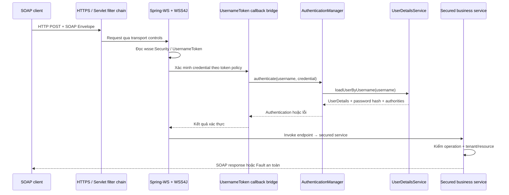
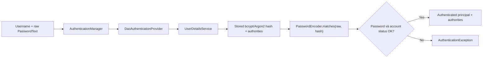
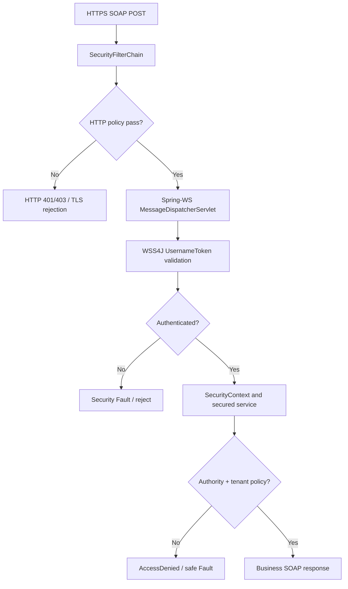
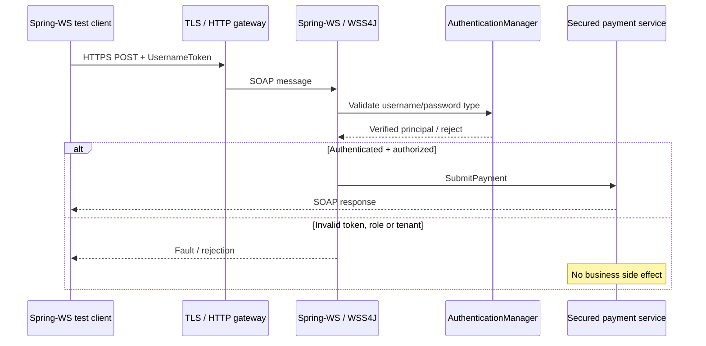

# UserDetailsService và callback xác minh danh tính cho WS-Security

Trong Spring Web Services (Spring-WS), một SOAP request có thể chứa **WS-Security UsernameToken** ở SOAP Header thay vì sử dụng HTTP Basic hoặc OAuth token trong HTTP headers. Để xác thực người gửi, hệ thống phải đọc token, kiểm chính sách mật khẩu/nonce/timestamp, tra cứu danh tính, kiểm mật khẩu theo đúng cơ chế, xác lập **Authentication** và cuối cùng **phân quyền nghiệp vụ**. Đây là nơi **Apache WSS4J**, **Spring Security**, `UserDetailsService` và **callback xác minh danh tính** gặp nhau.

Một lỗi thiết kế thường gặp là tưởng `UserDetailsService.loadUserByUsername(...)` đã “đăng nhập” người dùng, hoặc tưởng việc WSS4J báo UsernameToken hợp lệ đã tự trao quyền gọi mọi SOAP operation. Một lỗi khó hơn xuất hiện khi hệ thống lưu mật khẩu **BCrypt/Argon2** nhưng lại yêu cầu nhận **UsernameToken PasswordDigest**: cơ chế digest trong chuẩn UsernameToken cần một bí mật dùng để tính lại digest, trong khi hash thích ứng một chiều không thể đơn giản biến ngược thành mật khẩu gốc.

Bài thuộc chương **Tích hợp Spring Security** trong module **SPRING_WEB_SERVICES**, đặt trong kiến trúc SOAP **contract-first** với XSD/WSDL, JAXB/OXM, `@Endpoint` và `WebServiceTemplate`. Chúng ta sẽ kết nối xử lý WS-Security với Spring Security và đồng thời giữ đúng các lớp bảo vệ khác: SOAP Fault, interceptor, XML hardening, TLS/mTLS, XML Signature, chứng chỉ, kiểm thử tương thích và chống replay.

> **Nguyên tắc:** `UserDetailsService` là **nguồn tải thông tin người dùng**, không phải bộ kiểm mật khẩu; `AuthenticationManager`/`AuthenticationProvider` chịu trách nhiệm xác thực; WSS4J callback bridge chuyển thông tin token tới cơ chế phù hợp; **authorization** phải kiểm thêm quyền, tenant và operation. Không nhận `UsernameToken PasswordDigest` chỉ vì có username trong database.

## 1. Mục tiêu học tập

Hoàn thành bài, bạn có thể:

1. Mô tả đường đi của một SOAP request có `wsse:UsernameToken` qua HTTP/TLS, Spring-WS, WSS4J, Spring Security và endpoint.
2. Phân biệt **UsernameToken PasswordText**, **UsernameToken PasswordDigest**, **nonce**, `wsu:Created` và các yêu cầu replay protection.
3. Giải thích trách nhiệm của `UserDetailsService`, `UserDetails`, `PasswordEncoder`, `DaoAuthenticationProvider`, `AuthenticationManager` và `SecurityContextHolder`.
4. Nhận diện vai trò của `CallbackHandler`/`WSPasswordCallback` và các integration callback handler trong Spring-WS.
5. Cấu hình `Wss4jSecurityInterceptor` theo hướng yêu cầu xác thực inbound UsernameToken, không bỏ qua token thiếu/sai.
6. Hiểu vì sao so sánh `PasswordDigest` với một BCrypt hash như một chuỗi thường **không đúng**, và chọn phương án an toàn, tương thích.
7. Ánh xạ danh tính đã xác thực tới authorities, kiểm quyền thao tác SOAP và tenant/resource-level authorization.
8. Phân biệt xác thực HTTP filter chain với xác thực message-level của SOAP interceptor, tránh tạo đường đi bỏ qua bảo mật.
9. Thiết kế SOAP Fault/transport error an toàn, không lộ chi tiết tài khoản hoặc mật khẩu.
10. Viết unit/integration/negative tests cho sai mật khẩu, tài khoản bị khóa, replay, token thiếu, quyền không đủ và nhiều request đồng thời.

## 2. Bức tranh tổng thể: ba quyết định khác nhau

Một request đi qua tối thiểu ba câu hỏi:

- **Authentication — người gửi là ai?** UsernameToken được xử lý theo policy; thông tin tài khoản được tải, mật khẩu/credential được xác thực, account status được kiểm.
- **Authorization — được làm gì?** User đã xác thực có `GrantedAuthority`/role nào, có được gọi operation và tác động tới tenant/đơn hàng này không?
- **Message integrity/freshness — có thể tin nội dung nào?** Token/Body/header có được bảo vệ bằng TLS và, nếu cần end-to-end, bằng XML Signature, Timestamp/replay policy không?



Sơ đồ mô tả **đường tích hợp PasswordText với Spring Security**. Với PasswordDigest, WSS4J có thể cần **lookup bí mật qua callback rồi tự kiểm digest** thay vì gọi `AuthenticationManager` bằng password gốc; đây là hai mô hình xác thực khác nhau. Cách đưa `Authentication` vào `SecurityContextHolder` cũng phụ thuộc integration handler và request lifecycle được cấu hình — **không tự suy ra mọi callback đều làm việc đó**.

### Phân tách trách nhiệm

| Thành phần | Làm gì? | Không tự làm |
|---|---|---|
| HTTP TLS/mTLS + `SecurityFilterChain` | Bảo vệ transport, áp HTTP authentication/policy | Parse và verify UsernameToken theo WS-Security mặc định |
| Spring-WS `MessageDispatcherServlet` | Nhận SOAP, ánh xạ endpoint và message processing | Tự xác thực mọi user/token |
| `Wss4jSecurityInterceptor` | Xử lý WSS4J security actions theo cấu hình | Cấp quyền nghiệp vụ cho tenant |
| `CallbackHandler`/WSS4J validator | Cung cấp/kiểm credential theo token type | Tự biết mọi mật khẩu và role nếu chưa được nối |
| `UserDetailsService` | Tải user + hash + status + authorities | So sánh mật khẩu và đăng nhập |
| `PasswordEncoder` | Kiểm raw password với stored hash trong flow phù hợp | Tự kiểm UsernameToken PasswordDigest từ bcrypt hash |
| `AuthenticationManager` | Xác thực bằng `AuthenticationProvider` | Xác định quyền vào từng object nghiệp vụ |
| `SecurityContextHolder` | Giữ `Authentication` hiện tại trong scope phù hợp | Tự tạo hoặc dọn context trên mọi custom thread |
| `@PreAuthorize`/service policy | Kiểm quyền/role/tenant khi thực thi | Thay XSD validation hoặc WS-Security signature |
| `FaultMessageResolver` / exception handling | Chuyển lỗi theo SOAP client/server policy | Biến lỗi mật khẩu thành chi tiết lộ tài khoản |

## 3. Hợp đồng SOAP và bảo mật: Body khác Security Header

Giả sử operation `SubmitPayment` có hợp đồng document/literal với Body element:

```text
{urn:example:payments:v1}SubmitPaymentRequest
```

XSD tối giản:

```xml
<?xml version="1.0" encoding="UTF-8"?>
<xs:schema xmlns:xs="http://www.w3.org/2001/XMLSchema"
           xmlns:pay="urn:example:payments:v1"
           targetNamespace="urn:example:payments:v1"
           elementFormDefault="qualified">

    <xs:element name="SubmitPaymentRequest">
        <xs:complexType>
            <xs:sequence>
                <xs:element name="requestId" type="xs:string"/>
                <xs:element name="tenantId" type="xs:string"/>
                <xs:element name="accountId" type="xs:string"/>
                <xs:element name="amount" type="xs:decimal"/>
                <xs:element name="currency" type="xs:string"/>
            </xs:sequence>
        </xs:complexType>
    </xs:element>

    <xs:element name="SubmitPaymentResponse">
        <xs:complexType>
            <xs:sequence>
                <xs:element name="requestId" type="xs:string"/>
                <xs:element name="paymentId" type="xs:string"/>
                <xs:element name="accepted" type="xs:boolean"/>
            </xs:sequence>
        </xs:complexType>
    </xs:element>
</xs:schema>
```

WSDL xác định operation, input/output `wsdl:part` và SOAP binding. **UsernameToken không được thêm như một child của `SubmitPaymentRequest`**: WS-Security token nằm trong `wsse:Security` thuộc **SOAP Header**, và yêu cầu bảo mật của operation được mô tả qua **WS-SecurityPolicy** hoặc profile tài liệu tích hợp tương đương.

### Vì sao không tin `tenantId` trong Body như danh tính?

`tenantId` là giá trị do client gửi. Kẻ gọi có username của tenant A có thể tự ghi `TENANT-B` nếu không có kiểm tra. Dù password đúng, server vẫn phải xác minh **user có quyền giao dịch cho tenant B hay không**. Đây là **object-level authorization**, hoàn toàn tách với kết quả UsernameToken authentication.

Một WSDL/XSD đúng cũng không xác thực caller: XSD chỉ kiểm `amount` có kiểu decimal và các child đúng sequence; nó không biết signing identity hoặc role.

## 4. Cấu trúc UsernameToken ở SOAP Header

Một UsernameToken dạng PasswordText thường được serialize như sau:

```xml
<soap:Envelope
    xmlns:soap="http://schemas.xmlsoap.org/soap/envelope/"
    xmlns:wsse="http://docs.oasis-open.org/wss/2004/01/oasis-200401-wss-wssecurity-secext-1.0.xsd"
    xmlns:wsu="http://docs.oasis-open.org/wss/2004/01/oasis-200401-wss-wssecurity-utility-1.0.xsd"
    xmlns:pay="urn:example:payments:v1">
    <soap:Header>
        <wsse:Security soap:mustUnderstand="1">
            <wsse:UsernameToken wsu:Id="UsernameToken-1">
                <wsse:Username>soap-payment-client</wsse:Username>
                <wsse:Password
                  Type="http://docs.oasis-open.org/wss/2004/01/oasis-200401-wss-username-token-profile-1.0#PasswordText">REDACTED_TEST_SECRET</wsse:Password>
                <wsse:Nonce
                  EncodingType="http://docs.oasis-open.org/wss/2004/01/oasis-200401-wss-soap-message-security-1.0#Base64Binary">BASE64_TEST_NONCE</wsse:Nonce>
                <wsu:Created>2026-11-27T03:00:00Z</wsu:Created>
            </wsse:UsernameToken>
        </wsse:Security>
    </soap:Header>
    <soap:Body>
        <pay:SubmitPaymentRequest>
            <pay:requestId>REQ-1001</pay:requestId>
            <pay:tenantId>TENANT-A</pay:tenantId>
            <pay:accountId>ACC-101</pay:accountId>
            <pay:amount>125.00</pay:amount>
            <pay:currency>VND</pay:currency>
        </pay:SubmitPaymentRequest>
    </soap:Body>
</soap:Envelope>
```

**Chỉ là XML minh họa**, không phải message xác thực được: `REDACTED_TEST_SECRET`/`BASE64_TEST_NONCE` là placeholders. Chữ ký X.509, Timestamp độc lập và nonce verification không được mô tả đầy đủ trong ví dụ này. Date/time chỉ là dữ liệu ví dụ lịch sử; khi chạy test nên sinh Created/Nonce theo thời gian và entropy thích hợp.

Nhận diện:

- `wsse:Security`: vùng SOAP Header dành cho WS-Security; phải xử lý đúng SOAP role/`mustUnderstand`.
- `wsse:UsernameToken`: token mang username, password proof/secret cùng optional Nonce/Created.
- `Password Type`: xác định PasswordText hay PasswordDigest theo profile.
- `Nonce`: giá trị ngẫu nhiên dùng để giảm khả năng tái sử dụng token; cần kiểm replay.
- `wsu:Created`: thời điểm phát token, phục vụ giới hạn tuổi.
- `soap:Body`: request nghiệp vụ, **không được mặc nhiên coi là đã ký chỉ vì có UsernameToken**.

### UsernameToken không phải XML Signature

UsernameToken với password có thể giúp xác thực credential, nhưng **không đồng nghĩa Body được bảo vệ bằng chữ ký XML**. Nếu cần integrity end-to-end qua nhiều intermediaries, phải có WS-Security Signature trên Body và các header quan trọng theo policy. HTTPS bảo vệ chặng TLS; khi có trung gian kết thúc TLS và tạo kết nối mới, phải đánh giá trust boundary.

## 5. PasswordText và PasswordDigest: hai đường kiểm khác nhau

| Đặc điểm | UsernameToken PasswordText | UsernameToken PasswordDigest |
|---|---|---|
| Nội dung `wsse:Password` | Mật khẩu/secret như text theo profile | Base64 của digest tạo từ nonce, created và secret |
| Điểm xử lý | Có raw credential tại server security layer | Có digest proof, thường **không có raw password** |
| Kết nối `PasswordEncoder` | Có thể dùng `matches(raw, storedHash)` qua AuthenticationManager | Không lấy được raw password từ digest để matches với BCrypt hash |
| Nguồn credential trong `UserDetailsService` | Lưu BCrypt/Argon2 phù hợp với PasswordText+TLS | Hash một chiều thường **không đủ** để tái tạo digest chuẩn |
| Replay | Vẫn cần policy; PasswordText có thể bị replay nếu thiếu kiểm soát | Nonce/Created + replay cache bắt buộc cho policy an toàn |
| Chống sửa SOAP Body | Không tự bảo vệ Body | Không tự bảo vệ Body |
| Transport | **Bắt buộc TLS** theo policy thực tế | Vẫn **nên dùng TLS**, digest không thay TLS |
| Legacy interoperability | Nhiều stacks hỗ trợ | Tùy stack, password storage và proof algorithm |
| Phù hợp ứng dụng lưu adaptive hashes | **Phù hợp hơn** khi đối tác chấp nhận | Cần thiết kế credential backend/validation riêng và đánh giá rủi ro |

### 5.1. Vì sao PasswordText không có nghĩa “không an toàn” nếu làm đúng?

`PasswordText` là dạng credential có thể đọc dưới dạng XML. Vì vậy phải bảo vệ transport bằng HTTPS/TLS, không log SOAP Header, không lưu raw request, giới hạn quyền và tránh gửi secret qua intermediaries không đáng tin. Với TLS xác minh hostname/trust đúng và endpoint bảo vệ thông điệp theo policy, AuthenticationManager vẫn có thể kiểm `PasswordEncoder.matches(raw, bcryptHash)` mà **không** lưu plaintext password.

Không dùng PasswordText qua HTTP plaintext hoặc qua một gateway ghi raw SOAP traffic. Chỉ chọn nó khi policy giữa đối tác và hệ thống thực sự cho phép.

### 5.2. Công thức chuẩn PasswordDigest cần hiểu đúng

UsernameToken Profile thường dùng:

```text
PasswordDigest =
  Base64(
    SHA-1(
      nonce-decoded-bytes
      || UTF-8(Created)
      || UTF-8(password-or-shared-secret)
    )
  )
```

`||` là phép nối chuỗi bytes, không phải Java string concatenation. `nonce-decoded-bytes` là bytes sau khi giải Base64 từ `Nonce`. Đây là cơ chế **legacy WS-Security UsernameToken PasswordDigest**, **không phải** khuyến nghị dùng SHA-1 để lưu mật khẩu. Nó khác BCrypt/Argon2 và khác XML Signature SHA-256.

Ví dụ UsernameToken PasswordDigest (giá trị không có hiệu lực):

```xml
<wsse:UsernameToken
    xmlns:wsse="http://docs.oasis-open.org/wss/2004/01/oasis-200401-wss-wssecurity-secext-1.0.xsd"
    xmlns:wsu="http://docs.oasis-open.org/wss/2004/01/oasis-200401-wss-wssecurity-utility-1.0.xsd">
    <wsse:Username>soap-payment-client</wsse:Username>
    <wsse:Password
      Type="http://docs.oasis-open.org/wss/2004/01/oasis-200401-wss-username-token-profile-1.0#PasswordDigest">BASE64_DIGEST_PLACEHOLDER</wsse:Password>
    <wsse:Nonce
      EncodingType="http://docs.oasis-open.org/wss/2004/01/oasis-200401-wss-soap-message-security-1.0#Base64Binary">BASE64_NONCE_PLACEHOLDER</wsse:Nonce>
    <wsu:Created>2026-11-27T03:00:00Z</wsu:Created>
</wsse:UsernameToken>
```

Một server chỉ lưu `BCrypt(password)` **không có đủ dữ liệu** để tính lại SHA-1 của `nonce || Created || password` chuẩn, vì không thể đảo bcrypt thành password. **Không dùng `PasswordEncoder.matches(digest, bcryptHash)` và tưởng đã xác minh PasswordDigest.** Các phương án phải được thống nhất từ contract/security policy, không tự thay thuật toán digest trên wire.

## 6. Nonce, Created, Timestamp và chống replay

Một PasswordDigest có nonce và Created giúp khó tái sử dụng digest trong các ngữ cảnh khác nhau, nhưng **không tự chặn replay** nếu server chấp nhận cùng bộ `username + nonce + created + digest` nhiều lần.

Cần:

1. Nonce có entropy đủ, được sinh mới cho mỗi message theo profile.
2. `Created` nằm trong cửa sổ thời gian chấp nhận với clock skew có giới hạn.
3. Replay cache lưu nonce/token fingerprint đã thấy **theo identity/tenant và TTL**.
4. Replay cache hoạt động trên **toàn cụm** nếu có nhiều replica (hoặc có biện pháp chống replay tương đương).
5. Cơ chế từ chối token thiếu nonce/created khi policy bắt buộc, không tự fallback.
6. Cache có giới hạn số entry/dung lượng, bảo vệ chống DoS.
7. Operation ghi dữ liệu có **business idempotency** riêng, không coi nonce là requestId nghiệp vụ.

### Nonce khác business idempotency key

| Giá trị | Dùng để | Có nên dùng lại khi retry? |
|---|---|---|
| Nonce WS-Security | Chống phát lại token/message theo policy | **Không**, tạo nonce mới cho message mới |
| `wsu:Created` | Tính mới theo thời gian | **Không**, tạo theo thời gian gửi mới |
| WS-Addressing `MessageID` | Nhận dạng SOAP message/correlation | Thường message mới có ID mới, theo contract |
| `requestId` nghiệp vụ | Idempotent retry cùng giao dịch | **Có**, giữ nguyên cho cùng thao tác |
| TLS session ID | Transport/session | Không dùng làm idempotency hoặc username |
| JWT `jti` nếu dùng token khác | Nhận diện token theo policy | Không tự thay nonce WS-Security |

Khi client timeout sau khi gửi `SubmitPayment`, server **có thể đã ghi giao dịch**. Lần gửi lại dùng Timestamp/Nonce mới nhưng **giữ cùng requestId nghiệp vụ**, và server phải deduplicate atomically. Chỉ replay cache không ngăn được một request mới có token khác nhưng mang cùng payment action.

## 7. UserDetailsService thực sự làm gì?

Trong Spring Security, `UserDetailsService` có trách nhiệm tìm user theo tên:

```java
import org.springframework.security.core.userdetails.UserDetails;
import org.springframework.security.core.userdetails.UserDetailsService;
import org.springframework.security.core.userdetails.UsernameNotFoundException;

public interface UserDetailsService {
    UserDetails loadUserByUsername(String username)
        throws UsernameNotFoundException;
}
```

Đây là **chữ ký interface minh họa**, không phải định nghĩa lại interface trong ứng dụng. `UserDetails` thường chứa:

- Username được chuẩn hóa theo chính sách.
- Password hash được lưu (ví dụ BCrypt/Argon2).
- Các flags: enabled, accountNonLocked, accountNonExpired, credentialsNonExpired.
- Tập `GrantedAuthority` dành cho những thao tác được phép.

**Không** coi `UserDetailsService` là nơi xác thực mật khẩu. Nó có thể trả `UserDetails` cho một username hợp lệ ngay cả khi caller đưa sai password; xác thực còn phụ thuộc `AuthenticationProvider` và `PasswordEncoder`.

### Những gì không nên đặt trong loadUserByUsername

- Không lấy raw SOAP PasswordText rồi log.
- Không trả một user “anonymous” với role mặc định khi không tìm thấy username.
- Không bỏ qua account disabled/locked để “tránh lỗi liên thông”.
- Không gọi network ngoài không giới hạn thời gian trong hot path.
- Không dùng `tenantId` từ SOAP Body để tìm tùy ý account mà chưa xác thực.
- Không map username từ header chưa ký sang quyền của tenant khác.
- Không để exception `UserNotFound` lộ thông tin tồn tại tài khoản qua Fault detail.

## 8. Thiết kế kho danh tính cho đối tác SOAP

Một hệ thống production thường có **service accounts dành cho đối tác**, không dùng tài khoản cá nhân. Các trường cần quản lý:

| Trường | Ý nghĩa |
|---|---|
| `username` hoặc principalId | Định danh service client duy nhất trong trust domain |
| `passwordHash` | Hash thích ứng của PasswordText secret (nếu dùng cơ chế này) |
| `enabled` | Tài khoản có được chấp nhận không |
| `locked` / `expiresAt` | Chính sách khóa/thu hồi |
| `authorities` | Ví dụ `SOAP_PAYMENT_READ`, `SOAP_PAYMENT_WRITE` |
| `allowedTenants` | Danh sách tenant có quyền hoặc liên kết policy |
| `credentialVersion` | Hỗ trợ rotation/audit, không lưu raw secret |
| `partnerId` | Liên kết danh tính với tổ chức đối tác |
| `rateLimitTier` | Quota, chống brute force và overload |
| `revokedAt` | Đặt trạng thái thu hồi theo policy |

**Tách role khỏi tenant membership**: `SOAP_PAYMENT_WRITE` nói user được phép thực hiện loại thao tác; nó **không** tự cho phép thao tác trên tài khoản ở mọi tenant. Trong các hệ thống nhiều tenant, kiểm quyền cần dựa vào principal đã xác thực và object/context thật.

### Vấn đề tên người dùng trùng giữa đối tác

Nếu hai đối tác cùng chọn username `service`, không được suy rằng đó là cùng identity. Cần trust domain/namespace rõ ràng, ví dụ username được cấp duy nhất, principal key gồm partner realm, hoặc định danh từ mTLS certificate xác thực. Không được tạo identity bằng cách lấy `tenantId` chưa xác thực trong SOAP Body rồi ghép với username.

## 9. UserDetailsService với repository và UserDetails

Ví dụ ứng dụng dùng một repository đọc tài khoản từ database. Spring Security nhận password **hash đã được lưu**, không password gốc.

```java
package org.example.payments.security;

import org.springframework.context.annotation.Bean;
import org.springframework.context.annotation.Configuration;
import org.springframework.security.core.userdetails.User;
import org.springframework.security.core.userdetails.UserDetailsService;
import org.springframework.security.core.userdetails.UsernameNotFoundException;

@Configuration
public class SoapIdentityConfiguration {

    @Bean
    public UserDetailsService soapUserDetailsService(
            SoapAccountRepository accounts) {

        return username -> accounts.findByUsername(username)
            .map(account -> User.withUsername(account.username())
                .password(account.passwordHash())
                .disabled(!account.enabled())
                .accountLocked(account.locked())
                .authorities(
                    account.authorities().toArray(String[]::new)
                )
                .build())
            .orElseThrow(() -> new UsernameNotFoundException(
                "Invalid credentials"
            ));
    }
}
```

**Giả định:** `SoapAccountRepository` là interface của ứng dụng với `findByUsername(String)` trả `Optional<SoapAccount>`; `SoapAccount` có `username()`, `passwordHash()`, `enabled()`, `locked()` và `authorities()` trả tập `String`. Chúng **chưa được định nghĩa trong code fragment**. Username normalization, duplicate handling, lookup timeout và audit cần triển khai theo schema dữ liệu của dự án.

**Không đưa `passwordHash` vào SOAP response, Fault hoặc logs.** Nếu ứng dụng yêu cầu tenant-specific accounts, repository phải áp trust namespace/realm do server xác định, không nhận tenant do caller khai làm bằng chứng xác thực.

### 9.1. Không tạo default users “cứu hộ” trong production

`InMemoryUserDetailsManager` hữu ích cho test và demo, nhưng production phải có lifecycle cấp/thu hồi credential, password rotation và kho dữ liệu được bảo vệ. Một hard-coded user/password trong `@Configuration` sẽ rất khó thu hồi hoặc có thể lộ qua Git/log/build artifact.

### 9.2. Cache UserDetails có những đánh đổi nào?

`UserDetailsService` có thể đi qua cache để giảm độ trễ, nhưng:

- Khoản khóa/thu hồi tài khoản cần có **invalidation/TTL ngắn** theo policy.
- Authorities đổi phải có cơ chế cập nhật, tránh user đã bị thu hồi quyền vẫn gọi SOAP.
- Không cache raw password từ request.
- Cache key cần bao gồm trust realm nếu username không global unique.
- Không để cache miss trở thành anonymous success.
- Theo dõi latency database/cache vì authentication diễn ra trên **mỗi SOAP message** hoặc mỗi session theo policy.

## 10. PasswordEncoder và DaoAuthenticationProvider

Với PasswordText được truyền qua TLS đúng chính sách, Spring Security có thể dùng `PasswordEncoder` so sánh raw credential với adaptive stored hash.

```java
import org.springframework.context.annotation.Bean;
import org.springframework.context.annotation.Configuration;
import org.springframework.security.authentication.AuthenticationManager;
import org.springframework.security.authentication.ProviderManager;
import org.springframework.security.authentication.dao.DaoAuthenticationProvider;
import org.springframework.security.core.userdetails.UserDetailsService;
import org.springframework.security.crypto.bcrypt.BCryptPasswordEncoder;
import org.springframework.security.crypto.password.PasswordEncoder;

@Configuration
public class SoapAuthenticationConfiguration {

    @Bean
    public PasswordEncoder soapPasswordEncoder() {
        return new BCryptPasswordEncoder();
    }

    @Bean
    public AuthenticationManager soapAuthenticationManager(
            UserDetailsService soapUserDetailsService,
            PasswordEncoder soapPasswordEncoder) {

        DaoAuthenticationProvider provider =
            new DaoAuthenticationProvider(
                soapUserDetailsService
            );

        provider.setPasswordEncoder(
            soapPasswordEncoder
        );

        return new ProviderManager(provider);
    }
}
```

**Phiên bản:** ví dụ nhắm tới Spring Security 6.x hỗ trợ constructor `DaoAuthenticationProvider(UserDetailsService)`; một số phiên bản dùng constructor mặc định kết hợp setter. Phải kiểm BOM và API cụ thể ở build thực. Không cố trộn Spring Security 5/`javax.servlet` với Spring Security 6/`jakarta.servlet` chỉ bằng thay imports.

Luồng thực:



Cần hiểu: `PasswordEncoder.matches(raw, storedHash)` phù hợp **raw PasswordText**, không phải **WS-Security PasswordDigest**. Nếu dùng `DelegatingPasswordEncoder` với prefix `{bcrypt}`/`{argon2}`, phải quản lý migration/hash format theo chính sách. Không tự phát minh một chuỗi “encrypted password” để bỏ qua hashing.

### 10.1. Khả năng brute-force và password spraying

Một service endpoint SOAP công khai có thể bị thử nhiều username/password. Ngoài password hashing cần:

- TLS/mTLS hoặc network allowlist theo threat model.
- Rate limit ở API gateway theo signer/IP/partner, không chỉ IP đơn lẻ sau proxy.
- Lockout/backoff theo identity có kiểm soát để tránh bị dùng như DoS.
- Giới hạn số request/timeout của UserDetailsService/DB.
- Không trả Fault khác nhau cho “user không tồn tại” và “password sai” nếu tạo user enumeration.
- Audit failed authentication với correlation ID và metadata đã lọc.
- Cảnh báo khi có nhiều lần thất bại hoặc nonce replay.

## 11. AuthenticationManager không tự đọc SOAP UsernameToken

`AuthenticationManager` nhận một `Authentication` object, ví dụ `UsernamePasswordAuthenticationToken`; nó **không biết** phần tử `wsse:UsernameToken` nằm ở đâu trong SOAP Header.

Một lớp bridge cần:

1. Nhận thông tin WSS4J đã parse theo UsernameToken profile.
2. Xác định PasswordText/PasswordDigest và các policy liên quan.
3. Với PasswordText, chuyển username + raw credential tới `AuthenticationManager` bằng đúng token class.
4. Khi authenticate thành công, xác định principal/authorities.
5. Đảm bảo security context ở request thread nếu endpoint sử dụng method security.
6. Khi thất bại, từ chối message bằng lỗi WSS4J/SOAP security thích hợp.
7. Không giữ password/Authentication trong mutable singleton fields.
8. Không tự mở đường “skip authentication” khi callback không tìm thấy provider.

Ví dụ Spring Security authentication call:

```java
import org.springframework.security.authentication.AuthenticationManager;
import org.springframework.security.authentication.UsernamePasswordAuthenticationToken;
import org.springframework.security.core.Authentication;

public final class CredentialVerifier {

    private final AuthenticationManager authenticationManager;

    public CredentialVerifier(
            AuthenticationManager authenticationManager) {
        this.authenticationManager = authenticationManager;
    }

    public Authentication authenticatePasswordText(
            String username, String password) {

        return authenticationManager.authenticate(
            UsernamePasswordAuthenticationToken.unauthenticated(
                username,
                password
            )
        );
    }
}
```

**Đây là lớp dịch vụ xác thực chung, chưa phải WSS4J `CallbackHandler`.** Code bên nhận UsernameToken phải gọi nó tại điểm hook phù hợp; đồng thời phải áp policy Nonce/Created/Replay và quản lý SecurityContext. Nếu WSS4J đã xử lý một kiểu token mà callback cung cấp secret để WSS4J so sánh, không tự gọi phương thức trên lần nữa mà không hiểu trình tự xác minh.

## 12. CallbackHandler trong WSS4J: callback có nhiều mục đích

WSS4J dựa trên Java `javax.security.auth.callback.CallbackHandler` trong nhiều security actions. Callback object `WSPasswordCallback` có những usage/purpose khác nhau: yêu cầu secret để **ký/giải mã**, để **xác minh UsernameToken** hoặc phục vụ loại token khác.

Điều này dẫn tới hai sai lầm:

- Một handler dành cho **outbound signing private-key password** bị gắn làm inbound UsernameToken validator.
- Một handler thấy username và trả raw password hash của database bất kể token type, khiến WSS4J hiểu nhầm đó là **password gốc**.

### 12.1. Chữ ký khái niệm

```java
import java.io.IOException;

import javax.security.auth.callback.Callback;
import javax.security.auth.callback.CallbackHandler;
import javax.security.auth.callback.UnsupportedCallbackException;

public final class ExampleCallbackHandler
        implements CallbackHandler {

    @Override
    public void handle(Callback[] callbacks)
            throws IOException, UnsupportedCallbackException {

        for (Callback callback : callbacks) {
            // Kiểm chính xác class + usage, rồi xử lý
            // theo credential type và policy đã cấu hình.
        }
    }
}
```

`CallbackHandler` là interface của Java Authentication and Authorization Service (JAAS callback API), vẫn thuộc `javax.security.auth.callback.*` trên JDK hiện đại. Nó **không** phải `jakarta.security.*` và không cần đổi package thành Jakarta vì Spring Boot 3 dùng Jakarta Servlet/JAXB.

### 12.2. Đọc đúng ý nghĩa của WSPasswordCallback

Một `WSPasswordCallback` có thể mang username/identifier và `usage`. Tùy WSS4J version, các usage constants và processing paths khác nhau; khi implement handler custom phải đọc contract phiên bản thực, chẳng hạn:

- Inbound UsernameToken PasswordText có thể được đưa cho custom **validator** để authenticate trực tiếp.
- Inbound UsernameToken PasswordDigest thường khiến engine cần **credential secret** để tái tính digest theo UsernameToken Profile.
- Outbound UsernameToken PasswordText/Digest có thể dùng callback lấy secret phía gửi.
- XML Signature/Decryption callbacks có thể yêu cầu key password phục vụ crypto, **không phải password xác thực user**.

**Không chấp nhận mọi `WSPasswordCallback` và trả cùng một secret.** Phân nhánh theo usage/type, không lộ credential, và **fail closed** khi không hỗ trợ.

## 13. Bridge tiêu chuẩn: Spring Security Password Validation Callback Handler

Trên những phiên bản Spring-WS có integration handler tương ứng với WSS4J2, có thể dùng **`SpringSecurityPasswordValidationCallbackHandler`** để nối inbound UsernameToken PasswordText tới `AuthenticationManager`. Đây là lựa chọn ưu tiên hơn tự viết thuật toán kiểm UsernameToken, **nếu** phiên bản Spring-WS, token profile và yêu cầu thiết lập Authentication context đã được kiểm chứng.

Mẫu cấu hình minh họa:

```java
import org.springframework.context.annotation.Bean;
import org.springframework.context.annotation.Configuration;
import org.springframework.security.authentication.AuthenticationManager;
import org.springframework.ws.soap.security.wss4j2.callback.SpringSecurityPasswordValidationCallbackHandler;

@Configuration
public class UsernameTokenCallbackConfiguration {

    @Bean
    public SpringSecurityPasswordValidationCallbackHandler
            usernameTokenValidationHandler(
                    AuthenticationManager soapAuthenticationManager) {

        SpringSecurityPasswordValidationCallbackHandler handler =
            new SpringSecurityPasswordValidationCallbackHandler();

        handler.setAuthenticationManager(
            soapAuthenticationManager
        );

        return handler;
    }
}
```

**API/version caveat:** package/name/method availability và hỗ trợ PasswordText/PasswordDigest của Spring-WS integration có thể khác giữa Spring-WS/WSS4J releases. Code này là **mẫu kết nối handler**, không thay việc xác minh API resolved trong dự án.

**Đừng suy ra** handler này tự hỗ trợ PasswordDigest với BCrypt. Nếu triển khai chỉ lưu one-way adaptive hashes, cách an toàn là xác minh token profile cho phép **PasswordText qua TLS** kết hợp `AuthenticationManager`, hoặc chuyển sang X.509 Signature/token scheme khác được cả hai bên chấp nhận.

### 13.1. Vì sao không tự compare chuỗi password ở handler?

Phản mẫu:

```java
String passwordFromSoap = /* trích UsernameToken */;
String stored = accountRepository.findPasswordByUsername(user);

// Không làm: so sánh raw plaintext hoặc hash bằng String.equals
if (passwordFromSoap.equals(stored)) {
    return; // "Authenticated" sai thiết kế.
}
```

Nếu stored là BCrypt, so sánh chuỗi sẽ không đúng. Nếu stored là plaintext, kiến trúc lưu secret đã có rủi ro nghiêm trọng. Hơn nữa, đoạn code không kiểm account lock, expiration, nonce/replay, trust realm và không xây principal/authorities đúng cách.

**Dùng AuthenticationManager/PasswordEncoder cho PasswordText**, dùng WSS4J validator theo chuẩn cho các token type khác khi chính sách cho phép.

## 14. Wss4jSecurityInterceptor ở phía nhận SOAP

Spring-WS có lớp `org.springframework.ws.soap.security.wss4j2.Wss4jSecurityInterceptor` dành cho WS-Security processing. Ở inbound, một cấu hình bắt buộc UsernameToken có thể có dạng:

```java
import org.springframework.context.annotation.Bean;
import org.springframework.context.annotation.Configuration;
import org.springframework.ws.soap.security.wss4j2.Wss4jSecurityInterceptor;
import org.springframework.ws.soap.security.wss4j2.callback.SpringSecurityPasswordValidationCallbackHandler;

@Configuration
public class InboundSoapSecurityConfiguration {

    @Bean
    public Wss4jSecurityInterceptor usernameTokenInterceptor(
            SpringSecurityPasswordValidationCallbackHandler handler) {

        Wss4jSecurityInterceptor interceptor =
            new Wss4jSecurityInterceptor();

        interceptor.setValidationActions(
            "UsernameToken"
        );

        interceptor.setValidationCallbackHandler(
            handler
        );

        return interceptor;
    }
}
```

**Mục đích đoạn code:** cấu hình **policy xác thực inbound**. Cần kiểm thêm:

- `validationActions` phải thực sự khiến thiếu/malformed UsernameToken bị từ chối, không chỉ “nếu có thì xử lý”.
- Handler phải đúng **WSS4J token type** và version, không chỉ đúng interface Java.
- Nonce/Created replay cache và timestamp policy được bật theo yêu cầu.
- `Authentication` có được đặt vào `SecurityContextHolder` của thread chạy endpoint không — và có được clear sau request không?
- Nếu endpoint yêu cầu **XML Signature** trên Body, phải cấu hình thêm hành động và signed-parts enforcement đúng. `UsernameToken` **không tự ký Body**.
- SOAP version và WS-Security profile phải khớp đối tác.
- Fault từ security layer được trả an toàn và không gọi business method khi token sai.

### 14.1. Đăng ký interceptor vào server endpoint chain

```java
import java.util.List;

import org.springframework.context.annotation.Configuration;
import org.springframework.ws.config.annotation.WsConfigurer;
import org.springframework.ws.server.EndpointInterceptor;
import org.springframework.ws.soap.security.wss4j2.Wss4jSecurityInterceptor;

@Configuration
public class SoapServerInterceptors implements WsConfigurer {

    private final Wss4jSecurityInterceptor usernameTokenInterceptor;

    public SoapServerInterceptors(
            Wss4jSecurityInterceptor usernameTokenInterceptor) {
        this.usernameTokenInterceptor =
            usernameTokenInterceptor;
    }

    @Override
    public void addInterceptors(
            List<EndpointInterceptor> interceptors) {

        interceptors.add(
            usernameTokenInterceptor
        );
    }
}
```

Đây là một cấu hình khung server, cần `MessageDispatcherServlet`/`@EnableWs`/`@Endpoint` và bean security phù hợp. Nếu có các interceptor XSD validation, logging, WS-Addressing hoặc custom audit, phải kiểm **thứ tự** để không sử dụng dữ liệu chưa xác thực nhằm thực hiện business side effect.

### 14.2. Cần kiểm trường hợp bypass

Một số lỗi **chưa tới interceptor này**: HTTP route khác, SOAP parsing fail, endpoint mapping không có, transport authentication fail. Ngược lại, một HTTP route **được phép truy cập** mà Spring-WS endpoint chain không gắn interceptor security có thể trở thành lỗ hổng. Test toàn bộ SOAP operations và servlet mapping, không chỉ một endpoint mẫu.

## 15. SecurityContextHolder và danh tính theo request

Một callback trả về credential hợp lệ **không tự chứng minh** rằng business service đã thấy `Authentication`. `SecurityContextHolder` là điểm Spring Security thường dùng để giữ thông tin principal và authorities trong request thread.

```java
import org.springframework.security.core.Authentication;
import org.springframework.security.core.context.SecurityContextHolder;

Authentication authentication =
    SecurityContextHolder.getContext().getAuthentication();

if (authentication == null || !authentication.isAuthenticated()) {
    throw new IllegalStateException("Verified principal required");
}
```

Đoạn code chỉ kiểm cơ bản: **anonymous Authentication** trong một số cấu hình có thể báo authenticated, nên business authorization phải yêu cầu authority cụ thể và identity đáng tin.

Một `CallbackHandler` thuần có thể chỉ trả secret cho WSS4J mà **không** gọi `AuthenticationManager` hay đặt `SecurityContextHolder`. Với integration handler có hỗ trợ Spring Security, phải kiểm:

1. Callback nhận đúng UsernameToken type và validate đúng credential.
2. AuthenticationManager/provider thực sự được gọi trong PasswordText path.
3. Kết quả có principal/authorities của **request hiện tại**.
4. Endpoint/service đọc được Authentication trên đúng thread.
5. Khi fail/token thiếu, service không chạy với anonymous identity.
6. Context được dọn sau SOAP Fault, parser error và thành công.
7. Thread pool không giữ identity user A cho request user B.

### 15.1. Cài đặt context đúng scope

```java
import org.springframework.security.core.Authentication;
import org.springframework.security.core.context.SecurityContext;
import org.springframework.security.core.context.SecurityContextHolder;

public static void installVerifiedIdentity(
        Authentication verified) {
    if (verified == null || !verified.isAuthenticated()) {
        throw new IllegalArgumentException("Unverified identity");
    }

    SecurityContext scoped =
        SecurityContextHolder.createEmptyContext();
    scoped.setAuthentication(verified);
    SecurityContextHolder.setContext(scoped);
}
```

Đây chỉ là **helper minh họa**, không phải WSS4J handler hoàn chỉnh. Nó **chưa** đóng scope. Phải đặt sau khi verify và dùng cơ chế request-boundary `try/finally` để restore/clear. Trong Servlet applications, `SecurityContextHolderFilter` quản lý một phần lifecycle, nhưng cần integration test xác nhận nó thực sự bao quanh mọi SOAP execution path.

Một helper scope dễ thấy cleanup hơn:

```java
import java.util.function.Supplier;
import org.springframework.security.core.Authentication;
import org.springframework.security.core.context.SecurityContext;
import org.springframework.security.core.context.SecurityContextHolder;

public static <T> T runWithVerifiedIdentity(
        Authentication verified,
        Supplier<T> operation) {
    SecurityContext previous =
        SecurityContextHolder.getContext();
    SecurityContext next =
        SecurityContextHolder.createEmptyContext();
    next.setAuthentication(verified);

    try {
        SecurityContextHolder.setContext(next);
        return operation.get();
    } finally {
        SecurityContextHolder.setContext(previous);
    }
}
```

**Không** gọi `runWithVerifiedIdentity` bên trong callback rồi cho nó kết thúc **trước khi endpoint chạy**; khi đó context bị khôi phục quá sớm. Phải tích hợp với scope bao trùm endpoint invocation hoặc cơ chế chuẩn của framework.

### 15.2. ThreadPool/async và SecurityContext

`SecurityContextHolder` mặc định dựa trên ThreadLocal. Khi endpoint đẩy job sang `@Async` hoặc Executor, không mặc định security context đi cùng. Dùng `DelegatingSecurityContextExecutor`/TaskDecorator có kiểm soát cho tác vụ ngắn; với long-running jobs, lưu **actorId/tenantId** đã xác thực và decision/audit metadata, kiểm quyền lại nếu cần. Không gửi raw UsernameToken hay lưu nguyên SecurityContext trong queue.

## 16. Method security và phân quyền theo tenant

Sau authentication, một principal có thể có `SOAP_PAYMENT_READ` và `SOAP_PAYMENT_WRITE`. Nhưng `SOAP_PAYMENT_WRITE` **không** cho phép mặc định thanh toán từ mọi tài khoản ở mọi tenant.

Ứng dụng cần kiểm:

- Operation permission (`SOAP_PAYMENT_WRITE` cho `SubmitPayment`).
- Tenant membership theo identity store của server.
- Object ownership/`accountId` thuộc tenant được phép.
- Business limits/amount/status và request idempotency.
- Message integrity nếu contract yêu cầu signed Body/headers.

### 16.1. Service được bảo vệ bằng `@PreAuthorize`

```java
import org.springframework.context.annotation.Configuration;
import org.springframework.security.config.annotation.method.configuration.EnableMethodSecurity;

@Configuration
@EnableMethodSecurity
public class PaymentMethodSecurityConfiguration {}
```

```java
import org.springframework.security.access.prepost.PreAuthorize;
import org.springframework.stereotype.Service;

@Service
public class PaymentApplicationService {
    private final PaymentAuthorizationPolicy authorization;
    private final PaymentRepository repository;

    public PaymentApplicationService(
            PaymentAuthorizationPolicy authorization,
            PaymentRepository repository) {
        this.authorization = authorization;
        this.repository = repository;
    }

    @PreAuthorize("hasAuthority('SOAP_PAYMENT_WRITE')")
    public PaymentReceipt submit(SubmitPaymentRequest request) {
        authorization.requireTenantAndAccountAccess(
            request.getTenantId(),
            request.getAccountId()
        );

        return repository.recordIdempotently(
            request.getRequestId(),
            request.getAccountId(),
            request.getAmount()
        );
    }
}
```

```java
import org.springframework.ws.server.endpoint.annotation.Endpoint;
import org.springframework.ws.server.endpoint.annotation.PayloadRoot;
import org.springframework.ws.server.endpoint.annotation.RequestPayload;
import org.springframework.ws.server.endpoint.annotation.ResponsePayload;

@Endpoint
public final class PaymentEndpoint {
    private static final String NS = "urn:example:payments:v1";
    private final PaymentApplicationService service;

    public PaymentEndpoint(PaymentApplicationService service) {
        this.service = service;
    }

    @PayloadRoot(namespace = NS,
                 localPart = "SubmitPaymentRequest")
    @ResponsePayload
    public SubmitPaymentResponse submit(
            @RequestPayload SubmitPaymentRequest request) {
        PaymentReceipt receipt = service.submit(request);
        return createSoapResponse(receipt);
    }
}
```

**Giả định:** `PaymentAuthorizationPolicy`, `PaymentRepository`, `PaymentReceipt`, generated JAXB types và `createSoapResponse` là các thành phần ứng dụng chưa được định nghĩa. Hai fragment minh họa kiến trúc, không phải project hoàn chỉnh.

Đặt `@PreAuthorize` ở **service bean riêng** giúp Spring AOP proxy có cơ hội chặn lời gọi từ endpoint. Nếu method protected được gọi bằng `this.method(...)` trong chính cùng bean, **self-invocation** có thể bypass proxy. Test endpoint gọi service thật qua Spring context.

### 16.2. Không tin tenant trong SOAP Body để cấp quyền

`tenantId` là giá trị đầu vào do caller kiểm soát, dù hợp lệ theo XSD. Authorization phải dựa vào principal đã authenticated và membership/ownership trong data store đáng tin. Không viết:

```java
// Phản mẫu:
if (request.getTenantId() != null) {
    allowPayment();
}
```

Một Header `TenantContext` cũng không tự đáng tin chỉ vì UsernameToken đã valid. Nếu đi qua intermediaries, header dùng để quyết định quyền phải được bảo vệ integrity theo policy và ràng buộc với identity.

## 17. HTTP filter chain và SOAP interceptor là hai ranh giới khác nhau

SOAP HTTP request vào `MessageDispatcherServlet` đi qua `SecurityFilterChain` trước. HTTP filters có thể kiểm mTLS/HTTP Basic/OAuth2/CSRF; `Wss4jSecurityInterceptor` kiểm `wsse:Security` sau khi SOAP message được parse.



Hai mô hình tích hợp:

**HTTP authentication là lớp bắt buộc:** filter yêu cầu mTLS/HTTP credentials, UsernameToken có thể là điều kiện bổ sung của SOAP contract. Nếu HTTP identity khác SOAP identity, phải có policy kiểm consistency.

**UsernameToken là cơ chế xác thực chính:** HTTP request phải được phép đến SOAP processor; một `permitAll()` trên HTTP route chỉ có ý nghĩa ở **transport filter**, không làm SOAP endpoint thành public. Cần WSS4J và method security **bắt buộc**, test token thiếu ở mọi SOAP URL/operation.

### CSRF và cookie-based authentication

SOAP integration stateless thường không cần cookie-based browser session; chỉ khi đã đánh giá đúng mô hình mới nên cấu hình CSRF exception cho **route SOAP cụ thể**, không tắt CSRF toàn ứng dụng. Khi app đồng thời phục vụ giao diện browser, cần phân biệt SecurityFilterChains/matchers và kiểm thứ tự ưu tiên để không làm rò lỗ hổng sang form endpoints.

### HTTPS sau reverse proxy

Nếu TLS kết thúc ở gateway, backend chỉ được tin forwarded headers (`X-Forwarded-Proto`, client-certificate metadata) từ proxy đã được kiểm soát. Không tin header do caller gửi tự do, và không dùng thông tin proxy chưa xác thực để bỏ qua WSS4J.

## 18. PasswordDigest và BCrypt/Argon2: chọn đúng mô hình xác minh

PasswordDigest theo UsernameToken Profile cần secret để tái tính:

```text
Base64(
  SHA-1(nonceBytes || UTF8(Created) || UTF8(rawSecret))
)
```

Trong khi database có thể chỉ lưu:

```text
BCrypt(rawSecret)
```

Không thể đảo BCrypt để có secret gốc; cũng không thể lấy chính chuỗi BCrypt làm secret thay thế và kỳ vọng tương thích PasswordDigest chuẩn. **Không dùng `PasswordEncoder.matches(tokenDigest, bcryptHash)`.**

| Lựa chọn | Tình huống | Đánh đổi |
|---|---|---|
| PasswordText + TLS + adaptive hash | Đối tác cho phép và HTTPS/log policy đúng | Raw PasswordText có mặt tạm thời trong message |
| X.509 WS-Security Signature | Cần message-level integrity/trust | PKI, signed-parts verification, rotation |
| mTLS + server authorization | Đủ theo transport trust model | Không tự bảo vệ Body qua intermediaries |
| PasswordDigest + secret backend | Legacy contract buộc digest, đã phê duyệt | Server cần quyền lấy secret/secret-equivalent |
| Token/profile khác | Hai bên thỏa thuận chuẩn | Phụ thuộc validator/trust policy cụ thể |

**Không giảm bảo vệ mật khẩu bằng cách lưu plaintext trong database chỉ vì một legacy SOAP client.** Nếu bắt buộc dùng digest, cần vault/HSM hoặc secret backend tương thích được phê duyệt, rotation, least privilege và WSS4J verification chính xác.

### Callback path và Authentication của Digest

WSS4J có thể hỏi callback một secret dùng cho digest verification. Callback **không được set authenticated principal trước khi digest/nonce/timestamp được WSS4J xác minh**. Sau khi verify, integration layer mới kết nối trusted identity với UserDetails/authorities và SecurityContext. Một handler thiết kế cho PasswordText+AuthenticationManager không mặc nhiên hỗ trợ PasswordDigest.

### Không viết custom “SHA-1 password encoder”

Digest của WS-Security là một proof format legacy, không phải thuật toán password hashing thích hợp để lưu mật khẩu. Không thay BCrypt/Argon2 bằng một `SHA-1(password)` tự viết; không bỏ Nonce/Created hoặc replay cache để vượt lỗi tương thích.

## 19. UsernameToken và XML Signature có nhiệm vụ riêng

UsernameToken **xác thực credential**; nó không tự ký `soap:Body`. Với SOAP messages qua gateway/intermediaries, nếu policy yêu cầu end-to-end integrity, cần thêm WS-Security Signature trên:

- SOAP Body nghiệp vụ thực sự được endpoint xử lý.
- Timestamp nếu dùng làm security decision.
- WS-Addressing `To`/`Action` nếu ảnh hưởng route/operation.
- Custom tenant/authorization headers nếu chúng ảnh hưởng quyết định quyền.
- MTOM/SwA attachment bytes theo profile nếu dữ liệu nhị phân cần toàn vẹn.

Người nhận phải kiểm **signature cryptography + trust + required signed parts + identity binding**, không chỉ “có `ds:Signature`”. Không áp dụng `validationActions="UsernameToken"` rồi kết luận mọi Body/Headers đã được ký.

## 20. Phân loại SOAP Fault, HTTP error và lỗi xác thực

| Sự cố | Tầng lỗi | Hành vi phù hợp |
|---|---|---|
| Thiếu `wsse:Security` | WSS4J | Security rejection; endpoint không chạy |
| Username không tồn tại | Repository/provider | Reject, không user enumeration |
| PasswordText sai | AuthenticationManager/PasswordEncoder | Reject, không log raw secret |
| Account disabled/locked | UserDetails/provider | Reject dù password đúng |
| PasswordDigest sai | WSS4J verifier | Reject, không fallback |
| Nonce/Created replay/expired | Replay/freshness policy | Reject |
| Đúng credential, thiếu authority | Method security | AccessDenied, không commit |
| Đúng role, sai tenant/account | Application authorization | Reject, không commit |
| XML Body sai XSD | Parser/XSD/JAXB | Validation/contract Fault |
| XML malformed/DOCTYPE cấm | Message factory/parser | Protocol/parser failure |
| HTTP 401/403 trước SOAP | HTTP filter/gateway | Có thể không có SOAP Envelope |
| TLS/mTLS fail | Transport | Không có SOAP Fault |
| HTTP 500 + SOAP 1.1 Fault | SOAP binding | Client phân loại SOAP Fault hợp lệ |
| Read timeout sau payment | Transport/outcome | Chưa biết server có commit; reconcile |

Không đưa thông báo “user tồn tại nhưng sai mật khẩu”, stored password hash, token, keystore hoặc nội bộ repository vào SOAP Fault. Dùng mã lỗi nhóm, correlation ID và logs metadata-only. Một security failure **không được** bị catch rồi tiếp tục xử lý như anonymous success.

```java
// Phản mẫu: TUYỆT ĐỐI KHÔNG làm.
try {
    verifyUsernameToken();
} catch (org.springframework.security.core.AuthenticationException ex) {
    // Bỏ qua lỗi.
}
submitPayment();
```

Các helper trên là tên minh họa cho anti-pattern. Khi token sai, business must not run; integration tests cần assert DB không có side effect.

## 21. Phía client: gửi UsernameToken trong WebServiceTemplate

Đối với client SOAP, `WebServiceTemplate` marshal JAXB payload, một client-side `Wss4jSecurityInterceptor` có thể sinh UsernameToken outbound:

```java
import org.springframework.ws.soap.security.wss4j2.Wss4jSecurityInterceptor;

Wss4jSecurityInterceptor outbound =
    new Wss4jSecurityInterceptor();

outbound.setSecurementActions("UsernameToken");
outbound.setSecurementUsername("partner-service-account");

// Chưa hoàn chỉnh: secret được cung cấp qua approved
// secrets manager/callback theo WSS4J version.
// Không hard-code password ở @Configuration.
```

Mẫu chỉ cho biết vị trí securement và username; **chưa đầy đủ** vì phải cấu hình secret/callback, PasswordText/Digest và Nonce/Created theo policy. Không cache `UsernameToken` đã serialize để tái sử dụng; mỗi SOAP message cần token/freshness mới theo profile. Vẫn phải dùng TLS/hostname verification, HTTP timeouts và WS-Security Signature nếu contract yêu cầu.

### PasswordText trong logs

`WebServiceTemplate`/interceptors có thể logging SOAP Envelope để debug. **Không bật raw SOAP Header logging ở production** vì sẽ lộ PasswordText/nonce/token; nếu cần chẩn đoán, chỉ log operation, partner, outcome, duration, correlationId đã lọc.

## 22. Hiệu năng, rate limit và quản lý tài nguyên

Mỗi PasswordText authentication có thể khiến server tra DB và chạy BCrypt/Argon2, vốn **cố tình tốn CPU** để chống password cracking. Thiết kế chống DoS:

| Tài nguyên | Rủi ro | Kiểm soát |
|---|---|---|
| CPU password hashing | Password spraying/brute force | Rate limit theo partner, concurrency cap |
| DB connection pool | UserDetails lookups quá nhiều | Bounded pool, timeout, indexes |
| UserDetails cache | Revoked users/roles stale | TTL/invalidation, không cache raw secrets |
| Replay cache | Nonce flood hoặc multi-replica bypass | Capacity/TTL, distributed consistency |
| XML parser | XXE, huge/deep XML | DTD off, size/depth limits |
| MTOM attachments | Large streams/heap/disk | Per-part/total quotas, streaming |
| SecurityContext | Rò user giữa threads | Cleanup/restore theo request |
| HTTP pooled connections | Chờ backend/remote | Lease/connect/read timeouts |
| Logs | Lộ SOAP password/hash | Masking, metadata-only logs |

Không dùng một biến `synchronized` toàn cục quanh mọi `authenticate(...)`; sẽ tạo nút thắt dễ DoS. Không cache một `Authentication` đã thành công theo username rồi dùng cho request mới **mà không verify token mới**. Không giữ `currentUsername`/`currentPassword`/`lastAuthentication` mutable trong interceptor singleton.

## 23. Unit test: UserDetailsService, PasswordEncoder và AuthenticationManager

Trước khi kiểm SOAP, cần chứng minh core Spring Security đúng:

- Username tồn tại tải đúng password hash/authorities.
- PasswordText được `PasswordEncoder.matches(raw, storedHash)` kiểm đúng.
- Username không tồn tại/bad password/account disabled/locked bị từ chối.
- User hợp lệ nhưng thiếu authority WRITE không được phép gọi `SubmitPayment`.
- Repository timeout không được biến thành authenticated/anonymous success.
- Tài khoản bị thu hồi và thay đổi authorities có cơ chế cache invalidation.

Ví dụ unit test với fixture tự cấu hình:

```java
import static org.junit.jupiter.api.Assertions.assertThrows;
import static org.junit.jupiter.api.Assertions.assertTrue;

import org.junit.jupiter.api.Test;
import org.springframework.security.authentication.AuthenticationManager;
import org.springframework.security.authentication.UsernamePasswordAuthenticationToken;
import org.springframework.security.core.Authentication;
import org.springframework.security.core.AuthenticationException;

class SoapIdentityTest {

    private AuthenticationManager manager;

    @Test
    void correctPasswordReturnsVerifiedPrincipal() {
        Authentication auth = manager.authenticate(
            UsernamePasswordAuthenticationToken.unauthenticated(
                "soap-payment-client",
                "synthetic-test-password"
            )
        );

        assertTrue(auth.isAuthenticated());
        assertTrue(auth.getAuthorities().stream()
            .anyMatch(authority -> "SOAP_PAYMENT_WRITE"
                .equals(authority.getAuthority())));
    }

    @Test
    void incorrectPasswordIsRejected() {
        assertThrows(AuthenticationException.class, () ->
            manager.authenticate(
                UsernamePasswordAuthenticationToken.unauthenticated(
                    "soap-payment-client",
                    "incorrect-test-password"
                )
            )
        );
    }
}
```

Đây là **JUnit fragment**, `manager` còn cần được inject/khởi tạo trong fixture dùng `UserDetailsService` có **BCrypt hash được sinh từ password test**, không phải bean có password production. Không chạy class nguyên trạng với field null. Test này chỉ kiểm provider, **chưa** kiểm WSS4J/UsernameToken.

### Test trạng thái account

| Dữ liệu test | Kỳ vọng |
|---|---|
| User enabled, hash đúng | Authentication thành công |
| Username không tồn tại | AuthenticationException, không user enumeration |
| Password sai | AuthenticationException, không trả UserDetails |
| Account locked | Reject dù password đúng |
| Account disabled | Reject dù password đúng |
| Password hash format không đúng encoder | Reject, không auto NoOp fallback |
| Authorities chỉ READ | Authentication pass; method WRITE bị từ chối |
| User bị revoke trong cache | Request sau khi policy invalidates phải fail |

## 24. Kiểm thử callback WSS4J và SecurityContext

Một suite đúng scope cần assert:

1. PasswordText đúng → callback/bridge thực sự dùng AuthenticationManager.
2. PasswordText sai → security failure, endpoint không chạy.
3. User disabled/locked → không chuyển thành principal thành công.
4. PasswordDigest không bị chấp nhận bởi PasswordText-only handler qua một fallback vô tình.
5. Handler nhận callback usage cho Signature/decryption → không trả password người dùng.
6. Authenticated principal trong secured service đúng request.
7. Request thiếu token → không có authenticated principal được dùng để xử lý.
8. Sau Fault/exception → SecurityContext được clear/restore.
9. Concurrent clients A/B → không lẫn username/authorities.
10. Callback/shared bean không lưu raw secret hoặc `SoapMessage` sau lượt gọi.

### Kịch bản đặc biệt: ba request nối tiếp

```text
Request A:
  valid UsernameToken (userA)
  secured service sees userA

Request B:
  missing UsernameToken
  rejected before service
  never inherits userA

Request C:
  valid UsernameToken (userC)
  secured service sees userC, not userA
```

Một unit test tạo thread mới cho từng request có thể không phát hiện ThreadLocal leak. Cần test qua **server thread pool tái sử dụng threads**, bao gồm error paths.

### MockWebServiceClient và MockWebServiceServer

`MockWebServiceClient` dùng kiểm **server-side `@Endpoint`/interceptor chain** trong Spring application context. Nếu dùng test helper `withPayload(...)` chỉ gửi Body, message **không tự có UsernameToken**; với security bắt buộc, đây phải là test âm.

`MockWebServiceServer` mô phỏng remote server cho **outbound `WebServiceTemplate`**. Một matcher `payload(...)` chỉ kiểm XML Body và không chứng minh client đã gửi `wsse:Security`, nonce/Created/PasswordText profile chính xác hoặc được đối tác xác thực.

Để kiểm SOAP Header bảo mật, dùng WSS4J test client tạo UsernameToken hợp lệ, một matcher có hiểu security hoặc HTTP/TLS integration test với verifier server thật. Không dùng raw production password trong fixture.

## 25. Ma trận kiểm thử positive/negative

| ID | Điều kiện | Kỳ vọng |
|---|---|---|
| P01 | HTTPS + PasswordText đúng + enabled user | Authenticated principal đúng |
| P02 | User READ gọi operation READ | Pass nếu object policy cho phép |
| P03 | User WRITE gọi `SubmitPayment` TENANT-A | Pass khi tenant/resource policy đạt |
| P04 | UsernameToken Nonce/Created mới | Freshness checks pass |
| P05 | Prefix XML khác nhưng QName giữ nguyên | Endpoint/XSD mapping vẫn đúng |
| P06 | Retry với nonce mới, business requestId cũ | Không double-submit |
| P07 | Legacy PasswordDigest + approved secret backend | WSS4J verification đúng profile |
| P08 | Khi policy yêu cầu, signed Body hợp lệ | Integrity verification pass |
| N01 | Thiếu `wsse:Security` | Reject trước business |
| N02 | Có Security Header nhưng thiếu UsernameToken | Reject |
| N03 | Username không tồn tại | Reject, không enumeration |
| N04 | PasswordText sai | Reject, không log raw secret |
| N05 | Account disabled/locked/expired | Reject dù password đúng |
| N06 | PasswordText qua HTTP plaintext | Transport policy reject |
| N07 | PasswordDigest gửi tới PasswordText-only service | Reject, không fallback |
| N08 | BCrypt hash bị dùng như raw secret của digest | Test phát hiện sai, không accept |
| N09 | Replay cùng Nonce/Created | Reject theo replay cache |
| N10 | Created hết hạn hoặc quá xa tương lai | Reject |
| N11 | User READ gọi `SubmitPayment` | AccessDenied |
| N12 | User WRITE nhưng tenant trái quyền | Object authorization reject |
| N13 | User WRITE nhưng accountId thuộc tenant khác | Reject, không commit |
| N14 | Request XML sai root QName/sequence/type | Contract validation failure |
| N15 | Policy yêu cầu XML Signature nhưng chỉ có UsernameToken | Reject |
| N16 | Callback hợp lệ nhưng SecurityContext không chứa Authentication | Fail closed, không anonymous access |
| N17 | Request B kế thừa principal userA từ thread cũ | SecurityContext leak test fail |
| N18 | Hai request đồng thời ghi `currentUsername` chung | Isolation test fail |
| N19 | Callback handler trả secret cho unsupported usage | Reject, không tiết lộ secret |
| N20 | HTTP route/operation không đi qua WSS4J | Security bypass test fail |
| N21 | HTTP 401/403 trước SOAP | Client phân loại HTTP error đúng |
| N22 | TLS certificate untrusted | Handshake fail, không bỏ verify |
| N23 | SOAP Fault có account existence/password/hash | Privacy test fail |
| N24 | Same `requestId` được retry | Atomic idempotency, không tạo payment trùng |
| N25 | Password spraying/high error rate | Rate limits và alerting hoạt động |
| N26 | Account vừa bị revoke nhưng cache cũ | Invalidated theo policy, không accept |
| N27 | UserB gửi custom TenantContext giả mạo TENANT-A | Reject theo identity/integrity policy |
| N28 | Async worker dùng `SecurityContext` cũ | Context/job scope test fail |

**N11–N13/N27 kiểm authorization**, không phải authentication; **N16–N18** kiểm đúng ngữ cảnh thread và principal. Đừng chỉ assert HTTP status: kiểm **business service không chạy và DB không commit** cho các ca bị từ chối.

## 26. HTTP/TLS integration test: chứng minh end-to-end security

Một test server cô lập nên dùng stack thực: `SecurityFilterChain`, `MessageDispatcherServlet`, WSS4J, Spring Security provider, endpoint bean và HTTP/TLS sender.



Bộ test tối thiểu:

1. UsernameToken PasswordText qua HTTPS thành công.
2. TLS certificate không tin/hostname sai/mTLS sai bị từ chối.
3. HTTP request thiếu `wsse:Security` bị từ chối trên mọi SOAP mapping.
4. Sai password hoặc disabled/locked user bị từ chối.
5. User READ không gọi được WRITE.
6. User WRITE chỉ thao tác được trên tenant được cấp.
7. Nonce replay bị chặn trên nhiều replica nếu topology yêu cầu.
8. Legitimate retry với nonce mới, cùng requestId không double-charge.
9. SOAP 1.1/1.2 theo binding được dùng; không chỉ đổi Content-Type.
10. Body chưa ký khi policy yêu cầu signature → reject.
11. Request A/B/C trên thread pool → SecurityContext không leak.
12. Account rotation/revocation và cache invalidation.
13. HTTP 401/403 khác với SOAP Fault từ WSS4J.
14. Lỗi parser/authentication không giữ connection lease hoặc raw stream.
15. Logs/audit không chứa raw PasswordText, stored hash hoặc toàn SOAP Envelope.

**Không chỉ dùng mock in-memory** để kết luận TLS, nonce cache, thread reuse và policy giữa filter chain với Spring-WS đều hoạt động đúng.

## 27. Troubleshooting: username đúng nhưng SOAP vẫn lỗi

| Triệu chứng | Nguyên nhân khả dĩ | Cách kiểm |
|---|---|---|
| HTTP 401 trước SOAP | Filter đang yêu cầu HTTP auth khác | Rà `SecurityFilterChain` |
| HTTP 403 với token đúng | CSRF/method security/HTTP policy | Phân biệt HTTP vs SOAP reject |
| SOAP Fault thiếu UsernameToken | Client chưa tạo `wsse:Security` | Kiểm outbound securement |
| Callback không được gọi | Interceptor/validationActions không gắn | Kiểm server chain |
| UserDetailsService không được gọi | Digest path dùng secret lookup khác | Kiểm PasswordText vs Digest |
| UserDetails được tải nhưng auth fail | Encoder/hash/status sai | Kiểm provider và account flags |
| Digest luôn fail dù username đúng | Backend chỉ lưu BCrypt | Chọn phương án tương thích |
| `@PreAuthorize` fail khi token đúng | Context chưa được populated hoặc thiếu role | Kiểm Authentication trong service |
| `@PreAuthorize` không chạy | Self-invocation hoặc proxy bỏ qua | Gọi secured bean riêng |
| Role đủ nhưng tenant bị từ chối | Object authorization đang chặn | Rà membership/ownership |
| Fail khi tăng concurrent requests | Shared callback state/context leak | Per-request state, cleanup |
| User revoked vẫn gọi được | Cache stale | TTL/invalidation |
| Replay được qua nhiều replicas | Cache chỉ local JVM | Shared replay state |
| Fault lộ account status | Mapper quá chi tiết | Sanitize |
| HTTP 500 HTML bị parse SOAP | Gateway/proxy lỗi | Kiểm Content-Type/Envelope |
| UsernameToken pass nhưng Signature fail | Message integrity policy riêng | Kiểm signed parts/trust |
| Retry tạo giao dịch trùng | Thiếu idempotency | Atomic dedup + reconciliation |

### Quy trình debug theo tầng

1. Kiểm TLS/HTTP filter trước SOAP.
2. Kiểm Envelope version và `wsse:Security`/UsernameToken type.
3. Xác nhận WSS4J yêu cầu UsernameToken và callback handler đúng version.
4. Với PasswordText, kiểm AuthenticationManager/UserDetailsService/PasswordEncoder.
5. Với Digest, kiểm secret source/digest verification path; không lấy bcryptHash làm raw.
6. Kiểm nonce, Created, replay cache và rate limit.
7. Kiểm principal/authorities có đúng trong secured service.
8. Kiểm `@PreAuthorize`, tenant membership và account ownership.
9. Kiểm XSD QName và Signature nếu policy cần.
10. Phân loại SOAP Fault/HTTP 401/transport errors; không log token.
11. Reproduce một case có kiểm soát và thêm regression test.

## 28. Bài thực hành: xác thực hai service accounts cho SubmitPayment

**Bối cảnh:** SOAP service có hai service accounts, production lưu **adaptive hashes**, credentials được cấp/rotation qua quy trình riêng:

```text
partner-readonly:
  authorities: SOAP_PAYMENT_READ
  tenants: TENANT-A

partner-payments:
  authorities: SOAP_PAYMENT_READ, SOAP_PAYMENT_WRITE
  tenants: TENANT-A, TENANT-B
```

Hợp đồng XSD `SubmitPaymentRequest` gồm `requestId`, `tenantId`, `accountId`, `amount` và `currency`.

### Nhiệm vụ

1. Tạo UserDetailsService tra cứu username/hash/status/authorities.
2. Cấu hình PasswordEncoder và AuthenticationManager/DaoAuthenticationProvider.
3. Tạo callback bridge dùng đúng WSS4J UsernameToken PasswordText.
4. Gắn `Wss4jSecurityInterceptor` vào mọi endpoint cần bảo vệ.
5. Cấu hình TLS/mTLS nếu cần; không log raw UsernameToken.
6. Kiểm Nonce/Created/replay và rate limit theo partner.
7. Đảm bảo Authentication context đến đúng service và cleanup.
8. Bật `@EnableMethodSecurity`, bảo vệ `SubmitPayment` bằng `@PreAuthorize`.
9. Kiểm tenant/account từ principal đáng tin, không tin Body string.
10. Áp XSD validation và idempotency với cùng requestId khi retry.
11. Test missing token, bad password, disabled/locked user.
12. Test read-only user gửi payment → reject.
13. Test payment user cho TENANT-A pass, TENANT-C fail.
14. Test replay và valid retry có nonce mới.
15. Test concurrent A/B không lẫn SecurityContext.
16. Test PasswordDigest không được fallback sang PasswordText.
17. Test SOAP Fault an toàn và HTTP error classification.
18. Test trên HTTP/TLS thực, không chỉ matcher Body.

### Câu hỏi tự kiểm tra

1. `UserDetailsService` có tự so mật khẩu không?
2. AuthenticationManager khác UserDetailsService thế nào?
3. Vì sao PasswordText trên TLS có thể dùng BCrypt hash?
4. Vì sao Digest chuẩn không verify được chỉ với stored BCrypt hash?
5. UsernameToken có tự ký SOAP Body không?
6. Nonce/Created có chặn replay nếu không lưu nonce đã thấy?
7. Role WRITE có cho phép mọi tenant không?
8. Callback success có chứng minh SecurityContextHolder populated không?
9. Vì sao không dùng mutable `currentUser` trong singleton interceptor?
10. Vì sao `@PreAuthorize` có thể không chạy khi self-invocation?
11. HTTP filter trả 401 có bắt buộc tạo SOAP Fault không?
12. `permitAll()` ở HTTP filter có làm SOAP endpoint public không?
13. Retry cùng payment nên tạo nonce mới hay requestId mới?
14. Vì sao không giữ SecurityContext của SOAP request vào background queue?
15. Có nên trả “user có tồn tại, password sai” cho client không?
16. Test chỉ `payload(...)` có chứng minh UsernameToken được gửi không?
17. Khi nào cần WS-Security XML Signature ngoài UsernameToken?
18. Test nào phát hiện userA rò sang request B?

### Đáp án tham khảo

| Câu | Đáp án |
|---|---|
| 1 | Không; nó tải UserDetails/hash/status/authorities. |
| 2 | Manager điều phối providers kiểm credentials; service tải user. |
| 3 | `PasswordEncoder.matches(raw,hash)` qua AuthenticationManager; TLS/log bảo vệ raw token. |
| 4 | Digest cần secret để tái tính theo nonce + Created; bcrypt không đảo được. |
| 5 | Không; Signature cần hành động/policy riêng. |
| 6 | Không; phải có replay cache/time window. |
| 7 | Không; tenant/resource-level authorization là điều kiện riêng. |
| 8 | Không; callback thuần có thể chỉ trả secret. |
| 9 | Có thể lẫn user giữa concurrent requests. |
| 10 | Self-invocation có thể bỏ qua Spring AOP proxy. |
| 11 | Không; HTTP filter có thể reject trước Spring-WS. |
| 12 | Chỉ cho request tới SOAP; WSS4J+authorization vẫn phải chặn anonymous. |
| 13 | Nonce mới; giữ cùng business requestId cho cùng giao dịch. |
| 14 | Context thuộc request scope, có thể hết hiệu lực/rò identity. |
| 15 | Không; chống user enumeration. |
| 16 | Không; chỉ kiểm Body, không đầy đủ Security Header. |
| 17 | Khi yêu cầu end-to-end message integrity/signed parts. |
| 18 | A valid, B missing token reject, C userC valid trên reused threads. |

## 29. Checklist production

- [ ] XSD/WSDL, SOAP version và QNames đúng hợp đồng.
- [ ] UsernameToken PasswordText/Digest profile được hai bên thống nhất.
- [ ] TLS/mTLS/truststore/hostname validation đã được kiểm thử.
- [ ] HTTP filter và Spring-WS mapping không có đường bypass.
- [ ] WSS4J validation bắt buộc token, fail closed khi thiếu/sai.
- [ ] Callback handler tương thích Spring-WS/WSS4J version/token type.
- [ ] UserDetailsService tải hash/status/authorities từ trusted repository.
- [ ] AuthenticationManager/provider dùng PasswordEncoder; không compare hash bằng equals.
- [ ] PasswordDigest không được dùng BCrypt hash như raw secret.
- [ ] Không truyền PasswordText qua HTTP hoặc log nguyên SOAP Header.
- [ ] Nonce/Created, replay TTL/cache, clock skew, rate limit đã có policy.
- [ ] Authentication/authorities hiện diện đúng SecurityContext trong request.
- [ ] SecurityContext được clear/restore sau Fault/exception; concurrency test đạt.
- [ ] Method security qua bean proxy và authority names nhất quán.
- [ ] Tenant/resource authorization dùng identity đã xác minh, không tin Body hint.
- [ ] Account revoke/lock, credential rotation và cache invalidation có runbook.
- [ ] XML parser, schema import, SOAP Body/MTOM resource limits được harden.
- [ ] Nếu cần, WS-Security Signature bảo vệ Body và header quan trọng.
- [ ] Idempotency/reconciliation xử lý retry sau timeout.
- [ ] SOAP Fault/HTTP error không lộ account existence/token/password/hash.
- [ ] Unit/mock/integration tests bao gồm negative cases và context isolation.
- [ ] Logging/metrics P95/P99, auth failures, replay/denials theo metadata an toàn.

## 30. Tổng kết

`UserDetailsService` trong Spring Security **không tự xác minh SOAP UsernameToken**. Nó chỉ nạp `UserDetails`: username, password hash, account status và authorities. `AuthenticationManager`/`DaoAuthenticationProvider` cùng `PasswordEncoder` kiểm credential trong luồng **PasswordText** phù hợp; `Wss4jSecurityInterceptor` và callback integration kết nối WS-Security SOAP Header với hệ thống xác thực. Việc hỗ trợ **PasswordDigest**, truyền Authentication vào `SecurityContextHolder` và cleanup phải được kiểm theo token path/phiên bản đang sử dụng.

**PasswordText và PasswordDigest không tương đương.** PasswordText qua TLS cùng BCrypt/Argon2 có thể phù hợp nếu contract cho phép; PasswordDigest chuẩn cần một secret để tính lại digest từ nonce + Created, không thể đơn giản lấy stored bcrypt hash làm password. Cả hai còn cần chống replay, hạn chế tài nguyên và secret management. UsernameToken cũng không tự ký SOAP Body hoặc thay TLS/mTLS.

Một hệ thống SOAP an toàn cần **đúng principal trong đúng request**, `@PreAuthorize`/business service kiểm authority và tenant/resource, fail closed khi token thiếu/sai và không có side effect trước authentication/authorization. Kết hợp contract-first XSD/WSDL, WSS4J callbacks, Spring Security, SOAP Fault an toàn và kiểm thử HTTP/TLS nhiều tình huống sẽ giúp hệ thống xác minh danh tính nhất quán, tránh rò SecurityContext và thực hiện đúng quyền của từng đối tác.

