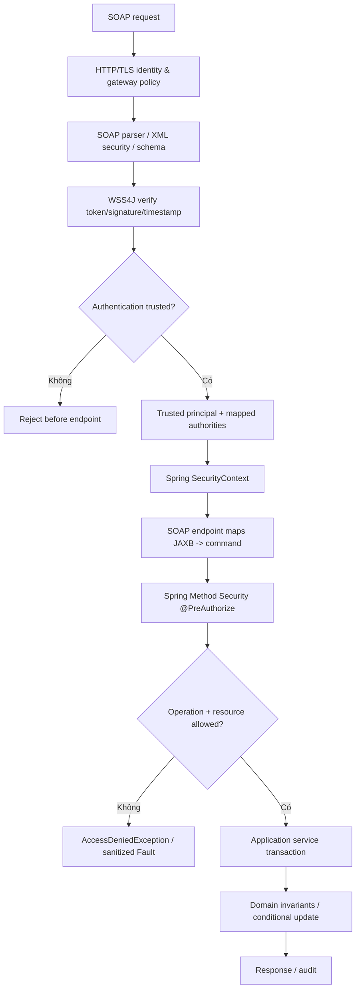
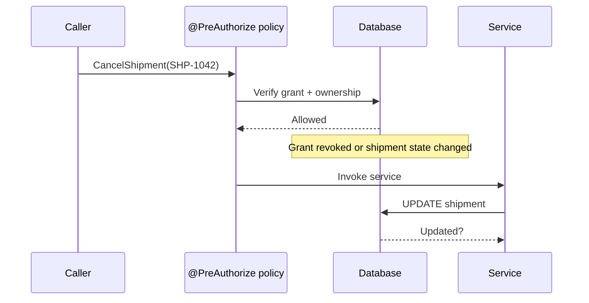

# Phân quyền theo thao tác nghiệp vụ và bảo vệ lớp dịch vụ

## 1. Vì sao xác thực SOAP thành công vẫn chưa đủ?

Trong Spring Web Services (Spring-WS), một SOAP request có thể được xác thực bằng HTTP Basic, mTLS, WS-Security UsernameToken hoặc chữ ký XML. Tuy nhiên, **biết ai gọi** không đồng nghĩa với **người đó được thực hiện mọi thao tác nghiệp vụ**.

Ví dụ đối tác vận chuyển `partner-a` có thể được phép tra cứu vận đơn của tài khoản `ACCT-A`, nhưng không được:

- Xem vận đơn thuộc tài khoản `ACCT-B`.
- Hủy đơn đã giao hoặc đã chốt quyết toán.
- Tạo vận đơn dưới danh nghĩa đối tác khác.
- Phê duyệt một giao dịch mà chính họ đã khởi tạo.
- Gọi operation quản trị chỉ dành cho nhân viên nội bộ.

Nếu hệ thống chỉ kiểm `wsse:UsernameToken` rồi cho mọi request vào `ShipmentService`, các thao tác trái phép vẫn có thể được thực hiện bằng XML hoàn toàn hợp lệ theo XSD.

Bài thuộc chương **Tích hợp Spring Security** của module **SPRING_WEB_SERVICES**, trong lộ trình phát triển SOAP **contract-first**, thiết kế XSD/WSDL, JAXB/OXM, endpoint/client, SOAP Fault, interceptor, XML security, WS-Security, chứng chỉ và kiểm thử tương thích hệ thống doanh nghiệp.

Trọng tâm là **authorization ở application/service layer** bằng Spring Security Method Security, kết hợp kiểm quyền theo operation, đối tác/tenant, bản ghi và trạng thái nghiệp vụ.

### Mục tiêu

Sau bài học, bạn có thể:

1. Phân biệt authentication, authorization, request validation và business invariants.
2. Giải thích vì sao định tuyến SOAP theo QName/SOAPAction không phải kiểm quyền.
3. Bật Spring Security Method Security bằng `@EnableMethodSecurity`.
4. Dùng `@PreAuthorize` bảo vệ các thao tác `GetShipmentStatus`, `CreateShipment`, `CancelShipment`.
5. Tổ chức quyền theo **operation** và **resource ownership/tenant** thay vì chỉ tên role.
6. Thiết kế một policy bean đọc `Authentication` từ `SecurityContext` đáng tin.
7. Đảm bảo danh tính từ WSS4J/HTTP/mTLS được xác thực **trước** khi sử dụng tại service.
8. Phòng chống IDOR/BOLA, thao tác xuyên tenant, self-invocation bypass và TOCTOU.
9. Phân biệt `@PreAuthorize` với `@PostAuthorize`/`@PostFilter`; tránh kiểm quyền sau khi đã ghi dữ liệu.
10. Ánh xạ từ chối quyền thành SOAP Fault/transport response an toàn.
11. Viết unit/integration/security tests bao phủ service, SOAP endpoint, principal mapping và transaction.

## 2. Bốn câu hỏi bảo mật độc lập

| Câu hỏi | Tầng kiểm | Ví dụ |
| --- | --- | --- |
| **Request có hợp đồng hợp lệ?** | XSD/SOAP validation | `shipmentId` đúng kiểu, element đúng QName |
| **Ai đang gọi?** | Authentication: HTTP/TLS/WS-Security | `partner-a` đã được WSS4J xác thực |
| **Có quyền thực hiện thao tác này trên đối tượng này?** | Authorization: Spring Security + domain policy | `partner-a` được `SHIPMENT_CANCEL` trên `SHP-1042`? |
| **Thao tác có hợp lệ với trạng thái hiện tại?** | Business invariants/transaction | Vận đơn đang `DELIVERED` có được hủy? |

Một request có thể **đúng XSD**, **đúng UsernameToken** nhưng vẫn **không có quyền** với vận đơn. Ngược lại, caller có quyền vẫn có thể gửi lệnh vi phạm trạng thái nghiệp vụ.

**Authorization không thay thế business validation; business validation không thay thế authorization.**

### 2.1. Phân biệt xác thực và phân quyền

- *Authentication* trả về một identity đã kiểm chứng, kèm metadata liên quan.
- *Authorization* trả lời phép truy cập cụ thể có được chấp thuận tại thời điểm đó không.
- *Role/authority* mô tả quyền hoặc nhóm quyền rộng.
- *Ownership/tenant relationship* liên hệ identity với bản ghi/đơn vị trong dữ liệu.
- *Business rule* có thể phụ thuộc trạng thái, hạn mức, thời gian hoặc separation of duties.

Đừng đưa toàn bộ các ý nghĩa này vào một biến `isAdmin`.

## 3. Vì sao SOAP endpoint không phải ranh giới phân quyền cuối cùng?

Một operation contract-first thường được định tuyến theo payload root:

```java
@Endpoint
public class ShipmentEndpoint {

    private static final String NS =
        "urn:example:shipment:v1";

    private final ShipmentApplicationService shipmentService;

    public ShipmentEndpoint(
            ShipmentApplicationService shipmentService) {
        this.shipmentService = shipmentService;
    }

    @PayloadRoot(
        namespace = NS,
        localPart = "GetShipmentStatusRequest")
    @ResponsePayload
    public GetShipmentStatusResponse getStatus(
            @RequestPayload GetShipmentStatusRequest request) {
        // Mapping SOAP DTO -> application command -> SOAP response.
        return toSoapResponse(shipmentService.getStatus(
            new ReadShipmentCommand(
                request.getAccountId(),
                request.getShipmentId())));
    }
}
```

Đoạn code giả định những types JAXB `GetShipmentStatusRequest`/`GetShipmentStatusResponse` và mapper `toSoapResponse` đã có. Các annotations cần import từ `org.springframework.ws.server.endpoint.annotation`; `@Endpoint`/`@PayloadRoot`/`@RequestPayload`/`@ResponsePayload` là phần của Spring-WS, **không phải** Spring Security.

`@PayloadRoot` xác định **method nhận XML có QName nào**, không quyết định caller được đọc bản ghi hay không. SOAPAction cũng chỉ là metadata/binding để định tuyến hoặc kiểm giao thức, **không phải authority có thể tin**.

### 3.1. Vì sao đặt authorization ở service?

`ShipmentApplicationService.getStatus(...)` có thể được gọi từ:

- SOAP `GetShipmentStatus`.
- REST endpoint hoặc một GraphQL adapter nội bộ.
- Kafka/RabbitMQ consumer.
- Scheduled reconciliation job.
- Admin UI service.
- Test/integration adapter.

Nếu chỉ dùng `if (isAuthorized)` ở SOAP endpoint, một adapter khác gọi cùng service sẽ bypass chính sách. Đặt lớp bảo vệ tại **public service use-case boundary** giúp một business operation có một cơ chế kiểm quyền nhất quán.

Điều này không có nghĩa bỏ HTTP/SOAP security ở cửa vào. **Defense in depth** gồm transport authentication, WS-Security, service authorization và kiểm điều kiện bên trong transaction.

## 4. Luồng từ SOAP identity đến service authorization



**Không được lấy một username, tenantId hay role từ SOAP Body/Header rồi đặt trực tiếp vào `SecurityContext` trước khi WSS4J hoàn thành verification.** Những trường đó là dữ liệu do sender điều khiển.

### 4.1. WSS4J validation không tự bảo đảm Method Security có principal

`Wss4jSecurityInterceptor` kiểm các security actions mà bạn cấu hình, chẳng hạn `UsernameToken`, `Signature`, `Timestamp`. Tùy handler/integration:

- Một số handler tích hợp Spring Security có thể xác thực qua `UserDetailsService` và điền `SecurityContextHolder` theo cơ chế của chúng.
- Một custom `WSPasswordCallback` chỉ trả shared secret cho WSS4J **không nên được giả định** cũng tạo một Spring Security `Authentication` đã xác thực.
- Với XML Signature/X.509, việc verify signature thành công không có nghĩa một Spring Security principal và authorities đã được tạo tự động.

Phải có **bước ánh xạ tin cậy sau xác thực** từ kết quả security đã verify sang principal/authorities, hoặc sử dụng một integration handler chính thức có hành vi đó và được test. Không tự tạo `UsernamePasswordAuthenticationToken` từ `wsse:Username` trước khi token được xác thực.

### 4.2. SecurityContext phải có vòng đời request

Trong servlet stack, `SecurityContextHolder` mặc định dùng thread-local strategy. Khi bạn tích hợp SOAP security thủ công:

1. Context phải phản ánh **request hiện tại**, không tái dùng của request trước.
2. Quy tắc tạo authentication chỉ chạy khi SOAP security đã verify.
3. Ngữ cảnh phải được **dọn sau request**, kể cả khi Fault/exception.
4. Đối với `@Async` hoặc thread pools, propagation phải được thiết kế rõ.
5. Không lưu principal hiện tại vào static field hoặc singleton mutable service.

Cần integration test gửi hai requests liên tiếp trên cùng thread/connection và chứng minh identity không bị “rò” sang request thứ hai.

## 5. Thiết kế bảng quyền theo thao tác nghiệp vụ

Giả sử dịch vụ quản lý vận đơn có các operations:

| SOAP operation | Authority ở service | Kiểm thêm trên dữ liệu | Rủi ro khi bỏ kiểm |
| --- | --- | --- | --- |
| `GetShipmentStatus` | `SHIPMENT_READ` | Partner có grant trên account và shipment thuộc account | Rò thông tin vận đơn tenant khác |
| `CreateShipment` | `SHIPMENT_CREATE` | Partner được tạo dưới account; quota và hợp đồng còn hiệu lực | Tạo đơn dưới tên người khác |
| `CancelShipment` | `SHIPMENT_CANCEL` | Đúng tenant, trạng thái được hủy, hạn chế thời gian | Hủy vận đơn trái phép hoặc đã giao |
| `ApproveShipmentAdjustment` | `SHIPMENT_APPROVE` | Approver khác initiator, hạn mức và trạng thái | Tự duyệt chỉnh sửa/hạn mức |
| `ListShipmentHistory` | `SHIPMENT_READ` | Truy vấn luôn scope theo account/partner | Liệt kê lịch sử tenant khác |
| `RotatePartnerCredential` | `SECURITY_ADMIN` | Quyền quản trị và xác thực mạnh | Chiếm quyền tích hợp SOAP |

Authority không phải chuỗi được client gửi trong request. Nó phải được cấp từ **trusted identity mapping** hoặc identity service đã verify.

### 5.1. Operation-level khác resource-level

`hasAuthority('SHIPMENT_READ')` chỉ cho biết caller được phép **thực hiện loại hành động đọc** nói chung. Nó không cho biết `partner-a` có được đọc `SHP-1042` hay không.

Để ngăn **Broken Object Level Authorization (BOLA)/IDOR**, chính sách phải kiểm trên **resource ID thực** hoặc áp bộ lọc tenant vào database query. Không chỉ kiểm `accountId` có trong request và tin giá trị đó.

## 6. Bật Spring Security Method Security

Spring Security hiện đại hỗ trợ `@EnableMethodSecurity`:

```java
import org.springframework.context.annotation.Configuration;
import org.springframework.security.config.annotation.method.configuration.EnableMethodSecurity;

@Configuration
@EnableMethodSecurity(prePostEnabled = true)
public class ShipmentMethodSecurityConfiguration {
}
```

`prePostEnabled = true` bật các annotations như `@PreAuthorize` và `@PostAuthorize`; nó vốn là default của `@EnableMethodSecurity`, nhưng ghi rõ giúp người đọc hiểu mục đích.

Lưu ý:

- Chỉ có dependency `spring-boot-starter-security` **không tự đảm bảo** method security đã được bật.
- `@EnableMethodSecurity` thay thế cách cũ `@EnableGlobalMethodSecurity` trong Spring Security hiện đại.
- Cần đặt cấu hình trong application context nơi service beans được tạo.
- `@Secured` và `@RolesAllowed` có cờ kích hoạt riêng; không giả định chúng được bật cùng `prePostEnabled`.
- Các ví dụ dùng Java 17+, Spring-WS 4.x và Spring Security Method Security 6.x/7.x; đối chiếu chính xác phiên bản sản phẩm.

### 6.1. Cơ chế thực thi

`@PreAuthorize` thông thường được áp dụng qua **Spring AOP proxy** trên Spring-managed bean. Khi caller gọi service **qua proxy**, security advice đánh giá expression trước khi chạy method. Nếu không đạt, Spring Security ném `AccessDeniedException` hoặc thực hiện hành vi từ chối theo cấu hình.

Đừng gọi `new ShipmentApplicationService(...)` trong production rồi kỳ vọng annotation tự động chặn: object tạo thủ công không đi qua Spring proxy.

## 7. Authority và Role: tránh nhầm ROLE_ prefix

Hai biểu thức thường gặp:

```java
@PreAuthorize("hasAuthority('SHIPMENT_CANCEL')")
@PreAuthorize("hasRole('SHIPMENT_OPERATOR')")
```

Ý nghĩa khác nhau:

- `hasAuthority('SHIPMENT_CANCEL')` so sánh **chính xác** chuỗi GrantedAuthority.
- `hasRole('SHIPMENT_OPERATOR')` thường tương đương authority `ROLE_SHIPMENT_OPERATOR` theo prefix role mặc định; ứng dụng có thể cấu hình prefix khác.
- `SCOPE_shipment.read` là convention phổ biến với OAuth2 scope mapping; không tự động tồn tại chỉ vì service dùng SOAP.

**Khuyến nghị:** đặt một convention thống nhất cho permission/authority theo operation, ví dụ `SHIPMENT_READ` và `SHIPMENT_CANCEL`; viết test map identities thành GrantedAuthorities tương ứng.

### 7.1. Mapping từ danh tính đối tác đến authorities

Ví dụ logic:

```text
Verified WSS4J identity: partner-a
Trusted partner registry:
  partner-a -> SHIPMENT_READ, SHIPMENT_CREATE
  partner-b -> SHIPMENT_READ, SHIPMENT_CANCEL
Resulting Spring Security Authentication:
  name=partner-a
  authorities=[SHIPMENT_READ, SHIPMENT_CREATE]
```

Mapping này phải được thực hiện **sau** khi identity được verify. Không chấp nhận:

```xml
<sec:roles>SHIPMENT_CANCEL,SECURITY_ADMIN</sec:roles>
```

do đối tác tự đưa vào SOAP Header hoặc Body làm GrantedAuthorities. Nếu có signed attributes/claims, vẫn phải verify signature, audience, issuer, lifetime và policy trước khi sử dụng.

## 8. Service command không nên phụ thuộc JAXB

Sau khi SOAP parser và JAXB hoàn thành, endpoint nên tạo **application command** không chứa SOAP-specific types:

```java
public record ReadShipmentCommand(
        String accountId,
        String shipmentId) {}

public record CreateShipmentCommand(
        String accountId,
        String customerReference,
        String destinationCode) {}

public record CancelShipmentCommand(
        String accountId,
        String shipmentId,
        String reason,
        String requestId) {}
```

Các records này là **ứng dụng tự định nghĩa**; chúng không phải generated JAXB classes. Lợi ích:

- Có thể kiểm thử service mà không tạo SOAP Envelope.
- Có thể gọi từ REST/message consumer nhưng vẫn qua cùng service boundary.
- Phân tách XML security/XSD với authorization và domain invariants.
- Giảm rủi ro DTO chứa một flag như `adminOverride=true` bị hiểu nhầm thành quyền.

Không truyền một `Authentication` do SOAP client khai vào command. Principal đáng tin được lấy qua security context hoặc một server-owned actor abstraction đã verify.

## 9. Bảo vệ service bằng @PreAuthorize

Ví dụ service:

```java
import org.springframework.security.access.prepost.PreAuthorize;
import org.springframework.stereotype.Service;
import org.springframework.transaction.annotation.Transactional;

@Service
public class ShipmentApplicationService {

    private final ShipmentRepository shipments;

    public ShipmentApplicationService(
            ShipmentRepository shipments) {
        this.shipments = shipments;
    }

    @Transactional(readOnly = true)
    @PreAuthorize(
        "hasAuthority('SHIPMENT_READ') and " +
        "@shipmentAuthorization.canRead(authentication, #p0)")
    public ShipmentStatusView getStatus(
            ReadShipmentCommand command) {

        return shipments.requireStatusForAccount(
            command.shipmentId(), command.accountId());
    }

    @Transactional
    @PreAuthorize(
        "hasAuthority('SHIPMENT_CANCEL') and " +
        "@shipmentAuthorization.canCancel(authentication, #p0)")
    public void cancelShipment(
            CancelShipmentCommand command) {

        int updated = shipments.cancelIfPendingForAccount(
            command.shipmentId(),
            command.accountId(),
            command.reason(),
            command.requestId());

        if (updated != 1) {
            throw new ShipmentStateConflictException(
                "Shipment cannot be cancelled in current state");
        }
    }
}
```

`ShipmentRepository`, `ShipmentStatusView` và `ShipmentStateConflictException` là types **do ứng dụng định nghĩa**. Chúng cần được triển khai trong bài tập/project; Spring-WS không cung cấp sẵn.

### 9.1. Tại sao dùng #p0?

Trong SpEL của Method Security, `#p0` tham chiếu argument thứ nhất của method. Điều này tránh phụ thuộc tên parameter `command` còn được giữ trong bytecode bằng `-parameters` hay chưa.

Một biểu thức tương đương khi parameter-name discovery được cấu hình đúng:

```java
@PreAuthorize(
    "hasAuthority('SHIPMENT_READ') and " +
    "@shipmentAuthorization.canRead(authentication, #command)")
```

Nếu đổi thứ tự arguments, `#p0` cũng phải cập nhật. Các dự án lớn có thể dùng custom method security authorization manager hoặc annotation riêng để giảm nguy cơ SpEL sai vì refactor.

### 9.2. Tại sao không chỉ dùng @PreAuthorize("isAuthenticated()")?

`isAuthenticated()` hoặc `hasAuthority('SHIPMENT_READ')` đơn độc không thể biết resource được yêu cầu thuộc tenant nào. Một principal của tenant A có thể đọc tenant B nếu repository fetch theo `shipmentId` mà không kiểm ownership.

**Dùng cả operation authority và resource policy.**

## 10. Policy bean: kiểm đúng principal, account và resource

Một cách tổ chức là tách `ShipmentAuthorization` khỏi service, để policy có thể đọc grants/ownership:

```java
import org.springframework.security.authentication.AnonymousAuthenticationToken;
import org.springframework.security.core.Authentication;
import org.springframework.stereotype.Component;

@Component("shipmentAuthorization")
public class ShipmentAuthorization {

    private final PartnerAccountGrantRepository grants;
    private final ShipmentRepository shipments;

    public ShipmentAuthorization(
            PartnerAccountGrantRepository grants,
            ShipmentRepository shipments) {
        this.grants = grants;
        this.shipments = shipments;
    }

    public boolean canRead(
            Authentication authentication,
            ReadShipmentCommand command) {

        if (!trustedAuthentication(authentication) ||
                command == null ||
                isBlank(command.accountId()) ||
                isBlank(command.shipmentId())) {
            return false;
        }

        return grants.hasActivePermission(
                    authentication.getName(),
                    command.accountId(),
                    "SHIPMENT_READ")
            && shipments.belongsToAccount(
                    command.shipmentId(),
                    command.accountId());
    }

    public boolean canCancel(
            Authentication authentication,
            CancelShipmentCommand command) {

        if (!trustedAuthentication(authentication) ||
                command == null ||
                isBlank(command.accountId()) ||
                isBlank(command.shipmentId())) {
            return false;
        }

        return grants.hasActivePermission(
                    authentication.getName(),
                    command.accountId(),
                    "SHIPMENT_CANCEL")
            && shipments.belongsToAccount(
                    command.shipmentId(),
                    command.accountId());
    }

    private static boolean trustedAuthentication(
            Authentication authentication) {
        return authentication != null
            && authentication.isAuthenticated()
            && !(authentication instanceof AnonymousAuthenticationToken);
    }

    private static boolean isBlank(String value) {
        return value == null || value.isBlank();
    }
}
```

Ví dụ `PartnerAccountGrantRepository` và `ShipmentRepository` là abstractions ứng dụng. Chúng không được tự tạo bean bằng cách đọc XML/headers thiếu tin cậy; triển khai nên lấy grants và ownership từ datastore/server-owned policy.

**Cảnh báo:** `authentication.isAuthenticated()` chỉ phản ánh trạng thái trong Spring Security object. Một `Authentication` được ứng dụng tạo **sai thời điểm từ SOAP Header chưa verify** vẫn có thể được đánh dấu authenticated. Vì vậy bảo đảm **provenance của SecurityContext** là điều kiện tiên quyết; code policy không thể tự vá một context bị giả mạo.

### 10.1. Nhánh false phải là từ chối

- Không có Authentication: từ chối.
- Có AnonymousAuthenticationToken: từ chối.
- Thiếu command/resource ID: từ chối hoặc lỗi input trước khi đến policy.
- Không có grant: từ chối.
- Shipment không thuộc account: từ chối.
- Data access lỗi: **không tự trả true** hoặc bỏ qua policy.

Đừng viết `catch (Exception e) { return true; }` để “hệ thống vẫn chạy khi bảng quyền lỗi”.

## 11. Phải kiểm shipment thuộc account, không chỉ accountId do client gửi

Một request tấn công có thể khai:

```xml
<sh:GetShipmentStatusRequest
    xmlns:sh="urn:example:shipment:v1">
  <sh:accountId>ACCT-A</sh:accountId>
  <sh:shipmentId>SHP-OF-ACCT-B</sh:shipmentId>
</sh:GetShipmentStatusRequest>
```

Nếu policy chỉ hỏi “`partner-a` được đọc `ACCT-A` không?”, rồi service query `findByShipmentId`, nó có thể trả vận đơn của account B. Đây là lỗi **BOLA/IDOR**.

Cần **hai liên hệ**:

1. `principal partner-a` có quyền `SHIPMENT_READ` trên `ACCT-A`.
2. `shipment SHP-OF-ACCT-B` **không** thuộc `ACCT-A` → từ chối.

Tốt hơn nữa, query của repository phải scope cả `shipmentId` và `accountId` (và các điều kiện tenant nếu có):

```sql
SELECT shipment_id, status, updated_at
FROM shipments
WHERE shipment_id = :shipmentId
  AND account_id = :accountId
```

Câu SQL là **mẫu**, không phải schema/SQL dialect cụ thể của Spring-WS. Không đưa SQL raw từ SOAP request vào query bằng nối chuỗi; dùng prepared statements/JPA parameters.

### 11.1. Không tiết lộ bản ghi của tenant khác có tồn tại

Thông báo chi tiết kiểu:

> “SHP-OF-ACCT-B tồn tại nhưng thuộc tài khoản B.”

có thể làm lộ thông tin. Public SOAP Fault nên dùng reason/code có chủ đích, ví dụ `ACCESS_DENIED` hoặc `NOT_FOUND_OR_NOT_PERMITTED` theo security policy và contract. Hệ thống nội bộ có thể phân loại kỹ thuật chính xác hơn trong audit đã giới hạn quyền.

## 12. Tạo dữ liệu: account không được suy từ payload

Với `CreateShipment`, client gửi `accountId` để yêu cầu tạo dưới tài khoản đó. Server phải:

1. Kiểm authority `SHIPMENT_CREATE`.
2. Kiểm grant của principal đã verify trên account.
3. Kiểm account active, quota, partner contract và giới hạn nghiệp vụ.
4. Gán **owner/tenant từ server-side account lookup**, không tin một field `ownerPartnerId` client tự cung cấp.
5. Kiểm idempotency key trước khi tạo side effect.

Ví dụ security boundary:

```java
@Transactional
@PreAuthorize(
    "hasAuthority('SHIPMENT_CREATE') and " +
    "@shipmentAuthorization.canCreate(authentication, #p0)")
public ShipmentCreationResult createShipment(
        CreateShipmentCommand command) {
    // 1. Kiểm idempotency; khóa/constraint của database.
    // 2. Load account được phép (server-side).
    // 3. Kiểm quota và business validation.
    // 4. Lưu shipment với owner từ account, không từ caller field.
    // 5. Ghi audit/outbox trong transaction.
    return creationWorkflow.create(command);
}
```

`shipmentAuthorization.canCreate` và `creationWorkflow` ở ví dụ này là methods/beans **cần bổ sung**, không phải APIs có sẵn. `@PreAuthorize` chỉ là một lớp kiểm trước method; domain vẫn phải giữ bất biến dữ liệu.

### 12.1. ID do client gửi có thể là hint, không phải quyền

Ngay cả khi request có `companyCode`, `tenantId` hoặc `delegatedBy`, các giá trị đó không tự nâng quyền. Nếu ứng dụng hỗ trợ delegation, phải có policy kiểm quan hệ delegation từ nguồn tin cậy, thời hạn, phạm vi và người cấp.

## 13. Hủy vận đơn: quyền thao tác cộng trạng thái nghiệp vụ

`CancelShipment` là command có side effect. Hãy tách hai điều kiện:

**Authorization:**

```text
partner-a có SHIPMENT_CANCEL trên ACCT-A?
SHP-1042 thuộc ACCT-A?
Caller có bị thu hồi quyền?
```

**Business invariant:**

```text
SHP-1042 hiện ở PENDING/READY?
Đã giao cho carrier chưa?
Có approval hoặc penalty policy đặc biệt?
RequestId có bị dùng với payload khác?
```

Một caller có quyền hủy có thể vẫn bị từ chối vì vận đơn đã `DELIVERED`. Đây là **state conflict/business rejection**, không phải lỗi xác thực.

### 13.1. Conditional update để giảm race

Ví dụ SQL:

```sql
UPDATE shipments
SET state = 'CANCELLED',
    cancellation_reason = :reason
WHERE shipment_id = :shipmentId
  AND account_id = :accountId
  AND state = 'PENDING'
```

Service kiểm `affectedRows == 1` và đảm bảo transaction/idempotency. Trong thực tế, policy có thể cần kiểm actor grant **ngay trong transaction**, cùng với optimistic/pessimistic locking, version column hoặc constraint phù hợp.

Không chỉ `SELECT` trạng thái rồi viết `UPDATE` không điều kiện ở một transaction khác: trạng thái có thể thay đổi giữa hai bước.

## 14. TOCTOU và @Transactional: kiểm quyền trước chưa chắc đủ

**Time-of-check to time-of-use (TOCTOU)** xảy ra khi policy kiểm một trạng thái/quyền tại thời điểm A nhưng dữ liệu bị thay trước thời điểm method thực hiện update B.

Ví dụ:



**Chỉ check `@PreAuthorize` không cung cấp tính nguyên tử cho database.** Cách bảo vệ thực tế:

- Giữ các invariant quan trọng trong **transaction**.
- Sử dụng conditional SQL update/JPA optimistic locking.
- Nếu cần, load grants/ownership theo isolation/locking policy phù hợp.
- Đặt unique constraint và idempotency record cho commands có thể bị retry.
- Thử concurrent update, revoke giữa chừng và duplicate request.
- Không giả định thứ tự AOP advices của `@Transactional` và `@PreAuthorize` luôn đưa policy DB lookup vào cùng transaction; xác minh cấu hình hoặc kiểm lại invariant trong transaction.

### 14.1. @PostAuthorize không phù hợp cho write rồi mới kiểm

Ví dụ sai:

```java
@PostAuthorize("returnObject.ownerPartnerId() == authentication.name")
public ShipmentCreationResult createShipment(
        CreateShipmentCommand command) {
    return repository.insert(command); // Đã ghi rồi!
}
```

Từ chối sau khi write có thể xảy ra **sau side effect**. Dù transaction proxy có thể rollback trong một số thứ tự advisors, không nên xây bảo mật trên một giả định advice ordering chưa được chứng minh. Ưu tiên **pre-authorization + transaction/domain invariant**, không sử dụng post-authorization để “thu hồi” thao tác đã thực hiện.

## 15. Khi nào nên dùng @PostAuthorize?

`@PostAuthorize` kiểm return value **sau khi method hoàn thành**; có thể hữu ích khi chỉ sau khi đọc dữ liệu mới biết owner và operation **không có side effect**.

Ví dụ:

```java
import org.springframework.security.access.prepost.PostAuthorize;

@PostAuthorize(
    "returnObject != null and " +
    "returnObject.ownerPartnerId() == authentication.name")
public OwnedShipmentView readForOwner(String shipmentId) {
    return repository.loadView(shipmentId);
}
```

`OwnedShipmentView` là domain projection có method `ownerPartnerId()`. Mẫu này vẫn có giới hạn:

- Database đã đọc dữ liệu trước khi method bị từ chối.
- Read có thể gây side effects gián tiếp (cache, audit, external calls).
- Một exception/log có thể lộ metadata trước security decision nếu code không kiểm.
- Với dữ liệu nhạy cảm, query **scope tenant ngay từ đầu** thường tốt hơn.

Không dùng `@PostAuthorize` làm cách duy nhất ngăn BOLA nếu bạn có thể kiểm ownership bằng query đã scope.

## 16. @PostFilter và collection authorization

Spring Security hỗ trợ `@PostFilter` để lọc một collection sau khi method trả về:

```java
@PostFilter(
    "filterObject.ownerPartnerId() == authentication.name")
public List<OwnedShipmentView> listShipments() {
    return repository.findAllRecent();
}
```

Đây là **mẫu giới thiệu API**, không phải thiết kế mặc định cho production. Nhược điểm:

- Query đã tải cả dữ liệu tenant khác vào memory.
- Pagination có thể sai: một page 50 rows sau lọc còn 2 rows.
- Có nguy cơ side effects/cache/audit đọc dữ liệu không được phép.
- Cấu hình sai hoặc gọi trực tiếp object thay proxy có thể bypass filter.
- Dữ liệu lớn gây memory/performance bottleneck.

**Ưu tiên filtering tại database query** theo account/tenant/grants đã xác thực, và test rằng truy vấn không trả rows ngoài phạm vi.

### 16.1. @PreFilter không thay thế ownership checks

`@PreFilter` có thể lọc collection input, nhưng không tự chứng minh các resource IDs thuộc tenant đúng. Với batch operation ghi, kiểm từng item và quota/transaction semantics rõ ràng trước khi thực hiện.

## 17. Custom policy bean so với SpEL phức tạp

Có thể viết toàn bộ logic trong annotation:

```java
@PreAuthorize(
  "hasAuthority('SHIPMENT_CANCEL') and #p0.accountId() == " +
  "authentication.name and #p0.shipmentId() != null")
```

Nhưng biểu thức này vừa dài vừa **sai mô hình thực tế** nếu authentication name là partner ID, không phải account ID; nó cũng không kiểm shipment thuộc account, trạng thái hay grants.

Tốt hơn:

```java
@PreAuthorize(
  "hasAuthority('SHIPMENT_CANCEL') and " +
  "@shipmentAuthorization.canCancel(authentication, #p0)")
```

Policy bean là nơi:

- Kiểm grants/relationships từ server-side data.
- Tái sử dụng quy tắc qua các transports.
- Unit test trường hợp hợp lệ/không hợp lệ.
- Giảm duplication và lỗi SpEL.
- Giữ service method đọc được ý định bảo mật.

Tuy nhiên, **đừng biến authorization bean thành nơi ghi dữ liệu nghiệp vụ chính**. Permission checks nên càng rõ ràng và hạn chế side effect càng tốt.

## 18. Custom meta-annotation cho quyền phổ biến

Nếu nhiều service methods cần cùng **operation authority**:

```java
import java.lang.annotation.ElementType;
import java.lang.annotation.Retention;
import java.lang.annotation.RetentionPolicy;
import java.lang.annotation.Target;

import org.springframework.security.access.prepost.PreAuthorize;

@Target({ElementType.METHOD, ElementType.TYPE})
@Retention(RetentionPolicy.RUNTIME)
@PreAuthorize("hasAuthority('SHIPMENT_READ')")
public @interface CanReadShipments {
}
```

Sau đó:

```java
@CanReadShipments
public ShipmentListPage listForAccount(
        String accountId, PageRequest page) {
    // Query vẫn phải scope theo account đã được cấp quyền.
    return repository.pageForAuthorizedAccount(accountId, page);
}
```

**Một meta-annotation chỉ kiểm `SHIPMENT_READ` chung không thay kiểm resource-level**. Trên method cụ thể, có thể kết hợp bằng một policy expression đã bao gồm cả operation và scope. Tránh đặt hai annotations `@PreAuthorize` khác nhau trên cùng method; Spring Security không hỗ trợ lặp cùng annotation như cách “AND” tự động.

## 19. Bảo vệ public service boundary thay vì private helper

Spring Method Security thường áp dụng qua proxies:

```java
@Service
public class WrongShipmentService {

    public void cancel(String shipmentId) {
        // self-invocation: gọi method cùng instance.
        cancelSecured(shipmentId);
    }

    @PreAuthorize("hasAuthority('SHIPMENT_CANCEL')")
    public void cancelSecured(String shipmentId) {
        // Side effect; lời gọi this.cancelSecured có thể bypass proxy.
    }
}
```

**Sai lầm:** một method trong cùng object gọi method được annotate trên `this`. Lời gọi này không đi qua Spring AOP proxy, nên advice có thể không chạy.

### 19.1. Cách sửa

Đặt method bảo mật trên một Spring-managed bean được inject qua proxy từ caller:

```java
@Service
public class ShipmentWorkflow {

    private final SecuredShipmentCommands securedCommands;

    public ShipmentWorkflow(
            SecuredShipmentCommands securedCommands) {
        this.securedCommands = securedCommands;
    }

    public void cancel(CancelShipmentCommand command) {
        securedCommands.cancel(command);
    }
}

@Service
public class SecuredShipmentCommands {

    @PreAuthorize(
        "hasAuthority('SHIPMENT_CANCEL') and " +
        "@shipmentAuthorization.canCancel(authentication, #p0)")
    public void cancel(CancelShipmentCommand command) {
        // Transactional business command.
    }
}
```

Có thể dùng AspectJ mode cho một số trường hợp nâng cao, nhưng phải cấu hình weaving và kiểm thử. Mặc định dễ duy trì là **external calls qua proxied service beans**.

### 19.2. Final/private methods và framework proxies

Một số method final/private hoặc class không thể proxy như mong đợi theo cấu hình JDK proxy/CGLIB/Kotlin. Đừng mặc định một annotation tồn tại trong source đồng nghĩa runtime advice đã áp dụng. Test bằng việc gọi bean thực trong application context và chứng minh có denial.

## 20. Đặt method security ở đâu trong cấu trúc dự án?

```text
soap/
  ShipmentEndpoint                  // JAXB request/response, QName, SOAP Fault
  ShipmentSoapMapper                // SOAP DTO -> command

security/
  SpringMethodSecurityConfiguration // @EnableMethodSecurity
  ShipmentAuthorization             // operation/resource policy
  VerifiedPrincipalAdapter          // trusted authentication mapping
  ShipmentAccessDeniedTranslator    // sanitized SOAP error mapping

application/
  ShipmentApplicationService        // public secured use-cases
  ReadShipmentCommand
  CancelShipmentCommand

domain/
  ShipmentStateMachine              // business invariants

persistence/
  ShipmentRepository                // tenant-scoped queries
  PartnerAccountGrantRepository     // trusted grants/ownership
```

Đây là **gợi ý tổ chức**, không phải convention bắt buộc của Spring-WS. Điều quan trọng:

- SOAP endpoint không quyết định quyền bằng một boolean do request gửi.
- Service bảo vệ hành động nghiệp vụ.
- Authorization policy dùng identity đã được verify và dữ liệu tin cậy.
- Domain transaction bảo vệ bất biến ngay cả khi dữ liệu thay đổi đồng thời.
- Repository không đưa dữ liệu tenant khác ra ngoài khi có query scope rõ.

## 21. Tích hợp Spring Security với WS-Security UsernameToken

Một cấu hình Spring-WS có thể dùng `Wss4jSecurityInterceptor`:

```java
import org.springframework.context.annotation.Bean;
import org.springframework.context.annotation.Configuration;
import org.springframework.ws.soap.security.wss4j2.Wss4jSecurityInterceptor;

@Configuration
public class ShipmentWsSecurityConfiguration {

    @Bean
    public Wss4jSecurityInterceptor shipmentWss4j(
            javax.security.auth.callback.CallbackHandler handler) {

        Wss4jSecurityInterceptor interceptor =
                new Wss4jSecurityInterceptor();

        interceptor.setValidationActions("UsernameToken Timestamp");
        interceptor.setValidationCallbackHandler(handler);
        interceptor.setValidationTimeToLive(300);

        return interceptor;
    }
}
```

`CallbackHandler` thuộc JAAS (vẫn là `javax.security.auth.callback` trong Java hiện đại). Nó có thể trả shared secret UsernameToken cho WSS4J hoặc dùng integration handler phù hợp.

**Ví dụ trên chỉ tạo interceptor bean.** Ở server còn phải đăng ký nó vào Spring-WS endpoint interceptor chain qua `WsConfigurer.addInterceptors(...)` hoặc cơ chế tương đương và xác minh cả trường hợp SOAP Header sai/thiếu.

### 21.1. Validation callback có thể chưa tạo Authentication

Một custom `WSPasswordCallback` thường chỉ đưa secret cho WSS4J kiểm UsernameToken. Nó không tự tạo authorities hoặc Spring Security context.

Hãy chọn một trong các chiến lược được kiểm thử:

1. Dùng Spring-WS/Spring Security callback integration hỗ trợ tạo `Authentication` sau validation thành công, nếu đúng profile và phiên bản.
2. Tạo một **trusted identity bridge** từ security result đã verify tới `Authentication`, gắn vào lifecycle request có cleanup.
3. Nếu HTTP/mTLS ở gateway xác thực trước, nhận principal thông qua một kênh **đã được bảo vệ và xác minh**, sau đó map scope/authorities; không tin raw forwarded headers từ Internet.

Không “sửa” bằng cách đọc `wsse:Username` bằng XPath rồi gọi `SecurityContextHolder.getContext().setAuthentication(...)` trước WSS4J. Đây là một privilege escalation nghiêm trọng.

### 21.2. Khi dùng XML Signature hoặc X.509

Xác minh XML Signature đòi:

- Certificate trust và algorithm policy.
- Chữ ký thực sự bao phủ SOAP Body/headers cần thiết.
- Bảo vệ trước XML Signature Wrapping và duplicate ID.
- Liên kết certificate signer với một partner identity tin cậy.
- Map identity đó sang authorities và tenant grants **sau verify**.

Một certificate subject string client khai trong SOAP Body không phải signer identity được verify.

## 22. HTTP FilterChain và SOAP interceptor là hai nơi bảo vệ khác nhau

Spring Security `SecurityFilterChain` xử lý HTTP servlet request trước khi Spring-WS dispatch SOAP. Các lựa chọn tùy mô hình:

| Mô hình authentication | HTTP security chain | SOAP layer | Method security |
| --- | --- | --- | --- |
| HTTP Basic only | `authenticated()`, HTTP Basic provider | XSD/SOAP validation | Bắt buộc kiểm operation/resource |
| mTLS ở gateway | Chỉ tin verified identity được gateway truyền theo kênh bảo vệ | SOAP validation | Bắt buộc |
| WS-Security UsernameToken only | Route SOAP có thể cần đi qua HTTP filters mà không yêu cầu HTTP principal trước | **WSS4J phải enforce** | Bắt buộc |
| HTTP Basic + WS-Security | Cả hai lớp xác thực theo policy | WSS4J verify thêm token/signature | Bắt buộc |
| Public WSDL fetch | Tách quyền xem WSDL khỏi POST operation | Không chạy business side effect | Theo use case |

### 22.1. Cảnh báo về permitAll trên SOAP route

Trong triển khai **WS-Security-only**, một filter chain dùng `permitAll()` cho HTTP POST `/ws/**` có thể là chủ đích để request đi tới `Wss4jSecurityInterceptor`. Nhưng:

- `permitAll()` **không** có nghĩa business operation được phép.
- WSS4J validation phải **thực sự** được đăng ký và từ chối SOAP Header thiếu/sai.
- Method security phải thấy trusted principal/authorities hoặc fail closed.
- Tránh `permitAll()` cho toàn bộ application chỉ để SOAP request đi qua.
- HTTP route tới WSDL có thể có policy riêng với SOAP POST.

Nếu SOAP endpoint dùng cookie/session authentication, phải đánh giá **CSRF**; đừng disable CSRF toàn cục vì “SOAP không phải web form”. Với stateless non-cookie SOAP authentication, ngoại lệ CSRF có thể được giới hạn đúng request matcher theo threat model.

### 22.2. “HTTP 403” không luôn là kết quả duy nhất

Lỗi xảy ra ở HTTP filter có thể là HTTP 401/403. Lỗi do method security sau khi SOAP message đã parse có thể cần được map sang một **SOAP Fault** theo contract. Không giả định `ExceptionTranslationFilter` tự đổi mọi `AccessDeniedException` trong mọi Spring-WS invocation thành HTTP 403 hoặc một typed SOAP Fault.

## 23. Ánh xạ AccessDeniedException thành SOAP Fault có chủ đích

Ở service, Spring Method Security có thể từ chối bằng `org.springframework.security.access.AccessDeniedException`. Khi từ chối tại SOAP boundary, cần thiết kế response nhất quán với SOAP 1.1/1.2 và WSDL:

- **SOAP 1.1:** Fault code nhóm `Client` nếu caller không có quyền/vi phạm policy phía request (tùy contract).
- **SOAP 1.2:** Fault code nhóm `Sender` trong trường hợp tương ứng.
- Fault detail công khai (nếu có) nên dùng một mã như `ACCESS_DENIED`, không chứa key, SQL, stack trace hay dữ liệu của tenant khác.
- `faultstring`/`Reason` mô tả đủ cho caller sửa quyền, không cho biết bản ghi lạ có tồn tại.
- Trường hợp authentication bị từ chối ở TLS/gateway có thể **không có SOAP Fault**.

### 23.1. Hình dạng Fault minh họa

```xml
<soapenv:Envelope
    xmlns:soapenv="http://schemas.xmlsoap.org/soap/envelope/"
    xmlns:err="urn:example:shipment:fault:v1">
  <soapenv:Body>
    <soapenv:Fault>
      <faultcode>soapenv:Client</faultcode>
      <faultstring>Access denied</faultstring>
      <detail>
        <err:SecurityError>
          <err:code>ACCESS_DENIED</err:code>
          <err:correlationId>CORR-1042</err:correlationId>
        </err:SecurityError>
      </detail>
    </soapenv:Fault>
  </soapenv:Body>
</soapenv:Envelope>
```

Đây là XML minh họa. **Để Fault detail tương thích chính thức, phải khai báo XSD/WSDL typed fault hoặc thỏa thuận riêng với đối tác**, không tự trả XML bất kỳ và gọi đó là contract-first.

### 23.2. Một mapping service exception không bao phủ mọi lỗi

Có thể dùng Spring-WS `SoapFaultMappingExceptionResolver` hoặc một resolver tùy chỉnh để map `AccessDeniedException` thành Fault an toàn. Nhưng:

- WSS4J validation failure có thể xảy ra **trước endpoint** và đi qua đường xử lý riêng.
- HTTP gateway 401/403 có thể không có SOAP Envelope.
- TLS handshake failure không có HTTP/SOAP response.
- Domain state conflict cần error code khác `ACCESS_DENIED`.

Nên viết test cho **mỗi boundary**, không chỉ một unit test exception mapper.

## 24. Không tiết lộ thông tin qua status và error message

Hai requests:

```text
GetShipmentStatus("SHP-NOT-EXIST")
GetShipmentStatus("SHP-OTHER-TENANT")
```

Nếu trả một thông báo cho “không tồn tại” và một thông báo khác cho “tồn tại nhưng không có quyền”, caller có thể dò ID. Tùy yêu cầu bảo mật, có thể thống nhất public response như `NOT_FOUND_OR_NOT_PERMITTED` hoặc `ACCESS_DENIED`.

Cẩn trọng: không được **che mọi lỗi kỹ thuật thành cùng thông báo** nếu việc này làm client retry sai hoặc đánh mất khả năng chẩn đoán. Phân biệt trong **internal audit** bằng các categories không chứa dữ liệu nhạy cảm; public contract giữ tối thiểu chi tiết cần thiết.

## 25. Batch operation: một request chứa nhiều resources

Operation `CancelShipments` có thể chứa nhiều shipment IDs. Không kiểm quyền bằng cách chỉ xem phần tử đầu tiên:

```xml
<sh:CancelShipmentsRequest
    xmlns:sh="urn:example:shipment:v1">
  <sh:accountId>ACCT-A</sh:accountId>
  <sh:shipmentId>SHP-A-1</sh:shipmentId>
  <sh:shipmentId>SHP-B-2</sh:shipmentId>
</sh:CancelShipmentsRequest>
```

Cần định nghĩa:

- Caller có authority batch cancellation không?
- **Tất cả** IDs có thuộc account được phép không?
- Nếu một ID bị cấm, là all-or-nothing hay partial results?
- Transaction semantics, idempotency và rollback thế nào?
- Một batch có giới hạn số items/payload bytes không?
- Public result có lộ ID thuộc tenant khác không?

### 25.1. Batch authorization phải tránh partial side effects ngoài dự kiến

Với all-or-nothing, nên validate/authorize **toàn bộ** tập input trước khi commit thay đổi, rồi thực hiện trong transaction có điều kiện. Nếu policy cho partial acceptance, thiết kế response/status per item theo XSD/WSDL và audit rõ, tránh hứa atomicity không thực hiện.

Không dùng `@PostFilter` để lọc IDs sau khi batch service đã hủy xong một phần.

## 26. Phê duyệt: phân quyền theo vai trò và separation of duties

Một thao tác `ApproveShipmentAdjustment` có thể yêu cầu:

1. Caller có authority `SHIPMENT_APPROVE`.
2. Caller được phép duyệt account/đối tác cụ thể.
3. Người duyệt **khác** người đề xuất chỉnh sửa (four-eyes principle).
4. Giá trị thay đổi không vượt approval limit.
5. Chỉnh sửa vẫn ở trạng thái `PENDING_APPROVAL`.
6. Signature/timestamp evidence đáp ứng policy nếu cần.

Ví dụ định hướng:

```java
@PreAuthorize(
    "hasAuthority('SHIPMENT_APPROVE') and " +
    "@shipmentAuthorization.canApprove(authentication, #p0)")
@Transactional
public ApprovalResult approve(
        ApproveShipmentCommand command) {

    // Trong transaction phải kiểm lại initiator, limit,
    // state version và update có điều kiện.
    return approvalWorkflow.approve(command);
}
```

`ApproveShipmentCommand`, `canApprove` và `approvalWorkflow` là components ứng dụng chưa được triển khai trong bài, không phải built-ins. Với quy tắc quan trọng, thêm database constraints/locking và auditing bên cạnh `@PreAuthorize`.

### 26.1. Đừng tin approverId trong SOAP Body

Một client không được tự gửi `approvedBy=manager-a` để giả mạo người phê duyệt. Server phải lấy actor identity từ kết quả authentication đã được verify, còn các trường do caller khai chỉ là nội dung yêu cầu.

## 27. @Async, scheduled jobs và SecurityContext

Method Security dựa vào `Authentication` trong context hiện hành. Khi use case chuyển sang thread khác:

```java
@Async
public void reconcileShipment(String shipmentId) {
    // Thread này có thể không có Authentication của caller.
}
```

Mặc định `SecurityContextHolder` dùng thread-local strategy, nên context **không tự truyền an toàn đến mọi executor**. Có vài lựa chọn:

- Dùng `DelegatingSecurityContextAsyncTaskExecutor`/`DelegatingSecurityContextExecutor` theo Spring Security khi cần propagate verified context vào job ngắn.
- Chuyển một **server-owned actor ID/authorization snapshot có policy** trong message để consumer tái xác minh.
- Với scheduled system jobs, dùng **technical principal** có giới hạn quyền và audit theo system purpose.
- Không dùng `MODE_INHERITABLETHREADLOCAL` bừa bãi với thread pool dùng lại threads.
- Không tạo `Authentication` với ROLE_ADMIN chỉ để job “không bị lỗi”, nếu job không thật sự cần quyền ấy.

### 27.1. Re-authorization khi xử lý bất đồng bộ

Giữa lúc SOAP request được chấp nhận và lúc queue consumer xử lý, grant hoặc account có thể thay đổi. Quyết định có **recheck quyền lúc thực thi** hay chấp nhận snapshot phải có policy rõ theo operation, TTL, legal audit và threat model.

Với các lệnh có rủi ro cao, nên kiểm lại quyền và trạng thái lúc commit, không chỉ lúc enqueue.

## 28. Transaction, outbox và authorization cho side effects

Một SOAP command có thể:

1. Ghi shipment state.
2. Ghi event outbox.
3. Gửi notification.
4. Trả acknowledgement.
5. Client mất kết nối và retry.

Nếu policy chỉ có một `@PreAuthorize` ở request đầu và retry tạo command mới không có idempotency, có thể phát sinh side effects trùng.

### 28.1. Invariants nên nằm cùng transaction

- Quyền trên account/resource phải phù hợp.
- State transition hợp lệ.
- Optimistic version/row lock đúng.
- Idempotency key chưa được dùng với payload khác.
- Database update và outbox insert atomic khi kiến trúc hỗ trợ.

Không bắt `AccessDeniedException` rồi tiếp tục commit “phần đã làm” với tư cách thành công.

### 28.2. Idempotency không thay authorization

Một caller **không có quyền** không thể dùng request ID đã biết của người khác để truy vấn kết quả hoặc ép server trả receipt. Idempotency records cần được scope theo trusted principal/partner/account và operation.

## 29. Cache, permission revocation và dữ liệu stale

Nếu `ShipmentAuthorization` đọc grants từ cache, cần quan tâm:

- TTL của grant cache.
- Invalidation khi role/account access bị revoke.
- Key theo trusted principal + account + permission.
- Không để cache entry của tenant A được trả cho tenant B.
- Không dùng `allowed=true` từ cache đã hết hạn hoặc có lỗi resolution.
- Cách xử lý policy store outage phải **fail closed** nếu không có snapshot hợp lệ theo policy.

Một grant đã revoke nhưng còn được cache trong 30 phút có thể là lỗ hổng quyền. Với thao tác hủy/phê duyệt nhạy cảm, cân nhắc recheck trực tiếp datastore và kiểm transaction.

### 29.1. Caching per-resource decisions

Nếu cache `canRead(partner, shipmentId)`, key thiếu account/tenant hoặc không tính version của ownership/grants có thể gây stale/incorrect allow. Cân nhắc cache **source of truth** có TTL và quản lý invalidation thay vì cache quyết định authorization quá rộng.

## 30. Quan sát và audit quyết định phân quyền

Log sự kiện an toàn:

```text
operation=CancelShipment
callerType=PARTNER
principal=partner-a
accountScope=ACCT-A
decision=DENY
reasonCategory=NO_ACCOUNT_GRANT
correlationId=CORR-1042
policyVersion=shipment-authz-v3
```

Trong production, accountScope/principal có thể cần pseudonymization hoặc hạn chế quyền xem tùy chính sách dữ liệu. Không log SOAP Body nhạy cảm, `Authorization`, UsernameToken, certificate private material hay full repository row khi bị từ chối.

### 30.1. Audit cái gì?

- Verified principal/actor source (WSS4J/mTLS/HTTP).
- Operation và resource scope đã kiểm.
- Authority/grant quyết định (metadata, không phải credential).
- Allow/deny và reason category nội bộ.
- Timestamp, correlation ID, policy version.
- Khi có side effect, transaction/result ID và idempotency key hash/reference nếu phù hợp.
- Mã triển khai hoặc rollout version khi điều tra.

### 30.2. Metrics cần tránh high cardinality

Ví dụ tên metric do đội dự án thiết kế:

```text
soap_authorization_decisions_total{operation="CancelShipment",decision="DENY"}
soap_authorization_policy_errors_total{policy="shipment",reason="store_unavailable"}
soap_security_context_missing_total{transport="soap"}
```

Không gắn raw shipment ID, partner secret, request ID hoặc token làm label. Metrics không thay thế audit trail có quyền truy cập hạn chế.

## 31. Unit test policy bean không cần tạo SOAP Envelope

Ví dụ JUnit với fake repositories:

```java
import static org.junit.jupiter.api.Assertions.*;

import java.util.List;
import org.junit.jupiter.api.Test;
import org.springframework.security.authentication.UsernamePasswordAuthenticationToken;
import org.springframework.security.core.authority.SimpleGrantedAuthority;

class ShipmentAuthorizationTest {

    @Test
    void rejectsShipmentBelongingToAnotherAccount() {
        PartnerAccountGrantRepository grants =
            (partner, account, permission) ->
                "partner-a".equals(partner)
                && "ACCT-A".equals(account)
                && "SHIPMENT_READ".equals(permission);

        ShipmentRepository shipments =
            new InMemoryShipmentRepository()
                .withOwner("SHP-B-2", "ACCT-B");

        ShipmentAuthorization policy =
            new ShipmentAuthorization(grants, shipments);

        var auth = new UsernamePasswordAuthenticationToken(
            "partner-a",
            "TEST-ONLY",
            List.of(new SimpleGrantedAuthority("SHIPMENT_READ")));

        assertFalse(policy.canRead(
            auth,
            new ReadShipmentCommand("ACCT-A", "SHP-B-2")));
    }
}
```

Đây là **khung test**: `PartnerAccountGrantRepository` có thể được thiết kế là functional interface đúng với lambda, còn `InMemoryShipmentRepository` là fake class ứng dụng cần triển khai. Ví dụ chỉ kiểm policy, chưa kiểm advice của Spring AOP proxy.

**Điểm kiểm quan trọng:** account grant hợp lệ nhưng shipment ID thuộc account khác → **DENY**. Đừng chỉ test trường hợp caller không có role.

### 31.1. Ma trận unit policy

| Authentication | Authority | Account grant | Ownership | Kỳ vọng |
| --- | --- | --- | --- | --- |
| Valid partner-a | READ | Có | Đúng | ALLOW |
| Valid partner-a | Không READ | Có | Đúng | DENY ở annotation |
| Valid partner-a | READ | Không | Đúng | DENY |
| Valid partner-a | READ | Có | Khác account | DENY |
| Missing | READ giả định | Có | Đúng | DENY |
| Anonymous | READ không tin cậy | Có | Đúng | DENY |
| Valid partner-b | CANCEL | Có | Đúng nhưng state DELIVERED | Business state rejection |
| Valid partner-a | READ | Datastore lỗi | Chưa biết | DENY/fail closed |

## 32. Test Method Security qua bean/proxy thật

Một unit test gọi `new ShipmentApplicationService(...)` không chứng minh `@PreAuthorize` hoạt động. Phải lấy Spring-managed bean từ application context:

```java
import static org.junit.jupiter.api.Assertions.assertThrows;

import org.junit.jupiter.api.Test;
import org.springframework.beans.factory.annotation.Autowired;
import org.springframework.boot.test.context.SpringBootTest;
import org.springframework.security.access.AccessDeniedException;
import org.springframework.security.test.context.support.WithMockUser;

@SpringBootTest
class ShipmentApplicationMethodSecurityTest {

    @Autowired
    ShipmentApplicationService service;

    @Test
    @WithMockUser(
        username = "partner-no-read",
        authorities = {"SHIPMENT_CREATE"})
    void deniesReadWithoutAuthority() {
        assertThrows(
            AccessDeniedException.class,
            () -> service.getStatus(
                new ReadShipmentCommand("ACCT-A", "SHP-A-1")));
    }
}
```

Test cần Spring Test + Spring Security Test, repository/configuration test profile hoạt động. `@WithMockUser` tạo SecurityContext **giả lập cho test Method Security**; nó **không chứng minh SOAP UsernameToken đã được WSS4J verify**.

### 32.1. Kiểm method thực sự bị chặn trước side effect

Đối với `cancelShipment`, ngoài `assertThrows(AccessDeniedException.class, ...)`, assert repository `cancelIfPendingForAccount(...)` **không được gọi** khi không có quyền. Với request hợp lệ nhưng trạng thái không cho phép hủy, expected exception nên là `ShipmentStateConflictException` chứ không phải `AccessDeniedException`.

### 32.2. Test self-invocation

Viết test cho `WrongShipmentService.cancel(...)` ở mục 19 để thấy vì sao annotation trên method nội bộ có thể bị bypass. Sau đó refactor sang hai beans hoặc bảo đảm external proxy invocation và assert deny.

Đây là **regression test bảo mật**, không chỉ kiểm output business.

## 33. SOAP integration tests: phải đi qua WSS4J và Method Security

Để chứng minh hệ thống bảo vệ end-to-end, test phải gửi **SOAP message thật** qua Spring-WS processing path với authentication phù hợp, không chỉ gọi Java service method.

### 33.1. Ma trận kiểm thử

| SOAP request | WSS4J/Authentication | Method Security | Kết quả |
| --- | --- | --- | --- |
| UsernameToken hợp lệ partner-a, READ grant, shipment thuộc A | PASS | PASS | Response dữ liệu A |
| UsernameToken hợp lệ A, shipment thuộc B | PASS | DENY | Access denied Fault/response an toàn |
| UsernameToken hợp lệ A, thiếu READ authority | PASS | DENY | Không gọi repository đọc dữ liệu |
| Token thiếu/sai secret | FAIL | Không chạy | Rejection trước endpoint |
| Timestamp hết hạn/replay | FAIL | Không chạy | Security rejection |
| XML Signature bị sửa Body | FAIL khi policy yêu cầu | Không chạy | Security rejection |
| HTTP mTLS caller không đáng tin | TLS FAIL | Không chạy | Không có SOAP Fault nếu handshake fail |
| Caller có CANCEL nhưng shipment DELIVERED | PASS | Có thể PASS về quyền | Business conflict |
| Hủy shipment đúng tenant/state | PASS | PASS | Conditional update đúng một record |
| HTTP 401/403 từ gateway | Chưa tới SOAP | Không chạy | HTTP response, không giả SOAP Fault |
| Tenant grant revoke giữa request/update | PASS ban đầu | Có thể stale | Transaction recheck/constraint từ chối |
| SOAP Header giả `roles=ADMIN` | Không phải authority đáng tin | DENY | Không nâng quyền |

### 33.2. MockWebServiceClient có giới hạn

`MockWebServiceClient` hữu ích để gửi SOAP requests trong test context Spring-WS. Nhưng test phải bao gồm:

- WSS4J security interceptor thật, được gắn vào chain.
- UsernameToken/Signature/Timestamp được tạo đúng bằng test credentials.
- Identity bridge thực sự map verified result thành `Authentication`.
- Service bean proxy thực thi `@PreAuthorize`.
- SOAP Fault resolver trả lỗi phù hợp contract.
- Domain side effects không xảy ra khi denied.

Với TLS/mTLS, proxy hoặc HTTP status, mock không đủ; cần integration test qua network/TLS server được kiểm soát.

## 34. Authorization và dữ liệu trả về trong SOAP response

Một SOAP service có thể trả thông tin nhạy cảm như tên người nhận, địa chỉ, số điện thoại, hoặc lịch sử vận chuyển.

Chỉ kiểm quyền gọi `GetShipmentStatus` không đủ nếu response chứa fields mà role không được đọc. Có thể cần **field-level authorization**:

- Role chỉ có quyền status → trả trạng thái và thời gian, không trả địa chỉ.
- Role được phép xem PII → trả dữ liệu theo policy.
- Tài khoản đã hết hợp đồng → có thể bị giới hạn lịch sử.
- Quyền tải attachment/PDF phải kiểm riêng, không suy từ quyền xem status.

### 34.1. Đừng chỉ “ẩn trường” ở SOAP mapper rồi bỏ bảo vệ truy vấn

Mapper có thể omit trường theo role, nhưng service/repository vẫn nên **không đọc những bí mật không cần thiết** khi có cách chọn projection phù hợp. Điều này giảm nguy cơ leak qua logs, caches và future serialization bugs.

### 34.2. XSD/WSDL phải phản ánh optional fields

Nếu SOAP response v1 bắt buộc có `recipientPhone` nhưng security policy cấm trả số điện thoại cho role thấp, không thể tùy tiện bỏ element mà vẫn tương thích schema. Hãy thiết kế contract với optional/nillable fields hoặc **response views/operations khác nhau** từ đầu, với phiên bản hóa hợp lý. Không để authorization logic âm thầm tạo XML sai XSD.

## 35. Các sai lầm thường gặp

### 35.1. Chỉ bảo vệ @Endpoint, không bảo vệ service

REST/message consumer dùng cùng service có thể bypass. **Sửa:** method security tại use-case boundary và transport security tại cửa vào.

### 35.2. @PreAuthorize chỉ kiểm isAuthenticated()

Danh tính hợp lệ không đủ quyền trên mọi shipment. **Sửa:** operation permission + tenant/resource policy.

### 35.3. Tin accountId trong XML là tenant đã được xác thực

Attacker có thể tự sửa accountId. **Sửa:** kiểm verified principal–account grant và shipment–account ownership.

### 35.4. Tự lấy wsse:Username trước khi verify

Điền Authentication từ XML chưa chứng thực là privilege escalation. **Sửa:** dùng WSS4J verification result/trusted integration.

### 35.5. Dùng SOAPAction làm tên quyền

SOAPAction là header bên gửi có thể điều khiển. **Sửa:** bảo vệ service operation và kiểm SOAP binding riêng.

### 35.6. Gọi self-invocation trong cùng class

Lời gọi không qua proxy, `@PreAuthorize` có thể không chạy. **Sửa:** external Spring bean/proxy invocation; integration test deny.

### 35.7. Dùng @PostAuthorize cho method đã ghi database

Side effect có thể đã xảy ra trước denial. **Sửa:** pre-authorization, transactional invariants và conditional writes.

### 35.8. Dùng @PostFilter thay tenant-scoped SQL

Dữ liệu tenant khác đã bị load, pagination/GC sai. **Sửa:** scope tại datastore/query.

### 35.9. Chỉ test @WithMockUser

Test method security không chứng minh SOAP WSS4J/SecurityContext bridge. **Sửa:** SOAP end-to-end security tests.

### 35.10. Tắt @EnableMethodSecurity khi lỗi cấu hình

Loại bỏ defense để “pass tests” là downgrade. **Sửa:** sửa bean/proxy/principal mapping đúng.

### 35.11. Coi mọi lỗi bảo mật là lỗi nghiệp vụ

Mất principal/thiếu role không giống shipment state conflict. **Sửa:** taxonomy Fault/HTTP/domain rõ.

### 35.12. Reuse request context trong @Async không kiểm soát

Thread pool có thể không có auth hoặc rò context. **Sửa:** explicit propagation/cleanup và re-authorization policy.

## 36. Quy trình triển khai đề xuất

1. **Đọc WSDL/XSD và liệt kê operations**: QName, SOAPAction, request/response, typed Fault.
2. **Xác định authentication model**: HTTP Basic, mTLS, WS-Security UsernameToken/Signature hoặc kết hợp.
3. **Thiết kế verified principal mapping**: nguồn identity, tenant/partner binding, granted authorities và request lifecycle.
4. **Liệt kê permissions theo use case**: READ/CREATE/CANCEL/APPROVE/ADMIN.
5. **Đặt policy data model**: account grants, ownership, delegation, revocation và expiry.
6. **Tạo application commands**: không phụ thuộc JAXB, không chứa role tự khai.
7. **Bật Method Security**: `@EnableMethodSecurity`, đảm bảo service Spring-managed proxy.
8. **Gắn @PreAuthorize trên public service operations**: operation authority + resource policy.
9. **Thiết kế tenant-scoped repository queries**: không chỉ `findById` nếu nhiều tenants.
10. **Giữ domain/transaction invariants**: state machine, optimistic locking, conditional write và idempotency.
11. **Ánh xạ AccessDeniedException sang Fault an toàn**: phù hợp SOAP version/contract, không lộ existence.
12. **Kiểm SOAP interceptor registration**: WSS4J thực sự reject token thiếu/sai.
13. **Kiểm SecurityContext lifecycle**: không rò principal qua request, async hoặc thread reuse.
14. **Viết unit tests policy và service proxy tests**: role/ownership/deny matrix.
15. **Viết SOAP integration tests**: WSS4J verified identity → method security → domain.
16. **Kiểm hiệu năng/grant caching**: concurrency, revoke delay và policy DB errors.
17. **Triển khai audit/monitoring**: decision, operation, policy version và sự cố principal missing.
18. **Kiểm interoperability**: Java/.NET/ESB gửi đúng WS-Security, nhận đúng Fault contract.

## 37. Bài tập thực hành

### Bài tập 1 — Lập ma trận quyền

Thiết kế bảng quyền cho `GetShipmentStatus`, `CreateShipment`, `CancelShipment` và `ApproveShipmentAdjustment`. Mỗi operation phải có một authority và ít nhất một kiểm tra resource/state riêng.

### Bài tập 2 — Bật @EnableMethodSecurity

Thêm `@EnableMethodSecurity` vào một Spring Boot/Spring-WS application test. Viết service method `@PreAuthorize("hasAuthority('SHIPMENT_READ')")` và test caller thiếu authority bị `AccessDeniedException`.

### Bài tập 3 — Chống IDOR/BOLA

Tạo partner A, account A/B, shipment A/B. Cho partner A quyền `SHIPMENT_READ` trên account A rồi gửi request có `accountId=A` và `shipmentId` của B. Policy phải từ chối dù account grant riêng lẻ hợp lệ.

### Bài tập 4 — SOAP verified principal

Gửi SOAP UsernameToken hợp lệ rồi chứng minh service nhìn thấy đúng `Authentication.getName()` và authorities qua bridge/integration đã verify. Thử token sai và SOAP Header giả role: không được tạo quyền.

### Bài tập 5 — Self-invocation regression

Viết một class gọi `this.cancelSecured(...)` để thấy nguy cơ proxy bypass. Refactor thành hai Spring beans hoặc đổi invocation path và assert denial khi thiếu authority.

### Bài tập 6 — CancelShipment và race condition

Dùng hai threads tranh hủy vận đơn; một thread đổi state sang `DELIVERED` trước update. Kiểm conditional update/optimistic locking đảm bảo không có state transition sai, và quyền bị revoke được xử lý theo policy.

### Bài tập 7 — SOAP Fault an toàn

Cấu hình mapping cho `AccessDeniedException` với public code `ACCESS_DENIED`; test SOAP 1.1/1.2 response theo contract. Xác minh Fault không chứa tên tenant khác, SQL, user secrets hoặc stack trace.

### Bài tập 8 — Async và scheduled

Cho service xử lý một lệnh qua queue. Quyết định lúc enqueue và lúc execute cần kiểm lại quyền gì? Dùng technical actor giới hạn và audit thay vì đặt ROLE_ADMIN mặc định.

### Bài tập 9 — Batch operation

Thiết kế `CancelShipments` với một shipment thuộc account B trong batch của account A. Chọn all-or-nothing hoặc partial response, viết XSD response và transaction test tránh partial side effects trái hợp đồng.

## 38. Checklist trước khi triển khai

- [ ] WSDL/XSD xác định operations và SOAP Fault contract rõ.
- [ ] Authentication ở HTTP/mTLS/WS-Security được thực hiện trước application use case.
- [ ] `Wss4jSecurityInterceptor` được đăng ký vào chain và kiểm nonce/timestamp/signature theo policy.
- [ ] Spring Security `Authentication` được tạo từ **verified identity**, không từ raw SOAP Header/Body.
- [ ] GrantedAuthorities được map từ nguồn tin cậy và có scope theo partner/tenant.
- [ ] `SecurityContextHolder` được dọn đúng request lifecycle.
- [ ] `@EnableMethodSecurity` bật trong context chứa service beans.
- [ ] Các public business use-case methods có operation-specific `@PreAuthorize`.
- [ ] Không dùng chỉ `isAuthenticated()` cho resource-sensitive methods.
- [ ] Có account grants, shipment ownership và delegation checks từ datastore/policy tin cậy.
- [ ] SOAP `accountId` hoặc `tenantCode` không tự cấp quyền.
- [ ] Repository queries scope đúng tenant/resource, không trả data tenant khác trước lọc.
- [ ] Batch operations kiểm toàn bộ IDs và có transaction/partial-success semantics rõ.
- [ ] Business state transitions và authorization được kiểm trong transaction phù hợp.
- [ ] Side effects dùng conditional updates/locking/idempotency theo operation.
- [ ] Không dùng `@PostAuthorize` để quyết định có được viết dữ liệu **sau** khi đã commit.
- [ ] Không phụ thuộc `@PostFilter` thay cho database scoping.
- [ ] Đã test service proxy/self-invocation và annotation trên method thực sự được enforce.
- [ ] Không có private/final/proxying issue làm bypass method security.
- [ ] HTTP SecurityFilterChain phù hợp WS-Security model, không mở `permitAll` toàn app.
- [ ] CSRF policy được quyết định theo cookie/session vs stateless SOAP authentication.
- [ ] AccessDeniedException/SOAP Fault mapping không lộ resource existence/secrets.
- [ ] Không nhầm HTTP 401/403, WSS4J failure, method denial và business conflict.
- [ ] @Async/queue/scheduled jobs có actor propagation/authorization policy riêng.
- [ ] Permission revoke/cache TTL theo SLA bảo mật, không fail open khi policy store lỗi.
- [ ] Unit tests policy có denied cases với đúng authority nhưng sai ownership.
- [ ] Service proxy tests dùng `@WithMockUser` và kiểm side effects không xảy ra khi deny.
- [ ] SOAP integration tests gửi WS-Security thật và đi qua cả identity bridge/method security.
- [ ] TLS/mTLS integration tests và Java/.NET/ESB interoperability theo policy đối tác.
- [ ] Audit/metrics có operation, principal, decision, correlation nhưng không chứa credentials.
- [ ] Có runbook cho missing SecurityContext, permission store outage và false deny.

## 39. Tài liệu đối chiếu

- [Spring Security — Method Security](https://docs.spring.io/spring-security/reference/servlet/authorization/method-security.html): `@EnableMethodSecurity`, `@PreAuthorize`, `@PostAuthorize`, annotation proxies, expressions và method authorization.
- [Spring Security — EnableMethodSecurity Javadoc](https://docs.spring.io/spring-security/site/docs/current/api/org/springframework/security/config/annotation/method/configuration/EnableMethodSecurity.html): các flags `prePostEnabled`, `securedEnabled`, `jsr250Enabled` và proxy modes.
- [Spring Security — Expression-Based Access Control](https://docs.spring.io/spring-security/reference/servlet/authorization/authorize-http-requests.html): sự khác biệt request-level/method-level và authority evaluation.
- [Spring Security — Testing Method Security](https://docs.spring.io/spring-security/reference/servlet/test/method.html): `@WithMockUser` và test authorization trên Spring beans.
- [Spring Security — Concurrency Support](https://docs.spring.io/spring-security/reference/features/integrations/concurrency.html): context propagation và `DelegatingSecurityContext*`.
- [Spring Web Services — Reference](https://docs.spring.io/spring-ws/reference/): `@Endpoint`, `@PayloadRoot`, `WebServiceTemplate` và interceptors.
- [Spring Web Services — WS-Security](https://docs.spring.io/spring-ws/docs/current/reference/pdf/index.pdf): WSS4J, UsernameToken callback handlers và Spring Security integration.
- [Spring Web Services — SoapFaultMappingExceptionResolver](https://docs.spring.io/spring-ws/docs/current/api/org/springframework/ws/soap/server/endpoint/SoapFaultMappingExceptionResolver.html): mapping application exceptions thành SOAP Fault.
- [OWASP — Broken Object Level Authorization](https://owasp.org/API-Security/editions/2023/en/0xa1-broken-object-level-authorization/): IDOR/BOLA và resource-level checks.
- [OWASP — Authorization Cheat Sheet](https://cheatsheetseries.owasp.org/cheatsheets/Authorization_Cheat_Sheet.html): deny-by-default, least privilege, per-resource validation và tests.
- [OASIS — WS-Security 1.1.1](https://docs.oasis-open.org/wss-m/wss/v1.1.1/os/wss-SOAPMessageSecurity-v1.1.1-os.html): SOAP message token/signature processing và security requirements.

Các ví dụ giả định Java 17+, Spring-WS 4.x, Spring Security Method Security 6.x/7.x và các repository/policy types do ứng dụng thiết kế. **Đối chiếu phiên bản framework/JDK/security integration thực** và chạy integration tests trước khi sử dụng production. Ví dụ chỉ mô tả kiến trúc và trách nhiệm; một số helper/repository implementations được nêu dưới dạng contract để người học bổ sung.

## 40. Tổng kết

**Bảo vệ SOAP bằng UsernameToken, chữ ký XML hoặc TLS chưa đủ để bảo vệ nghiệp vụ.** Spring Security Method Security đưa quyết định **ai được gọi thao tác gì trên tài nguyên nào** xuống lớp application service, giúp giữ cùng chính sách dù use case được kích hoạt qua SOAP, REST, queue hay scheduler.

Triển khai đúng cần `@EnableMethodSecurity`, `@PreAuthorize` với authority theo operation **và** policy kiểm tenant/ownership, nguồn `Authentication` chỉ từ danh tính đã được verify, cùng repository queries có scope và các bất biến transaction. Đừng coi QName/SOAPAction, `accountId` trong XML hoặc `isAuthenticated()` đơn độc là đủ. Cần tránh bypass qua self-invocation/proxy, `@PostAuthorize` sau side effect, cache stale permissions và security context rò qua threads.

Cuối cùng, một hệ thống **SPRING_WEB_SERVICES** ổn định phải trả từ chối quyền bằng SOAP Fault/HTTP response phù hợp boundary và hợp đồng, không làm lộ dữ liệu tenant khác, không tạo side effects khi denied, có audit/metrics an toàn và test từ **verified WS-Security identity → SecurityContext → proxied service → domain transaction**. Đó là điểm nối thực tế giữa **xác thực SOAP** và **phân quyền nghiệp vụ**.
