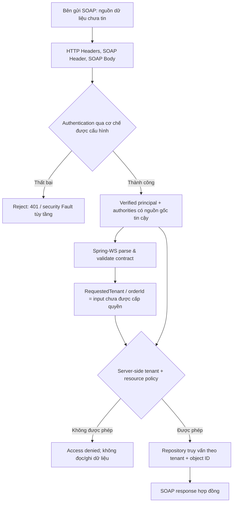
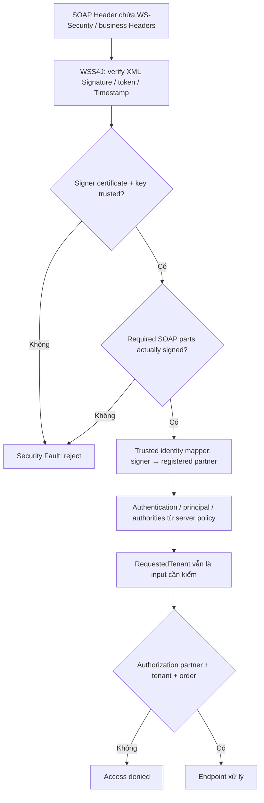
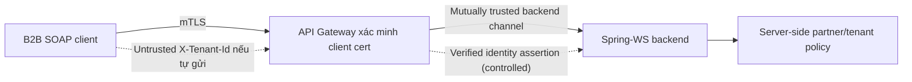

# Không dùng header nghiệp vụ chưa xác thực làm nguồn cấp quyền

Giả sử một hệ thống SOAP phục vụ nhiều đối tác gửi nhận đơn hàng. SOAP client gọi operation `GetOrder` với Header `tenantId=TENANT-A` và `userRole=ADMIN`. Nếu endpoint đọc hai giá trị này rồi quyết định rằng caller được xem mọi đơn hàng của TENANT-A, một client bất kỳ có thể thay Header thành `tenantId=TENANT-B` hoặc `userRole=ADMIN` để cố truy cập dữ liệu không thuộc quyền của mình. Việc XML có cú pháp đúng, đi qua HTTPS, khớp XSD hoặc chứa `wsse:Security` **không làm những giá trị tự khai ấy trở thành quyền đã được xác thực**.

**Nguyên tắc trọng tâm của bài:** thông tin nghiệp vụ do caller cung cấp có thể là **dữ liệu của yêu cầu**, ví dụ tenant muốn thao tác, mã chi nhánh hoặc loại báo cáo; nhưng **quyền truy cập phải xuất phát từ danh tính đã xác thực và chính sách do server quản lý**. Một `role`, `tenantId`, `userId` hoặc `clientId` nằm trong SOAP Header/HTTP Header không được phép tự nâng đặc quyền chỉ vì mang một tên có vẻ liên quan bảo mật.

Bài thuộc chương **Tích hợp Spring Security** của module **SPRING_WEB_SERVICES**. Trong lộ trình phát triển SOAP theo hướng **contract-first** với Spring Web Services (Spring-WS), chúng ta thiết kế XSD/WSDL, dùng JAXB/Spring OXM ánh xạ payload, xây dựng endpoint cùng SOAP client, xử lý SOAP Fault, interceptor, XML security, WS-Security, chứng chỉ và kiểm thử tương thích. Bài này nối các thành phần ấy với **Spring Security authentication, authorization và ranh giới tin cậy của SOAP/HTTP Headers**.

Ví dụ được viết bằng Java 17+, Spring Boot 3/Spring Security 6 và Spring-WS ở hệ Jakarta. URI, mã tenant và endpoint trong bài là giả lập. Mô hình minh họa chính dùng **HTTP Bearer JWT đã được Spring Security Resource Server xác minh**, và trình bày riêng cách áp dụng khi dùng **mTLS hoặc WS-Security/X.509**. Không được mặc định ba cách xác thực này tự động tích hợp với nhau hoặc tự cung cấp cùng một `Authentication`.

## 1. Phân biệt dữ liệu yêu cầu với bằng chứng cấp quyền

Một ứng dụng SOAP có thể nhận:

```xml
<s:Envelope
    xmlns:s="http://schemas.xmlsoap.org/soap/envelope/"
    xmlns:ctx="https://example.org/soap/context/v1"
    xmlns:o="https://example.org/orders/v1">
    <s:Header>
        <ctx:RequestedTenant>TENANT-B</ctx:RequestedTenant>
        <ctx:RequestedRole>ADMIN</ctx:RequestedRole>
        <ctx:ClientId>preferred-partner</ctx:ClientId>
    </s:Header>
    <s:Body>
        <o:GetOrderRequest>
            <o:orderId>ORD-2002</o:orderId>
        </o:GetOrderRequest>
    </s:Body>
</s:Envelope>
```

Điều mà server **biết chắc từ riêng XML này** là: client **đã khai** các chuỗi `TENANT-B`, `ADMIN`, `preferred-partner` và `ORD-2002`. Server **chưa chứng minh** chúng thuộc danh tính nào, có được cấp quyền hay không, và liệu client có được thao tác với đơn hàng `ORD-2002` hay không.

### 1.1. Bốn khái niệm không được trộn

| Khái niệm | Câu hỏi | Ví dụ nguồn đúng | Nguồn không đủ tin |
| --- | --- | --- | --- |
| **Authentication** | Ai đang gọi? | JWT được verify issuer/signature/audience; mTLS client certificate đã verify; WS-Security token/chữ ký đã validate | `userId`, `role`, `clientId` tự khai trong SOAP Header |
| **Authorization** | Caller được làm gì? | Policy server theo principal, partner registry, authorities, tenant/resource ACL | `RequestedRole=ADMIN` trong request |
| **Business context** | Caller muốn thao tác ở phạm vi nào? | `RequestedTenant`, mã cửa hàng, order ID do caller yêu cầu, sau khi validate cú pháp | Không được biến ngay thành principal/authority |
| **Integrity** | Phần message có bị sửa không? | XML Signature xác minh đúng signed parts; TLS bảo vệ một transport hop | “Có chữ ký đâu đó” hoặc “có HTTPS” không đủ cho mọi Header |

**Xác thực** và **ủy quyền** là hai quyết định độc lập. Ngay cả khi một đối tác ký toàn bộ SOAP Body và Header bằng certificate trusted, điều đó chứng minh **đối tác đã gửi những giá trị ấy** (theo policy ký) chứ **không chứng minh mọi giá trị bên trong được phép**. Một đối tác hợp lệ có thể gửi `RequestedTenant` của đối tác khác; server vẫn phải kiểm tra phạm vi.

### 1.2. Cùng một trường có hai vai trò rất khác nhau

```text
RequestedTenant = TENANT-B
  ├── Hợp lệ: "Tôi muốn xem dữ liệu TENANT-B"
  └── Không hợp lệ: "Tôi chứng minh mình là quản trị TENANT-B"
```

Nếu một caller được phép phục vụ nhiều tenant, Header có thể là một **tham số chọn tenant**, nhưng phải được đối chiếu với tập tenant mà caller có quyền. Nếu mỗi caller chỉ được gán một tenant, thậm chí tốt hơn là **suy tenant hiệu lực từ principal đã xác thực** và từ chối Header mâu thuẫn.

## 2. Bản đồ ranh giới tin cậy của SOAP request



Sơ đồ là **chuỗi trách nhiệm logic**. Trong ứng dụng thực, Spring Security servlet filters chạy **trước** `MessageDispatcherServlet`; WS-Security interceptor của Spring-WS thường chạy **sau bước SOAP parsing nhưng trước endpoint**. Việc lấy một principal đã xác minh từ WS-Security và đưa vào `SecurityContextHolder` có thể cần integration adapter riêng. Không tự suy mọi bước có cùng thứ tự với mọi transport/security profile.

| Tầng | Những gì có thể do client kiểm soát | Điều server phải xác minh |
| --- | --- | --- |
| HTTP headers | `X-Tenant-Id`, `X-User-Role`, `Authorization`, forwarded headers | Token/credential theo protocol, origin/proxy boundary và cấu hình authentication |
| SOAP Header | `RequestedTenant`, `ClientId`, `wsa:From`, `wsa:Action`, `wsse:Security` | Cú pháp, chữ ký/token đúng parts, signer trust, vai trò SOAP node; **không tự cấp quyền** |
| SOAP Body | `GetOrderRequest.orderId`, amount, account | XSD/JAXB và business validation; authorization theo resource |
| Security context | `Authentication` do trusted authentication mechanism dựng | Không được nạp authority từ dữ liệu request tự khai |
| Data access | Tenant ID, order ID, business filters | Scope theo principal/tenant, tránh Insecure Direct Object Reference |
| Response/Fault | Kết quả hoặc lỗi truy cập | Không lộ dữ liệu thuộc tenant khác, token, chi tiết xác thực |

## 3. Anti-pattern: coi SOAP Header là danh tính hoặc authority

Một đoạn mã sai có thể xuất hiện ngay trong endpoint:

```java
// SAI: ví dụ tư duy, không phải implementation nên dùng.
String tenantId = headerReader.readTenant(messageContext);
String role = headerReader.readRole(messageContext);

if ("ADMIN".equals(role)) {
    return repository.findByOrderId(orderId);
}
return repository.findByTenantIdAndOrderId(tenantId, orderId);
```

Vấn đề gồm hai lớp:

1. `role` là **chuỗi do caller gửi**, nên điều kiện `"ADMIN".equals(role)` cho phép **privilege escalation**.
2. Ngay cả nhánh không phải admin, `tenantId` là chuỗi tùy ý; caller chỉ cần đổi tenant là có thể **cross-tenant access** nếu backend không kiểm quyền.

### 3.1. Anti-pattern nghiêm trọng hơn: tự tạo `Authentication`

```java
// TUYỆT ĐỐI KHÔNG LÀM: biến role tự khai thành quyền trong Spring Security.
var forgedAuthentication =
        new UsernamePasswordAuthenticationToken(
                headerUserId,
                null,
                List.of(new SimpleGrantedAuthority(headerRole)));

SecurityContextHolder.getContext()
        .setAuthentication(forgedAuthentication);
```

Constructor nhận authorities tạo token ở trạng thái **authenticated**; khi nguồn là một Header chưa được xác minh, ứng dụng đã **tự xác thực attacker**. Spring Security không thể tự phát hiện rằng danh tính và authorities do code ứng dụng cấp sai.

**Không được dùng `UsernamePasswordAuthenticationToken` hoặc bất kỳ `Authentication` authenticated nào để “đánh dấu đã kiểm” nếu thực tế chỉ đọc Header.** Chỉ trusted authentication processor sau khi xác thực credential/token/chứng chỉ và ánh xạ policy mới được tạo kết quả đáng tin.

### 3.2. Thêm `@PreAuthorize` không tự cứu sai nguồn authority

Giả sử:

```java
@PreAuthorize("hasAuthority('ORDER_READ')")
public OrderView readOrder(String orderId) { /* ... */ }
```

Nếu `ORDER_READ` được gán từ `RequestedRole=ORDER_READ` mà không xác thực, method security chỉ đang kiểm **quyền giả**. Nguồn gốc của `Authentication` và authorities quan trọng **ngang với việc có annotation**.

### 3.3. Coi mã tenant đã ký là quyền có đúng không?

Không mặc định. Nếu `RequestedTenant=TENANT-B` được **đối tác A ký** bằng khóa hợp lệ, chữ ký ràng buộc rằng **A đã yêu cầu B**, không chứng minh A có quyền với B. **Integrity không phải authorization**. Authorization vẫn phải hỏi registry/policy server rằng A được quyền truy cập TENANT-B hay không.

## 4. Các loại Header dễ bị hiểu nhầm

| Header hoặc metadata | Có thể dùng để làm gì? | Tuyệt đối không suy ra ngay |
| --- | --- | --- |
| SOAP `RequestedTenant` | Đề xuất tenant nghiệp vụ để lọc dữ liệu | Caller sở hữu hoặc quản trị tenant |
| SOAP `RequestedRole` | Tùy chọn hiển thị/ngữ cảnh nếu contract cho phép | Role/authority trong `Authentication` |
| SOAP `UserId` | Định danh đối tượng đang được thao tác, cần ràng buộc | Danh tính caller đã xác thực |
| SOAP `ClientId` | Correlation/tenant mapping *sau khi được xác minh* | Chứng minh client identity chỉ từ chuỗi |
| HTTP `X-User-Id` | Context nội bộ giữa các hop tin cậy khi có cơ chế xác minh | Người gọi Internet được xác thực |
| HTTP `X-Tenant-Id` | Yêu cầu tenant hoặc trusted delegation đã xác minh riêng | Được cấp quyền mà không kiểm tra |
| `wsa:From` | Địa chỉ logic bên gửi trong WS-Addressing | Identity hoặc authenticated principal |
| `wsa:ReplyTo`/`FaultTo` | Điểm nhận response/Fault theo policy | URL callback được phép hoặc bằng chứng danh tính |
| `wsa:MessageID` | Định danh thông điệp/correlation | Token xác thực hoặc bằng chứng chưa replay |
| `wsse:BinarySecurityToken` | Mang chứng chỉ/token để security processor xử lý | Certificate trusted chỉ vì có trong Header |
| HTTP `Authorization: Bearer ...` | Chứa credential cần được resource server verify | Token đã tin cậy trước khi xác minh signature/issuer/audience/lifetime |

Ngôn ngữ nên sử dụng trong code review: **“Header X do caller khai báo”**, **“principal Y đã được xác minh”**, **“policy Z cấp quyền”**. Tránh gọi chung mọi Header chứa chữ `auth`/`role` là “authentication data” nếu nó không đi qua security processor đúng nghĩa.

## 5. Hai mẫu thiết kế an toàn: chọn tenant hoặc suy tenant từ principal

### 5.1. Mẫu A — tenant là tham số nghiệp vụ, luôn đối chiếu policy

Khi một đối tác được phép vận hành nhiều tenant:

```text
Verified principal: partner-A
Allowed tenants:    {TENANT-A, TENANT-C}

SOAP RequestedTenant=TENANT-A  → có thể tiếp tục
SOAP RequestedTenant=TENANT-B  → access denied
SOAP RequestedTenant=TENANT-C  → có thể tiếp tục
```

Điều kiện đọc đơn hàng:

```text
CanReadOrder(principal, tenantId, orderId)
    = Authenticated(principal)
  AND PartnerCanReadTenant(principal, tenantId)
  AND OrderBelongsToTenant(orderId, tenantId)
  AND PrincipalMayReadOrder(principal, orderId)
```

Nên kiểm object/tenant ở cả **service policy và truy vấn dữ liệu**, chẳng hạn `findByTenantIdAndOrderId(tenantId, orderId)`. Nếu chỉ kiểm tenant trước rồi repository dùng `findById(orderId)` không có tenant scope, một lỗi ở tầng khác có thể làm lọt dữ liệu.

### 5.2. Mẫu B — tenant được xác định từ danh tính đã xác minh

Nếu mỗi service account chỉ thuộc **một tenant**, không cần Header `tenantId` để quyết định tenant:

```text
Verified identity: partner-A
Server registry:   partner-A → TENANT-A

SOAP RequestedTenant = TENANT-A → chấp nhận như kiểm consistency (tùy contract)
SOAP RequestedTenant = TENANT-B → từ chối mismatch
SOAP thiếu tenant                → dùng TENANT-A nếu contract cho phép
```

Ở mẫu này, **tenant hiệu lực** được cấp từ principal/registry của server. Header có thể bị bỏ qua hoặc dùng để kiểm inconsistency; nó không ghi đè giá trị tin cậy.

### 5.3. Không lấy danh sách tenant từ Header `AllowedTenants`

Ví dụ một client gửi:

```xml
<ctx:AllowedTenants xmlns:ctx="https://example.org/soap/context/v1">
    <ctx:Tenant>TENANT-A</ctx:Tenant>
    <ctx:Tenant>TENANT-B</ctx:Tenant>
</ctx:AllowedTenants>
```

Danh sách ấy cũng là **dữ liệu tự khai**. Nếu cần mô hình nhiều tenant, hãy lấy danh sách từ policy server, partner registry hoặc claims đã được xác thực và **được phép sử dụng cho mục đích authorization**; sau đó kiểm cả resource ownership, không dùng nguyên danh sách self-asserted.

## 6. Spring Security: xác thực danh tính ở HTTP filter boundary

Với các đối tác dùng **HTTP Bearer JWT**, `SecurityFilterChain` có thể xác minh JWT **trước khi** SOAP request đi vào `MessageDispatcherServlet`. Khi xác thực thành công, Spring Security đặt `Authentication` vào `SecurityContextHolder` cho luồng xử lý HTTP hiện tại.

Ví dụ:

```java
package com.example.soap.security;

import org.springframework.context.annotation.Bean;
import org.springframework.context.annotation.Configuration;
import org.springframework.core.annotation.Order;
import org.springframework.security.config.Customizer;
import org.springframework.security.config.annotation.method.configuration.EnableMethodSecurity;
import org.springframework.security.config.annotation.web.builders.HttpSecurity;
import org.springframework.security.config.annotation.web.configuration.EnableWebSecurity;
import org.springframework.security.config.http.SessionCreationPolicy;
import org.springframework.security.web.SecurityFilterChain;

@Configuration
@EnableWebSecurity
@EnableMethodSecurity
public class SoapHttpSecurityConfiguration {

    @Bean
    @Order(1)
    public SecurityFilterChain soapApi(
            HttpSecurity http) throws Exception {

        http.securityMatcher("/ws/**");

        http.authorizeHttpRequests(authorize ->
                authorize.anyRequest().authenticated());

        http.oauth2ResourceServer(oauth2 ->
                oauth2.jwt(Customizer.withDefaults()));

        http.sessionManagement(session ->
                session.sessionCreationPolicy(
                        SessionCreationPolicy.STATELESS));

        // Chỉ phù hợp cho SOAP API dùng Bearer token ở HTTP Header,
        // không dùng cookie/session như cơ chế xác thực browser.
        http.csrf(csrf ->
                csrf.ignoringRequestMatchers("/ws/**"));

        return http.build();
    }
}
```

**Điều kiện bắt buộc của mẫu cấu hình:**

1. Application có các dependencies Spring Security và OAuth2 Resource Server/JWT.
2. Có `JwtDecoder` được cấu hình với **issuer, signature/JWK, audience và thời hạn** theo trust policy; chỉ có `oauth2ResourceServer().jwt(...)` không đủ để chứng minh tất cả claims đã được kiểm tra đúng.
3. Đối tác thực sự gửi HTTP `Authorization: Bearer ...`; mẫu này không tự xác thực `UsernameToken` trong SOAP Header.
4. `/ws/**` phải khớp **Servlet mapping thực** của Spring-WS. Nếu WSDL GET ở `/ws/orders.wsdl` cũng bị bảo vệ, việc công bố metadata cần quyết định riêng theo policy.
5. Có filter chain khác cho các URL ngoài `/ws/**` nếu ứng dụng còn REST/admin UI.
6. **Không vô hiệu CSRF toàn cục**: ví dụ chỉ bỏ kiểm CSRF trên API stateless không dùng cookie làm credential. Nếu browser cookie/session có thể xác thực SOAP endpoint, CSRF vẫn phải được xem xét.

**Đây là một mô hình xác thực cụ thể, không phải cấu hình bắt buộc cho mọi SOAP service.** Có đối tác dùng mTLS hoặc WS-Security thay vì Bearer token; khi ấy cần chọn security integration phù hợp và không đồng thời giả định một `JwtAuthenticationToken` tồn tại.

### 6.1. JWT đã verify không có nghĩa mọi claim đều là quyền

Một token có thể chứa `sub`, `partner_id`, `roles` hoặc `tenant_id`. Server phải xác minh:

- Signature và thuật toán được cho phép; không chấp nhận `alg=none` hay key tùy tiện.
- Issuer tin cậy; audience hướng tới SOAP API; `exp`, `nbf`/clock skew và các ràng buộc liên quan.
- Mapping từ claims tới **principal và authorities** theo quy tắc tin cậy, không dùng mọi string `roles` làm `GrantedAuthority` nếu issuer không được cấp quyền đưa ra quyết định đó.
- Claims tenant có **ngữ nghĩa đã được thỏa thuận** và được kiểm tra bằng policy server nếu cần.
- Authorization cho từng operation/resource không chỉ dựa vào token có chữ ký hợp lệ.

Một JWT có chữ ký đúng do **issuer khác** cấp không tự được phép gọi API. Khi nhiều issuers cùng được chấp nhận, nên nhận diện principal bằng **issuer + subject** hoặc một mapping định danh ổn định do server quản lý, tránh trùng `sub` giữa các issuers.

### 6.2. SOAP Header và HTTP Bearer token không được tự đồng bộ

Ví dụ:

```text
HTTP Authorization: Bearer <JWT đã xác minh cho partner-A>
SOAP RequestedTenant: TENANT-B
SOAP RequestedRole: ADMIN
```

Spring Security có thể xác định principal là **partner-A**, nhưng vẫn phải kiểm riêng yêu cầu `TENANT-B`. Không có quy tắc Spring-WS mặc định biến `RequestedRole` thành `GrantedAuthority`, và ta **không được tự thêm quy tắc nguy hiểm ấy**.

## 7. Một lớp policy dựa trên `Authentication` đã xác thực

Thay vì để endpoint kiểm `RequestedRole`, hãy định nghĩa ranh giới domain rõ ràng. Giả sử hệ thống quản lý quyền tenant trong cơ sở dữ liệu/partner registry.

```java
package com.example.soap.orders;

public interface PartnerRegistry {
    boolean canReadTenant(
            String authenticatedPartnerKey,
            String tenantId);
}
```

`authenticatedPartnerKey` là **định danh chuẩn hóa từ `Authentication` đã xác thực**, không phải một giá trị SOAP Header. Khi dùng nhiều JWT issuer, khóa này có thể là một ID nội bộ ánh xạ từ tổ hợp issuer/subject; khi dùng mTLS, có thể là registry ID ánh xạ từ chứng chỉ đã được xác minh.

### 7.1. Policy object được Spring Method Security gọi

```java
package com.example.soap.orders;

import org.springframework.security.authentication.AnonymousAuthenticationToken;
import org.springframework.security.core.Authentication;
import org.springframework.stereotype.Service;

@Service("orderAccess")
public final class OrderAccess {
    private final PartnerRegistry partners;

    public OrderAccess(PartnerRegistry partners) {
        this.partners = partners;
    }

    public boolean canRead(
            Authentication authentication, String requestedTenant) {

        if (authentication == null
                || !authentication.isAuthenticated()
                || authentication instanceof AnonymousAuthenticationToken) {
            return false;
        }

        if (requestedTenant == null
                || !requestedTenant.matches("[A-Z0-9_-]{1,64}")) {
            return false;
        }

        // Quyền được cấp bởi verified token / server-side mapping,
        // không lấy từ SOAP Header RequestedRole.
        boolean canReadOrders = authentication.getAuthorities()
                .stream()
                .anyMatch(authority ->
                        "SCOPE_orders.read".equals(
                                authority.getAuthority()));
        if (!canReadOrders) {
            return false;
        }

        // Chỉ an toàn nếu authentication.getName() đã được
        // security configuration map thành đối tác nội bộ ổn định.
        String authenticatedPartnerKey =
                authentication.getName();

        return partners.canReadTenant(
                authenticatedPartnerKey, requestedTenant);
    }
}
```

Ví dụ dùng `authentication.getName()` để minh họa. Nếu trong ứng dụng thực `getName()` là `JWT.sub` chưa được ánh xạ với issuer hoặc là `CN` từ certificate có thể trùng, **không được dùng trực tiếp làm partner key**. Thay bằng một `PartnerIdentityResolver` nhận **verified Authentication** rồi lookup ID nội bộ qua issuer+subject hoặc certificate identity đã xác minh.

Ví dụ dùng authority `SCOPE_orders.read` theo quy ước thường gặp của OAuth2 Resource Server khi token có scope `orders.read`. Với mTLS hoặc WS-Security, authority này cần được **trusted identity mapper cấp từ server policy** (hoặc thay bằng authority tương đương), không được sao chép từ `RequestedRole`. Quyền được kiểm đồng thời với danh sách tenant và object policy.

### 7.2. Có thể chèn phương thức kiểm quyền vào service

```java
package com.example.soap.orders;

import org.springframework.security.access.prepost.PreAuthorize;
import org.springframework.stereotype.Service;

@Service
public class OrderQueryService {
    private final OrderRepository orders;

    public OrderQueryService(OrderRepository orders) {
        this.orders = orders;
    }

    @PreAuthorize(
            "@orderAccess.canRead(authentication, #tenantId)")
    public OrderView findOrder(String tenantId, String orderId) {
        // Query vẫn scope theo tenant để phòng IDOR/cross-tenant leak.
        return orders.findByTenantIdAndOrderId(tenantId, orderId)
                .orElseThrow(OrderNotFoundException::new);
    }
}
```

Các kiểu domain cần định nghĩa:

```java
public record OrderView(
        String orderId, String tenantId, String status) {
}

public interface OrderRepository {
    java.util.Optional<OrderView> findByTenantIdAndOrderId(
            String tenantId, String orderId);
}

public final class OrderNotFoundException
        extends RuntimeException {
}
```

Mỗi `public` type ở trên thuộc **một file Java riêng**. `OrderRepository` phải thực thi tenant-aware query tại datastore/ORM. Nếu cần kiểm quyền theo từng order (owner, department, status), mở rộng policy hoặc query để kiểm ở mức object; `canReadTenant` là điều kiện cần **nhưng chưa phải toàn bộ object authorization** trong mọi sản phẩm.

**Lưu ý về `@PreAuthorize`:** Spring Method Security thường áp qua proxy. Nếu gọi method được bảo vệ bằng self-invocation `this.findOrder(...)` từ cùng bean, proxy có thể không áp rule. Gọi qua bean được Spring quản lý hoặc dùng thiết kế service tách rõ; test để bảo đảm annotation thực sự chạy.

### 7.3. Không chỉ dựa vào `hasRole("ADMIN")`

Một đối tác có quyền `ROLE_ADMIN` **trong tenant A** không mặc nhiên là admin tenant B. Hệ thống đa tenant thường phải kiểm:

```text
authenticated principal
  + scoped authority/role
  + requested tenant được cho phép
  + resource thật thuộc tenant ấy
  + điều kiện nghiệp vụ của operation
  = authorization decision
```

Role không có phạm vi có thể là nguồn gốc privilege escalation. Cân nhắc quyền có scope `TENANT_A:ORDER_READ`, registry mapping hoặc policy engine chuyên trách thay vì chuỗi `ADMIN` toàn cục.

## 8. Đọc SOAP Header dưới dạng dữ liệu, không cấp quyền trong parser

Giả sử WSDL/hợp đồng có một SOAP Header block:

```xml
<ctx:RequestedTenant
    xmlns:ctx="https://example.org/soap/context/v1">TENANT-A</ctx:RequestedTenant>
```

Một reader có thể kiểm:

- **QName** chính xác, không so prefix tùy ý.
- Header block đúng vị trí và đúng SOAP actor/role nếu contract quy định.
- Header phải xuất hiện **đúng một lần**, tránh ambiguous/duplicate values.
- Giá trị là text đơn giản, không cho nested XML/CDATA tùy ý nếu contract không cho.
- Có giới hạn độ dài và định dạng.

Sau đó reader **chỉ trả `requestedTenant`**, không trả `Authentication` hay `GrantedAuthority`.

### 8.1. Đọc Header qua `MessageContext`

```java
package com.example.soap.headers;

import java.util.Iterator;
import javax.xml.namespace.QName;
import org.springframework.ws.WebServiceMessage;
import org.springframework.ws.context.MessageContext;
import org.springframework.ws.soap.SoapHeaderElement;
import org.springframework.ws.soap.SoapMessage;

public final class RequestedTenantHeaderReader {
    private static final QName TENANT_QNAME = new QName(
            "https://example.org/soap/context/v1",
            "RequestedTenant");

    public String readRequestedTenant(MessageContext context) {
        WebServiceMessage request = context.getRequest();
        if (!(request instanceof SoapMessage soap)) {
            throw new InvalidSoapContextException(
                    "SOAP request required");
        }

        Iterator<SoapHeaderElement> it =
                soap.getSoapHeader().examineAllHeaderElements();
        String tenant = null;
        int count = 0;

        while (it.hasNext()) {
            SoapHeaderElement header = it.next();
            if (!TENANT_QNAME.equals(header.getName())) {
                continue;
            }

            count++;
            if (count > 1) {
                throw new InvalidSoapContextException(
                        "Duplicate tenant header");
            }
            tenant = SimpleHeaderText.read(header.getSource());
        }

        if (count != 1 || tenant == null
                || !tenant.matches("[A-Z0-9_-]{1,64}")) {
            throw new InvalidSoapContextException(
                    "Invalid requested tenant");
        }

        // Không tạo Authentication hoặc quyền ở đây!
        return tenant;
    }
}
```

Đoạn trên giả định một utility `SimpleHeaderText` được định nghĩa bên dưới, và một exception input riêng. Code reader cố tình **không nhìn `RequestedRole`, `UserId` hoặc `ClientId` để tự cấp quyền**.

### 8.2. Giới hạn XML khi đọc giá trị Header

```java
package com.example.soap.headers;

import javax.xml.XMLConstants;
import javax.xml.transform.Source;
import javax.xml.transform.Transformer;
import javax.xml.transform.TransformerFactory;
import javax.xml.transform.dom.DOMResult;
import org.w3c.dom.Document;
import org.w3c.dom.Element;
import org.w3c.dom.Node;

public final class SimpleHeaderText {
    private SimpleHeaderText() { }

    public static String read(Source source) {
        try {
            TransformerFactory factory =
                    TransformerFactory.newInstance();
            factory.setFeature(
                    XMLConstants.FEATURE_SECURE_PROCESSING, true);
            factory.setAttribute(
                    XMLConstants.ACCESS_EXTERNAL_DTD, "");
            factory.setAttribute(
                    XMLConstants.ACCESS_EXTERNAL_STYLESHEET, "");

            Transformer transformer = factory.newTransformer();
            DOMResult result = new DOMResult();
            transformer.transform(source, result);

            Node root = result.getNode();
            if (root instanceof Document document) {
                root = document.getDocumentElement();
            }
            if (!(root instanceof Element element)
                    || element.getChildNodes().getLength() != 1
                    || element.getFirstChild().getNodeType()
                        != Node.TEXT_NODE) {
                throw new InvalidSoapContextException(
                        "Expected simple tenant header text");
            }
            return element.getTextContent().trim();
        } catch (InvalidSoapContextException ex) {
            throw ex;
        } catch (Exception ex) {
            throw new InvalidSoapContextException(
                    "Unable to read tenant header", ex);
        }
    }
}
```

Custom exception:

```java
package com.example.soap.headers;

public final class InvalidSoapContextException
        extends RuntimeException {
    public InvalidSoapContextException(String message) {
        super(message);
    }

    public InvalidSoapContextException(
            String message, Throwable cause) {
        super(message, cause);
    }
}
```

Ví dụ nhận một `Source` từ SOAP Header **đã được Spring-WS message factory parse**. Nó không thay thế cấu hình phòng XXE ở message factory/parser đầu vào. Tùy message provider, `Source` có thể là DOMSource, SAXSource hoặc nguồn khác; production phải kiểm thử với **message factory thực tế**, không bật external access chỉ để đọc một Header.

Nếu hợp đồng yêu cầu một header đơn giản, giải pháp JAXB/schema mapping hoặc message adapter hỗ trợ sẵn có thể tốt hơn một helper DOM thủ công. Dù chọn cách nào, **reader không là security authenticator**. Mọi Header nhận từ client vẫn cần authorization sau khi đọc.

## 9. Endpoint SOAP chỉ chuyển yêu cầu xuống service có kiểm quyền

Giả sử XSD công bố `GetOrderRequest` và `GetOrderResponse`:

```xml
<?xml version="1.0" encoding="UTF-8"?>
<xs:schema xmlns:xs="http://www.w3.org/2001/XMLSchema"
           targetNamespace="https://example.org/orders/v1"
           xmlns:o="https://example.org/orders/v1"
           elementFormDefault="qualified">
    <xs:element name="GetOrderRequest">
        <xs:complexType>
            <xs:sequence>
                <xs:element name="orderId" type="xs:string"/>
            </xs:sequence>
        </xs:complexType>
    </xs:element>

    <xs:element name="GetOrderResponse">
        <xs:complexType>
            <xs:sequence>
                <xs:element name="orderId" type="xs:string"/>
                <xs:element name="status" type="xs:string"/>
            </xs:sequence>
        </xs:complexType>
    </xs:element>
</xs:schema>
```

Endpoint:

```java
package com.example.soap.orders;

import com.example.soap.headers.RequestedTenantHeaderReader;
import org.springframework.ws.context.MessageContext;
import org.springframework.ws.server.endpoint.annotation.Endpoint;
import org.springframework.ws.server.endpoint.annotation.PayloadRoot;
import org.springframework.ws.server.endpoint.annotation.RequestPayload;
import org.springframework.ws.server.endpoint.annotation.ResponsePayload;

@Endpoint
public final class GetOrderEndpoint {
    private static final String NS =
            "https://example.org/orders/v1";

    private final RequestedTenantHeaderReader tenantHeaders;
    private final OrderQueryService orderQueries;

    public GetOrderEndpoint(
            RequestedTenantHeaderReader tenantHeaders,
            OrderQueryService orderQueries) {
        this.tenantHeaders = tenantHeaders;
        this.orderQueries = orderQueries;
    }

    @PayloadRoot(namespace = NS, localPart = "GetOrderRequest")
    @ResponsePayload
    public GetOrderResponse getOrder(
            @RequestPayload GetOrderRequest request,
            MessageContext context) {

        // Dữ liệu do caller yêu cầu; KHÔNG phải authentication.
        String requestedTenant =
                tenantHeaders.readRequestedTenant(context);

        // Bean OrderQueryService áp @PreAuthorize và tenant-scoped query.
        OrderView order = orderQueries.findOrder(
                requestedTenant, request.getOrderId());

        GetOrderResponse response = new GetOrderResponse();
        response.setOrderId(order.orderId());
        response.setStatus(order.status());
        return response;
    }
}
```

`GetOrderRequest`/`GetOrderResponse` là JAXB classes giả định được sinh từ hợp đồng; `RequestedTenantHeaderReader` cần được khai báo thành Spring bean. Ví dụ Java đặt từng `public` type vào một file riêng theo package đã chỉ định. Để triển khai được cần WSDL, JAXB marshaller, exception resolver, registry, repository và security configuration phù hợp.

### 9.1. Trình tự quyết định tại endpoint

```text
HTTP Bearer token đã verify:
  partnerIdentity = PARTNER-A
SOAP Header RequestedTenant:
  requestedTenant = TENANT-B    ← dữ liệu chưa được cấp quyền
SOAP Body:
  orderId = ORD-2002            ← dữ liệu chưa được cấp quyền

OrderAccess.canRead(principal PARTNER-A, TENANT-B)
  ├── false → AccessDenied; không gọi repository
  └── true  → OrderRepository.findByTenantIdAndOrderId(
                    TENANT-B, ORD-2002)
                    → object-level rules → Response
```

Đừng bao giờ gọi `repository.findById(orderId)` **trước** khi kiểm quyền rồi dùng kết quả để “giải thích lỗi” theo cách tiết lộ sự tồn tại của đối tượng ở tenant khác. Nếu có thể, đưa tenant scope vào query và trả lỗi công khai phù hợp policy.

### 9.2. `@PayloadRoot` không phải kiểm quyền

`@PayloadRoot(namespace=..., localPart=...)` chỉ giúp Spring-WS dispatch request dựa vào QName payload. Nó **không** xác minh principal, role, tenant hay signed parts. `@ResponsePayload` và JAXB marshalling cũng không bổ sung quyền.

Ngay cả khi XSD chỉ cho mã tenant thuộc enum `TENANT-A`/`TENANT-B`, client vẫn có thể chọn giá trị hợp lệ **nhưng không thuộc quyền**. Schema validation kiểm **hợp đồng dữ liệu**, không phải authorization.

## 10. Khi dùng WS-Security: phải xác minh signer trước khi lấy identity

Một SOAP client không nhất thiết gửi HTTP Bearer token. Trong tích hợp B2B, client có thể sử dụng:

- `wsse:UsernameToken` kèm password proof theo profile và TLS phù hợp.
- `wsse:BinarySecurityToken` chứa certificate X.509.
- XML Signature trên SOAP Body, Timestamp, WS-Addressing Headers và các Header nghiệp vụ quan trọng.
- XML Encryption khi hợp đồng yêu cầu bảo mật một số phần của message.

Spring-WS có thể dùng **Apache WSS4J** thông qua `Wss4jSecurityInterceptor` để xác minh security actions. Tuy nhiên **WS-Security validation và Spring Security `Authentication` là hai trách nhiệm cần được tích hợp rõ**. Không được suy luận rằng một `wsse:Security` Header hợp lệ sẽ tự động làm `SecurityContextHolder.getContext().getAuthentication()` có principal mà ứng dụng cần.

### 10.1. Pipeline đáng tin với WS-Security



**Điều kiện của luồng trên:** chữ ký phải được xác minh bởi một security processor chuẩn, chain/trust/identity của signer được xác minh theo chính sách, và signed-parts enforcement chứng minh **đúng Body/Header mà ứng dụng đọc** nằm trong phạm vi đã ký. Không nên tự đọc `wsse:BinarySecurityToken` rồi lấy `Subject CN` làm principal khi WSS4J chưa chứng minh certificate trusted.

### 10.2. Ví dụ cấu hình xác minh WS-Security

```java
package com.example.soap.security;

import org.apache.wss4j.common.crypto.Crypto;
import org.springframework.context.annotation.Bean;
import org.springframework.context.annotation.Configuration;
import org.springframework.ws.soap.security.wss4j2.Wss4jSecurityInterceptor;

@Configuration
public class SoapMessageSecurityConfiguration {

    @Bean
    public Wss4jSecurityInterceptor inboundSoapSecurity(
            Crypto partnerSignatureTrustCrypto) {
        Wss4jSecurityInterceptor interceptor =
                new Wss4jSecurityInterceptor();
        interceptor.setValidationActions("Timestamp Signature");
        interceptor.setValidationSignatureCrypto(
                partnerSignatureTrustCrypto);
        return interceptor;
    }
}
```

Đây mới là **cấu hình một phần**, cần đăng ký interceptor vào `WsConfigurer#addInterceptors(...)` hoặc cấu hình endpoint dispatcher tương ứng. `partnerSignatureTrustCrypto` phải được cấp từ cấu hình truststore và chính sách X.509 đáng tin, không lấy certificate mà attacker đính kèm làm trust anchor.

**`setValidationActions("Timestamp Signature")` không tự chứng minh tất cả business Header và SOAP Body bắt buộc đều đã được ký.** Còn phải enforce signed-parts policy, trust, certificate purpose, freshness/replay, chính sách algorithm và quyền theo partner. Không dùng bean này như bằng chứng rằng `RequestedTenant` chắc chắn hợp lệ về quyền.

### 10.3. Header được ký vẫn có thể yêu cầu tenant không được phép

```text
Certificate signer: partner-A, đã verify PKIX + đúng chữ ký
SOAP Body:          GetOrderRequest(ORD-2002), đã ký
SOAP Header:        RequestedTenant=TENANT-B, đã ký
Server registry:    partner-A chỉ được TENANT-A

Cryptographic integrity = PASS
Signer authentication  = PASS
Business authorization = DENY
```

Không tạo một rule nguy hiểm như `if (isHeaderSigned("RequestedTenant")) allow`. **Chữ ký chỉ ràng buộc ai đã gửi giá trị**, không phải chính sách quyết định giá trị ấy có được chấp nhận hay không.

### 10.4. Bridge verified identity vào Spring Security

Khi application dùng WS-Security làm nguồn authentication, một integration adapter **đã được kiểm soát** có thể:

1. Nhận **verification result** từ WSS4J, không nhận raw SOAP Header tự khai.
2. Xác định signer/token đã qua trust, validity, required signed parts và anti-replay policy.
3. Ánh xạ signer đã xác minh tới `partnerId` nội bộ bằng registry.
4. Tra cứu authorities/tenant scopes từ nguồn policy server, không từ `RequestedRole` tự khai.
5. Xây `Authentication` dạng authenticated bằng cơ chế của trusted authentication provider/integration.
6. Gắn security context cho **chính request** trước khi service có `@PreAuthorize` chạy, rồi dọn/khôi phục context đúng lifecycle.

Không nên viết một interceptor đọc `wsse:Username` rồi trực tiếp gọi:

```java
// SAI — chưa xác minh token hoặc certificate thực sự:
SecurityContextHolder.getContext().setAuthentication(
        new UsernamePasswordAuthenticationToken(
                soapHeaderUsername, null,
                List.of(new SimpleGrantedAuthority(
                        soapHeaderRole))));
```

Đây vẫn là privilege escalation dù chuỗi `soapHeaderRole` nằm trong `wsse:Security`. Một **custom security bridge** chỉ được đọc kết quả xác minh đáng tin và phải xử lý lỗi thất bại như một request bị từ chối, không “fallback” sang tự khai báo danh tính.

**Lưu ý vòng đời:** Spring Security servlet filters có thể clear SecurityContext ở cuối request. Nếu một WS-Security interceptor tự đặt context, nó phải bảo đảm **không rò `Authentication` sang request khác**, kể cả khi Fault/exception phát sinh. Dùng cơ chế tích hợp được framework hỗ trợ, hoặc một adapter có `try/finally`/scope rõ ràng; không lưu `Authentication` vào field singleton của `@Endpoint`.

### 10.5. Không trộn tùy tiện HTTP và SOAP authentication

Một request có thể đồng thời có HTTP Bearer principal A và WS-Security signer B. Policy phải định nghĩa rõ:

- Có bắt buộc **cả hai** nguồn xác thực không?
- Nếu có, hai identity phải tương quan như thế nào?
- Nguồn nào xác định đối tác nghiệp vụ chính?
- Có cho phép delegated identity không, và token/claim nào chứng minh delegation?
- Khi A ≠ B, có từ chối hay chấp nhận theo policy đã được mô tả?

Không lấy nguồn dễ dãi hơn khi hai nguồn mâu thuẫn, không cho HTTP Header `X-User` ghi đè signer principal. Security configuration không rõ về thứ tự nguồn danh tính dễ tạo **confused deputy**: một thành phần có quyền cao thực thi theo chỉ dẫn của caller không đủ quyền.

## 11. mTLS: danh tính tại tầng TLS khác với SOAP Header

Khi dùng **mutual TLS (mTLS)**, TLS endpoint yêu cầu client certificate. TrustManager/JSSE/gateway phải xác minh chain, thời hạn, KeyUsage/EKU theo `clientAuth` và identity policy phù hợp.

Nhưng mTLS xác minh **peer của một kết nối TLS**, không phải mọi SOAP Header do peer đó khai sẽ tự trở thành quyền:

```text
TLS verified client certificate:
  subject/registry → partner-A
SOAP RequestedTenant:
  TENANT-B
Server policy:
  partner-A allowed tenants = {TENANT-A}
Authorization result:
  DENY
```

### 11.1. Spring Security X.509 authentication và identity mapping

Spring Security hỗ trợ cấu hình X.509 authentication ở tầng servlet trong những môi trường triển khai phù hợp. Cần bảo đảm:

1. TLS endpoint thực sự **yêu cầu và xác minh client certificate**.
2. Servlet/container cung cấp certificate chain đã được xác minh một cách đáng tin cho Spring Security.
3. X.509 authentication mapping tạo principal từ certificate identity **đã xác minh**, kết nối tới user/partner registry và authorities do server cấp.
4. Không chỉ tách `CN` bằng một regex rồi coi đó là đối tác duy nhất nếu PKI không bảo đảm uniqueness và scope.
5. Không để một HTTP request bên ngoài tự tạo thông tin certificate bằng Header như `X-SSL-Client-Cert` mà backend tin trực tiếp.

Một cấu hình `http.x509(...)` tự nó **không bật mTLS ở load balancer, servlet container hoặc reverse proxy**. Cần kiểm actual TLS termination point và đường chuyển identity.

### 11.2. TLS kết thúc ở gateway



Khi gateway xác thực client rồi backend cần dùng identity:

- **Chặn và xóa** các Header nội bộ cùng tên mà client từ ngoài gửi tới.
- Chỉ **gateway tin cậy** mới được tạo identity assertion; bảo vệ kết nối backend bằng mTLS/internal auth hoặc signed assertion theo policy.
- Backend xác minh **issuer/gateway identity**, tính toàn vẹn, freshness và scope của assertion.
- Chặn truy cập trực tiếp vào backend bỏ qua gateway.
- Phân biệt **verified identity assertion** với `X-Tenant-Id` do client tự khai: không gộp chúng.
- Định nghĩa rõ principal/authorities mà Spring Security tạo từ kết quả xác minh ở backend.

Không được suy ra “đã đứng sau reverse proxy nên Header nào cũng tin”. Một cấu hình sai cho phép gọi thẳng backend hoặc để `X-Verified-User` đi xuyên từ Internet là một lỗi xác thực nghiêm trọng.

## 12. HTTP Header, SOAP Header và WS-Addressing là các lớp khác nhau

Một SOAP request có thể có nhiều lớp metadata:

```text
HTTP POST /ws/orders
  Authorization: Bearer <token>          → authentication nếu được verify
  X-Tenant-Id: TENANT-A                  → user input nếu không có trust policy
  X-Forwarded-Proto: https               → metadata proxy, chỉ dùng khi proxy trusted

SOAP Envelope
  SOAP Header
    ctx:RequestedTenant = TENANT-B       → business input
    wsa:Action = urn:example:GetOrder    → WS-A action/routing
    wsa:From = https://caller.example    → logical sender address
    wsse:Security = Signature, Token     → cần security processor verify
  SOAP Body
    GetOrderRequest(orderId=ORD-2002)    → business input
```

| Trường | Khác biệt quan trọng |
| --- | --- |
| `Authorization` (HTTP) | Là credential **đầu vào để xác minh**, không tự là principal |
| `X-Tenant-Id` (HTTP) | Nếu do caller gửi thì cũng chưa có quyền; không an toàn hơn SOAP Header |
| `ctx:RequestedTenant` (SOAP) | Request context, không phải role/authority |
| `wsa:From` | Địa chỉ logic nguồn theo WS-Addressing, **không phải danh tính đã xác thực** |
| `wsa:To` | Địa chỉ logic đích, không được dùng làm arbitrary URL để proxy/fetch |
| `wsa:ReplyTo`/`FaultTo` | EPR callback; cần allowlist và policy chống SSRF/dữ liệu rò |
| `wsa:MessageID` | Correlation ID, không là token xác thực hay idempotency guarantee |
| `wsse:BinarySecurityToken` | Có thể mang certificate; phải verify trust/signature |
| `wsu:Timestamp` | Freshness của message khi được xác minh đúng; không là quyền truy cập |

**Một SOAP Header có `mustUnderstand="1"` không tự được xác thực.** `mustUnderstand` yêu cầu node được nhắm tới hiểu/xử lý Header; nó không thay thế chữ ký, token validation hoặc authorization.

### 12.1. Forwarded headers phục vụ routing, không thay thế identity

`Forwarded`, `X-Forwarded-For`, `X-Forwarded-Host` và `X-Forwarded-Proto` có thể giúp ứng dụng tái tạo URL/public scheme qua reverse proxy. Chúng **không phải role/tenant claims**. Chỉ xử lý sau khi xác định request thực sự đến từ proxy tin cậy và cấu hình strip/overwrite; không dùng raw IP/header text làm bằng chứng quyền của đối tác.

### 12.2. Hành động định tuyến phải được kiểm soát

Nếu endpoint mapping dùng `@SoapAction`, `@Action` hoặc `@PayloadRoot`:

- Action/QName giúp chọn handler, **không quyết định caller được phép gọi handler đó**.
- WS-A `Action`/`To` có thể cần ký và xác minh exact signed parts nếu ảnh hưởng routing.
- Authorization theo operation vẫn cần chạy trên principal đã xác thực.
- Đừng dùng một HTTP `X-Operation-Role` do client tự khai để bỏ qua kiểm quyền cho một action cụ thể.

## 13. Có chữ ký trên SOAP Header chưa đủ để cấp quyền

Hãy xem một message có WS-Security XML Signature trên `s:Body` và `ctx:RequestedTenant`. Một hợp đồng như vậy cho phép server kiểm tra **tính toàn vẹn** của hai phần, nhưng server vẫn phải kiểm **chủ thể nào ký** và **được phép với tenant nào**.

### 13.1. Một ví dụ tấn công với Header role đã được ký

```text
Verified signer: Partner-A
Signed SOAP Header RequestedRole: ADMIN
Signed SOAP Header RequestedTenant: TENANT-B
Signed SOAP Body: DeleteOrder(ORD-2002)

Security:
  Signer trusted? YES
  Signature valid? YES
  Required parts signed? YES

Authorization:
  Partner-A can delete order in TENANT-B? NO

Expected outcome: DENY, không delete order
```

**Không có cột nào trong ba kết quả security ở trên trả lời thay câu hỏi cuối.** Role do caller tự khai dù đã ký chỉ chứng minh caller tự khẳng định role ấy, không phải hệ thống cấp role.

### 13.2. Ngược lại: Header quan trọng chưa ký cũng là rủi ro

Nếu policy dựa vào `RequestedTenant` cho routing, một attacker/intermediary có thể sửa Header chưa ký dù Body đã được ký. Vì vậy có hai lớp kiểm tra:

1. **Integrity/authenticity:** nếu Header mang thông tin quan trọng, kiểm nó được ký hoặc bảo vệ theo cơ chế hợp đồng, so đúng **DOM node mà endpoint đọc** với signed parts thực sự.
2. **Authorization:** dù Header đã được signer đáng tin ký, kiểm giá trị có thuộc **quyền được cấp từ server policy** hay không.

Thiếu kiểm tra (1) dễ bị sửa Header trên đường truyền; thiếu kiểm tra (2) cho phép caller hợp lệ vượt quyền.

### 13.3. Chống XML Signature Wrapping

**XML Signature Wrapping (XSW)** xảy ra khi bộ xác minh chữ ký kiểm một element, còn endpoint/JAXB/reader xử lý một element **khác** có cùng tên hoặc ID trông giống.

Ví dụ khái niệm:

```text
Signature verifies:
  <ctx:RequestedTenant wsu:Id="tenant-signed">TENANT-A</...>

Application mistakenly reads:
  <ctx:RequestedTenant>TENANT-B</...>  (not signed)
```

Hệ thống phải:

- Từ chối **duplicate `wsu:Id`** và Header blocks mơ hồ theo policy.
- Xác minh đúng **node, vị trí, QName và signed coverage** theo WSS4J/security processor.
- Không dùng XPath rộng như `//*[local-name()='RequestedTenant']` để tìm Header sau security validation.
- Không cho application tự chọn một “header đầu tiên/cuối cùng” khác với Header mà security engine đã xác minh.
- Kiểm actor/role và nhiều `wsse:Security` Header theo chính sách.

Một chữ ký hợp lệ trên **một bản sao Header** không đủ để tin bản Header mà endpoint xử lý. Nếu cần tin Header cho integrity-sensitive decisions, phải kết nối **actual verified node** với nguồn dữ liệu application tiêu thụ, không chỉ so tên hoặc chuỗi `wsu:Id`.

### 13.4. Signed part policy không phải business policy

| Kiểm tra | Chặn lỗi nào? |
| --- | --- |
| XML Signature đúng thuật toán/digest | Chặn sửa nội dung đã ký |
| X.509/trust/token identity đúng | Chặn giả danh signer không được tin |
| Exact signed parts coverage | Chặn Body/Header được xử lý nhưng chưa ký |
| Tenant/object authorization | Chặn signer hợp lệ truy cập dữ liệu ngoài quyền |
| Server-side repository scoping | Giảm rủi ro IDOR hoặc bug lọc dữ liệu |
| Replay/idempotency policy | Chặn phát lại/nhân đôi thao tác có side effect |

**Đủ cả các lớp được hợp đồng yêu cầu mới có thể chấp nhận request.**

## 14. Header nghiệp vụ có thể nằm trong WSDL/XSD — vẫn cần quyền

SOAP with Headers có thể được mô tả trong WSDL 1.1 bằng `soap:header` với `wsdl:message` riêng.

Ví dụ XSD:

```xml
<xs:schema xmlns:xs="http://www.w3.org/2001/XMLSchema"
           targetNamespace="https://example.org/soap/context/v1"
           xmlns:ctx="https://example.org/soap/context/v1"
           elementFormDefault="qualified">
    <xs:element name="RequestedTenant">
        <xs:simpleType>
            <xs:restriction base="xs:string">
                <xs:pattern value="[A-Z0-9_-]{1,64}"/>
            </xs:restriction>
        </xs:simpleType>
    </xs:element>
</xs:schema>
```

WSDL binding fragment:

```xml
<!-- Fragment: cần wsdl:definitions và các prefix/parts hợp lệ. -->
<wsdl:message name="RequestedTenantHeaderMessage">
    <wsdl:part
        name="tenant"
        element="ctx:RequestedTenant"/>
</wsdl:message>

<wsdl:binding name="OrdersSoapBinding"
              type="tns:OrdersPortType">
    <soap:binding
        style="document"
        transport="http://schemas.xmlsoap.org/soap/http"/>
    <wsdl:operation name="GetOrder">
        <soap:operation
            soapAction="urn:example:orders:GetOrder"/>
        <wsdl:input>
            <soap:body use="literal"/>
            <soap:header
                message="tns:RequestedTenantHeaderMessage"
                part="tenant"
                use="literal"/>
        </wsdl:input>
        <wsdl:output>
            <soap:body use="literal"/>
        </wsdl:output>
    </wsdl:operation>
</wsdl:binding>
```

Trong WSDL hoàn chỉnh cần khai báo namespaces `wsdl`, `soap`, `tns`, `ctx`, `wsdl:portType`, request/response messages và service/port. Fragment chỉ diễn giải việc Header là một phần **contract**, không phải cấu hình application có thể chạy độc lập.

### 14.1. XSD validation không xác minh quyền

Một giá trị `TENANT-B` hoàn toàn có thể khớp pattern `[A-Z0-9_-]{1,64}`. XSD chỉ cho biết nó **đúng định dạng**, không cho biết principal A **được phép truy cập TENANT-B**.

Ngay cả khi dùng `PayloadValidatingInterceptor`, cần xác định **nó đang validate Body, Header nào và schema nào** theo cấu hình. Không mặc định các SOAP Headers hoặc MIME attachments đều đã được validate chỉ vì Body pass XSD.

### 14.2. Nếu không cần business Header, đừng tạo

Nhiều thao tác có thể đặt `tenantId` trong SOAP Body để làm rõ hợp đồng, nhưng điều đó **không làm nó thành quyền**. Nếu tenant có thể suy ra từ principal một cách tin cậy, loại bỏ Header không cần thiết sẽ làm API ít mơ hồ hơn:

```xml
<o:GetOrderRequest xmlns:o="https://example.org/orders/v1">
    <o:orderId>ORD-1001</o:orderId>
</o:GetOrderRequest>
```

Server suy tenant từ identity registry, dùng tenant scope cho truy vấn, còn `orderId` vẫn phải được kiểm object-level access. Nếu một partner có nhiều tenant, đưa requested tenant trong Body hay Header đều được về mặt mô hình **dữ liệu**, nhưng không thay thế kiểm quyền.

## 15. Quản lý SecurityContext qua request, async và batch

`SecurityContextHolder` thường chứa context gắn với **thread hiện tại**. Với servlet filter chain, Spring Security quản lý lifecycle theo request. Đừng giữ `Authentication` hay `tenantId` vào field của singleton:

```java
// SAI: @Endpoint là singleton và phục vụ nhiều request đồng thời.
@Endpoint
public class UnsafeOrderEndpoint {
    private String currentTenant;
    private Authentication currentCaller;
}
```

Hai request khác tenant có thể chạy đồng thời; field mutable dễ làm lẫn dữ liệu/ngữ cảnh. Dùng biến local, immutable command/context hoặc đúng mechanism request-scoped.

### 15.1. Công việc async không tự có identity context

Nếu endpoint gửi message vào queue hoặc executor:

```text
SOAP request thread:
  Authentication = partner-A
  RequestedTenant = TENANT-A

Async worker thread:
  SecurityContextHolder có thể trống hoặc không tương ứng
```

Không “sửa” bằng cách đọc `RequestedTenant` từ message rồi tự tạo authenticated principal ở worker. Thay vào đó:

- Xác thực và kiểm quyền **trước khi enqueue**.
- Ghi lại **server-generated job ownership**, tenant scope và hành động được phép trong một job record đã được bảo vệ.
- Worker xác thực quyền service của chính nó và kiểm job ownership/quyền cần thiết trước khi xử lý; tránh tin raw metadata trên queue.
- Nếu thật sự cần propagate Spring Security context nội bộ, dùng cơ chế như `DelegatingSecurityContextExecutor`/`DelegatingSecurityContextRunnable` với phạm vi có kiểm soát, hiểu vòng đời và không tái dùng context giữa jobs.
- Dùng idempotency/replay controls cho các lệnh có side effect.

Một principal có quyền tại lúc enqueue có thể mất quyền trước khi job chạy. Chính sách phải định nghĩa có kiểm tra lại quyền khi thực thi hay không; không coi một snapshot Header cũ là authorization vĩnh viễn.

### 15.2. SecurityContext phải được cleanup kể cả khi SOAP Fault

Nếu có adapter WS-Security custom gắn `Authentication` vào `SecurityContextHolder`, phải dọn/khôi phục trong `finally`/cơ chế lifecycle được hỗ trợ. Một SOAP Fault giữa đường không được để principal từ request A rò sang request B trên thread pool.

## 16. Khi dữ liệu đã xác thực bị nhầm thành dữ liệu được cấp quyền

Một số hệ thống còn mắc lỗi tinh vi hơn việc đọc raw Header:

| Trạng thái | Có thể tin điều gì? | Vẫn cần kiểm |
| --- | --- | --- |
| JWT signature/issuer/audience đúng | Token được issuer tin cậy cấp cho bối cảnh dự kiến | Scope, resource, tenant và quyền operation |
| WS-Security signature trên Body/Header đúng | Signer đã phát thông điệp với nội dung được ký | Partner identity, tenant/object rights |
| mTLS client certificate trusted | TLS peer được xác thực ở boundary đó | Partner account mapping và operation rights |
| Signed `RequestedRole=ADMIN` | Signer đã tự khai ADMIN, không bị đổi trên đường | Server có thực sự cấp ADMIN ở tenant đó? |
| Gateway assertion đã được verify | Gateway tin cậy đưa ra identity assertion theo contract | Delegation scope, expiry, audience và resource |
| Header `RequestedTenant` đúng XSD | Chuỗi hợp lệ về định dạng | Caller có quyền với tenant không? |

### 16.1. Delegation và impersonation

Trong B2B, một gateway có thể gọi SOAP service **thay mặt người dùng cuối**. Ví dụ partner-A đại diện cho user-42:

```text
Authenticated client: partner-A
Claimed on-behalf-of: user-42
RequestedTenant: TENANT-B
```

Không đủ để gắn `user-42` vào principal rồi kiểm quyền của user-42. Cần **delegation proof** đã xác minh: token có issuer/audience/scope đúng, hoặc mô hình signed delegation/authorization được hợp đồng cho phép. Policy cần kiểm **cả partner đang đại diện và user được đại diện**, giới hạn tenant và thao tác.

Nếu không có cơ chế delegated authorization, coi `OnBehalfOfUser` là **business input chưa được cấp quyền**. Một partner hợp lệ không có quyền tự mạo danh mọi người dùng.

### 16.2. Confused deputy

Một SOAP gateway có quyền truy cập kho dữ liệu nhiều tenant có thể trở thành **confused deputy** nếu nó làm theo `RequestedTenant` tự khai mà không kiểm danh tính caller. Vấn đề không nằm ở SOAP riêng biệt: bất kỳ service có quyền cao nào nhận tham số điều khiển từ nguồn thấp quyền đều phải áp policy.

Giải pháp: giữ **caller identity** và **target resource** tách biệt; quyết định `canAct(caller, action, resource)` ở server, và ràng buộc khi truy cập kho dữ liệu.

## 17. Xử lý SOAP Fault/HTTP error mà không lộ dữ liệu

Thất bại authentication hoặc authorization có thể xảy ra ở nhiều tầng, nên client không được giả định mọi lỗi đều là SOAP Fault:

| Nơi phát sinh | Ví dụ | Response thường gặp |
| --- | --- | --- |
| Spring Security HTTP filter | HTTP Bearer token thiếu/sai | HTTP 401/403 theo entry point/access denied handler; **có thể không có SOAP Envelope** |
| TLS/mTLS handshake | Certificate client/server sai | TLS/transport exception, thường không có SOAP Fault |
| WS-Security interceptor | XML Signature, trust hoặc Timestamp không đạt | SOAP Security Fault theo cấu hình/policy |
| SOAP Header reader | Thiếu, trùng hoặc sai định dạng `RequestedTenant` | SOAP Client/Sender Fault hoặc lỗi hợp đồng |
| Spring Method Security | Principal không được phép tenant | `AccessDeniedException`, cần mapping an toàn nếu muốn SOAP Fault |
| Repository/object policy | Không có quyền hoặc không tồn tại trong tenant | Fault nghiệp vụ công khai, có thể che sự tồn tại của resource |
| API Gateway/proxy | Rate limit, request quá lớn | HTTP 429/413/502... không nhất thiết SOAP Fault |

### 17.1. Không lộ sự tồn tại của tài nguyên qua Fault

Giả sử partner-A yêu cầu `TENANT-B/ORD-2002`. Nếu server trả “Order ORD-2002 tồn tại nhưng thuộc TENANT-B”, đã tiết lộ thông tin của tenant B. Policy có thể dùng **cùng một lỗi công khai** cho đối tượng không tồn tại và đối tượng không thuộc quyền, tùy yêu cầu nghiệp vụ.

Không đưa raw certificate subject, JWT claims, danh sách tenant được phép, policy expression, SQL query, stack trace hay toàn bộ SOAP Header vào response.

### 17.2. Đừng dùng “authentication failed” cho mọi loại lỗi

Một token hợp lệ nhưng bị từ chối truy cập tenant B là **authorization denied**, không phải “caller không xác thực”. Phân biệt này quan trọng cho metrics, audit, client behavior và điều tra. Tuy nhiên **thông điệp công khai** có thể được làm mờ theo chính sách bảo mật để tránh lộ trạng thái hệ thống.

Nếu muốn trả SOAP Fault từ endpoint, cấu hình `SoapFaultMappingExceptionResolver` hoặc exception resolver tùy hợp đồng cho `InvalidSoapContextException`, `AccessDeniedException` và lỗi nghiệp vụ. Chú ý rằng **HTTP SecurityFilterChain** có thể chặn request trước khi tới SOAP exception resolver; không thể chỉ cấu hình resolver rồi giả định HTTP 401 luôn được bọc SOAP.

### 17.3. Audit log có kiểm soát

Một log phù hợp:

```text
event=SOAP_AUTHORIZATION_DENIED
operation=GetOrder
authenticatedPartner=partner-A
requestedTenant=TENANT-B
decision=DENY
reason=TENANT_NOT_ALLOWED
correlationId=req-2026-901
```

Đây là ví dụ, không phải dữ liệu thật. Mã tenant có thể là dữ liệu nhạy cảm và chỉ được log nếu policy cho phép; phải giới hạn quyền xem/retention. **Không ghi password, private key, raw JWT, raw SOAP Header, WS-Security token hoặc toàn bộ PII**. Chuẩn hóa correlation ID trước khi ghi để giảm log injection; không dùng giá trị ID duy nhất làm metric label cardinality cao.

## 18. Kiểm thử policy: Header giả không thể tạo quyền

Trước tiên nên test **quy tắc ủy quyền độc lập với SOAP transport**. Điều cần chứng minh là đối tác A không thể truy cập tenant B chỉ vì Header khai TENANT-B hoặc `ADMIN`.

### 18.1. Unit test `OrderAccess` với registry giả

```java
package com.example.soap.orders;

import java.util.List;
import org.junit.jupiter.api.Test;
import org.springframework.security.authentication.UsernamePasswordAuthenticationToken;
import org.springframework.security.core.Authentication;
import org.springframework.security.core.authority.SimpleGrantedAuthority;

import static org.junit.jupiter.api.Assertions.*;

class OrderAccessTest {
    private final PartnerRegistry partners =
            (authenticatedKey, requestedTenant) ->
                    "issuer-A|partner-A".equals(authenticatedKey)
                    && "TENANT-A".equals(requestedTenant);

    private final OrderAccess access = new OrderAccess(partners);

    @Test
    void allowsRegisteredTenantOnly() {
        Authentication verifiedTestPrincipal =
                authenticatedTestPartner();

        assertTrue(access.canRead(
                verifiedTestPrincipal, "TENANT-A"));
        assertFalse(access.canRead(
                verifiedTestPrincipal, "TENANT-B"));
    }

    @Test
    void rejectsAnonymousOrAbsentPrincipal() {
        assertFalse(access.canRead(null, "TENANT-A"));
    }

    @Test
    void rejectsMissingTrustedScope() {
        Authentication noReadScope =
                new UsernamePasswordAuthenticationToken(
                        "issuer-A|partner-A",
                        "test-only",
                        List.of(new SimpleGrantedAuthority(
                                "SCOPE_orders.write")));

        assertFalse(access.canRead(noReadScope, "TENANT-A"));
    }

    private static Authentication authenticatedTestPartner() {
        return new UsernamePasswordAuthenticationToken(
                "issuer-A|partner-A",
                "test-only",
                List.of(new SimpleGrantedAuthority(
                        "SCOPE_orders.read")));
    }
}
```

**Quan trọng:** unit test này chủ động tạo `Authentication` đã xác thực như **test double**. Trong production, chỉ trusted authentication mechanism sau khi verify JWT/mTLS/WS-Security và mapping identity mới được tạo principal như vậy. Không lấy `UsernamePasswordAuthenticationToken` trong test làm “công thức” chuyển SOAP Header thành principal ở runtime.

Test `rejectsMissingTrustedScope` giả định `OrderAccess` yêu cầu authority `SCOPE_orders.read`, nguồn là **verified JWT scope** hoặc authority do server cấp sau authentication. Nếu ứng dụng dùng mTLS/WS-Security với authority scheme khác, phải cập nhật chính sách và test đồng bộ.

### 18.2. Test độc lập cho SOAP Header reader

Các tình huống:

| SOAP Header | Mong đợi |
| --- | --- |
| Một `RequestedTenant=TENANT-A` đúng QName | Đọc chuỗi TENANT-A, **chưa cấp quyền** |
| Header thiếu khi contract yêu cầu | Lỗi input |
| Hai Header cùng QName nhưng khác tenant | Từ chối duplicate, không chọn “đầu tiên” hoặc “cuối cùng” |
| Prefix XML khác nhưng cùng namespace URI | Nhận đúng QName |
| Cùng local name nhưng khác namespace URI | Không coi là Header hợp đồng |
| Chuỗi dài quá giới hạn | Từ chối |
| Dữ liệu có ký tự XML lạ/nested elements | Từ chối theo schema/policy |
| `RequestedRole=ADMIN` xuất hiện kèm tenant | Reader không tự chuyển thành `GrantedAuthority` |
| `RequestedTenant` ở SOAP role/actor khác | Xử lý theo profile, không tự tin Header của node khác |
| WS-Security Header giả nhưng chưa verified | Không tạo verified principal |

**Một Header parser pass không có nghĩa authorization pass.** Test parser chỉ nên trả giá trị đã chuẩn hóa hoặc exception input; test policy quyết định quyền riêng.

### 18.3. Test service với `@PreAuthorize` thật

Test unit gọi trực tiếp `new OrderQueryService(...)` **không tự chạy proxy method security**. Cần test trong **Spring context có `@EnableMethodSecurity`** hoặc integration test thực tế:

1. Đặt `Authentication` kiểm soát bằng test support trong `SecurityContextHolder` hoặc dùng `@WithMockUser` đúng authority; dọn context sau test.
2. Gọi `OrderQueryService` lấy từ Spring container qua proxy.
3. Với principal A + TENANT-B, phải ném `AccessDeniedException` và repository spy phải xác nhận **không bị gọi**.
4. Với principal A + TENANT-A, method mới truy vấn.
5. Thử một đường gọi nội bộ/self-invocation để phát hiện rule bị bỏ qua do proxy.
6. Kiểm tra repository thực chỉ trả object thuộc tenant được phép.

Không dùng `@WithMockUser(username="ADMIN")` để tuyên bố JWT/PKIX/WS-Security production đã verify — đó là fixture giả lập principal, chỉ kiểm tầng authorization.

## 19. Ma trận kiểm thử tích hợp SOAP và bảo mật

### 19.1. HTTP authentication và ranh giới principal

| Ca | Kết quả mong muốn |
| --- | --- |
| Không có JWT khi filter yêu cầu Bearer | HTTP 401 hoặc entry-point denial, không tới endpoint |
| JWT chữ ký sai | Từ chối trước business |
| JWT hết hạn/chưa có hiệu lực | Từ chối |
| JWT issuer/audience sai | Từ chối nếu decoder/validator đã cấu hình đúng |
| JWT đúng nhưng thiếu scope `orders.read` | Method security từ chối |
| JWT đúng partner-A, SOAP Header `RequestedRole=ADMIN` | Không được nâng đặc quyền |
| JWT đúng partner-A, SOAP `RequestedTenant=TENANT-B` | Từ chối nếu partner-A chỉ được tenant A |
| JWT đúng partner-A, SOAP `RequestedTenant=TENANT-A` | Có thể tiếp tục object-level checks |
| HTTP `X-User-Id=admin` gửi từ Internet | Không tạo principal admin |
| HTTP `X-Tenant-Id=TENANT-B` gửi từ Internet | Không bỏ qua registry/policy |
| Hai JWT issuers có cùng `sub` | Không map nhầm đối tác nếu policy dùng issuer+subject |
| JWT đúng nhưng object thuộc tenant khác | Repository/object authorization từ chối |

### 19.2. WS-Security và Header integrity

| Ca | Điều cần chứng minh |
| --- | --- |
| `wsse:Security` có token nhưng signature không hợp lệ | Từ chối |
| Signer tự ký, trust không phù hợp | Từ chối dù XML Signature math đúng |
| Signature chỉ ký Timestamp, Body chưa ký | Từ chối nếu policy yêu cầu Body |
| Signature ký Body, Header quan trọng chưa ký | Từ chối nếu policy yêu cầu Header ấy |
| Signature hợp lệ trên Body, `RequestedRole=ADMIN` đã ký | **Không** cấp admin nếu server policy không cấp |
| Partner-A ký đúng `RequestedTenant=TENANT-B` | Từ chối nếu không được phép tenant B |
| `RequestedTenant` bị thay sau khi ký | Phát hiện nếu signed-parts policy bảo vệ Header |
| Duplicate `wsu:Id`/Header tương đương | Từ chối hoặc xử lý chặt theo policy; không đọc node khác signed node |
| SOAP Header có `mustUnderstand=1` | Có bộ xử lý hiểu policy thật, không chỉ bỏ Fault |
| WS-A `Action` đổi nhưng Body không đổi | Từ chối nếu mapping/policy yêu cầu Action đúng và signed |
| WS-A `ReplyTo` tới host ngoài | Không gửi callback khi chưa được allowlist/authorized |
| SOAP client nhận response có signer sai | Client từ chối nếu response signature được hợp đồng yêu cầu |

### 19.3. mTLS và reverse proxy

| Ca | Kết quả mong muốn |
| --- | --- |
| mTLS client certificate không trusted | TLS handshake từ chối |
| Client cert trusted nhưng thuộc partner B | Không có quyền truy cập dữ liệu partner A |
| Certificate hết hạn hoặc sai EKU `clientAuth` | Từ chối theo TLS policy |
| Client tự gửi `X-Verified-Client-Cert` | Gateway strip/overwrite; backend không tin input đó |
| Request trực tiếp tới backend bỏ qua gateway | Bị firewall/network/security boundary chặn |
| Gateway gửi verified assertion quá hạn/sai audience | Backend từ chối |
| WSDL/public URL qua proxy hợp lệ | Endpoint mapping đúng, không thay đổi authorization |
| Host/forwarded headers bị spoof | Không thay đổi tenant/role/identity |
| Mạng giữa gateway và backend không được bảo vệ | Test phát hiện rủi ro, không coi asserted Header là trusted |

### 19.4. Hành vi nghiệp vụ và Fault

| Ca | Kỳ vọng |
| --- | --- |
| Request thiếu tenant trong hợp đồng bắt buộc | Fault input, không truy vấn DB |
| Request có hai RequestedTenant khác nhau | Fault, không chọn bừa |
| Tenant đúng nhưng order thuộc tenant khác | Không trả dữ liệu ngoài quyền |
| Partner A có quyền read nhưng không có quyền delete | `DeleteOrder` bị từ chối |
| Request bị deny sau khi vào service | Không có write side effect |
| SOAP Fault authz | Không lộ danh sách tenants, SQL, JWT hoặc cert secrets |
| HTTP 401/403 trước SOAP | SOAP client xử lý HTTP/transport error, không ép parse Fault |
| 100 concurrent requests từ các tenants khác nhau | Không trộn principal/tenant giữa threads |
| Job async sau request | Identity/tenant ownership được quản lý, không lấy context từ Header cũ |
| Retry thao tác ghi với Header bất kỳ | Không bỏ idempotency, replay và authorization policy |

**Các bài test phải kiểm cả kết quả từ chối và không có side effect**. Một request bị từ chối nhưng đã đọc dữ liệu nhạy cảm, cập nhật DB, gửi callback hoặc ghi event trái quyền trước đó vẫn là lỗi bảo mật.

### 19.5. Công cụ kiểm thử nên chọn theo ranh giới

| Công cụ | Phù hợp kiểm | Không tự chứng minh |
| --- | --- | --- |
| JUnit + mock `PartnerRegistry` | Quy tắc principal–tenant–authority | JWT/signature được verify |
| Spring Method Security test | Proxy `@PreAuthorize` và repository invocation | TLS, HTTP authentication, WS-Security |
| `MockWebServiceClient` | SOAP endpoint/Header reader/interceptors với test context | HTTP FilterChain/JWT 401 và TLS handshake thật |
| `MockWebServiceServer` | SOAP client request/response payload và Headers | Server-side authorization hoặc mTLS |
| HTTP integration test + Spring Security | JWT resource server/filter mapping, 401/403 | Tự chứng minh WSS4J signed parts |
| WSS4J signed-message test | Signature/token/trust và actual signed Body/Header | Quyền tenant nếu không gắn policy test |
| TLS/reverse-proxy E2E test | Client cert, trusted proxy, host, strip headers | Object-level authorization nếu không kiểm DB |

Đặc biệt, `MockWebServiceClient` thường trực tiếp thử `MessageDispatcher` trong test context; nó **không chứng minh** servlet HTTP security filters sẽ chạy đúng trên mạng. Hãy có test thật đi qua URL `/ws/**` khi cần xác minh `SecurityFilterChain`.

## 20. Checklist review và triển khai

**Trước khi chấp nhận request:**

1. Chọn **một nguồn xác thực chính đã được verify** (JWT, mTLS, WS-Security) hoặc quy định rõ điều kiện khi dùng kết hợp.
2. Dựng `Authentication` và authorities **chỉ** từ trusted verification result và mapping/policy server; không lấy `role`/`tenantId`/`userId` từ Header tự khai.
3. Nếu SOAP Header mang business context, xem nó là **requested context** cần validation/authorization, không là verified identity.
4. Với nhiều tenant, kiểm `principal + requestedTenant + operation + resource`, không chỉ role toàn cục.
5. Truy vấn dữ liệu có **tenant scope** và object-level policy để giảm rủi ro IDOR.
6. Đăng ký `@EnableMethodSecurity`, test proxy và tránh self-invocation bypass.
7. Nếu dùng WS-Security, kiểm **signer trust, timestamp, exact signed parts và XML Signature Wrapping**, rồi vẫn kiểm tenant permissions.
8. Nếu dùng mTLS qua gateway, bảo vệ verified-identity assertion, strip Header giả mạo và chặn truy cập trực tiếp backend.
9. Nếu dùng JWT, validate issuer, audience, lifetime, algorithms và authority mapping; không trust mọi custom claim.
10. Phân biệt HTTP Headers, SOAP Header và WS-Addressing; `wsa:From`/`ReplyTo` không phải authentication.
11. Không để SOAP Header input tạo `Authentication` authenticated một cách thủ công.
12. Không lưu principal/tenant ở field singleton; xử lý SecurityContext đúng request/thread/async lifecycle.
13. Tách SOAP Fault security/input/authz và HTTP/TLS errors, không lộ credentials, schema nội bộ hoặc dữ liệu ngoài quyền.
14. Có negative tests với Header `ADMIN`/tenant giả, signature hợp lệ nhưng truy cập ngoài quyền, duplicate Header và concurrent requests.

**Khi hợp đồng đã lỡ dùng `RequestedRole` như quyền:** đừng tiếp tục vì lý do tương thích mà không có kiểm soát. Có thể giữ trường trong một giai đoạn chuyển đổi nhưng **chỉ xem là requested view/mode**, sau đó server kiểm quyền độc lập; version hóa WSDL/XSD, cập nhật client, thêm test chống giả mạo rồi loại bỏ ngữ nghĩa cấp quyền cũ.

## 21. Bài tập tự kiểm tra

**Câu 1.** SOAP Header chứa `RequestedRole=ADMIN` và Body hoàn toàn hợp lệ theo XSD. Có thể cho phép operation quản trị không?

**Đáp án:** Không. XSD kiểm cú pháp, còn Header là dữ liệu caller khai. Quyền quản trị phải do server cấp dựa trên principal đã xác thực, scope và resource/tenant policy.

**Câu 2.** Client dùng HTTPS; vậy `RequestedTenant` được bảo vệ rồi, có thể coi nó là quyền truy cập không?

**Đáp án:** Không. TLS bảo vệ một kênh/hop, không chứng minh client được phép với tenant đã khai. Cần authentication và authorization server-side.

**Câu 3.** Một request có `wsse:BinarySecurityToken` mang cert Subject=partner-A. Có đủ tạo principal A không?

**Đáp án:** Không. Cần security processor xác minh XML Signature/token, certificate trust/purpose, actual signed parts, rồi map verified signer sang identity nội bộ.

**Câu 4.** Partner-A ký đầy đủ SOAP Body và `RequestedTenant=TENANT-B`. B có thuộc quyền A không?

**Đáp án:** Không suy được từ chữ ký. Chữ ký chỉ chứng minh signer A đã gửi yêu cầu B. Server registry/policy phải xác nhận A được phép tenant B.

**Câu 5.** `@PreAuthorize("hasRole('ADMIN')")` có bảo vệ endpoint nếu application tự tạo `GrantedAuthority(ROLE_ADMIN)` từ `RequestedRole`?

**Đáp án:** Không. Authority đã bị tạo từ dữ liệu không đáng tin, nên method security chỉ kiểm quyền giả. Phải sửa **nguồn principal/authority**.

**Câu 6.** Vì sao cần truy vấn `findByTenantIdAndOrderId` dù đã có `@PreAuthorize`?

**Đáp án:** Để giới hạn dữ liệu ở datastore và giảm rủi ro sai sót/missing authorization, đặc biệt IDOR. Với object có ownership phức tạp, vẫn cần thêm object-level rules.

**Câu 7.** `SecurityContextHolder#getContext().getAuthentication().isAuthenticated()` trả true. Có chắc không phải anonymous không?

**Đáp án:** Chưa. `AnonymousAuthenticationToken` có thể được coi là authenticated theo API. Policy cần loại anonymous và chỉ tin token từ trusted mechanism phù hợp.

**Câu 8.** JWT có chữ ký đúng nhưng `issuer` không thuộc tập issuer được tin. Có thể dùng `roles` trong JWT để cấp quyền không?

**Đáp án:** Không. Phải xác minh issuer, audience, lifetime, signature/key và authority mapping trước khi dùng claims.

**Câu 9.** Một API gateway xác minh mTLS, backend nhận `X-Verified-User`. Khi nào backend được tin?

**Đáp án:** Chỉ khi gateway là nguồn tin cậy, Header từ caller đã bị strip/overwrite, backend chỉ nhận qua kênh tin cậy và assertion được verify theo policy. Không tin raw forwarded Header từ Internet.

**Câu 10.** `wsa:From` nói client là partner-A. Có đủ dùng làm `Authentication#getName()` không?

**Đáp án:** Không. WS-Addressing From là địa chỉ logic bên gửi, không phải bằng chứng xác thực.

**Câu 11.** SOAP Signature bảo vệ Body, nhưng `RequestedTenant` chưa ký và endpoint dùng Header ấy để chọn tenant. Có rủi ro gì?

**Đáp án:** Một intermediary có thể sửa Header chưa ký. Nếu Header quan trọng cho routing/business context, cần bảo vệ tính toàn vẹn đúng policy, đối chiếu exact signed node; sau đó vẫn kiểm quyền tenant.

**Câu 12.** SOAP Header có hai `RequestedTenant`, một nằm trong phần đã ký và một chưa ký. Có nên lấy giá trị đầu tiên không?

**Đáp án:** Không. Từ chối duplicate/ambiguous Header theo policy; bảo đảm dữ liệu mà endpoint dùng chính là node đã được xác minh. Đây là một phần của phòng vệ XML Signature Wrapping.

**Câu 13.** Tại sao test `MockWebServiceClient` không chứng minh JWT filter trên `/ws/**` đã hoạt động?

**Đáp án:** Vì nó có thể gọi trực tiếp Spring-WS MessageDispatcher trong test, không đi qua servlet HTTP FilterChain. Cần HTTP integration test với security filter thật.

**Câu 14.** Một token hợp lệ thiếu quyền `orders.read`, nhưng partner registry cho phép tenant A. Có nên đọc order?

**Đáp án:** Không nếu policy yêu cầu cả scope thao tác và tenant access. Phải thỏa **đồng thời** authority, tenant và object permissions.

**Câu 15.** Tại sao không đặt `currentTenant` vào một field của `@Endpoint` để các method khác dùng?

**Đáp án:** Endpoint thường là singleton phục vụ request đồng thời; field mutable dễ trộn tenant/identity giữa requests. Dùng state local, request scope hoặc context được quản lý đúng lifecycle.

**Câu 16.** Client thiếu HTTP token và bị Spring Security trả HTTP 401. Có luôn nhận SOAP Fault không?

**Đáp án:** Không. Filter có thể từ chối trước khi SOAP message được parse, nên client có thể nhận HTTP error không chứa SOAP Envelope. Phải xử lý cả transport/HTTP errors và SOAP Fault.

**Câu 17.** Partner-A có quyền TENANT-A nhưng cố xem `ORD-9009` thuộc TENANT-B; sao không chỉ kiểm `RequestedTenant=TENANT-A`?

**Đáp án:** Vì order ID có thể trỏ tới object tenant khác. Repository phải scope theo cả tenant và object ID, đồng thời kiểm object-level ownership/permissions khi cần.

**Câu 18.** SOAP request có `OnBehalfOfUser=user-42`. Có đủ gán principal user-42 và dùng quyền của họ không?

**Đáp án:** Không. Cần một cơ chế delegation/impersonation đã xác thực và cấp quyền, bao gồm phạm vi tenant/operation. Trường tự khai chỉ là request data.

## Ghi nhớ

- **Không bao giờ biến SOAP/HTTP Header nghiệp vụ tự khai thành `Authentication` hoặc `GrantedAuthority`.** `tenantId`, `role`, `userId`, `clientId` chỉ là dữ liệu của request khi chưa được nguồn tin cậy xác minh/ủy quyền.
- **Authentication xác định caller; authorization quyết định caller được thao tác gì với tenant và resource.** Một chữ ký, token hoặc certificate hợp lệ không tự cấp mọi quyền.
- **Spring Security `SecurityFilterChain` và `@PreAuthorize` phải dựa trên principal/authorities có nguồn gốc đã xác minh.** Không bảo vệ được hệ thống nếu ứng dụng tự tạo quyền từ Header giả.
- **Header đã ký vẫn có thể yêu cầu vượt quyền.** WS-Security bảo vệ tính toàn vẹn và xác thực signer; cần signed-parts policy, chống XSW và kiểm business authorization độc lập.
- **Truy vấn theo tenant và object ID** để tránh rò dữ liệu xuyên tenant/IDOR; không chỉ dựa vào Header hoặc role toàn cục.
- **mTLS, JWT, WS-Security, HTTP Header và WS-Addressing là các ranh giới khác nhau.** Gateway phải strip Header giả, bảo vệ identity assertion và kiểm quyền tại backend.
- **SOAP Fault và HTTP 401/403/TLS errors có thể phát sinh ở các tầng khác nhau.** Không để lộ dữ liệu bí mật và luôn kiểm request bị deny không tạo side effect.
- **Test trường hợp giả mạo role/tenant, signer hợp lệ nhưng ngoài quyền, Header trùng, unsigned Header và concurrent requests.** Happy path chưa đủ chứng minh bảo vệ đúng.
