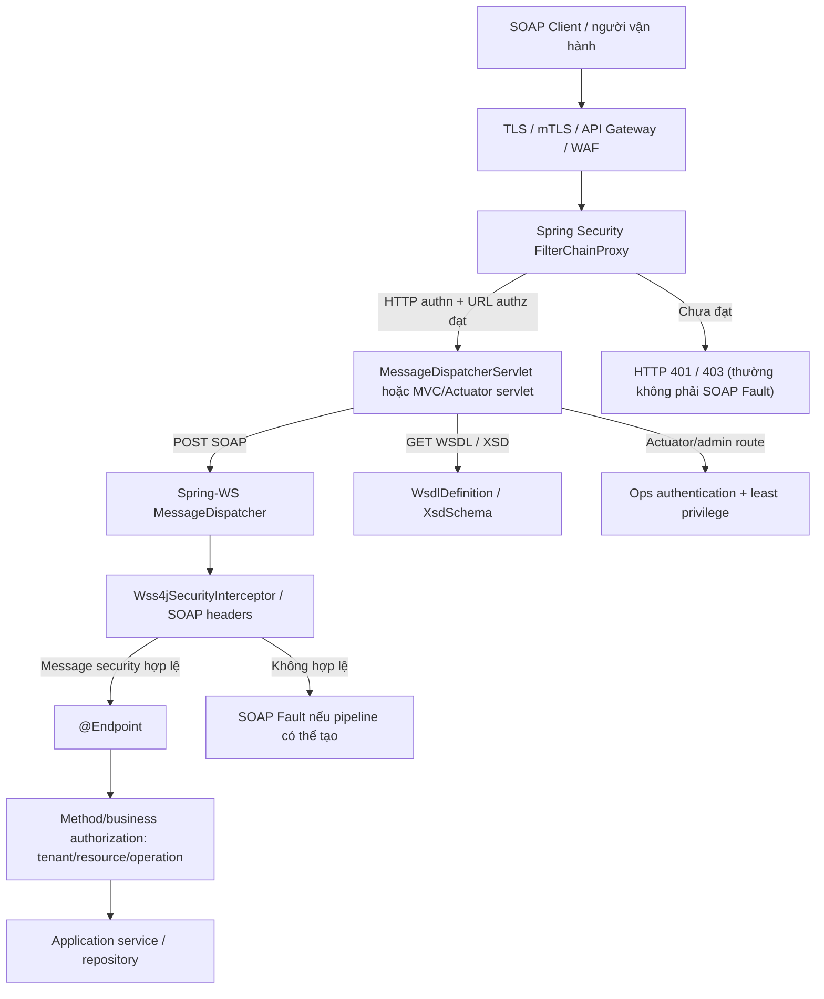

# Bảo vệ URL SOAP, WSDL, XSD và các tài nguyên quản trị theo mục đích

## Mục tiêu học tập

Đây là bài thuộc chương **Tích hợp Spring Security** của module **SPRING_WEB_SERVICES**. Trong một dịch vụ SOAP contract-first, **SOAP endpoint**, **WSDL mô tả hợp đồng**, **XSD định nghĩa kiểu dữ liệu** và **trang/API quản trị** đều có thể được công bố trên HTTP, nhưng **không có cùng đối tượng được phép truy cập hoặc cùng mức độ nhạy cảm**. Thiết kế bảo mật đúng cần trả lời: *Ai được gọi nghiệp vụ? Ai được tải hợp đồng? Ai được quan sát vận hành? Ai được thay đổi cấu hình?* và *một URL bị quên có bị lộ hay không?*

Bài giải thích cách phối hợp **Spring Security Servlet FilterChain** với **Spring Web Services** (`MessageDispatcherServlet`, `@Endpoint`, `DefaultWsdl11Definition`, `XsdSchema`, SOAP client) trong ứng dụng Java 17+, ưu tiên các API **Spring Security 6.5+**. Nếu dự án dùng phiên bản khác, phải đối chiếu Javadoc/BOM thay vì đổi import theo trí nhớ. Ví dụ không cung cấp bí mật thật hoặc tự giả định hệ thống có đăng nhập/SSO nào.

Sau bài học, bạn có thể:

1. Phân biệt HTTP authorization, SOAP WS-Security message validation, TLS/mTLS và business authorization.
2. Xác định đúng tập URL của `POST` SOAP, `GET` WSDL, `GET` XSD và admin/Actuator theo servlet path, context path, reverse proxy và deployment profile.
3. Chọn có chủ đích giữa **public contract**, **partner-only contract** và **private/offline contract**; không coi công bố WSDL là mặc nhiên an toàn hoặc mặc nhiên bí mật.
4. Dùng `SecurityFilterChain`, `authorizeHttpRequests`, `requestMatchers`, `securityMatcher`, `PathPatternRequestMatcher` và `EndpointRequest` đúng phạm vi.
5. Đặt **default deny**, kiểm soát method, role/authority, OAuth2 JWT bearer hoặc mTLS identity và tránh bypass do filter-chain ordering.
6. Áp CSRF policy phù hợp với SOAP machine-to-machine mà không vô hiệu hóa CSRF cho UI quản trị dùng cookie.
7. Giữ WSDL/XSD imports hoạt động theo cùng chính sách công bố; không làm lộ địa chỉ nội bộ qua `soap:address` hoặc URL rewriting bị thao túng.
8. Bảo vệ Actuator, metrics, logs, heapdump, config, admin endpoint, debug console và đường dẫn chưa biết theo nguyên tắc least privilege.
9. Hiểu vì sao URL authorization **không thay** kiểm tra SOAPAction, QName, operation, principal, tenant/resource và signature của SOAP Body.
10. Kiểm thử HTTP `401/403/404/405`, các trường hợp public/private WSDL, XSD transitively imported, SOAP POST, CSRF và đường bypass sau proxy.
11. Chẩn đoán lỗi `permitAll` quá rộng, matcher sai servlet path, actuator tự động mở sau cấu hình custom `SecurityFilterChain`, missing token và lỗi WSS4J.

## 1. Tình huống thực tế: cùng một ứng dụng nhưng bốn bề mặt HTTP

Giả sử hệ thống xử lý đơn hàng công bố các địa chỉ minh họa:

| URL (không có context path) | Method | Nội dung | Đối tượng truy cập dự kiến |
| --- | --- | --- | --- |
| `/ws/orders` | `POST` | SOAP `GetOrder`, `SubmitOrder`, `CancelOrder` | Đối tác đã được xác thực và cấp quyền nghiệp vụ. |
| `/ws/orders.wsdl` | `GET` | Contract WSDL 1.1 | Chỉ partner onboarding hoặc theo chính sách public đã duyệt. |
| `/ws/orders-schema.xsd` | `GET` | Schema XSD cho WSDL/ứng dụng | Cùng nhóm được phép tải contract. |
| `/actuator/health` | `GET` | Liveness/health | Load balancer/probe, giới hạn chi tiết. |
| `/actuator/prometheus` | `GET` | Metrics | Hệ thống giám sát có quyền hoặc network segment riêng. |
| `/actuator/env` | `GET` | Môi trường/cấu hình nhạy cảm | Không expose công khai; ops break-glass nếu thật cần. |
| `/internal/admin/reprocess` | `POST` | Chạy lại tác vụ nghiệp vụ | Operator được cấp quyền mạnh và có audit. |
| `/admin/**` | Nhiều | UI quản trị, login/session | Nhân sự được phép, có CSRF/MFA/authorization riêng. |

Mục tiêu **không phải** thêm `.authenticated()` cho cả `/ws/**` rồi coi xong. SOAP POST cần business scope và xác thực caller; WSDL/XSD có thể dùng chính sách riêng; Actuator/admin nhạy cảm hơn nhiều. Một URL bị quên hoặc một servlet mapping khác có thể vượt ngoài matcher mà tác giả nghĩ đã bảo vệ.

### 1.1. Threat model cần viết rõ

Ai có thể kết nối đến ứng dụng?

- Public internet hoặc đối tác qua gateway.
- Client nội bộ trong cùng VPC/cluster, không tự mặc định đáng tin.
- CI pipeline dùng WSDL để sinh JAXB/JAX-WS client.
- Health probe và Prometheus scraper.
- Nhân sự vận hành dùng UI/admin API.
- Reverse proxy hoặc service mesh có TLS termination.
- Người không xác thực dò URL/metadata để thu thập thông tin.

Mỗi actor có quyền khác nhau. Thiết kế theo **dữ liệu và thao tác cần thực hiện**, không theo tên folder “ws” hay “admin” một cách cảm tính.

## 2. Ba lớp bảo vệ bổ sung, không thay thế nhau



**Lớp 1 — HTTP/transport:** Spring Security ở servlet filter chain kiểm tra bearer token, HTTP Basic/mTLS principal nếu được cấu hình, URL/method/authority. Gateway có thể áp allowlist IP, mTLS và request limits. Lỗi ở đây thường là HTTP `401 Unauthorized`, `403 Forbidden` hoặc network/TLS failure **trước SOAP parsing**.

**Lớp 2 — SOAP/message:** Spring-WS dispatch và WSS4J xác minh `wsse:Security`, XML Signature, Timestamp, encryption và các phần XML được ký. Một bearer token hợp lệ ở HTTP **không làm chữ ký SOAP trở nên hợp lệ** nếu hợp đồng yêu cầu cả hai.

**Lớp 3 — nghiệp vụ:** `GetOrder` chỉ được đọc order thuộc tenant, `CancelOrder` chỉ thuộc vai trò được quyền hủy, `SubmitDocument` có quota và kiểm tra tệp. URL authorization không thể đoán `orderId`/tenant hoặc operation khi nhiều operation dùng cùng endpoint.

### 2.1. HTTP identity và WS-Security identity

Một request có thể có:

```http
POST /ws/orders HTTP/1.1
Host: soap.example.test
Authorization: Bearer eyJ...
Content-Type: text/xml; charset=utf-8
SOAPAction: "urn:example:orders:v1/GetOrder"
```

và đồng thời `wsse:Security` trong SOAP Header. Cần quy định rõ:

- Ai phát hành và xác minh bearer token (issuer, audience, expiry, signature)?
- WS-Security token/chữ ký do ai cấp và trust policy nào chấp nhận?
- Nếu có hai identity khác nhau, có bắt buộc chúng ánh xạ **cùng partner/tenant** không?
- Principal nào được sử dụng ở service layer?
- Có cho phép một cơ chế thay cơ chế kia theo **profile đã thỏa thuận** hay không?

**Không** lấy raw SOAP Header tự khai rồi đặt `SecurityContextHolder` thành authenticated principal trước khi WSS4J xác minh. Tương tự, không lấy `X-User` do client tự gửi mà coi đó là chứng cứ mTLS.

## 3. `MessageDispatcherServlet` công bố SOAP, WSDL và XSD thế nào?

Trong Spring-WS, `MessageDispatcherServlet` là servlet phía HTTP. Nó có thể nhận SOAP requests và công bố các định nghĩa hợp đồng:

- `WsdlDefinition` bean có tên `orders` được công bố mặc định dưới `orders.wsdl` trong servlet mapping.
- `XsdSchema` bean có tên `orders-schema` có thể được servlet xử lý dưới `orders-schema.xsd` khi được công bố trong context.
- `DefaultWsdl11Definition` có thể sinh WSDL từ `XsdSchema` và properties như `portTypeName`, `locationUri`, `targetNamespace`.
- `SimpleWsdl11Definition` có thể công bố file WSDL tĩnh.
- `WsdlDefinitionHandlerAdapter` và `XsdSchemaHandlerAdapter` tham gia trả tài nguyên khi servlet tìm thấy definitions tương ứng.

Tài liệu `MessageDispatcherServlet` 4.1.4 mô tả xử lý `GET` đối với các resource `.wsdl`/`.xsd`. Đây là **cách Servlet công bố tài nguyên**, không phải policy bảo mật tự động.

### 3.1. Ví dụ servlet mapping theo contract-first

```java
package com.example.orders.configuration;

import org.springframework.boot.web.servlet.ServletRegistrationBean;
import org.springframework.context.ApplicationContext;
import org.springframework.context.annotation.Bean;
import org.springframework.context.annotation.Configuration;
import org.springframework.ws.transport.http.MessageDispatcherServlet;

@Configuration
public class SoapServletConfiguration {

    @Bean
    public ServletRegistrationBean<MessageDispatcherServlet>
            messageDispatcherServlet(
                    ApplicationContext applicationContext) {

        MessageDispatcherServlet servlet =
                new MessageDispatcherServlet();

        servlet.setApplicationContext(applicationContext);
        servlet.setTransformWsdlLocations(true);

        return new ServletRegistrationBean<>(
                servlet, "/ws/*");
    }
}
```

Với mapping `/ws/*`, một WSDL bean tên `orders` sẽ có URL dạng `/ws/orders.wsdl` sau khi tính context path; SOAP URL thực tế có thể là `/ws/orders` theo `locationUri` của hợp đồng. Một `@Endpoint` Spring-WS được chọn bằng `@PayloadRoot`/`@SoapAction`, **không phải** vì một Java method được ánh xạ với HTTP path giống Spring MVC `@PostMapping`.

**Lưu ý phiên bản/Boot:** Nếu Spring Boot Web Services auto-configuration đã đăng ký servlet, không đăng ký thêm servlet trùng mà chưa xác nhận route. Cần soát `spring.webservices.path`/custom servlet registration của dự án và test URL thực.

### 3.2. WSDL bean và XSD bean

```java
package com.example.orders.configuration;

import org.springframework.context.annotation.Bean;
import org.springframework.context.annotation.Configuration;
import org.springframework.core.io.ClassPathResource;
import org.springframework.ws.wsdl.wsdl11.DefaultWsdl11Definition;
import org.springframework.xml.xsd.XsdSchema;
import org.springframework.xml.xsd.SimpleXsdSchema;

@Configuration
public class OrdersContractConfiguration {

    @Bean(name = "orders-schema")
    public XsdSchema ordersSchema() {
        return new SimpleXsdSchema(
                new ClassPathResource("xsd/orders-v1.xsd"));
    }

    @Bean(name = "orders")
    public DefaultWsdl11Definition ordersDefinition(
            XsdSchema ordersSchema) {

        DefaultWsdl11Definition definition =
                new DefaultWsdl11Definition();

        definition.setPortTypeName("OrdersPort");
        definition.setLocationUri("/ws/orders");
        definition.setTargetNamespace("urn:example:orders:v1");
        definition.setSchema(ordersSchema);

        return definition;
    }
}
```

Ví dụ giả định file `xsd/orders-v1.xsd` đã tồn tại và định nghĩa request/response elements của contract-first module. Việc dùng `orders-schema.xsd` trong WSDL/XSD imports cần được kiểm thử trên WSDL được sinh thật: URL và cách schema được nhúng/tham chiếu có thể khác tùy generator, schema collection và setting transformation.

### 3.3. Đường dẫn bên ngoài không nhất thiết bằng đường dẫn servlet nội bộ

Ví dụ reverse proxy công bố `https://partner.example.test/api/soap/orders` nhưng upstream nhận `http://orders-service:8080/ws/orders`. Khi đó security matcher chạy trong servlet container thường nhìn **path nội bộ** sau proxy rewrite. Một rule chỉ match external prefix `/api/soap/**` có thể không áp lên `/ws/**`.

Cần lập bảng **external URL → ingress rewrite → context path → servlet mapping → Spring Security matcher → Spring-WS operation** và test đúng đường đi. Không suy từ một URL trên tài liệu API mà không kiểm tra các request attributes thực.

## 4. Phân loại tài nguyên theo mục đích công bố

Một profile bảo mật tốt xác định rõ chính sách của từng nhóm.

| Nhóm | Ví dụ | Chính sách mặc định khuyến nghị |
| --- | --- | --- |
| SOAP production operation | `POST /ws/orders` | Authenticated partner + scope `soap.invoke` + WSS4J/business authz theo contract. |
| WSDL public được duyệt | `GET /ws/orders.wsdl` | Public **chỉ nếu** đã review nội dung/URI, giới hạn rate và chấp nhận disclosure. |
| WSDL partner-only | `GET /ws/orders.wsdl` | Scope `contract.read` hoặc private network/mTLS, không dùng scope invoke mặc định. |
| XSD được WSDL import | `GET /ws/orders-schema.xsd` | Cùng chính sách với WSDL; kiểm tra dependency closure. |
| Private contract artifact | File WSDL/XSD phân phối qua CI/artifact repository | Không publish HTTP runtime nếu không cần. |
| Health probe | `GET /actuator/health` hoặc health groups | Chỉ expose mức tối thiểu, details giới hạn; network probe có thể cần anonymous. |
| Metrics | `GET /actuator/prometheus` | Internal network + monitoring credential/authority. |
| Diagnostics | `/actuator/heapdump`, `/actuator/env`, `/actuator/loggers` | Mặc định không expose, hoặc break-glass ops-only. |
| Admin operation | `POST /internal/admin/reprocess` | Auth + role/authority cụ thể, CSRF nếu browser session, audit + MFA theo policy. |
| Mọi URL không thuộc hợp đồng | `/**` | **deny by default** hoặc 404 từ ingress; không có “public fallback”. |

### 4.1. WSDL không phải bí mật luôn luôn, nhưng có thể lộ thông tin

WSDL và XSD thường được dùng để tạo client, nên một số tổ chức công bố chúng công khai. Tuy nhiên contract có thể để lộ:

- Danh sách operations nhạy cảm như `CancelOrder`, `ExportCustomers`.
- Cấu trúc nghiệp vụ, tên fields và các version còn tồn tại.
- URL máy chủ nội bộ trong `soap:address location` hoặc `schemaLocation`.
- Namespace hoặc naming tiết lộ sản phẩm/tenant/môi trường.
- WS-Policy/security assertions giúp attacker biết dạng token/algorithm đang dùng.

**Chọn public là một quyết định review có chủ đích**, không phải hậu quả tình cờ của `permitAll("/ws/**")`.

### 4.2. Ba mô hình phát hành contract

**A. Public contract:** WSDL/XSD sạch thông tin nội bộ, ổn định, có rate limit, phù hợp API công khai. SOAP POST vẫn cần xác thực và phân quyền.

**B. Partner-only contract:** `GET` WSDL/XSD yêu cầu OAuth2 client credentials/mTLS/đường mạng cho phép. Onboarding tools phải gửi credential khi tải WSDL **và mọi XSD imports**.

**C. Offline/private contract:** WSDL/XSD được phân phối qua artifact repository/portal CI có kiểm soát, runtime không cần công bố. Nếu servlet tự expose `WsdlDefinition` bean, phải chặn tại filter/gateway hoặc không đăng ký bean/servlet publication không cần thiết. File classpath không mặc định công khai, nhưng endpoint publication có thể làm nó truy cập được.

### 4.3. Quy tắc thực tế với XSD

Một file WSDL có thể chứa:

```xml
<xs:import
    namespace="urn:example:orders:common"
    schemaLocation="common.xsd"/>
```

Nếu đối tác lấy được WSDL nhưng `GET /ws/common.xsd` trả 403, code generation có thể thất bại. Ngược lại, mở wildcard `GET /ws/**` để “sửa” có thể công bố cả URL ngoài hợp đồng.

Hãy tạo danh sách **dependency closure** gồm WSDL, các imported WSDL, XSD imports/includes/redefines và resource aliases cần thiết, rồi áp policy nhất quán theo **đường dẫn đã kiểm chứng**. Có thể có schemas ngoài hệ thống; chỉ cho outbound resolver tải từ nguồn đã phê duyệt, tránh SSRF.

## 5. Spring Security filter chain chạy trước SOAP dispatcher

`SecurityFilterChain` là tập các servlet filters cho một nhóm HTTP requests. `FilterChainProxy` chọn **chuỗi khớp đầu tiên** theo thứ tự cấu hình. Có hai khái niệm dễ nhầm:

- `http.securityMatcher(...)`: quyết định **request có đi vào SecurityFilterChain này không**.
- `authorizeHttpRequests(...).requestMatchers(...)`: quyết định **quy tắc authorization trong chain đã chọn**.

Nếu chỉ có một chain với `securityMatcher("/ws/**")` và không có chain bao phủ `/admin/**` hoặc `/actuator/**`, các request khác có thể **không được Spring Security bảo vệ**. Vì vậy nên có catch-all chain hoặc một chain mặc định bao phủ tất cả paths.

### 5.1. Ví dụ thứ tự nhiều chain

```text
@Order(1) Actuator-specific chain
    chỉ match Actuator HTTP endpoints

@Order(2) SOAP/contract chain
    match /ws/**

@Order(99) Catch-all chain
    anyRequest().denyAll()
```

Đây là một cấu trúc phù hợp khi từng nhóm dùng authentication mechanism khác nhau. Nếu mọi route cùng dùng OAuth2 JWT và session policy giống nhau, **một chain** với nhiều `requestMatchers` và `anyRequest().denyAll()` thường dễ kiểm soát hơn.

### 5.2. Bẫy “requestMatchers không áp dụng vì chain không match”

Ví dụ sai về ý định:

```java
http.securityMatcher("/ws/**")
    .authorizeHttpRequests(auth -> auth
        .requestMatchers("/admin/**").hasRole("OPS")
        .anyRequest().authenticated());
```

Rule `/admin/**` bên trong chain này **không bao giờ chạy cho admin**, vì request `/admin/**` không match `securityMatcher("/ws/**")`. Nếu không có chain khác, nó có thể không được Spring Security bảo vệ.

### 5.3. Không dùng `web.ignoring()` tùy tiện

`web.ignoring().requestMatchers("/ws/*.wsdl")` bỏ qua **toàn bộ Security FilterChain** cho request đó: không chỉ authorization mà cả security context và các filters bảo vệ khác. Nếu muốn public WSDL có chủ đích, thường dùng `permitAll()` **trong chain** và giới hạn đúng URL/method; không mở `/ws/**` hoặc bỏ qua security filter hoàn toàn.

## 6. Matcher phải hiểu context path, servlet path và nhiều servlet

Đây là nguồn lỗi tích hợp phổ biến với Spring-WS dùng `MessageDispatcherServlet` cùng Spring MVC `DispatcherServlet`:

- `contextPath`: prefix triển khai WAR hoặc `server.servlet.context-path`, ví dụ `/erp`.
- `servletPath`: đường gắn servlet, ví dụ `/ws` cho mapping `/ws/*`.
- `pathInfo`: đoạn sau servlet mapping, ví dụ `/orders.wsdl`.
- `requestURI`: có thể là `/erp/ws/orders.wsdl`.
- `external URL`: có thể có thêm reverse proxy prefix, host và HTTPS.

### 6.1. Bảng minh họa

| Thành phần | Giá trị |
| --- | --- |
| External URL | `https://api.example.test/integrations/soap/orders.wsdl` |
| Gateway rewrite | `/integrations/soap/*` → `/erp/ws/*` hoặc prefix nội bộ tương ứng |
| Servlet context path | `/erp` |
| Servlet mapping | `/ws/*` |
| `servletPath`/`pathInfo` (tùy container mapping) | `/ws` + `/orders.wsdl` |
| Pattern Security phù hợp khi nhìn full path sau context | `/ws/orders.wsdl` |
| Spring-WS WSDL bean | `orders` |

Bảng này là ví dụ; **phải quan sát request attributes thực**, không giả định một gateway rewrite luôn hoạt động như nhau trên mọi servlet container.

### 6.2. `PathPatternRequestMatcher` trên Spring Security 6.5+

Tài liệu Spring Security mới ưu tiên `PathPatternRequestMatcher` thay cho `MvcRequestMatcher`/`AntPathRequestMatcher` đã deprecated trong các bản gần đây. Matcher xử lý path **không bao gồm context path**; `Builder.basePath("/ws")` có thể dùng để tách servlet prefix khỏi subpath.

```java
import static org.springframework.security.web.servlet.util.matcher.PathPatternRequestMatcher.withDefaults;

import org.springframework.http.HttpMethod;
import org.springframework.security.web.servlet.util.matcher.PathPatternRequestMatcher;

PathPatternRequestMatcher.Builder ws = withDefaults()
        .basePath("/ws");

var wsdl = ws.matcher(HttpMethod.GET, "/orders.wsdl");
var xsd = ws.matcher(HttpMethod.GET, "/orders-schema.xsd");
var soap = ws.matcher(HttpMethod.POST, "/orders");
```

**Đoạn này diễn giải cú pháp**, không phải file Java độc lập: các imports đã được viết đúng một dòng để dễ sao chép. Bản đầy đủ về security chains nằm ở mục 7.

Với Spring Security 6.5+ dùng `PathPatternRequestMatcher`, chú ý `basePath` áp đúng đường theo context path; đừng vừa ghi `basePath("/ws")` vừa thêm `/ws/orders` vào matcher phụ, làm path bị lặp.

### 6.3. Phiên bản cũ và MVC matcher

Với Spring Security 6.0–6.4, `MvcRequestMatcher`/`AntPathRequestMatcher` còn có thể là cách phù hợp tùy mapping, nhưng không copy code 6.5 vào bản chưa có class ấy. `MvcRequestMatcher` dựa vào `HandlerMappingIntrospector` của Spring MVC, cần phân biệt nhiều servlets và set servlet path đúng. Nếu auto-detection gây ambiguity, **chọn explicit RequestMatcher đúng phiên bản**, kiểm tra `servletPath`/`pathInfo` và test request thực.

Đừng dựa vào `requestMatchers(String...)` khi app có nhiều servlet với mapping phức tạp mà không hiểu matcher được Spring Security chọn trong runtime.
## 7. Cấu hình ba `SecurityFilterChain` theo tài nguyên

Ví dụ sau giả định ứng dụng dùng **Spring Boot 3.x + Spring Security 6.5+ + Spring-WS 4.x**, `MessageDispatcherServlet` ở `/ws/*`, OAuth2 JWT resource server cho API machine-to-machine, và Actuator cùng servlet application context. Mọi rule **chỉ là profile minh họa**, không tự tạo issuer, JWT decoder hoặc client credentials.

Chính sách được chọn:

- SOAP và WSDL/XSD: một chain ở `/ws/**`, JWT stateless, phân quyền theo `SCOPE_...`.
- Actuator: chain ở các HTTP endpoints do Actuator đăng ký, mở health thông tin tối thiểu; metrics chỉ cho monitoring; các Actuator khác deny.
- Catch-all: admin **machine API** cần quyền riêng, mọi URL khác deny.
- CSRF bỏ qua **chỉ cho endpoint M2M không dùng cookie/session** trong chain tương ứng. Nếu admin là UI có cookie, phải áp một cấu hình riêng giữ CSRF (mục 11).

### 7.1. `SecurityConfiguration.java`

```java
package com.example.orders.configuration;

import org.springframework.boot.actuate.autoconfigure.security.servlet.EndpointRequest;
import org.springframework.context.annotation.Bean;
import org.springframework.context.annotation.Configuration;
import org.springframework.core.annotation.Order;
import org.springframework.http.HttpMethod;
import org.springframework.security.config.Customizer;
import org.springframework.security.config.annotation.web.builders.HttpSecurity;
import org.springframework.security.config.annotation.web.configuration.EnableWebSecurity;
import org.springframework.security.config.http.SessionCreationPolicy;
import org.springframework.security.web.SecurityFilterChain;
import org.springframework.security.web.servlet.util.matcher.PathPatternRequestMatcher;

@Configuration
@EnableWebSecurity
public class SecurityConfiguration {

    @Bean
    @Order(1)
    SecurityFilterChain actuatorChain(HttpSecurity http)
            throws Exception {

        http
            .securityMatcher(EndpointRequest.toAnyEndpoint())
            .authorizeHttpRequests(auth -> auth
                // Health information/health groups phải được giới hạn riêng.
                .requestMatchers(EndpointRequest.to("health")).permitAll()
                .requestMatchers(EndpointRequest.to("prometheus"))
                    .hasAuthority("SCOPE_metrics.read")
                .anyRequest().denyAll()
            )
            .oauth2ResourceServer(oauth -> oauth
                .jwt(Customizer.withDefaults()))
            .sessionManagement(session -> session
                .sessionCreationPolicy(SessionCreationPolicy.STATELESS));

        return http.build();
    }

    @Bean
    @Order(2)
    SecurityFilterChain soapAndContractChain(HttpSecurity http)
            throws Exception {

        PathPatternRequestMatcher.Builder paths =
                PathPatternRequestMatcher.withDefaults();

        PathPatternRequestMatcher.Builder ws =
                PathPatternRequestMatcher.withDefaults()
                    .basePath("/ws");

        var soapSurface = paths.matcher("/ws/**");
        var callSoap = ws.matcher(HttpMethod.POST, "/orders");
        var ordersWsdl = ws.matcher(HttpMethod.GET, "/orders.wsdl");
        var ordersSchema =
                ws.matcher(HttpMethod.GET, "/orders-schema.xsd");
        var sharedSchema =
                ws.matcher(HttpMethod.GET, "/common.xsd");

        http
            .securityMatcher(soapSurface)
            .authorizeHttpRequests(auth -> auth
                .requestMatchers(ordersWsdl, ordersSchema, sharedSchema)
                    .hasAuthority("SCOPE_contract.read")
                .requestMatchers(callSoap)
                    .hasAuthority("SCOPE_soap.invoke")
                .anyRequest().denyAll()
            )
            .oauth2ResourceServer(oauth -> oauth
                .jwt(Customizer.withDefaults()))
            .sessionManagement(session -> session
                .sessionCreationPolicy(SessionCreationPolicy.STATELESS))
            // Chỉ dành cho SOAP M2M dùng Bearer, KHÔNG dùng cookie.
            // Các request không khớp POST /ws/orders đã bị deny.
            .csrf(csrf -> csrf.ignoringRequestMatchers(callSoap));

        return http.build();
    }

    @Bean
    @Order(3)
    SecurityFilterChain adminAndDefaultChain(HttpSecurity http)
            throws Exception {

        var paths = PathPatternRequestMatcher.withDefaults();
        var adminApi = paths.matcher("/internal/admin/**");

        http
            // Không có securityMatcher: chain cuối bao phủ tất cả URL.
            .authorizeHttpRequests(auth -> auth
                .requestMatchers(adminApi)
                    .hasAuthority("SCOPE_platform.admin")
                .anyRequest().denyAll()
            )
            .oauth2ResourceServer(oauth -> oauth
                .jwt(Customizer.withDefaults()))
            .sessionManagement(session -> session
                .sessionCreationPolicy(SessionCreationPolicy.STATELESS))
            // CHỈ cho admin machine API dùng JWT, không dùng cookie.
            .csrf(csrf -> csrf.ignoringRequestMatchers(adminApi));

        return http.build();
    }
}
```

### 7.2. Giải thích ý nghĩa bảo mật

**SOAP chain** có `securityMatcher("/ws/**")` nên cả `GET`, `POST` hoặc URL lạ trong vùng `/ws` đều đi vào **một chain được bảo vệ**. Bên trong, chỉ bốn loại request được phê duyệt (`POST /ws/orders`, ba đường đọc contract) có authority tương ứng; những request còn lại deny. **Không dùng `permitAll("/ws/**")`**.

**Actuator chain** match đúng Actuator endpoints bằng `EndpointRequest` thay vì match toàn bộ `/actuator/**` bằng một đường hard-code có thể thay đổi base path. Rule `health permitAll` phù hợp ví dụ load-balancer health probe, nhưng response vẫn phải giới hạn chi tiết và ingress network; không public `env`/`heapdump`. Khi management chạy **port/context riêng**, cần test cách SecurityFilterChain được tạo ở management context và cấu hình bảo vệ phù hợp cho port đó.

**Catch-all chain** không có `securityMatcher` nên mọi URL không match hai chain trước đều bị xem xét. Ở đây chỉ admin **machine-to-machine API** được phép theo JWT authority; mọi thứ khác deny, bao gồm một URL SOAP mới chưa được khai báo hoặc một UI admin vô tình thêm vào project.

### 7.3. Nếu dự án không dùng Spring Boot Actuator

`EndpointRequest` là tiện ích Spring Boot Actuator. Nếu dự án không có dependency Actuator, **không copy import/chains Actuator này**; dùng một policy cho API/SOAP và catch-all với matcher phù hợp. Không cài Actuator chỉ để tạo matcher.

### 7.4. Vai trò của `jwt` và `SCOPE_...`

Ví dụ yêu cầu OAuth2 JWT resource server được cấu hình với issuer/JWK/trust hợp lệ:

```properties
# Chỉ là minh họa, không phải issuer thật:
spring.security.oauth2.resourceserver.jwt.issuer-uri=https://idp.example.test/realms/partners
```

Spring Security mặc định có cơ chế ánh xạ OAuth2 scope thành authority dạng `SCOPE_<scope>` qua `JwtGrantedAuthoritiesConverter` khi dùng converter mặc định. Nếu tổ chức dùng claim `roles` hoặc converter riêng, kiểm tra authority thực được tạo.

**Không đủ** chỉ kiểm tra token có chữ ký đúng; với SOAP integration còn cần:

- Issuer và audience của token đúng API.
- Expiry/`nbf` và clock skew chính sách.
- Scope tương ứng operation/tenant.
- Thu hồi/quản lý khóa IdP.
- Identity binding với mTLS client certificate hay WS-Security principal nếu đồng thời dùng.
- Rate limits và quyền nghiệp vụ ở service layer.

### 7.5. Nếu WSDL được công bố public

Chỉ đổi đúng ba đường contract được duyệt:

```java
.requestMatchers(ordersWsdl, ordersSchema, sharedSchema)
    .permitAll()
```

Giữ `POST` SOAP đòi `SCOPE_soap.invoke`, giữ `anyRequest().denyAll()` và kiểm tra WSDL/XSD không tiết lộ nội bộ trước khi public. Public contract là quyết định sản phẩm/security review, không phải cách “sửa” onboarding tool không biết gửi Bearer token.

### 7.6. Bảo vệ sai method và HEAD

Các `RequestMatcher` ở ví dụ chỉ cho `GET` với contract và `POST` với SOAP. Điều đó có nghĩa:

- `POST /ws/orders.wsdl` bị deny.
- `GET /ws/orders` bị deny.
- `PUT /ws/orders`, `TRACE`, `DELETE` hoặc `PATCH` bị deny.
- `HEAD /ws/orders.wsdl` chưa được phép nếu chưa khai báo riêng.

Nếu tooling cần HEAD cho contract, thêm rule `ws.matcher(HttpMethod.HEAD, "/orders.wsdl")` với **cùng contract policy**, rồi test hoạt động của servlet/response. Không mở mọi method trên `/ws/**` chỉ để hỗ trợ một công cụ.

### 7.7. Hạn chế của ví dụ

Các snippets giả định paths `/ws/orders.wsdl`/`orders-schema.xsd`/`common.xsd` tồn tại; chúng chỉ tồn tại khi beans/routing được cấu hình và XSD imports tương ứng. Chưa có code tạo JWT/issuer, WSS4J security, admin controller, audit hoặc gateway policy. Đây là **security routing skeleton để học tập**, không phải full production setup. Phải test bằng HTTP runtime thật và đúng Spring Security version.

## 8. Spring Security và Spring-WS phân quyền ở những tầng khác nhau

Giả sử `POST /ws/orders` là một endpoint HTTP chứa ba SOAP operations:

```xml
<ord:GetOrderRequest xmlns:ord="urn:example:orders:v1">
    <ord:orderId>ORD-42</ord:orderId>
</ord:GetOrderRequest>
```

```xml
<ord:CancelOrderRequest xmlns:ord="urn:example:orders:v1">
    <ord:orderId>ORD-42</ord:orderId>
</ord:CancelOrderRequest>
```

Cả hai đều đi qua **cùng HTTP path**, nhưng quyền khác nhau: `order:read` và `order:cancel`.

### 8.1. Tại sao không chỉ dựa vào `hasAuthority("SCOPE_soap.invoke")`?

HTTP filter có thể biết URL, method và identity nhưng không tự biết SOAP Body thực, các phần XML đã được ký, principal WS-Security hoặc tenant của order. `SOAPAction` là chuỗi client khai; `@PayloadRoot` mapping xác định operation nhưng **không tự xác thực caller**.

Vì vậy cần:

1. HTTP authentication + coarse URL permission `SCOPE_soap.invoke`.
2. WSS4J request signature/token validation khi profile yêu cầu.
3. Xác định operation theo QName và kiểm tra `SOAPAction`/WS-Addressing consistency nếu contract yêu cầu.
4. Business authorization theo operation, authenticated principal, tenant và resource.
5. Không cho application service chạy khi validation/authorization chưa đạt.

### 8.2. `@PreAuthorize` ở application service

Bật method security với `@EnableMethodSecurity` khi service được Spring quản lý. Ví dụ service chỉ nhận một kiểu principal/domain authorization đã tin cậy:

```java
package com.example.orders.service;

import org.springframework.security.access.prepost.PreAuthorize;
import org.springframework.stereotype.Service;
import org.springframework.transaction.annotation.Transactional;

@Service
public class OrderCommandService {

    private final OrderRepository repository;

    public OrderCommandService(OrderRepository repository) {
        this.repository = repository;
    }

    @Transactional
    @PreAuthorize("hasAuthority('SCOPE_order.cancel')")
    public void cancel(String orderId, String tenantId) {
        // Bắt buộc tự kiểm tra quyền trên chính tenant/order
        // bằng authenticated principal hoặc AuthorizationService.
        repository.cancelIfOwnedByTenant(orderId, tenantId);
    }
}
```

`OrderRepository` và business methods trong ví dụ là abstraction của ứng dụng. Annotation `@PreAuthorize` chỉ chạy nếu bật method security và invocation đi qua Spring proxy (tránh self-invocation). `tenantId` phải được lấy từ caller context đã xác thực và kiểm chứng, **không tự tin** một tenantId do SOAP Body khai. Ví dụ chưa thực hiện đầy đủ tenant/resource authorization, phải bổ sung chính sách nghiệp vụ thật.

### 8.3. Bật method security một cách rõ ràng

```java
import org.springframework.context.annotation.Configuration;
import org.springframework.security.config.annotation.method.configuration.EnableMethodSecurity;

@Configuration
@EnableMethodSecurity
public class MethodSecurityConfiguration {
}
```

Nếu WSS4J là nguồn identity chứ không phải OAuth2 JWT ở HTTP, phải thiết kế cách **đưa verified identity vào SecurityContext** hoặc truyền một `VerifiedCaller` immutable tới service. Spring-WS/WSS4J không mặc định đảm bảo mọi `wsse:UsernameToken` tự trở thành đúng loại `Authentication` mà `@PreAuthorize` kỳ vọng.

**Không** tự tạo `UsernamePasswordAuthenticationToken.authenticated(...)` từ raw unvalidated UsernameToken.

### 8.4. Nếu hai identity cùng tồn tại

Một design mạnh cho B2B có thể yêu cầu:

```text
JWT client_id == authenticated WS-Security partner alias
JWT tenant scope contains requested tenant
WSS4J signed SOAP Body contains same tenant identifier
Method-level check verifies order belongs to tenant
```

Đây là ràng buộc của ứng dụng; Spring Security và WSS4J không tự đưa ra phép đối chiếu trên. Nếu mismatch, **reject** theo security policy, không chọn một trong hai tùy ý.

## 9. CSRF: SOAP M2M khác UI quản trị dùng cookie

Spring Security mặc định bật CSRF protection cho request thay đổi trạng thái. Với SOAP client machine-to-machine sử dụng Bearer token trong `Authorization` header và không dùng browser cookie/HTTP session làm thông tin xác thực ambient, nhiều hệ thống **loại trừ đúng SOAP POST URL khỏi CSRF**.

### 9.1. Cách giới hạn CSRF đúng vị trí

Trong SOAP chain ở mục 7:

```java
.csrf(csrf -> csrf.ignoringRequestMatchers(callSoap))
```

Điều này **không tắt CSRF toàn ứng dụng**. Nếu có UI quản trị `/admin/**` dùng `formLogin`/session cookie, UI ấy phải giữ CSRF cho `POST`, `PUT`, `DELETE`... theo Spring Security.

### 9.2. Điều kiện áp dụng

Chỉ bỏ CSRF cho SOAP M2M khi:

- Client không dựa trên cookie/ambient browser auth để xác thực POST.
- JWT, mTLS, HMAC hoặc WS-Security identity được thực thi thật sự theo policy.
- Không có fallback sang form login/session cookie trên cùng route.
- Không dùng `permitAll()` thay cho kiểm tra token.
- Thử từ browser cross-origin không có bearer token phải nhận `401/403`.

Nếu SOAP endpoint được browser gọi bằng session cookie, **không áp mẫu ignore CSRF một cách máy móc**. Cần CSRF token hoặc thiết kế authentication không dựa trên ambient credentials.

### 9.3. Mẫu admin machine API và admin UI không giống nhau

Ở mục 7, `/internal/admin/**` là **API stateless chỉ chấp nhận bearer** nên có thể được loại trừ CSRF theo chính sách. Nếu đó là UI do con người mở trong browser, nên tách URL/chain và dùng session/OIDC login cùng `csrf` mặc định bật. Ngoài ra cần MFA, audit, rate limit, clickjacking protection, cookie flags, SameSite và session fixation controls.

**Không dùng cùng một rule “admin URL” rồi giả định browser và machine clients có cùng threat model.**
## 10. Phân quyền cho WSDL và XSD theo vòng đời contract

Việc cho phép `GET /ws/orders.wsdl` không đủ nếu client generator cần đọc thêm files import.

### 10.1. Thu thập dependency closure

Một WSDL 1.1 có thể có:

```xml
<wsdl:types>
  <xs:schema
      xmlns:xs="http://www.w3.org/2001/XMLSchema">
    <xs:import
        namespace="urn:example:orders:common"
        schemaLocation="common.xsd"/>
  </xs:schema>
</wsdl:types>
```

Khi tooling đọc `/ws/orders.wsdl`, nó có thể tiếp tục truy cập `/ws/common.xsd`. Nếu nó chỉ gửi Bearer token ở lần tải WSDL mà không gửi ở XSD import, codegen có thể nhận `401/403`. Giải pháp:

- Liệt kê mọi import/include và **test** từ external base URL.
- Cấu hình client tooling gửi credential đúng scope cho các URL đáng tin.
- Không forward Bearer token tới **third-party external schema URL** tùy ý.
- Nếu cần public contract, công bố **toàn bộ closure đã duyệt**, không mở toàn `/ws/**`.
- Version hóa WSDL/XSD và tránh schemaLocation trỏ nhầm `localhost`/internal DNS.

### 10.2. Quy tắc cập nhật contract không được vô tình mở URL

Khi thêm `orders-v2.wsdl`, `orders-v2.xsd` hoặc `common-v2.xsd`, cần:

1. Review thay đổi hợp đồng/PII và schemas.
2. Tạo URL policy mới rõ method và authority.
3. Chạy client code generation test qua môi trường công bố.
4. Xác minh GET hợp lệ và anonymous/role không đủ bị chặn.
5. Giữ/thu hồi URL version cũ theo tương thích đối tác.
6. Cập nhật gateway allowlist và audit logs.

Không thêm `GET /ws/** permitAll` chỉ vì việc đăng ký schema từng URL tốn công.

### 10.3. `GET ?wsdl` không mặc định giống `GET orders.wsdl`

Một số SOAP stacks dùng `?wsdl`, `?xsd=1` hoặc URL sinh động để công bố contract. Spring-WS `MessageDispatcherServlet` thường dùng định nghĩa bean dưới dạng `orders.wsdl`; không giả định tất cả variant query đều hoạt động hoặc đều có cùng security rule.

**Quan trọng:** HTTP path matcher thường **không xét query string**. Nếu application có servlet/controller riêng xử lý `?wsdl`, bạn cần một quy tắc theo exact path/controller hoặc `RequestMatcher` có điều kiện phù hợp; không mở rộng authorization dựa trên query dễ bị bypass.

## 11. Bảo vệ trang quản trị với session/SSO riêng

Admin UI cho con người thường cần khả năng khác SOAP M2M:

- OIDC/OAuth2 login hoặc SSO doanh nghiệp.
- MFA, session inactivity timeout, secure cookies, logout.
- CSRF protection cho các HTTP operations thay đổi trạng thái.
- Quyền rõ ràng: `ROLE_SUPPORT_READ`, `ROLE_OPERATIONS`, `ROLE_SECURITY_ADMIN`.
- Approval/audit cho các thao tác tác động đến tài liệu, giao dịch, khóa hoặc client credentials.
- Không expose `Actuator/env`/`heapdump` cho support read-only.
- Bảo vệ header/caching cho dữ liệu admin.

### 11.1. Tách security chain theo surface

Một thiết kế có thể dùng:

```text
@Order(1) /actuator/...: monitoring/service-mesh auth
@Order(2) /ws/...: bearer JWT, SOAP role, CSRF ignore only for M2M
@Order(3) /admin/...: OIDC/session login, CSRF enabled
@Order(99) catch-all: denyAll
```

Để login flow hoạt động, chain admin cần bao phủ cả **OAuth2 authorization callback**, login page, logout, CSS assets và các URLs liên quan theo path thực. Chỉ đặt `securityMatcher("/admin/**")` rồi `oauth2Login()` mà catch-all chặn `/login/oauth2/code/**` có thể phá login. Thiết kế đầy đủ chain/callback cụ thể theo SSO provider; ví dụ ở mục 7 cố tình coi `/internal/admin/**` là **JWT-only machine API**, không phải UI.

### 11.2. Với URL admin có thao tác nguy hiểm

`POST /internal/admin/reprocess` hoặc `DELETE /internal/admin/jobs/{id}` không chỉ dựa trên HTTP role. Cần xác nhận quyền đối với **job, tenant và dữ liệu**, giới hạn số lần chạy, idempotency, audit principal, lý do thao tác và rollback/reconciliation.

### 11.3. Chặn admin ở network layer là lớp bổ sung

Nếu có thể, đặt admin trên internal host/port, private network, VPN/ZTNA, mTLS hoặc bastion. Tuy nhiên **private network không thay authentication/authorization** trong ứng dụng. Kiểm thử route public internet **không truy cập được** các admin endpoints dù đoán đúng URL.
## 12. Actuator, metrics, heapdump và cấu hình vận hành

Spring Boot Actuator cung cấp HTTP endpoints để quan sát và vận hành. Nếu thêm `spring-boot-starter-actuator`, không suy rằng chúng chỉ chạy nội bộ hoặc tự an toàn ở mọi deployment.

### 12.1. Cấu hình exposure phải tối thiểu

Ví dụ minh họa:

```properties
# Không đưa "*" vào production chỉ để tiện debug.
management.endpoints.web.exposure.include=health,info,prometheus
management.endpoint.health.show-details=when_authorized
management.endpoint.health.roles=OPS_HEALTH
```

Với cấu hình này:

- `/actuator/health` có thể dùng cho probe, nhưng **không được trả nội dung nhạy cảm công khai**.
- `/actuator/info` nếu được expose vẫn cần đánh giá nội dung: build metadata/commit/hostname có thể làm lộ cấu hình.
- `/actuator/prometheus` dành cho monitoring được xác thực hoặc network segment riêng; không mặc định public.
- Các endpoints như `env`, `configprops`, `heapdump`, `threaddump`, `logfile`, `mappings`, `loggers` và `shutdown` **không nên expose nếu không có yêu cầu rõ**.

**Bẫy quan trọng của Spring Boot:** khi ứng dụng định nghĩa **bất kỳ bean `SecurityFilterChain` tùy chỉnh nào**, Boot **rút lui khỏi cấu hình bảo mật Actuator tự động** và trao quyền kiểm soát cho cấu hình của bạn. Do đó luôn có test Actuator sau khi thêm custom SOAP security chain.

### 12.2. Chỉ mở đúng HTTP endpoint không đủ

`management.endpoints.web.exposure.include` quyết định Actuator endpoint nào được expose trên HTTP; `SecurityFilterChain` quyết định caller nào được đọc/gọi chúng. Hai lớp cần đồng nhất:

- **Không expose** endpoint không cần.
- Với endpoint được expose, chỉ cấp quyền đúng.
- Network ACL, mTLS/service-mesh và monitoring credentials là lớp bổ sung.
- Có request/response size limits, rate limits và audit cho thao tác mutation.
- Không bật actuator endpoints nhạy cảm trong môi trường staging/production rồi nghĩ `denyAll` là cơ chế duy nhất.

### 12.3. Quản trị ở cổng khác

Có thể dùng:

```properties
management.server.port=9090
management.endpoints.web.base-path=/actuator
```

Đó chỉ là **ví dụ địa chỉ/port**, không nói cổng 9090 tự an toàn. Khi port quản trị nằm trên management context khác, phải xác định SecurityFilterChain thực ở context đó, network routes, Docker/Kubernetes Service/Ingress/NetworkPolicy và authentication behavior. **Thêm một port không bằng thêm bảo mật**.

Nếu health probe ở Kubernetes yêu cầu truy cập không authentication, ưu tiên expose liveness/readiness tối thiểu qua địa chỉ hoặc route được kiểm soát; không dùng `permitAll("/actuator/**")`.

### 12.4. Vì sao `EndpointRequest` có ích?

Spring Boot cung cấp `EndpointRequest.toAnyEndpoint()` và `EndpointRequest.to("health")` để khớp các HTTP Actuator endpoints mà Boot thực sự đăng ký, thay vì chỉ hard-code `/actuator/**`. Nó giúp tránh lệch khi base path thay đổi, nhưng **không thay** quyết định exposure, port/context và security policy.

## 13. HTTP 401/403, SOAP Fault và kiểm soát thông tin lỗi

Spring Security HTTP filter chain chạy **trước** Spring-WS SOAP dispatcher. Vì vậy lỗi có thể diễn ra ở các giai đoạn:

| Tình huống | Trạng thái/biểu hiện thường gặp | Có SOAP Fault không? |
| --- | --- | --- |
| Thiếu/invalid JWT, không authenticated | HTTP `401` do authentication entry point. | Thường không; request chưa vào Spring-WS. |
| JWT hợp lệ nhưng thiếu `SCOPE_soap.invoke` | HTTP `403` hoặc policy-specific denial. | Thường không. |
| `GET /ws/orders` không nằm allowlist | `403` hoặc deny theo chain. | Không phải lỗi business SOAP. |
| `GET /ws/unknown.wsdl` | Deny mặc định, có thể `403`; 404 nếu route không tồn tại/được che ở edge. | Không. |
| WSS4J signature sai sau HTTP auth | Security SOAP Fault/reject theo interceptor/profile. | Có thể, nếu pipeline tạo được Fault. |
| SOAP payload QName sai | SOAP dispatch/endpoint mapping error hoặc Fault. | Phụ thuộc SOAP pipeline. |
| XSD validation failure | SOAP Fault/validation error nếu interceptor/exception resolver xử lý. | Có thể. |
| `OrderNotFoundException` sau authz | Typed business SOAP Fault theo contract. | Có nếu resolver tạo. |
| HTTP 413 do proxy chặn body | HTTP 413, có thể đóng kết nối. | Không nhất thiết. |
| TLS handshake fail | Network/TLS error trước HTTP. | Không. |

**401 khác 403:** 401 cho biết thiếu/chưa đạt authentication theo HTTP auth scheme; 403 cho biết request bị từ chối do quyền/policy. Tuy nhiên một request vô danh bị `denyAll` có thể dẫn đến 401 hoặc 403 tùy entry point và configuration. **Đừng ràng buộc bài test vào một status chưa kiểm tra chain cụ thể**, nhưng phải đảm bảo request không tới endpoint.

### 13.1. Không biến toàn bộ 401/403 thành SOAP Fault HTTP 200

Ví dụ không nên áp một filter:

```text
Mọi HTTP 401/403
 → HTTP 200 + SOAP Fault thành công về mặt transport
```

Làm vậy có thể phá HTTP authentication semantics, khiến client retry sai và làm giảm khả năng quan sát ở gateway. SOAP client phải xử lý transport/authentication errors **riêng** với SOAP Fault.

### 13.2. Không tiết lộ thông tin xác thực qua lỗi

Không đưa raw JWT, private key, Security Header, certificate chain, alias truststore, full exception message hoặc thông tin tenant vào HTTP error/SOAP Fault. Ghi correlation ID và loại lỗi đã chuẩn hóa ở logs nội bộ; không ghi raw request body theo mặc định.

## 14. TLS/mTLS tại gateway và principal tại ứng dụng

Một kiến trúc B2B thường kết thúc TLS/mTLS ở load balancer, ingress controller hoặc service mesh. Khi đó app nhìn một HTTP request từ proxy, không nhất thiết trực tiếp sở hữu TLS session với client ban đầu.

### 14.1. Đừng tin header client tự khai

Ví dụ **không an toàn** nếu proxy không loại bỏ và ký/kiểm soát:

```http
X-Client-Cert: Subject=CN=TrustedPartner
X-Forwarded-User: internal-admin
X-Forwarded-Proto: https
```

Bất kỳ client nào cũng có thể gửi các HTTP headers này nếu edge không xóa/ghi đè. Không biến chúng thành authenticated principal chỉ bằng một `OncePerRequestFilter` đọc string.

### 14.2. Hai mô hình an toàn hơn

**A. End-to-end mTLS tới app:** Spring Security dùng X.509 authentication/trust của connector đúng cấu hình, kiểm tra certificate identity/issuer/usage/revocation policy và authorization mapping.

**B. mTLS tại gateway:** Gateway xác thực certificate, chỉ kết nối tới backend qua một kênh tin cậy, **xóa mọi header identity do client đưa vào** và truyền identity bằng cơ chế đã được xác minh giữa các hop (ví dụ service-to-service signed token với audience đúng). Backend vẫn cần authorization và chặn direct access bypass.

Nếu dự án dùng cả JWT và mTLS, phải quy định rõ identity binding. Không coi việc client có certificate bất kỳ là quyền `ROLE_OPS` hay `SCOPE_soap.invoke`.

### 14.3. Tài liệu WSDL phải chỉ đúng địa chỉ đối tác

`DefaultWsdl11Definition.setLocationUri("/ws/orders")` cùng `MessageDispatcherServlet.setTransformWsdlLocations(true)` giúp cấu hình URI theo request, nhưng khi có reverse proxy, việc biến đổi có thể phụ thuộc Host, forwarded headers và servlet context.

**Rủi ro:** Nếu server tin các giá trị `Host`/`X-Forwarded-Host` do client tự khai, URL trong WSDL `soap:address location` có thể bị thao túng, gây contract poisoning hoặc rò nội bộ. Với client tools tự tải WSDL rồi gọi address được công bố, rủi ro có thể chuyển hướng lời gọi đến host không mong muốn.

Cách phòng thủ:

- Công bố **canonical external base URL** theo profile/partner.
- Chỉ trust forwarded headers từ **trusted proxy**, proxy phải xóa headers untrusted.
- Cấu hình `ForwardedHeaderFilter` hoặc strategy của Boot **khi** topology yêu cầu và mạng tin cậy được thiết lập; không bật tùy tiện.
- Test response WSDL từ external URL, không chỉ `localhost`.
- Không để `soap:address` trỏ tới `http://localhost`, private pod DNS hoặc đường HTTP không TLS trong WSDL public.
- Đánh giá XSD schemaLocation và các WSDL imports tương tự.
- Nếu có multi-tenant hostnames, kiểm soát allowlist hostname theo trusted routing, không phản chiếu bất kỳ Host header nào.

## 15. Chặn đường đi tắt và URL normalization

Một policy an toàn phải chống “URL matcher tưởng khớp nhưng Servlet khác xử lý”.

### 15.1. Những đường cần kiểm tra

| Phân loại | Ví dụ | Câu hỏi |
| --- | --- | --- |
| Prefix rewrite | External `/api/soap` → internal `/ws` | Chain đang match path nào? |
| Context path | `/app/ws/orders` | Matcher có lặp `/app` không? |
| Servlet mapping | `/ws/*` và `/api/*` | App có nhiều servlet/DispatcherServlet không? |
| Encoded path | `%2F`, `%2e`, duplicate slash | Container/firewall chuẩn hóa và từ chối đúng không? |
| HTTP method | `HEAD`, `OPTIONS`, `TRACE`, `PUT` | Rule có vô tình mở method không? |
| Trailing slash | `/ws/orders/` vs `/ws/orders` | Có khớp theo cấu hình thật không? |
| Uppercase/lowercase | `/WS/orders` vs `/ws/orders` | Path matching có case-sensitive đúng ý không? |
| Query variant | `/ws/orders?wsdl` | Có một handler khác công bố WSDL theo query không? |
| Alternate connector | Port 8080/9090, direct pod IP | Có bypass gateway được không? |
| Forwarded headers | `X-Forwarded-Prefix`, `Host` | Ai được phép quyết định external URI? |

**Không tự viết bộ decode URL lần thứ hai để quyết định quyền**. Dùng servlet container/Spring Security HTTP firewall cập nhật và request matcher tương thích; chặn ambiguous encoding/pattern ở edge.

### 15.2. `StrictHttpFirewall`

Spring Security có `StrictHttpFirewall` để từ chối một số request targets mơ hồ hoặc nguy hiểm. Không nới các thiết lập như encoded slash, double slash, semicolon hoặc URL encoding tùy ý chỉ để một endpoint hợp lệ qua test. Hãy chuẩn hóa hợp đồng URL và test cả gateway/container/security matchers.

### 15.3. FilterChainProxy có thể bỏ lọt nếu không có catch-all

Một cấu hình chỉ có:

```java
http.securityMatcher("/ws/**");
```

và không có chain thứ hai thì `/internal/admin/reprocess` có thể không đi qua Spring Security. Đây là lý do **catch-all deny** ở mục 7 quan trọng dù ứng dụng “chỉ có SOAP”. Các paths mới từ dependency/framework có thể xuất hiện khi nâng cấp.

## 16. WSDL/XSD và quyền truy cập của công cụ phát triển

Một client generator, IDE hoặc `wsimport` có thể không biết gửi bearer token trên các lần tải subresource. Đó là vấn đề **onboarding tooling**, không nhất thiết là lý do public WSDL.

### 16.1. Lựa chọn hỗ trợ đúng

1. **Artifact bundle:** Cung cấp WSDL/XSD versioned đã review trong một repository/portal đòi SSO để codegen offline.
2. **Authenticated contract endpoint:** Hướng dẫn tooling gửi bearer/mTLS khi đọc WSDL và schemas cùng host được phép.
3. **Public contract portal:** Cung cấp riêng bản contract đã loại bỏ/internalize endpoint addresses, không đồng nhất với mọi runtime WSDL.
4. **Development profile:** Có thể cho anonymous GET trên local/sandbox nhưng không tự copy rule sang production.

### 16.2. URL riêng cho contract distribution

Có thể đặt static WSDL/XSD lên một domain như `contracts.example.test` được quản trị riêng, trong khi SOAP runtime là `soap.example.test`. Điều này giúp:

- Giới hạn bề mặt public runtime.
- Versioned static artifacts/cache, giảm tải request lên SOAP server.
- Review contract và publication pipeline riêng.
- Giữ runtime URL/mTLS/bearer token policy độc lập.

Nhưng phải kiểm tra `soap:address` trong WSDL bản phân phối trỏ đúng SOAP endpoint môi trường tương ứng, không trỏ nhầm staging/localhost hay host do attacker kiểm soát.

### 16.3. XSD import cycle, external URLs và SSRF

Tool codegen có thể tự fetch imports recursively. Khi schemaLocation trỏ ra network:

- Không tự động gửi token tới host khác.
- Dùng XML catalog hoặc resolver allowlist.
- Chặn file://, internal address và external DTD/entity resolution không được phép.
- Bảo đảm WSDL/XSD version tương thích với XJC/JAXB runtime.
- Kiểm tra script CI không log token/URL credentials ra build artifacts.

## 17. CORS và SOAP API

SOAP enterprise thường được gọi từ backend; CORS là chính sách **browser** và không phải phương thức xác thực SOAP client. Cấu hình `Access-Control-Allow-Origin: *` không làm một SOAP endpoint thành “public authenticated API”, nhưng cho phép scripts từ những origins khác đọc response nếu browser/cookie conditions phù hợp.

### 17.1. Khi nào cần CORS?

Nếu một SPA/browser thật sự gọi SOAP endpoint, có thể xuất hiện `OPTIONS` preflight do `Authorization`/`Content-Type`. Khi đó cần:

- Origin allowlist theo domain được quản lý.
- Allowed methods/headers tối thiểu.
- Credential policy rõ ràng; không dùng wildcard origin với credentialed requests.
- CSRF protection nếu dùng cookie session.
- Không coi `Origin` header là authenticated identity.
- Test response và preflight qua gateway/browser thật.

### 17.2. Khi không cần

Với client Java `WebServiceTemplate`, Apache HttpClient hoặc hệ thống backend, **không bật CORS** chỉ để sửa `401` hay `403`. Những lỗi đó cần xử lý authentication/authorization, không liên quan Same-Origin Policy.

## 18. HTTP method và content type là hai chính sách khác nhau

Thực tế SOAP 1.1 thường gửi:

```http
POST /ws/orders HTTP/1.1
Content-Type: text/xml; charset=utf-8
SOAPAction: "urn:example:orders:v1/GetOrder"
Authorization: Bearer ...
```

SOAP 1.2 thường dùng:

```http
POST /ws/orders HTTP/1.1
Content-Type: application/soap+xml; charset=utf-8; action="urn:example:orders:v1/GetOrder"
Authorization: Bearer ...
```

Cả hai đều `POST` theo hợp đồng ví dụ, nên cùng `HttpMethod.POST` matcher ở filter chain có thể áp dụng. Nhưng `Content-Type` khác và SOAP MessageFactory phải phù hợp binding.

### 18.1. Không chặn SOAP 1.2 bằng rule MIME 1.1 quá hẹp

Nếu hệ thống hỗ trợ cả SOAP 1.1 và SOAP 1.2, một gateway allowlist chỉ cho `text/xml` có thể trả `415 Unsupported Media Type` trước SOAP parsing khi nhận `application/soap+xml`. Đặt rule media type theo **contract**. Nếu chỉ hỗ trợ SOAP 1.1, từ chối SOAP 1.2 có chủ đích.

### 18.2. HTTP method match không xác thực operation

`POST /ws/orders` có thể chứa `GetOrder` hoặc `CancelOrder`. Không dựa trên `SOAPAction` do client khai để cấp quyền `order.cancel`. Cần xác minh payload QName, WS-Addressing Action và signed parts, rồi áp kiểm tra business permission.

## 19. Request limits, XXE, WS-Security và rate limiting vẫn bắt buộc

Ngay cả caller hợp lệ và có `SCOPE_soap.invoke` vẫn có thể gửi malformed/oversized XML. HTTP authentication không chống OOM, XML external entities, signature wrapping hay ZIP bomb.

### 19.1. Lớp kiểm soát đề xuất

| Tầng | Cơ chế |
| --- | --- |
| Gateway/connector | Max HTTP body, header size, timeouts, concurrent requests, rate limit/quota. |
| Spring-WS message factory | Giới hạn incoming SOAP message phù hợp version; kiểm tra advisory/security updates. |
| XML/SAAJ/JAXB | Chặn DTD/XXE, entity expansion, XML depth/attributes/nodes. |
| MIME/MTOM | Tổng package bytes, part count, per-part bytes và temp storage quota. |
| WSS4J | Validate Signature, Timestamp, replay, certificate trust và signed parts. |
| Business layer | Tenant/resource authorization, idempotency, transaction, file quarantine/scan. |
| Observability | Correlation IDs, metrics theo loại reject, không log secrets. |

### 19.2. Thứ tự sớm quan trọng

Nếu WSS4J interceptor chạy **sau** SOAP message factory parse, nó không thể cứu được server đã OOM trong quá trình parse XML/MTOM. Áp giới hạn byte ở gateway/transport trước parser và nâng phiên bản Spring-WS đã được vá theo advisory hiện hành.

### 19.3. Rate limit theo partner, operation, tenant

Một client được xác thực vẫn có thể gây quá tải do vô tình retry. Rate limit nên xem:

- Client ID đã xác thực và TLS/mTLS identity khi đáng tin.
- Operation cost (GetOrder nhỏ, SubmitDocument MTOM lớn).
- Per-tenant quota và concurrent upload slots.
- Request size budget và response limits.
- Retry policies, backoff, circuit breaker, idempotency keys.

Không chỉ dùng IP nếu nhiều partner chia sẻ NAT; không tin header `X-Client-Id` nếu client tự gắn.

## 20. Phân quyền theo deployment profile và môi trường

Không nên dùng một bộ `permitAll` giống nhau cho development, staging, production.

| Surface | Local dev | Staging | Production |
| --- | --- | --- | --- |
| SOAP POST | Test credentials hoặc local mocked auth. | Realistic JWT/mTLS và WSS4J test identities. | Partner auth + business authz + quotas. |
| WSDL/XSD GET | Có thể public local để IDE codegen. | Partner-only hoặc artifact bundle. | Public/partner/offline **theo quyết định review**. |
| Health | Local public low detail. | Probe + monitoring network. | Probe-only exposure, minimal details. |
| Prometheus | Local dev tiện quan sát. | Monitoring identity/ACL. | Monitoring identity/private segment. |
| Env/configprops/heapdump | Chỉ khi cần debug. | Default not exposed. | Default not exposed; break-glass nếu thực sự cần. |
| Admin POST | Local mock account có quyền giới hạn. | SSO/MFA/audit, data sandbox. | SSO/MFA, role separation, approvals/audit. |
| Unknown paths | Deny. | Deny. | Deny. |

**Không dựa vào chuỗi `spring.profiles.active=dev` do request header/cookie tự khai.** Profile là cấu hình triển khai phía server, không phải input từ client.

### 20.1. Một lỗi thường gặp khi deploy

Local chạy `server.servlet.context-path=/app`, production gateway forward sang root, trong khi security matcher hard-code `/app/ws/**`. Kết quả chính sách có thể không match. Vì vậy phải test ở **external URL và internal effective path** đúng của mỗi môi trường.

### 20.2. Infra policy bổ sung

- Ingress chỉ route SOAP paths đã cho phép.
- Admin host/port và monitoring segment tách biệt nếu được.
- NetworkPolicy/Firewall chặn direct access backend.
- TLS policy và trusted proxy headers được kiểm soát.
- Secrets nằm trong secret manager, không trong WSDL, env endpoint hay repository.
- Audit việc public/thay đổi WSDL/XSD và admin routes.
## 21. Bảng quyền truy cập mẫu cho từng URL và HTTP method

Bảng sau áp chính sách của mục 7 cho một SOAP service dùng OAuth2 JWT. Các mã HTTP được mô tả theo **trường hợp chain đã cấu hình đúng**; một request được phép qua HTTP authorization vẫn có thể lỗi XML/SOAP phía sau.

| ID | Method + URL | Caller | Kỳ vọng ở HTTP authorization |
| --- | --- | --- | --- |
| A | `GET /ws/orders.wsdl` | Anonymous | `401`, không công bố contract trong partner-only profile. |
| B | `GET /ws/orders.wsdl` | JWT có `SCOPE_contract.read` | Qua filter; WSDL GET trả 200 nếu resource tồn tại. |
| C | `GET /ws/orders.wsdl` | JWT chỉ có `SCOPE_soap.invoke` | `403`. |
| D | `GET /ws/orders-schema.xsd` | Contract reader | Qua filter; tải XSD nếu đã publish. |
| E | `GET /ws/common.xsd` | Contract reader | Qua filter; XSD import hoạt động. |
| F | `POST /ws/orders` | Anonymous | `401`; chưa parse SOAP. |
| G | `POST /ws/orders` | JWT chỉ có `SCOPE_contract.read` | `403`, không gọi endpoint. |
| H | `POST /ws/orders` | JWT có `SCOPE_soap.invoke` | Qua HTTP filter; vẫn cần WSS4J/business authorization. |
| I | `GET /ws/orders` | JWT invoke | Deny do sai method. |
| J | `POST /ws/orders.wsdl` | JWT contract | Deny do sai method. |
| K | `GET /ws/private.wsdl` | JWT contract | Deny vì URL chưa allowlist. |
| L | `GET /ws/admin/config` | JWT invoke | Deny vì không có allowlist dù path ở `/ws`. |
| M | `HEAD /ws/orders.wsdl` | Contract reader | Deny nếu chưa cho phép HEAD theo contract. |
| N | `GET /actuator/health` | Anonymous probe | Có thể qua filter, chỉ thấy thông tin health tối thiểu. |
| O | `GET /actuator/prometheus` | Anonymous | `401` trong profile JWT này. |
| P | `GET /actuator/prometheus` | JWT `SCOPE_metrics.read` | Qua filter khi Actuator endpoint được expose. |
| Q | `GET /actuator/env` | JWT monitoring/admin | Deny vì ví dụ không cho phép endpoint này. |
| R | `POST /internal/admin/reprocess` | JWT admin machine scope | Qua filter, business service vẫn cần resource-level authz/audit. |
| S | `POST /internal/admin/reprocess` | JWT invoke | `403`. |
| T | `GET /unknown` | Bất kỳ | Catch-all deny, không thành public vì thiếu chain. |

Để tránh sai kỳ vọng: nếu admin/Actuator endpoint **không được đăng ký/expose**, kết quả có thể `404` thay vì `403`. Đó vẫn là fail-closed ở bề mặt resource, nhưng test phải xác định **route tồn tại hay không**.

### 21.1. Hệ quả khi đổi sang public WSDL

Khi profile public được duyệt, hàng A (và các XSD import public tương ứng) có thể đổi từ 401 sang 200. **Không thay đổi** hàng F/G/H vì mở WSDL không mở quyền gọi SOAP.

## 22. Unit test `PathPatternRequestMatcher` với context/servlet path

Matcher test rất hữu ích để phát hiện prefix bị lặp hoặc thiếu khi ứng dụng có context path và `MessageDispatcherServlet`. Tuy vậy, unit test matcher **không thay thế** HTTP integration test: nó không mở servlet/gateway thật.

**`SoapPathMatcherTest.java`**:

```java
package com.example.orders.configuration;

import static org.junit.jupiter.api.Assertions.*;

import org.junit.jupiter.api.Test;
import org.springframework.http.HttpMethod;
import org.springframework.mock.web.MockHttpServletRequest;
import org.springframework.security.web.servlet.util.matcher.PathPatternRequestMatcher;

class SoapPathMatcherTest {

    @Test
    void matchesWsdlUnderApplicationContext() {
        var contract = PathPatternRequestMatcher.withDefaults()
                .basePath("/ws")
                .matcher(HttpMethod.GET, "/orders.wsdl");

        MockHttpServletRequest request =
                new MockHttpServletRequest(
                        "GET", "/erp/ws/orders.wsdl");

        request.setContextPath("/erp");
        request.setServletPath("/ws");
        request.setPathInfo("/orders.wsdl");

        assertTrue(contract.matches(request));

        request.setMethod("POST");
        assertFalse(contract.matches(request));
    }

    @Test
    void doesNotConfuseSoapOperationAndWsdlPath() {
        var soapPost = PathPatternRequestMatcher.withDefaults()
                .basePath("/ws")
                .matcher(HttpMethod.POST, "/orders");

        MockHttpServletRequest request =
                new MockHttpServletRequest(
                        "GET", "/erp/ws/orders.wsdl");
        request.setContextPath("/erp");
        request.setServletPath("/ws");
        request.setPathInfo("/orders.wsdl");

        assertFalse(soapPost.matches(request));

        request.setMethod("POST");
        request.setRequestURI("/erp/ws/orders");
        request.setPathInfo("/orders");

        assertTrue(soapPost.matches(request));
    }
}
```

**Lưu ý:** Code dùng Spring Security **6.5+**, Spring Test và JUnit 5. Đã chọn `basePath("/ws")` và các matcher phụ **không lặp `/ws`**. Kết quả phụ thuộc đường matching hiện hành của Spring Security; trước production hãy chạy trên BOM project thật, đặc biệt nếu có servlet mapping khác kiểu `/*.wsdl` hoặc reverse proxy rewrite.

### 22.1. Test security matcher không phải test servlet publication

Có thể `contract.matches(request) == true` nhưng `/ws/orders.wsdl` vẫn trả 404 vì thiếu `WsdlDefinition` bean hoặc URL không được publish. Cần kiểm tra cả **routing thực tế** lẫn authorization.

### 22.2. Test exact path với trailing slash và double encoding

Thêm tests:

- `/ws/orders` so với `/ws/orders/`.
- `/ws/orders.wsdl` so với `/ws/orders.wsdl/`.
- `/ws/%6frders.wsdl` hoặc `/ws/%2e%2e/...` trong môi trường được phép.
- Context path `/erp` và external prefix đã rewrite.
- HTTP GET/HEAD/POST/OPTIONS.

Không kết luận các biến thể encoded “an toàn” chỉ vì matcher đơn vị trả false; cần xác minh toàn chuỗi **gateway → container firewall → Spring Security → servlet**.

## 23. Integration test HTTP thật với JWT test decoder

Để kiểm tra SecurityFilterChain hoạt động trước `MessageDispatcherServlet`, dùng Spring Boot embedded server trên **random local port**, JWT decoder giả **chỉ trong test** và WSDL/XSD beans của context test.

### 23.1. `@SpringBootTest` + test-only `JwtDecoder`

Ví dụ sau dùng `TestRestTemplate` trong Spring Boot 3.x. Nó chỉ minh họa **3 tình huống chính**; project phải có test configuration thực sự công bố WSDL ở `/ws/orders.wsdl`.

**`SoapAccessHttpIT.java`**:

```java
package com.example.orders.configuration;

import static org.junit.jupiter.api.Assertions.*;

import java.time.Instant;

import org.junit.jupiter.api.Test;
import org.springframework.beans.factory.annotation.Autowired;
import org.springframework.boot.test.context.SpringBootTest;
import org.springframework.boot.test.context.TestConfiguration;
import org.springframework.boot.test.web.client.TestRestTemplate;
import org.springframework.context.annotation.Bean;
import org.springframework.context.annotation.Import;
import org.springframework.http.HttpEntity;
import org.springframework.http.HttpHeaders;
import org.springframework.http.HttpMethod;
import org.springframework.http.HttpStatus;
import org.springframework.http.ResponseEntity;
import org.springframework.security.oauth2.jwt.BadJwtException;
import org.springframework.security.oauth2.jwt.Jwt;
import org.springframework.security.oauth2.jwt.JwtDecoder;

@SpringBootTest(
    webEnvironment = SpringBootTest.WebEnvironment.RANDOM_PORT)
@Import(SoapAccessHttpIT.TestJwtDecoderConfig.class)
class SoapAccessHttpIT {

    @Autowired
    TestRestTemplate rest;

    @Test
    void anonymousCannotReadPartnerOnlyWsdl() {
        ResponseEntity<String> result = rest.getForEntity(
                "/ws/orders.wsdl", String.class);

        assertEquals(HttpStatus.UNAUTHORIZED, result.getStatusCode());
    }

    @Test
    void contractScopeCanReadWsdl() {
        HttpHeaders headers = new HttpHeaders();
        headers.setBearerAuth("contract-test-token");

        ResponseEntity<String> result = rest.exchange(
                "/ws/orders.wsdl",
                HttpMethod.GET,
                new HttpEntity<Void>(headers),
                String.class);

        assertEquals(HttpStatus.OK, result.getStatusCode());
        assertTrue(result.getBody().contains("definitions"));
    }

    @Test
    void soapInvokeScopeCannotReadContract() {
        HttpHeaders headers = new HttpHeaders();
        headers.setBearerAuth("invoke-test-token");

        ResponseEntity<String> result = rest.exchange(
                "/ws/orders.wsdl",
                HttpMethod.GET,
                new HttpEntity<Void>(headers),
                String.class);

        assertEquals(HttpStatus.FORBIDDEN, result.getStatusCode());
    }

    @TestConfiguration
    static class TestJwtDecoderConfig {

        @Bean
        JwtDecoder jwtDecoder() {
            return token -> {
                String scope = switch (token) {
                    case "contract-test-token" -> "contract.read";
                    case "invoke-test-token" -> "soap.invoke";
                    case "ops-test-token" -> "platform.admin";
                    default -> throw new BadJwtException(
                            "Invalid test bearer token");
                };

                return Jwt.withTokenValue(token)
                        .header("alg", "RS256")
                        .subject("integration-test-only")
                        .claim("scope", scope)
                        .issuedAt(Instant.now().minusSeconds(60))
                        .expiresAt(Instant.now().plusSeconds(300))
                        .build();
            };
        }
    }
}
```

**Cảnh báo tối quan trọng:** `TestJwtDecoderConfig` **cố tình chấp nhận các chuỗi token giả** để chỉ test HTTP authorization; đó **không phải** implementation production, **không được import/enable trong main application**, và không kiểm tra cryptographic JWT signature/issuer/audience. Với production security assurance, có test khác dùng **JWT thật có chữ ký** và mock IdP/JWKS test server để kiểm tra issuer, signature, expiry, audience và rotation.

Kết quả `200` trong test thứ hai phụ thuộc WSDL bean đã tồn tại và serialization trả WSDL như dự kiến. Nếu Boot default context path khác, sửa đường test theo deployment. Nếu class `JwtDecoder` chính của ứng dụng đã được cấu hình, test phải quản lý bean overriding rõ ràng thay vì lặng lẽ có hai beans cùng type.

### 23.2. Những test còn thiếu

Các test bổ sung cần kiểm tra:

- `POST /ws/orders` thiếu token → HTTP 401 **trước SOAP parser**.
- Scope `contract.read` không thể POST SOAP → 403.
- Scope `soap.invoke` có thể vào SOAP pipeline; sau đó signature/WSS4J/payload checks vẫn chạy.
- `GET`/`HEAD`/`PUT` tới SOAP URL bị deny theo method policy.
- `GET` từng XSD import cùng scope → tải được.
- `GET` XSD khác không nằm allowlist → deny.
- `/actuator/env` không public/exposed.
- Admin scope không thể đọc order nếu thiếu soap scope (tùy profile).
- SecurityFilterChain catch-all không để lộ các đường mới.
- Authentication error có response HTTP rõ và không leak token.

**Không** chỉ test status 200 ở SOAP POST với payload sai; để chứng minh SOAP operation được xử lý đúng, phải gửi **SOAP Envelope hợp lệ**, đúng XSD/WS-Security profile và xác minh application side effect/response.

## 24. Kiểm thử trên ingress/gateway và tương thích đối tác

Unit test Spring Security không mô phỏng hết network topology. Một bài kiểm thử triển khai tối thiểu nên chạy **trong môi trường đã được cấp phép**:

1. Từ public internet, thử tải WSDL theo profile: public/partner/private đúng như thiết kế.
2. Kiểm tra mọi `xs:import`/`xs:include` và WSDL imports từ máy/codegen của đối tác.
3. Gửi SOAP POST không token → 401, không gọi endpoint.
4. Gửi token thiếu scope → 403.
5. Gửi valid token nhưng WSS4J invalid signature → SOAP security rejection, không business side effects.
6. Gửi valid token/WSS4J nhưng không quyền tenant → business authorization reject.
7. Kiểm tra `soap:address` trong WSDL sau reverse proxy chỉ chứa URL ngoài hợp lệ, không lộ IP nội bộ.
8. Thử spoof `X-Forwarded-Host`, `X-Client-Cert` và `X-User` từ phía client → không nâng quyền, không thay trusted identity.
9. Thử direct backend pod/NodePort/management port từ mạng không được phép → bị chặn.
10. Kiểm tra CORS preflight chỉ khi browser SOAP client thực sự cần; không mở wildcard không cần thiết.
11. Thử HEAD, TRACE, PUT, GET SOAP URL và POST WSDL URL → không vượt chính sách method.
12. Kiểm tra log/metrics không chứa raw JWT, WS-Security Header hay dữ liệu khách hàng.
13. Kiểm tra public Actuator health không lộ details; prometheus yêu cầu monitoring authority.
14. Kiểm tra thao tác admin được audit, có protection phù hợp với M2M hoặc UI/SSO session.
15. Tái thử khi thay context path, servlet mapping, Spring Boot/Security version và security policy.

### 24.1. Mẫu lệnh kiểm tra thủ công

```bash
# Chỉ chạy với môi trường được phép kiểm thử.
# $TOKEN phải là token test hợp lệ, không dán vào issue/chat/log.
curl -i https://soap.example.test/ws/orders.wsdl

curl -i \
  -H "Authorization: Bearer $TOKEN" \
  https://soap.example.test/ws/orders.wsdl

curl -i -X GET \
  -H "Authorization: Bearer $TOKEN" \
  https://soap.example.test/ws/orders

curl -i -X POST \
  -H "Authorization: Bearer $TOKEN" \
  -H "Content-Type: text/xml; charset=utf-8" \
  -H 'SOAPAction: "urn:example:orders:v1/GetOrder"' \
  --data-binary @valid-get-order-envelope.xml \
  https://soap.example.test/ws/orders
```

`valid-get-order-envelope.xml` là **file test do người học chuẩn bị**, không phải file được tạo trong bài. Thông tin URL/IdP cũng chỉ minh họa. Token đặt trong command line có thể xuất hiện trong shell history hoặc process information; dùng quy trình secrets/test credentials phù hợp của tổ chức khi chạy thật, tránh bật shell tracing.

### 24.2. Khi không nhận SOAP Fault

Nếu Spring Security trả 401/403 **trước servlet**, phía client không nên kỳ vọng XML Fault. Với `WebServiceTemplate`, phân biệt:

```text
HTTP 401 → cần kiểm tra credential/token/issuer
HTTP 403 → kiểm tra authority/scope/tenant/edge rules
SOAP Fault → request đã tới SOAP handling và lỗi theo SOAP
TLS error → handshake/trust/protocol, không có HTTP response
WSS4J validation error → message security layer
```

Không biến một 401 thành lỗi `OrderNotFound` để tránh xử lý xác thực. Client error handling phải hỗ trợ đúng các tầng.

## 25. Ma trận kiểm thử bảo mật hồi quy

| Test | Tình huống | Kết quả phải kiểm tra |
| --- | --- | --- |
| T01 | Anonymous GET partner-only WSDL | 401/chặn; không public WSDL. |
| T02 | Contract scope GET WSDL | 200 và đúng hợp đồng theo profile. |
| T03 | Invoke-only scope GET WSDL | 403. |
| T04 | Contract scope GET tất cả XSD imports | Được phép, schemas hợp lệ. |
| T05 | Contract scope GET XSD chưa allowlist | Deny mặc định. |
| T06 | Anonymous POST SOAP | HTTP authentication fail, endpoint không chạy. |
| T07 | Contract-only scope POST SOAP | Deny, không xử lý SOAP. |
| T08 | Invoke scope POST SOAP valid XML/WS-Security | HTTP pass và SOAP xử lý theo contract. |
| T09 | Invoke scope POST SOAP bad WS-Security | Security rejection/Fault, không domain side effect. |
| T10 | Invoke scope POST SOAP valid signature nhưng sai tenant | Business authorization reject. |
| T11 | GET SOAP endpoint | Deny do sai method. |
| T12 | POST WSDL/XSD | Deny do sai method. |
| T13 | HEAD WSDL | Deny hoặc cho phép rõ nếu đã thỏa thuận. |
| T14 | URL traversal/encoded path | Firewall/matcher không bypass. |
| T15 | Context path/servlet path thay đổi | Security rules vẫn đúng với actual URI. |
| T16 | Reverse proxy prefix rewrite | External route và internal matcher nhất quán. |
| T17 | Host/X-Forwarded-Host spoof | WSDL không bị host poisoning. |
| T18 | X-Client-Cert / X-User spoof | Không tạo authenticated principal. |
| T19 | Anonymous health probe | Chỉ thấy minimal details theo policy. |
| T20 | Anonymous Prometheus | 401/chặn. |
| T21 | Monitoring credential Prometheus | Được phép theo exposure/authority. |
| T22 | Actuator env/configprops/heapdump | Không expose hoặc deny, kể cả ops scope thông thường. |
| T23 | Admin machine operation thiếu admin scope | Deny, không side effect. |
| T24 | Admin UI POST thiếu CSRF token | Deny trong profile session-cookie. |
| T25 | SOAP M2M POST không CSRF nhưng có valid bearer | Không bị 403 **chỉ vì thiếu CSRF**; vẫn cần authn/authz. |
| T26 | Unknown URL không match SOAP/Actuator | Catch-all deny, không bypass filter. |
| T27 | Direct backend management port từ mạng không tin cậy | Network/connector chặn. |
| T28 | JWT expired/wrong issuer/audience | Auth fail, không vào SOAP; test bằng JWT thật trong security suite. |
| T29 | WSDL public profile | Chỉ contract URLs public; SOAP POST vẫn protected. |
| T30 | WSDL private/offline profile | Runtime không expose hoặc HTTP policy chặn ngay cả khi bean tồn tại. |
| T31 | SOAP request quá lớn/XXE/MTOM bomb | Transport/parser limits hoạt động trước business. |
| T32 | Response/operation error | Không lộ keystore, JWT, stacktrace hoặc thông tin tenant. |

## 26. Troubleshooting theo dấu hiệu quan sát

| Triệu chứng | Nguyên nhân khả dĩ | Bước kiểm tra |
| --- | --- | --- |
| WSDL `/ws/orders.wsdl` trả 401 | Partner-only policy; client codegen không gửi token. | Xác minh policy công bố và auth headers. |
| WSDL tải được nhưng XSD 403 | Thiếu `common.xsd` trong allowlist hoặc import đổi host/path. | Xem WSDL/XSD import graph và matcher từng URL. |
| SOAP POST luôn 403 dù có token | Thiếu scope, CSRF không được loại đúng route, matcher sai servlet path. | Phân biệt AccessDeniedException, csrf logs và authority. |
| SOAP POST 401 | Missing/invalid JWT, issuer/JWK trust fail. | Authentication entry point, bearer token validation. |
| WSDL GET 404 | Bean `WsdlDefinition` không được đăng ký, servlet mapping sai. | Bean name, `MessageDispatcherServlet` URL và logs. |
| XSD GET 404 | `XsdSchema` bean không publish, URL import sai. | Xsd schema adapter + bean mapping. |
| `/ws/orders` bất ngờ public | `permitAll("/ws/**")` hoặc no matching security chain. | `FilterChainProxy`, chain order, match trace. |
| `/internal/admin/**` bỏ qua Spring Security | Chỉ có `securityMatcher("/ws/**")`, không catch-all. | Kiểm tra mọi `SecurityFilterChain` và default matching. |
| Actuator bị public sau thêm SOAP chain | Boot auto-security backs off khi có custom chain. | Exposure + EndpointRequest chain/catch-all. |
| `/actuator/prometheus` trả 404 | Endpoint chưa expose hoặc không có dependency registry. | Actuator exposure/registration trước authz. |
| Admin OIDC login loop hoặc 404 | Chain chỉ match `/admin/**`, bỏ qua login callback URLs. | Test filterchain mapping cho `/oauth2/**`, `/login/**`. |
| Health probe 401 và pod restart | Rule health/probe không cho caller thích hợp. | Probe URL/port/management context & proxy route. |
| WSDL lộ `localhost`/internal host | `locationUri` hard-code, forwarded transformation sai. | Inspect actual WSDL `soap:address` qua external URL. |
| WSDL đổi địa chỉ theo Host header lạ | Trusted forwarded headers chưa cấu hình. | Host allowlist, proxy header stripping. |
| SOAP nhận HTTP 415 | SOAP 1.1/1.2 Content-Type mismatch. | WSDL binding/message factory, không phải role. |
| SOAP nhận WSS4J Fault sau HTTP 200/500 | HTTP auth qua nhưng SOAP message signature/policy sai. | WSS4J validation, signed parts/timestamp. |
| 401 được client diễn giải thành JAXB Fault | Client đang giả định mọi HTTP error có SOAP Envelope. | Phân loại transport vs SOAP Fault. |
| GET WSDL bị CORS error trên browser | Browser origin policy, không phải HTTP bearer auth đúng/sai. | Preflight/origins/credentials theo nhu cầu thật. |
| Thay context path làm mọi matcher fail | Đưa context path vào matcher sai hoặc thiếu servlet base path. | Request attributes thực và matcher unit tests. |
| JWT scope hợp lệ nhưng order tenant khác vẫn đọc được | Thiếu resource-level business authorization. | `@PreAuthorize`/AuthorizationService + tenant ownership. |
| Token bearer được gửi đến external XSD host | Tool tự forward Authorization qua imports. | XML catalog/allowlist, credential scoping. |

### 26.1. Quy trình chẩn đoán 10 bước

```text
1. URL ngoài + HTTP method thật là gì?
2. Gateway/ingress có rewrite path và headers không?
3. Context path / servlet mapping / pathInfo thực?
4. FilterChainProxy đã chọn SecurityFilterChain nào?
5. Security chain có securityMatcher bao phủ URL không?
6. requestMatchers nào được chọn trước anyRequest?
7. JWT/mTLS/SSO principal và authorities được tạo từ nguồn đáng tin nào?
8. Nếu HTTP auth qua: Spring-WS MessageDispatcherServlet thấy message gì?
9. Nếu SOAP operation chạy: WSS4J và business authorization có qua?
10. Nếu Fault/401/403: client phân loại lỗi/side effects/retry đúng chưa?
```

## 27. Các anti-pattern cần tránh

### 27.1. `permitAll("/ws/**")` vì muốn public WSDL

Mở cả SOAP path và những tài nguyên khác trong namespace. Chỉ public **exact GET contract URLs đã duyệt**, SOAP POST vẫn có authn/authz.

### 27.2. Chỉ có một `SecurityFilterChain` với `securityMatcher("/ws/**")`

Các URL ngoài `/ws` có thể không được Spring Security xử lý. Luôn có catch-all chain hoặc một chain mặc định bao phủ toàn ứng dụng.

### 27.3. Dùng `web.ignoring()` thay `permitAll()` cho WSDL

Bỏ qua toàn filter chain, không chỉ bỏ authorization. Nếu muốn public contract, giữ nó trong chain với `permitAll` đúng method/path.

### 27.4. Coi WSDL là bí mật phải giấu bằng 404 nhưng bỏ SOAP auth

Giấu contract không thay xác thực và phân quyền. Attacker có thể đoán SOAP body/operations hoặc có WSDL từ nơi khác.

### 27.5. Coi WSDL là public nên mọi XSD cũng public

Một XSD import có thể chứa kiểu dữ liệu hoặc URL không dự định công bố. Review **dependency closure** và scope/publication từng resource.

### 27.6. Chỉ cấp `SCOPE_soap.invoke`, không kiểm tra operation/tenant

Nhiều SOAP operations cùng URL có quyền khác nhau. Cần method/business authorization và authenticated identity binding.

### 27.7. Tắt CSRF toàn ứng dụng vì SOAP POST bị 403

Chỉ loại đúng M2M SOAP route không dùng cookie, giữ CSRF cho admin UI/session.

### 27.8. Nhận `X-Forwarded-User` làm principal

Header do client khai không phải chứng cứ xác thực. Chỉ trust thông tin được proxy kiểm chứng trên kênh tin cậy với header stripping/signed assertion.

### 27.9. Coi management port khác là internal-only

Một port khác vẫn có thể bị công bố qua firewall/Service/Ingress. Cần network controls, Actuator exposure và authentication.

### 27.10. Chỉ test `MockWebServiceClient` để kết luận URL an toàn

Mock Spring-WS dispatcher không nhất thiết chạy Spring Security Servlet FilterChain hay HTTP socket. Cần security matcher unit tests và end-to-end HTTP tests.

### 27.11. Dùng `SOAPAction` tự khai để nâng quyền

SOAPAction là transport metadata; không thay xác minh Body, WS-Addressing headers, signature hoặc business authorization.

### 27.12. Bỏ qua cache của WSDL/XSD

Nếu contract từng public rồi chuyển partner-only, CDN/browser/proxy cache có thể vẫn giữ bản cũ. Cần cache-control, invalidation/rotation policy và đánh giá dữ liệu đã phát hành; đổi JWT rule không xóa nội dung đã public.

### 27.13. Bỏ qua TLS/WSS4J vì đã có OAuth2 JWT

Bearer token ở HTTP là một authentication mechanism; không thay thế end-to-end SOAP message integrity/encryption nếu hợp đồng yêu cầu.

### 27.14. Quản trị bằng account có mọi quyền

Operator đọc metrics không cần quyền đọc heapdump hoặc chạy lại jobs nhạy cảm. Dùng tách nhiệm vụ, least privilege, MFA/audit và approvals.
## 28. Bài tập thực hành có đáp án

### Bài 1 — Public WSDL, protected SOAP

Tổ chức muốn đối tác mới đọc được WSDL mà không cần tài khoản, nhưng operation `SubmitOrder` yêu cầu JWT có `SCOPE_soap.invoke`. Rule nào phù hợp hơn: `permitAll("/ws/**")` hay public exact GET WSDL/XSD?

**Đáp án:** Chỉ public các **GET WSDL/XSD URL được duyệt**. `POST /ws/orders` vẫn phải authentication/authorization và các checks WSS4J/business. Mở `/ws/**` là quá rộng và có thể công bố resource chưa được review.

### Bài 2 — WSDL hợp lệ nhưng XSD 403

Một tool codegen tải được `orders.wsdl` nhưng thất bại tại `common.xsd`. Lỗi nằm ở đâu?

**Đáp án:** Kiểm tra XSD `schemaLocation`, đường dẫn import và **authorization policy dành cho cả dependency closure**. Đối tác có thể chưa gửi Bearer token khi tải imported schema hoặc URL không nằm trong allowlist. Không mở mọi `GET /ws/**` để sửa.

### Bài 3 — `securityMatcher` khác `requestMatchers`

Cấu hình có một chain `securityMatcher("/ws/**")`, bên trong có `requestMatchers("/admin/**").hasRole("OPS")`. Admin đã được bảo vệ chưa?

**Đáp án:** Không, rule admin không thể chạy trong chain chỉ match `/ws/**`. Phải có chain khác bao phủ admin và **catch-all** để tránh URL không match filter nào.

### Bài 4 — Context path

Ứng dụng chạy ở `/erp` với servlet mapping `/ws/*`. `PathPatternRequestMatcher` được cấu hình `basePath("/ws")`. Có nên thêm `/erp/ws/orders` vào path matcher phụ không?

**Đáp án:** Không. Matcher dùng path **không bao gồm context path**; với builder `basePath("/ws")`, dùng matcher phụ `/orders` hoặc `/orders.wsdl`. Kiểm tra Servlet request attributes và actual HTTP tests.

### Bài 5 — SOAP GET hay POST?

Một khách hàng có scope invoke gọi `GET /ws/orders`. Có được phép vì bearer token hợp lệ?

**Đáp án:** Không nếu hợp đồng/URL policy chỉ cho `POST`. Method matcher phải deny GET bất chấp scope. Việc có quyền invoke không thay HTTP binding.

### Bài 6 — Nhiều SOAP operations, cùng HTTP path

`GetOrder` và `CancelOrder` cùng `POST /ws/orders`. Scope `SCOPE_soap.invoke` đã đủ phân quyền hủy order chưa?

**Đáp án:** Chưa. URL-level permission chỉ là coarse-grained. Cần kiểm tra `SCOPE_order.cancel`/role theo operation và quyền trên order/tenant sau khi xác minh identity + SOAP Body/signed parts.

### Bài 7 — CSRF cho SOAP M2M

Java client gửi Bearer token và SOAP POST, không có CSRF token. Có thể bỏ CSRF cho toàn ứng dụng để request thành công không?

**Đáp án:** Không. Chỉ ignore request matcher của SOAP M2M không dùng cookie/ambient browser auth; UI quản trị dùng session vẫn cần CSRF protection.

### Bài 8 — Actuator tự mở sau khi thêm chain

Trước đây Boot bảo vệ `/actuator/prometheus`; sau khi nhóm thêm một `SecurityFilterChain` cho SOAP, metrics trở nên truy cập được trong test. Vì sao?

**Đáp án:** Khi đã có custom `SecurityFilterChain`, Spring Boot Actuator auto-security backs off. Phải tự viết Actuator-specific policy và catch-all, đồng thời giới hạn HTTP exposure và network.

### Bài 9 — Health probe và thông tin nhạy cảm

Bạn muốn public `/actuator/health` cho load balancer. Có nên cấu hình `management.endpoint.health.show-details=always` không?

**Đáp án:** Thường không. Public minimal status theo policy và giới hạn details cho operator/roles phù hợp, vì health component details có thể tiết lộ hạ tầng.

### Bài 10 — Port quản trị khác

`management.server.port=9090` và firewall quên chặn 9090 từ internet. Đã an toàn vì Actuator ở port khác chưa?

**Đáp án:** Chưa. Port không phải security boundary tự động. Cần network ACL/Ingress/NetworkPolicy, Actuator exposure và authentication/authorization đúng management context.

### Bài 11 — Header spoofing

Gateway mTLS xác thực partner, nhưng backend tin `X-Client-Cert` do HTTP client tự gửi nếu proxy không strip. Rủi ro gì?

**Đáp án:** Attacker có thể giả identity. Proxy phải xóa/ghi đè identity headers do client cung cấp, chỉ truyền trusted claims trên kết nối được xác thực; backend cũng phải chặn direct access và kiểm tra signed assertions nếu có.

### Bài 12 — WSDL host poisoning

`MessageDispatcherServlet` rewrite `soap:address` theo Host header; một người gửi `Host: attacker.example` và thấy host ấy trong WSDL. Giải pháp?

**Đáp án:** Dùng canonical external URL hoặc trusted forwarded headers từ proxy đã strip/validate, host allowlist, kiểm thử public WSDL. Không phản chiếu raw Host/X-Forwarded-Host do caller tự khai.

### Bài 13 — HTTP 401 và SOAP Fault

SOAP client thiếu bearer token nhận HTTP 401 không có SOAP Envelope. Có nên để JAXB unmarshal response thành `OrderFault`?

**Đáp án:** Không. Spring Security chặn request trước SOAP servlet; client phân biệt HTTP authentication/transport errors với SOAP Fault do SOAP pipeline tạo.

### Bài 14 — Resource ownership

JWT có `SCOPE_order.read` hợp lệ, request yêu cầu đọc order thuộc tenant khác. Có được trả dữ liệu vì JWT hợp lệ?

**Đáp án:** Không. Scope xác nhận quyền thao tác tổng quát; application phải xác minh order thuộc tenant/resource mà principal được phép truy cập.

### Bài 15 — Public contract cache

Một WSDL trước đây public; nay tổ chức muốn partner-only, sửa `permitAll` thành `hasAuthority("SCOPE_contract.read")`. Dữ liệu contract đã công bố trước đó có tự biến mất?

**Đáp án:** Không. CDN/browser/proxy caches và bản sao do client tải vẫn tồn tại. Cần content review, cache invalidation, versioning/rotation và quy trình truyền thông thay đổi.

### Bài 16 — Method security

Một method `@PreAuthorize` được gọi nội bộ từ một method khác **cùng bean**. Check có chắc chạy không?

**Đáp án:** Không mặc định, vì Spring AOP proxy thường không áp vào self-invocation. Cần đặt boundary/service phù hợp, test với Spring context thật hoặc dùng một authorization service explicit; luôn kiểm tra principal/tenant đã xác thực.

### Bài 17 — XSD ở third-party host

WSDL import `https://untrusted.example/schema.xsd`. Một codegen tool tự forward Bearer token của SOAP contract sang host ấy để tải schema. Có đúng không?

**Đáp án:** Không. Credential phải scoped đúng audience/origin. Dùng XML catalog, vendored trusted schema hoặc URL allowlist và không forward Authorization sang untrusted host; đồng thời chặn XXE/SSRF.

### Bài 18 — Chỉ test `MockWebServiceClient`

Bài test gửi SOAP payload hợp lệ qua `MockWebServiceClient` và endpoint trả response. Có thể kết luận `/ws/orders` không public hoặc `/actuator/env` được bảo vệ không?

**Đáp án:** Không. Mock Spring-WS dispatcher không nhất thiết chạy HTTP Servlet FilterChain/Ingress. Cần test HTTP với web server thật, matcher, JWT/mTLS và network.

### Bài 19 — Quản trị browser so với machine API

`/internal/admin/reprocess` chỉ dùng JWT bearer, còn `/admin/ui/**` dùng login cookie. Có nên dùng chung một rule `csrf.disable()` cho cả hai không?

**Đáp án:** Không. Admin machine API có thể được loại CSRF nếu thật sự không dùng ambient cookie auth; admin UI cần CSRF, SSO/MFA/session/cookie policy. Tách route/chains và test login callback URLs.

### Bài 20 — 403 khi đã authenticated

Một JWT chứa scope `contract.read` nhưng caller POST `/ws/orders` nhận 403. Có phải Spring Security đã nhầm đường dẫn?

**Đáp án:** Không nhất thiết: trong policy mẫu, POST yêu cầu `SCOPE_soap.invoke` riêng. Kiểm tra decoded authorities/claim converter, matchers và CSRF policy. 403 có thể chính là hành vi đúng.

## 29. Checklist thiết kế và triển khai

### Phân loại tài nguyên và hợp đồng

- [ ] Có inventory đầy đủ SOAP POST URLs, WSDL GET URLs, XSD import URLs, Actuator, admin UI/API và static/debug endpoints.
- [ ] Mỗi URL/method có chủ sở hữu, đối tượng được phép và lý do công bố.
- [ ] Đã quyết định WSDL/XSD thuộc **public**, **partner-only** hay **offline/private** bằng review rõ ràng.
- [ ] Nếu WSDL public, đã loại internal endpoints/PII/security assumptions cần giữ kín.
- [ ] Tất cả imported WSDL/XSD được kiểm tra dependency closure, URL scheme và credential scope.
- [ ] WSDL `soap:address`/`schemaLocation` đúng external URL, không phản chiếu Host header chưa tin cậy.
- [ ] Contract version cũ và cache/CDN được quản lý theo chính sách.

### Spring Security filter chain

- [ ] Đã kiểm tra `SecurityFilterChain` theo version/BOM thực, không sao chép API từ nhánh khác.
- [ ] Phân biệt rõ `securityMatcher` (chọn chain) và `requestMatchers` (authorization trong chain).
- [ ] Có **catch-all chain** hoặc chain mặc định bảo vệ mọi URL, không có route lạc khỏi FilterChainProxy.
- [ ] Có rule exact method/path cho `POST` SOAP và `GET` WSDL/XSD.
- [ ] Không dùng `permitAll("/ws/**")` hay `web.ignoring()` rộng để mở contract.
- [ ] Servlet context path, `servletPath`, `pathInfo` và gateway rewrite được kiểm tra bằng tests.
- [ ] Với nhiều servlet, matchers phù hợp mapping thực; `PathPatternRequestMatcher` dùng đúng base path.
- [ ] Unknown paths, TRACE/PUT/DELETE/HEAD được deny nếu chưa được phê duyệt.
- [ ] Strict HTTP firewall/URL normalization không bị nới tùy tiện.

### Identity, WS-Security và nghiệp vụ

- [ ] HTTP authentication thực thi JWT/mTLS/SSO trust theo chính sách, không dựa vào headers chưa xác minh.
- [ ] JWT issuer/audience/expiry/scope và certificate trust được kiểm tra; test với token thật có chữ ký.
- [ ] Nếu vừa JWT vừa WS-Security, identity binding/mismatch policy đã rõ.
- [ ] WSS4J Signature/Timestamp/Encryption kiểm tra signed parts và replay theo contract.
- [ ] Operation-specific roles/scopes được kiểm tra khi nhiều SOAP operations dùng chung URL.
- [ ] Tenant/resource ownership và authorization ở application service; không tin tenantId trong Body tự khai.
- [ ] `@EnableMethodSecurity` và AOP invocation đã được kiểm thử nếu dùng `@PreAuthorize`.
- [ ] Response data, SOAP Fault và HTTP 401/403 không lộ token, key, chứng chỉ hoặc tenant khác.

### CSRF, Actuator và quản trị

- [ ] CSRF chỉ ignore SOAP M2M stateless routes khi không dùng cookie/browser session.
- [ ] Admin UI dùng cookie được bảo vệ CSRF, login/OIDC/MFA và session policies.
- [ ] Admin machine API có authority riêng, audit và resource-level checks.
- [ ] Actuator chỉ expose các endpoints cần thiết; không dùng `management.endpoints.web.exposure.include=*` mặc định.
- [ ] Health probe public (nếu cần) chỉ tiết lộ thông tin tối thiểu.
- [ ] Prometheus/metrics, env, heapdump, loggers và diagnostic URLs có allowlist/deny thích hợp.
- [ ] Khi custom `SecurityFilterChain` xuất hiện, đã kiểm tra lại Actuator auto-security và management context.
- [ ] Management port và admin host có network policies; không cho bypass gateway.

### Gateway, kiểm thử và vận hành

- [ ] Proxy xóa untrusted forwarded identity headers; chỉ trust Host/proxy metadata từ nguồn được phép.
- [ ] HTTP/2 ↔ HTTP/1.1, external prefix rewrite và alternate paths không bypass authorization.
- [ ] Body/header/timeout/rate limits bảo vệ SOAP XML và MTOM trước parser, không chỉ sau WSS4J.
- [ ] Có matcher unit tests và HTTP integration tests bằng embedded server/real gateway.
- [ ] Kiểm thử anonymous, token không scope, token có scope, expired/invalid JWT, SOAP signature fail và business auth fail.
- [ ] Kiểm thử 401/403 vs SOAP Fault ở client, đảm bảo retry/idempotency đúng.
- [ ] Kiểm thử GET WSDL/XSD, imports, 404 nếu không publish và 403 nếu thiếu quyền.
- [ ] Kiểm thử Actuator/health/metrics/management port/unknown URLs.
- [ ] Kiểm thử admin mutation, CSRF và audit; không có side effects khi bị từ chối.
- [ ] Các security negative tests chỉ chạy trong môi trường được cấp phép, dùng test secrets/tokens.
- [ ] Logs/metrics tránh raw JWT, SOAP Header WS-Security, PII; correlation và retention phù hợp.
- [ ] Sau khi nâng Spring Boot/Security/Spring-WS/JDK, chạy lại toàn bộ tests URL/matcher/contract.

## 30. Tài liệu tham khảo chính thức

Các URL trong bài là **ví dụ học tập**, không phải endpoint hệ thống thật. Những API cụ thể như `PathPatternRequestMatcher` được trình bày cho **Spring Security 6.5+**; các nhánh cũ hơn có khác biệt với `MvcRequestMatcher` và các overload `requestMatchers`.

1. [Spring Security — Authorize HttpServletRequests](https://docs.spring.io/spring-security/reference/servlet/authorization/authorize-http-requests.html) — `authorizeHttpRequests`, exact paths/methods, nhiều servlet và request matcher.
2. [Spring Security — Java Configuration](https://docs.spring.io/spring-security/reference/servlet/configuration/java.html) — `SecurityFilterChain`, `securityMatcher` vs `requestMatchers`, thứ tự chains, unmatched requests.
3. [Spring Security 6.5 — PathPatternRequestMatcher API](https://docs.spring.io/spring-security/reference/6.5/api/java/org/springframework/security/web/servlet/util/matcher/PathPatternRequestMatcher.html) — path matching theo context path, builder/basePath.
4. [Spring Security 6.5 — PathPatternRequestMatcher.Builder](https://docs.spring.io/spring-security/reference/6.5/api/java/org/springframework/security/web/servlet/util/matcher/PathPatternRequestMatcher.Builder.html) — method-specific matchers và base path.
5. [Spring Security — CSRF](https://docs.spring.io/spring-security/reference/servlet/exploits/csrf.html) — `ignoringRequestMatchers`, bảo vệ browser/session, lý do không disable CSRF tùy tiện.
6. [Spring Security — OAuth2 Resource Server JWT](https://docs.spring.io/spring-security/reference/servlet/oauth2/resource-server/jwt.html) — JWT validation, issuer, scope-to-authority mapping.
7. [Spring Security — Method Security](https://docs.spring.io/spring-security/reference/servlet/authorization/method-security.html) — `@EnableMethodSecurity` và `@PreAuthorize`.
8. [Spring Security — HTTP Firewall](https://docs.spring.io/spring-security/reference/servlet/exploits/firewall.html) — `StrictHttpFirewall` và URL normalization.
9. [Spring Security — Test with MockMvc](https://docs.spring.io/spring-security/reference/servlet/test/mockmvc/setup.html) — Spring Security FilterChain trong web tests.
10. [Spring Boot 3.5 — Actuator Endpoints](https://docs.spring.io/spring-boot/3.5/reference/actuator/endpoints.html) — HTTP exposure, `EndpointRequest` và custom `SecurityFilterChain`.
11. [Spring Boot — OAuth2 Resource Server](https://docs.spring.io/spring-boot/reference/web/spring-security.html) — ứng dụng bảo vệ endpoints theo Boot/Spring Security.
12. [Spring Web Services 4.1.4 — MessageDispatcherServlet](https://docs.spring.io/spring-ws/docs/4.1.4/api/org/springframework/ws/transport/http/MessageDispatcherServlet.html) — SOAP processing, `.wsdl`/`.xsd` resource publishing và URL transformation.
13. [Spring Web Services 4.1.4 — XsdSchemaHandlerAdapter](https://docs.spring.io/spring-ws/docs/4.1.4/api/org/springframework/ws/transport/http/XsdSchemaHandlerAdapter.html) — XSD publication qua Servlet.
14. [Spring Web Services 4.1.4 — Reference Documentation](https://docs.spring.io/spring-ws/docs/4.1.4/reference/html/) — contract-first service, WSDL/XSD, `@Endpoint` và SOAP security.
15. [Spring Web Services 4.1.4 — DefaultWsdl11Definition](https://docs.spring.io/spring-ws/docs/4.1.4/api/org/springframework/ws/wsdl/wsdl11/DefaultWsdl11Definition.html) — sinh WSDL từ schema.
16. [Spring Web Services 4.1.4 — Wss4jSecurityInterceptor](https://docs.spring.io/spring-ws/docs/4.1.4/api/org/springframework/ws/soap/security/wss4j2/Wss4jSecurityInterceptor.html) — WS-Security request/response bảo vệ message.
17. [W3C — WSDL 1.1](https://www.w3.org/TR/wsdl11/) — WSDL operation/binding/service và imported contract.
18. [W3C — XML Schema](https://www.w3.org/TR/xmlschema11-1/) — XSD types/imports và XML contract structure.
19. [OWASP — Authorization Cheat Sheet](https://cheatsheetseries.owasp.org/cheatsheets/Authorization_Cheat_Sheet.html) — deny by default, least privilege, resource-level authorization.
20. [OWASP — API Security Top 10](https://owasp.org/API-Security/editions/2023/en/0x00-header/) — broken object-level authorization, broken authentication và misconfiguration.
21. [OWASP — XML External Entity Prevention Cheat Sheet](https://cheatsheetseries.owasp.org/cheatsheets/XML_External_Entity_Prevention_Cheat_Sheet.html) — an toàn khi tải WSDL/XSD và xử lý XML.
22. [RFC 9110 — HTTP Semantics](https://www.rfc-editor.org/rfc/rfc9110.html) — HTTP methods, authentication status và Content-Type.

**Phạm vi ví dụ:** Bài sử dụng Java 17+, Spring-WS 4.x, Spring Boot 3.x và Spring Security 6.5+ ở các ví dụ matcher mới. Các examples chưa chạy Maven/Gradle/JUnit tại workspace trong STEP 4; các `JwtDecoder`, IdP, keystores, WSDL/XSD files và admin endpoints là cấu hình hoặc stubs phải triển khai theo hệ thống thật. Các URL, scopes và role names chỉ minh họa kiến trúc; không phải mặc định của Spring-WS.

## Tổng kết

**Bảo vệ SOAP URL, WSDL, XSD và tài nguyên quản trị phải bắt đầu từ mục đích sử dụng của từng HTTP surface.** SOAP `POST` cần identity đáng tin và quyền gọi dịch vụ; WSDL/XSD `GET` có thể public, partner-only hoặc private tùy chính sách phát hành hợp đồng; Actuator và admin API/UI có mức nhạy cảm, phương thức xác thực và CSRF khác nhau. Đừng để một `permitAll("/ws/**")` hoặc một `securityMatcher("/ws/**")` không có catch-all làm hở những đường còn lại.

Với Spring-WS và Spring Security, **FilterChainProxy quyết định caller được đi vào servlet**, WSS4J quyết định SOAP security header/chữ ký có hợp lệ hay không, còn application service quyết định caller có quyền trên **operation, tenant và tài nguyên cụ thể**. Hãy kiểm tra đúng servlet path/context path và ingress rewrites, giữ WSDL/XSD imports nhất quán, không tin forwarded identity headers, bảo vệ management ports, kiểm thử qua HTTP thật và mặc định từ chối URL ngoài hợp đồng. Đây là cách triển khai SOAP contract-first **có thể tích hợp được với đối tác nhưng vẫn giữ ranh giới bảo mật rõ ràng, kiểm soát được và bền vững trong vận hành**.


