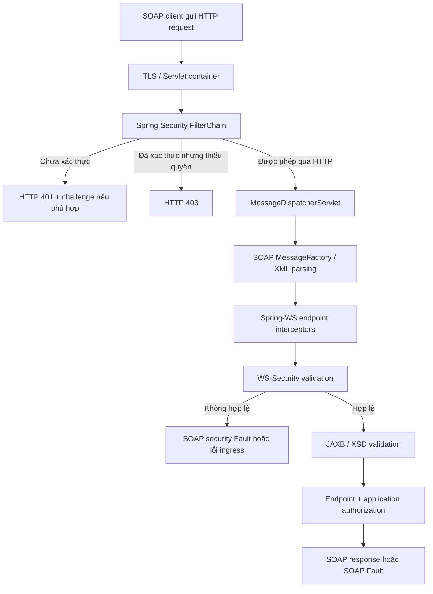
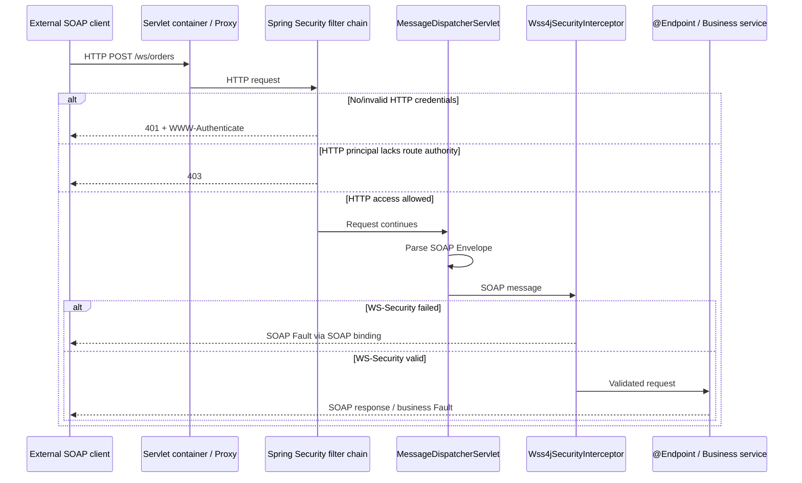
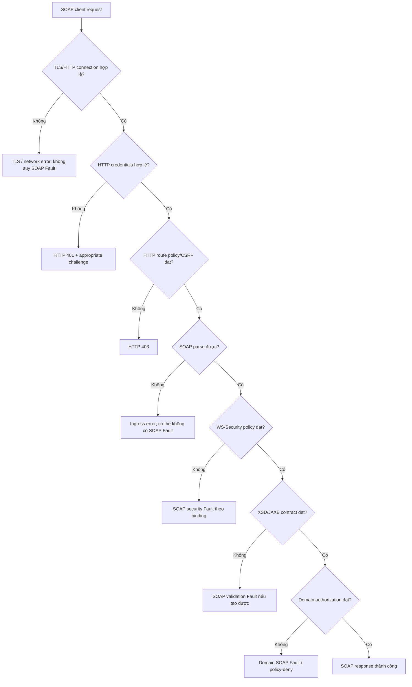

# Phân biệt HTTP 401, HTTP 403 với SOAP Fault bảo mật

## 1. Bối cảnh: cùng là “không được phép” nhưng lỗi xuất hiện ở những tầng khác nhau

Trong dự án **SPRING_WEB_SERVICES**, nhóm phát triển dịch vụ SOAP contract-first để đồng bộ đơn hàng giữa doanh nghiệp và các đối tác. **XSD/WSDL** mô tả `SubmitOrderRequest`, `SubmitOrderResponse` và SOAP Fault. **JAXB** chuyển XML thành Java object. **Spring Web Services (Spring-WS)** dùng `MessageDispatcherServlet` để nhận SOAP, `@Endpoint` để gọi ứng dụng, `WebServiceTemplate` để gọi SOAP service khác, interceptor để xử lý header, kiểm tra schema và **WS-Security**. Kết nối có thể được bảo vệ bằng HTTPS/mTLS và chứng chỉ.

Một buổi kiểm thử xuất hiện ba kết quả:

1. Client không gửi thông tin xác thực HTTP. Server trả **HTTP 401 Unauthorized**, đôi khi có `WWW-Authenticate` và **không có SOAP Envelope**.
2. Client đã xác thực bằng HTTP Basic/Bearer nhưng không có quyền truy cập endpoint `/ws/orders`. Server trả **HTTP 403 Forbidden** và **không có SOAP Fault**.
3. Client vượt qua lớp HTTP, nhưng SOAP Header `wsse:Security` có chữ ký không hợp lệ hoặc thiếu token bắt buộc. Server trả **SOAP Fault bảo mật** trong một SOAP Envelope; HTTP status có thể là 500 hoặc giá trị khác tùy SOAP version, binding và implementation.

Lỗi thứ ba có thể có HTTP status 500, nhưng **không được kết luận “500 nghĩa là lỗi hệ thống”**. Nó có thể là Fault do người gửi thiếu chứng chỉ tin cậy hoặc gửi SOAP Signature sai. Ngược lại, **HTTP 403** không tự chứng minh request đã được parse thành SOAP hoặc đã qua WSS4J.

Đây là đề mục **“Phân biệt HTTP 401, HTTP 403 với SOAP Fault bảo mật”**, thuộc chương **Tích hợp Spring Security**. Bài viết gắn với mục tiêu module: thiết kế SOAP contract-first, endpoint/client, WSDL/XSD, JAXB, interceptor, SOAP Fault, XML security, WS-Security, chứng chỉ, xác thực và kiểm thử tương thích doanh nghiệp.

**Mục tiêu sau bài học:**

- Định vị chính xác tầng nào thường tạo HTTP 401, HTTP 403 và SOAP Fault.
- Hiểu sự khác nhau giữa **authentication**, **authorization**, **XML signature verification** và **business authorization**.
- Cấu hình `SecurityFilterChain` cho endpoint SOAP mà không làm suy yếu các URL khác.
- Hiểu `Wss4jSecurityInterceptor` và WS-Security failure không tự là HTTP Basic/Bearer failure.
- Viết client xử lý đúng HTTP error, SOAP Fault, lỗi TLS và lỗi kết nối.
- Xây bộ test bao gồm status, header, Content-Type, SOAP Fault, business side effects và rò rỉ thông tin.

## 2. Hai lớp giao thức: HTTP transport và SOAP message

### 2.1. SOAP qua HTTP không có nghĩa mọi lỗi đều là SOAP Fault



Sơ đồ này mô tả **một kiến trúc servlet điển hình**, không quy định thứ tự tuyệt đối của mọi interceptor/validator trong tất cả phiên bản Spring-WS. Tùy cách đăng ký servlet, interceptor và message factory, lỗi parse có thể xảy ra trước khi SOAP Fault resolver được gọi.

### 2.2. Bảng nhận diện nhanh

| Kết quả | Lớp thường tạo | Ý nghĩa điển hình | SOAP Body bắt buộc phải tồn tại? |
|---|---|---|---|
| **HTTP 401** | Spring Security `AuthenticationEntryPoint` hoặc gateway HTTP | Chưa có/không hợp lệ thông tin xác thực được yêu cầu cho HTTP resource | **Không** |
| **HTTP 403** | Spring Security `AccessDeniedHandler` hoặc gateway | Caller đã được nhận diện nhưng không được phép truy cập HTTP resource; đôi khi là CSRF/policy khác | **Không** |
| **SOAP Fault bảo mật** | Spring-WS/WSS4J hoặc SOAP-aware peer | SOAP message thiếu/sai token, timestamp, signature, encryption, trust hoặc policy | **Có, khi SOAP Fault đã được tạo** |
| **TLS handshake failure** | TLS stack trước HTTP | Không thiết lập được kết nối bảo mật | Không có HTTP response hay SOAP Fault bảo đảm |
| **HTTP 413/415** | Proxy/container/message handling | Request quá lớn hoặc media type sai | Không |
| **SOAP Fault nghiệp vụ** | Endpoint/service/fault resolver | Vi phạm quy tắc nghiệp vụ hoặc hợp đồng đã định nghĩa | Có |

**Trọng tâm:** **HTTP status** cho biết kết quả ở **transport/protocol binding**; **SOAP Fault** là cấu trúc lỗi bên trong **SOAP Envelope**. Chúng có thể cùng xuất hiện trong một response, nhưng không phải hai cách viết khác nhau của cùng một khái niệm.

### 2.3. Chữ “security” trong hai lớp không đồng nhất

Một HTTP security filter có thể chỉ kiểm tra:

```text
Authorization: Basic ...
Authorization: Bearer ...
TLS client identity (nếu được ánh xạ tới Authentication)
Spring Security roles/authorities
```

Trong khi WS-Security xét:

```text
SOAP Header: wsse:Security
  wsse:UsernameToken
  wsu:Timestamp
  ds:Signature
  xenc:EncryptedData / EncryptedKey
  BinarySecurityToken / X.509 certificate
```

Chứng chỉ TLS, HTTP Bearer token và X.509 certificate nằm trong SOAP Header có thể gắn với **các identity khác nhau**. Không tự coi chúng là một principal duy nhất nếu chưa có cơ chế binding và mapping đáng tin cậy.

## 3. HTTP 401 Unauthorized: xác thực HTTP còn thiếu hoặc không hợp lệ

Mặc dù tên mã là **Unauthorized**, `401` trong HTTP thường mang nghĩa **cần xác thực** (*unauthenticated* hoặc credentials không được chấp nhận).

### 3.1. Ví dụ HTTP Basic

Request không có HTTP credentials:

```http
POST /ws/orders HTTP/1.1
Host: soap.example.org
Content-Type: text/xml; charset=utf-8
SOAPAction: "urn:example:orders:v1:SubmitOrder"

<soap:Envelope xmlns:soap="http://schemas.xmlsoap.org/soap/envelope/">
  <soap:Body>...</soap:Body>
</soap:Envelope>
```

Nếu `/ws/orders` yêu cầu HTTP Basic, server có thể trả:

```http
HTTP/1.1 401 Unauthorized
WWW-Authenticate: Basic realm="soap-partners"
Content-Type: text/plain; charset=UTF-8

Authentication required
```

Trong ví dụ này, Spring Security có thể **chặn request trước khi Spring-WS parse SOAP**. SOAP Body hợp lệ hay không chưa được biết và không ảnh hưởng trực tiếp tới quyết định 401.

`WWW-Authenticate` là HTTP response header dùng cho cơ chế challenge; với HTTP Basic, giá trị có dạng `Basic realm="..."`. Không tự gửi `WWW-Authenticate: Basic` cho API yêu cầu OAuth2 Bearer, vì mỗi authentication scheme có quy tắc riêng.

### 3.2. 401 do những tình huống nào?

- Thiếu `Authorization` HTTP header khi resource yêu cầu xác thực.
- Basic username/password sai.
- Bearer token thiếu, sai định dạng, expired, chữ ký JWT không hợp lệ hoặc không được chấp nhận theo resource-server policy.
- Một gateway trả 401 vì credential/authorization ở gateway không hợp lệ.
- Một custom authentication provider không xác thực được caller.

**Chưa kết luận WS-Security:** SOAP Header có `wsse:UsernameToken` hoặc chữ ký X.509 hợp lệ **không tự thỏa HTTP Basic/Bearer** nếu Spring Security filter vẫn yêu cầu HTTP credentials riêng.

### 3.3. HTTP Bearer khác HTTP Basic

Một SOAP service có thể nhận Bearer token ở HTTP header:

```http
POST /ws/orders HTTP/1.1
Host: soap.example.org
Authorization: Bearer <access-token-placeholder>
Content-Type: text/xml; charset=utf-8
```

`Authorization: Bearer ...` nằm **ngoài SOAP Envelope**. Spring Security resource server có thể xác minh JWT hoặc dùng opaque-token introspection và đặt `Authentication` trong `SecurityContext`. Khi token không hợp lệ, cơ chế Bearer challenge thường sử dụng `WWW-Authenticate: Bearer` và có thể kèm thông tin lỗi theo RFC/profile, nhưng không nên tiết lộ token hoặc dữ liệu hệ thống.

**Không dùng một request vừa Basic vừa Bearer theo cách không được hợp đồng quy định.** Chọn HTTP authentication scheme theo gateway/resource-server policy.

### 3.4. 401 không có nghĩa endpoint Spring-WS đã được gọi

Nếu filter từ chối trước `MessageDispatcherServlet`, các thành phần sau không được thực thi:

```text
SaajSoapMessageFactory
PayloadRootAnnotationMethodEndpointMapping
Wss4jSecurityInterceptor
JAXB unmarshaller
@Endpoint method
Domain service
```

Đây là **kỳ vọng kiến trúc** cần xác minh bằng test, không phải suy từ một HTTP response body. Gateway khác có thể xử lý sớm hơn cả Spring Security.

## 4. HTTP 403 Forbidden: đã được nhận diện nhưng không có quyền

**403** thường có nghĩa server hiểu yêu cầu nhưng **từ chối cho caller thực hiện**. Trong một ứng dụng Spring Security, `403` thường xuất hiện khi một `Authentication` đã tồn tại nhưng không có authority/role được yêu cầu.

### 4.1. Ví dụ người dùng không có role của SOAP API

Giả sử `/ws/**` yêu cầu:

```java
requestMatchers("/ws/**").hasRole("SOAP_CLIENT")
```

User đã xác thực thành công nhưng chỉ có `ROLE_READ_ONLY`. Khi gửi SOAP request:

```http
HTTP/1.1 403 Forbidden
Content-Type: text/plain; charset=UTF-8

Access denied
```

SOAP XML có thể hoàn toàn hợp lệ, thậm chí chứa một WS-Security Signature đúng. Spring Security vẫn có thể từ chối trước khi SOAP parser chạy vì **HTTP principal không có `ROLE_SOAP_CLIENT`**.

### 4.2. 403 cũng có thể do CSRF

Khi Spring Security bảo vệ HTTP POST bằng CSRF, một request không có CSRF token có thể bị từ chối **403**, kể cả caller đã xác thực theo một phương thức khác. Điều này thường gặp khi ứng dụng đưa SOAP endpoint vào cùng security filter chain với web application dùng session/cookie.

Do đó:

> **Không thể khẳng định mọi 403 nghĩa là người dùng thiếu business role.** Nó có thể do CSRF, method restrictions, gateway rule, IP policy hoặc AccessDeniedHandler tùy biến.

Cách debug đúng là kiểm tra **quy tắc security thực sự bị vi phạm**, không đổi soapAction hoặc XML để sửa một lỗi do CSRF.

### 4.3. Anonymous caller và `AccessDeniedException`

Trong Spring Security, `ExceptionTranslationFilter` có thể nhận `AccessDeniedException` ngay cả khi request chưa xác thực. Nếu current user anonymous/không có authentication hợp lệ theo cơ chế filter, framework có thể chuyển sang **`AuthenticationEntryPoint` và 401** thay vì trả 403.

Vì vậy:

- **401** thường là yêu cầu xác thực hoặc credentials không đạt.
- **403** thường là caller đã xác thực nhưng quyền không đạt, hoặc một HTTP-level deny policy như CSRF.
- Kết quả cụ thể tùy filter ordering, authentication mechanism, exception translation và custom handlers.

### 4.4. 403 không tự tương đương `wsse:FailedAuthentication`

`wsse:FailedAuthentication` thuộc cách biểu diễn security failure **trong SOAP** của một profile WS-Security. Một `HTTP 403` được trả trước khi parse message **không có cùng cấu trúc** hoặc nghĩa vụ SOAP Fault với một WS-Security failure do WSS4J tạo ra.

Nếu contract của đối tác đòi SOAP Fault cho authorization nghiệp vụ sau khi verify WS-Security, không thể đơn giản quy mọi `AccessDeniedException` thành HTTP 403 mà không quyết định rõ **tầng nào sở hữu authorization**.

## 5. SOAP Fault bảo mật: lỗi đã đi vào xử lý SOAP

SOAP Fault là phần tử `Fault` trong SOAP Envelope theo SOAP 1.1/1.2. Nó được tạo khi một SOAP processor không thể xử lý message theo các quy tắc của SOAP/protocol hoặc business contract.

### 5.1. Những lỗi WS-Security thường gặp

- Không có `wsse:Security` khi policy bắt buộc token/chữ ký.
- `UsernameToken` không hợp lệ hoặc caller không được chấp nhận.
- `wsu:Timestamp` đã hết hạn, quá sớm hoặc nằm ngoài clock skew policy.
- XML Signature không hợp lệ vì node được ký đã bị thay đổi.
- Chứng chỉ signer không được tin cậy, hết hạn hoặc không khớp identity policy.
- XML Encryption sử dụng sai recipient public key khiến bên nhận không giải mã được.
- SignedParts/algorithm/KeyIdentifier không đáp ứng WS-SecurityPolicy hoặc BSP.
- SOAP Header có `mustUnderstand` nhưng node nhận không hỗ trợ xử lý.

Không phải mọi trường hợp đều tạo **cùng một fault code**; WSS4J, Spring-WS, SOAP version, WS-Security profile và custom resolver có thể khác nhau.

### 5.2. SOAP 1.1 security Fault (minh họa)

```xml
<soap:Envelope
    xmlns:soap="http://schemas.xmlsoap.org/soap/envelope/">
  <soap:Body>
    <soap:Fault>
      <faultcode>soap:Client</faultcode>
      <faultstring>Security validation failed</faultstring>
    </soap:Fault>
  </soap:Body>
</soap:Envelope>
```

Đây là **Fault mẫu để giải thích hình thức**, không phải output bắt buộc của `Wss4jSecurityInterceptor`. Một số WS-Security implementations dùng fault code QName trong namespace WS-Security, chẳng hạn loại liên quan đến `FailedAuthentication` hoặc `FailedCheck`, thay vì `soap:Client`; lỗi và fault detail phải căn cứ profile thực.

Không trả:

```text
Signature validation failed for private key in /run/secrets/...
Truststore password incorrect: <secret>
Partner certificate CN=... with internal trust path ...
Raw UsernameToken / Authorization header ...
```

Đây là **những loại thông tin tuyệt đối không nên đưa ra công khai**, không phải giá trị lấy từ hệ thống thật.

### 5.3. SOAP 1.2 Fault có cấu trúc khác

```xml
<env:Envelope xmlns:env="http://www.w3.org/2003/05/soap-envelope">
  <env:Body>
    <env:Fault>
      <env:Code>
        <env:Value>env:Sender</env:Value>
      </env:Code>
      <env:Reason>
        <env:Text xml:lang="vi">Yêu cầu SOAP không hợp lệ</env:Text>
      </env:Reason>
    </env:Fault>
  </env:Body>
</env:Envelope>
```

SOAP 1.2 dùng `Code`, `Reason`, có thể có `Subcode`, `Node`, `Role` và `Detail`. Với WS-Security, tên Subcode/Code phụ thuộc chuẩn và cách xây dựng Fault. Không sao chép `soap:Client`/`faultstring` của SOAP 1.1 sang một SOAP 1.2 Envelope.

### 5.4. SOAP Fault có thể ở HTTP 500: vì sao?

Ở **SOAP 1.1 HTTP binding**, một SOAP Fault thường được trả cùng **HTTP 500 Internal Server Error** theo binding. Điều đó **không** khẳng định lỗi phát sinh do server vận hành sai, mà có thể là thông điệp client gửi không đáp ứng WS-Security/contract.

Với **SOAP 1.2 HTTP binding**, status cho Sender/Receiver faults có quy tắc riêng; một số binding/implementation có thể dùng **HTTP 400 cho Sender fault** hoặc **500 cho Receiver fault**. Cần đọc binding/profile và **capture response thực tế**.

**Không tự đặt quy tắc “SOAP Fault luôn 500” hoặc “security fault luôn 403”.** Trước hết xác định SOAP version/binding và điểm phát sinh lỗi.

### 5.5. Lỗi xảy ra trước khi tạo SOAP Envelope

Nếu XML bị hỏng ngay tại `SaajSoapMessageFactory` hoặc HTTP body bị proxy chặn trước khi parser chạy, server có thể **không có SOAP Envelope để tạo Fault đúng chuẩn**. Khi đó có thể trả HTTP 400/413/415/500, hoặc cắt kết nối, tùy layer.

Không ép hệ thống phải trả SOAP Fault khi chính SOAP parser chưa tạo được message. Ưu tiên an toàn, không lộ chi tiết parser/file/certificate nội bộ.

## 6. HTTP status và SOAP Fault là hai chiều dữ liệu cần kiểm tra riêng

### 6.1. Bốn response cần phân biệt

**Trường hợp A — HTTP 401, không SOAP:**

```http
HTTP/1.1 401 Unauthorized
WWW-Authenticate: Basic realm="soap-partners"
Content-Type: text/plain; charset=UTF-8

Authentication required
```

**Trường hợp B — HTTP 403, không SOAP:**

```http
HTTP/1.1 403 Forbidden
Content-Type: text/plain; charset=UTF-8

Access denied
```

**Trường hợp C — HTTP 500, SOAP 1.1 security Fault:**

```http
HTTP/1.1 500 Internal Server Error
Content-Type: text/xml; charset=UTF-8
```

```xml
<soap:Envelope xmlns:soap="http://schemas.xmlsoap.org/soap/envelope/">
  <soap:Body>
    <soap:Fault>
      <faultcode>soap:Client</faultcode>
      <faultstring>Security validation failed</faultstring>
    </soap:Fault>
  </soap:Body>
</soap:Envelope>
```

**Trường hợp D — HTTP 200, SOAP response thành công:**

```http
HTTP/1.1 200 OK
Content-Type: text/xml; charset=UTF-8
```

```xml
<soap:Envelope
    xmlns:soap="http://schemas.xmlsoap.org/soap/envelope/"
    xmlns:o="urn:example:orders:v1">
  <soap:Body>
    <o:SubmitOrderResponse>
      <o:orderId>ORD-1001</o:orderId>
      <o:status>ACCEPTED</o:status>
    </o:SubmitOrderResponse>
  </soap:Body>
</soap:Envelope>
```

Đây là những **mẫu on-wire để học cách phân loại**, không phải lời khuyên custom mọi endpoint phải phát đúng từng byte. Framework/Gateway có thể khác cách ghi media type, charset, Fault code và response formatting.

### 6.2. Dựa vào một status là không đủ

Một HTTP 500 có thể là:

1. SOAP security Fault do chữ ký sai.
2. SOAP business Fault.
3. SOAP Fault do schema validation.
4. HTTP error của gateway (HTML, plain text hoặc JSON).
5. Ứng dụng Java lỗi thật sự trước khi tạo SOAP response.

Vì vậy, một client đúng cần đọc **status + Content-Type + khả năng parse SOAP Envelope/Fault + Fault code/detail**. Nếu nhận HTML error, không dùng JAXB unmarshal như thể đó là SOAP response.

### 6.3. Có trường hợp 403 chứa SOAP Fault không?

Một gateway/custom application **có thể** trả HTTP 403 kèm SOAP Envelope theo quy ước riêng, nhưng không nên coi đây là behavior mặc định của Spring Security hay SOAP binding. Một số stack sẽ coi HTTP 403 là **transport error** và không parse SOAP Fault bên trong.

Nếu hai phía buộc phải có mapping như vậy, cần tài liệu hóa **quy tắc HTTP-to-SOAP binding và client interoperability**, rồi test `WebServiceTemplate` với sender/handler thực. Đừng tự đổi tất cả WSS4J Fault thành 403 chỉ vì tên lỗi chứa “access denied”.

## 7. Spring Security filter chain chạy trước phần lớn xử lý Spring-WS

Trong triển khai Servlet thường gặp:



### 7.1. Vì sao thứ tự này quan trọng?

- HTTP 401/403 do filter tạo thường **không đi qua** `@Endpoint`, JAXB hay WSS4J.
- WS-Security Fault có thể chỉ được phát hiện **sau khi message factory đã parse SOAP**.
- Nếu SOAP body/XML chứa DTD/XXE, parser hardening ở ingress vẫn cần thiết; WSS4J verification không ngăn mọi nguy cơ xảy ra **trước khi verify**.
- Nếu endpoint service thao tác DB trước security validation, việc trả Fault sau đó không xóa được side effect đã xảy ra.

### 7.2. Những điểm có thể thay đổi đường đi

Một hệ thống thực tế có thể có thêm:

```text
API Gateway
Reverse proxy / load balancer
WAF / rate limiter
TLS termination + mTLS verifier
Servlet FilterChainProxy
MessageDispatcherServlet
EndpointInterceptor chain
Wss4jSecurityInterceptor
PayloadValidatingInterceptor
Business authorization policy
```

Gateway có thể trả 401/403 **trước khi request đến ứng dụng Java**. Không thể kết luận “Spring Security đã trả 403” chỉ từ header/status nếu thực tế response do proxy tạo. Cần correlation ID và logs theo từng hop, không dump raw credentials hay SOAP Header để debug.

### 7.3. Đừng coi WS-Security và HTTP auth là “OR” tự động

Nếu server yêu cầu **cả** HTTP authentication **và** WS-Security Signature, caller phải thỏa **cả hai**. Không có quy tắc tự động:

```text
Valid wsse:Signature => bỏ qua HTTP Basic
Valid HTTP Bearer => bỏ qua WS-Security Signature
```

Muốn tích hợp nhiều loại identity, phải thiết kế rõ hệ thống **đối chiếu chúng như thế nào**, trust boundary nào được dùng và authorization thuộc tầng nào.

## 8. Cấu hình `SecurityFilterChain` dành riêng cho SOAP endpoint

Với Spring Security 6 / Spring Boot sử dụng Jakarta Servlet, nên xây dựng một `SecurityFilterChain` có scope chính xác cho URL SOAP thay vì vô hiệu hóa security toàn bộ ứng dụng.

### 8.1. Ví dụ HTTP Basic và role kiểm soát `/ws/**`

```java
package com.example.orders.soap.security;

import org.springframework.context.annotation.Bean;
import org.springframework.context.annotation.Configuration;
import org.springframework.core.annotation.Order;
import org.springframework.security.config.Customizer;
import org.springframework.security.config.annotation.web.builders.HttpSecurity;
import org.springframework.security.config.annotation.web.configuration.EnableWebSecurity;
import org.springframework.security.config.http.SessionCreationPolicy;
import org.springframework.security.web.SecurityFilterChain;

@Configuration
@EnableWebSecurity
public class SoapHttpSecurityConfiguration {

    @Bean
    @Order(1)
    SecurityFilterChain soapHttpChain(HttpSecurity http) throws Exception {
        http
            // Chỉ áp dụng chain này cho SOAP servlet path.
            .securityMatcher("/ws/**")
            .authorizeHttpRequests(auth -> auth
                .anyRequest().hasRole("SOAP_CLIENT"))
            .httpBasic(Customizer.withDefaults())
            .sessionManagement(session -> session
                .sessionCreationPolicy(SessionCreationPolicy.STATELESS))
            // Chỉ bỏ yêu cầu CSRF tại integration endpoint
            // khi đã phân tích mô hình client/credential.
            .csrf(csrf -> csrf
                .ignoringRequestMatchers("/ws/**"));

        return http.build();
    }
}
```

Đây là **ví dụ một SOAP API dành cho hệ thống máy–máy đã lựa chọn HTTP Basic**. User store hoặc authentication provider phải được cấu hình riêng, an toàn; đoạn này không tự tạo người dùng và không cất password. Nếu ứng dụng dùng Bearer/mTLS thay Basic, phải thay authentication mechanism, không bật tất cả theo thói quen.

**Điểm cần chú ý:**

1. `securityMatcher("/ws/**")` chọn chain cho các URL phù hợp; nó không phải SOAP operation mapping.
2. `hasRole("SOAP_CLIENT")` kiểm tra authority `ROLE_SOAP_CLIENT` trong Spring Security context theo convention mặc định.
3. Người dùng chưa xác thực sẽ được HTTP authentication mechanism đưa qua entry point phù hợp, thường **401** với Basic challenge.
4. Người dùng đã xác thực nhưng không có role sẽ bị từ chối, thường **403**.
5. `SessionCreationPolicy.STATELESS` phù hợp một số machine-to-machine integrations, nhưng cần kiểm tra các authentication providers/session mechanisms khác của ứng dụng.
6. Rule CSRF được giới hạn ở `/ws/**`; **không** tắt CSRF toàn cục trên các URL giao diện web.

### 8.2. Đừng vô tình để lộ các URL ngoài `/ws/**`

Đoạn code trên chỉ định nghĩa **một filter chain**. Những request không khớp `/ws/**` sẽ được xử lý bởi chain khác nếu được cấu hình; nếu không có chain phù hợp, có thể xuất hiện khoảng trống bảo vệ.

Trong một ứng dụng có REST UI, admin API và SOAP, cần có **chain fallback**/chính sách rõ ràng cho các đường khác. Ví dụ một chain thứ hai có thể bảo vệ URL còn lại:

```java
@Bean
@Order(2)
SecurityFilterChain remainingApplicationChain(HttpSecurity http)
        throws Exception {
    return http
            .authorizeHttpRequests(auth -> auth
                    .anyRequest().authenticated())
            .httpBasic(org.springframework.security.config.Customizer
                    .withDefaults())
            .build();
}
```

Đây là **phác thảo**, không bắt buộc toàn ứng dụng phải dùng Basic. Hãy lựa chọn form login, Bearer token hoặc cách xác thực khác cho các URL còn lại theo business context.

### 8.3. URL security khác WSDL operation security

Rule:

```java
securityMatcher("/ws/**")
```

không hiểu XML:

```xml
<o:CancelOrderRequest xmlns:o="urn:example:orders:v1">
  <o:orderId>ORD-1001</o:orderId>
</o:CancelOrderRequest>
```

Nếu `GetOrder` và `CancelOrder` đi qua **cùng `/ws/orders`**, URL rule chỉ bảo vệ quyền đi vào SOAP endpoint. Kiểm soát **quyền hủy đơn** theo operation/account phải được thực hiện ở tầng xác định đúng SOAP action/payload và **business service** sau authentication, security validation và contract validation.

Không tạo URL rule `/ws/orders/cancel` chỉ vì tên Java method là `cancelOrder()` nếu WSDL transport endpoint thực vẫn là `/ws/orders`.

## 9. CSRF: vì sao SOAP POST đôi khi trả 403 dù có credentials?

CSRF bảo vệ các ứng dụng mà browser có thể **tự động** gửi credentials (đặc biệt cookie/session và cả những trường hợp trình duyệt lưu HTTP auth).

### 9.1. Machine-to-machine không dùng browser cookie

Một SOAP integration độc lập trình duyệt thường:

- Gửi request từ server-to-server.
- Dùng HTTP Basic/Bearer/mTLS hoặc WS-Security theo profile.
- Không dựa vào session/cookie của người dùng trình duyệt.

Với mô hình đã phân tích rõ, nhóm có thể cấu hình **bỏ kiểm tra CSRF chỉ ở SOAP endpoint** nếu CSRF không áp dụng theo threat model. Tuy nhiên, việc đó **không có nghĩa SOAP endpoint tự an toàn**; vẫn cần HTTP authentication/authorization, WS-Security khi contract yêu cầu, parser hardening, request limits và business controls.

### 9.2. Trường hợp không được vô hiệu hóa CSRF tùy tiện

Nếu một browser UI dùng cookie session để gửi SOAP request tới cùng origin, vô hiệu hóa CSRF tại `/ws/**` có thể mở đường request giả mạo. Cần:

- Hiểu **ai có thể gửi request từ trình duyệt**.
- Xác định cookie/session có tự được đính kèm hay không.
- Cấu hình CSRF token hoặc mô hình authentication không tự gửi credentials trong cross-site contexts.
- Cấu hình CORS/SameSite cookie theo policy, không xem CORS là thay thế duy nhất cho CSRF.

**Không làm:**

```java
// ANTI-PATTERN: tắt CSRF toàn cục mà không đánh giá threat model.
http.csrf(csrf -> csrf.disable());
```

### 9.3. Test chẩn đoán 403 do CSRF

Nếu HTTP 403 xảy ra với **cả user có đủ role**, hãy phân biệt:

1. Request có bị `CsrfFilter` từ chối trước authorization không?
2. URL có khớp `/ws/**` của chain SOAP không?
3. Có custom filter/gateway kiểm tra origin, CSRF token hoặc referer không?
4. Có authentication thực hay chỉ giả định user đã có session?
5. Có sai biệt path do context path/reverse proxy không?

Không nên sửa SOAP Body, `SOAPAction`, `wsa:Action` hoặc JAXB DTO trước khi loại trừ các nguyên nhân HTTP-level này.

## 10. HTTP authentication, WS-Security identity và business authorization

### 10.1. Ba câu hỏi khác nhau

| Câu hỏi | Ví dụ | Tầng chịu trách nhiệm |
|---|---|---|
| **Ai đang kết nối/gọi?** | Basic user, JWT subject, mTLS client identity | HTTP/TLS/Spring Security |
| **Thông điệp SOAP có thực sự được ký và đúng policy?** | X.509 signer, SignedParts, timestamp, encryption | WSS4J/WS-Security |
| **Caller có quyền làm thao tác này trên dữ liệu này không?** | Partner A chỉ được hủy đơn thuộc Tenant A | Domain/application authorization |

Hai câu đầu có thể nhận diện cùng một đối tác hoặc hai actors khác nhau; điều đó phải có **quy tắc ánh xạ** chính thức. Câu thứ ba không được suy từ mỗi giá trị action hoặc certificate subject.

### 10.2. Spring Security context không tự được tạo từ `wsse:Signature`

Spring Security HTTP filter có thể đặt:

```java
org.springframework.security.core.Authentication authentication =
        org.springframework.security.core.context.SecurityContextHolder
                .getContext()
                .getAuthentication();
```

Nhưng nếu WSS4J chỉ verify XML Signature trong SOAP interceptor, không có gì bảo đảm signer sẽ **tự động** trở thành một `Authentication` trong `SecurityContextHolder`. Để dùng signer identity cho authorization, application cần một **trusted identity bridge** hoặc integration được chính stack/framework hỗ trợ.

**Không làm:**

```java
// Không an toàn: tin XML element tự xưng là caller.
String partnerId = soapHeader.getTextContent();
securityContext.setAuthentication(
        makeAuthenticatedUser(partnerId));
```

Chỉ ánh xạ identity từ dữ liệu **đã được verify** (certificate/token, SignedParts, trust policy). Nếu application cần một Spring Security `Authentication`, chỉ tạo sau khi xác thực hoàn tất, đặt/clear context đúng lifecycle và tránh rò rỉ sang thread/request khác.

### 10.3. Business authorization ở service layer

Ví dụ interface:

```java
public interface OrderCommandService {
    CancelOrderResult cancel(
            VerifiedPartnerIdentity caller,
            String orderId,
            String clientRequestId);
}
```

`VerifiedPartnerIdentity` là một kiểu domain/application **chỉ được tạo bởi trusted security adapter** sau xác thực. Trong implementation:

```java
public CancelOrderResult cancel(
        VerifiedPartnerIdentity caller,
        String orderId,
        String clientRequestId) {
    var order = orderRepository.getRequired(orderId);
    if (!order.belongsTo(caller.allowedTenantId())) {
        throw new OrderAccessDeniedException();
    }
    return cancellationService.cancelIdempotently(
            caller, order, clientRequestId);
}
```

Các type `OrderAccessDeniedException`, `VerifiedPartnerIdentity`, `CancelOrderResult`, repository và cancellation service là thành phần **do ứng dụng định nghĩa**. Khi mapping exception thành SOAP Fault, phải thống nhất với hợp đồng WSDL, không tự serialize domain exception stack trace ra response.

### 10.4. Dùng `@PreAuthorize` khi nào?

Spring Method Security (`@EnableMethodSecurity` và `@PreAuthorize`) có thể bảo vệ service methods dựa trên `Authentication`/authorities trong Spring Security context. Nhưng nếu SOAP caller được xác thực **chỉ bằng WS-Security** mà chưa có trusted bridge sang context, biểu thức `@PreAuthorize` sẽ không tự biết signer.

Một thiết kế an toàn có thể:

1. Dùng trusted identity adapter cung cấp application principal.
2. Gọi domain authorization service với principal ấy.
3. Dùng Method Security khi identity/authorities được đưa vào `SecurityContext` một cách đáng tin và có lifecycle chính xác.

Không tự copy `UsernameToken` hoặc `wsa:MessageID` vào Spring `Authentication` rồi đánh dấu authenticated.

## 11. WSS4J security interceptor: lỗi SOAP-level không thay HTTP filter

Ở phía server, `Wss4jSecurityInterceptor` có thể yêu cầu WS-Security signature/timestamp:

```java
import org.apache.wss4j.common.crypto.Crypto;
import org.springframework.beans.factory.annotation.Qualifier;
import org.springframework.context.annotation.Bean;
import org.springframework.ws.soap.security.wss4j2.Wss4jSecurityInterceptor;

@Bean
Wss4jSecurityInterceptor inboundSoapSecurity(
        @Qualifier("trustedPartnerCrypto") Crypto verificationCrypto) {

    Wss4jSecurityInterceptor security =
            new Wss4jSecurityInterceptor();
    security.setValidationActions("Timestamp Signature");
    security.setValidationSignatureCrypto(verificationCrypto);
    return security;
}
```

Đây là **một snippet bean**, giả định `trustedPartnerCrypto` là WSS4J `Crypto` được tạo từ keystore/truststore có trust policy phù hợp, ví dụ bằng `CryptoFactoryBean`. Đoạn code không tự khai báo Crypto và không tự đăng ký interceptor vào SOAP endpoint.

### 11.1. Đăng ký trong Spring-WS

```java
package com.example.orders.soap.config;

import java.util.List;
import org.springframework.beans.factory.annotation.Qualifier;
import org.springframework.context.annotation.Configuration;
import org.springframework.ws.config.annotation.EnableWs;
import org.springframework.ws.config.annotation.WsConfigurer;
import org.springframework.ws.server.EndpointInterceptor;
import org.springframework.ws.soap.security.wss4j2.Wss4jSecurityInterceptor;

@Configuration
@EnableWs
public class SoapEndpointInterceptors implements WsConfigurer {
    private final Wss4jSecurityInterceptor security;

    public SoapEndpointInterceptors(
            @Qualifier("inboundSoapSecurity")
            Wss4jSecurityInterceptor security) {
        this.security = security;
    }

    @Override
    public void addInterceptors(List<EndpointInterceptor> interceptors) {
        interceptors.add(security);
    }
}
```

Hãy xác minh `WsConfigurer` thật sự được gọi bởi cấu hình Spring-WS đang dùng, các mapping/endpoint mong muốn được áp dụng interceptor, và không có một URL/endpoint khác **bỏ qua** security chain. Một bean tồn tại chưa chứng minh bảo mật đã hoạt động.

### 11.2. Validation và securement là hai chiều

| Triển khai | Inbound validation | Outbound securement |
|---|---|---|
| SOAP server | Validate request từ client | Ký/mã hóa response theo policy |
| SOAP client | Validate response từ server | Ký/mã hóa request theo policy |

Một `Wss4jSecurityInterceptor` dùng trong SOAP client có thể cấu hình:

```java
security.setSecurementActions("Timestamp Signature");
security.setSecurementSignatureCrypto(clientSigningCrypto);
security.setSecurementUsername("client-key-alias");
security.setSecurementPassword(privateKeyPassword);
security.setValidationActions("Timestamp Signature");
security.setValidationSignatureCrypto(partnerVerificationCrypto);
```

Đây là **các dòng cấu hình minh họa**; `Crypto`, alias, password và store đều phải được tạo từ nguồn tin cậy. `setSecurementPassword` có thể phù hợp ví dụ, nhưng production cần secret manager/password callback theo WSS4J version và yêu cầu keys.

### 11.3. Trình tự thất bại phổ biến

```text
HTTP Basic/Bearer PASS
  -> HTTP authorization PASS
    -> SOAP parser PASS
      -> WSS4J signature INVALID
        -> SOAP security Fault
          -> Domain service NOT INVOKED
```

Một test chỉ xem HTTP status 500 rồi kết luận lỗi backend sẽ bỏ lỡ **nguyên nhân an ninh**. Tương tự, tắt `validationActions` chỉ để client hết nhận Fault là một **security regression**.

### 11.4. Certificate trust không phải authorization

`Wss4jSecurityInterceptor` có thể verify chữ ký của partner certificate theo truststore, nhưng vẫn cần kiểm tra partner đó được phép gọi operation/tài nguyên này.

Với một truststore chung chứa nhiều partner certificates, nếu không gắn signer vào tenant identity đã đăng ký, caller B có thể bị nhận nhầm là caller A. **Cryptographic validity** và **business entitlement** là hai kiểm tra riêng.

## 12. Xử lý lỗi trước và sau khi parse SOAP

### 12.1. Lỗi trước `MessageDispatcherServlet`

Ví dụ:

```text
API Gateway -> 401
Spring Security FilterChain -> 401/403
HTTP size filter -> 413
TLS handshake -> không có HTTP response
```

Những lỗi này **không nên cố đóng gói thành SOAP Fault** nếu chưa tạo được một SOAP message. Client phải có logic xử lý transport errors độc lập với JAXB/SOAP Fault.

### 12.2. Lỗi khi message factory parse SOAP

Ví dụ:

```text
MessageDispatcherServlet
  -> SaajSoapMessageFactory
     -> XML malformed / prohibited DTD / wrong SOAP version
```

Nếu parser fail trước khi tạo `WebServiceMessage`, Spring-WS có thể không chuyển lỗi qua thông thường `SoapFaultMappingExceptionResolver` của endpoint. Ứng dụng/proxy phải bảo đảm error page chung chung, không lộ XML payload, system path hoặc stack trace.

**Đừng dùng WS-Security interceptor thay XML parser hardening.** Entity expansion/XXE có thể xảy ra trước khi WSS4J có cơ hội verify chữ ký.

### 12.3. Lỗi trong WS-Security interceptor

Ví dụ:

```text
SOAP message parsed
  -> wsu:Timestamp expired
  -> wsse:Signature invalid
  -> signer certificate not trusted
  -> WS-Security Fault
```

Lỗi này thuộc SOAP security contract. WSS4J có thể tạo SOAP Fault security-specific, và HTTP response mang status theo SOAP binding/framework. Không nhất thiết là HTTP 401/403.

### 12.4. Lỗi authorization sau khi endpoint đã xác định operation

Ví dụ:

```text
HTTP Authentication PASS
WS-Security Signature PASS
XSD/JAXB payload valid
Business user lacks permission for orderId
  -> application authorization exception
  -> SOAP Fault (nếu hợp đồng thiết kế như vậy)
```

Đây là **một lựa chọn thiết kế**: nếu authorization được thực hiện ở business/service layer và contract-first SOAP client cần typed Fault, ứng dụng có thể map lỗi thành SOAP Fault riêng với code an toàn. Nếu authorization đã được áp dụng ở HTTP filter, client có thể nhận HTTP 403 trước SOAP. Hai cách phù hợp ở **hai ranh giới khác nhau**, không nên nhập nhằng.

## 13. Tùy biến HTTP 401/403 có kiểm soát

Mặc định của Spring Security có thể đã phù hợp. Khi cần trả response tối giản, có thể dùng `AuthenticationEntryPoint` và `AccessDeniedHandler`.

### 13.1. Ví dụ với HTTP Basic challenge rõ ràng

```java
import org.springframework.http.HttpHeaders;
import org.springframework.security.config.annotation.web.builders.HttpSecurity;

// Bên trong cấu hình chain dùng HTTP Basic:
http.exceptionHandling(errors -> errors
    .authenticationEntryPoint((request, response, failure) -> {
        response.setStatus(401);
        response.setHeader(
                HttpHeaders.WWW_AUTHENTICATE,
                "Basic realm=\"soap-partners\"");
        response.setContentType("text/plain; charset=UTF-8");
        response.getWriter().write("Authentication required");
    })
    .accessDeniedHandler((request, response, denied) -> {
        response.setStatus(403);
        response.setContentType("text/plain; charset=UTF-8");
        response.getWriter().write("Access denied");
    }));
```

Đây là **đoạn bổ sung trong cùng `SecurityFilterChain`**, không phải một filter độc lập. Cần chọn handler phù hợp với **HTTP authentication scheme**: đối với Bearer resource server, nên dùng handler/entry point chuẩn của Spring Security OAuth2 Resource Server, để `WWW-Authenticate: Bearer` và mã `invalid_token`/`insufficient_scope` nếu áp dụng vẫn tuân đúng RFC/profile.

**Không đưa `failure.getMessage()` hoặc `denied.getMessage()` vào response.** Một exception có thể chứa path, authority, token metadata hoặc thông tin nội bộ.

### 13.2. Đừng cố trả SOAP Fault từ HTTP AuthenticationEntryPoint

Anti-pattern:

```java
// SAI về ranh giới nếu filter không có SOAP parser/contract.
entryPoint = (req, res, error) -> {
    res.setStatus(200);
    res.getWriter().write("<soap:Fault>...</soap:Fault>");
};
```

Điều này gây nhiều vấn đề:

- HTTP 200 báo thành công trong khi request bị chặn.
- `<soap:Fault>` đứng riêng, không phải một SOAP Envelope hợp lệ.
- Không biết SOAP 1.1/1.2 binding và namespace thực.
- Client dùng HTTP authentication challenge sẽ không biết cách bổ sung credentials.
- Có thể làm rối logs, metrics và reverse proxy retry.

HTTP security error nên tuân **HTTP semantics**. Nếu buộc phải có gateway SOAP-specific error contract, phải thiết kế và kiểm thử như một phần giao thức tích hợp riêng, không chèn chuỗi XML tự tạo.

### 13.3. Đừng đổi 403 thành 401 để client tự retry vô hạn

Một user đã xác thực nhưng thiếu role gọi SOAP endpoint không thể tự sửa bằng cách gửi lại cùng credentials. Nếu ứng dụng trả 401 cho mọi trường hợp 403, client có thể:

- Thử login lại vô ích.
- Gửi nhiều lần cùng command có side effect.
- Che mất nguyên nhân authorization.
- Gây tăng tải cho gateway/identity provider.

Giữ semantics 401 và 403 đúng; **không tự retry** khi lỗi là quyền truy cập, trừ khi có một quá trình **cấp lại credential/đổi scope có kiểm soát**.

## 14. SOAP Fault resolver: xử lý lỗi ở đúng tầng và không rò rỉ thông tin

Spring-WS có cơ chế xử lý exception để tạo SOAP Fault sau khi SOAP processing đã bắt đầu, ví dụ `SoapFaultMappingExceptionResolver` cho exception ở endpoint.

### 14.1. Lỗi nghiệp vụ khác lỗi xác thực HTTP

Ví dụ service ném:

```java
throw new OrderAccessDeniedException();
```

Để trả typed SOAP Fault theo WSDL, có thể tạo/customize exception resolver và Fault detail. **Không dùng cùng resolver này để thay Spring Security `AuthenticationEntryPoint`**: hai loại lỗi ở hai tầng khác nhau.

### 14.2. Một cấu hình fault mapping cơ bản

```java
import java.util.Properties;
import org.springframework.context.annotation.Bean;
import org.springframework.ws.soap.SoapFaultDefinition;
import org.springframework.ws.soap.server.endpoint.SoapFaultMappingExceptionResolver;

@Bean
SoapFaultMappingExceptionResolver businessFaultResolver() {
    SoapFaultMappingExceptionResolver resolver =
            new SoapFaultMappingExceptionResolver();

    Properties mappings = new Properties();
    mappings.setProperty(
            "com.example.orders.domain.OrderAccessDeniedException",
            "CLIENT,Order operation not permitted");

    resolver.setExceptionMappings(mappings);

    SoapFaultDefinition fallback = new SoapFaultDefinition();
    fallback.setFaultCode(SoapFaultDefinition.SERVER);
    fallback.setFaultStringOrReason(
            "SOAP request could not be processed");
    resolver.setDefaultFault(fallback);
    resolver.setOrder(1);
    return resolver;
}
```

**Đây là một ví dụ hướng dẫn**, không phải typed Fault WSDL hoàn chỉnh. Nội dung mapping string/fault code và cú pháp cụ thể phải xác minh theo `SoapFaultMappingExceptionResolver` phiên bản sử dụng; nếu client cần machine-readable domain error, hãy bổ sung `detail` theo XSD/WSDL và một resolver có kiểm soát.

**Đừng nhầm mapping này với WSS4J internal security Fault**: nhiều lỗi WSS4J được interceptor xử lý trực tiếp, không đi qua cùng exception resolver của business endpoint. Cũng không bảo đảm resolver chạy khi lỗi xảy ra trước SOAP parser.

### 14.3. Không tiết lộ nguyên nhân nhạy cảm

SOAP Fault bên ngoài có thể nói:

```text
Security validation failed
Order operation not permitted
Invalid SOAP request
```

Nhưng không được gửi:

```text
Private key password is ...
Unable to read /run/secrets/soap/partner-truststore.p12
JWT signature validation failed for token <raw token>
Certificate CN of unknown internal integration: ...
Order belongs to tenant SECRET-TENANT-...
```

**Error code được công bố theo contract** thường tốt hơn việc serialize raw exception message. Logs nội bộ cũng phải redact dữ liệu nhạy cảm; không vì response đã che mà dump nguyên SOAP Body/WS-Security token vào tracing system.

### 14.4. Authentication vs business denial có thể dùng mã lỗi SOAP khác nhau

Một SOAP contract có thể định nghĩa:

```xml
<o:OrderFault xmlns:o="urn:example:orders:v1">
  <o:code>ORDER_OPERATION_NOT_PERMITTED</o:code>
  <o:message>Operation is not permitted</o:message>
</o:OrderFault>
```

Đây là **fault detail do ứng dụng định nghĩa**, không phải WS-Security standard fault code. Nó phù hợp hơn với lỗi nghiệp vụ sau khi xác minh identity và authorization hơn là lỗi HTTP 401 (chưa qua SOAP) hoặc chữ ký XML sai (WS-Security Fault).

## 15. SOAP client Spring-WS: đừng coi 401/403 là `SoapFaultClientException`

### 15.1. `WebServiceTemplate` tách transport error và SOAP Fault

`WebServiceTemplate` cung cấp những điểm xử lý khác nhau cho lỗi HTTP/transport và SOAP Fault. Một số exception quan trọng:

| Exception | Package Spring-WS | Khi nào thường gặp |
|---|---|---|
| `SoapFaultClientException` | `org.springframework.ws.soap.client` | SOAP Fault được phân tích thành message Fault |
| `WebServiceTransportException` | `org.springframework.ws.client` | Transport trả lỗi, ví dụ HTTP response không được nhận diện là SOAP Fault |
| `WebServiceIOException` | `org.springframework.ws.client` | I/O/connect/read hoặc lỗi kết nối |
| `WebServiceException` | `org.springframework.ws` | Lớp lỗi nền cho nhiều vấn đề SOAP/client |

Một HTTP 401/403 do Spring Security hoặc gateway trả với body plain text/HTML thường được phân loại là **transport-level failure**, không nhất thiết được đọc thành `SoapFaultClientException`. Ngược lại, SOAP security Fault trong HTTP 500 có thể được parse và ném dưới dạng `SoapFaultClientException`.

**Tuy nhiên, đừng hardcode mọi 401/403 luôn là đúng một Java exception class:** kết quả còn phụ thuộc `WebServiceMessageSender`, version Spring-WS, MIME response, `hasError/hasFault` và các customization của `WebServiceTemplate`.

### 15.2. Ví dụ code phân loại theo nguồn lỗi

```java
package com.example.orders.soap.client;

import org.springframework.ws.client.core.WebServiceTemplate;
import org.springframework.ws.client.WebServiceIOException;
import org.springframework.ws.client.WebServiceTransportException;
import org.springframework.ws.soap.client.SoapFaultClientException;

public final class OrdersSoapClient {
    private final WebServiceTemplate template;

    public OrdersSoapClient(WebServiceTemplate template) {
        this.template = template;
    }

    public Object submit(Object jaxbRequest) {
        try {
            return template.marshalSendAndReceive(jaxbRequest);
        } catch (SoapFaultClientException fault) {
            // SOAP peer đã trả một Fault có thể phân tích.
            throw new PartnerSoapFaultException(
                    "Partner returned a SOAP Fault");
        } catch (WebServiceTransportException transport) {
            // Ví dụ HTTP 401, 403 hoặc transport error khác.
            throw new PartnerTransportException(
                    "Partner rejected the HTTP request");
        } catch (WebServiceIOException io) {
            // Connect timeout, read timeout hoặc lỗi socket/I/O.
            throw new PartnerCommunicationException(
                    "Cannot communicate with SOAP partner");
        }
    }
}
```

Các `PartnerSoapFaultException`, `PartnerTransportException` và `PartnerCommunicationException` là exception **do ứng dụng định nghĩa**. Snippet này là **cấu trúc phân loại**, chưa đủ nếu cần giữ safe status/Fault code cho nghiệp vụ hoặc quyết định retry. Đừng trả raw exception message hoặc raw SOAP response có token/PII ra HTTP API caller.

**Không dựa vào thứ tự catch để phân biệt 401 và 403:** `WebServiceTransportException` chưa phải một kiểu dữ liệu HTTP status được chuẩn hóa cho mọi sender. Nếu ứng dụng cần status cụ thể, hãy lấy từ transport adapter/instrumentation được thiết kế và kiểm thử với sender đang dùng, hoặc xây một adapter trả typed transport result khi policy cần.

### 15.3. Khi nào có thể nhận SOAP Fault trong HTTP 500?

`WebServiceTemplate` thường kiểm tra transport response xem có lỗi hay không, rồi kiểm tra có SOAP Fault hợp lệ hay không. Với SOAP 1.1, một HTTP 500 kèm `text/xml` và SOAP Fault hợp lệ có thể đi vào logic Fault thay vì bị coi là lỗi HTTP thuần túy.

Đây là lý do:

```text
HTTP 500 + SOAP Fault  -> SOAP fault handling
HTTP 500 + HTML        -> transport/error handling
HTTP 401 + text/plain  -> HTTP auth/error handling
HTTP 403 + text/plain  -> HTTP access denial/error handling
```

**Không tắt `checkConnectionForError`/`checkConnectionForFault` một cách tùy tiện** để ép client parse body bất kể HTTP status. Việc thay behavior này phải có test liên thông và tuân SOAP-over-HTTP binding của partner.

### 15.4. Client nhận 401: hành động nên làm

Nếu HTTP Basic:

1. Xác minh endpoint URL, TLS trust và đúng HTTP realm/challenge.
2. Kiểm tra client sender đã thêm credentials đúng cách.
3. Kiểm tra credential còn hiệu lực và scope/identity được cấp.
4. Nếu cơ chế hỗ trợ refresh/rotation, thực hiện theo policy.
5. **Không tự retry vô hạn** cùng password sai.

Nếu OAuth2 Bearer:

1. Kiểm tra token acquisition/expiry và resource audience.
2. Kiểm tra `WWW-Authenticate: Bearer` và error category an toàn nếu có.
3. Refresh token **chỉ khi luồng cho phép**, với giới hạn retry.
4. Kiểm tra policy idempotency nếu operation có side effect.

Không sửa JAXB payload hoặc `wsa:Action` để giải quyết HTTP authentication failure.

### 15.5. Client nhận 403: hành động nên làm

1. Xác minh caller identity **đã được chấp nhận** ở HTTP layer.
2. Kiểm tra role/scope/authority và chính sách route/gateway.
3. Kiểm tra CSRF nếu request đi qua web/session chain.
4. Không tự retry cùng credentials khi không có thay đổi quyền.
5. Liên hệ chủ sở hữu partner entitlement nếu cần cấp quyền.

Khi HTTP 403 có `WWW-Authenticate: Bearer error="insufficient_scope"` theo resource-server scheme, xử lý đây là **thiếu quyền**, không phải token expired mặc định.

### 15.6. Client nhận WS-Security Fault: hành động nên làm

1. Kiểm tra WSDL/WS-SecurityPolicy của request/response.
2. Kiểm tra `wsse:Security`, Timestamp, SignedParts và SOAP version.
3. Kiểm tra signer alias, key/cert chain, truststore và certificate validity.
4. Kiểm tra algorithm/KeyIdentifier, message đã bị sửa sau ký không.
5. Kiểm tra clock skew và policy replay.
6. Kiểm tra request được ký bằng đúng identity của partner profile.

**Không disable signature validation hoặc trust verification chỉ để test “SOAP gọi được”.**

## 16. HTTP sender: credentials HTTP nằm ngoài SOAP Body

Spring-WS client gửi thông điệp qua một `WebServiceMessageSender` như `HttpUrlConnectionMessageSender` hoặc sender dựa trên Apache HttpClient. Configuration của HTTP Basic/Bearer credentials phụ thuộc transport implementation.

### 16.1. Không đưa HTTP Authorization vào SOAP Header

Sai:

```xml
<soap:Header xmlns:soap="http://schemas.xmlsoap.org/soap/envelope/">
  <Authorization>Bearer token-here</Authorization>
</soap:Header>
```

Phần tử này **không trở thành** HTTP `Authorization` header. Một HTTP Basic gateway sẽ vẫn có thể trả 401. Ngược lại, một HTTP `Authorization: Bearer` hợp lệ không tự tạo `wsse:Security` cho WSS4J.

### 16.2. Callback SOAP không phải setter HTTP Authorization

`org.springframework.ws.WebServiceMessageCallback` được dùng để chỉnh **SOAP message**, ví dụ:

```java
new org.springframework.ws.soap.client.core.SoapActionCallback(
    "urn:example:orders:v1:SubmitOrder");
```

`SoapActionCallback` thiết lập **SOAPAction/binding action**; nó không cấu hình HTTP Basic password hoặc OAuth2 token. HTTP credentials phải được cấu hình **ở sender/client request layer** hoặc integration mechanism được hỗ trợ của Spring-WS sender đang sử dụng.

### 16.3. Không tắt TLS trust để xử lý 401

Nếu client gặp `SSLHandshakeException`, lỗi xuất hiện **trước HTTP** và không phải HTTP 401. Thêm Bearer token hoặc sửa `SOAPAction` không giải quyết certificate trust/hostname mismatch.

Nếu HTTP 401 xuất hiện sau TLS thành công, việc **tắt hostname verification** là sai hoàn toàn: nó làm giảm bảo mật kênh mà không cải thiện HTTP identity.

### 16.4. HTTP sender và WS-Security có thể dùng hai loại chứng chỉ

Một client có thể có:

```text
TLS client key:       mTLS với API Gateway
TLS truststore:       tin server HTTPS
WS-Security key:      ký XML SOAP Body
WS-Security trust:    kiểm tra signer của SOAP response
```

Các store có thể cùng định dạng PKCS#12/JKS, nhưng **không tự được dùng thay cho nhau**. TLS được cấu hình qua JSSE/HTTP sender, còn XML Signature/Encryption qua WSS4J Crypto và interceptor.

## 17. Mức HTTP và mức SOAP cùng có thể yêu cầu xác thực

### 17.1. Ma trận tình huống tích hợp

| HTTP credentials | HTTP route authority | SOAP WS-Security | Business authorization | Kết quả thường mong đợi |
|---|---|---|---|---|
| Thiếu | Chưa xét | Chưa xét | Chưa xét | HTTP 401 |
| Sai/expired | Chưa xét | Chưa xét | Chưa xét | HTTP 401 |
| Hợp lệ | Thiếu role/scope | Chưa xét | Chưa xét | HTTP 403 |
| Hợp lệ | Đủ | Thiếu token/chữ ký bắt buộc | Chưa xét | SOAP security Fault |
| Hợp lệ | Đủ | Signature đã bị sửa | Chưa xét | SOAP security Fault |
| Hợp lệ | Đủ | Signer certificate không được tin | Chưa xét | SOAP security Fault |
| Hợp lệ | Đủ | Hợp lệ | Caller thiếu quyền trên order | Domain SOAP Fault hoặc HTTP-level deny theo kiến trúc |
| Hợp lệ | Đủ | Hợp lệ | Đủ quyền | SOAP response thành công |
| Hợp lệ | Đủ | Có thể hợp lệ | Payload sai XSD | SOAP validation Fault nếu parser đã tạo message |
| Chưa xét | Chưa xét | Chưa xét | Chưa xét | TLS handshake failure nếu peer không được tin |

Ma trận này mô tả **các điểm trách nhiệm được khuyến nghị**. Nếu đối tác thiết kế custom gateway gộp SOAP and HTTP security hoặc dùng một SOAP fault mapper cho access denied, actual response có thể khác. Phải lấy **hợp đồng, policy và integration tests** làm căn cứ.

### 17.2. Vì sao client cần phân loại trước khi quyết định retry?

| Lỗi | Retry ngay cùng input? | Hành động hợp lý |
|---|---|---|
| HTTP 401 Basic sai | Không | Kiểm tra credentials/identity, tránh thử liên tiếp |
| HTTP 401 Bearer expired | Có điều kiện | Refresh đúng flow, giới hạn lần thử |
| HTTP 403 thiếu scope | Không | Cập nhật entitlement/role qua quy trình phê duyệt |
| SOAP Signature invalid | Không | Sửa key/policy/message processing |
| SOAP Timestamp expired | Không đơn giản | Đồng bộ clock/TTL; tạo message mới khi được phép |
| SOAP Fault business “not permitted” | Không | Sửa quyền/tài nguyên |
| HTTP 503, network timeout | Có điều kiện | Retry policy, backoff, idempotency/reconciliation |
| Connection lost sau khi gửi command | Không biết server đã xử lý chưa | Tra cứu trạng thái, dùng idempotency key |

**Không coi một SOAP security Fault là lỗi tạm thời để tự gửi lại tiền/đơn hàng.** Một retry có thể tạo signed message mới, nhưng nghiệp vụ phải có cơ chế deduplication riêng.

### 17.3. `MessageID` và idempotency

Khi dùng WS-Addressing, `wsa:MessageID` giúp tương quan message; `wsu:Timestamp` giúp giới hạn tuổi message. Cả hai đều **không mặc nhiên** là `clientRequestId` dùng chống gửi trùng lệnh thanh toán/đơn hàng.

Nếu HTTP 401 được sửa rồi client gửi lại request đã trước đó được nhận ở gateway khác, trạng thái nghiệp vụ có thể không rõ. Thiết kế idempotency key ổn định và operation truy vấn trạng thái phải được xác định ở hợp đồng doanh nghiệp.

## 18. Kiểm thử HTTP 401 và 403 bằng Spring Security Test

`MockMvc` và `spring-security-test` giúp kiểm tra security filter chain mà không cần gọi server ngoài. Đây là **test authorization ở tầng Servlet**, không phải bằng chứng WS-Security đã verify SOAP.

### 18.1. Test controller/servlet chain cho URL SOAP

```java
package com.example.orders.soap.security;

import static org.springframework.security.test.web.servlet.request
        .SecurityMockMvcRequestPostProcessors.user;
import static org.springframework.test.web.servlet.request
        .MockMvcRequestBuilders.post;
import static org.springframework.test.web.servlet.result
        .MockMvcResultMatchers.status;

import org.junit.jupiter.api.Test;
import org.springframework.beans.factory.annotation.Autowired;
import org.springframework.boot.test.autoconfigure.web.servlet.AutoConfigureMockMvc;
import org.springframework.boot.test.context.SpringBootTest;
import org.springframework.test.web.servlet.MockMvc;

@SpringBootTest
@AutoConfigureMockMvc
class SoapHttpAuthorizationIT {

    @Autowired
    MockMvc mockMvc;

    private static final String VALID_SOAP = """
        <soap:Envelope
            xmlns:soap="http://schemas.xmlsoap.org/soap/envelope/"
            xmlns:o="urn:example:orders:v1">
          <soap:Body>
            <o:SubmitOrderRequest>
              <o:clientRequestId>REQ-1001</o:clientRequestId>
            </o:SubmitOrderRequest>
          </soap:Body>
        </soap:Envelope>
        """;

    @Test
    void withoutHttpIdentityReturns401() throws Exception {
        mockMvc.perform(post("/ws/orders")
                .contentType("text/xml")
                .content(VALID_SOAP))
            .andExpect(status().isUnauthorized());
    }

    @Test
    void authenticatedCallerWithoutSoapRoleReturns403()
            throws Exception {
        mockMvc.perform(post("/ws/orders")
                .with(user("readonly-test").roles("READ_ONLY"))
                .contentType("text/xml")
                .content(VALID_SOAP))
            .andExpect(status().isForbidden());
    }
}
```

**Điều kiện để test có ý nghĩa:** test application phải đăng ký đúng security chain `/ws/**`, servlet mapping và authentication policies. `user(...)` của `spring-security-test` **gắn synthetic Authentication vào test**, không chứng minh HTTP Basic/Bearer decoder hoạt động trên network. Đừng dùng test này làm bằng chứng client đã gửi `Authorization` đúng.

### 18.2. Positive control để tránh test “mọi request đều bị chặn”

Một user có `ROLE_SOAP_CLIENT` phải được **đi qua HTTP security filter** để tiếp tục SOAP processing. Sau đó request có thể:

- Thành công nếu SOAP, XSD và WS-Security hợp lệ.
- Trả SOAP Fault nếu thiếu signature/timestamp.
- Bị lỗi schema nếu payload test không đầy đủ.

Vì vậy, một positive control tốt không nhất thiết assert HTTP 200 nếu fixture SOAP chưa có chữ ký bắt buộc; nó phải chứng minh request **đã vượt qua HTTP filter** và được xử lý đúng ở tầng SOAP.

Có thể dùng bean spy/test interceptor với counter, hoặc một signed SOAP fixture hợp lệ để assert thành công end-to-end.

### 18.3. Thử với CSRF enabled

Trong một **test-only chain** có CSRF áp dụng cho `/ws/**`, request POST thiếu token có thể trả 403 ngay cả khi đã xác thực và có đủ role. Test dùng:

```java
import static org.springframework.security.test.web.servlet.request
        .SecurityMockMvcRequestPostProcessors.csrf;

mockMvc.perform(post("/ws/orders")
        .with(user("soap-client").roles("SOAP_CLIENT"))
        .with(csrf())
        .contentType("text/xml")
        .content(VALID_SOAP));
```

Đây là snippet trong test method, không có assertion đính kèm vì kết quả còn phụ thuộc SOAP parser/WS-Security. Hãy thêm assertion phù hợp với stage được test. Đừng ngộ nhận phải dùng CSRF token trong mọi SOAP machine-to-machine contract; điều đó phụ thuộc security model.

### 18.4. Khi nào cần thêm HTTP Basic wire test?

`MockMvc.with(user(...))` bỏ qua một số chi tiết cơ chế gửi HTTP credentials. Bổ sung HTTP integration test với:

- HTTP request không có Authorization → kiểm tra `401`/`WWW-Authenticate`.
- Header Basic đúng/sai từ test user → kiểm tra `401` hoặc request được cho đi tiếp.
- Header Bearer invalid/expired/scope thiếu nếu chọn OAuth2 resource server.
- Không có raw password/token trong response, log hoặc metrics.
- TLS/mTLS trust behavior nếu gateway yêu cầu.

Test hoàn chỉnh phải đi qua **HTTP sender và servlet/filter thực**, dùng synthetic credentials và local test server.

## 19. HTTP integration test: nhận diện status + SOAP Fault thật trên dây

### 19.1. Dùng `HttpClient` Java để capture transport result

```java
package com.example.orders.soap.security;

import static org.junit.jupiter.api.Assertions.*;

import java.net.URI;
import java.net.http.HttpClient;
import java.net.http.HttpRequest;
import java.net.http.HttpResponse;
import java.time.Duration;
import org.junit.jupiter.api.Test;
import org.springframework.boot.test.context.SpringBootTest;
import org.springframework.boot.test.web.server.LocalServerPort;

@SpringBootTest(webEnvironment =
        SpringBootTest.WebEnvironment.RANDOM_PORT)
class SoapHttpWireSecurityIT {

    @LocalServerPort
    int port;

    @Test
    void unauthenticatedHttpRequestGetsBasicChallenge()
            throws Exception {
        String xml = """
            <s:Envelope
                xmlns:s="http://schemas.xmlsoap.org/soap/envelope/">
              <s:Body/>
            </s:Envelope>
            """;

        HttpRequest request = HttpRequest.newBuilder(
                URI.create("http://127.0.0.1:" + port
                        + "/ws/orders"))
                .timeout(Duration.ofSeconds(5))
                .header("Content-Type", "text/xml; charset=utf-8")
                .POST(HttpRequest.BodyPublishers.ofString(xml))
                .build();

        HttpClient client = HttpClient.newBuilder()
                .connectTimeout(Duration.ofSeconds(2))
                .build();

        HttpResponse<String> response = client.send(
                request,
                HttpResponse.BodyHandlers.ofString());

        assertEquals(401, response.statusCode());
        assertTrue(response.headers().firstValue("WWW-Authenticate")
                .orElse("").startsWith("Basic"));
        assertFalse(response.body().contains("<s:Fault"));
        assertFalse(response.body().contains("java.lang."));
    }
}
```

Đây là một test **trong ứng dụng Spring Boot đã cấu hình Basic security**, không phải chứng cứ rằng mọi server đều phải gửi `Content-Type: text/plain` hoặc body chính xác giống ví dụ. Mục tiêu: xác minh response của **HTTP entry point** không mạo danh một SOAP Fault. `<s:Fault` chỉ là check minh họa; muốn kiểm tra đầy đủ, phải parse XML theo QName hoặc xác nhận response không mang media type SOAP.

### 19.2. Test 403 với credentials thật

Để test 403:

1. Cấu hình synthetic test user `readonly-test` với password hash phù hợp.
2. Gửi HTTP Basic header được tạo từ test credentials đến `/ws/orders`.
3. Assert HTTP status `403` khi user thiếu `ROLE_SOAP_CLIENT`.
4. Assert request không đi vào business service.
5. Assert response không chứa secret, XML request hoặc stack trace.

**Không in giá trị `Authorization` trong test logs** và không dùng password production. Với Bearer authentication, dùng test JWT/opaque token do test identity provider cấp, không dùng một token thực bị copy từ môi trường staging.

### 19.3. Test WS-Security Fault sau khi HTTP authentication thành công

Một test có giá trị cao cần một **signed SOAP message được tạo bằng WSS4J/test key**. Kịch bản:

```text
Arrange:
  Valid HTTP identity with ROLE_SOAP_CLIENT
  Valid SOAP 1.1 Envelope and WSDL payload QName
  WSS4J policy requires Timestamp + Signature

Case A:
  Valid HTTP credentials + no wsse:Security header

Expected:
  HTTP filter allows request
  SOAP security interceptor rejects
  SOAP Fault emitted when framework can create it
  No business side effect

Case B:
  Valid HTTP credentials + signed message using untrusted cert

Expected:
  HTTP filter allows request
  Signature/trust validation fails
  SOAP security Fault
  No domain mutation

Case C:
  Valid HTTP credentials + valid trusted signature

Expected:
  XML schema and domain authorization still applied
  Success or domain Fault according to business rules
```

**Đừng chỉ assert HTTP 500:** một 500 HTML lỗi Java không chứng minh WSS4J đã phát hiện security violation. Hãy parse SOAP Fault và xác minh code/reason an toàn, đồng thời assert domain service không được gọi.

### 19.4. XML namespace-aware assertions

Với SOAP 1.1, Fault QName:

```text
{http://schemas.xmlsoap.org/soap/envelope/}Fault
```

Với SOAP 1.2:

```text
{http://www.w3.org/2003/05/soap-envelope}Fault
```

Test phải parse SOAP Envelope bằng XML parser **đã khóa DTD/external entities**. Prefix có thể là `soap`, `s`, `env` hoặc khác; không so một substring `"<soap:Fault>"` rồi kết luận không có Fault khi parser dùng prefix khác.

### 19.5. Phân biệt SOAP Fault hợp lệ và “Fault giả”

Một HTTP 500 có body:

```html
<h1>Internal server error</h1>
```

không phải SOAP Fault. Một body có literal string `<Fault>` nhưng không thuộc SOAP Envelope namespace đúng cũng không đủ chứng minh. Client/test phải kiểm tra:

1. MIME type tương ứng SOAP binding.
2. XML được parse an toàn, namespace-aware.
3. Root là SOAP Envelope đúng version.
4. SOAP Body chứa `Fault` đúng QName.
5. Fault code/reason/detail hợp đồng được đọc đúng.

Nếu Content-Type/malformed XML sai, phân loại là **HTTP/transport/protocol failure**, không giả vờ đó là typed SOAP Fault.

## 20. Security test: không rò rỉ thông tin và không có side effects

### 20.1. Các bề mặt có thể lộ thông tin

- HTTP error page do servlet container/proxy tạo.
- SOAP Fault reason/string/detail.
- Exception message của Java/WSS4J/XML parser.
- HTTP `WWW-Authenticate` parameters bị custom sai.
- Spring Security DEBUG/TRACE logs.
- Spring-WS message tracing logs chứa SOAP Body hoặc `wsse:Security`.
- APM/trace attributes và centralized logs.
- Metrics labels chứa raw URL, token hoặc certificate subject.

Một HTTP 401/403 “đúng status” chưa đạt nếu response in:

```text
unknown-user@example.org has no ROLE_PAYMENT_ADMIN
Unable to load /run/secrets/partner/private-key.p12
Presented JWT: eyJ...
Cannot decrypt payload using alias private-...
```

### 20.2. Dùng test canary an toàn

Tạo dữ liệu test giả:

```text
TEST_ONLY_HTTP_SECRET_42BC
TEST_ONLY_SOAP_PRIVATE_CANARY_84AF
```

Khi request 401/403 hoặc security Fault, kiểm tra:

```java
import static org.junit.jupiter.api.Assertions.assertFalse;

void assertNoLeaks(String publicResponse, String syntheticCanary) {
    assertFalse(publicResponse.contains(syntheticCanary));
    assertFalse(publicResponse.contains("java.lang."));
    assertFalse(publicResponse.contains("org.springframework."));
    assertFalse(publicResponse.contains("/run/secrets/"));
    assertFalse(publicResponse.contains("Exception in thread"));
}
```

Đây là helper **bổ sung**; negative string assertions không phải bộ lọc secrets toàn diện. Thiết kế tốt hơn là response theo **allowlisted error code/messages**, test cả proxy error page và SOAP Fault detail.

### 20.3. Không kiểm tra lỗi bằng cách in toàn bộ raw SOAP

`Wss4jSecurityInterceptor` có thể làm việc với `wsse:BinarySecurityToken`, X.509, `UsernameToken` và XML Signature. Raw SOAP message tracing có thể ghi PII và security tokens dù không có private key.

Khi cần debug, log metadata đã chuẩn hóa:

```text
event=soap_security_rejected
stage=ws_security
operation=submit_order
partner_profile=partner_a
category=SIGNATURE_VALIDATION_FAILED
correlation_id=synthetic-req-1001
```

Không log raw signed XML, Authorization header, password callback output, key material hoặc certificate chain nếu policy không cho phép.

### 20.4. Test no-side-effect qua các tầng

| Tình huống | Tầng từ chối | Điều phải chứng minh |
|---|---|---|
| HTTP 401 | HTTP authentication | Không gọi `MessageDispatcherServlet`/domain |
| HTTP 403 do role | HTTP authorization | Không gọi SOAP endpoint/domain |
| 403 do CSRF | HTTP CSRF filter | Không có write side effects |
| WS-Security Signature sai | SOAP security interceptor | Không gọi domain service |
| XSD sai | SOAP validation | Không thực thi business mutation |
| Domain authorization sai | Application service | Không thay đổi entity/quyền |
| Malformed XML/XXE | Parser ingress | Không đọc external file/network; không chạy domain |

Không chỉ assert exception. Dùng test spy/repository test transaction để xác minh **trạng thái hệ thống không thay đổi**.

### 20.5. Negative tests không được làm yếu production policy

Đừng sửa test để pass bằng cách:

```java
// Những hành vi không được dùng làm giải pháp:
// http.authorizeHttpRequests(...permitAll())
// security.setValidationActions("")
// trustAnyCertificate()
// disable CSRF globally
// disable TLS hostname verification
```

Nếu test thiếu signed SOAP fixture, hãy **tạo fixture ký bằng key test** hoặc dùng test peer có WSS4J, thay vì tắt WS-Security để đạt HTTP 200.

## 21. Ngăn bỏ qua lớp bảo vệ khi có nhiều URL, endpoint và gateway

### 21.1. SecurityFilterChain ordering

Với nhiều `SecurityFilterChain` và `@Order`, **chain đầu tiên khớp request** được dùng. Một lỗi phổ biến là:

```text
Chain 1: /** -> permitAll
Chain 2: /ws/** -> hasRole(SOAP_CLIENT)
```

Nếu chain 1 khớp trước, chain 2 có thể không bao giờ xử lý `/ws/**`. Hãy định nghĩa thứ tự và matcher sao cho **SOAP security chain được áp dụng**. Đồng thời, tránh các URL không khớp chain nào.

### 21.2. Servlet path và context path

Giả sử public URL:

```text
https://api.example.org/integration/ws/orders
```

Nhưng servlet context path là `/integration` và servlet mapping là `/ws/*`. Matcher security thường đánh giá các phần đường dẫn trong servlet request theo semantics của Spring Security/version. **Phải test actual requests sau reverse proxy/context path**, không tự lấy toàn bộ public URL string làm matcher mà không kiểm tra.

Một route không được bảo vệ do path mismatch nguy hiểm hơn một lỗi 401/403, bởi nó có thể cho SOAP request đi thẳng vào endpoint.

### 21.3. Gateway 401/403 không đồng nghĩa backend nhận biết

Nếu API gateway trả HTTP 401, backend Spring-WS có thể **không nhận request**. Nếu backend vẫn tiếp nhận thông qua đường nội bộ trực tiếp, cần kiểm soát:

- Backend chỉ nhận traffic từ trust boundary cho phép.
- Gateway authentication không bị bypass bằng internal URL.
- mTLS/network policy giữa gateway và backend nếu cần.
- Việc forward verified identity dưới header phải có trust/anti-spoofing controls.
- WSS4J/business authorization vẫn áp dụng theo hợp đồng.

**Không tin `X-Partner-ID` hoặc `X-User-Name` do caller ngoài tự gửi**, trừ khi gateway loại bỏ/ghi đè và backend xác thực nguồn gửi một cách mạnh.

### 21.4. HSTS/CORS và content type

SOAP qua HTTPS vẫn cần TLS settings, proxy certificate validation và giới hạn Content-Type/body. CORS là browser-origin policy, không bảo vệ server-to-server SOAP client khỏi credential theft hoặc SSRF; HSTS giúp browser nâng cấp HTTPS nhưng không thay mTLS/WS-Security.

Không dùng CORS/preflight 403 để kết luận WSS4J từ chối chữ ký: đó là một vấn đề HTTP/browser layer khác hoàn toàn.

## 22. Bảng chẩn đoán: nhận diện đúng lớp phát sinh lỗi

| Triệu chứng | Vùng có thể gây lỗi | Cách xác minh và sửa |
|---|---|---|
| HTTP 401, `WWW-Authenticate: Basic` | HTTP Basic authentication | Kiểm tra credentials, realm, authentication provider |
| HTTP 401, `WWW-Authenticate: Bearer` | OAuth2 Resource Server | Token validity, issuer, audience, expiration |
| HTTP 401 dù SOAP chứa `wsse:Signature` | HTTP credentials thiếu | Không coi chữ ký SOAP thay HTTP authentication |
| HTTP 403 với user đã xác thực | HTTP route authority | Kiểm tra role/scope của `SecurityContext` |
| HTTP 403 sau POST có cookie session | CSRF filter hoặc access policy | CSRF token, session/browsers, filter chain |
| HTTP 403 khi có đủ role | Gateway deny hoặc matcher sai/CSRF | Kiểm tra hop nào trả response, effective chain |
| HTTP 403 với Bearer `insufficient_scope` | OAuth2 authorization | Kiểm tra scopes/permissions, không refresh vô hạn |
| HTTP 500 chứa SOAP 1.1 Fault | SOAP processing | Parse Fault QName và code/reason/detail |
| HTTP 500 chứa HTML | Container/gateway/server error | Không parse bằng JAXB, kiểm tra HTTP layer |
| SOAP `FailedAuthentication` | WS-Security token/profile | UsernameToken, certificate trust, policy |
| SOAP `FailedCheck` | XML signature/check failure | SignedParts, data tampering, algorithms |
| SOAP lỗi timestamp | WS-Security replay/freshness | Clock skew, TTL, timestamp signing |
| SOAP lỗi decrypt | WSS4J decryption Crypto | Recipient alias, private key, algorithm |
| SOAP Fault business “not permitted” | Domain authorization | Caller identity/tenant/account permissions |
| SOAP Fault sau khi HTTP 401 đã sửa | HTTP đã qua; SOAP policy chưa đạt | Kiểm tra WS-Security riêng |
| `SSLHandshakeException` | TLS/mTLS layer | Hostname/certificate chain/truststore |
| `WebServiceTransportException` | SOAP client HTTP sender | Kiểm tra status/media type/response capture |
| `SoapFaultClientException` | SOAP peer trả Fault | Đọc Fault theo binding, không suy từ 500 |
| `WebServiceIOException` | Mạng, connect/read timeout | Retry có điều kiện, idempotency và circuit breaker |
| SOAP parser báo DTD không cho phép | XML ingress security | Không nới lỏng XML hardening |
| WSS4J signature bị reject dù HTTP 200 ở gateway | SOAP-level policy | Kiểm tra Body signature, trust và action |
| HTTP Basic đúng nhưng endpoint không được gọi | Authorization/servlet/WSS4J | Correlation qua các lớp, verify mapping |
| Không thấy `Wss4jSecurityInterceptor` chạy | Interceptor chain misconfiguration | `WsConfigurer`/mapping và test signed message |
| Endpoint bị gọi dù thiếu signature | Security bypass | Block release, fix interceptor/mapping |
| SOAP Fault lộ đường dẫn keystore | Fault resolver/logging | Generic messages, redacted diagnostics |
| 401/403 xuất hiện chỉ khi đi qua proxy | API Gateway policy | Kiểm tra public route, forwarded identity, mTLS |
| 403 biến mất khi tắt CSRF toàn cục | Mis-scoped CSRF policy | Thiết kế security model, chỉ cấu hình endpoint phù hợp |
| Certificate hợp lệ nhưng caller bị cấm | Business authorization | Kiểm tra quyền domain, không “trust-all” |

### 22.1. Quy trình debug theo thứ tự ít rủi ro

1. **Xác định có HTTP response hay không.** Nếu TLS handshake lỗi hoặc connection reset, đừng bắt đầu ở SOAP Fault.
2. **Đọc HTTP status và `WWW-Authenticate`.** 401 thường liên quan authentication; 403 thường liên quan permission/policy/CSRF.
3. **Xác định bên tạo response.** Gateway, servlet filter, Spring Security hay Spring-WS? Dùng trace/correlation, không log raw token.
4. **Đọc Content-Type**. Có thể là `text/xml`, `application/soap+xml`, `text/html` hoặc plain text.
5. **Nếu là SOAP, parse an toàn theo namespace**. Tìm `Fault`, code/subcode, reason và fault detail theo contract.
6. **Xác minh WS-Security**. Token/signature/timestamp/certificate/KeyIdentifier và signed parts.
7. **Kiểm tra authorization nghiệp vụ**. Caller có quyền trên resource/tenant cụ thể không?
8. **Test không có side effect và không rò rỉ**. Một lỗi đúng mã nhưng đã cập nhật DB là không đạt.

### 22.2. Đừng debug bằng cách cố tình phá bảo mật

Những hành động nguy hiểm:

```text
Disable signature verification
Accept all X.509 certificates
Turn off HTTPS hostname validation
Remove hasRole/hasAuthority check for /ws/**
Make every SOAP operation permitAll
Disable CSRF globally without threat analysis
Log raw HTTP Authorization and wsse:Security
Retry payment commands repeatedly after 401/403
```

Tốt hơn là tạo **test profile** có keystore/certificates và identities riêng, xác định stage gây lỗi bằng bounded logs và signed SOAP fixtures.

## 23. Thiết kế monitoring, metrics và operational runbook

### 23.1. Phân tách chỉ số theo tầng

| Metric | Ý nghĩa |
|---|---|
| `http_requests_total{status,route}` | 401/403/5xx theo HTTP route |
| `soap_transport_auth_rejected_total{scheme}` | HTTP Basic/Bearer rejected, nếu đo được |
| `soap_http_authorization_denied_total{policy}` | Thiếu role/scope hoặc HTTP deny |
| `soap_fault_total{category,operation}` | Fault nghiệp vụ, schema hoặc security |
| `soap_ws_security_rejected_total{category}` | Signature, trust, timestamp, token failures |
| `soap_parser_rejected_total{category}` | XML malformed, DTD, size, schema |
| `soap_request_duration_seconds{operation}` | Latency endpoint SOAP |
| `soap_client_transport_errors_total{partner}` | Lỗi HTTP/network từ outbound client |
| `soap_security_context_mismatch_total` | HTTP identity và SOAP signer lệch policy |
| `soap_replay_rejected_total{partner}` | Message bị từ chối bởi anti-replay policy |

**Không đặt raw JWT, `Authorization`, `wsa:MessageID` tự do, SOAP Body, X.509 subject, URL input không giới hạn hoặc exception message vào metric labels.** Những giá trị đó có thể là dữ liệu nhạy cảm hoặc làm tăng cardinality.

### 23.2. Ví dụ phân loại log an toàn

```text
timestamp=2026-11-27T03:00:00Z
component=soap-http-security
event=authentication_failed
route=/ws/orders
scheme=basic
http_status=401
correlation=synthetic-1001
```

```text
timestamp=2026-11-27T03:00:01Z
component=soap-http-security
event=authorization_denied
route=/ws/orders
http_status=403
policy=SOAP_CLIENT_ROLE
correlation=synthetic-1002
```

```text
timestamp=2026-11-27T03:00:02Z
component=soap-ws-security
event=security_fault
operation=submit_order
category=SIGNATURE_FAILED
correlation=synthetic-1003
```

Các timestamp và correlation values **chỉ để minh họa**. Trong production, dùng hệ thống observability với quyền truy cập/retention chính thức. Một event `SIGNATURE_FAILED` là **mã tổng hợp**, không phải thông tin signature/certificate bí mật.

### 23.3. Cảnh báo vận hành

Các dấu hiệu cần theo dõi:

- Tỷ lệ 401 tăng sau khi rotate HTTP Basic password hoặc OAuth token.
- Tỷ lệ 403 tăng sau khi thay role/scope policy.
- 403 bất thường ở POST SOAP sau release do thay CSRF matcher/filter ordering.
- WS-Security Fault tăng sau certificate rotation hoặc đổi KeyIdentifier.
- Timestamp Fault tăng vì clock skew giữa đối tác.
- SOAP Fault chuyển thành HTML 500 sau khi đổi reverse proxy.
- Requests thiếu signature vẫn tới được domain service — **security bypass nghiêm trọng**.
- Lỗi truy cập truststore/keystore hoặc certificate expiry gần hạn.

Một dashboard tốt **tách HTTP authentication failure, SOAP security failure và business authorization failure**. Nếu gộp tất cả thành HTTP 500/error_count, team khó nhận ra sự cố đúng lớp.

### 23.4. Runbook theo mã lỗi

**Khi 401 tăng đột ngột:** kiểm tra identity provider/credentials/token issuer, challenge headers và gateway logs an toàn. Không dump token hay password để so sánh.

**Khi 403 tăng đột ngột:** kiểm tra role/scope changes, CSRF, chain ordering, route matching, proxy policy. Không tắt toàn bộ authorization.

**Khi SOAP security Fault tăng:** kiểm tra WSS4J Crypto, certificate trust/expiry, signature parts, timestamp và policy mới. Test với signed fixture trước khi rollback hoặc rotate.

**Khi HTTP 500 tăng:** phân loại có SOAP Fault không; nếu có Fault, đọc code/reason; nếu HTML/plain text, điều tra servlet/container/gateway.

**Khi TLS failures tăng:** kiểm tra certificate chain, SNI/hostname, mTLS/client certificate và truststore của HTTP sender. Không nhầm với SOAP X.509 signer.

## 24. Sơ đồ quyết định: response bảo mật nên do ai tạo?



### 24.1. Ví dụ decision log cho một request thanh toán

```text
Request: SubmitPayment
Transport: HTTPS
HTTP Authorization: Bearer test token
SOAP WS-Security: X.509 Signature + Timestamp
Body QName: {urn:example:payments:v1}SubmitPaymentRequest

Check 1 TLS:
  Unknown server cert -> TLS failure, not HTTP 401.

Check 2 HTTP authentication:
  Expired JWT -> HTTP 401, SOAP not parsed.

Check 3 HTTP authorization:
  Valid JWT, missing soap.invoke scope -> HTTP 403.

Check 4 SOAP security:
  Valid JWT and scope, invalid ds:Signature -> SOAP Fault.

Check 5 XSD:
  Valid HTTP and SOAP security, wrong QName -> SOAP validation Fault.

Check 6 domain:
  Everything valid but account not owned by tenant -> domain Fault.

Check 7 success:
  Valid caller, message and domain permissions -> response.
```

Không nên thực thi payment side effect trước khi hoàn tất các kiểm tra bắt buộc. Với các operation có retry, `clientRequestId`/idempotency key ổn định phải được quản lý ở domain service, không dựa vào HTTP status hay `MessageID` để đoán server chưa xử lý.

## 25. Checklist trước khi đưa SOAP security integration vào production

### HTTP transport và Spring Security

- [ ] Đã biết URL servlet SOAP, context path, public gateway path và filter-chain matcher.
- [ ] `SecurityFilterChain` đúng `@Order`; không có chain `permitAll` nuốt `/ws/**`.
- [ ] Đã xác định HTTP authentication scheme: Basic, Bearer, mTLS hoặc policy tương ứng.
- [ ] HTTP 401 trả challenge phù hợp scheme, không lộ raw credentials.
- [ ] HTTP 403 phản ánh deny policy/CSRF đúng, không giả vờ là SOAP Fault.
- [ ] CSRF được phân tích dựa trên browser/cookie threat model; không tắt toàn cục tùy tiện.
- [ ] HTTPS/mTLS xác minh peer, certificate chain, hostname và client identity khi cần.
- [ ] Các đường internal/direct không bypass gateway và Spring Security.

### SOAP, WSS4J và domain

- [ ] `MessageDispatcherServlet`/SOAP message factory được cấu hình đúng version.
- [ ] XML parser từ chối DTD/external entities và có size/resource limits.
- [ ] `Wss4jSecurityInterceptor` được đăng ký cho mọi SOAP operation cần bảo vệ.
- [ ] WS-Security validation yêu cầu đúng token, timestamp, signature và signed parts.
- [ ] Signer certificate được xác minh theo trust/identity policy.
- [ ] HTTP principal và SOAP signer được đối chiếu nếu hợp đồng yêu cầu cùng identity.
- [ ] Authorization theo partner/tenant/resource được thực thi trước business side effects.
- [ ] XSD/WSDL/QName, SOAPAction và WS-Addressing được kiểm tra độc lập theo binding.
- [ ] SOAP Fault code/reason/detail có contract, không echo exception/secret.
- [ ] SOAP 1.1/1.2 HTTP Fault behavior đã được kiểm chứng on-wire.

### Client, kiểm thử và vận hành

- [ ] Client phân biệt transport error với `SoapFaultClientException`.
- [ ] Client không retry vô hạn 401/403 hoặc WS-Security Fault.
- [ ] Timeout/503/connection reset có idempotency/reconciliation phù hợp.
- [ ] Có test 401 thiếu credentials, 403 thiếu role/scope và 403 do CSRF nếu áp dụng.
- [ ] Có test thiếu/chữ ký sai/cert không trusted/timestamp expired dẫn đến SOAP Fault.
- [ ] Có test positive-control signed SOAP đúng và domain authorization.
- [ ] Có test malformed XML/HTTP 413/415 và không lộ stack trace.
- [ ] Có assertion không business side effect ở mọi nhánh reject.
- [ ] HTTP status, Content-Type, Fault QName và `WWW-Authenticate` được kiểm tra.
- [ ] Logs/metrics/traces redact token, SOAP security headers và PII.
- [ ] Certificate/password rotation, expiry alerts và incident runbooks rõ chủ sở hữu.
- [ ] Có interoperability tests giữa Spring-WS client và đối tác/stack độc lập.

## 26. Bài tập thực hành

### Bài tập 1 — Phân loại 12 tình huống

Cho các tình huống:

1. Không có HTTP `Authorization`.
2. Basic password sai.
3. Bearer token expired.
4. Bearer token hợp lệ nhưng thiếu scope `soap.invoke`.
5. User đã xác thực nhưng `ROLE_SOAP_CLIENT` không có.
6. HTTP POST bị `CsrfFilter` từ chối.
7. HTTP pass, SOAP thiếu `wsse:Security` khi bắt buộc.
8. HTTP pass, SOAP Signature đã bị thay một byte.
9. HTTP pass, WS-Security hợp lệ nhưng `SubmitOrderRequest` sai XSD.
10. XML hợp lệ, signer trusted nhưng user không có quyền hủy đơn.
11. HTTPS server certificate không được client tin.
12. HTTP 500 có HTML error page của proxy.

Với mỗi trường hợp, xác định **tầng xử lý**, **response/exception kỳ vọng**, **có SOAP Envelope/Fault hay không**, **có retry không** và **một test assertion quan trọng**. Không trả lời tất cả lỗi bảo mật đều là 403.

### Bài tập 2 — Tạo Spring Security chain chỉ bảo vệ SOAP

Viết cấu hình HTTP Basic:

```text
Path: /ws/**
Required role: SOAP_CLIENT
Session: Stateless
CSRF: phân tích và quyết định riêng cho SOAP endpoint
Other paths: được bảo vệ bởi fallback policy phù hợp
```

Test:

- Không credentials → 401.
- Credentials hợp lệ nhưng thiếu role → 403.
- Có role → vượt qua HTTP chain để đến SOAP layer.
- Một URL ngoài `/ws/**` không vô tình public.

Giải thích `securityMatcher` khác `requestMatchers` và khác `@PayloadRoot` của Spring-WS.

### Bài tập 3 — Phân tích 403 do CSRF

Tạo test application có CSRF enabled cho browser/session endpoint. Gửi SOAP POST qua cookie session mà không có CSRF token, quan sát 403. Sau đó:

1. Gửi request có CSRF token đúng để xác nhận nguyên nhân.
2. Đề xuất một SOAP machine-to-machine path riêng không dùng browser session.
3. Xác định có thể `ignoringRequestMatchers("/ws/**")` an toàn theo threat model hay không.
4. Chứng minh không vô hiệu hóa CSRF ở phần web UI.
5. Chứng minh 403 này **không phải** Fault do WSS4J.

### Bài tập 4 — WS-Security Fault có HTTP 500

Dựng một Spring-WS server test có `Wss4jSecurityInterceptor` bắt buộc:

```text
Validation actions: Timestamp Signature
Trusted signer: client-test certificate
```

Gửi:

1. HTTP credentials hợp lệ, không có WS-Security Header.
2. Signed SOAP bằng test cert không trusted.
3. Signed SOAP hợp lệ, sau đó sửa một phần SOAP Body đã ký.
4. Signed SOAP hợp lệ, Timestamp quá hạn.
5. Signed SOAP hợp lệ, đúng contract.

Đối với mỗi request, assert **không side effect** khi security fail. Với request bị từ chối, kiểm tra SOAP Fault theo QName/code/reason; không chỉ assert HTTP 500.

### Bài tập 5 — HTTP 401 và XML Signature hợp lệ

Tạo một SOAP request có chữ ký WSS4J đúng nhưng **không gửi HTTP Basic/Bearer credentials**. Nếu filter yêu cầu HTTP auth:

- Dự đoán kết quả.
- Xác minh request chưa tới WSS4J interceptor.
- Bổ sung HTTP credentials đúng rồi quan sát xử lý SOAP.
- Giải thích vì sao chữ ký SOAP không thay thế HTTP authentication tự động.

### Bài tập 6 — HTTP 403 và SOAP payload hợp lệ

Với role `READ_ONLY`, gửi một SOAP `CancelOrderRequest` đúng WSDL/XSD, có `wsa:Action` và signature hợp lệ. HTTP chain yêu cầu `SOAP_CLIENT`.

Kiểm tra:

1. Request nhận 403 ở filter.
2. `@Endpoint` không gọi.
3. JAXB không cần được kích hoạt để quyết định HTTP 403.
4. SOAP headers/action không sửa được thiếu quyền HTTP.
5. Nếu cấp `SOAP_CLIENT`, domain vẫn phải kiểm tra quyền hủy đơn cụ thể.

### Bài tập 7 — SOAP Fault bảo mật khác SOAP Fault nghiệp vụ

Xây `SubmitPaymentRequest` theo XSD mẫu. Thiết kế:

```text
SECURITY_VALIDATION_FAILED  -> security fault generic
PAYMENT_ACCOUNT_FORBIDDEN   -> typed domain fault
INVALID_PAYMENT_PAYLOAD    -> schema/contract fault
```

Thiết kế fault code/detail cho từng lớp, không trả partner account ownership hoặc certificate internal path cho caller. Viết positive and negative tests, xác minh **không có một đoạn code catch-all** làm mọi lỗi thành HTTP 403.

### Bài tập 8 — Viết client xử lý ba loại lỗi

Viết Spring-WS `OrdersSoapClient` với `WebServiceTemplate`:

1. Xử lý `SoapFaultClientException` bằng typed SOAP failure.
2. Xử lý transport error HTTP 401/403 bằng adapter/classification phù hợp sender.
3. Xử lý `WebServiceIOException` cho lỗi mạng/timeout.
4. Không parse HTML/JSON error page thành JAXB response.
5. Không tự retry 401/403/WS-Security Fault.
6. Với network timeout sau khi gửi command, dùng idempotency/reconciliation.

Test với local HTTP server trả lần lượt 401 Basic, 403 text/plain, 500 SOAP Fault và 500 HTML, rồi so sánh exception/result.

### Bài tập 9 — Proxy trả 401/403, backend không thấy request

Mô hình:

```text
Partner -> API Gateway -> /ws/orders Spring Boot -> Spring-WS
```

Thực hiện:

- Đặt một rule gateway yêu cầu credential.
- Gửi request không credentials, assert backend domain invocations = 0.
- Gửi request có credentials nhưng thiếu scope, assert gateway 403.
- Gửi request được gateway chấp nhận nhưng WS-Security sai, assert SOAP Fault do backend.
- Kiểm tra forwarded identity được ký/xác thực hoặc chỉ cho phép từ trust boundary.
- Chứng minh direct backend URL không bypass chính sách.

### Bài tập 10 — Cấu hình nhiều chain và kiểm tra thứ tự

Tạo hai chains:

```text
@Order(1) /ws/** -> hasRole(SOAP_CLIENT)
@Order(2) remaining paths -> application policy
```

Viết test chứng minh SOAP chain luôn match. Sau đó cố tình tạo một test-only `permitAll` chain có thứ tự sai, để thấy test phát hiện bypass. Sửa lại ordering. Không đưa cấu hình cố tình sai vào production.

### Bài tập 11 — Bảo vệ dữ liệu lỗi

Dùng canary test:

```text
TEST_ONLY_SOAP_SECRET_6A29
```

Tạo 401, 403, WS-Security Fault và domain Fault. Với mỗi tình huống:

- Assert HTTP body không chứa canary.
- Assert SOAP Fault không chứa raw key path/token/certificate chain.
- Capture application logs bằng test appender, assert không raw `Authorization`/`wsse:Security`.
- Kiểm tra proxy error page không in stack trace.
- Không in chính captured secret/canary vào CI output nếu test thất bại.

### Bài tập 12 — Kiểm thử liên thông SOAP 1.1/1.2

Với cùng service nghiệp vụ:

1. Tạo binding SOAP 1.1, nhận biết Fault và HTTP status.
2. Tạo binding SOAP 1.2, nhận biết `Code`/`Reason` và media type `application/soap+xml`.
3. So response khi HTTP authentication fail trước SOAP: 401/403 không cần SOAP Envelope.
4. So WS-Security Fault khi SOAP được parse: Fault structure theo version.
5. Dùng một client khác công nghệ để kiểm tra không phụ thuộc prefix XML hay một status-only assumption.

## 27. Tổng kết

**HTTP 401, HTTP 403 và SOAP Fault bảo mật không phải ba tên gọi cho cùng một lỗi.** HTTP **401** thường biểu thị HTTP credentials còn thiếu/không được chấp nhận và có thể đi kèm `WWW-Authenticate`. HTTP **403** thường biểu thị caller đã được nhận diện nhưng không đủ quyền, hoặc bị một HTTP policy như CSRF từ chối. Cả hai có thể xuất hiện **trước khi Spring-WS parse SOAP** và không bắt buộc có SOAP Envelope.

**SOAP Fault bảo mật** xuất hiện khi request/response đã đi vào xử lý SOAP và vi phạm WS-SecurityPolicy hoặc các quy tắc an ninh ở tầng message: token, timestamp, XML Signature, trust, encryption hay một chính sách khác. Với SOAP 1.1 HTTP binding, Fault thường đi với **HTTP 500**; với SOAP 1.2, HTTP binding/implementation có thể biểu diễn khác. Vì vậy, không suy ra loại lỗi chỉ từ HTTP status — cần kiểm tra **Content-Type, SOAP Envelope, Fault QName/code/reason/detail và nguồn tạo response**.

Trong Spring-WS, **`SecurityFilterChain`** bảo vệ đường HTTP, **`Wss4jSecurityInterceptor`** kiểm tra bảo mật SOAP, **JAXB/XSD** đảm bảo cấu trúc dữ liệu, còn **service/domain authorization** quyết định caller có được thao tác trên resource cụ thể hay không. Những lớp này có thể bổ sung nhau nhưng không tự thay thế nhau. **TLS/mTLS** lại bảo vệ/xác thực transport, không đồng nghĩa XML Signature đã được verify.

Một tích hợp SOAP doanh nghiệp chỉ đáng tin khi có **security configuration theo đúng ranh giới**, **HTTP và SOAP Fault contracts rõ ràng**, **client phân loại lỗi trước retry**, **kiểm thử không side effect**, **không rò rỉ secrets qua Fault/log** và **kiểm thử end-to-end với partner hoặc SOAP stack độc lập**. Đây là cách phân biệt chính xác HTTP 401, HTTP 403 và SOAP Fault bảo mật trong thực tế, thay vì sửa nhầm XML khi lỗi nằm ở HTTP filter hoặc vô hiệu hóa WS-Security khi lỗi thực ra là hợp đồng chứng chỉ.
