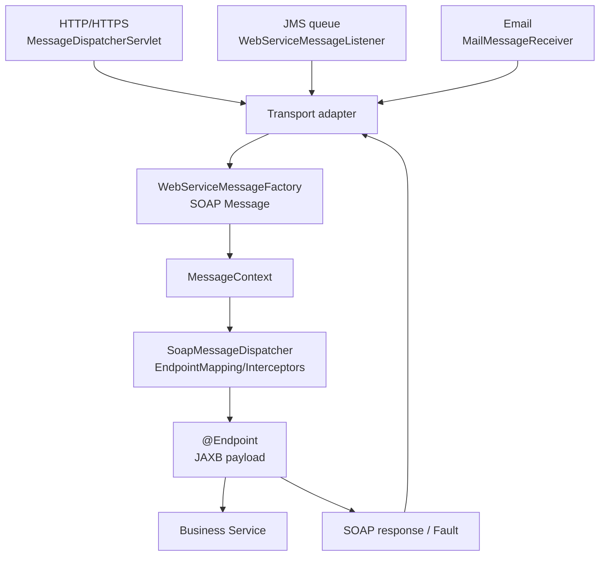
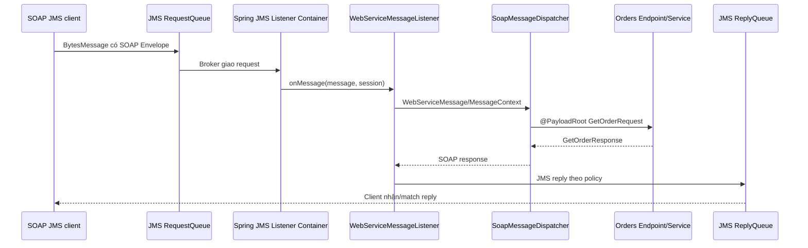
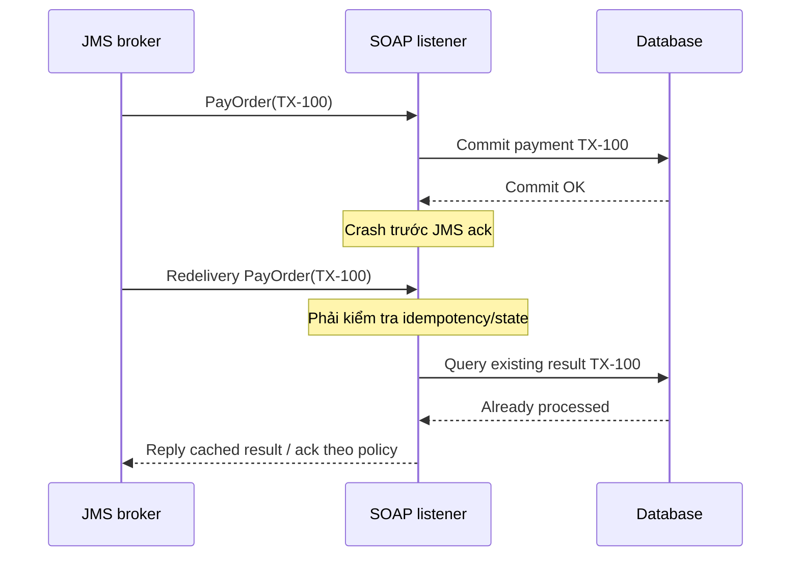
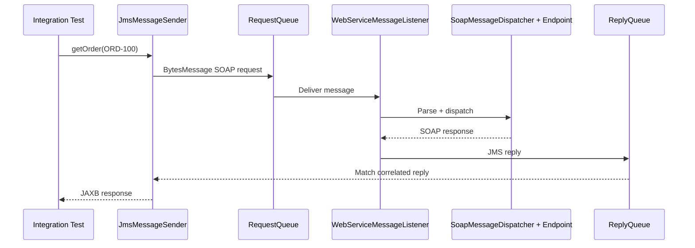
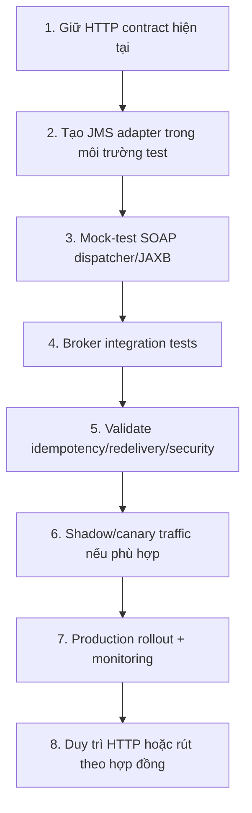

# Tách xử lý SOAP khỏi HTTP và kiểm tra transport được phiên bản hỗ trợ

## 1. Tình huống: cùng một hợp đồng SOAP nhưng không phải mọi yêu cầu đều đi qua HTTP

Một hệ thống đặt hàng đã triển khai dịch vụ **Spring Web Services (Spring-WS)** theo hướng **contract-first**: XSD định nghĩa `SubmitOrderRequest`/`SubmitOrderResponse`, WSDL công bố operation, JAXB ánh xạ XML sang Java và `@Endpoint` xử lý nghiệp vụ. Ban đầu, đối tác gọi bằng HTTPS:

```text
SOAP client --HTTPS POST /ws/orders--> Spring-WS endpoint
```

Sau đó, công ty muốn thêm một đường truyền nhận SOAP qua **JMS queue** để giảm phụ thuộc kết nối HTTP trực tiếp và tích hợp với broker sẵn có:

```text
SOAP client --JMS queue--> Broker --> Spring-WS endpoint
```

Có phải viết lại XSD, JAXB model và business logic? **Không nhất thiết.** Spring-WS có kiến trúc tách **XML/SOAP message processing** khỏi một số lớp **transport adapter**. Tuy nhiên, điều này **không** có nghĩa mọi transport đều hỗ trợ mặc định trong mọi phiên bản, hay có thể đổi từ HTTP sang JMS chỉ bằng cách sửa URI.

Ví dụ, các câu hỏi vận hành khác hẳn:

- HTTP request/response dùng socket và HTTP status; JMS dùng queue/topic, ack, redelivery, correlation và reply destination.
- HTTPS xác minh server qua TLS; broker có security/ACL và đôi khi TLS riêng.
- WSDL 1.1 SOAP/HTTP binding không tự mô tả tất cả semantics JMS/email.
- SOAP Fault là **nội dung message**, còn HTTP 500, broker timeout hoặc JMS redelivery là **transport behavior**.
- Client/Spring-WS version có thể hỗ trợ `JmsMessageSender` nhưng dự án chưa có `spring-ws-support` hoặc đang dùng JMS API không tương thích.

Bài này thuộc chương **Truyền tải mở rộng** của module `SPRING_WEB_SERVICES`. Kiến thức áp dụng cho dịch vụ SOAP contract-first, XSD/WSDL, JAXB, endpoint, SOAP Fault/interceptor, XML security, WS-Security, chứng chỉ và kiểm thử tương thích doanh nghiệp.

### Mục tiêu học tập

Sau bài này, bạn có thể:

1. Mô tả ranh giới giữa **SOAP Envelope/Body/Header**, Spring-WS dispatch và HTTP/JMS/mail transport.
2. Hiểu vai trò của `WebServiceMessage`, `WebServiceMessageFactory`, `MessageContext`, `WebServiceMessageReceiver`, `MessageDispatcher` và `WebServiceMessageSender`.
3. Phân biệt cấu hình client và server: `MessageDispatcherServlet` cho HTTP, `WebServiceMessageListener` cho JMS, `MailMessageReceiver` cho email trong những phiên bản có hỗ trợ.
4. Biết cách **kiểm tra transport thật sự được phiên bản và classpath hỗ trợ**, không suy từ bài viết cũ hay import IDE.
5. Thiết kế message exchange pattern cho HTTP sync, JMS request/reply hoặc bất đồng bộ, correlation IDs, retry/ack/DLQ và idempotency.
6. Kiểm soát transport-specific headers/destinations mà không làm business code phụ thuộc HTTP.
7. Giữ nguyên XML contract khi đổi đường truyền nhưng **phân biệt WSDL binding, endpoint address và giao thức giao nhận**.
8. Xây bộ kiểm thử hai tầng: SOAP endpoint logic bằng mock và transport adapter bằng broker/network integration.

## 2. “SOAP không phụ thuộc HTTP” nghĩa chính xác là gì?

SOAP xác định cấu trúc **XML Envelope** với Header, Body và Fault. HTTP là một trong những cơ chế mang thông điệp SOAP, **không phải thành phần bắt buộc của mọi SOAP Envelope**.

### 2.1. SOAP message và HTTP response là hai đối tượng khác nhau

SOAP 1.1 message:

```xml
<soap:Envelope
    xmlns:soap="http://schemas.xmlsoap.org/soap/envelope/"
    xmlns:ord="urn:example:orders:v1">
    <soap:Header/>
    <soap:Body>
        <ord:GetOrderRequest>
            <ord:orderId>ORD-100</ord:orderId>
        </ord:GetOrderRequest>
    </soap:Body>
</soap:Envelope>
```

Khi gửi bằng HTTP, có thêm lớp giao thức:

```http
POST /ws/orders HTTP/1.1
Host: soap.partner.example.org
Content-Type: text/xml; charset=utf-8
SOAPAction: "urn:example:orders:v1:GetOrder"
```

Đây là request HTTP headers **minh họa**, SOAP Envelope nằm trong body phía dưới. Với JMS, payload SOAP có thể nằm trong `BytesMessage` thay vì HTTP body, nên **không có HTTP status line hoặc `Content-Type` HTTP tương đương tự động**.

### 2.2. Cái gì giữ được, cái gì phải thiết kế lại?

| Thành phần | Có thể giữ khi HTTP → JMS? | Lưu ý |
| --- | --- | --- |
| XSD request/response schema | **Thường có** | Giữ nguyên QName/version khi cùng data contract |
| SOAP Envelope version | Có điều kiện | Các bên phải dùng cùng SOAP 1.1/1.2 message factory |
| JAXB generated classes | **Thường có** | Không tự thêm transport metadata vào JAXB domain |
| `@Endpoint` / `@PayloadRoot` | **Có thể tái dùng** | Dispatcher/endpoint mapping được cấu hình tương ứng |
| Business service | **Nên tái dùng** | Không nên đọc `HttpServletRequest` trực tiếp |
| SOAP Fault payload | Có thể | Delivery/ack và transport-level failure semantics khác |
| HTTP URL/`SOAPAction` header | **Không tự giữ** | JMS destination/metadata là chuyện khác |
| HTTP status codes | **Không** | JMS dùng ack/transaction/error route/DLQ |
| WSDL SOAP/HTTP binding | **Không thể coi là JMS binding** | Contract publication cần mô tả transport-specific deployment đúng |
| Authentication | Không tự động | Broker TLS/ACL khác HTTPS/mTLS; WS-Security có thể dùng xuyên transport |
| Metrics, timeouts | Khái niệm có | Cách đo và cấu hình khác nhau |

### 2.3. Transport-agnostic không có nghĩa transport-invisible

Một endpoint có thể xử lý cùng một payload qua nhiều adapter. Nhưng những thông tin như **HTTP source address**, **JMS correlation ID**, **mail sender** vẫn thuộc transport. Nếu business rule cần tenant/partner identity, nên cung cấp **một abstraction đáng tin cậy** sau authentication thay vì đọc trực tiếp header tùy tiện.

**Transport independence là một quyết định kiến trúc có ranh giới**, không phải lời hứa rằng mọi header/response timing/error của HTTP, JMS và email giống nhau.

## 3. Cấu trúc Spring-WS tách transport

### 3.1. Luồng server ở mức khái niệm



Sơ đồ mô tả **kiến trúc logic**. Trong runtime thực tế, adapter/receiver có thể tạo message từ input trước khi gọi `WebServiceMessageReceiver`; thứ tự cụ thể của security/validation/response writing phụ thuộc transport và pipeline.

### 3.2. Các abstraction quan trọng

| API/class | Vai trò | Có phụ thuộc HTTP không? |
| --- | --- | --- |
| `WebServiceMessage` | Đại diện thông điệp XML/SOAP | Không gắn cố định với HTTP |
| `SoapMessage` | SOAP-specific header/body/fault API | Gắn với SOAP, không gắn riêng HTTP |
| `WebServiceMessageFactory` | Parse/tạo WebServiceMessage | Không nhất thiết HTTP |
| `MessageContext` | Chứa request/response và state khi xử lý | Không nhất thiết HTTP |
| `WebServiceMessageReceiver` | Server-side tiếp nhận context từ transport adapter | Transport-neutral interface |
| `SoapMessageDispatcher` | Mapping tới endpoint, interceptor, exception handling | Chủ yếu SOAP/endpoint |
| `EndpointMapping` | Chọn handler theo payload/action/... | Không buộc theo URL HTTP |
| `WebServiceMessageSender` | Client-side tạo `WebServiceConnection` cho URI | **Transport-specific implementation** |
| `WebServiceConnection` | Kết nối request/response trừu tượng | Implementation tùy HTTP/JMS/mail |
| `TransportContext` | Truy cập connection thực tế khi cần | Có transport-specific data |

**Tách lớp quan trọng nhất:** `MessageDispatcher` xử lý `MessageContext`, còn lớp transport đọc và ghi bytes/messages từ HTTP servlet, JMS broker hay mail store.

### 3.3. HTTP server: `MessageDispatcherServlet`

Ở HTTP, lớp servlet nhận request rồi kết nối tới Spring-WS dispatcher:

```text
HTTP POST
  -> Servlet container
  -> MessageDispatcherServlet
  -> SOAP message factory
  -> SoapMessageDispatcher
  -> @PayloadRoot endpoint
  -> SOAP response/Fault
  -> HTTP response
```

`MessageDispatcherServlet` còn thuận tiện để công bố WSDL động qua HTTP khi được cấu hình. Nhưng **SOAP processing business** có thể tồn tại độc lập với việc HTTP servlet có được đăng ký hay không.

### 3.4. JMS server: `WebServiceMessageListener`

Theo Spring-WS **4.1.4**, `org.springframework.ws.transport.jms.WebServiceMessageListener` là `jakarta.jms` `SessionAwareMessageListener` và cần:

- JMS `ConnectionFactory`;
- Spring `MessageListenerContainer`;
- `WebServiceMessageFactory`;
- `WebServiceMessageReceiver`, thường là `SoapMessageDispatcher`;
- Một broker và destination được cấu hình.

```text
JMS RequestQueue
    -> listener container
    -> WebServiceMessageListener
    -> SOAP message factory
    -> SoapMessageDispatcher
    -> @Endpoint
    -> SOAP reply/Fault (tùy request/reply policy)
```

Đây **không phải** `@JmsListener` thông thường nhận `String` rồi gọi business method trực tiếp. Spring-WS listener là adapter chuyển JMS message thành **SOAP WebServiceMessage** rồi giao vào SOAP dispatch pipeline.

### 3.5. Client: `WebServiceTemplate` và `WebServiceMessageSender`

`WebServiceTemplate` nhận một đích `URI` (default URI hoặc URI trong từng call), rồi sử dụng message sender phù hợp:

```text
JAXB request
    -> WebServiceTemplate
       -> WebServiceMessageFactory
       -> ClientInterceptor / WS-Security
       -> WebServiceMessageSender
          -> HTTP URLConnection / HttpClient / JMS / Mail / ...
       <- response/Fault nếu exchange pattern có reply
    -> JAXB response / Fault handling
```

Đổi `defaultUri` từ `https:` sang `jms:` **không đủ** nếu `WebServiceTemplate` vẫn chỉ có HTTP sender. Cần sender thực sự hỗ trợ URI, provider dependencies và broker connection.

### 3.6. Các lỗi do làm rò transport vào business

Ví dụ không nên dùng trong core service:

```java
// Anti-pattern: business code phụ thuộc HTTP trong mọi transport.
public OrderStatus getOrder(
        GetOrderRequestType request,
        jakarta.servlet.http.HttpServletRequest httpRequest) {
    String caller = httpRequest.getHeader("X-Partner");
    // ...
    return findOrder(request.getOrderId());
}
```

Khi chạy qua JMS, không tồn tại `HttpServletRequest`. Thay vào đó:

```java
public record AuthenticatedPartnerContext(
    String partnerId,
    String correlationId,
    String channel
) {}

public interface OrderQueryService {
    OrderStatus getOrder(
        String orderId,
        AuthenticatedPartnerContext caller
    );
}
```

**Cần lưu ý:** `AuthenticatedPartnerContext` phải được **tạo từ cơ chế authentication/authorization đáng tin**, không phải copy một header do client tự khai rồi gắn nhãn “authenticated”.

## 4. Bản đồ các transport: điều gì được xác nhận từ Spring-WS 4.1.4?

Tài liệu tham chiếu Spring-WS **4.1.4, công bố 10/06/2026**, ghi nhận các transport ở client/server và phân biệt module `spring-ws-core` với `spring-ws-support`.

| Transport | Thành phần được tài liệu/Javadoc 4.1.4 mô tả | Điều kiện để chạy |
| --- | --- | --- |
| HTTP/HTTPS server | `MessageDispatcherServlet`; embedded HTTP handler tùy cấu hình | Servlet/web server, Spring-WS core, message factory |
| HTTP/HTTPS client | `HttpUrlConnectionMessageSender`, `HttpComponents5MessageSender`, `JdkHttpClientMessageSender` và lựa chọn khác theo API | HTTP client implementation, TLS/auth/timeout |
| JMS client | `JmsMessageSender` | `spring-ws-support`, Spring JMS, **Jakarta JMS** provider/connection factory |
| JMS server | `WebServiceMessageListener` + listener container | `spring-ws-support`, JMS broker, message factory, dispatcher |
| Email client | `MailMessageSender` | `spring-ws-support`, mail provider + SMTP/POP3/IMAP configuration |
| Email server | `MailMessageReceiver` | `spring-ws-support`, mail folder/polling/SMTP |
| Embedded HTTP server | `SimpleHttpServerFactoryBean` + `WebServiceMessageReceiverHttpHandler` | Embedded server API/config tương ứng |
| XMPP | `XmppMessageSender` và server-side transport classes trong reference | `spring-ws-support`, XMPP library/server và **compatibility validation** |

**Điểm có ý nghĩa với việc triển khai:** “class xuất hiện trong Javadoc” là bằng chứng **API được công bố trong artifact/version đó**, **chưa chứng minh** dependency runtime, broker, driver, security, classpath và integration test của dự án hoạt động.

### 4.1. Cẩn thận khi áp dụng ví dụ cũ

Những ví dụ Spring-WS 2.x/3.x có thể dùng:

```text
javax.jms.*
javax.mail.*
org.apache.http.* (HttpClient 4)
Spring Framework 5
```

Trong Spring-WS 4.x stack thường gặp:

```text
jakarta.jms.*
Jakarta Mail APIs theo dependency
Spring Framework 6.x
Java 17+
Apache HttpClient 5 APIs nếu chọn sender tương ứng
```

Theo tài liệu reference **4.1.4**, runtime yêu cầu **Java 17** và dựa trên **Spring Framework 6.x**. Không copy snippet `javax.jms.Session` từ bài cũ để chạy trong `WebServiceMessageListener` 4.1.4 vốn khai báo `jakarta.jms.Session`.

### 4.2. Không gộp “được liệt kê” với “được hỗ trợ cho use case của mình”

Ví dụ có `MailMessageSender` không có nghĩa mail transport phù hợp một API thanh toán cần latency vài trăm mili giây, deadline cứng, retry chính xác hay synchronous response. Tương tự, `XmppMessageSender` có tên trong API không tự bảo đảm phiên bản XMPP library/security/SASL phù hợp môi trường production hiện tại.

Một kết luận hỗ trợ hợp lệ phải ghi **artifact version + class + dependency/provider + test result + limitation**; không chỉ đánh dấu “Spring-WS supports JMS”.

## 5. Quy trình kiểm chứng transport trên phiên bản đang triển khai

Không nên trả lời “có” hoặc “không” chỉ dựa vào một ví dụ trên mạng. Hãy kiểm tra theo **năm lớp**, và ghi rõ ngày/phiên bản để kết luận có thể kiểm chứng lại.

### 5.1. Lớp 1 — Xác định chính xác phiên bản Spring-WS

Ở một dự án Maven:

```bash
mvn dependency:tree \
  -Dincludes=org.springframework.ws,org.springframework
```

Nếu output dài, có thể giới hạn theo artifact cụ thể:

```bash
mvn dependency:tree \
  -Dincludes=org.springframework.ws:spring-ws-core

mvn dependency:tree \
  -Dincludes=org.springframework.ws:spring-ws-support
```

Đây là **lệnh người học chạy trong dự án có Maven**, không phải kết quả thực tế của bài học. Kiểm tra cả `spring-ws-core`, `spring-ws-support`, `spring-xml`, Spring Framework và Java runtime — đặc biệt khi dùng Spring Boot dependency management.

Không suy phiên bản Spring-WS từ tên `spring-boot-starter-web-services` mà chưa kiểm tra dependency tree hoặc resolved artifact.

### 5.2. Lớp 2 — Mở đúng reference/Javadoc theo phiên bản

Ví dụ API đã xác minh ở Spring-WS 4.1.4:

```text
org.springframework.ws.transport.WebServiceMessageSender
org.springframework.ws.transport.jms.JmsMessageSender
org.springframework.ws.transport.jms.WebServiceMessageListener
org.springframework.ws.transport.mail.MailMessageSender
org.springframework.ws.transport.mail.MailMessageReceiver
org.springframework.ws.transport.xmpp.XmppMessageSender
```

Nguồn:

- Spring-WS 4.1.4 Reference, phần `5.2 Transports` và `6.1.1 URIs and Transports`.
- Spring-WS 4.1.4 Javadoc của từng class/constructor/setter.

**Chọn docs theo đúng artifact đang chạy**, không nhảy sang `current`/`SNAPSHOT` khi một dự án bị khóa ở 3.x hoặc 4.0.x.

### 5.3. Lớp 3 — Kiểm tra module và dependency transitives

`spring-ws-core` không bảo đảm mang đủ mọi JMS/mail/XMPP class. Tài liệu 4.1.4 mô tả module **`spring-ws-support` chứa các transport bổ sung**. Một project chỉ có starter HTTP có thể chưa kéo những dependencies này.

Các mục cần xác minh:

- `spring-ws-support` có trên compile/runtime classpath không?
- `spring-jms` có đúng version Spring Framework không?
- JMS API là `jakarta.jms` hay `javax.jms` trong stack cụ thể?
- ConnectionFactory triển khai JMS API tương thích với listener/container không?
- SAAJ/JAXB/XML message factory hoạt động trên Java runtime hiện tại không?
- Với Mail/XMPP: provider, protocol library, TLS/auth và module có tồn tại không?

Một dependency được compile chưa chứng minh hoạt động ở runtime nếu classpath/container cung cấp class phiên bản khác.

### 5.4. Lớp 4 — Xác nhận API thật sự đúng

Ví dụ với Spring-WS 4.1.4, Javadoc xác nhận:

```java
new JmsMessageSender(jakartaJmsConnectionFactory);
jmsSender.setReceiveTimeout(5_000);
```

`JmsMessageSender` còn có `supports(URI, UriSource)` để kiểm tra một URI phù hợp transport và nguồn URI. Lưu ý:

- `supports(...)` trả `true` chỉ xác nhận **sender chấp nhận loại URI/cấu trúc destination theo policy**.
- Nó **không chứng minh** broker đang chạy, user có quyền gửi đến queue, reply quay về, hay network/TLS hợp lệ.
- Javadoc 4.1.4 đánh dấu `supports(URI)` cũ là **deprecated**, khuyến nghị `supports(URI, UriSource)` có từ **3.1.9**.

### 5.5. Lớp 5 — Chạy smoke/integration test trên stack thật

Hệ thống phải chứng minh ít nhất:

1. ConnectionFactory kết nối được broker bằng user/credential thực tế của môi trường test.
2. Sender gửi được SOAP BytesMessage vào destination mong muốn.
3. Listener container nhận message, tạo WebServiceMessage và dispatch đúng `@Endpoint`.
4. SOAP Fault được trả qua cơ chế reply phù hợp (khi có request/reply).
5. Correlation, timeout, redelivery và DLQ hoạt động theo hợp đồng vận hành.
6. Không phát sinh side effect trùng khi broker redeliver.
7. TLS/ACL và WS-Security policy áp dụng đúng ở cả sender/receiver.

### 5.6. Mẫu bảng compatibility nên lưu trong dự án

| Trường | Ví dụ ghi nhận |
| --- | --- |
| Spring-WS version | `4.1.4` (**chỉ là ví dụ đã đối chiếu docs**) |
| Spring Framework | Resolved version của ứng dụng |
| Java | Vendor + build + version runtime thực |
| Transport | JMS request/reply |
| Spring-WS class | `JmsMessageSender` + `WebServiceMessageListener` |
| Dependency | `spring-ws-support`, `spring-jms`, provider phù hợp |
| API namespace | `jakarta.jms.*` với ví dụ 4.1.4 |
| Broker/provider | Tên/version trong environment |
| URI | `jms:Orders.Request?replyToName=Orders.Reply` |
| Reply mode | Temporary queue hay named queue |
| Message type | BytesMessage |
| Authn/ACL | Broker identity/allowed destinations |
| Fault/retry | SOAP Fault vs JMS nack/redelivery/DLQ |
| Integration test | Pass/Fail + build ID/date |
| Chưa kiểm chứng | Các edge cases hoặc constraints cụ thể |

**Không** dùng một mẫu có chữ “Pass” để khẳng định môi trường của bạn đã pass; bảng phải được điền từ kết quả test thực.

## 6. Contract-first: giữ payload contract, kiểm tra riêng transport binding

Giả sử XSD định nghĩa:

```xml
<?xml version="1.0" encoding="UTF-8"?>
<xs:schema
    xmlns:xs="http://www.w3.org/2001/XMLSchema"
    xmlns:ord="urn:example:orders:v1"
    targetNamespace="urn:example:orders:v1"
    elementFormDefault="qualified">

    <xs:complexType name="GetOrderRequestType">
        <xs:sequence>
            <xs:element name="orderId" type="xs:string"/>
        </xs:sequence>
    </xs:complexType>

    <xs:complexType name="GetOrderResponseType">
        <xs:sequence>
            <xs:element name="orderId" type="xs:string"/>
            <xs:element name="status" type="xs:string"/>
        </xs:sequence>
    </xs:complexType>

    <xs:element name="GetOrderRequest"
                type="ord:GetOrderRequestType"/>
    <xs:element name="GetOrderResponse"
                type="ord:GetOrderResponseType"/>
</xs:schema>
```

`GetOrderRequest` có QName:

```text
{urn:example:orders:v1}GetOrderRequest
```

Khi request đi bằng HTTP hoặc JMS, SOAP Body root vẫn có thể giữ **cùng QName và cùng XSD**.

### 6.1. SOAP Envelope không mang sẵn HTTP headers

```xml
<soap:Envelope
    xmlns:soap="http://schemas.xmlsoap.org/soap/envelope/"
    xmlns:ord="urn:example:orders:v1">
    <soap:Body>
        <ord:GetOrderRequest>
            <ord:orderId>ORD-100</ord:orderId>
        </ord:GetOrderRequest>
    </soap:Body>
</soap:Envelope>
```

Đây là payload SOAP được ứng dụng xử lý. Khi gửi HTTP, HTTP request chứa metadata như `SOAPAction`, `Content-Type`. Khi gửi JMS, broker sử dụng JMS destination, message ID, correlation ID, reply-to destination, delivery mode, headers/properties.

Không tự nhét một HTTP `SOAPAction` vào JMS properties rồi giả định mọi endpoint mapping sẽ hiểu giống HTTP SOAPAction. Nếu routing cần action, hãy thống nhất **SOAP message header (ví dụ WS-Addressing Action)** hoặc transport mapping thực sự hỗ trợ, và kiểm thử.

### 6.2. WSDL `soap:binding` vẫn mang nghĩa HTTP

WSDL 1.1 thường có:

```xml
<!-- Trích đoạn: thiếu phần definitions, messages, portType... -->
<wsdl:binding
    name="OrdersSoap11HttpBinding"
    type="tns:OrdersPortType">
    <soap:binding
        style="document"
        transport="http://schemas.xmlsoap.org/soap/http"/>
    <wsdl:operation name="GetOrder">
        <soap:operation soapAction="urn:example:orders:v1:GetOrder"/>
        <wsdl:input><soap:body use="literal"/></wsdl:input>
        <wsdl:output><soap:body use="literal"/></wsdl:output>
    </wsdl:operation>
</wsdl:binding>
```

`transport="http://schemas.xmlsoap.org/soap/http"` mô tả một **SOAP/HTTP binding**, không phải “mọi kiểu giao nhận XML”. Nếu ứng dụng thêm JMS endpoint, **không** đơn thuần:

```xml
<!-- Sai về ý nghĩa: giữ HTTP binding nhưng tự đổi address thành JMS
     rồi tuyên bố WSDL đã hỗ trợ JMS. -->
<soap:address location="jms:Orders.Request"/>
```

Nhiều WSDL clients và công cụ code generation kỳ vọng HTTP semantics khi binding ghi HTTP. Cần mô tả/document riêng **JMS URI, provider, reply strategy, QoS, correlation, fault handling** và chọn WSDL extension/binding **được hai bên hỗ trợ thực sự** khi cần công bố non-HTTP contract.

### 6.3. Một service có thể có nhiều deployment bindings

Thiết kế khái niệm:

```text
Logical operation:
  GetOrder(GetOrderRequest) -> GetOrderResponse

SOAP XML contract:
  namespace = urn:example:orders:v1
  request QName = {urn:example:orders:v1}GetOrderRequest

Deployment A:
  SOAP 1.1 / HTTP(S)
  URL = https://api.example.org/ws/orders

Deployment B:
  SOAP 1.1 / JMS
  Request destination = Orders.Request
  Reply destination = Orders.Reply
  Broker/provider details = agreed out of band
```

Cùng logical operation có thể được phục vụ qua hai adapters, nhưng **đây là thiết kế và cấu hình cụ thể**, không phải một tùy chọn bật tất cả transports trong Spring-WS.

### 6.4. JAXB và `@PayloadRoot` xử lý payload, không quyết định đường truyền

```java
import org.springframework.ws.server.endpoint.annotation.Endpoint;
import org.springframework.ws.server.endpoint.annotation.PayloadRoot;
import org.springframework.ws.server.endpoint.annotation.RequestPayload;
import org.springframework.ws.server.endpoint.annotation.ResponsePayload;

@Endpoint
public class OrdersEndpoint {

    private static final String NS = "urn:example:orders:v1";

    private final OrdersService ordersService;

    public OrdersEndpoint(OrdersService ordersService) {
        this.ordersService = ordersService;
    }

    @PayloadRoot(namespace = NS, localPart = "GetOrderRequest")
    @ResponsePayload
    public GetOrderResponseType getOrder(
            @RequestPayload GetOrderRequestType request) {

        return ordersService.getOrder(request.getOrderId());
    }
}
```

Đây là khung endpoint dùng JAXB classes **giả định** và `OrdersService` do ứng dụng định nghĩa. Phụ thuộc vào XJC/global element binding và adapters, response có thể cần `JAXBElement<GetOrderResponseType>`/`@XmlRootElement`; đừng copy mù phương thức này mà không kiểm tra schema.

Endpoint **không gọi `HttpServletRequest`**; nó nhận payload JAXB từ SOAP dispatcher. Nếu endpoint mapping/adapters và JAXB context được cấu hình cho cả HTTP và JMS, cùng business logic có thể được dùng lại.

### 6.5. Những phần còn phải version hóa ngoài XSD

- SOAP 1.1/1.2 message factory và XML Envelope namespace.
- WSDL binding/location và client deployment metadata.
- WS-Addressing version/action URI nếu sử dụng.
- JMS provider/destination format/reply strategy.
- Transport security (HTTPS/mTLS hoặc broker TLS/SASL/ACL).
- Encoding, binary vs text, attachment/MTOM capabilities.
- Retry/idempotency/delivery guarantees, timeout/SLA.

**Schema version ≠ transport version ≠ library version.** Đổi HTTP → JMS có thể giữ XSD v1 nhưng vẫn cần một deployment contract bổ sung.

## 7. Ranh giới `TransportContext`: khi nào phải dùng và khi nào nên tránh?

Spring-WS có `TransportContextHolder` để truy cập `TransportContext`/`WebServiceConnection` hiện tại. Chức năng này hữu ích khi một adapter cần metadata thật từ transport, nhưng **dễ làm endpoint mất tính độc lập nếu ép mọi connection thành HTTP**.

### 7.1. Cách viết rủi ro

```java
// Anti-pattern: giả định mọi request đều qua servlet HTTP.
TransportContext transportContext =
    TransportContextHolder.getTransportContext();

HttpServletConnection http =
    (HttpServletConnection) transportContext.getConnection();

String sourceAddress =
    http.getHttpServletRequest().getRemoteAddr();
```

Đoạn này có thể hợp lệ trong một **HTTP-only adapter**, nhưng `ClassCastException` hoặc null context ở JMS/mail path. Nó không nên xuất hiện trong core business service hoặc endpoint dùng chung.

### 7.2. Thiết kế adapter riêng

```java
public interface CallerContextResolver {
    AuthenticatedPartnerContext resolve();
}

public record AuthenticatedPartnerContext(
    String partnerId,
    String correlationId,
    String transport
) {}
```

Mỗi transport adapter có trách nhiệm tạo context đã được **xác thực**, ví dụ:

- HTTP: principal/token đã verify, mTLS identity được gateway/container tin.
- JMS: broker user/workload identity đã verify hoặc signed SOAP identity theo policy.
- Email: authenticated mailbox + **message-level signature** nếu nguồn thư không đủ tin cậy.

Không tin `JMSCorrelationID`, HTTP `X-Partner` hoặc mail `From` là danh tính người gửi đã xác thực chỉ vì chúng có giá trị.

### 7.3. Đường biên cho timeout và observability

Business service có thể nhận một `RequestExecutionContext` mang deadline/correlation ID **đã được chuẩn hóa**. Adapter HTTP chuyển HTTP deadline; adapter JMS chuyển message age/TTL hoặc request SLA. Core service không trực tiếp đọc `HttpServletRequest` hay `jakarta.jms.Message`.

## 8. JMS client với `JmsMessageSender` (ví dụ Spring-WS 4.1.4)

JMS là minh họa rõ nhất cho việc **thay đường truyền nhưng giữ SOAP contract**. Phía client dùng `WebServiceTemplate` như HTTP, nhưng thay message sender.

### 8.1. Đọc URI JMS trong Spring-WS

Javadoc 4.1.4 mô tả dạng:

```text
jms:<destination>[?param-name=param-value][&param-name=param-value]
```

Ví dụ:

```text
jms:Orders.Request
jms:Orders.Request?replyToName=Orders.Reply
jms:Orders.Request?deliveryMode=PERSISTENT&priority=4
jms:Orders.Request?messageType=TEXT_MESSAGE
```

Những tham số được liệt kê trong Javadoc 4.1.4:

| Tham số | Mục đích |
| --- | --- |
| `deliveryMode` | `PERSISTENT` hoặc `NON_PERSISTENT` khi gửi request |
| `messageType` | `BINARY_MESSAGE` mặc định hoặc `TEXT_MESSAGE` |
| `priority` | JMS message priority từ 0–9 |
| `replyToName` | Tên reply destination, nếu không khai báo thì mặc định dùng **temporary queue** |
| `timeToLive` | TTL tính bằng mili giây của request message |

**Những URI trên là ví dụ cho Spring-WS JMS sender**, không phải URI JMS universal có ý nghĩa giống nhau với mọi thư viện.

### 8.2. Tại sao nên ưu tiên `BytesMessage`?

Theo reference/Javadoc 4.1.4, `JmsMessageSender` mặc định gửi **`BytesMessage`**. `TextMessage` có thể được bật bằng tham số URI, nhưng `BytesMessage` thường phù hợp hơn cho SOAP vì:

- Chuyển chính xác chuỗi bytes/charset mà SOAP message factory đã serialize.
- Hạn chế những bất đồng khi chuyển kiểu String/encoding.
- Xử lý attachments tốt hơn theo khả năng transport/message factory được hỗ trợ.

Không suy rằng mọi MTOM/SOAP attachment sẽ tương thích broker tự động. Nếu có binary attachments, cần **test thực tế message serialization, size, MIME boundary và JAXB/XOP** trên cả sender và receiver.

### 8.3. Cấu hình client Java bằng Spring beans

Ví dụ này giả định dự án đã có một **`jakarta.jms.ConnectionFactory` hợp lệ**, kết nối broker sandbox và một `Jaxb2Marshaller` trỏ tới package JAXB-generated:

```java
import jakarta.jms.ConnectionFactory;
import org.springframework.context.annotation.Bean;
import org.springframework.context.annotation.Configuration;
import org.springframework.oxm.jaxb.Jaxb2Marshaller;
import org.springframework.ws.client.core.WebServiceTemplate;
import org.springframework.ws.soap.saaj.SaajSoapMessageFactory;
import org.springframework.ws.transport.jms.JmsMessageSender;

@Configuration
public class OrdersSoapJmsClientConfiguration {

    @Bean
    public JmsMessageSender ordersJmsMessageSender(
            ConnectionFactory connectionFactory) {

        JmsMessageSender sender =
            new JmsMessageSender(connectionFactory);
        sender.setReceiveTimeout(5_000); // milliseconds
        return sender;
    }

    @Bean
    public WebServiceTemplate ordersJmsWebServiceTemplate(
            SaajSoapMessageFactory soapMessageFactory,
            Jaxb2Marshaller ordersJaxbMarshaller,
            JmsMessageSender ordersJmsMessageSender) {

        WebServiceTemplate template =
            new WebServiceTemplate(soapMessageFactory);

        template.setMarshaller(ordersJaxbMarshaller);
        template.setUnmarshaller(ordersJaxbMarshaller);
        template.setMessageSender(ordersJmsMessageSender);
        template.setDefaultUri(
            "jms:Orders.Request?replyToName=Orders.Reply"
        );
        return template;
    }
}
```

Đây là **mẫu client adapter** dựa trên API Spring-WS 4.1.4. Những beans khác phải được cung cấp:

- `SaajSoapMessageFactory` đã cấu hình đúng SOAP 1.1/1.2, provider hỗ trợ.
- `Jaxb2Marshaller` với context path/packages đúng XSD.
- `jakarta.jms.ConnectionFactory` của một broker/provider thực.
- Security/TLS/broker credentials được nạp từ secret source, không nằm trong code.
- Destination `Orders.Request`/`Orders.Reply` được broker cấu hình và cho phép access.

Không mặc định Spring Boot tự tạo đủ những beans trên nếu chỉ khai báo `spring-boot-starter-web-services`.

### 8.4. Gửi JAXB SOAP payload

```java
import jakarta.xml.bind.JAXBElement;
import org.springframework.ws.client.core.WebServiceTemplate;

public final class OrdersJmsSoapGateway {

    private final WebServiceTemplate template;
    private final ObjectFactory objectFactory =
        new ObjectFactory();

    public OrdersJmsSoapGateway(WebServiceTemplate template) {
        this.template = template;
    }

    public GetOrderResponseType getOrder(String orderId) {
        GetOrderRequestType request = new GetOrderRequestType();
        request.setOrderId(orderId);

        JAXBElement<GetOrderRequestType> root =
            objectFactory.createGetOrderRequest(request);

        Object result = template.marshalSendAndReceive(root);
        if (result instanceof JAXBElement<?> element
                && element.getValue()
                    instanceof GetOrderResponseType response) {
            return response;
        }
        throw new IllegalStateException(
            "Unexpected SOAP JAXB response"
        );
    }
}
```

`ObjectFactory`, `GetOrderRequestType` và `GetOrderResponseType` là **JAXB model classes giả định**. Nếu JAXB generator trả direct root-annotated response, client phải xử lý cả trường hợp phù hợp. Ngoài kiểm tra Java type, production nên xác minh **response QName**, XSD contract và SOAP Fault trước khi chuyển sang domain model.

Ví dụ dùng **request/reply**; `marshalSendAndReceive` không nên được dùng để giả vờ một message là **fire-and-forget** khi contract không có response channel.

### 8.5. Timeout mặc định cần được quyết định rõ

Javadoc `JmsMessageSender` 4.1.4 mô tả `DEFAULT_RECEIVE_TIMEOUT=-1` tương đương chờ nhận **không có timeout**. Một client production không nên vô tình giữ worker thread vô hạn khi reply không đến.

Chọn timeout theo SLA, tính đến broker latency/processing time và bản chất operation. Nếu client timeout sau khi request đã được broker/server xử lý, **không suy server chưa commit**.

### 8.6. Không đánh đồng JMS `timeToLive` với receive timeout

`timeToLive` áp dụng tuổi thọ/expiration của request JMS message. `setReceiveTimeout(...)` kiểm soát thời gian sender **chờ nhận reply**.

Hai giá trị khác nhau:

```text
JMS request TTL = 30s:
  Broker có thể xem message quá hạn sau 30s.

Client receive timeout = 5s:
  Client từ bỏ chờ reply sau 5s.
```

Một request có thể vẫn nằm trong broker/được xử lý **sau khi client đã timeout**, tùy TTL, queue backlog, transaction và xử lý. Đây là lý do phải thiết kế correlation/status checks/idempotency.

### 8.7. Temporary reply queue vs named reply queue

Không khai báo `replyToName` thường khiến sender 4.1.4 dùng **temporary queue**. Điều này có thể phù hợp request/reply trực tiếp, nhưng phải cân nhắc connection lifetime và khả năng broker hỗ trợ temporary destinations.

Khai báo:

```text
jms:Orders.Request?replyToName=Orders.Reply
```

không tự bảo đảm nhiều concurrent requests cùng chia sẻ reply queue sẽ được correlation đúng. Kiểm tra:

- JMSCorrelationID/JMSMessageID relationship.
- Reply selectors/consumer behavior của sender/provider.
- Có nhiều client instances cùng dùng một named reply queue không?
- Reply quá hạn, mất kết nối, duplicate và dead-letter routing.

**Đừng tự tạo cơ chế shared reply queue khi chưa test concurrency và matching của framework/provider.**

## 9. JMS server: nối broker listener với SOAP dispatcher

Client `JmsMessageSender` chỉ là một nửa. Phía server cần **transport receiver** và endpoint mapping tương ứng.

### 9.1. Mô hình xử lý



Với phiên bản 4.1.4, `WebServiceMessageListener` implements Spring `SessionAwareMessageListener<jakarta.jms.Message>`. Nó chuyển JMS `BytesMessage`/`TextMessage` sang SOAP thông qua `WebServiceMessageFactory` rồi gọi receiver.

### 9.2. Cấu hình listener và message receiver ở mức bean

Ví dụ Java:

```java
import jakarta.jms.ConnectionFactory;
import org.springframework.context.annotation.Bean;
import org.springframework.context.annotation.Configuration;
import org.springframework.jms.listener.DefaultMessageListenerContainer;
import org.springframework.ws.WebServiceMessageFactory;
import org.springframework.ws.transport.WebServiceMessageReceiver;
import org.springframework.ws.transport.jms.WebServiceMessageListener;

@Configuration
public class OrdersSoapJmsServerAdapter {

    @Bean
    public WebServiceMessageListener ordersJmsListener(
            WebServiceMessageFactory soapMessageFactory,
            WebServiceMessageReceiver ordersSoapReceiver) {

        WebServiceMessageListener listener =
            new WebServiceMessageListener();
        listener.setMessageFactory(soapMessageFactory);
        listener.setMessageReceiver(ordersSoapReceiver);
        return listener;
    }

    @Bean
    public DefaultMessageListenerContainer ordersJmsContainer(
            ConnectionFactory connectionFactory,
            WebServiceMessageListener ordersJmsListener) {

        DefaultMessageListenerContainer container =
            new DefaultMessageListenerContainer();
        container.setConnectionFactory(connectionFactory);
        container.setDestinationName("Orders.Request");
        container.setMessageListener(ordersJmsListener);
        // Transaction/ack/concurrency settings phải theo broker policy.
        return container;
    }
}
```

**Đây là adapter snippet, không phải application khởi động độc lập.** Bean `ordersSoapReceiver` phải là một **`WebServiceMessageReceiver`/`SoapMessageDispatcher` đã được cấu hình endpoint mappings, adapters/interceptors, exception resolvers** theo Spring-WS context. Không dùng `new SoapMessageDispatcher()` rỗng rồi kỳ vọng tự biết tất cả `@Endpoint` trong application.

Trong dự án nhiều `WebServiceMessageReceiver` beans, dùng `@Qualifier` để chọn dispatcher đúng. Tương tự, chọn đúng `WebServiceMessageFactory` khi ứng dụng có SOAP 1.1 và SOAP 1.2 cùng lúc.

### 9.3. Bean `@Endpoint` và `@PayloadRoot` có thể dùng lại

Khi `SoapMessageDispatcher` được cấu hình hợp lệ và nhận cùng contract QName, endpoint mục 6.4 vẫn xử lý:

```text
{urn:example:orders:v1}GetOrderRequest
```

Từ client HTTP hay JMS đều có thể đi tới **cùng business service** nếu ứng dụng cố ý nối hai transport adapters với dispatcher/endpoint configuration tương ứng.

### 9.4. Transaction và acknowledgement không phải SOAP Fault

Listener container/broker quyết định:

- Session transacted hay không.
- Khi nào message được acknowledge/commit.
- Cách redelivery khi listener lỗi/rollback.
- Delivery attempts, poison message handling, DLQ policy.
- Ack đối với việc gửi reply thành công/thất bại.

SOAP endpoint cũng có thể **tạo SOAP Fault một cách hợp lệ** mà không ném exception ra listener container. Khi đó broker **không tự biết** nên rollback request chỉ vì SOAP Body chứa Fault.

Do đó:

**SOAP Fault về nghiệp vụ và JMS delivery failure là hai kết quả độc lập.**

Ví dụ `ORDER_NOT_FOUND` Fault có thể được xử lý như một response chính thức và broker ack request. Trái lại, lỗi database transient có thể cần rollback/redelivery **nếu** transaction/idempotency policy và listener integration cho phép.

### 9.5. Không dựa vào một boolean để xác định transaction committed

Một exception xảy ra sau khi business service commit nhưng trước khi gửi JMS reply có thể khiến broker redeliver request. Đây không phải bằng chứng giao dịch đầu chưa chạy.

Để xử lý:

- Tách transaction boundary rõ.
- Dùng business idempotency key ổn định.
- Ghi trạng thái xử lý/transaction outcomes.
- Thiết kế transactional outbox hoặc cơ chế tương đương nếu cần nhất quán DB → broker.
- Test duplicate/redelivery và tình huống mất reply.

### 9.6. Chọn queue hay topic?

**Queue** thường phù hợp request/reply cần một handler group nhận một công việc; **topic** dành cho publish/subscribe với fan-out. Không tự biến SOAP request/reply thành topic để “scale” nếu muốn một endpoint duy nhất xử lý; semantics consumer subscriptions có thể gây nhiều executions.

Đối với JMS publisher, `setPubSubDomain(...)`/destination resolver của Spring JMS và URI/provider phải được cấu hình nhất quán, không suy “tên Topic” từ string destination là đủ.

## 10. Correlation: ba loại ID dễ bị nhầm

Một SOAP request qua JMS thường có tối thiểu ba định danh:

| ID | Nơi tồn tại | Ý nghĩa |
| --- | --- | --- |
| JMSMessageID | JMS broker/header | Broker nhận diện JMS message |
| JMSCorrelationID | JMS header | Nối request với reply theo quy tắc ứng dụng/provider |
| WS-Addressing `wsa:MessageID` | SOAP Header | Định danh SOAP message cấp WS-Addressing |
| Business `transactionId`/`idempotencyKey` | SOAP Body/Header theo contract | Chống side effect trùng, tra cứu nghiệp vụ |

Chúng **không tự đồng bộ**. Một message có thể được broker redeliver với các JMS delivery properties thay đổi, nhưng business transaction ID cần giữ ổn định để nhận diện cùng giao dịch.

### 10.1. Một request/reply thường có hai correlation layers

```text
JMS layer:
  request JMSMessageID = broker-generated ID
  reply JMSCorrelationID = ID được quy ước để match request

SOAP layer:
  request wsa:MessageID = SOAP message ID
  response wsa:RelatesTo = referenced SOAP request ID

Business layer:
  request transactionId = TX-100
  server deduplicates operations by TX-100 (+ caller/operation)
```

**Không bắt buộc cả hai cơ chế JMS và WS-A luôn có mặt**. Nếu profile không dùng WS-A, JMS correlation vẫn có thể hoạt động. Nếu có WS-A, ứng dụng có thể cần kiểm tra đồng thời hai lớp để tránh reply mismatch.

### 10.2. Tình huống reply không đúng request

Hai client instances A và B cùng gửi request vào `Orders.Request`, và cùng chờ ở `Orders.Reply`. Nếu reply consumer không lọc `JMSCorrelationID` đúng, A có thể đọc reply của B.

Vì vậy phải test:

1. Hai requests cùng lúc từ các client khác nhau.
2. Broker redeliver/delay reply.
3. Reply tới sau timeout của client gốc.
4. Duplicate replies trên shared queue.
5. Chọn wrong message không xảy ra.

Không viết mã tiêu thụ “lấy message đầu tiên trong reply queue” cho một hệ thống có concurrency.

### 10.3. Không dùng JMSMessageID làm idempotency key một cách máy móc

Một business action được người gửi retry có thể tạo **JMSMessageID mới**, nhưng vẫn là cùng một giao dịch. Ngược lại, broker redelivery có thể giữ cùng ID hoặc thêm redelivery metadata, nhưng idempotency phải gắn **ngữ nghĩa nghiệp vụ** và authorization, không chỉ ID transport.

### 10.4. WS-Addressing `ReplyTo` không phải `JMSReplyTo`

`wsa:ReplyTo` là SOAP Header EPR; `JMSReplyTo` là JMS header/destination. Trong một tích hợp non-HTTP, chúng có thể liên quan theo profile, nhưng **không tự động đồng nghĩa hoặc được map hai chiều** trừ khi sender/receiver đã được cấu hình/test.

Nếu hỗ trợ non-anonymous WS-Addressing reply, phải xác minh:

- URI trong EPR có sender tương ứng không?
- Đích đó có được phép bởi security policy không?
- Ai thực sự gửi response (transport request/reply logic hay WS-A out-of-band dispatcher)?
- Nếu cả hai cơ chế được bật, có nguy cơ gửi hai replies không?

## 11. Retry, delivery guarantee, idempotency và DLQ

### 11.1. “At-least-once delivery” không tự trở thành “exactly-once business execution”

Một broker có thể redeliver message khi:

- Consumer crash trước acknowledgement;
- Session transaction rollback;
- Network/connection reset;
- Reply send thất bại;
- Broker/consumer failover.

Nếu SOAP request `PayOrder` đã ghi thanh toán vào database trước khi consumer ack, lần redelivery có thể chạy lại `PayOrder`.



### 11.2. Giữ riêng bốn khái niệm

| Khái niệm | Ý nghĩa |
| --- | --- |
| JMS delivery mode | Gợi ý mức độ bền lưu message theo JMS provider/broker |
| JMS transaction/ack | Quyết định xử lý lại message khi consumer/transaction thất bại |
| Retry policy | Khi nào thử lại operation/broker send/reply wait |
| Business idempotency | Ngăn một giao dịch logic tạo side effect nhiều lần |

**`PERSISTENT` không đồng nghĩa “exactly once payment”.** Và `NON_PERSISTENT` không có nghĩa “không có duplicate”. Đó là các trục khác nhau.

### 11.3. Kịch bản timeout sau commit

Client chờ reply 5 giây, server nhận request ở giây 2, commit ở giây 4, nhưng reply đi chậm tới giây 6. Client thấy timeout.

Kết quả thực:

```text
clientObservation = timeout
serverBusinessState = committed
replyState = late
outcomeFromClientPerspective = UNKNOWN
```

Hành động đúng: query status bằng transaction ID hoặc retry có **idempotency key được server hỗ trợ**. Không retry mù `CancelOrder`/`PayOrder` và giả định chưa xử lý.

### 11.4. DLQ cho poison messages và retries có giới hạn

Một SOAP request invalid XSD liên tục sẽ không trở nên hợp lệ nếu redeliver 100 lần. Nên thiết kế:

- Phân loại permanent error (schema, auth, unsupported operation) vs transient broker/DB error.
- Giới hạn retry count và backoff phù hợp.
- Dead-letter queue (DLQ) cho thông điệp không thể xử lý theo policy.
- Quarantine/redaction đối với dữ liệu nhạy cảm trong DLQ.
- Alert và reprocessing procedure rõ ràng, tránh replay side effect.

### 11.5. SOAP Fault vs broker redelivery policy

| Kết quả SOAP | Ý nghĩa | Broker xử lý như thế nào? |
| --- | --- | --- |
| Normal response `GetOrderResponse` | Business success | Thường ack/commit nếu reply gửi thành công |
| SOAP Fault `INVALID_ORDER_ID` | Permanent contract/business failure | Có thể gửi Fault reply và ack; không retry message vô hạn |
| SOAP Fault `ACCESS_DENIED` | Security rejection | Ack/quarantine theo security policy, không retry y hệt |
| SOAP Fault `TEMPORARY_UNAVAILABLE` | Transient service failure nếu contract quy định | Policy quyết định Fault reply hay rollback/redelivery |
| JVM crash trước ack | Không biết status | Broker redelivery có thể xảy ra; server phải idempotent |
| Reply lost | Client timeout, operation có thể đã commit | Correlation/status lookup/idempotency |

Quyết định cuối là **application + broker transaction policy**, không phải một hành vi SOAP/JMS bắt buộc áp cho mọi service.

## 12. Email và XMPP: có API không có nghĩa phù hợp request/reply thời gian thực

### 12.1. Email transport trong Spring-WS 4.1.4

Reference 4.1.4 mô tả:

- `MailMessageSender`: client tạo mail message từ `WebServiceMessage`, gửi qua SMTP và có thể chờ reply qua POP3/IMAP.
- `MailMessageReceiver`: server theo dõi mailbox, chuyển thư sang SOAP message và gửi reply qua SMTP.
- `MonitoringStrategy`: mặc định polling, trong reference mô tả interval mặc định **năm phút**; có thể cấu hình polling hoặc IMAP IDLE khi mail server hỗ trợ.

Ví dụ URI:

```text
mailto:orders@example.org?subject=SOAP%20Request
```

Ứng dụng còn cần `transportUri` tới SMTP và `storeUri` tới POP3/IMAP. Những giá trị này phải có secret/TLS policy phù hợp; **không đưa SMTP password trực tiếp vào source code hoặc log URI**.

### 12.2. Email có rất nhiều đặc tính không giống HTTP

| Vấn đề | HTTP sync | Email transport |
| --- | --- | --- |
| Delivery latency | Thường đo bằng request deadline/HTTP response | Có thể chậm vì mail routing/polling |
| Message order | Kết nối/request-level semantics | Không đảm bảo ordering giống request stream |
| Duplicates | Có thể do client retry | Có thể vì mail delivery, retries, mailbox processing |
| Sender identity | TLS/auth/HTTP security | Mail `From` **không tự xác thực**; phải dùng mail-layer và message-layer trust |
| Reply | HTTP response trên connection | Mail mới từ remote mailbox |
| Error handling | HTTP status + SOAP Fault | Bounce, undeliverable, timeout, SOAP Fault mail |
| Retention | Access logs/temp buffers theo policy | Inbox/archive/backup/retention |

Vì vậy email transport thường phù hợp hơn với workflows **legacy/batch/asynchronous** đã được thỏa thuận, không phải một lựa chọn thay thế thuận tiện cho API đồng bộ cần latency thấp.

### 12.3. XMPP transport

Reference 4.1.4 còn mô tả `XmppMessageSender` và `XmppMessageReceiver` dựa trên Smack/XMPP. Đường truyền này có thể có:

- XMPP server/account authentication;
- user/room/address semantics;
- message delivery/reply mapping;
- presence/network/session behavior;
- TLS/SASL/security protocol phụ thuộc server/library.

**Không giả định API class hiện hữu tương đương library/provider tương thích.** Với XMPP, đặc biệt cần kiểm tra resolved dependency versions, authentication protocol, hostname verification và end-to-end SOAP interoperability.

### 12.4. Embedded HTTP server vẫn là HTTP

Spring-WS có `SimpleHttpServerFactoryBean`, `WebServiceMessageReceiverHttpHandler` và `WsdlDefinitionHttpHandler` trong reference. Đây là **đường tiếp nhận HTTP không cần servlet container đầy đủ**, nhưng **không phải non-HTTP transport**.

Reference 4.1.4 ghi chú embedded HTTP server hỗ trợ mục đích **testing**. Không suy nó là sự lựa chọn production mặc định thay thế hardened servlet/gateway cho hệ thống doanh nghiệp.

### 12.5. MTOM cũng không phải transport

MTOM/XOP tối ưu hóa binary content trong SOAP serialization. Nó **không phải** một protocol vận chuyển thay thế JMS/HTTP/mail. Khả năng mang attachments, MIME, size limits và caching khác nhau theo `WebServiceMessageFactory` và sender/provider.

**Tách bạch:** transport = đường chuyển message; MTOM = cơ chế biểu diễn/đóng gói dữ liệu binary cho SOAP.

## 13. Bảo mật khi chuyển từ HTTPS sang broker/mail

### 13.1. TLS cho broker khác HTTPS và XML Signature

Một SOAP request có thể đi qua:

```text
SOAP client --TLS--> JMS broker --TLS/TCP--> SOAP consumer
```

Các lớp độc lập:

| Cơ chế | Bảo vệ | Không tự bảo đảm |
| --- | --- | --- |
| TLS/mTLS tới broker | Bảo vệ kết nối client↔broker, xác thực broker/client tùy config | SOAP message integrity xuyên qua mọi intermediaries |
| Broker ACL/authorization | Producer/consumer có quyền với queue/topic | Caller có quyền `CancelOrder` trong business |
| WS-Security Signature | Integrity/authenticity của SOAP parts được ký | Queue ACL hoặc TLS endpoint identity |
| WS-Security Encryption | Confidentiality của SOAP parts được mã hóa | Broker backlog, retention, DLQ policy |
| XSD/JAXB validation | Payload đúng contract | Trust/authorization của sender |
| Input quotas | Giới hạn bytes/XML depth/attachments | Chính sách security của message |

HTTPS có thể dùng TLS server certificate và mTLS; JMS broker có TLS, SASL hoặc credentials khác. **Không tự di chuyển HTTP Basic/Bearer/mTLS authentication sang JMS** bằng cách đổi URI.

### 13.2. Xác thực bên gửi trong broker

Một JMS message có các header như `JMSCorrelationID`, `JMSReplyTo`, user properties. Chúng **không mặc nhiên là danh tính được xác thực** cho business:

- Producer được broker xác thực có thể được ánh xạ tới workload identity nếu provider cho phép và cơ chế đó đáng tin.
- Một JMS application property tên `partnerId` có thể do producer tự đặt.
- JMS ReplyTo có thể là destination do producer chỉ định; phải kiểm tra quyền gửi tới destination đó.
- WS-Security signer identity (nếu hợp đồng yêu cầu) phải được xác minh ở SOAP layer.

Tương tự email `From` hay XMPP sender string không thay thế việc xác thực message và authorization trong nghiệp vụ.

### 13.3. Out-of-band `ReplyTo`/`FaultTo`: nguy cơ tự tạo kết nối tới đích không đáng tin

Trong WS-Addressing, một request có thể mang:

```xml
<wsa:ReplyTo
    xmlns:wsa="http://www.w3.org/2005/08/addressing">
    <wsa:Address>
        jms:Orders.Replies
    </wsa:Address>
</wsa:ReplyTo>
```

Đây là ví dụ EPR logic, **không phải chứng minh mọi stack chấp nhận `jms:` trong mọi WSDL/profile**. Nếu server có khả năng mở outbound connection đến một URI **do remote client cung cấp**, có nguy cơ bị điều khiển gửi message/network tới đích không được phép.

Trong Spring-WS 4.1.4, `WebServiceMessageSender` có API:

```java
boolean supports(
    URI uri,
    WebServiceMessageSender.UriSource uriSource
);
```

`UriSource.APPLICATION` là URI do application kiểm soát; `UriSource.REMOTE` là URI chịu ảnh hưởng bên gửi remote. Javadoc mô tả các sender áp **kiểm tra nghiêm hơn** với REMOTE.

Ví dụ:

```java
import java.net.URI;
import org.springframework.ws.transport.WebServiceMessageSender;

URI destination = URI.create("jms:Orders.Replies");

boolean allowed = jmsSender.supports(
    destination,
    WebServiceMessageSender.UriSource.REMOTE
);
```

`jmsSender` là `JmsMessageSender` đã cấu hình. Test này chỉ xác nhận **URI được sender cho phép**, chưa xác minh JMS broker ACL hoặc destination thực sự tồn tại.

### 13.4. DestinationPolicy và allowlist

Javadoc 4.1.4 của `JmsMessageSender` mô tả mặc định có kiểm tra các tên destination/reply-to có dấu hiệu indirection kiểu JNDI/LDAP/RMI khi URI bị remote kiểm soát. API `setDestinationPolicy(...)` cho phép bổ sung allowlists và quy tắc riêng.

Đối với ứng dụng doanh nghiệp, có thể chấp nhận duy nhất:

```text
Allowed reply destinations:
  Orders.Replies.PartnerA
  Orders.Replies.PartnerB

Disallowed:
  Mọi destination chưa được đăng ký/không có quyền
```

Không cài một custom policy để “nới” kiểm tra mặc định mà chưa hiểu security implications. Khi cần thêm tên hợp lệ, ghép điều kiện **trên cùng security boundary**, kiểm thử URIs do remote cung cấp và broker ACL.

### 13.5. Security interceptor phải chạy trước out-of-band dispatch

Reference 4.1.4 lưu ý đối với WS-Addressing non-anonymous `ReplyTo`/`FaultTo`: security interceptors cần được thực thi trước addressing interceptor để không cho một request chưa xác thực khiến server gửi Fault tới URL/destination do attacker chỉ định. Spring-WS ghi nhận cơ chế thứ tự cho `Wss4jSecurityInterceptor` và `AddressingEndpointInterceptor`.

Ứng dụng vẫn cần:

- Xác minh chính xác security profile, signed-parts và caller authorization.
- Destination allowlist/denylist; giới hạn scheme, names, external network.
- Broker ACL; TLS và certificate validation ở sender.
- Rate limiting/concurrency; kiểm soát request storms và reply floods.
- Không tin `FaultTo` từ người dùng trước authentication chỉ vì XML well-formed.

**Một reply destination hợp lệ về cú pháp chưa phải một destination được phép về nghiệp vụ.**

### 13.6. XML security và dữ liệu được lưu lâu trong broker

Với HTTP, request thường có lifecycle gắn kết nối ngắn; với JMS, SOAP message có thể nằm trong queue/DLQ lâu hơn. Để giảm rủi ro:

1. Giới hạn message bytes, XML nesting, entity expansion và attachments.
2. Tắt XXE/external DTD trong parser thực sự dùng.
3. Áp storage encryption/retention/deletion policy tại broker.
4. Không log nguyên SOAP Body, `wsse:Security`, keys hoặc bearer tokens.
5. Dùng WS-Security encryption/signing khi cần bảo vệ nội dung qua intermediaries.
6. Xử lý timestamp/replay policy theo thực tế queue delay; đừng đặt window vô lý làm reject hàng đợi hợp lệ.

### 13.7. Không coi nhiều tầng bảo vệ là “cùng một chứng chỉ”

Một JMS broker có TLS server certificate riêng; SOAP signer có certificate X.509 riêng; SOAP payload recipient encryption có thể dùng certificate khác. Keystore/truststore của broker client không tự được WSS4J sử dụng để verify SOAP signatures. Phải cấu hình rõ mục đích từng khóa.

## 14. SOAP Fault và lỗi transport: phân loại chính xác

### 14.1. Bảng lỗi đa transport

| Tình huống | Có SOAP Fault XML không? | Client thấy gì? |
| --- | --- | --- |
| Endpoint throw business exception, resolver tạo Fault | **Có**, nếu message được xử lý thành Fault | `SoapFaultClientException` hoặc custom resolver khi response được nhận |
| HTTP 401/403 trước SOAP | Thường không | HTTP transport/security error |
| HTTP 502 HTML từ proxy | Không | HTTP protocol/transport error; không JAXB unmarshal HTML |
| JMS broker không có queue | Không | JMS destination/access exception |
| JMS send không kết nối được broker | Không | JMS/transport I/O failure |
| JMS request đã xử lý, reply mất | Không biết | Receive timeout; **outcome unknown** |
| JMS request bị redeliver | Không nhất thiết | Có thể thấy duplicate business execution nếu thiếu idempotency |
| JMS listener nhận malformed SOAP | Có thể không | Parser failure, rollback/ack/DLQ theo policy |
| JMS listener nhận SOAP hợp lệ nhưng không có endpoint mapping | Có thể tạo Fault/dispatch error | Phụ thuộc exception mapping và reply |
| Mail SMTP accept nhưng reply không tới inbox | Không biết | Timeout, mail routing/bounce hoặc message lost |
| WS-Security signature invalid trong SOAP | Có thể có security Fault | SOAP Fault nếu pipeline gửi được reply |
| JAXB response QName sai | Không phải SOAP Fault bắt buộc | XML mapping/unmarshal error |

### 14.2. Một SOAP Fault không phải một JMS nack

SOAP Fault có thể là **một response được xử lý thành công về mặt giao nhận**:

```xml
<soap:Fault
    xmlns:soap="http://schemas.xmlsoap.org/soap/envelope/">
    <faultcode>soap:Client</faultcode>
    <faultstring>Order ID is invalid</faultstring>
</soap:Fault>
```

Đây là **trích đoạn Fault minh họa**, cần được đặt trong SOAP Envelope/Body hợp lệ khi truyền thực tế. Một consumer JMS có thể tạo Fault rồi ack message. Broker không suy semantic “Client fault” để rollback tự động.

### 14.3. Không coi timeout là lỗi chắc chắn của server

Nếu `WebServiceTemplate.marshalSendAndReceive(...)` ném exception do không nhận được reply JMS trong 5 giây:

```text
Known:
  Client không nhận được response trong timeout.

Unknown:
  Server đã nhận request?
  Server đã commit DB?
  Reply đã được gửi nhưng đến trễ?
  Broker đã redeliver?
```

Do đó cần correlation ID + transaction status/query API + idempotency key. Đặc biệt không retry các operation có side effects chỉ dựa vào exception class.

### 14.4. Fault detail và schema không đổi vì JMS

Nếu hệ thống định nghĩa Fault Detail trong XSD, QName/code phải giữ đúng contract dù transport là HTTP hay JMS:

```xml
<err:OrderError
    xmlns:err="urn:example:orders:fault:v1">
    <err:code>ORDER_NOT_FOUND</err:code>
    <err:requestId>req-42</err:requestId>
</err:OrderError>
```

Nhưng **cách Fault đến client**, deadline và broker ack có thể khác. Đừng chuyển JMS exception thành `ORDER_NOT_FOUND`, vì transport failure không chứng minh kết quả nghiệp vụ.

### 14.5. Ba kết quả cho operation có side effect

```text
SUCCESS:
  SOAP response hợp lệ, kết quả nghiệp vụ xác nhận.

KNOWN_FAILURE:
  SOAP Fault nghiệp vụ rõ ràng hoặc request bị từ chối trước khi gửi.

OUTCOME_UNKNOWN:
  Gửi có thể đã xảy ra, nhưng không có phản hồi đủ xác nhận.
```

Trong OUTCOME_UNKNOWN, ưu tiên tra cứu trạng thái hoặc retry qua idempotent protocol được hai bên đồng thuận.

## 15. Observability và monitoring cho transport mở rộng

### 15.1. Những chỉ số cần tách

| Chỉ số | HTTP | JMS | Mail |
| --- | --- | --- | --- |
| Inbound request count | HTTP POST count | Messages consumed | Incoming mailbox messages |
| Latency | HTTP request duration | Queue wait + processing + reply wait | SMTP/IMAP delivery + processing |
| Backlog | Open/in-flight requests | Queue depth/consumer lag | Mailbox unread/processing age |
| Retries | Client retry/proxy | Broker redelivery/DLQ | SMTP retry/re-poll |
| Errors | HTTP status + SOAP Fault | Broker/JMS errors + SOAP Fault | SMTP/IMAP errors + SOAP Fault |
| Security | TLS/HTTP auth/mTLS | Broker TLS/ACL + WS-Security | Mail auth/TLS + WS-Security |
| Correlation | HTTP trace ID/WS-A | JMSCorrelationID + WS-A/business ID | Mail Message-ID + WS-A/business ID |

Một SOAP XML parser có thể xử lý cùng payload, nhưng performance budget cần tính thêm **thời gian chờ queue/broker/mail delivery**, không chỉ thời gian chạy `@Endpoint`.

### 15.2. Mẫu metadata log an toàn

```text
operation=GetOrder
channel=JMS
partner=PartnerA
destinationAlias=orders-request
requestId=req-42
businessTransactionId=TX-100
soapQName={urn:example:orders:v1}GetOrderRequest
deliveryAttempt=2
queueWaitMs=340
endpointDurationMs=28
outcome=SOAP_FAULT
faultPublicCode=ORDER_NOT_FOUND
```

Đây là **định dạng đề xuất**, không phải metric/log fields Spring-WS tự động sinh. Cần validate/truncate IDs, redaction và access control.

**Không log nguyên SOAP Envelope**, credentials broker, JWT, private keys, WS-Security UsernameToken/chữ ký, raw XML Body chứa PII hoặc đầy đủ mail headers có thông tin nhạy cảm.

### 15.3. Thời gian queue wait và endpoint processing khác nhau

Một request đợi trong queue 30 giây và xử lý SOAP 20 ms không thể được coi là đáp ứng SLA “end-to-end 1 giây”. Đo:

```text
endToEndLatency
  = producer send latency
  + queue waiting time
  + consumer processing time
  + reply send / receive wait
  + network/provider overhead
```

Đây là phân rã khái niệm, không phải công thức hoàn chỉnh có thể suy ra chỉ từ một timestamp thiếu time sync.

### 15.4. Metrics đề xuất

```text
soap_messages_total{transport,operation,outcome}
soap_transport_errors_total{transport,category}
soap_endpoint_duration_seconds{operation}
soap_queue_lag_seconds{destination}
soap_jms_redeliveries_total{destination}
soap_jms_dlq_messages{destination}
soap_reply_timeouts_total{transport,operation}
```

Các nhãn phải **low-cardinality**; không dùng JMSMessageID/WS-A MessageID/user ID làm metric labels. Cần broker metrics riêng cho queue depth, consumers, storage/TTL và DLQ.

### 15.5. Một alert phải nhìn cả request và broker state

Ví dụ `soap_reply_timeouts_total` tăng nhưng `soap_endpoint_duration_seconds` không tăng. Có thể do queue backlog, reply destination bị mất, consumer chờ sai correlation hoặc network broker. Không vội tăng endpoint CPU/heap mà chưa xem queue lag và reply routing.

## 16. Kiểm thử SOAP dispatch độc lập transport

### 16.1. Hai mục tiêu kiểm thử không giống nhau

**Test cấp SOAP endpoint**: chứng minh cùng một XML request QName được dispatcher/endpoint xử lý đúng, với JAXB response hoặc SOAP Fault tương ứng.

**Test cấp transport adapter**: chứng minh HTTP/JMS/mail input được chuyển **đúng** thành SOAP message, địa chỉ/reply/correlation/ack và security hoạt động.

Nếu chỉ test endpoint bằng mock rồi khẳng định JMS đã chạy là sai; ngược lại chỉ thấy JMS message được consumer nhận rồi khẳng định JAXB/schema đúng cũng sai.

### 16.2. Mock Spring-WS server-side

`MockWebServiceClient` của `spring-ws-test` giúp test `WebServiceMessageReceiver`/dispatcher mà không cần HTTP socket hay broker. Ví dụ:

```java
import org.junit.jupiter.api.Test;
import org.springframework.context.ApplicationContext;
import org.springframework.ws.test.server.MockWebServiceClient;
import org.springframework.xml.transform.StringSource;

import static org.springframework.ws.test.server.RequestCreators.withPayload;
import static org.springframework.ws.test.server.ResponseMatchers.payload;

class OrdersEndpointDispatchTest {

    private final ApplicationContext applicationContext =
        TestContextFactory.ordersContext();

    @Test
    void routesGetOrderByPayloadQName() {
        MockWebServiceClient client =
            MockWebServiceClient.createClient(applicationContext);

        StringSource request = new StringSource("""
            <GetOrderRequest xmlns="urn:example:orders:v1">
                <orderId>ORD-100</orderId>
            </GetOrderRequest>
            """);

        StringSource response = new StringSource("""
            <GetOrderResponse xmlns="urn:example:orders:v1">
                <orderId>ORD-100</orderId>
                <status>CREATED</status>
            </GetOrderResponse>
            """);

        client.sendRequest(withPayload(request))
              .andExpect(payload(response));
    }
}
```

`TestContextFactory` là helper test **giả định**; test chỉ chạy khi Spring context đã cấu hình endpoint mapping, response generation và JAXB đúng. Nó **không mở kết nối JMS, không kiểm tra broker hay retry/ack**.

### 16.3. Mock Spring-WS client-side

`MockWebServiceServer` có thể gắn vào `WebServiceTemplate` để xác minh client marshal đúng SOAP request:

```java
import org.junit.jupiter.api.Test;
import org.springframework.ws.client.core.WebServiceTemplate;
import org.springframework.ws.test.client.MockWebServiceServer;
import org.springframework.xml.transform.StringSource;

import static org.springframework.ws.test.client.RequestMatchers.payload;
import static org.springframework.ws.test.client.ResponseCreators.withPayload;

class OrdersClientSoapTest {

    @Test
    void serializesTheExpectedSoapBody() {
        WebServiceTemplate template =
            TestSoapClientFactory.createJaxbTemplate();

        MockWebServiceServer server =
            MockWebServiceServer.createServer(template);

        StringSource request = new StringSource("""
            <GetOrderRequest xmlns="urn:example:orders:v1">
                <orderId>ORD-100</orderId>
            </GetOrderRequest>
            """);

        StringSource response = new StringSource("""
            <GetOrderResponse xmlns="urn:example:orders:v1">
                <orderId>ORD-100</orderId>
                <status>CREATED</status>
            </GetOrderResponse>
            """);

        server.expect(payload(request))
              .andRespond(withPayload(response));

        OrdersJmsSoapGateway gateway = new OrdersJmsSoapGateway(template);
        gateway.getOrder("ORD-100");

        server.verify();
    }
}
```

`TestSoapClientFactory` là helper giả định tạo template JAXB phù hợp. `MockWebServiceServer` thay message sender ở test để mô phỏng server, nên **kết quả test này không chứng minh `JmsMessageSender` kết nối broker thành công**.

### 16.4. Test schema/Fault tại lớp SOAP

Bổ sung test cho:

1. Request QName sai namespace.
2. Payload không hợp XSD.
3. SOAP 1.1/1.2 mismatch.
4. SOAP Fault code/detail trong contract.
5. WSS4J Signature/Encryption nếu áp dụng.
6. Header `wsa:Action`/`MessageID`/`RelatesTo` khi profile yêu cầu.
7. Không gọi business service sau security/validation failure.

Những test này giúp giữ SOAP contract ổn định trước khi thêm JMS transport.

## 17. JMS broker integration tests: chứng minh transport thật

### 17.1. Những thành phần cần chạy

Một bộ test JMS nên sử dụng:

- Broker sandbox/embedded test broker tương thích nhà cung cấp;
- JMS `ConnectionFactory` **đúng Jakarta JMS version** cho Spring-WS đang chạy;
- `JmsMessageSender` client;
- `WebServiceMessageListener` + `DefaultMessageListenerContainer` server;
- `WebServiceMessageFactory`, `SoapMessageDispatcher`, JAXB classes;
- Request/reply destination và credentials/ACL thử nghiệm;
- Quan sát message IDs/correlation/ack/redelivery từ broker.

Ví dụ có thể dùng containerized Artemis broker khi stack phù hợp, nhưng không bắt buộc mọi dự án đều dùng Artemis. Test phải dùng **provider mà deployment thật hỗ trợ**.

### 17.2. Smoke test request/reply



Assertions:

- Reply body root QName đúng `GetOrderResponse`.
- `status`/`orderId` đúng giá trị mẫu.
- Sender dùng đúng request destination.
- Correlation của reply trỏ đúng request theo provider/framework.
- Queue không còn message bị treo sau test (trừ retention policy cố ý).
- Test có timeout hữu hạn, không treo vô thời hạn khi broker bị lỗi.

### 17.3. Test JMS Fault

Gửi `GetOrderRequest` với ID không tồn tại và expect server trả SOAP Fault `ORDER_NOT_FOUND`, nếu service contract quy định.

Cần kiểm tra:

1. Fault đến dưới dạng **SOAP message**, không phải JSON hoặc broker exception.
2. Client Fault resolver nhận/giải mã Fault detail đúng QName.
3. Request được acknowledge/commit theo policy; không redeliver vô hạn.
4. Server không phát sinh business side effect.

### 17.4. Test lỗi broker tách biệt SOAP Fault

Tạm ngắt broker sandbox hoặc dùng destination không được phép. Kết quả phải là **JMS/transport exception** với diagnostic hữu ích, không tự đổi thành SOAP Fault nghiệp vụ như `ORDER_NOT_FOUND`.

### 17.5. Concurrency và named reply queue

Chạy song song nhiều requests khác nhau:

```text
A -> GetOrder(ORD-101)
B -> GetOrder(ORD-102)
C -> GetOrder(ORD-103)
```

Broker có thể trả replies không theo thứ tự gửi. Assertions phải xác minh **A chỉ nhận ORD-101**, B chỉ nhận ORD-102, C chỉ nhận ORD-103, kể cả khi các response hoàn tất khác thứ tự.

Lặp test với:

- `replyToName` explicit;
- Temporary reply queue mặc định;
- Hai client instances/shared broker;
- Reply timeout và late reply;
- Reply duplicate/consumer reconnect.

### 17.6. Test consumer crash/redelivery và idempotency

Mô phỏng:

1. Consumer nhận `PayOrder` với `transactionId=TX-42`.
2. Business service ghi giao dịch thành công.
3. Consumer bị dừng trước acknowledgement/reply.
4. Broker redeliver request.
5. Business service xác định TX-42 đã xử lý và **không tạo thanh toán thứ hai**.

Test này quan trọng hơn việc chỉ chứng minh `setSessionTransacted(true)` có mặt trong code: **delivery semantics không tự bảo đảm business exactly-once**.

### 17.7. Test DLQ

Gửi một SOAP request sai schema vào queue test và xác minh:

- Không retry vô hạn.
- Rejection/Fault/quarantine theo policy.
- Sau số lần retry được cấu hình, poison message vào DLQ nếu đúng thiết kế.
- DLQ không tự lưu vô hạn credentials/PII không được bảo vệ.
- Operator có cách inspect/reprocess an toàn.

### 17.8. Test resource/security budgets

- SOAP payload vượt byte limit.
- XML có DTD bị từ chối.
- JMS message chứa raw XML không phải SOAP Envelope.
- Message không có WS-Security Signature hợp lệ nếu contract bắt buộc.
- Caller không có quyền queue hoặc resource dù broker connection thành công.
- Reply-to destination không có trong allowlist.
- MIME/MTOM payload vượt attachment budget.

### 17.9. Không dùng prod queue làm nơi thử negative tests

Các test về DLQ, timeout, malformed SOAP và redelivery phải chạy trên broker test/sandbox **được cô lập**. Không cố tình gây broker failover/replay, gửi message độc hại hoặc tắt ACL trên production chỉ để thử behavior.

## 18. Bảng kiểm “phiên bản hỗ trợ hay không?” trước khi triển khai

| Câu hỏi | Cách kiểm chứng | Nếu chưa đạt |
| --- | --- | --- |
| Spring-WS version nào đang chạy? | Resolved dependencies và runtime logs | Chưa kết luận hỗ trợ |
| Có `spring-ws-support`? | Dependency tree/runtime classpath | Thêm đúng module/đúng version theo dependency management |
| Có `JmsMessageSender` ở đúng Javadoc? | Javadoc artifact version | Không copy API của phiên bản khác |
| Client và server JMS API đồng bộ? | `jakarta.jms` vs `javax.jms` signatures | Sửa dependencies/provider; tránh classpath mixed |
| Có broker/ConnectionFactory hoạt động? | Integration connection test | Cấu hình provider/credentials/network |
| URI scheme được sender hỗ trợ? | `supports(uri, UriSource.APPLICATION)` | Chọn sender/URI phù hợp |
| Destination được phép? | Broker ACL và DestinationPolicy | Giới hạn/đăng ký destinations |
| Message type phù hợp? | Bytes/Text + attachments/encoding tests | Chuyển BytesMessage hoặc sửa compatibility |
| Request/reply hoạt động? | Test response, correlation, timeout | Chưa dùng trong production |
| Error/Fault đúng? | SOAP Fault vs JMS transport negative tests | Thiết kế error mapping riêng |
| Redelivery/idempotency an toàn? | Test crash sau commit | Thêm transaction ID, status check, dedup |
| WSDL có mô tả đúng transport? | Binding/address review với đối tác | Không công bố nhầm SOAP/HTTP binding cho JMS |
| WS-Security qua broker đúng? | Signature/encryption/trust tests | Bảo vệ message, không phụ thuộc broker TLS đơn lẻ |
| Mail/XMPP được vận hành? | Protocol/library/handshake tests | Chưa xem là supported production |
| Có runbook/metrics/SLA? | Observability/operations review | Không chuyển traffic chính |

### 18.1. Mức độ kết luận nên ghi rõ

```text
AVAILABLE_IN_API:
  Class có trong artifact/Javadoc đúng version.

CLASSPATH_READY:
  Module/provider dependencies đã resolve.

CONFIGURED:
  Beans, destinations, credentials và trust đã thiết lập.

INTEGRATION_TESTED:
  Có test qua broker/network thật với happy/negative paths.

PRODUCTION_APPROVED:
  Đã review security, SLA, retries, DLQ, operations/rollout.
```

Không dùng `AVAILABLE_IN_API` thay thế `PRODUCTION_APPROVED`. Đây là cách tránh một nhận định hấp tấp kiểu “Spring-WS có support class rồi, triển khai đi”.

## 19. Chẩn đoán sự cố khi đổi hoặc bổ sung transport

### 19.1. Bảng troubleshooting

| Triệu chứng | Nguyên nhân khả dĩ | Kiểm tra đầu tiên |
| --- | --- | --- |
| IDE không tìm thấy `JmsMessageSender` | Thiếu `spring-ws-support` | Resolved dependency và đúng package |
| `ClassNotFoundException`/`NoClassDefFoundError` khi start | Thiếu JMS/provider transitive dependency | Runtime classpath, versions |
| Lỗi `javax.jms` vs `jakarta.jms` | Trộn API/library đời cũ với Spring-WS 4.x | Dependency tree, constructor/listener signatures |
| `WebServiceTemplate` không có sender cho URI `jms:` | Chỉ cấu hình HTTP sender | `setMessageSender(...)` hoặc `setMessageSenders(...)` |
| JMS URI bị sender từ chối | Scheme/parameter/policy không phù hợp | `supports(uri, UriSource)`, destination policy |
| `InvalidDestinationException` hoặc không resolve queue | Broker không có destination/ACL/resolver | Queue name, broker config, connection identity |
| JMS message gửi thành công nhưng endpoint không chạy | Consumer container không chạy/sai queue | Broker queue depth, consumer count, listener config |
| Endpoint không tìm được handler | Endpoint mappings/`@PayloadRoot` không đúng | Payload QName, dispatcher/context setup |
| JAXB marshal lỗi trước gửi | Root `JAXBElement`/context path sai | XSD binding, `ObjectFactory` |
| SOAP version mismatch | Sender/receiver message factories khác SOAP 1.1/1.2 | Envelope namespace, factory versions |
| Fault không quay lại client | Reply destination/consumer/correlation sai | JMSReplyTo, receiveTimeout, broker reply queue |
| Client treo không hồi đáp | Receive timeout vô hạn hoặc reply mất | `setReceiveTimeout`, queue lag, broker state |
| Named reply queue bị “lẫn phản hồi” | Concurrent consumers không match correlation | JMSCorrelationID/selector and concurrency tests |
| Temporary reply queue thất bại | Broker không cho temp queue hoặc connection lifecycle | Broker ACL/provider capabilities |
| Server chạy hai lần cùng operation | Broker redelivery sau ack/commit failure | Business transaction ID/deduplication |
| SOAP Fault bị xử lý như broker error | Error classifier gộp hai tầng | Xem SOAP Fault body vs JMS exception |
| Poison message retry vô hạn | Không có max redelivery/DLQ | Listener transaction/rollback, DLQ config |
| SOAP Body đúng nhưng WSDL/JAX-WS client không gọi JMS được | WSDL chỉ có SOAP/HTTP binding | Transport contract/binding interoperability |
| WS-Security signature mismatch chỉ qua JMS | Serialization/encoding/headers/rewrite khác | Wire SOAP bytes, signed parts, provider |
| JMS broker TLS thành công nhưng SOAP signer không tin | TLS trust khác WS-Security trust | WSS4J Crypto/PKI config |
| Email message không xử lý ngay | Polling/IMAP IDLE và mail routing delay | MonitoringStrategy, mailbox status |
| XMPP API có nhưng không kết nối | Provider/Smack/server/TLS-SASL mismatch | Dependency/handshake smoke test |
| Embedded HTTP được dùng làm production gateway | Hiểu sai vai trò testing transport | Reference version + production network review |
| Out-of-band Fault gửi tới đích không được phép | Remote-supplied `FaultTo`/URI thiếu policy | UriSource.REMOTE, DestinationPolicy, security order |
| `SOAPAction` header biến mất khi chuyển JMS | Header HTTP không được vận chuyển tự động | SOAP routing profile và WS-A/Body QName |
| WSDL endpoint URL đúng nhưng JMS queue sai | WSDL/HTTP config không điều khiển JMS destination | JMS URI và listener destination |

### 19.2. Trình tự điều tra theo tầng

```text
1. SOAP client có marshal được request đúng XSD/QName không?
    no  -> JAXB / XSD / MessageFactory
    yes
2. Có sender xử lý URI được chọn không?
    no  -> Version / spring-ws-support / setMessageSender
    yes
3. Broker/provider có chấp nhận send vào destination không?
    no  -> ConnectionFactory / ACL / URI / broker network
    yes
4. JMS listener/container đã consume message chưa?
    no  -> Queue name / consumer / transaction / backlog
    yes
5. SoapMessageDispatcher map đúng @Endpoint không?
    no  -> PayloadRoot / endpoint mappings / SOAP version
    yes
6. WS-Security / XSD / business outcome là gì?
    fault -> SOAP response contract & error category
    success
7. Reply đã gửi tới đích nào? Có correlation đúng?
    no  -> JMSReplyTo / broker / selector / timeout
    yes -> JAXB unmarshal / caller
```

### 19.3. Sai lầm do debug chỉ bằng HTTP tools

`curl` gửi HTTP POST thành công vào `/ws` **không chứng minh JMS listener/queue đã cấu hình đúng**. Tương tự, thấy `jms:Orders.Request` trong `WebServiceTemplate` không chứng minh WSDL đã phát hành binding JMS hợp lệ.

Nên có hai runbooks:

- **SOAP contract runbook:** QName, XSD, SOAP version, Fault, WS-Security, JAXB.
- **Transport runbook:** broker/queue, URI, ACL, timeout, reply/correlation, ack, DLQ, metrics.

### 19.4. Một lỗi JSP/Servlet không nhất thiết liên quan JMS

Nếu HTTP `MessageDispatcherServlet` dùng context path sai, chỉ HTTP adapter có thể lỗi 404 trong khi JMS listener vẫn dispatch được. Không dùng HTTP 404 như kết luận toàn bộ SOAP business service bị lỗi, và không cố sửa JMS queue khi lỗi thực nằm ở servlet mapping.

## 20. Bài thực hành có đáp án

### Bài 1. SOAP có bắt buộc dùng HTTP không?

Một kỹ sư nói: “SOAP là XML gửi POST HTTP, không có HTTP thì không còn SOAP.”

**Đáp án:** Không chính xác. SOAP xác định XML message envelope/processing model; HTTP là một transport/binding phổ biến. Spring-WS có các transport adapters khác như JMS/email/XMPP ở những phiên bản và dependencies hỗ trợ. Tuy nhiên phải thiết kế binding, delivery và interoperability phù hợp.

### Bài 2. Thay HTTP URL bằng `jms:Orders.Request` là đủ?

Client có `WebServiceTemplate` mặc định chỉ cấu hình HTTP message sender.

**Đáp án:** Chưa đủ. Cần `JmsMessageSender` trong `spring-ws-support`, JMS ConnectionFactory/provider, đúng API version, destination, broker ACL, reply/correlation policy và integration test.

### Bài 3. Vai trò của `MessageDispatcherServlet`?

**Đáp án:** Đây là HTTP servlet adapter cho Spring-WS dispatch và có thể công bố WSDL qua HTTP. SOAP endpoint/business xử lý không bắt buộc phụ thuộc servlet; JMS có thể dùng `WebServiceMessageListener` đưa message vào SOAP receiver/dispatcher.

### Bài 4. `WebServiceMessageListener` làm gì?

**Đáp án:** Trong Spring-WS 4.1.4, nó là Spring JMS `SessionAwareMessageListener<jakarta.jms.Message>`, chuyển JMS `BytesMessage`/`TextMessage` thành `WebServiceMessage` nhờ message factory rồi chuyển tới `WebServiceMessageReceiver`.

### Bài 5. Vì sao `spring-ws-core` không đủ?

**Đáp án:** Các transport mở rộng nằm trong `spring-ws-support` theo reference 4.1.4. Cần kiểm tra cả module support, Spring JMS/mail/XMPP dependencies và provider runtime, không chỉ core/Spring Boot starter.

### Bài 6. Đọc docs theo phiên bản nào?

Ứng dụng dùng Spring-WS 3.x nhưng lập trình viên copy `JmsMessageSender(jakarta.jms.ConnectionFactory)` từ Javadoc 4.1.4.

**Đáp án:** Dễ gặp API namespace incompatibility (ví dụ javax ↔ jakarta). Phải xem **resolved artifact version**, Javadoc tương ứng, Java/Spring Framework/JMS provider và compile/integration tests. Không áp API 4.x cho stack 3.x.

### Bài 7. `WebServiceMessageSender.supports(...)` có đủ chứng minh broker chạy?

**Đáp án:** Không. Nó kiểm tra URI sender có chấp nhận theo policy, không mở broker handshake hay xác nhận quyền queue, reply path hoặc transaction. Cần thực tế gửi/nhận qua broker.

### Bài 8. Sự khác nhau giữa `UriSource.APPLICATION` và `UriSource.REMOTE`?

**Đáp án:** Application-controlled URI là giá trị do ứng dụng quyết định; remote-influenced URI chịu ảnh hưởng phía ngoài, ví dụ `wsa:ReplyTo`. Spring-WS 4.1.4 cho phép áp kiểm tra nghiêm hơn cho REMOTE; cần DestinationPolicy/allowlist, không tin remote callback destinations mù quáng.

### Bài 9. SOAP Body QName có đổi khi chuyển HTTP → JMS?

**Đáp án:** Không bắt buộc. Cùng `GetOrderRequest` XSD contract có thể giữ QName `{urn:example:orders:v1}GetOrderRequest`. Nhưng transport URI, WSDL binding/deployment, reply/ack/correlation cần được thiết kế riêng.

### Bài 10. WSDL SOAP/HTTP binding có thành JMS binding khi đổi `soap:address`?

**Đáp án:** Không. `soap:binding transport="http://schemas.xmlsoap.org/soap/http"` vẫn mô tả SOAP/HTTP. Việc dùng `jms:` URI với sender là cấu hình runtime khác; nếu công bố JMS qua WSDL cần binding/extension/profile được client/server hỗ trợ và thỏa thuận.

### Bài 11. JMS `BytesMessage` hay `TextMessage`?

**Đáp án:** `JmsMessageSender` 4.1.4 mặc định dùng `BytesMessage`; tài liệu khuyến nghị vì text messages kém tin cậy hơn với encoding/attachments. Dùng `TEXT_MESSAGE` chỉ khi đã kiểm tra SOAP/encoding và partner interoperability.

### Bài 12. `replyToName` không được cấu hình thì sao?

**Đáp án:** `JmsMessageSender` 4.1.4 dùng **temporary reply queue** theo Javadoc. Phải bảo đảm broker cho phép temporary destination và lifecycle/concurrency của connection phù hợp.

### Bài 13. `timeToLive` có thay `receiveTimeout` không?

**Đáp án:** Không. TTL liên quan expiration của request JMS message; receive timeout giới hạn client đợi reply. Request có thể xử lý xong khi client đã timeout, nên outcome còn chưa rõ.

### Bài 14. SOAP Fault có khiến broker tự rollback không?

**Đáp án:** Không. SOAP Fault là XML response có ý nghĩa nghiệp vụ/protocol; transaction/ack/rollback của JMS do listener/container/application policy quyết định. Một Fault `INVALID_ORDER_ID` có thể được trả rồi ack request.

### Bài 15. Redelivery sau database commit

Consumer đã commit `PayOrder(TX-42)` nhưng crash trước ack. Broker giao lại message.

**Đáp án:** Broker redelivery có thể khiến side effect trùng nếu không có business idempotency. Phải lưu trạng thái theo transaction ID/caller/operation và trả kết quả đã xử lý, thay vì chạy lại thanh toán.

### Bài 16. Ba định danh có như nhau không?

`JMSMessageID`, `JMSCorrelationID` và `wsa:MessageID` xuất hiện trong một request.

**Đáp án:** Không tự đồng nhất; chúng thuộc broker correlation và SOAP WS-Addressing khác nhau. Business idempotency key là lớp khác nữa. Nếu cần liên kết, phải thiết kế mapping và test.

### Bài 17. Hai clients đọc chung reply queue

A gửi `ORD-101` và B gửi `ORD-102`; server trả B trước.

**Đáp án:** Client phải match reply bằng đúng correlation policy, không lấy “message đầu tiên”. Test named reply queue với concurrency, late/duplicate replies và nhiều client instances.

### Bài 18. `MailMessageReceiver` có đảm bảo phản hồi nhanh?

**Đáp án:** Không. Reference 4.1.4 mô tả polling strategy với mặc định năm phút, hoặc IMAP IDLE khi hỗ trợ; mail delivery còn có latency và retry riêng. Không coi mail là drop-in replacement cho SOAP HTTPS request/response latency thấp.

### Bài 19. XMPP class có trong API là production-ready?

**Đáp án:** Chưa. Cần version-compatible XMPP/Smack provider, server auth/TLS, actual message exchange, reply correlation, performance và operations approval. “Có class” chỉ ở mức `AVAILABLE_IN_API`.

### Bài 20. `SimpleHttpServerFactoryBean` có phải non-HTTP transport không?

**Đáp án:** Không, nó vẫn là HTTP server adapter (không cần servlet container đầy đủ). Reference 4.1.4 mô tả mục đích testing; không coi là non-HTTP delivery thay thế JMS.

### Bài 21. MTOM có phải transport mở rộng không?

**Đáp án:** Không. MTOM/XOP là tối ưu serialization/attachments của SOAP content. Vẫn phải có transport như HTTP/JMS và test support attachments trên sender/provider.

### Bài 22. Broker TLS và WS-Security có thay thế nhau không?

**Đáp án:** Không. Broker TLS bảo vệ hop/kết nối tới broker, WS-Security có thể ký/mã hóa SOAP parts xuyên intermediaries. Cần trust/identity/authorization riêng và XML parser security.

### Bài 23. Một `ReplyTo` JMS do remote gửi có nên chấp nhận mọi destination?

**Đáp án:** Không. Dùng `UriSource.REMOTE`/DestinationPolicy, allowlist và broker ACL, xác thực caller trước out-of-band reply. Tránh gửi Fault/response tới destination do attacker chọn.

### Bài 24. Mock SOAP test pass nhưng JMS production lỗi

`MockWebServiceClient` chứng minh JAXB/`@Endpoint` đúng, nhưng broker không giao messages.

**Đáp án:** Mock chỉ kiểm tra SOAP dispatch, không kiểm chứng JMS transport. Phải test `ConnectionFactory`, queue, listener container, ACL, message type, reply/correlation/timeout với broker runtime thật.

## 21. Case study: chuyển một SOAP endpoint từ chỉ HTTPS sang thêm JMS

### 21.1. Hệ thống ban đầu

Một dịch vụ có:

```text
HTTPS endpoint:
  https://api.example.org/ws/orders

XSD:
  {urn:example:orders:v1}SubmitOrderRequest
  {urn:example:orders:v1}SubmitOrderResponse

Server:
  MessageDispatcherServlet
  @Endpoint OrdersEndpoint
  OrdersService

Client:
  WebServiceTemplate
  JAXB marshaller/unmarshaller
  HTTPS sender
```

Đối tác mới muốn gửi đơn hàng qua broker, dùng queue `Orders.Submit.Request` và reply queue `Orders.Submit.Reply`. Họ cũng yêu cầu chống xử lý trùng khi broker redeliver.

### 21.2. Phạm vi giữ nguyên

Có thể giữ:

- `SubmitOrderRequest` và `SubmitOrderResponse` XSD QNames, khi không thay đổi data contract.
- JAXB-generated request/response models.
- `OrdersEndpoint`/`OrdersService` không phụ thuộc `HttpServletRequest`.
- Business validation, order persistence và domain error codes.
- SOAP Fault detail schema, nếu message contract đã thỏa thuận.

Không thể mặc định giữ:

- HTTPS endpoint URI.
- HTTP status/SOAPAction transport semantics.
- Security principal từ HTTP token/mTLS.
- Client receive timeout/chế độ synchronous HTTP.
- Retry logic cũ.
- WSDL SOAP/HTTP binding để công bố JMS deployment.

### 21.3. Adapter mới

Phía client:

```text
WebServiceTemplate + JmsMessageSender
    defaultUri = jms:Orders.Submit.Request
                 ?replyToName=Orders.Submit.Reply
    receiveTimeout = theo SLA
    messageType = BytesMessage mặc định
```

Phía server:

```text
DefaultMessageListenerContainer
    destinationName = Orders.Submit.Request
    messageListener = WebServiceMessageListener

WebServiceMessageListener
    messageFactory = SoapMessageFactory
    messageReceiver = configured SoapMessageDispatcher

SoapMessageDispatcher
    -> OrdersEndpoint -> OrdersService
```

### 21.4. Hợp đồng giao nhận phải bổ sung

Hai bên cần một tài liệu **JMS deployment profile** (ngoài XSD/WSDL payload contract):

| Thành phần | Ví dụ thỏa thuận |
| --- | --- |
| Broker | Địa chỉ/protocol/provider được phê duyệt |
| Destination | `Orders.Submit.Request` |
| Reply | `Orders.Submit.Reply` hoặc temporary queue |
| Message type | BytesMessage |
| Charset/SOAP version | UTF-8 / SOAP 1.1 |
| Request TTL | Giá trị theo SLA |
| Client reply timeout | Giá trị theo SLA |
| Correlation | JMSCorrelationID matching policy |
| Idempotency | `orderSubmissionId` bất biến khi retry |
| Ack/transaction | Consumer/session policy được xác định |
| Permanent error | SOAP Fault và ack/quarantine theo policy |
| Transient error | Bounded retry/backoff + DLQ |
| Security | Broker TLS/ACL + WS-Security signer policy nếu yêu cầu |
| Size limits | Max SOAP XML bytes, attachments/depth |
| Metrics | Queue lag, deliveries, faults, reply timeout |

Không copy giá trị timeout 5.000 ms trong ví dụ chương 8 sang production mà chưa xét queue latency, batch size và downstream SLA.

### 21.5. Rollout theo giai đoạn



Trong canary, tránh **gửi cùng lệnh side-effect đồng thời qua HTTP và JMS** nếu chưa có cơ chế deduplication xuyên hai channels. Shadow traffic cho operation thuần đọc có thể dễ thực hiện hơn; operation `SubmitOrder` cần test/staging hoặc dry-run policy.

### 21.6. Những kết quả phải có trước cutover

- Chứng minh cùng payload XSD/QName được xử lý qua HTTP và JMS.
- Đối tác có client/provider hỗ trợ JMS transport thực tế.
- Đồng bộ broker ACL, TLS và SOAP signer trust.
- Response/Fault correlation đúng khi nhiều client gửi song song.
- Không nhân đơn hàng khi broker redelivery hoặc client retry sau timeout.
- Queue lag/DLQ/consumer count và alerts hiển thị ở hệ thống monitoring.
- Có rollback path sang HTTP nếu hợp đồng cho phép, không tạo duplicate side effects.

## 22. Checklist production cho transport độc lập HTTP

| Nhóm | Tiêu chí |
| --- | --- |
| Module scope | Đúng dịch vụ `SPRING_WEB_SERVICES`, đúng module `spring-ws-core`/`spring-ws-support`? |
| Version | Ghi Spring-WS, Spring Framework, Java, Boot/provider versions và ngày xác minh? |
| Source of truth | Dùng reference/Javadoc đúng phiên bản, không chỉ bài blog cũ? |
| API | Sender/receiver thực sự tồn tại, methods/constructors không deprecated sai mục đích? |
| Dependencies | `spring-ws-support`, `spring-jms`, `jakarta.jms` provider tương thích và có runtime? |
| Message abstraction | Endpoint/OrdersService không phụ thuộc trực tiếp `HttpServletRequest`? |
| XML contract | XSD/WSDL data contract, SOAP QName, version và JAXB mappings đúng? |
| WSDL binding | Không công bố HTTP binding như JMS contract nếu không có extension/profile? |
| SOAP factory | SOAP 1.1/1.2 và SAAJ/AXIOM/encoding được thống nhất hai phía? |
| HTTP adapter | `MessageDispatcherServlet`/URL mapping không bị ảnh hưởng ngoài ý muốn? |
| JMS adapter | `WebServiceMessageListener` trỏ đúng receiver/dispatcher được cấu hình? |
| JMS destinations | Queue/topic/resolver, producer/consumer identities và broker ACL đúng? |
| Message type | BytesMessage/TextMessage/attachments đã test interoperability? |
| Reply | Temporary/named queue, matching correlation, cleanup và late replies đúng? |
| Timeout | Connect/send/reply/TTL/deadline phù hợp SLA; không chờ vô hạn? |
| Transactions | Ack/rollback/commit/redelivery/DLQ rõ nghĩa, không gộp SOAP Fault với nack? |
| Idempotency | Business transaction ID và duplicate handling vượt qua retries/channels? |
| Error model | Phân biệt SOAP Fault, JMS exception, HTTP status, XML mapping, outcome unknown? |
| Broker security | TLS/ACL/auth, secrets, truststores và network isolation đúng? |
| WS-Security | Signature/encryption, signer trust và signed parts được kiểm tra nếu yêu cầu? |
| Out-of-band destinations | `UriSource.REMOTE`/DestinationPolicy/allowlist và authentication hợp lý? |
| Input quotas | XML bytes/depth/entities, attachments và DLQ retention được giới hạn? |
| Observability | Metrics queue lag/reply timeout/redelivery + SOAP Fault classification? |
| Tests | Mock SOAP tests **và** broker/network integration, concurrency, failure recovery? |
| Operations | Runbook, reprocessing, DLQ handling, rollout/rollback và certificate rotation? |
| Partner proof | Đối tác đã xác nhận message format, URI, security, error/reply semantics? |

### 22.1. Mẫu báo cáo compatibility ngắn gọn

```text
Module: SPRING_WEB_SERVICES
Feature: SOAP over JMS
Spring-WS artifact/version: ...
Spring Framework version: ...
Java/Jakarta JMS runtime: ...
Provider/broker version: ...
Sender class: ...
Receiver class: ...
Required dependency: ...
URI scheme/format: ...
Request/reply correlation contract: ...
Broker auth/TLS/ACL: ...
WS-Security: ...
Happy-path integration test: PASS/FAIL/NOT_RUN
Negative-path tests: PASS/FAIL/NOT_RUN
Redelivery/idempotency test: PASS/FAIL/NOT_RUN
Performance/SLA test: PASS/FAIL/NOT_RUN
Limitations: ...
Decision: API_ONLY / CONFIGURED / TESTED / APPROVED
Owner/review date: ...
```

Trong report thật, **không để chữ `PASS` chỉ vì class đã có trong API**; điền từ kết quả test được lưu lại.

### 22.2. Khi nào nên không dùng transport mở rộng?

Nếu đối tác chỉ hỗ trợ HTTPS/SOAP HTTP binding, việc buộc họ dùng JMS không mang lại interoperability. Nếu yêu cầu của bạn là **buffering, retry và xử lý bất đồng bộ nội bộ**, đôi khi kiến trúc phù hợp hơn:

```text
External SOAP/HTTPS
    -> Spring-WS boundary
    -> Internal queue / event workflow
    -> Domain service
```

Trong mô hình này, **đối tác không cần SOAP-over-JMS**. Spring-WS vẫn dùng HTTP ở ranh giới bên ngoài, còn broker nội bộ vận chuyển **domain commands/events** theo contract riêng. Không nhầm “có broker trong hệ thống” với “cần mang nguyên SOAP Envelope trên JMS”.

### 22.3. Quyết định kiến trúc dựa trên yêu cầu, không dựa trên tính năng có sẵn

| Nhu cầu | Hướng cân nhắc |
| --- | --- |
| Đối tác có SOAP/HTTP contract chuẩn | Giữ HTTPS/WS-Security nếu đáp ứng SLA |
| Đối tác đã vận hành JMS SOAP profile | Dùng Spring-WS JMS adapter sau khi test đúng version |
| Cần tách tải xử lý bên trong nhưng đối tác vẫn HTTP | HTTP SOAP boundary + internal queue |
| Batch legacy qua mailbox | Mail transport chỉ khi giao thức, latency và security chấp nhận |
| XMPP trong môi trường chuyên biệt | Xác minh provider/security/interoperability, không mặc định |
| Chỉ cần embedded HTTP test harness | `SimpleHttpServerFactoryBean` nếu thích hợp testing |

## 23. Tổng kết

**Spring-WS tách SOAP message/dispatch khỏi một transport duy nhất**, nhưng không làm các transport trở nên có cùng semantics.

- `WebServiceMessage`, `MessageContext` và `SoapMessageDispatcher` là trung tâm xử lý SOAP/endpoint; HTTP servlet chỉ là một adapter.
- Client `WebServiceTemplate` dùng `WebServiceMessageSender` để gửi SOAP qua URI phù hợp; `WebServiceConnection` trừu tượng hóa connection.
- Spring-WS **4.1.4** ghi nhận HTTP, JMS, email, embedded HTTP và XMPP transport; các lựa chọn mở rộng thuộc `spring-ws-support` và cần dependencies/provider đúng.
- `JmsMessageSender` + `WebServiceMessageListener` minh họa SOAP qua JMS; receiver cần SOAP message factory, dispatcher và listener container/broker.
- **Không đổi WSDL SOAP/HTTP binding thành JMS chỉ bằng sửa URL.** XML contract có thể giữ, còn transport deployment, reply/correlation/ack/security phải thỏa thuận riêng.
- **SOAP Fault khác lỗi JMS/HTTP**. Timeout JMS sau gửi có thể là **OUTCOME_UNKNOWN**; redelivery không tự bảo đảm business exactly-once.
- `JMSMessageID`, `JMSCorrelationID`, WS-Addressing `MessageID` và business idempotency key không tự đồng nhất.
- WS-Security, broker TLS/ACL, XML parser limits và WS-Addressing destination policies bảo vệ những ranh giới khác nhau.
- Để kết luận transport được **phiên bản hỗ trợ**, phải kiểm tra Javadoc/reference đúng artifact, `spring-ws-support`, JMS `jakarta/javax` compatibility, provider/broker và **test end-to-end**.

### Mô hình tư duy cần nhớ

```text
Contract-first XSD / WSDL / JAXB
         |
         v
SOAP Envelope (Body + Header + Fault)
         |
    +----+------------------------------------+
    |    Spring-WS Message/Dispatch Layer    |
    |    MessageContext / SoapMessageDispatcher
    |    EndpointMapping / Interceptors      |
    |    @Endpoint -> Business Service       |
    +----+------------------------------------+
         |
    +----+---------------+------------------+
    | HTTP/HTTPS adapter | JMS adapter      | Mail/XMPP adapter
    | Servlet / sender   | Listener/sender  | Provider-specific
    +--------------------+------------------+------------------
         |
 Transport-specific:
  URI / authentication / reply / correlation
  timeout / retry / ack / fault delivery / metrics
```

**Kết luận thực hành:** “Spring-WS không gắn SOAP cứng với HTTP” là khả năng thiết kế quan trọng. Nhưng **“transport này đã được hỗ trợ và an toàn trên hệ thống của tôi” phải được chứng minh bằng đúng phiên bản, đúng dependencies, đúng sender/receiver, đúng contract và kiểm thử broker/network thực tế.**

### Tài liệu tham khảo

- [Spring Web Services 4.1.4 — Reference Documentation](https://docs.spring.io/spring-ws/docs/4.1.4/reference/html/) — phần `4.1 MessageContext`, `5.2 Transports`, `5.5 Endpoint mappings`, `6.1 WebServiceTemplate`.
- [Spring-WS 4.1.4 — WebServiceMessageSender API](https://docs.spring.io/spring-ws/docs/4.1.4/api/org/springframework/ws/transport/WebServiceMessageSender.html) — `supports(URI, UriSource)`, destination policy.
- [Spring-WS 4.1.4 — JmsMessageSender API](https://docs.spring.io/spring-ws/docs/4.1.4/api/org/springframework/ws/transport/jms/JmsMessageSender.html) — JMS URI, BytesMessage, `replyToName`, timeout.
- [Spring-WS 4.1.4 — WebServiceMessageListener API](https://docs.spring.io/spring-ws/docs/4.1.4/api/org/springframework/ws/transport/jms/WebServiceMessageListener.html) — Jakarta JMS session-aware receiver.
- [Spring-WS 4.1.4 — JmsMessageReceiver API](https://docs.spring.io/spring-ws/docs/4.1.4/api/org/springframework/ws/transport/jms/JmsMessageReceiver.html).
- [Spring-WS 4.1.4 — Transport package](https://docs.spring.io/spring-ws/docs/4.1.4/api/org/springframework/ws/transport/package-summary.html).
- [Spring Framework — JMS Integration](https://docs.spring.io/spring-framework/reference/integration/jms.html).
- [Jakarta Messaging Specification](https://jakarta.ee/specifications/messaging/).
- [W3C — SOAP Version 1.2 Part 1: Messaging Framework](https://www.w3.org/TR/soap12-part1/).
- [W3C — SOAP Version 1.2 Part 2: Adjuncts](https://www.w3.org/TR/soap12-part2/).
- [W3C — WSDL 1.1](https://www.w3.org/TR/2001/NOTE-wsdl-20010315).
- [W3C — Web Services Addressing 1.0 Core](https://www.w3.org/TR/ws-addr-core/).
- [OASIS — Web Services Security](https://www.oasis-open.org/committees/tc_home.php?wg_abbrev=wss).
