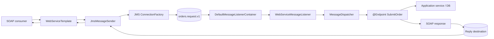
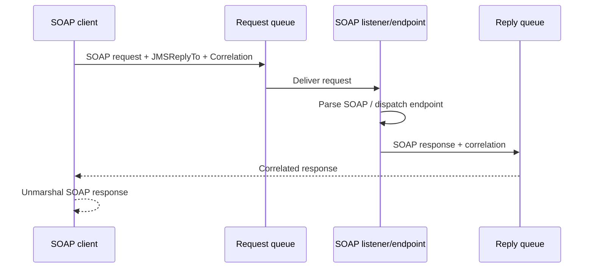
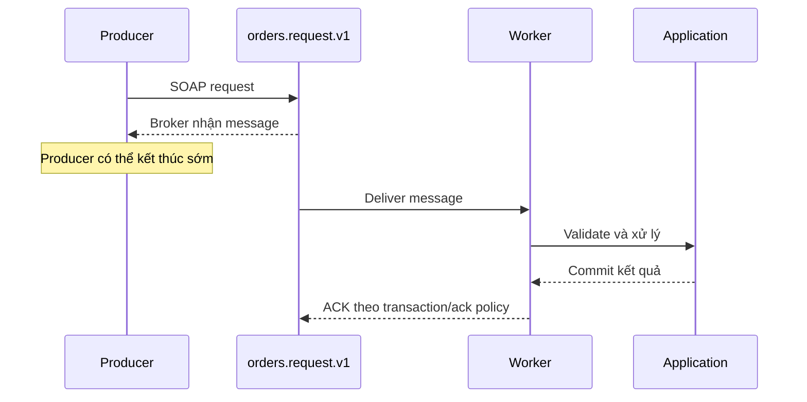
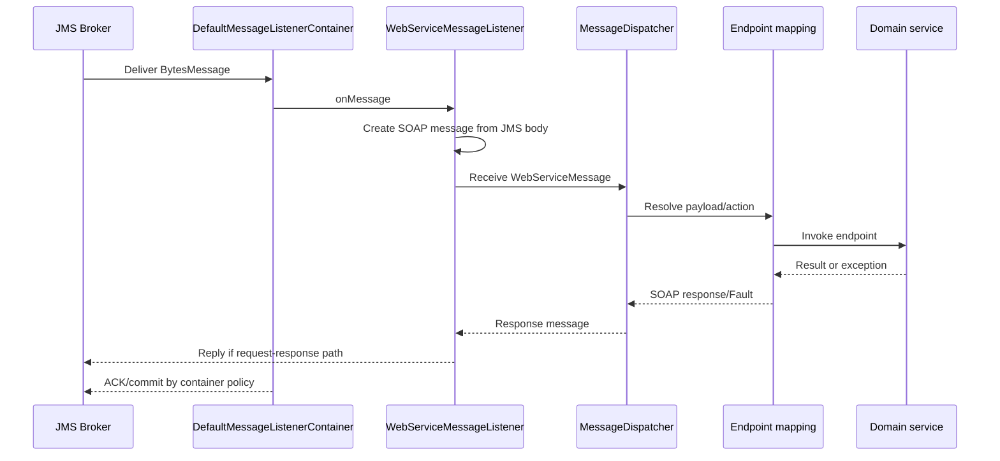
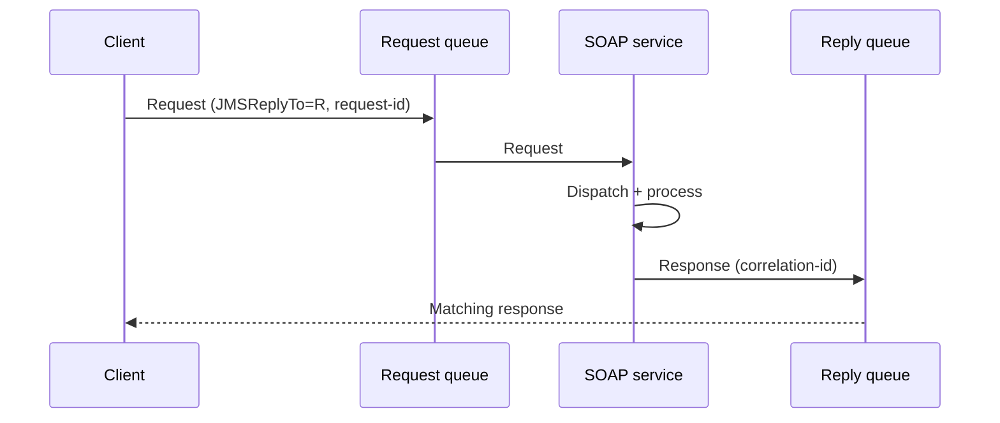

# Gửi, nhận SOAP qua JMS và cấu hình bên nghe thông điệp

## 1. Khi nào nên vận chuyển SOAP qua JMS?

**Spring Web Services (Spring-WS)** xây dựng dịch vụ SOAP theo hướng **contract-first**: XSD mô tả cấu trúc dữ liệu, WSDL mô tả message/operation/binding, còn endpoint thực thi nghiệp vụ. SOAP thường được truyền qua HTTP, nhưng hệ thống doanh nghiệp đôi khi cần message broker để tách thời điểm gửi và xử lý, hấp thụ burst traffic, định tuyến theo queue và tích hợp với các hệ thống vốn sử dụng Java Message Service (JMS).

**SOAP over JMS** giữ nguyên SOAP Envelope và hợp đồng XML, nhưng chuyển SOAP message qua JMS Destination thay vì HTTP endpoint. Trong Spring-WS, client thường dùng **`JmsMessageSender`** kết hợp `WebServiceTemplate`; server dùng **`WebServiceMessageListener`** để tiếp nhận JMS Message, chuyển thành SOAP message và giao cho `MessageDispatcher` cùng hệ thống endpoint mapping xử lý.

Bài dùng ví dụ `OrderService` có operation `SubmitOrder` theo XSD/WSDL. Client gửi SOAP request lên queue `orders.request.v1`; consumer nhận message, định tuyến tới endpoint theo XML payload và xử lý đơn. Với request/response, kết quả được gửi về reply destination; với kiểu một chiều, broker có thể giữ message cho consumer xử lý khi sẵn sàng.

### Mục tiêu học tập

Sau bài, bạn có thể:

1. Giải thích kiến trúc SOAP qua JMS và khác biệt với SOAP over HTTP.
2. Phân biệt JMS Queue, Topic, Destination, ConnectionFactory, Connection, Session, Producer và Consumer.
3. Cấu hình client `WebServiceTemplate` + `JmsMessageSender` với JMS URI.
4. Cấu hình server `WebServiceMessageListener` + `DefaultMessageListenerContainer`.
5. Hiểu request/response đồng bộ, temporary queue, `replyToName`, out-of-band replies và correlation.
6. Phân biệt SOAP action/operation routing với JMS destination/selector routing.
7. Thiết kế persistence, acknowledgement, transaction, redelivery, DLQ và idempotency.
8. Quản lý timeout, concurrency, backpressure, delivery guarantees và ordering.
9. Kiểm tra bảo mật broker, SOAP WS-Security, payload size và dữ liệu nhạy cảm.
10. Kiểm thử end-to-end với broker thật, xử lý lỗi và vận hành production.

**Lưu ý phiên bản:** Spring-WS 4.x chạy trên Java 17/Spring Framework 6 và hệ sinh thái Jakarta; JMS integration phải dùng Jakarta Messaging API và provider tương thích. Các project Spring-WS cũ có thể dùng `javax.jms`. Không trộn hai namespace trong cùng runtime. Các ví dụ tập trung Spring-WS 4.x, Spring JMS và Artemis/ActiveMQ tương thích; kiểm tra dependency BOM/provider trước khi biên dịch.

## 2. SOAP Envelope không thay đổi, transport thay đổi

Trong SOAP over HTTP, client POST Envelope tới URL:

```text
POST https://orders.example.org/soap/orders
Content-Type: text/xml; charset=UTF-8
SOAPAction: "urn:orders:SubmitOrder"

<soap:Envelope>...</soap:Envelope>
```

Trong SOAP over JMS, client gửi message body chứa SOAP XML/bytes tới destination:

```text
JMS destination: orders.request.v1
JMS message type: BytesMessage
JMS properties:
  SOAPAction = urn:orders:SubmitOrder
  JMSReplyTo = temporary-or-configured-reply-destination
  JMSCorrelationID = request-correlation-id

Body:
  SOAP Envelope bytes
```

SOAP payload vẫn tuân theo contract. Tuy nhiên, URI, HTTP status và HTTP headers không tự tồn tại trong JMS. JMS có message headers/properties riêng, vì thế hai bên phải thống nhất **cách ánh xạ metadata SOAP sang JMS**.

### 2.1. Sơ đồ kiến trúc



Ở client, `WebServiceTemplate` vẫn chịu trách nhiệm marshalling/unmarshalling SOAP, callback, fault handling và interceptor. `JmsMessageSender` biến message thành JMS message và chờ response trong request/response. Ở server, listener container lấy JMS Message và gọi `WebServiceMessageListener`; listener đưa SOAP message vào `MessageDispatcher` để xử lý giống lõi Spring-WS.

**Broker không tự hiểu XSD/WSDL.** Broker thấy destination, headers/properties và bytes/text; SOAP layer mới parse Envelope, QName, SOAPAction hoặc endpoint mapping.

### 2.2. SOAP qua JMS không phải một giao thức SOAP mới

- SOAP 1.1/1.2 Envelope vẫn giữ namespace và cấu trúc tương ứng.
- XSD request/response vẫn quy định payload XML.
- WSDL service/port/binding vẫn mô tả SOAP service; transport/binding metadata phải phù hợp profile mà hai bên thống nhất.
- Endpoint method như `@PayloadRoot` vẫn định tuyến dựa trên payload QName.
- JMS cung cấp delivery, queue/topic, metadata, persistence và transaction semantics.

Không giả định WSDL SOAP/HTTP có thể đổi URL thành `jms:` rồi client bất kỳ sẽ hoạt động. SOAP over JMS có profile/metadata và cách trao đổi được định nghĩa riêng; cần interoperability tests với consumer/provider thực.

## 3. Các khái niệm JMS phải nắm trước

JMS là API messaging Java. Provider như ActiveMQ Artemis, ActiveMQ Classic hoặc IBM MQ triển khai broker/protocol riêng; application code dùng JMS API và `ConnectionFactory`.

| Thành phần | Ý nghĩa | Ví dụ |
|---|---|---|
| `ConnectionFactory` | Tạo kết nối tới JMS provider | Artemis ConnectionFactory |
| `Connection` | Kết nối tới broker | Connection của SOAP consumer |
| `Session` | Ngữ cảnh tạo/sử dụng message và transaction/acknowledgement | JMS Session |
| `Destination` | Điểm gửi/nhận: Queue hoặc Topic | `orders.request.v1` |
| `MessageProducer` | Gửi JMS messages | Producer gửi SOAP bytes |
| `MessageConsumer` | Nhận JMS messages | Consumer trên request queue |
| `MessageListener` | Callback xử lý message bất đồng bộ | `WebServiceMessageListener` |
| `BytesMessage` | Body là chuỗi bytes | SOAP Envelope bytes |
| `TextMessage` | Body là String | SOAP XML text |
| JMS properties | Metadata dạng key/value | Action, tenant code, schema version |
| `JMSReplyTo` | Reply destination của message | Temporary queue |
| `JMSCorrelationID` | Ghép request và response | ID của request |

### 3.1. Queue và Topic khác nhau ra sao?

| Destination | Semantics cơ bản | Dùng khi |
|---|---|---|
| **Queue (point-to-point)** | Một message được giao cho một consumer cạnh tranh, theo delivery/selector/broker policy | Một request cần một worker xử lý |
| **Topic (publish/subscribe)** | Message được phân phối tới subscriptions phù hợp theo durable/non-durable semantics | Broadcast sự kiện cho nhiều subscribers |

Trong SOAP request/response, **queue** thường dễ quản lý vì các worker cạnh tranh xử lý từng request. Topic không tự tạo request/response semantics; cần thiết kế subscription, reply destination và correlation riêng. Nhiều instances consume cùng queue thường chia tải; một message không mặc định broadcast đến tất cả instances.

### 3.2. JMS Message có header và properties

Các header chuẩn có thể gồm:

- `JMSMessageID`: ID do provider gán.
- `JMSCorrelationID`: liên kết message với request/response hoặc workflow.
- `JMSReplyTo`: destination gửi response.
- `JMSType`: kiểu message tùy ứng dụng.
- `JMSExpiration`, `JMSPriority`, `JMSDeliveryMode`: thời hạn, ưu tiên, delivery mode.
- `JMSRedelivered`: cho biết message đã được giao lại ít nhất một lần theo provider semantics.

**JMS properties** là metadata tùy ứng dụng; chúng không phải SOAP XML elements. Dùng tên property có quy ước, validate kiểu dữ liệu và không cho caller tùy ý điều khiển destination hoặc selector.

### 3.3. JMS URI của Spring-WS

`JmsMessageSender` nhận URI có dạng:

```text
jms:<destination>[?param-name=value&param-name=value]
```

Một số tham số theo Javadoc của sender:

| Tham số | Ý nghĩa |
|---|---|
| `deliveryMode` | `PERSISTENT` hoặc `NON_PERSISTENT` |
| `messageType` | `BINARY_MESSAGE` (mặc định) hoặc `TEXT_MESSAGE` |
| `priority` | Ưu tiên JMS message (0–9) |
| `replyToName` | Destination nhận SOAP response |
| `timeToLive` | Thời gian sống JMS message, tính bằng milliseconds |

Ví dụ:

```text
jms:orders.request.v1
jms:orders.request.v1?deliveryMode=PERSISTENT
jms:orders.request.v1?replyToName=orders.reply.v1
jms:orders.request.v1?priority=5&timeToLive=30000
```

Nếu không đặt `replyToName`, Spring-WS sender dùng **temporary queue** làm reply destination. Temporary queue cần broker hỗ trợ và phải được quản lý theo lifecycle của request/connection; trong môi trường phân tán hoặc policy không cho temporary destinations, queue reply tĩnh đã được provision có thể phù hợp hơn.

**Ưu tiên `BytesMessage`** cho SOAP binary transport. Spring-WS khuyến nghị kiểu này vì `TextMessage` không hỗ trợ attachments và character encodings một cách đáng tin cậy. Nếu dùng TextMessage vì hệ thống legacy, hai bên phải thống nhất charset, BOM, content encoding và payload limits.

## 4. Request/response và one-way qua JMS

Có hai kiểu giao tiếp thường dùng.

### 4.1. Request/response đồng bộ



Client thread chờ response đến khi hoàn tất hoặc timeout. Dù message được lưu trong queue, API `marshalSendAndReceive` vẫn có thể mang semantics đồng bộ ở caller. Nếu service xử lý lâu hơn timeout, caller có thể timeout **trong khi server vẫn đang xử lý**.

Một số hệ thống dùng temporary reply queue; hệ thống khác dùng reply destination lâu dài kèm `JMSCorrelationID`. Cần kiểm tra sender/provider mapping thực tế và cấu hình `replyToName` nếu cần.

### 4.2. One-way/asynchronous



Producer nhận được xác nhận gửi/commit theo cấu hình JMS, nhưng điều đó **không có nghĩa nghiệp vụ đã hoàn tất**. Nếu cần trạng thái xử lý, thiết kế operation tra cứu trạng thái hoặc event/result queue riêng với correlation/business ID.

### 4.3. Đừng nhầm các loại acknowledgement

- **Producer send completion:** ứng dụng gửi đã hoàn thành lời gọi gửi; độ bền còn phụ thuộc persistence/provider/transaction.
- **Broker persistence/commit:** message được broker tiếp nhận và lưu theo guarantee đã cấu hình.
- **Consumer acknowledgement/transaction commit:** broker coi message đã xử lý xong theo chế độ ack/transaction.
- **Business success:** ứng dụng đã commit thay đổi nghiệp vụ hoặc kết quả cần thiết.

Các mốc này xảy ra ở những thời điểm khác nhau. Không trả SOAP success trước khi nghiệp vụ commit nếu contract yêu cầu kết quả đồng bộ. Không ACK message rồi mới ghi dữ liệu nếu muốn nhất quán; phải thiết kế transaction/outbox phù hợp.

## 5. JMS Queue không thay thế XSD/WSDL và endpoint mapping

Giả sử hai operations:

- `SubmitOrder`: `{https://example.org/orders/v1}SubmitOrderRequest`
- `CancelOrder`: `{https://example.org/orders/v1}CancelOrderRequest`

Chúng có thể cùng vào queue `orders.request.v1`; endpoint mapping phân biệt theo QName payload. Có thể tách destination theo service/priority/tenant, nhưng đó là quyết định routing của messaging.

| Routing layer | Khóa định tuyến | Ai xử lý? |
|---|---|---|
| Broker destination | Queue/Topic name | JMS provider |
| JMS selector | Message properties/headers | Broker/consumer |
| Spring-WS endpoint mapping | Payload root QName, SOAP Action hoặc mapping phù hợp | `MessageDispatcher` |
| Business authorization | Principal, tenant, resource permission | Application/domain |

**SOAPAction không tự biến thành JMS destination.** JMS property có thể mang action nếu sender/provider/profile hỗ trợ mapping, nhưng endpoint mapping phải được cấu hình để đọc đúng metadata; đừng dựa vào một HTTP header không tồn tại trong JMS.

### 5.1. Contract-first vẫn quan trọng

XSD/WSDL phải ổn định và độc lập với implementation Java. Broker không kiểm tra:

- Namespace/QName có đúng không.
- Required XML elements có mặt không.
- Giá trị có thỏa XSD facets không.
- Operation có được authorization không.
- SOAP Fault detail có đúng contract không.


## 6. Cấu hình SOAP client với `JmsMessageSender`

Spring-WS sender sử dụng Spring JMS để gửi `WebServiceMessage` thành JMS Message và nhận response nếu caller dùng request/response. URI transport có scheme `jms:`.

### 6.1. Java configuration cho client (Spring-WS 4.x)

```java
package org.example.orders.soap.client;

import jakarta.jms.ConnectionFactory;
import org.springframework.context.annotation.Bean;
import org.springframework.context.annotation.Configuration;
import org.springframework.oxm.jaxb.Jaxb2Marshaller;
import org.springframework.ws.client.core.WebServiceTemplate;
import org.springframework.ws.soap.saaj.SaajSoapMessageFactory;
import org.springframework.ws.transport.jms.JmsMessageSender;

@Configuration
public class OrdersJmsClientConfiguration {

    @Bean
    public SaajSoapMessageFactory ordersSoapMessageFactory() {
        return new SaajSoapMessageFactory();
    }

    @Bean
    public Jaxb2Marshaller ordersMarshaller() {
        Jaxb2Marshaller marshaller = new Jaxb2Marshaller();
        marshaller.setContextPath("org.example.orders.contract");
        return marshaller;
    }

    @Bean
    public JmsMessageSender ordersJmsMessageSender(
            ConnectionFactory connectionFactory) {
        JmsMessageSender sender =
            new JmsMessageSender(connectionFactory);
        sender.setReceiveTimeout(15_000L);
        return sender;
    }

    @Bean
    public WebServiceTemplate ordersJmsTemplate(
            SaajSoapMessageFactory soapFactory,
            Jaxb2Marshaller marshaller,
            JmsMessageSender sender) {
        WebServiceTemplate template = new WebServiceTemplate(soapFactory);
        template.setMarshaller(marshaller);
        template.setUnmarshaller(marshaller);
        template.setMessageSender(sender);
        template.setDefaultUri(
            "jms:orders.request.v1?deliveryMode=PERSISTENT");
        return template;
    }
}
```

Đây là mẫu client request/response. JMS provider, broker URL, credentials, destination resolver và connection lifecycle phải được cấu hình trong application. `Jaxb2Marshaller` cần package JAXB thực do XJC sinh; ví dụ không bao gồm source XSD hoặc generated classes.

### 6.2. Gọi operation theo hợp đồng

```java
import org.springframework.ws.client.core.WebServiceTemplate;
import org.springframework.ws.soap.client.core.SoapActionCallback;

public final class OrdersSoapClient {
    private final WebServiceTemplate template;

    public OrdersSoapClient(WebServiceTemplate template) {
        this.template = template;
    }

    public SubmitOrderResponse submit(SubmitOrderRequest request) {
        return (SubmitOrderResponse) template.marshalSendAndReceive(
            request,
            new SoapActionCallback("urn:orders:SubmitOrder"));
    }
}
```

Ví dụ giả định request/response là JAXB root objects trực tiếp. Nếu XJC sinh `JAXBElement`/`ObjectFactory`, dùng root object đúng theo package generated. SOAPAction phải khớp WSDL/profile và mapping mà hai bên đã thống nhất; **không phải HTTP header tự động được broker vận chuyển**.

### 6.3. Đặt receive timeout hữu hạn

Javadoc `JmsMessageSender` Spring-WS 4.x cho biết `setReceiveTimeout(...)` mặc định là `-1`, nghĩa là chờ receive **không giới hạn thời gian**. Vì vậy, request/response client cần timeout hữu hạn, chẳng hạn 15 giây minh họa ở trên. Giá trị thực phải dựa trên SLA, broker queueing, service latency và deadline của caller.

Cần phân biệt:

- `timeToLive` trong JMS URI giới hạn tuổi của **request message ở broker**.
- `setReceiveTimeout` giới hạn thời gian client chờ **response message**.
- Timeout của HTTP caller/API gateway (nếu có) là deadline tầng khác.
- Hết receive timeout không chứng minh server chưa xử lý hoặc chưa commit nghiệp vụ.

Nếu client timeout nhưng provider đã commit đơn, retry `SubmitOrder` mù có thể tạo đơn trùng. Dùng business request ID/idempotency và trạng thái tra cứu để xử lý tình huống không chắc chắn.

### 6.4. Temporary reply queue và named reply queue

- **Temporary reply queue:** Spring-WS dùng khi không cấu hình `replyToName`. Hữu ích cho request/response ngắn hạn, nhưng phụ thuộc provider cho phép temporary destination và client giữ lifecycle phù hợp.
- **Named reply queue:** `replyToName` cho destination cố định, phù hợp policy yêu cầu destination đã provision.
- **Out-of-band reply:** tách request và response theo luồng riêng, consumer xử lý sau; không yêu cầu thread ban đầu chờ response trực tiếp.

Với named reply queue dùng chung cho nhiều callers, **correlation là bắt buộc về mặt thiết kế**. Client phải ghép đúng response với request; không lấy response đầu tiên trong queue làm kết quả của caller hiện tại.

## 7. Cấu hình bên nhận: Listener Container + WebServiceMessageListener

Spring-WS server-side JMS transport dùng `WebServiceMessageListener` để tích hợp với Spring JMS `MessageListenerContainer`. Listener cần `WebServiceMessageFactory` và `WebServiceMessageReceiver` (thường là `MessageDispatcher`) để parse và dispatch SOAP message.

### 7.1. Mô hình xử lý phía server



Listener container quản lý consume, concurrency, transaction/acknowledgement và lifecycle. `WebServiceMessageListener` nối JMS message với SOAP message factory và Spring-WS receiver. `MessageDispatcher` không cần biết request đến từ HTTP hay JMS.

### 7.2. Cấu hình XML listener container

Ví dụ cấu trúc Spring XML theo Spring-WS reference:

```xml
<beans>
    <bean id="connectionFactory"
          class="org.apache.activemq.artemis.jms.client.ActiveMQConnectionFactory">
        <property name="brokerURL" value="tcp://broker.internal:61616"/>
    </bean>

    <bean id="soapMessageFactory"
          class="org.springframework.ws.soap.saaj.SaajSoapMessageFactory"/>

    <bean id="ordersMessageDispatcher"
          class="org.springframework.ws.soap.server.SoapMessageDispatcher">
        <property name="endpointMappings">
            <bean class="org.springframework.ws.server.endpoint.mapping.PayloadRootAnnotationMethodEndpointMapping"/>
        </property>
    </bean>

    <bean id="ordersJmsMessageListener"
          class="org.springframework.ws.transport.jms.WebServiceMessageListener">
        <property name="messageFactory" ref="soapMessageFactory"/>
        <property name="messageReceiver" ref="ordersMessageDispatcher"/>
    </bean>

    <bean id="ordersJmsListenerContainer"
          class="org.springframework.jms.listener.DefaultMessageListenerContainer">
        <property name="connectionFactory" ref="connectionFactory"/>
        <property name="destinationName" value="orders.request.v1"/>
        <property name="messageListener" ref="ordersJmsMessageListener"/>
        <property name="concurrentConsumers" value="3"/>
        <property name="maxConcurrentConsumers" value="8"/>
        <property name="sessionTransacted" value="true"/>
    </bean>
</beans>
```

Đây là **skeleton cấu hình**. Broker URL/credentials cần externalize, không hard-code secret. Tên package/class của Artemis ConnectionFactory phụ thuộc version. Endpoint mappings, endpoint adapters, OXM và interceptors phải phù hợp Spring-WS setup của ứng dụng; không giả định dispatcher tự phát hiện endpoint nếu ApplicationContext thiếu beans/mappings cần thiết.

`DefaultMessageListenerContainer` ở trên chạy 3 consumer ban đầu và có thể tăng tới 8. Đây chỉ là con số minh họa, không phải sizing production.

### 7.3. Java configuration cho listener container

Giả định đã có SOAP factory và MessageDispatcher:

```java
import jakarta.jms.ConnectionFactory;
import org.springframework.context.annotation.Bean;
import org.springframework.context.annotation.Configuration;
import org.springframework.jms.listener.DefaultMessageListenerContainer;
import org.springframework.ws.soap.server.SoapMessageDispatcher;
import org.springframework.ws.soap.saaj.SaajSoapMessageFactory;
import org.springframework.ws.transport.jms.WebServiceMessageListener;

@Configuration
public class OrdersJmsServerConfiguration {

    @Bean
    public WebServiceMessageListener ordersJmsListener(
            SaajSoapMessageFactory soapMessageFactory,
            SoapMessageDispatcher messageDispatcher) {
        WebServiceMessageListener listener =
            new WebServiceMessageListener();
        listener.setMessageFactory(soapMessageFactory);
        listener.setMessageReceiver(messageDispatcher);
        return listener;
    }

    @Bean
    public DefaultMessageListenerContainer ordersListenerContainer(
            ConnectionFactory connectionFactory,
            WebServiceMessageListener ordersJmsListener) {
        DefaultMessageListenerContainer container =
            new DefaultMessageListenerContainer();
        container.setConnectionFactory(connectionFactory);
        container.setDestinationName("orders.request.v1");
        container.setMessageListener(ordersJmsListener);
        container.setConcurrentConsumers(3);
        container.setMaxConcurrentConsumers(8);
        container.setSessionTransacted(true);
        return container;
    }
}
```

Đoạn code tập trung cấu hình listener, không phải cấu hình dispatcher đầy đủ. Endpoint beans, endpoint mapping và endpoint adapter phải ở đúng ApplicationContext mà receiver dùng. Ưu tiên Spring lifecycle quản lý container; không tự khởi động/dừng lặp lại trong từng request.

### 7.4. Endpoint vẫn dùng các cơ chế Spring-WS quen thuộc

```java
@Endpoint
public class OrdersEndpoint {
    private static final String NS =
        "https://example.org/orders/v1";

    private final OrderApplicationService service;

    public OrdersEndpoint(OrderApplicationService service) {
        this.service = service;
    }

    @PayloadRoot(namespace = NS, localPart = "SubmitOrderRequest")
    @ResponsePayload
    public SubmitOrderResponse submit(
            @RequestPayload SubmitOrderRequest request) {
        OrderResult result = service.submit(request);
        return mapResponse(result);
    }
}
```

Đây là endpoint minh họa; `SubmitOrderRequest`/`SubmitOrderResponse` được sinh từ XSD và service/domain types cần triển khai. Nếu request đến bằng HTTP hay JMS, endpoint mapping theo payload QName vẫn cùng một cơ chế. Transport-specific details nên được xử lý tại lớp transport/message listener thay vì nhúng vào business method.

## 8. Transactions, acknowledgement và redelivery

JMS cung cấp delivery semantics, nhưng không tự biến nghiệp vụ thành giao dịch phân tán bất khả lỗi. Khi consumer nhận SOAP request, các bước có thể gồm: broker giao JMS message; Spring-WS parse SOAP và dispatch endpoint; domain service ghi database; SOAP response được tạo; listener hoàn tất và JMS Session commit/acknowledge.

### 8.1. Session transaction có ý nghĩa gì?

Với Spring JMS DefaultMessageListenerContainer, bật sessionTransacted cho phép việc nhận/acknowledge message nằm trong JMS Session transaction. Khi listener hoàn tất bình thường, transaction commit; khi xử lý thất bại, rollback có thể khiến broker giao lại message theo redelivery policy.

Nhưng **JMS transaction không tự bao gồm database transaction** trong cấu hình local đơn giản. Nếu database đã commit rồi process crash trước khi JMS ACK commit, broker có thể redeliver và endpoint chạy lại. Nếu JMS commit trước khi database ghi thành công, business update có thể mất. Không tuyên bố «exactly once» chỉ vì bật session transaction.

### 8.2. Local transaction, XA và outbox/inbox

| Cách làm | Lợi ích | Giới hạn |
|---|---|---|
| JMS local transaction | Atomically acknowledge/rollback trong JMS Session | Không atomic cùng DB mặc định |
| DB transaction riêng | Dữ liệu domain nhất quán | Crash có thể xảy ra giữa DB commit và JMS ACK |
| XA/JTA transaction | Có thể phối hợp JMS + DB qua two-phase commit nếu provider/resource hỗ trợ | Complexity, overhead và recovery |
| Inbox + idempotent handler | Khống chế duplicate theo message/business ID | Cần lưu unique ID trong DB |
| Outbox pattern | Commit domain update và event trong cùng DB transaction | Publisher cần retry/monitor |

Trong nhiều hệ thống tích hợp, **at-least-once delivery + idempotent processing** thực tế hơn tuyên bố exactly-once. Nếu cần consistency giữa DB và JMS, hãy quyết định rõ XA hay outbox/inbox và kiểm thử crash/restart.

### 8.3. Ví dụ inbox deduplication

```sql
CREATE TABLE processed_soap_messages (
    message_id VARCHAR(100) PRIMARY KEY,
    operation_name VARCHAR(100) NOT NULL,
    processed_at TIMESTAMP NOT NULL
);
```

Luồng nghiệp vụ:

1. Lấy request ID ổn định từ business payload hoặc metadata được tin cậy.
2. Trong **cùng DB transaction** với thay đổi đơn hàng, insert ID vào bảng inbox.
3. Nếu unique constraint báo ID đã tồn tại, trả kết quả đã lưu hoặc bỏ qua an toàn theo policy.
4. Commit business data và inbox record cùng nhau.
5. Sau đó listener hoàn tất để JMS transaction được commit/ack.
6. Nếu crash trước JMS ACK, redelivery gặp inbox record và không tạo đơn lần nữa.

Không dùng JMSMessageID làm idempotency key duy nhất nếu producer retry có thể tạo ID mới cho cùng request. Nên có business request ID ổn định, unique theo partner/tenant/operation.

### 8.4. Redelivery và Dead Letter Queue

Một message lỗi có thể được broker giao lại nhiều lần do process crash, JMS rollback, database/downstream unavailable, SOAP parsing error hoặc exception trong endpoint.

Cần cấu hình broker/provider:

- Maximum delivery attempts.
- Redelivery delay/backoff.
- Dead Letter Queue (DLQ) sau số lần retry.
- Monitoring message age, delivery count và queue depth.
- Quy trình kiểm tra nguyên nhân, sửa lỗi và replay DLQ có phê duyệt.

**Không retry vô hạn với message lỗi vĩnh viễn.** XML sai XSD, QName không được hỗ trợ hoặc request không hợp lệ nên được đưa vào fault handling phù hợp, không chiếm worker threads mãi.

### 8.5. SOAP Fault có đồng nghĩa JMS rollback?

Không. SOAP Fault có thể là **một phản hồi hợp lệ** của SOAP service; trong request/response, listener có thể gửi Fault về reply destination và coi request đã xử lý xong. Exception làm JMS listener rollback là luồng khác. Mapping exception thành Fault hay rollback tùy Spring-WS listener, exception resolver, message handling và transaction configuration.

Cần kiểm thử riêng: business Fault có chủ đích; transient infrastructure failure; malformed message; và trạng thái không chắc chắn sau side effect.

## 9. Concurrency, throughput và backpressure

DefaultMessageListenerContainer điều phối số JMS consumers. Một queue có 3 consumers có thể xử lý 3 requests cùng lúc; dynamic scaling có thể tăng tới ngưỡng tối đa.

| Tham số/khái niệm | Tác dụng | Cần cân nhắc |
|---|---|---|
| concurrentConsumers | Consumer ban đầu | Threads, DB pool, CPU và giới hạn partner |
| maxConcurrentConsumers | Trần consumer khi scale động | Không vượt capacity hệ phụ thuộc |
| Prefetch (provider-specific) | Broker giao trước messages | Ảnh hưởng fairness và số message client giữ |
| Queue depth | Số messages chờ | Quan sát cùng message age |
| Message age | Tuổi message | Quan trọng khi SLA theo deadline |
| Processing latency | Thời gian endpoint xử lý | Sizing workers/timeout |
| Redelivery count | Số lần giao lại | Phát hiện poison message |

### 9.1. Không tăng concurrency mù quáng

Tăng listener consumers từ 8 lên 80 có thể làm cạn database connection pool, tạo quá nhiều outbound calls tới partner, tăng heap vì mỗi request giữ SOAP/JAXB objects và làm contention trên dữ liệu đơn hàng.

Hãy xác định capacity theo **nút thắt nhỏ nhất**: CPU, DB pool, downstream services, broker I/O hoặc partner quotas. Các con số 3–8 trong ví dụ chỉ để minh họa.

### 9.2. Backpressure và queue limits

Queue bền vững không có nghĩa có thể nhận vô hạn. Đặt:

- Broker queue max size/quota.
- Producer flow control/throttling.
- Application rate limit theo tenant/partner.
- Consumer concurrency có giới hạn.
- TTL cho messages stale nếu contract cho phép hết hạn.
- Alert khi queue depth/message age vượt ngưỡng.
- Quota payload size và temporary storage.

Khi broker từ chối do đầy, producer cần nhận lỗi gửi rõ ràng. Đừng chỉ tăng queue capacity; backlog dài có thể khiến messages đến sau business deadline.

### 9.3. Ordering không tự bảo đảm toàn cục

Một queue với một consumer tuần tự dễ duy trì order hơn, nhưng nhiều consumers có thể hoàn thành processing khác thứ tự nhận. Nhiều producers, redelivery, priority và failover cũng ảnh hưởng ordering.

Nếu nghiệp vụ yêu cầu thứ tự theo orderId, dùng partition/grouping key mà broker hỗ trợ, giới hạn xử lý tuần tự theo group, lưu sequence/version trong business data và chặn update out-of-order ở domain. Không giả định JMSMessageID hoặc broker timestamp là thứ tự nghiệp vụ.

## 10. JMS selectors và định tuyến message

JMS selector là expression lọc theo message headers/properties, ví dụ:

```sql
serviceVersion = 'v1' AND priorityCode BETWEEN 1 AND 5
```

Một consumer chỉ nhận messages thỏa selector; các message khác vẫn ở destination cho consumer khác theo broker semantics.

### 10.1. Ví dụ tách consumers theo version

```text
orders.request.v1
  consumer-v1: property schemaVersion = '1'

orders.request.v2
  consumer-v2: property schemaVersion = '2'
```

Có thể tách destinations thay vì selectors phức tạp. Selector chỉ hoạt động khi producer gửi property đúng kiểu và provider hiểu cú pháp. SOAP payload vẫn phải validate theo XSD/version tương ứng.

### 10.2. Không tin properties do caller tự ý đặt

Metadata như tenantId, priorityCode, schemaVersion hoặc replyDestination có thể ảnh hưởng định tuyến/tài nguyên. Chúng cần allowlist giá trị, kiểu dữ liệu/độ dài, authorization khi tác động tenant/resource; không cho caller gửi JNDI destination hay selector tùy ý; không dùng property chưa xác minh để thay identity.

Nếu property routing ảnh hưởng bảo mật, hãy đưa thông tin vào security context đáng tin cậy hoặc ký/đối chiếu SOAP claims theo policy.

## 11. Bảo mật SOAP over JMS

JMS loại bỏ HTTP transport, nhưng **không loại bỏ yêu cầu bảo mật**.

| Lớp | Kiểm soát |
|---|---|
| Broker connectivity | TLS broker protocol, broker authentication, certificate validation |
| Authorization | ACL quyền connect/send/consume/browse destinations |
| SOAP message | WS-Security UsernameToken/X.509/SAML, signature/encryption nếu cần |
| Payload | XML parser hardening, XSD validation, size/depth limits |
| Application | Tenant/resource authorization, idempotency, audit |
| Operations | Secrets management, DLQ access, log redaction |

### 11.1. TLS broker và WS-Security khác nhau

TLS tới broker bảo vệ kết nối producer/consumer ↔ broker. Broker có thể đọc SOAP message bytes vì đó là nội dung được vận chuyển. Nếu kiến trúc yêu cầu broker/intermediaries **không đọc được nội dung SOAP**, dùng WS-Security message-level encryption cho recipient thích hợp. TLS một hop không thay thế message encryption end-to-end.

### 11.2. Identity và ACL

- Mỗi producer/consumer nên dùng service identity riêng.
- Tách quyền gửi queue request, nhận reply, consume DLQ và browse messages.
- Không để service consumer có quyền quản trị/xóa toàn bộ queues nếu không cần.
- Quản lý broker credentials/certificates qua secret manager.
- Hạn chế temporary destinations theo broker policy.
- Với mTLS broker, validate CA/hostname/identity; không cấu hình trust-all.
- Không để properties tùy ý điều khiển destination mà ứng dụng có thể gửi/nhận.

### 11.3. WS-Security vẫn nằm trong SOAP Envelope

Wss4jSecurityInterceptor có thể xác minh/sign/encrypt SOAP message khi SOAP layer xử lý; JMS chỉ mang bytes. Cần bảo đảm security interceptor được đăng ký đúng pipeline, validation trước domain operation, signature bao phủ Body/headers theo profile và replay policy hoạt động kể cả khi message xếp hàng lâu.

**Điểm quan trọng:** một JMS message có thể chờ queue nhiều phút, trong khi wsu:Timestamp của SOAP chỉ hợp lệ trong thời hạn ngắn hơn. Khi consumer nhận được, validator có thể từ chối timestamp đã hết hạn. Cần thống nhất TTL, queue latency và security freshness; không tắt timestamp validation chỉ để message cũ chạy được.

## 12. Correlation, reply routing và out-of-band replies

Request/response qua JMS cần ghép đúng response với request gốc. JMS cung cấp JMSCorrelationID và JMSReplyTo; Spring-WS sender có thể dùng destination tạm hoặc reply destination cố định tùy URI/provider.

### 12.1. Mô hình correlation



Có nhiều convention ghép request-response: provider có thể dùng JMSMessageID của request làm correlation ID trong response; hoặc application/profile dùng business request ID. Phải kiểm tra sender/listener thực tế và thỏa thuận với partner. Không giả định mọi broker tự đặt response correlation theo cùng quy tắc.

### 12.2. Dùng reply queue chung

Nếu nhiều client instances cùng lắng nghe một reply queue chung, cần correlation an toàn:

- Correlation ID duy nhất đủ lâu trong phạm vi message còn hiệu lực.
- Consumer lọc theo correlation (selector hoặc cơ chế sender quản lý).
- Một response không được consume nhầm bởi client instance khác.
- Có timeout, cleanup metadata và xử lý response đến trễ.
- Không dùng message ID đoán được/do caller giả mạo để cấp quyền.

Temporary queue thường giảm tranh chấp reply vì destination được tạo cho request/client lifecycle. Named reply queue giúp provision ACL và quan sát broker dễ hơn, nhưng đòi hỏi cách correlation/demultiplex rõ ràng.

### 12.3. Out-of-band reply

Spring-WS reference cũng mô tả out-of-band JMS replies. Cách này hữu ích khi consumer gửi request rồi xử lý response sau theo một message flow riêng:

1. Request gửi kèm business request ID/correlation đã quy ước.
2. Provider xử lý và gửi kết quả vào reply destination đã thống nhất.
3. Component độc lập consume reply và cập nhật trạng thái.
4. Caller tra cứu kết quả hoặc nhận notification qua một kênh khác.

Đây là **workflow bất đồng bộ**, không phải semantics của một lời gọi blocking request/response đơn giản. Nếu cần, hãy tách nó thành API/application service riêng để caller không hiểu nhầm «đã enqueue» thành «đã tạo đơn».

## 13. SOAP Fault và lỗi JMS phải được phân biệt

| Loại lỗi | Ví dụ | Xử lý |
|---|---|---|
| SOAP Client/Sender Fault | QName/syntax sai, dữ liệu không hợp lệ | Fault theo hợp đồng; có thể không retry |
| SOAP Server/Receiver Fault | Domain service tạm unavailable | Retry tùy nghiệp vụ, idempotency và policy |
| JMS transport failure | Broker unavailable, destination missing, send rejected | Transport exception, retry có giới hạn |
| Receive timeout | Broker không có response trước deadline | Trạng thái xử lý có thể chưa rõ |
| Serialization failure | SOAP message không tạo được JMS payload | Sửa JAXB/message factory/contract |
| Listener failure | Consumer exception, JMS rollback | Redelivery/backoff/DLQ |
| Poison message | Payload luôn làm consumer fail | Quarantine/DLQ và phân tích |
| Authorization failure | Broker ACL hoặc SOAP identity không hợp lệ | Từ chối, không retry mù |

### 13.1. SOAP Fault có thể là message response hợp lệ

Trong request/response, một SOAP Fault có thể được gửi về reply destination như SOAP response. Client SOAP layer cần phân tích Fault, phân biệt với lỗi JMS receive/send. Không phải mỗi Fault đều khiến broker redeliver request.

Ngược lại, nếu listener ném exception khiến JMS transaction rollback, broker có thể giao lại message; cần tránh một lỗi vĩnh viễn tạo vòng redelivery. Exception resolver, transaction policy và DLQ phải thống nhất.

### 13.2. Timeout không có nghĩa request chưa được xử lý

Client gửi request, server nhận và commit database, nhưng reply bị trễ hoặc mất. Client hết receive timeout và không biết kết quả. Đây là **outcome unknown**.

Cách xử lý:

- Dùng request ID/idempotency ổn định.
- Cung cấp operation tra cứu trạng thái nếu quy trình cần.
- Retry với cùng idempotency key, không sinh business ID mới.
- Server lưu kết quả đã xử lý để trả lại cùng kết quả khi duplicate.
- Có reconciliation cho những request ở trạng thái không rõ.

### 13.3. Error queue/DLQ replay có kiểm soát

Trước khi replay DLQ:

1. Phân loại lỗi do payload, contract, credentials, broker hay dependency.
2. Xác định request đã gây side effect/commit hay chưa.
3. Kiểm tra business idempotency và duplicate status.
4. Sửa nguyên nhân trước khi replay hàng loạt.
5. Replay theo batch/throttle, quan sát queue depth và consumer lag.
6. Giữ correlation/request IDs để audit.
7. Không chỉnh SOAP bytes/message properties theo cách phá signature hoặc contract.

## 14. Kiểm thử JMS transport với broker thật

Mock SOAP endpoint có thể xác minh XML handling và endpoint mapping nhưng **không chứng minh JMS broker delivery, transactions, reply routing hoặc redelivery**. Cần broker test thực (embedded/container test broker hoặc môi trường integration) cùng Spring JMS listener container.

### 14.1. Các lớp test

| Loại test | Mục tiêu |
|---|---|
| JAXB/SOAP unit test | Marshal/unmarshal XSD payload, namespace, SOAP Fault |
| Spring-WS endpoint test | Payload QName, endpoint mapping, exception resolver |
| JMS sender integration | Gửi BytesMessage, destination resolution, reply handling |
| JMS listener integration | MessageListenerContainer nhận và dispatch SOAP |
| Transaction/redelivery test | Rollback, redelivery count, DLQ |
| Timeout/correlation test | Response đến đúng request; timeout xử lý outcome unknown |
| Broker security test | TLS/authentication/ACL/destination permissions |
| Load test | Queue depth, throughput, concurrency, memory và backpressure |
| Interoperability test | Consumer/provider khác stack theo profile SOAP over JMS |

### 14.2. Test request/response end-to-end

1. Khởi động broker test và provision request/reply queues.
2. Khởi tạo Spring-WS server với `WebServiceMessageListener` và endpoint mapping.
3. Khởi tạo client với `WebServiceTemplate`, SOAP message factory và `JmsMessageSender`.
4. Gửi JAXB request hợp lệ đến `orders.request.v1`.
5. Kiểm tra server endpoint được gọi đúng một lần trong happy path.
6. Xác minh SOAP response được unmarshal đúng contract và correlation khớp.
7. Gửi payload QName không hỗ trợ; xác minh Fault/error path đúng.
8. Dừng consumer để tạo backlog, xác minh client timeout hữu hạn.
9. Khởi động lại consumer, xác minh message tồn đọng được xử lý theo persistence/TTL policy.
10. Gửi hai callers song song; bảo đảm response không bị ghép chéo.

### 14.3. Test transaction và duplicate

- Cố tình ném exception trước database commit; kiểm tra JMS rollback/redelivery.
- Commit DB xong, mô phỏng crash trước JMS ACK; message giao lại nhưng business record chỉ tạo một lần.
- Gửi cùng business request ID nhiều lần; response/record đúng idempotency policy.
- Tạo poison message; kiểm tra maximum attempts và DLQ.
- Sửa dependency rồi replay một DLQ message; xác minh không trùng side effect.
- Test business SOAP Fault không tạo redelivery loop ngoài ý muốn.

### 14.4. Test selector, ordering và concurrency

- Hai consumers có selectors khác nhau chỉ nhận schemaVersion được gán.
- Không selector: consumers cạnh tranh cùng queue theo broker behavior.
- Gửi messages cho cùng order ID song song; kiểm tra domain invariant/order version.
- Tăng consumer concurrency từ nhỏ đến mục tiêu; quan sát DB pool, CPU, heap và broker throughput.
- Test broker flow control/queue full và producer backpressure.
- Test restart/failover, consumer reconnect và message redelivery.

### 14.5. Test SOAP security qua JMS

- Gửi SOAP request có WS-Security signature hợp lệ; server validate trước domain operation.
- Signature sai, untrusted certificate hoặc expired timestamp phải bị từ chối.
- Chờ request trong queue lâu hơn timestamp lifetime; xác nhận policy xử lý đúng và không silent disable security.
- Kiểm tra broker TLS/ACL độc lập với WS-Security.
- Nếu có SOAP attachments/MTOM, xác minh message type/encoding giữ được MIME bytes; BytesMessage được Spring-WS ưu tiên.
- Không ghi SOAP Security Header, password, token hoặc attachment bytes vào log.

## 15. Quan sát và vận hành

### 15.1. Các chỉ số nên theo dõi

| Metric | Ý nghĩa |
|---|---|
| Queue depth | Số message đang đợi |
| Oldest message age | Tuổi message cũ nhất |
| Enqueue/dequeue rate | Tốc độ gửi/nhận |
| Consumer count | Số listeners hoạt động |
| Processing latency | Thời gian endpoint xử lý |
| Redelivery count | Số lần giao lại |
| DLQ depth | Messages cần điều tra |
| Send failure | Broker/destination/producer errors |
| Reply timeout | Client không nhận response đúng hạn |
| SOAP Fault rate | Lỗi hợp đồng/nghiệp vụ có cấu trúc |
| Correlation mismatch | Reply không ghép được đúng request |
| Transaction rollback | Listener/JMS transaction thất bại |

Không dùng raw order IDs/tenant IDs làm metric labels nếu gây cardinality cao hoặc tiết lộ dữ liệu. Dùng partner/service/operation/version labels đã chuẩn hóa.

### 15.2. Log và tracing

Một log an toàn có thể gồm correlation ID đã validate, destination cố định, operation QName, message size, delivery count, elapsed time và outcome category. Không log toàn SOAP Envelope mặc định nếu payload chứa PII/credentials. Nếu debug payload cần thiết, dùng môi trường test, masking và retention nghiêm ngặt.

Có thể propagate trace context qua JMS properties theo quy ước nếu tracing stack hỗ trợ. Không để caller tự đặt trace metadata thành trusted security identity.

### 15.3. Vận hành broker và listener

- Provision queues/topics, DLQ và expiry queues trước khi release.
- ACL tách producer/consumer/operator.
- TLS broker, certificate rotation và credential rotation được theo dõi.
- Theo dõi broker disk usage/persistence journal, paging/flow control.
- Quản lý listener container lifecycle, graceful shutdown và drain messages.
- Đặt worker concurrency phù hợp DB/downstream capacity.
- Có dashboard queue age/depth và DLQ alert.
- Có runbook xử lý poison messages, retry storm và broker outage.

## 16. Bảng lỗi thường gặp và cách khắc phục

| Triệu chứng | Nguyên nhân khả dĩ | Hướng điều tra |
|---|---|---|
| WebServiceTemplate không chọn JMS sender | URI không có scheme jms: hoặc sender không được cấu hình | defaultUri, supports(uri), sender bean |
| Broker không thấy request | ConnectionFactory/broker URL/credentials/destination sai | Producer exceptions, broker logs, ACL |
| Request vào queue nhưng server không xử lý | Listener container không chạy/nghe sai destination | Container lifecycle, destinationName, consumer metrics |
| JAXB error | Generated classes/contextPath/root QName không khớp | XSD, ObjectFactory, JAXB context |
| SOAP endpoint không được map | Namespace/localPart/action không đúng | PayloadRoot mapping, SOAP Body |
| Request/response chờ vô hạn | receiveTimeout mặc định -1 | JmsMessageSender.setReceiveTimeout |
| Client timeout nhưng server vẫn tạo đơn | Receive timeout trước khi nghiệp vụ/reply hoàn tất | Idempotency, status lookup, reply path |
| Reply tới nhầm caller | Reply queue chung thiếu correlation | JMSCorrelationID/selectors, sender config |
| Message bị giao lại nhiều lần | Exception/rollback hoặc crash | Delivery count, transaction, exception handling |
| DLQ tăng nhanh | Poison messages hoặc downstream outage | Phân loại lỗi, backoff, schema/security |
| DB update trùng | At-least-once delivery nhưng handler không idempotent | Inbox/unique request ID |
| Queue depth tăng liên tục | Producer nhanh hơn consumer | Capacity, scaling, rate limits, downstream |
| Out-of-order update | Nhiều consumers, retry/partition | Sequence/version, grouping |
| SOAP Fault làm redelivery loop | Fault/exception bị xử lý như listener failure | Fault resolver và JMS transaction |
| Text/encoding lỗi | TextMessage, charset/BOM mismatch | Dùng BytesMessage nếu được |
| Attachments không đọc được | TextMessage hoặc transport không giữ binary reliable | BytesMessage/MTOM integration test |
| TLS broker handshake fail | CA/hostname/client cert mismatch | Truststore, SAN, mTLS, broker logs |
| WS-Security timestamp expired | Queue age dài hơn token TTL | Queue latency, TTL, Timestamp window |
| Consumer không scale | maxConcurrentConsumers/consumer limits | Container config/provider settings |
| Shutdown làm redelivery tăng | In-flight work chưa drain | Graceful shutdown, transaction boundaries |

### Quy trình điều tra

1. Xác định message đã vào broker chưa, destination và delivery mode.
2. Xác định listener container có đang nhận message không.
3. Kiểm tra JMS Message type, correlation, replyTo, expiration và redelivery.
4. Phân biệt SOAP parse/validation Fault với JMS transport exception.
5. Kiểm tra transaction boundary DB/JMS và khả năng duplicate.
6. Đọc queue age/depth, consumer count và downstream health.
7. Tái hiện bằng fixture qua broker thật; không sửa payload production tùy tiện.
8. Xác minh WSDL/XSD, WS-Security và broker ACL độc lập.

## 17. Bài thực hành tích hợp SOAP over JMS

Tạo một ứng dụng nhỏ cho operation SubmitOrder sử dụng contract-first và broker test.

### Giai đoạn A — Contract và generated code

1. Tạo XSD với global elements SubmitOrderRequest và SubmitOrderResponse trong namespace https://example.org/orders/v1.
2. Tạo WSDL document/literal mô tả operation và SOAP binding phù hợp hệ thống.
3. Sinh JAXB classes bằng XJC; xác minh QName/root object và package context.
4. Viết endpoint Spring-WS dùng @PayloadRoot và domain service.
5. Test JAXB marshalling/unmarshalling và SOAP Fault payload độc lập.

### Giai đoạn B — Broker và server listener

6. Chạy broker test tương thích JMS API của ứng dụng (Jakarta cho stack Spring-WS 4.x).
7. Provision request queue orders.request.v1 và reply destination nếu dùng named replies.
8. Cấu hình ConnectionFactory, SOAP message factory, MessageDispatcher và WebServiceMessageListener.
9. Đưa listener vào DefaultMessageListenerContainer.
10. Bật session transaction phù hợp, cấu hình consumer count và graceful shutdown.
11. Gửi test message để xác minh broker giao message và endpoint được gọi.
12. Kiểm tra SOAP response/Fault được gửi về đúng reply destination trong request/response path.

### Giai đoạn C — Client

13. Cấu hình JmsMessageSender với cùng ConnectionFactory.
14. Cấu hình WebServiceTemplate với JAXB marshaller/unmarshaller và JMS message sender.
15. Đặt JMS URI, delivery mode và receive timeout hữu hạn.
16. Gọi SubmitOrder qua marshalSendAndReceive và xác minh response.
17. Gửi hai requests song song để kiểm tra correlation/reply isolation.
18. Thử temporary reply queue và named reply queue theo broker policy.

### Giai đoạn D — Độ bền và xử lý lỗi

19. Dừng consumer, enqueue message và kiểm tra persistence/TTL.
20. Khởi động lại consumer và xác minh backlog được xử lý.
21. Tạo exception trước DB commit; kiểm tra rollback/redelivery.
22. Mô phỏng crash sau DB commit nhưng trước JMS ACK; xác minh inbox/idempotency ngăn tạo đơn trùng.
23. Tạo malformed SOAP request; kiểm tra Fault/quarantine/DLQ không lặp vô hạn.
24. Tạo transient downstream outage; quan sát redelivery delay/backoff.
25. Replay một DLQ message sau khi đã sửa nguyên nhân; xác minh business effect chỉ xảy ra một lần.
26. Làm queue backlog lâu hơn WS-Security timestamp window; kiểm chứng chính sách freshness.
27. Test queue full, broker unavailable và client receive timeout.

### Giai đoạn E — Bảo mật và hiệu năng

28. Cấu hình TLS và broker authentication/ACL.
29. Bật WS-Security signature validation cho SOAP request nếu profile yêu cầu.
30. Gửi invalid signature/untrusted certificate; chứng minh endpoint không được gọi.
31. Kiểm thử consumer concurrency, queue depth, oldest message age và DB pool saturation.
32. Thử graceful shutdown và failover broker/consumer.
33. Test interoperability từ một SOAP client/provider không dùng Spring-WS nếu có đối tác đa nền tảng.
34. Ghi lại cách provisioning destinations, DLQ replay và monitor service metrics.

### Câu hỏi tự kiểm tra

1. SOAP over JMS giữ nguyên phần nào của SOAP contract và thay đổi phần nào của transport?
2. Tại sao broker không tự định tuyến theo XSD QName?
3. Queue và Topic khác nhau ra sao đối với nhiều consumer instances?
4. JMS BytesMessage được Spring-WS ưu tiên vì lý do gì?
5. Temporary reply queue khác named reply queue ở vòng đời và vận hành như thế nào?
6. JMSCorrelationID giúp tránh response chéo giữa callers ra sao?
7. JmsMessageSender receiveTimeout mặc định có đặc điểm gì?
8. TTL của request khác receive timeout của caller như thế nào?
9. Client timeout có chứng minh server chưa commit đơn không?
10. Tại sao sessionTransacted không tự tạo atomic transaction với database?
11. Inbox/outbox xử lý duplicate/crash window như thế nào?
12. SOAP Fault có luôn khiến broker redeliver request không?
13. Vì sao poison messages cần maximum delivery attempts và DLQ?
14. Khi tăng listener concurrency, những dependency nào có thể thành bottleneck?
15. JMS selectors lọc theo loại metadata nào?
16. TLS tới broker khác WS-Security message encryption thế nào?
17. Vì sao queue delay có thể làm WS-Security Timestamp hết hạn?
18. Test nào chứng minh response correlation đúng khi nhiều callers đồng thời?
19. Khi nào dùng out-of-band reply thay request/response blocking?
20. Những metric nào cho thấy producer rate đang vượt consumer capacity?

## 18. Definition of Done — Spring-WS SOAP qua JMS

Một tích hợp SOAP over JMS chỉ được xem là sẵn sàng khi:

### Contract và transport

- [ ] XSD/WSDL contract-first được phê duyệt, SOAP version và endpoint namespace nhất quán.
- [ ] Transport JMS được hai phía thỏa thuận; không giả định SOAP/HTTP client tương thích tự động.
- [ ] Queue/Topic, request/reply destinations, destination resolver và ACL được provision.
- [ ] JMS API namespace/version khớp Spring-WS/Spring Framework/JMS provider; không trộn javax/jakarta.
- [ ] Client dùng WebServiceTemplate + JmsMessageSender đúng JMS URI.
- [ ] Server dùng WebServiceMessageListener + listener container + MessageDispatcher đúng ApplicationContext.
- [ ] BytesMessage/TextMessage choice và encoding được thống nhất; ưu tiên BytesMessage khi có binary/attachments.
- [ ] Request/reply correlation được kiểm thử với nhiều callers đồng thời.
- [ ] Receive timeout hữu hạn, TTL và business deadline được thiết kế riêng.

### Reliability và business correctness

- [ ] JMS persistence/delivery mode, transaction/ack policy và redelivery được xác định.
- [ ] Database/JMS consistency dùng XA hoặc outbox/inbox theo kiến trúc đã chọn.
- [ ] Business handlers idempotent với request ID ổn định.
- [ ] DLQ, poison-message policy, replay process và audit được triển khai.
- [ ] Timeout được xử lý như outcome unknown khi server có thể đã commit.
- [ ] Queue limits, backpressure, rate limit và consumer concurrency có giới hạn.
- [ ] Ordering requirements được kiểm soát ở broker/domain; không giả định global order.
- [ ] SOAP Fault, transport exception và JMS rollback được phân biệt.

### Security, testing và operations

- [ ] Broker TLS/authentication/ACL được cấu hình đúng; secrets không hard-code.
- [ ] WS-Security validation/signature/encryption bật theo profile SOAP nếu cần.
- [ ] Payload size, XML parser hardening, XSD validation và domain authorization được thực hiện.
- [ ] Timestamp lifetime phù hợp queue delay; replay/idempotency policy được kiểm thử.
- [ ] Broker integration tests chứng minh client send, server receive, endpoint dispatch và reply correlation.
- [ ] Transaction/redelivery/DLQ/duplicate tests chạy với broker thực.
- [ ] Có load test cho queue depth, message age, throughput, consumer count và memory.
- [ ] Graceful shutdown, reconnect/failover và broker unavailable scenarios được kiểm thử.
- [ ] Có metrics/logs an toàn, không log SOAP secrets/payload nhạy cảm.
- [ ] Có runbook provisioning destinations, xử lý DLQ, replay, capacity và incident recovery.
- [ ] Interoperability được kiểm thử với SOAP stack khác nếu partner yêu cầu.

**Ghi nhớ:** SOAP over JMS thay đổi **cách vận chuyển và delivery** của SOAP message, chứ không thay XSD/WSDL, endpoint mapping hoặc SOAP security semantics. Spring-WS client dùng JmsMessageSender; server nhận bằng WebServiceMessageListener trong listener container. Để chạy ổn định, phải kết hợp correlation, receive timeout hữu hạn, transaction/ack policy, idempotency, redelivery/DLQ, backpressure, broker security và integration tests với broker thật.

## 19. Tài liệu tham khảo

- [Spring Web Services 4.1.4 — Reference Documentation](https://docs.spring.io/spring-ws/docs/4.1.4/reference/html/): JMS transport phía client/server, WebServiceMessageListener, listener container và out-of-band JMS replies.
- [Spring-WS 4.1.x — JmsMessageSender API](https://docs.spring.io/spring-ws/docs/4.1.x/api/org/springframework/ws/transport/jms/JmsMessageSender.html): URI syntax, messageType, deliveryMode, replyToName, TTL và receive timeout.
- [Spring-WS 4.1.x — JmsMessageReceiver API](https://docs.spring.io/spring-ws/docs/4.1.x/api/org/springframework/ws/transport/jms/JmsMessageReceiver.html): nhận JMS BytesMessage/TextMessage phía server.
- [Spring-WS 4.1.x — WebServiceMessageListener API](https://docs.spring.io/spring-ws/docs/4.1.x/api/org/springframework/ws/transport/jms/WebServiceMessageListener.html): listener nối JMS Message với Spring-WS MessageReceiver.
- [Spring Framework — JMS Support](https://docs.spring.io/spring-framework/reference/integration/jms.html): ConnectionFactory, listener containers, transactions và Spring JMS.
- [Jakarta Messaging Specification](https://jakarta.ee/specifications/messaging/): JMS API, Message headers/properties, queues/topics, sessions và delivery.
- [Apache ActiveMQ Artemis Documentation](https://activemq.apache.org/components/artemis/documentation/): destinations, queues, consumers, persistence, redelivery và dead letter addresses.
- [Apache ActiveMQ Classic Documentation](https://activemq.apache.org/components/classic/documentation): JMS provider configuration, queues/topics, transactions và broker operations.
- [W3C — SOAP 1.2](https://www.w3.org/TR/soap12-part1/) và [WSDL 1.1](https://www.w3.org/TR/wsdl.html): SOAP Envelope/message model và service binding.
- [W3C — SOAP over JMS 1.0](https://www.w3.org/TR/soapjms/): SOAP/JMS transport binding, properties và interoperability profile.
- [OASIS — WS-Security SOAP Message Security](https://docs.oasis-open.org/wss-m/wss/v1.1.1/os/wss-SOAPMessageSecurity-v1.1.1-os.html): SOAP message-level tokens, signature và encryption.
- [OWASP — Web Service Security Cheat Sheet](https://cheatsheetseries.owasp.org/cheatsheets/Web_Service_Security_Cheat_Sheet.html): SOAP authentication, XML security và validation controls.


