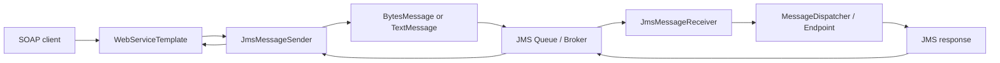
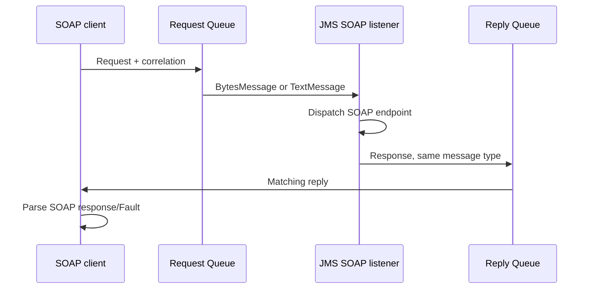

# BytesMessage, TextMessage và yêu cầu tương thích giữa hai phía

## Mục tiêu học tập

Trong module **SPRING_WEB_SERVICES**, SOAP có thể đi qua JMS thay vì HTTP. Spring Web Services (Spring-WS) cung cấp `JmsMessageSender` để chuyển `WebServiceMessage` thành JMS Message, gửi qua Queue/Topic và nhận response nếu có. Hai kiểu JMS message thường gặp là `BytesMessage` và `TextMessage`. Chúng khác nhau về semantics, cách đọc/ghi và giới hạn; producer/consumer phải thống nhất message type, encoding và request-reply behavior.

Sau bài học, bạn có thể phân biệt hai message types, cấu hình Spring-WS JMS URI, hiểu server response type, lựa chọn BytesMessage/TextMessage, xác minh Unicode/MTOM, thiết kế correlation/replyTo, kiểm soát TTL/redelivery và kiểm thử tương thích provider giữa hai phía.

## 1. JMS transport trong Spring-WS

Spring-WS dùng abstraction `WebServiceMessage` cho SOAP message bất kể transport. `JmsMessageSender` chuyển message này thành JMS Message, gửi tới destination rồi chờ response nếu cấu hình request-reply. Phía server, `JmsMessageReceiver` tiếp nhận JMS message, chuyển vào `WebServiceMessageReceiver`/`MessageDispatcher` và gọi endpoint.



JMS message type là lớp transport bao ngoài SOAP payload. Nó không thay SOAP Envelope, SOAP 1.1/1.2, WSDL binding hoặc JAXB contract.

## 2. BytesMessage và TextMessage khác nhau thế nào?

| Đặc điểm | BytesMessage | TextMessage |
| --- | --- | --- |
| Body | Chuỗi byte | Giá trị String |
| API body | writeBytes/readBytes/reset | setText/getText |
| Encoding | Do serialization contract quy định | String được chuyển đổi theo JMS/provider boundary |
| Binary data | Phù hợp | Không phải mục đích |
| SOAP XML | Phù hợp, giữ bytes rõ ràng | Có thể dùng nếu hai phía thống nhất encoding |
| MIME/MTOM | Lựa chọn phù hợp | Không hỗ trợ attachment/encoding đáng tin cậy theo khuyến nghị Spring-WS |
| Consumer | Phải đọc BytesMessage | Phải đọc TextMessage |

`BytesMessage` chứa bytes, không tự biết đó là UTF-8 hay XML. Hai phía cần thống nhất byte serialization, thường là UTF-8. `TextMessage` giữ một Java/JMS String; nó thuận tiện cho consumer legacy đọc text, nhưng không đại diện tốt cho serialized MIME package hoặc binary attachments.

## 3. Vì sao Spring-WS mặc định dùng BytesMessage?

`JmsMessageSender` mặc định gửi `BytesMessage`. Có thể override thành TextMessage qua tham số URI `messageType=TEXT_MESSAGE`. Tài liệu Spring-WS khuyến nghị BytesMessage vì TextMessage không hỗ trợ attachments và character encodings một cách đáng tin cậy. Đây là lựa chọn phù hợp hơn cho SOAP có MIME attachments/MTOM và khi cần kiểm soát encoding.

Ví dụ JMS URI:

```text
jms:OrdersRequestQueue
jms:OrdersRequestQueue?messageType=TEXT_MESSAGE
jms:OrdersRequestQueue?priority=5&deliveryMode=PERSISTENT
jms:OrdersRequestQueue?replyToName=OrdersReplyQueue
```

`BINARY_MESSAGE` là loại mặc định của sender; `TEXT_MESSAGE` chọn text mode. Tham số này chọn kiểu JMS Message, không chọn SOAP 1.1/1.2.

## 4. Khi nào dùng BytesMessage?

Ưu tiên BytesMessage khi:
- Cần bảo toàn serialized SOAP XML theo encoding cụ thể.
- SOAP message có MIME attachments, SwA hoặc MTOM/XOP.
- Provider/consumer chạy trên nhiều runtime khác nhau.
- Cần tránh implicit String conversion.
- Payload có binary content hoặc serialized MIME package.
- Muốn quản lý bytes, limits và parser behavior rõ ràng.

BytesMessage không tự làm hệ thống tương thích. Vẫn cần thống nhất encoding, XML declaration, SOAP version, message factory, attachment handling, max message size và provider behavior. Khi custom consumer đọc body, nhớ quản lý cursor/reset và giới hạn kích thước; không cấp phát buffer vô hạn dựa trên length chưa kiểm soát.

## 5. Khi nào dùng TextMessage?

TextMessage có thể cần khi hệ thống legacy chỉ đọc JMS TextMessage hoặc một integration component chỉ nhận String XML. Chỉ chọn khi:
- Producer và consumer đều support TextMessage.
- Không cần attachment/MTOM hay binary MIME package.
- Encoding/Unicode conversion đã được test trên provider thật.
- Không encode/decode cùng payload nhiều lần.
- BOM, XML declaration và line endings đã có quy tắc.
- Consumer không cast cứng sang BytesMessage.

Không nên chọn TextMessage chỉ vì SOAP payload là XML text. XML document vẫn có encoding và có thể đi kèm MIME attachments; String representation không thay thế toàn bộ transport semantics.

## 6. Cấu hình JmsMessageSender ở client

Ví dụ Spring configuration, giả định ConnectionFactory và JAXB marshaller đã được cấu hình:

```java
@Configuration
class SoapJmsClientConfiguration {

    @Bean
    JmsMessageSender jmsMessageSender(
            ConnectionFactory connectionFactory) {
        JmsMessageSender sender = new JmsMessageSender();
        sender.setConnectionFactory(connectionFactory);
        return sender;
    }

    @Bean
    WebServiceTemplate ordersTemplate(
            SaajSoapMessageFactory messageFactory,
            Jaxb2Marshaller marshaller,
            JmsMessageSender sender) {
        WebServiceTemplate template =
                new WebServiceTemplate(messageFactory);
        template.setMarshaller(marshaller);
        template.setUnmarshaller(marshaller);
        template.setMessageSender(sender);
        template.setDefaultUri("jms:OrdersRequestQueue");
        return template;
    }
}
```

Đây là skeleton: imports, JAXB context và ConnectionFactory phải đến từ project. Với TextMessage, URI có thể là `jms:OrdersRequestQueue?messageType=TEXT_MESSAGE`. Kiểm tra API namespace và dependency version: Spring-WS 4.x thuộc Jakarta ecosystem; không trộn `javax.jms` và `jakarta.jms` tùy tiện.

## 7. Server-side response type và tương thích hai chiều

`JmsReceiverConnection` tạo response cùng loại với request mà server nhận:
- Request BytesMessage → response BytesMessage.
- Request TextMessage → response TextMessage.

Điều đó tạo ràng buộc end-to-end. Client gửi BytesMessage thì consumer/client receiver cần đọc được BytesMessage response. Client legacy chỉ đọc TextMessage sẽ không tương thích nếu request/response flow chuyển sang bytes mà không có adapter.

| Request từ client | Server nhận | Response server tạo | Client cần đọc |
| --- | --- | --- | --- |
| BytesMessage | BytesMessage | BytesMessage | BytesMessage |
| TextMessage | TextMessage | TextMessage | TextMessage |
| BytesMessage | Listener chỉ nhận TextMessage | Không dispatch đúng | Incompatible |
| TextMessage | TextMessage | TextMessage | Client chỉ đọc BytesMessage sẽ fail |

Không giả định broker tự chuyển BytesMessage thành TextMessage hoặc ngược lại. JMS provider thường bảo toàn message type; conversion nếu có là chức năng integration cụ thể cần được test.

## 8. URI options của JmsMessageSender

JMS URI có dạng `jms:<destination>[?param=value&...]`. Các tham số phổ biến:

| Parameter | Ý nghĩa |
| --- | --- |
| messageType | BINARY_MESSAGE mặc định hoặc TEXT_MESSAGE. |
| replyToName | Destination nhận response có tên; nếu không, sender dùng temporary queue. |
| deliveryMode | PERSISTENT hoặc NON_PERSISTENT. |
| priority | JMS priority từ 0 đến 9. |
| timeToLive | Tuổi message tại broker, milliseconds. |

Ví dụ:

```text
jms:OrdersRequestQueue?deliveryMode=PERSISTENT&priority=4
jms:OrdersRequestQueue?replyToName=OrdersReplyQueue&timeToLive=30000
jms:LegacyOrdersQueue?messageType=TEXT_MESSAGE
```

Đối chiếu parameter với Javadoc của đúng version. `timeToLive` không phải timeout đồng bộ chờ reply của client: TTL quyết định message hết hạn tại broker; reply timeout là cơ chế riêng.

## 9. Request-reply, replyTo và correlation

Một JMS request-reply flow cần:
- Request destination.
- `JMSReplyTo` hoặc temporary reply queue.
- `JMSCorrelationID` để ghép response với request.
- Timeout chờ response.
- Chính sách xử lý reply đến muộn hoặc trùng.
- Acknowledgement và transaction boundaries.

Nếu nhiều client dùng chung reply queue, correlation ID và selector/listener phải đảm bảo client chỉ nhận response của mình. Temporary queue cần broker policy cho phép và phải tồn tại đủ lâu.



Correlation ID không phải business idempotency key. Correlation ghép reply với request; idempotency bảo vệ business side effect khi retry/redelivery.

## 10. Character encoding và Unicode

### 10.1. BytesMessage

Với BytesMessage, producer serialize SOAP XML theo encoding đã thỏa thuận, thường UTF-8. XML declaration phải phù hợp byte stream:

```xml
<?xml version="1.0" encoding="UTF-8"?>
<ord:SubmitOrder xmlns:ord="urn:example:orders:v1">
  <ord:customerName>Nguyễn Ánh</ord:customerName>
</ord:SubmitOrder>
```

Nếu bytes UTF-8 nhưng declaration báo ISO-8859-1, consumer có thể giải mã sai. Tránh chuyển bytes sang String bằng platform default charset rồi encode lại.

### 10.2. TextMessage

TextMessage lưu String. Phía Spring-WS server có property `textMessageEncoding` để quy định encoding khi đọc/ghi TextMessage; API JmsMessageReceiver 4.1.4 ghi nhận default UTF-8. Nếu dùng custom consumer/producer, cần thống nhất encoding và không decode/encode lặp. Không dùng locale hệ điều hành làm contract.

### 10.3. Unicode tests

Test ASCII, tiếng Việt có dấu, combining marks, ký tự ngoài BMP, XML entity escaping, dấu nháy và payload lớn. So sánh semantic String sau parse khi mục tiêu là XML content; kiểm tra exact bytes khi contract là byte encoding.

## 11. XML declaration, BOM và line endings

Các yếu tố có thể làm legacy parser lỗi:
- XML declaration vắng mặt hoặc encoding không khớp.
- UTF-8 BOM.
- CRLF so với LF.
- Whitespace trước XML declaration.
- Invalid byte sequences.
- TextMessage chuyển String qua provider với behavior khác.
- Double encoding: UTF-8 bytes bị đọc nhầm charset rồi encode lại.

Không tự xóa BOM hay normalize mọi bytes nếu chưa biết consumer behavior. Tạo fixtures và chạy qua từng provider/message type trong compatibility suite.

## 12. SOAP attachments và MTOM

Spring-WS ưu tiên BytesMessage vì TextMessage không hỗ trợ attachment và character encodings đáng tin cậy. SOAP with Attachments/MTOM có thể tạo MIME multipart package gồm SOAP part, MIME headers, Content-ID và binary parts. TextMessage chỉ chứa String, không thể biểu diễn toàn bộ binary MIME package đúng semantics.

Khi cần attachments:
- Chọn BytesMessage.
- Kiểm tra MIME boundaries, Content-ID và XOP references.
- Kiểm tra tổng kích thước và giới hạn từng part.
- Kiểm tra streaming/buffering, temp storage và cleanup.
- Kiểm tra integrity/signature theo policy.

Không Base64 hóa file vào TextMessage chỉ để ép qua transport nếu contract chưa thiết kế cho cách đó; size tăng và semantics/performance thay đổi.

## 13. SOAP 1.1/1.2 độc lập với JMS type

| Tổ hợp | Ý nghĩa |
| --- | --- |
| BytesMessage + SOAP 1.1 | Bytes chứa serialized SOAP 1.1. |
| BytesMessage + SOAP 1.2 | Bytes chứa serialized SOAP 1.2. |
| TextMessage + SOAP 1.1 | String chứa SOAP 1.1 XML theo encoding profile. |
| TextMessage + SOAP 1.2 | String chứa SOAP 1.2 XML theo encoding profile. |

Message type không quyết định SOAP version. Server phải cấu hình đúng message factory và endpoint binding. Đừng đổi JMS type để sửa lỗi Envelope namespace hoặc SOAP Fault format.

## 14. JMS headers khác SOAP headers

JMS metadata gồm `JMSCorrelationID`, `JMSReplyTo`, expiration, priority, delivery mode, redelivery flag và application properties. SOAP Header nằm bên trong Envelope. Hai lớp độc lập.

- JMSCorrelationID dùng ghép request-reply.
- JMSReplyTo chỉ destination trả lời.
- JMS properties có thể dùng routing/selector.
- SOAP Header mang WS-Addressing hoặc business context theo WSDL/policy.

Không coi JMSCorrelationID là WS-Addressing MessageID nếu chưa có mapping. JMS headers không nằm trong XML Signature của SOAP Body/Header; message-level security cần kiểm tra riêng.

## 15. Delivery mode, TTL và priority

`PERSISTENT` yêu cầu broker lưu bền vững theo durability/provider configuration; `NON_PERSISTENT` có semantics nhẹ hơn và có thể mất message khi provider failure. TTL quyết định expiry; priority hỗ trợ delivery preference nhưng không bảo đảm strict ordering trên mọi broker.

Nếu request hết hạn hoặc reply đến muộn, client có thể timeout dù endpoint đã xử lý. Theo dõi expired messages, dead-letter queue, late replies và broker persistence. Chọn TTL theo nghiệp vụ, không lấy response timeout thay TTL.

## 16. Transactions, acknowledgement và redelivery

JMS listener có thể dùng transacted session hoặc acknowledgement mode theo container/provider. Khi endpoint fail:
- Message có thể rollback và redeliver.
- Redelivery count có thể tăng và message tới DLQ.
- Business transaction có thể commit nhưng JMS acknowledgement thất bại, dẫn tới redelivery.
- Reply có thể được gửi trước hoặc sau transaction commit tùy wiring.

Không giả định exactly-once end-to-end. Dùng business request ID, deduplication/inbox table, unique constraint và transaction design để xử lý lặp. Correlation ID không ngăn xử lý business duplicate.

## 17. Queue và Topic

SOAP request-reply thường phù hợp Queue vì request có consumer xử lý và một response tương ứng. Topic broadcast có thể đưa request đến nhiều subscribers, tạo nhiều xử lý hoặc replies. Nếu dùng Topic, xác định durable subscription, số consumer, reply semantics, selector, correlation và duplicate processing.

Không chuyển Queue thành Topic chỉ để tăng fan-out mà chưa thiết kế semantics request-reply.

## 18. Provider compatibility

Spring-WS abstraction không xóa khác biệt broker. Khi chọn ActiveMQ Artemis, ActiveMQ Classic, IBM MQ hay provider khác, xác minh:
- JMS API namespace/version và ConnectionFactory.
- Client library/provider version.
- Destination naming/JNDI/destination resolver.
- BytesMessage/TextMessage handling.
- Temporary/named reply queues và permissions.
- Message size/large message limits.
- TTL, priority, persistence và expiry.
- Correlation properties, selectors.
- Transaction, acknowledgement, redelivery và DLQ.
- Charset/Unicode behavior với consumer ngoài Java.

Không trộn client/provider hoặc javax/jakarta APIs nếu compatibility matrix không xác nhận. Đặt tuning provider-specific ở adapter/config, còn application contract cần mô tả semantics ổn định.

## 19. Migration từ TextMessage sang BytesMessage

Chuyển loại JMS message là thay đổi transport contract; không bật producer bytes khi consumer vẫn cast cứng TextMessage.

Lộ trình:
1. Inventory producer, consumer, listener, queue, API/provider và versions.
2. Xác minh server response type theo request type.
3. Tạo queue/versioned route mới hoặc adapter nhận cả hai types.
4. Thêm metric phân biệt BytesMessage/TextMessage.
5. Chuyển một nhóm producer sang BytesMessage.
6. Test Unicode, SOAP payload, Fault, correlation và attachments.
7. Chuyển consumer và theo dõi redelivery/DLQ/expiry.
8. Ngừng TextMessage sau khi không còn legacy consumers.
9. Giữ rollback route trong migration window.

Không dual-send write operations vào cùng service nếu không có idempotency hoặc shadow flow không side effect.

## 20. Adapter tương thích hai message types

Một adapter legacy có thể phân nhánh theo class:

```java
Message message = consumer.receive(timeout);

if (message instanceof BytesMessage bytes) {
    bytes.reset();
    // Read bytes with a configured upper size limit.
    processSoapBytes(bytes);
} else if (message instanceof TextMessage text) {
    processSoapText(text.getText());
} else {
    throw new UnsupportedOperationException(
            "Unsupported JMS message type");
}
```

Đây là pseudocode ở adapter boundary, không thay Spring-WS JmsMessageReceiver. Khi đọc BytesMessage, phải xử lý length, cursor, end-of-stream, reset, IOException và size limit. Không cấp phát buffer lớn dựa trên body length chưa kiểm soát. Sau migration, thu hẹp adapter về loại message đã chốt.

## 21. Compatibility test matrix

| ID | Producer | Consumer | Kỳ vọng |
| --- | --- | --- | --- |
| T01 | Bytes UTF-8 | Spring-WS bytes receiver | SOAP parse thành công. |
| T02 | Text ASCII | Text receiver | Pass theo profile. |
| T03 | Text tiếng Việt | UTF-8 text receiver | Không mojibake. |
| T04 | UTF-8 bytes, XML declaration sai | Bytes receiver | Lỗi encoding được phát hiện. |
| T05 | Text có BOM | Text receiver | Behavior rõ và test. |
| T06 | Bytes + MTOM | MTOM endpoint | Attachment preserved. |
| T07 | Text + MTOM | Consumer | Không hỗ trợ attachment; fail rõ. |
| T08 | Bytes request | JmsReceiverConnection | Bytes response. |
| T09 | Text request | JmsReceiverConnection | Text response. |
| T10 | Bytes producer | Text-only consumer | Compatibility reject. |
| T11 | Text producer | Bytes-only consumer | Compatibility reject. |
| T12 | SOAP 1.1 over Bytes | SOAP 1.1 factory | Pass. |
| T13 | SOAP 1.2 over Bytes | SOAP 1.2 factory | Pass. |
| T14 | Wrong SOAP version | Incompatible factory | Protocol failure. |
| T15 | Queue request-reply | ReplyTo/correlation | Ghép đúng response. |
| T16 | Shared reply queue | Multiple clients | Không nhận nhầm reply. |
| T17 | Short TTL | Broker | Expiry quan sát được. |
| T18 | Persistent request | Broker restart test | Behavior theo provider config. |
| T19 | Endpoint exception | Transacted listener | Redelivery/DLQ đúng policy. |
| T20 | Late response | Client | Không gán cho request mới. |
| T21 | Unsupported JMS class | Adapter | Reject có kiểm soát. |
| T22 | Oversized BytesMessage | Consumer | Size limit, không OOM. |
| T23 | Malformed SOAP bytes | MessageFactory | Reject/Fault đúng policy. |
| T24 | SOAP Fault response | Client | Fault resolver map đúng. |
| T25 | JMS correlation khác WS-Addressing ID | Mapping layer | Không coi hai ID tự động đồng nhất. |

## 22. Troubleshooting

| Triệu chứng | Nguyên nhân | Kiểm tra |
| --- | --- | --- |
| ClassCastException trong listener | Consumer chỉ cast TextMessage/BytesMessage. | JMS class thực tế và listener code. |
| Client timeout không có reply | ReplyTo/correlation sai hoặc listener không trả. | JMSReplyTo, JMSCorrelationID và queue metrics. |
| BytesMessage có nhưng XML parse fail | Encoding/declaration hoặc cursor/reset sai. | Bytes/charset/read logic. |
| TextMessage mojibake | Encoding/provider conversion không thống nhất. | textMessageEncoding và UTF-8. |
| MTOM thất bại | Dùng TextMessage hoặc mất MIME parts. | BytesMessage/Content-ID/boundary. |
| Response khác type mong đợi | Server response theo request type. | JmsReceiverConnection behavior. |
| Temporary queue bị từ chối | Broker policy không cho temporary destination. | ACL hoặc named reply queue. |
| Reply tới nhầm client | Shared reply queue thiếu correlation filtering. | Selector/listener. |
| Message hết hạn | TTL ngắn hoặc broker delay. | JMSExpiration/expiry queue. |
| Duplicate business transaction | Redelivery/timeout không idempotent. | Business request ID/deduplication. |
| Unicode lỗi | Charset policy/provider mismatch. | Test ký tự ngoài ASCII trên broker thật. |
| SOAP 1.2 parsing error | Factory/binding chỉ cấu hình SOAP 1.1. | SoapVersion/WSDL binding. |

## 23. Bài tập và đáp án

1. **JmsMessageSender mặc định gửi gì?** BytesMessage (BINARY_MESSAGE).
2. **Chọn TextMessage?** Dùng messageType=TEXT_MESSAGE trên JMS URI.
3. **Vì sao BytesMessage được ưu tiên?** TextMessage không hỗ trợ attachment và character encodings đáng tin cậy.
4. **TextMessage chứa SOAP XML được không?** Được nếu hai phía thống nhất text/encoding và không có attachment.
5. **BytesMessage tự biết UTF-8?** Không; encoding nằm trong serialization contract.
6. **Server nhận BytesMessage sẽ trả gì?** JmsReceiverConnection tạo BytesMessage response.
7. **Text producer gặp bytes-only consumer?** Incompatible nếu không có adapter.
8. **TextMessage dùng MTOM?** Không nên; dùng BytesMessage.
9. **SOAP 1.2 bắt buộc BytesMessage?** Không; SOAP version và JMS message type độc lập.
10. **TTL là response timeout?** Không; TTL điều khiển expiry tại broker.
11. **Correlation ID chống duplicate?** Không; cần idempotency/business request ID.
12. **Không có replyToName?** Sender dùng temporary queue theo Javadoc.
13. **Unicode lỗi ở TextMessage?** Kiểm tra textMessageEncoding và provider conversion.
14. **Listener cast cứng TextMessage?** BytesMessage gây incompatibility; cần thống nhất hoặc adapter.
15. **Một queue có thể chứa cả hai types?** Có thể tùy broker; consumer phải đọc cả hai hoặc route riêng.
16. **Persistent nghĩa exactly-once?** Không; vẫn cần transaction và deduplication.
17. **JMS Header giống SOAP Header?** Không; thuộc hai lớp khác nhau.
18. **Có thể trộn javax/jakarta JMS?** Không tùy tiện; API/provider phải tương thích.

## 24. Checklist triển khai

- [ ] Xác định broker/provider và JMS API namespace/version.
- [ ] Thống nhất BytesMessage hoặc TextMessage giữa producer/consumer.
- [ ] Ghi rõ messageType trong JMS URI và contract đối tác.
- [ ] Nếu dùng TextMessage, xác nhận không attachment/MTOM và test Unicode.
- [ ] Nếu dùng BytesMessage, thống nhất charset/XML declaration.
- [ ] Cấu hình JmsMessageSender và JmsMessageReceiver/Listener đúng version.
- [ ] Xác nhận response message type theo request type.
- [ ] Thiết kế Queue/Topic semantics.
- [ ] Cấu hình replyTo, correlation và response timeout.
- [ ] Phân biệt correlation ID với idempotency key.
- [ ] Kiểm thử TTL, deliveryMode, priority và expiry.
- [ ] Kiểm thử transaction, ack, redelivery và DLQ.
- [ ] Test UTF-8, BOM, line endings và invalid bytes.
- [ ] Test SOAP 1.1/1.2 độc lập JMS type.
- [ ] Test MTOM/attachments bằng BytesMessage.
- [ ] Giới hạn message size, memory và temp storage.
- [ ] Interoperability test trên provider/broker mục tiêu.
- [ ] Không log raw SOAP payload/token/PII.
- [ ] Có migration/rollback plan TextMessage → BytesMessage.
- [ ] Có metrics cho message class, queue depth, expiry, redelivery, DLQ và timeout.

## 25. Tài liệu tham khảo chính thức

1. [Spring-WS 4.1.4 Reference — JMS transport](https://docs.spring.io/spring-ws/docs/4.1.4/reference/html/) — JmsMessageSender, JMS URI và BytesMessage/TextMessage.
2. [Spring-WS 4.1.4 JmsMessageSender API](https://docs.spring.io/spring-ws/docs/4.1.4/api/org/springframework/ws/transport/jms/JmsMessageSender.html) — messageType, replyToName, deliveryMode, priority, timeToLive.
3. [Spring-WS 4.1.4 JmsReceiverConnection API](https://docs.spring.io/spring-ws/docs/4.1.4/api/org/springframework/ws/transport/jms/JmsReceiverConnection.html) — response type theo request type.
4. [Spring-WS 4.1.4 JmsMessageReceiver API](https://docs.spring.io/spring-ws/docs/4.1.4/api/org/springframework/ws/transport/jms/JmsMessageReceiver.html) — BytesMessage/TextMessage và textMessageEncoding.
5. [Jakarta Messaging Specification](https://jakarta.ee/specifications/messaging/) — message types, headers, delivery và transactions.
6. [Jakarta Messaging 3.1 API](https://jakarta.ee/specifications/messaging/3.1/apidocs/) — BytesMessage/TextMessage.
7. [ActiveMQ Artemis Documentation](https://activemq.apache.org/components/artemis/documentation/latest/) — broker/client, queues và message configuration.
8. [ActiveMQ Classic Documentation](https://activemq.apache.org/components/classic/documentation/) — provider-specific compatibility.
9. [W3C SOAP 1.1](https://www.w3.org/TR/SOAP/) và [SOAP 1.2](https://www.w3.org/TR/soap12-part1/) — Envelope/Fault độc lập JMS.
10. [W3C XML 1.0](https://www.w3.org/TR/xml/) — XML declaration/encoding.
11. [RFC 3629 UTF-8](https://www.rfc-editor.org/rfc/rfc3629.html) — UTF-8 encoding.
12. [OASIS WS-Security](https://docs.oasis-open.org/wss-m/wss/v1.1.1/os/wss-SOAPMessageSecurity-v1.1.1-os.html) — SOAP message security; JMS headers là metadata riêng.

**Phạm vi ví dụ:** Bài hướng tới Spring-WS 4.1.4, Jakarta Messaging và Java 17+. Snippets là skeleton, cần ConnectionFactory, broker, JAXB types và provider version phù hợp. STEP 4 không chạy Maven/Gradle/JMS broker tests. Kiểm tra JmsMessageSender/JmsReceiverConnection Javadoc, API namespace và provider compatibility matrix trước khi áp dụng; không giả định broker tự chuyển đổi BytesMessage/TextMessage.

## Tổng kết

**BytesMessage và TextMessage không thể hoán đổi vô điều kiện.** Spring-WS JmsMessageSender mặc định gửi BytesMessage, có thể chọn TextMessage bằng messageType=TEXT_MESSAGE và khuyến nghị BytesMessage vì attachments cùng character encodings được hỗ trợ đáng tin cậy hơn. Phía server, JmsReceiverConnection tạo response cùng loại message nhận được; producer và consumer phải thống nhất message type hoặc có adapter kiểm soát được.

Tương thích end-to-end còn phụ thuộc encoding, SOAP version, WSDL/XSD, replyTo/correlation, TTL, transaction, redelivery, provider và listener. Hãy ưu tiên BytesMessage cho SOAP transport; chỉ dùng TextMessage khi legacy contract yêu cầu và đã kiểm thử kỹ Unicode/no-attachment behavior. Rollout từng bước, quan sát message type và bảo vệ idempotency khi chuyển đổi để SOAP qua JMS tích hợp ổn định giữa nhiều nền tảng và broker.

