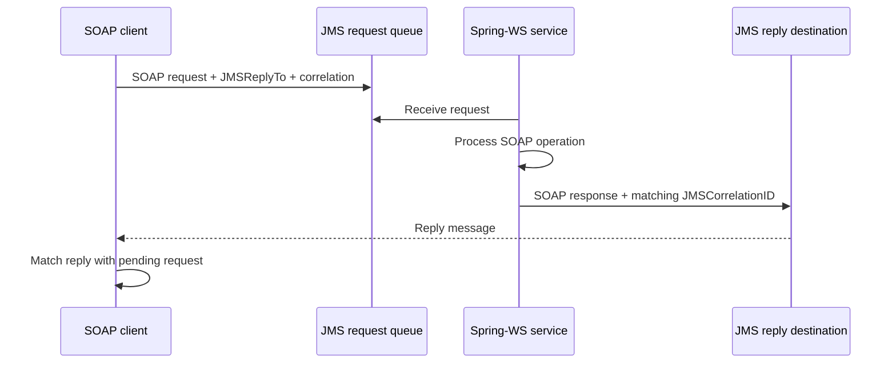
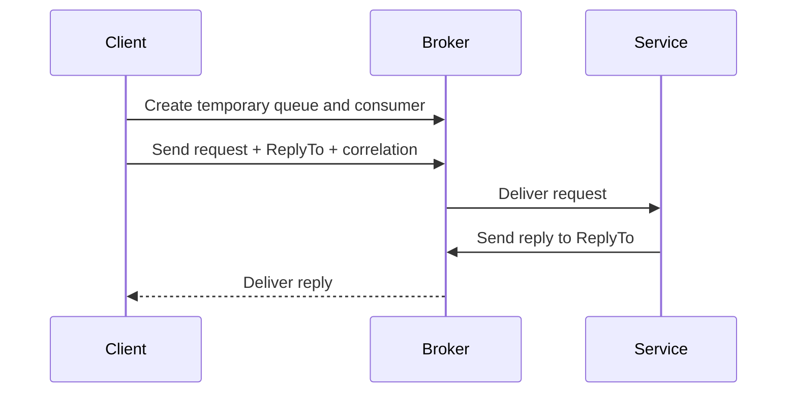
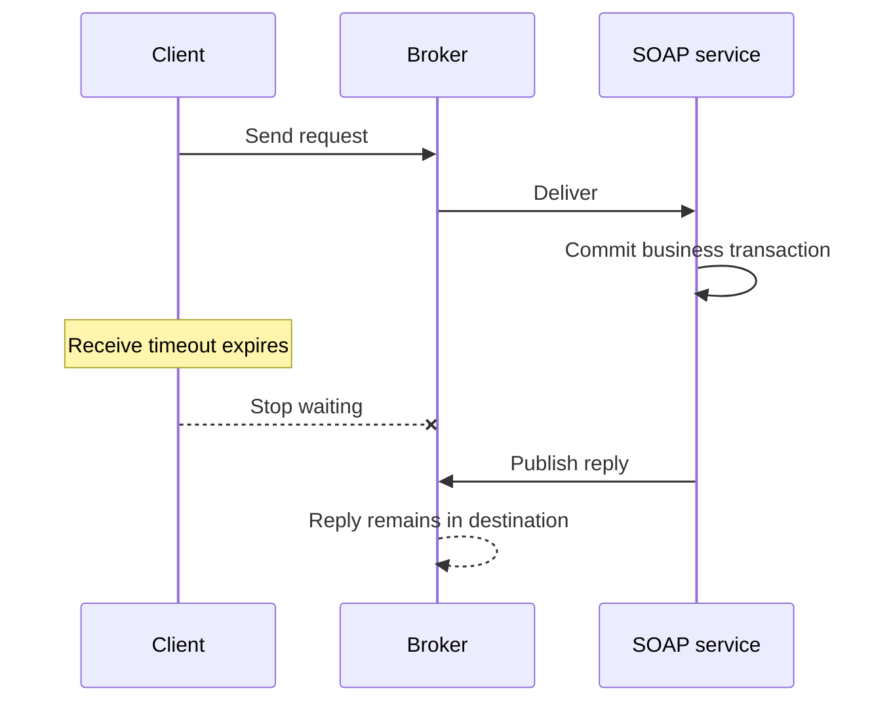

# JMSReplyTo, correlation và ghép yêu cầu với phản hồi

Khi SOAP dùng **JMS làm transport**, request được gửi vào một destination và response là một JMS message riêng. Client cần cho responder biết nơi gửi reply và cần ghép reply tới đúng request đang chờ. Hai cơ chế chính là **`JMSReplyTo`** và **`JMSCorrelationID`**.

- **`JMSReplyTo`** chỉ destination nhận phản hồi.
- **`JMSCorrelationID`** nối reply với request/conversation.
- **`JMSMessageID`** là định danh do JMS provider gán cho message.
- **Business request key** định danh ý định nghiệp vụ và phục vụ idempotency; khác với JMS identifiers.

Trong **Spring Web Services (Spring-WS)**, SOAP Envelope, XSD/WSDL, JAXB, endpoint, SOAP Fault và WS-Security mô tả nội dung/chính sách SOAP. JMS vận chuyển message. Một request/reply design cần định nghĩa destination, correlation, timeout, concurrency, retry, redelivery, transaction và trạng thái nghiệp vụ.

> **Nguyên tắc:** `JMSReplyTo` trả lời “gửi response tới đâu?”; `JMSCorrelationID` trả lời “response này thuộc request nào?”. Không cơ chế nào tự chứng minh nghiệp vụ đã commit đúng một lần.

## 1. Luồng request/reply

Giả sử đối tác gửi SOAP `GetOrder` tới queue `orders.request`. Service nhận request, xử lý SOAP Body và gửi response tới destination trong `JMSReplyTo`.



Request và reply là hai JMS message riêng. Client có thể timeout sau khi broker nhận request; response có thể đến trễ; consumer có thể redeliver; responder có thể crash giữa business commit và reply send. Phải phân biệt **message lifecycle** với **business lifecycle**.

## 2. Bốn loại định danh

| Giá trị | Nguồn tạo | Phạm vi | Mục đích |
| --- | --- | --- | --- |
| `JMSMessageID` | JMS provider | Một JMS message | Nhận diện message |
| `JMSCorrelationID` | Ứng dụng/pattern | Quan hệ message | Ghép reply với request |
| `JMSReplyTo` | Producer | Reply destination | Định tuyến response |
| WS-A `MessageID`/`RelatesTo` | SOAP sender/responder | SOAP message pair | Correlation tầng SOAP |
| Business request key | Ứng dụng | Một ý định nghiệp vụ | Idempotency và tra trạng thái |

Ví dụ:

```text
Request:
  JMSMessageID       = ID:broker-123
  JMSCorrelationID   = corr-8f27
  JMSReplyTo         = temporary://reply-queue-91
  businessRequestKey = create-order-421

Response:
  JMSMessageID       = ID:broker-456
  JMSCorrelationID   = ID:broker-123
```

Nếu client retry cùng ý định nghiệp vụ, provider có thể cấp MessageID mới. Không dùng JMSMessageID/JMSCorrelationID làm idempotency key mặc định.

## 3. JMSReplyTo: nơi gửi phản hồi

`JMSReplyTo` là JMS header field kiểu Destination. Request producer có thể gắn queue/topic:

```java
// JMS API pseudocode
Message request = session.createTextMessage(soapEnvelope);
request.setJMSReplyTo(replyQueue);
producer.send(request);
```

Responder đọc destination:

```java
Destination replyTo = request.getJMSReplyTo();
if (replyTo != null) {
    Message response = session.createTextMessage(soapResponse);
    producer.send(replyTo, response);
}
```

Đây là pseudocode, chưa phải cấu hình Spring-WS đầy đủ. Ứng dụng còn quản lý session, transaction, serialization, correlation và lỗi broker.

Nếu `JMSReplyTo` thiếu, operation có thể là one-way. Với operation bắt buộc reply, phải reject hoặc xử lý lỗi theo contract. Responder không tự tạo destination tùy ý.

### Rủi ro bảo mật

Producer không đáng tin có thể chỉ định destination tùy ý và lợi dụng responder gửi dữ liệu nhạy cảm tới queue attacker kiểm soát. Cần xác thực producer, allowlist destination, broker ACL cho send/receive/create temporary destination và giới hạn dữ liệu trả về.

**JMSReplyTo là routing metadata, không phải authorization policy.**

## 4. JMSCorrelationID: ghép reply

Khi có nhiều request đang chờ, reply có thể đến đảo thứ tự:

```text
Pending:
  corr-A -> GetOrder(42)
  corr-B -> GetOrder(43)
  corr-C -> GetOrder(44)

Arrival:
  corr-C -> response for GetOrder(44)
  corr-A -> response for GetOrder(42)
  corr-B -> response for GetOrder(43)
```

Client dùng pending registry như `correlationId → future` để hoàn tất đúng call. Correlation ID nên duy nhất trong scope, có format thống nhất, được dọn sau success/fault/timeout, không chứa secret và không được dùng như tenant identity.

## 5. Hai pattern correlation

### Pattern A: echo request JMSCorrelationID

Client tạo ID trước khi gửi:

```java
String correlationId = UUID.randomUUID().toString();
request.setJMSCorrelationID(correlationId);
request.setJMSReplyTo(replyQueue);
producer.send(request);
```

Responder echo ID:

```java
response.setJMSCorrelationID(request.getJMSCorrelationID());
replyProducer.send(request.getJMSReplyTo(), response);
```

Client biết ID trước send nên có thể đăng ký pending future trước request.

### Pattern B: request JMSMessageID

Client gửi request và lấy ID provider cấp:

```java
request.setJMSReplyTo(replyQueue);
producer.send(request);
String requestId = request.getJMSMessageID();
```

Responder dùng request MessageID làm correlation của reply:

```java
response.setJMSCorrelationID(request.getJMSMessageID());
replyProducer.send(request.getJMSReplyTo(), response);
```

| Tiêu chí | Pattern A | Pattern B |
| --- | --- | --- |
| ID tạo bởi | Client | JMS provider |
| Biết trước send | Có | Thường không |
| Reply correlation | Echo request correlation | Bằng request MessageID |
| Điều kiện | Responder echo đúng | Provider tạo MessageID |
| Idempotency nghiệp vụ | Cần key riêng | Cần key riêng |

**Chọn một pattern thống nhất.** Trong Pattern B, so reply JMSCorrelationID với request JMSMessageID, không so với request JMSCorrelationID. Nếu provider tắt MessageID generation, pattern B không hoạt động.

## 6. Temporary và static reply queue

Temporary queue có thể được tạo theo lifecycle connection/session. Client nên tạo destination và đăng ký consumer trước khi gửi request:



Temporary destination thuận tiện cho call ngắn nhưng không phải durable inbox sau restart; cluster có thể hạn chế gửi cross-node. Với workflow dài, dùng durable named reply queue/inbox và lưu pending state bền vững.

Static reply queue có thể phục vụ nhiều request. Client cần dispatcher match theo correlation. Nếu nhiều process cùng consume nhưng pending registry nằm trong RAM riêng, một process có thể nhận reply của process khác rồi bỏ lạc. Cần queue riêng mỗi instance, dispatcher tập trung hoặc shared durable registry.

## 7. Selector và pending registry

JMS selector có thể lọc theo correlation:

```java
String selector =
        "JMSCorrelationID = '" + escapedCorrelationId + "'";
MessageConsumer consumer =
        session.createConsumer(replyQueue, selector);
```

Không nối giá trị untrusted vào selector; escape dấu nháy theo cú pháp JMS và giới hạn format ID.

| Chiến lược | Ưu điểm | Đánh đổi |
| --- | --- | --- |
| Consumer mỗi request | Dễ ghép | Nhiều consumer |
| Một consumer + dispatcher | Ít consumer | Cần thread-safe pending map |
| Queue riêng mỗi client | Cô lập | Nhiều destination |
| Durable inbox | Phục hồi restart | Cần persistence/cleanup |

Pending registry cần atomic registration, complete/fail một lần, timeout cleanup, late/duplicate handling và capacity limit.

## 8. Ví dụ pending registry

```java
import java.util.concurrent.CompletableFuture;
import java.util.concurrent.ConcurrentHashMap;
import java.util.concurrent.ConcurrentMap;

public final class PendingReplies<T> {
    private final ConcurrentMap<String, CompletableFuture<T>> pending =
            new ConcurrentHashMap<>();

    public CompletableFuture<T> register(String id) {
        CompletableFuture<T> future = new CompletableFuture<>();
        if (pending.putIfAbsent(id, future) != null) {
            throw new IllegalStateException("Duplicate correlation id");
        }
        return future;
    }

    public boolean complete(String id, T reply) {
        CompletableFuture<T> future = pending.remove(id);
        if (future == null) return false;
        future.complete(reply);
        return true;
    }
}
```

Đây là in-memory example, chưa có timeout scheduler, restart recovery hay persistence. Luồng là sinh ID, đăng ký pending trước send, gửi request, reply consumer lookup correlation, complete future và cleanup. Reply sau timeout là late reply; không giữ map vô hạn.

Trong Pattern B, pending key phụ thuộc MessageID lấy sau send; phải bảo đảm reply đến nhanh không bị bỏ lỡ thông qua dispatcher/sender phù hợp.

## 9. Spring-WS JMS transport và version

Spring-WS có hỗ trợ JMS transport trong các phiên bản/module tương ứng. Kiến trúc có thể gồm `WebServiceTemplate`, JAXB marshaller/unmarshaller, JMS message sender/receiver, connection factory và listener/container. Artifact/API cụ thể phụ thuộc Spring-WS, Spring Framework và JMS API namespace: `javax.jms` hoặc `jakarta.jms`.

```text
SOAP client
  WebServiceTemplate + JAXB
  JMS WebServiceMessageSender
    ConnectionFactory + request destination
    JMSReplyTo + correlation

JMS broker
  request queue
  reply destination

SOAP service
  JMS listener/receiver
  SOAP processing + EndpointMapping
  EndpointInterceptor / WS-Security
  Application service + JMS reply
```

Mô hình bean khái niệm:

```java
// Pseudocode: API depends on Spring-WS version.
@Bean
WebServiceTemplate soapOverJmsTemplate(
        Jaxb2Marshaller marshaller,
        WebServiceMessageSender jmsSender) {
    WebServiceTemplate template = new WebServiceTemplate();
    template.setMarshaller(marshaller);
    template.setUnmarshaller(marshaller);
    template.setMessageSender(jmsSender);
    return template;
}
```

JMS sender phải cấu hình destination, reply handling, timeout và correlation. Không giả định URL HTTP hay SoapActionCallback điều khiển JMS metadata.

Trước khi triển khai, xác minh: API javax/jakarta; JMS transport artifact; sender có tự tạo temporary queue không; pattern correlation; receiver có copy/echo ID không; timeout và transaction/ack semantics; cluster support với temporary destinations. Đối chiếu dependency/Javadoc và test broker thực tế.

## 10. JMSReplyTo khác WS-Addressing ReplyTo

SOAP Header có thể chứa WS-Addressing ReplyTo:

```xml
<wsa:ReplyTo xmlns:wsa="http://www.w3.org/2005/08/addressing">
  <wsa:Address>https://callback.example.com/soap</wsa:Address>
</wsa:ReplyTo>
```

| Tiêu chí | JMSReplyTo | WS-Addressing ReplyTo |
| --- | --- | --- |
| Nằm ở | JMS header | SOAP Header |
| Kiểu địa chỉ | JMS Destination | EndpointReference |
| Xử lý bởi | JMS provider/adapter | WS-Addressing/SOAP |
| Vai trò | JMS response destination | SOAP response/fault routing |
| Correlation | JMSCorrelationID | MessageID/RelatesTo |

Không tự động lấy URI WS-Addressing làm JMS destination hoặc ngược lại. Nếu dùng cả hai, contract phải quy định source of truth và consistency validation.

## 11. Timeout, late reply và unknown state

Request đã vào broker có thể vẫn đang được xử lý khi caller timeout:



Timeout không chứng minh request bị hủy; cancel future không rút message đã gửi. Hủy nghiệp vụ cần cancellation operation riêng có authorization và race handling.

| Tình huống | Ý nghĩa |
| --- | --- |
| Send timeout | Producer/broker chưa hoàn tất gửi |
| Receive timeout | Chưa thấy reply trong cửa sổ chờ |
| Message TTL hết hạn | Broker loại message theo policy |
| Consumer xử lý lâu | Kiểm tra concurrency/redelivery |
| Overall deadline | Caller hết thời gian chờ |

Khi chưa biết business commit hay chưa, client giữ state `UNKNOWN` hoặc `PENDING`. Correlation rỗng/không tồn tại/duplicate phải reject hoặc quarantine; không ghép theo arrival order.

## 12. Transaction và idempotency

Listener có thể nhận JMS request, parse/verify SOAP, gọi application service, commit database, tạo reply rồi acknowledge JMS receive. DB commit và JMS reply send thường là **hai resource**, không mặc nhiên atomic.

| Điểm crash | DB | Request | Reply | Hướng xử lý |
| --- | --- | --- | --- | --- |
| Trước xử lý | Chưa commit | Redeliver được | Chưa có | Retry có kiểm soát |
| Sau DB commit, trước reply | Đã commit | Tùy ack | Chưa có | Idempotency/status |
| Sau reply, trước ack | Đã commit | Có thể redeliver | Có thể đã có | Dedupe/recovery |
| Sau ack, trước DB commit | Chưa commit | Đã ack | Không | Tránh ack sớm/durable work |

JMS transaction không tự bao gồm database. XA/JTA có thể phối hợp resource nhưng thêm phức tạp; vẫn cần recovery và idempotency.

```sql
CREATE TABLE soap_request_dedup (
    caller_id VARCHAR(128) NOT NULL,
    tenant_id VARCHAR(128) NOT NULL,
    operation_name VARCHAR(80) NOT NULL,
    business_request_key VARCHAR(128) NOT NULL,
    request_hash CHAR(64) NOT NULL,
    state VARCHAR(24) NOT NULL,
    result_reference VARCHAR(128),
    updated_at TIMESTAMP NOT NULL,
    PRIMARY KEY (
        caller_id, tenant_id, operation_name, business_request_key
    )
);
```

Cùng key và fingerprint có thể trả result/status đã lưu; cùng key nhưng payload khác cần reject. Claim key phải atomic bằng unique constraint/transaction/locking. **Correlation không chống duplicate business effect.**

## 13. Retry, redelivery và DLQ

Phân biệt client retry gửi message mới; broker redelivery giao lại message; SOAP retry gửi lại envelope; business retry thử lại cùng intent với cùng key.

| Loại | Kích hoạt | Rủi ro |
| --- | --- | --- |
| Broker redelivery | Provider/container | Endpoint chạy lại |
| Client retry | SOAP client | Business effect trùng |
| Downstream retry | Application | External side effect trùng |
| DLQ redrive | Vận hành | Replay dữ liệu cũ |

Retry policy cần fault classification, backoff/jitter, budget, max delivery, DLQ, replay approval, idempotency và quy tắc giữ/thay correlation. Không retry mọi SOAP Fault.

## 14. Bảo mật destination và correlation

JMS transport không tự an toàn vì broker nằm trong mạng nội bộ.

| Principal | Quyền |
| --- | --- |
| SOAP client partner A | Send request được cấp; receive reply của A |
| SOAP service | Consume request; send reply được phép |
| Operations | Quản lý destination/DLQ theo quy trình |
| Monitoring | Xem metrics, không cần đọc Body |
| Other partner | Không consume reply queue của A |

Bảo vệ broker bằng TLS/mTLS hoặc authentication phù hợp, ACL queue/topic/temporary destination, service identity và persistence policy. Không log raw SOAP/token.

Correlation bị đoán/giả có thể gây ghép nhầm trên shared queue. Cần ID duy nhất/khó đoán, pending registry theo partner/tenant/destination, ACL và kiểm tra source identity. **Correlation chỉ để ghép message; không xác thực nguồn gửi.**

## 15. SOAP Fault, message body và ordering

SOAP Fault có thể được đóng gói trong JMS reply và giữ correlation. Client cần phân biệt SOAP Fault, JMS exception, timeout, malformed SOAP reply và correlation mismatch. Không đổi mọi lỗi broker thành SOAP `Receiver`; lỗi broker có thể không có SOAP Envelope.

JMS hỗ trợ TextMessage, BytesMessage, ObjectMessage, MapMessage và StreamMessage. Body type Spring-WS adapter dùng phụ thuộc implementation/version. Chọn representation được transport và partner hỗ trợ; tránh native Java serialization cho message không tin cậy. XSD Body validation không tự validate JMS headers/properties hoặc attachments.

`JMSCorrelationID` **không bảo đảm ordering**. Nếu thứ tự nghiệp vụ quan trọng, dùng broker grouping/partition/order feature hoặc application sequencing; không dùng correlation làm sequence number.

## 16. Kiểm thử và ma trận 40 ca

Mock session xác minh header được set nhưng **không chứng minh** temporary queue routing, selector, broker ACL, redelivery, DLQ, expiration hay cluster failover. Dùng broker integration test theo provider/version thực tế.

| Cấp độ | Kiểm thử | Chứng minh |
| --- | --- | --- |
| JMS header unit | ReplyTo/CorrelationID/MessageID | Pattern đúng |
| Pending registry | Concurrent calls, reply đảo thứ tự | Match đúng |
| Responder | Echo/copy correlation | Reply ID đúng |
| Temporary queue | Create/receive/close | Lifecycle |
| Shared queue | Nhiều client/consumer | Không nhận nhầm process |
| Timeout/late reply | Reply sau timeout | Cleanup/reconciliation |
| Redelivery/transaction | Crash injection | Idempotency/recovery |
| SOAP contract | XSD/JAXB/QName/Fault | Đúng WSDL/XSD |
| Security | Broker ACL/WS-Security | Destination isolation |
| Cluster | Reconnect/failover | State recovery |

| Mã | Tình huống | Kết quả cần xác minh |
| --- | --- | --- |
| J01 | ReplyTo hợp lệ | Reply đúng destination |
| J02 | Thiếu ReplyTo ở one-way | Theo contract |
| J03 | Thiếu ReplyTo khi bắt buộc reply | Reject |
| J04 | Destination không tồn tại | Phân loại lỗi |
| J05 | Producer không có quyền destination | ACL từ chối |
| J06 | Temporary queue | Reply đúng lifecycle |
| J07 | Đóng connection trước reply | Late handling |
| J08 | Temporary destination không cross-node | Test phát hiện |
| J09 | Static queue nhiều pending | Dispatcher match |
| J10 | Hai process dùng chung queue | Không bỏ lạc |
| J11 | Pattern A | Echo correlation |
| J12 | Pattern B | Correlation khớp MessageID |
| J13 | Tắt MessageID generation | Fail fast |
| J14 | So nhầm correlation ở Pattern B | Test phát hiện |
| J15 | Reply đảo thứ tự | Future đúng |
| J16 | Correlation trùng | Reject duplicate |
| J17 | Correlation rỗng | Reject/quarantine |
| J18 | Correlation không pending | Late/unknown metrics |
| J19 | Reply duplicate | Không complete hai lần |
| J20 | Reply sau timeout | Late policy |
| J21 | Selector có quote | Escape an toàn |
| J22 | Nhiều selector consumer | Provider behavior đúng |
| J23 | Correlation chứa secret | Không nhận/không log |
| J24 | Đoán ID client khác | ACL/scope ngăn ghép |
| J25 | WS-A MessageID khác JMS ID | Không nhầm lớp |
| J26 | WS-A RelatesTo đúng, JMS sai | Reject |
| J27 | SOAP Fault reply | Correlate đúng |
| J28 | XML reply malformed | Không success |
| J29 | XSD/QName sai | Validation reject |
| J30 | Broker redelivery sau rollback | Idempotency |
| J31 | Retry cùng business key | Không trùng result |
| J32 | Crash sau DB commit trước reply | Status/reconcile |
| J33 | Crash sau reply trước ack | Recovery |
| J34 | TTL hết hạn | Expired/timeout |
| J35 | DLQ redrive | Replay audit/idempotency |
| J36 | Broker failover | Destination/correlation đúng |
| J37 | Cluster nhiều consumers | Pending state đúng node |
| J38 | Shutdown còn pending | Cleanup |
| J39 | Reply gửi tenant khác | ACL/auth ngăn rò |
| J40 | Spring-WS + broker thực | Interoperability |

Với replay/redrive/payment test, đo **số business effects đã commit**, không chỉ số listener invocation. Chỉ dùng dữ liệu giả trong môi trường cô lập.

## 17. Chẩn đoán, bài tập và checklist

| Triệu chứng | Nguyên nhân có thể | Kiểm tra |
| --- | --- | --- |
| Timeout nhưng service đã tạo đơn | Reply chậm/mất/temp queue đóng | Business key/status |
| Reply tới queue nhưng call pending | Correlation mismatch | Pattern và các ID |
| Reply không về | ReplyTo/ACL/destination lỗi | Header/broker log |
| Process khác nhận reply | Shared queue thiếu ownership | Consumer/pending scope |
| Concurrent calls lỗi | Duplicate ID/unsafe map | Atomic registration |
| Reply đảo thứ tự làm sai dữ liệu | Ghép theo arrival | Match correlation |
| Request xử lý nhiều lần | Redelivery/retry | Delivery count/idempotency |
| Fault bị coi success | Không parse Fault | Fault mapping |
| Temporary queue mất khi restart | Không durable | Inbox/operation state |
| WS-A đúng, JMS sai | Nhầm hai lớp | Contract mapping |

### Quy trình điều tra

1. Xác định producer đã gửi và broker đã nhận chưa.
2. Ghi metadata đã lọc: destination, MessageID, correlation, reply destination, timestamp, delivery count.
3. Xác nhận responder đọc đúng JMSReplyTo.
4. Xác nhận Pattern A/B và giá trị reply.
5. Kiểm consumer/selector/dispatcher/pending registry đúng process.
6. Kiểm timeout, TTL, temporary destination và late reply.
7. Kiểm SOAP Envelope/Fault/XSD sau khi correlation match.
8. Tra business key và DB state.
9. Kiểm ack/redelivery/DLQ/failover.
10. Regression test với provider/version thực tế.

### Bài tập: GetOrder với 500 request đồng thời

Client Spring-WS gửi 500 `GetOrderRequest` tới `orders.request`; client dùng static reply queue cho partner; mỗi request có độ trễ khác nhau và một số call timeout.

Thiết kế cần: reply queue giới hạn bằng ACL; chọn Pattern A hoặc B; mở consumer/dispatcher trước send; dispatcher tra pending map; timeout chuyển call sang UNKNOWN/TIMED_OUT; late reply có policy; business key riêng cho command có side effect; SOAP Fault được gửi như correlated reply; test concurrency, reply đảo thứ tự, duplicate/wrong correlation, timeout, redelivery, failover và tenant isolation.

**Tiêu chí đạt:** mỗi pending call nhận đúng reply; reply lạ/trễ không complete nhầm; timeout không bị hiểu rollback; redelivery không tạo business effect trùng.

### Checklist

1. Chốt transport binding và JMS provider/version thực tế.
2. Quy định JMSReplyTo: queue/topic, static/temporary, owner và ACL.
3. Chọn một correlation pattern và document.
4. Không trộn hai pattern nếu chưa có mapping contract.
5. Tạo pending registry trước send.
6. Match correlation, không match arrival order.
7. Scope correlation theo partner/tenant/destination.
8. Thiết kế temporary queue lifecycle; dùng durable inbox cho workflow dài.
9. Bảo vệ shared reply queue bằng ACL/dispatcher ownership.
10. Xác minh JMSReplyTo được phép.
11. Giữ SOAP và JMS correlation riêng; map WS-A chỉ khi contract định nghĩa.
12. Phân biệt MessageID, CorrelationID và business key.
13. Xác định timeout, TTL, deadline, cancellation, late reply.
14. Quyết định transaction boundary giữa JMS ack, DB commit, reply send.
15. Có idempotency bền vững cho side effect.
16. Phân loại retry/redelivery/DLQ; không retry mọi SOAP Fault.
17. Bảo vệ broker/payload và không log secret/raw SOAP.
18. Xử lý SOAP Fault như correlated reply, phân biệt JMS exception.
19. Kiểm thread safety/capacity và cleanup.
20. Test broker thật cho temporary destination, selector, redelivery, DLQ, failover.
21. Kiểm thử Spring-WS version thực tế; không giả định API giữa các release.
22. Đo pending count, reply latency, timeout, late correlation và DLQ depth.
23. Kiểm client Java/.NET theo SOAP/WSDL/transport profile.
24. Ghi giới hạn guarantee: correlated reply không đồng nghĩa exactly-once hoặc atomic transaction.

**Kết luận:** `JMSReplyTo` cho responder biết nơi gửi response; `JMSCorrelationID` giúp client ghép response với đúng request. Hai pattern phổ biến là echo correlation ID do client tạo và dùng request `JMSMessageID` làm correlation cho reply; hai bên phải chọn một cách thống nhất. Trong Spring-WS, SOAP contract và JMS transport có metadata riêng: WS-Addressing `MessageID/RelatesTo` không mặc định đồng nghĩa JMS correlation. Thiết kế enterprise còn phải quản lý reply destination, shared consumer, selector, timeout, late reply, transaction, redelivery, DLQ, security và business idempotency. Khi các ranh giới đó được định nghĩa và kiểm thử bằng broker/provider thực, request/reply mới vận hành ổn định dưới tải đồng thời và khi có sự cố phân tán.
