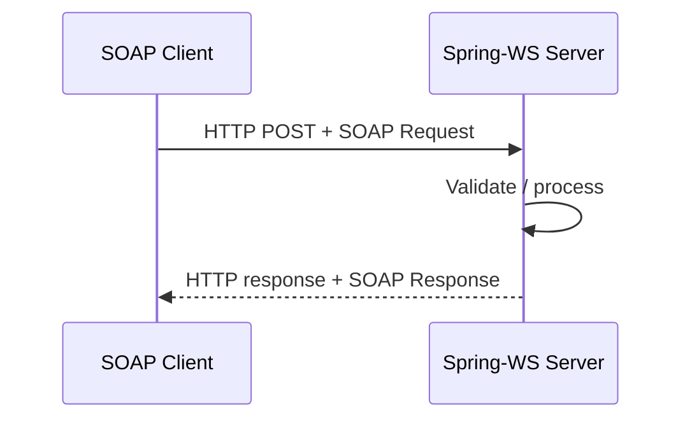
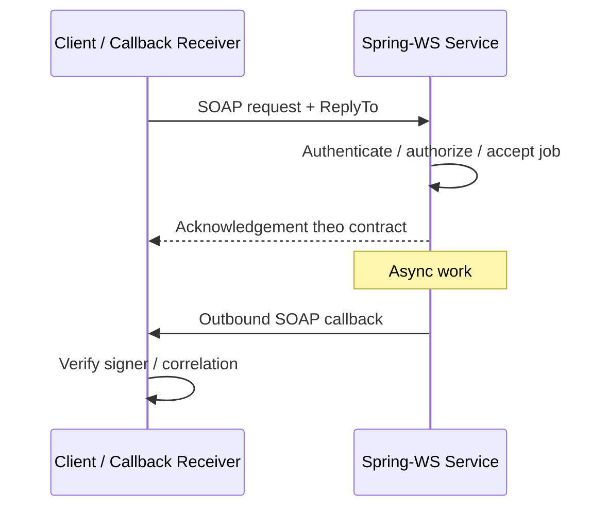
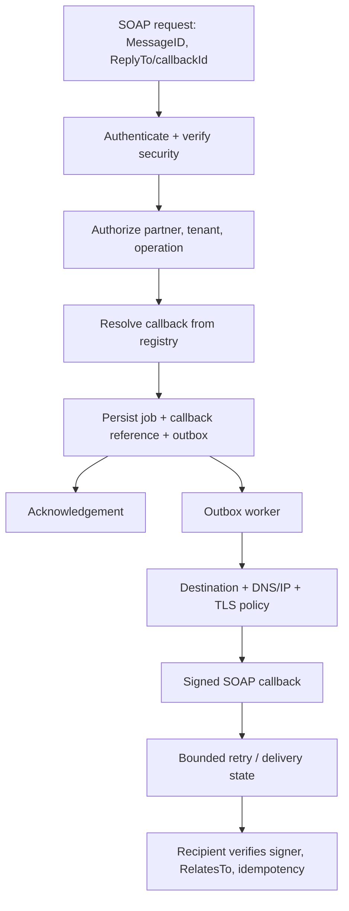

# Kiểm soát đích phản hồi khác kênh và các kết nối do thông điệp kích hoạt

Một SOAP client có thể gửi yêu cầu rồi nhận kết quả sau qua callback endpoint. WS-Addressing biểu diễn đích logic bằng Endpoint Reference (EPR), thường qua **`ReplyTo`** và **`FaultTo`**. Cơ chế này hữu ích cho tích hợp bất đồng bộ, nhưng tạo ra ranh giới bảo mật quan trọng: **thông điệp đến có thể khiến server mở một kết nối mạng mới tới địa chỉ do bên gửi cung cấp**.

Nếu server POST SOAP response tới `http://169.254.169.254/`, tới loopback hoặc host trong mạng nội bộ, endpoint có thể trở thành một **SSRF primitive**. Rủi ro còn xuất hiện ở `wsa:To`, URL tải file, WSDL/XSD import, XML DTD, XSLT `document()`, CRL/OCSP URI hoặc bất kỳ dữ liệu nào khiến ứng dụng tự động dereference một địa chỉ.

Bài thuộc chương **Truyền tải mở rộng** của module **SPRING_WEB_SERVICES**. Trong hệ SOAP contract-first, Spring Web Services (Spring-WS) cung cấp endpoint, SOAP client, JAXB/OXM, interceptor và tích hợp WS-Addressing/WS-Security; HTTP, JMS hoặc broker có vòng đời và ranh giới tin cậy riêng. Bài tập trung vào kiểm soát callback khác kênh, chống SSRF, DNS rebinding, redirect, TLS, xác thực callback, correlation, idempotency và kiểm thử tương thích.

Ví dụ dùng Java 17+, Spring-WS hiện đại và WS-Addressing 1.0. URI/IP/tenant là dữ liệu giả. Code là ví dụ kiến trúc, không phải một callback transport hoàn chỉnh để sao chép nguyên trạng vào production.

## 1. Phản hồi cùng kênh và phản hồi khác kênh

### 1.1. Cùng kênh

Trong HTTP request-response, client gửi SOAP request và server trả response trên cùng kết nối:



Server không phải tự chọn hostname mới để trả response; HTTP transport đã xác định kết nối.

### 1.2. Khác kênh qua WS-Addressing

Request có thể mang `ReplyTo`:

```xml
<wsa:ReplyTo
    xmlns:wsa="http://www.w3.org/2005/08/addressing">
    <wsa:Address>https://callback.partner.example.org/soap/results</wsa:Address>
</wsa:ReplyTo>
```

Luồng logic:



Callback là một outbound network connection mới từ server tới receiver. Server phải kiểm tra **có được phép gọi đích ấy không** trước khi gửi. Không suy ra Spring-WS tự động thực hiện callback chỉ vì thấy `ReplyTo`; WS-Addressing biểu diễn địa chỉ logic, còn job, worker, retry và delivery cần application/transport architecture.

### 1.3. Phân biệt các trường WS-Addressing

| Field | Vai trò | Rủi ro nếu tự động sử dụng |
| --- | --- | --- |
| `wsa:To` | Đích logic message hiện tại | Dispatch/proxy tới URI tùy ý |
| `wsa:ReplyTo` | Địa chỉ nhận response | Callback SSRF, rò dữ liệu |
| `wsa:FaultTo` | Địa chỉ nhận Fault | Gửi lỗi nội bộ ra host ngoài |
| `wsa:From` | EPR logic bên gửi | Nhầm với authenticated identity |
| `wsa:Action` | Operation/action | Route sai nếu không ràng buộc |
| `wsa:MessageID` | Định danh message | Replay/collision |
| `wsa:RelatesTo` | Liên hệ response với request | Ghép nhầm job/tenant |

`ReplyTo` có thể là `anonymous` theo binding, khi đó response thường đi cùng HTTP channel. Non-anonymous ReplyTo/FaultTo biểu thị đích khác kênh và cần policy riêng.

## 2. Endpoint Reference là địa chỉ, không phải quyền mạng

```xml
<wsa:EndpointReference
    xmlns:wsa="http://www.w3.org/2005/08/addressing">
    <wsa:Address>https://callback.partner.example.org/soap/results</wsa:Address>
    <wsa:ReferenceParameters>
        <ctx:subscriptionId
            xmlns:ctx="https://example.org/callback/v1">sub-42</ctx:subscriptionId>
    </wsa:ReferenceParameters>
    <wsa:Metadata><!-- Contract metadata --></wsa:Metadata>
</wsa:EndpointReference>
```

`Address` là URI; `ReferenceParameters` là dữ liệu được mang theo theo binding; `Metadata` mô tả contract/profile. Reference Parameter không tự là credential. `subscriptionId` do caller gửi phải được gắn với subscription đã đăng ký và kiểm tra owner/tenant.

### 2.1. Đích cần bị từ chối

```text
http://localhost:8080/admin
http://127.0.0.1/
http://[::1]/
http://169.254.169.254/
http://10.0.0.12:8080/internal
file:///etc/passwd
gopher://127.0.0.1:25/
```

XML hợp lệ không có nghĩa server được phép gọi địa chỉ trên. Cần xem IPv4, IPv6, private, loopback, link-local, metadata, multicast, unspecified, reserved ranges và dạng IPv4-mapped IPv6; không chỉ chặn chuỗi `localhost`.

### 2.2. DNS rebinding

Hostname allowlist hôm nay có thể resolve tới IP public, rồi đổi sang private/link-local trước khi worker kết nối. Đây là **DNS rebinding/TOCTOU**. Nếu application kiểm hostname một lần nhưng HTTP client tự DNS lookup lại khi mở socket, attacker có thể thay kết quả giữa hai bước. Proxy có thể resolve ở nơi khác với ứng dụng.

DNS/IP policy phải nhất quán với **thành phần thực sự mở socket**. Kiểm tra ở service nhưng HTTP sender lookup độc lập chưa đủ chống rebinding.

## 3. Các nguồn outbound request do message kích hoạt

| Nguồn dữ liệu | Hành động có thể kích hoạt | Rủi ro |
| --- | --- | --- |
| `wsa:ReplyTo` | Gửi SOAP response | Callback SSRF |
| `wsa:FaultTo` | Gửi SOAP Fault | Rò lỗi |
| `wsa:To` | Dispatch/forward | Proxy tới mạng nội bộ |
| Business `documentUrl` | Download file | SSRF |
| WSDL/XSD import/include | Tải schema | External access |
| XML DTD/entity | Resolve entity | XXE/file/network |
| XSLT `document()`/include | Tải XML/stylesheet | SSRF |
| CRL/OCSP/AIA trong cert | Tải PKI metadata | Outbound tùy URI |
| HTTP redirect | Chuyển host | Vượt allowlist |
| JMS reply destination | Publish message | Destination injection |

**Mọi outbound request dựa trên dữ liệu ngoài phải đi qua outbound destination policy.** URI trong SOAP Header cũng không đáng tin hơn URI trong SOAP Body.

Tác động có thể gồm đọc metadata/private services, dò mạng nội bộ, gửi SOAP data tới attacker, lộ fault/tenant data, tạo tải hoặc retry storm. Ngay cả khi bỏ qua response body, hành động gửi request đã nhạy cảm.

## 4. Policy quyết định callback

Một policy vững cần xét:

1. **Identity:** request đến từ partner/principal đã xác thực nào?
2. **Authorization:** partner có quyền đăng ký/đổi callback cho operation và tenant nào?
3. **Destination:** scheme, host, port, path có khớp allowlist/registration?
4. **Network:** IP thực có thuộc private/loopback/link-local/metadata range?
5. **Resolution:** DNS có bị rebinding; redirect/proxy có đổi đích không?
6. **TLS:** hostname/certificate callback có được xác minh? Có yêu cầu mTLS?
7. **Message:** action, payload, reference parameters, signature có hợp lệ?
8. **Lifecycle:** timeout, retry, rate limit, idempotency, audit, cancellation?

### 4.1. Ưu tiên callback registry

Client đăng ký callback trước qua onboarding/API quản lý đã xác thực. Hệ thống lưu:

```yaml
partnerId: partner-A
tenantScope: TENANT-A
callbackId: orders-result-v2
scheme: https
host: callback.partner-a.example.org
port: 443
path: /soap/orders/results
tlsPolicy: partner-a-callback-mtls
allowedActions:
  - urn:example:orders:GetOrderResponse
status: ACTIVE
version: 3
```

Đây là metadata minh họa. Request gửi `callbackId`; server tra endpoint canonical và kiểm partner/tenant có quyền dùng. Không cần gọi URL tùy ý trong message.

### 4.2. Nếu bắt buộc EPR động

Cần authentication mạnh, allowlist host/path/port theo partner, HTTPS, hostname verification, DNS/IP policy tại connection boundary, redirect tắt mặc định, không forward credentials/cookies qua origin khác, giới hạn timeout/bytes/calls/concurrency. Nếu không kiểm soát được DNS và egress tại nơi mở socket, **không nên cho phép callback URI động**.

## 5. Chuẩn hóa URI và allowlist

Dùng URI parser chuẩn, không tách chuỗi bằng dấu hai chấm hay regex. Policy ví dụ:

| Thành phần | Quy tắc |
| --- | --- |
| Scheme | Chỉ `https` |
| User info | Cấm `user:password@host` |
| Host | FQDN đã đăng ký, normalize IDN |
| Port | 443 hoặc port được duyệt |
| Path | Exact path/path prefix đã đăng ký |
| Query | Từ chối hoặc allowlist key/value |
| Fragment | Từ chối |
| Redirect | Tắt hoặc kiểm mọi hop |
| DNS/IP | Từ chối ranges bị cấm |

Ví dụ kiểm hình dạng URI:

```java
import java.net.URI;
import java.net.URISyntaxException;
import java.util.Locale;
import java.util.Set;

public final class CallbackUriPolicy {
    private static final Set<String> ALLOWED_HOSTS = Set.of(
            "callback.partner-a.example.org",
            "callback.partner-b.example.org");

    private CallbackUriPolicy() { }

    public static URI validateRegisteredShape(String value) {
        final URI uri;
        try {
            uri = new URI(value);
        } catch (URISyntaxException ex) {
            throw new IllegalArgumentException("Invalid callback URI", ex);
        }

        if (!uri.isAbsolute()
                || !"https".equalsIgnoreCase(uri.getScheme())
                || uri.getRawUserInfo() != null
                || uri.getRawFragment() != null
                || uri.getRawQuery() != null
                || uri.getHost() == null
                || uri.getPort() != 443) {
            throw new IllegalArgumentException("Callback URI rejected");
        }
        String host = uri.getHost().toLowerCase(Locale.ROOT);
        if (!ALLOWED_HOSTS.contains(host)
                || !"/soap/orders/results".equals(uri.getRawPath())) {
            throw new IllegalArgumentException("Destination not registered");
        }
        return uri;
    }
}
```

Đây chỉ là **kiểm tra hình dạng URI theo allowlist tĩnh**. Nó chưa xác thực principal/tenant, DNS, IP kết nối, redirect, TLS hay egress. Production lấy host/path từ partner registry và kiểm tra DNS/IP tại connection boundary. Không dùng phép so lỏng `endsWith("partner.example.org")`; `evilpartner.example.org` có thể đánh lừa.

Hostname cần canonicalize IDN/punycode, trailing dot, case và IPv6 theo policy thống nhất. Từ chối dạng không hỗ trợ thay vì thử nhiều cách diễn giải.

## 6. DNS/IP, redirect và network egress

Tại nơi thực sự mở TCP connection:

1. Resolve cả A và AAAA bằng resolver được kiểm soát.
2. Kiểm mọi địa chỉ trả về, không chỉ địa chỉ đầu tiên.
3. Từ chối loopback, private, link-local, multicast, unspecified, metadata và ranges bị cấm.
4. Kết nối đúng địa chỉ đã kiểm, tránh lookup khác ngoài ý muốn.
5. Xác minh TLS hostname theo registry, không đổi identity sang IP tùy tiện.
6. Bảo đảm proxy/resolver khác không bỏ qua policy.

IPv4 private gồm các dải như `10.0.0.0/8`, `172.16.0.0/12` và `192.168.0.0/16`; IPv6 cần xem `::1/128`, `fc00::/7`, `fe80::/10`, multicast và IPv4-mapped. Không tự viết một danh sách CIDR ngắn rồi tuyên bố bao phủ mọi special-purpose range; dùng thư viện/network policy được cập nhật và egress firewall.

### 6.1. Redirect

Host callback được phép có thể trả:

```text
HTTP/1.1 302 Found
Location: http://127.0.0.1:8080/admin
```

Mặc định tắt redirect. Nếu business bắt buộc follow, kiểm scheme/host/port/path/DNS/IP/TLS lại ở mỗi hop, giới hạn số hop và không forward Authorization/cookie/client credentials sang origin khác.

### 6.2. Egress firewall

Egress firewall/service mesh/proxy nên chỉ cho outbound tới callback host/port đã duyệt, chặn metadata/private management ranges, tách callback worker khỏi subnet quản trị/database và rate-limit theo partner. Network layer vẫn có thể ngăn SSRF nếu application có lỗi.

## 7. TLS, mTLS và credential callback

Khi server gửi callback, nó là SOAP client trong giao tiếp mới. Phải xác minh server TLS certificate/hostname. Nếu partner yêu cầu mTLS, dùng client certificate đúng partner. WS-Security signing/encryption là lớp khác và theo contract.

Không dùng `trustAll` hoặc tắt hostname verification để chữa lỗi CA private. Cài trust anchor/CA hoặc pin được quản lý. Không nhầm mTLS client certificate với SOAP signer certificate.

Không gắn global Authorization header, cookie hoặc private-key policy vào mọi URI lấy từ message. Chọn credentials từ **verified partner + callback registration**, không từ hostname/alias tự khai. Không để partner header chưa xác minh chọn truststore hoặc key alias.

## 8. `FaultTo` và rò dữ liệu

`FaultTo` có thể khác `ReplyTo`; Fault có thể chứa code, reason, detail và correlation nhạy cảm. Chỉ gửi Fault đã sanitize tới callback owner được phép. Không gửi stack trace, SQL, filesystem path, certificate detail hoặc raw XML. Nếu `FaultTo` không đăng ký/không được phép, không mở kết nối; dùng fault channel đã thỏa thuận và audit nội bộ.

| Tình huống | Hành vi |
| --- | --- |
| FaultTo anonymous/absent | Theo binding/transport |
| FaultTo đã đăng ký | Gửi Fault sanitized |
| FaultTo chưa đăng ký | Không connect; audit |
| Caller chưa xác thực | Không tin EPR tùy ý |
| Callback lỗi | Retry có giới hạn |

## 9. WS-Addressing, JMS và broker

| Kiến trúc | Response | Security concerns |
| --- | --- | --- |
| HTTP synchronous | Cùng HTTP response | TLS, authz, timeout |
| WS-A callback | HTTP(S) outbound tới EPR | SSRF, DNS, TLS, callback auth |
| JMS request/reply | Reply destination/correlation | Queue ACL, destination injection, selector |
| Broker/event bus | Publish event/job | Topic ACL, tenant isolation, replay |
| Durable callback worker | Registry + worker | SSRF, retry, outbox, audit |

Không coi `JMSReplyTo` hoặc tên queue client gửi là destination đáng tin. Broker ACL giới hạn sender/consumer; server map destination tới namespace/queue được quản lý. Correlation cần scope partner/tenant/job.

Phân biệt `MessageID` (message), `RelatesTo` (response correlation), business job ID (server sinh), partner ID (identity đã xác minh), tenant ID (authorization scope) và callback registration ID (registry lookup). Không để client chọn ID của tenant khác để nhận response.

## 10. Async callback an toàn: registry, outbox và worker



Không enqueue raw EPR như một quyền vĩnh viễn. Lưu callback registration ID/version, owner/expiry và job correlation. Worker tra policy hiện tại hoặc snapshot version/expiry được duyệt; DNS/IP cần revalidate lúc connect.

Transactional outbox ghi job và event trong cùng transaction. Delivery state có thể là `PENDING`, `SENDING`, `DELIVERED`, `RETRY_SCHEDULED`, `UNKNOWN`, `FAILED`, `CANCELLED` hoặc `DEAD_LETTERED`. Timeout sau khi partner đã nhận nhưng acknowledgement mất tạo trạng thái **không xác định**; cần idempotency/reconciliation, không retry mù.

## 11. Outbound SOAP callback với Spring-WS

```java
package com.example.soap.callback;

import java.net.URI;
import org.springframework.stereotype.Service;
import org.springframework.ws.client.core.WebServiceTemplate;

@Service
public final class RegisteredCallbackSender {
    private final CallbackRegistry registry;
    private final CallbackDestinationPolicy policy;
    private final WebServiceTemplate template;

    public RegisteredCallbackSender(
            CallbackRegistry registry,
            CallbackDestinationPolicy policy,
            WebServiceTemplate template) {
        this.registry = registry;
        this.policy = policy;
        this.template = template;
    }

    public void send(
            VerifiedPartner partner,
            String tenantId,
            String callbackId,
            OrderResultPayload payload) {
        CallbackRegistration registration = registry.findActive(
                partner.partnerId(), tenantId, callbackId)
                .orElseThrow(CallbackNotAllowedException::new);
        URI endpoint = policy.requireAllowed(
                partner, tenantId, registration);
        template.marshalSendAndReceive(endpoint.toASCIIString(), payload);
    }
}
```

Các domain contracts minh họa:

```java
public record VerifiedPartner(String partnerId) { }
public record CallbackRegistration(
        String registrationId, String partnerId, String tenantId,
        String endpointUri, long version, boolean active) { }
public record OrderResultPayload(
        String jobId, String relatesTo, String orderId, String status) { }
public interface CallbackRegistry {
    java.util.Optional<CallbackRegistration> findActive(
            String partnerId, String tenantId, String callbackId);
}
public interface CallbackDestinationPolicy {
    java.net.URI requireAllowed(
            VerifiedPartner partner, String tenantId,
            CallbackRegistration registration);
}
public final class CallbackNotAllowedException extends RuntimeException { }
```

Đây là **application skeleton**, không phải SSRF-safe transport hoàn chỉnh. Policy phải kiểm URI/registry/DNS-IP; WebServiceTemplate phải dùng sender cấu hình TLS hostname/mTLS, timeout, redirect và egress. Nếu sender tự DNS lookup khác sau validation, policy này chưa đủ chống rebinding.

Không dùng một WebServiceTemplate mutable thay truststore/credentials giữa nhiều partner song song. Dùng sender profile immutable/factory theo partner registration, quản lý cache và certificate rotation.

Callback có thể cần `wsa:Action` khớp WSDL và `wsa:RelatesTo` trỏ đúng request đã xác minh. Chúng là correlation/routing data, không phải authorization. Dùng WS-Addressing support phù hợp phiên bản Spring-WS và kiểm wire message; không ghép XML Header bằng string.

## 12. Inbound callback receiver cũng phải xác minh

Callback là một SOAP request mới. Recipient phải kiểm TLS/client authentication, WS-Security signer nếu contract yêu cầu, Body/XSD/Action, `RelatesTo`, partner/tenant/job, idempotency, timestamp/replay và payload limits. Việc server đã gửi request tới endpoint không làm mọi response từ endpoint tự động đáng tin.

Pseudocode:

```java
CallbackJob job = jobs.findByMessageId(
        verifiedPartner.partnerId(),
        verifiedTenant.tenantId(),
        callback.relatesTo())
    .orElseThrow(UnknownCallbackCorrelationException::new);

if (!job.expects(callback.action())
        || !job.callbackRegistrationId().equals(
                callback.registrationId())) {
    throw new CallbackRejectedException();
}

if (!job.markDeliveredOnce(callback.idempotencyKey())) {
    // Duplicate: return idempotent acknowledgement.
}
```

Đây là pseudocode. `markDeliveredOnce` phải transactional/atomic (unique constraint hoặc compare-and-set); câu if trong memory không chống được hai node xử lý cùng lúc.

## 13. Timeout, retry và Fault

Timeout có thể xảy ra trước connect, trong TLS handshake, khi gửi body hoặc sau khi partner đã xử lý nhưng acknowledgement bị mất. Cần connect/TLS/read timeout, deadline job, per-partner rate/concurrency, bounded exponential backoff với jitter, dead-letter, circuit breaker và cleanup registration revoked.

| Lỗi | Hành vi |
| --- | --- |
| DNS temporary failure | Retry ít lần với backoff |
| TLS hostname/cert failure | Fail/quarantine, không trust-all |
| HTTP 401/403 | Xử lý credential/policy |
| HTTP 429/503 | Retry theo quota/Retry-After nếu hợp đồng cho phép |
| HTTP 3xx | Mặc định từ chối |
| HTTP 4xx contract/payload | Không retry như lỗi mạng |
| Timeout sau khi partner nhận | UNKNOWN; idempotency/reconciliation |
| Registration bị revoke | Cancel/quarantine |

SOAP Fault công khai chỉ nên nêu mã ổn định như `CALLBACK_NOT_REGISTERED`; không tiết lộ IP bị chặn, hostname nội bộ, DNS answers, certificate secrets, stack trace hoặc network topology. Log nội bộ không ghi Authorization, private key, raw token, full SOAP Body/PII hoặc query có secret.

## 14. Kiểm thử callback và SSRF

### 14.1. URI/IP negative tests

| Test | Kỳ vọng |
| --- | --- |
| `http://127.0.0.1/`, `http://[::1]/` | Từ chối |
| `http://169.254.169.254/`, `http://10.1.2.3/` | Từ chối |
| `file:///etc/passwd`, `gopher://127.0.0.1/` | Từ chối scheme |
| HTTPS URI có user-info | Từ chối |
| Host lookalike ngoài exact allowlist | Từ chối |
| Allowlisted host resolve private IPv4/IPv6 | Từ chối trước connect |
| DNS có public và private IP | Từ chối theo strict policy |
| DNS đổi sau validation | Transport/egress chặn |
| Redirect tới loopback/private | Không follow |
| Port/path/query/fragment ngoài policy | Từ chối |
| IDN/trailing dot | Normalize hoặc reject |

Chỉ thử trong sandbox thuộc quyền kiểm soát, không gửi request tới metadata endpoint hoặc mạng production.

### 14.2. WS-Addressing và delivery tests

Kiểm tra ReplyTo anonymous/non-anonymous, FaultTo chưa đăng ký, EPR thuộc partner khác, ReferenceParameters trùng, To/Action không khớp, MessageID duplicate, RelatesTo không tồn tại, WS-Security thiếu signed Header, partner cert/hostname sai, callback 302, 401/403/429/503, timeout sau nhận, worker crash, hai worker cùng claim, callback trùng idempotency key, registration revoked và cross-tenant correlation.

### 14.3. Chọn công cụ

| Công cụ | Kiểm tra | Không tự chứng minh |
| --- | --- | --- |
| `MockWebServiceClient` | SOAP inbound endpoint/WS-A | Socket/DNS/TLS thật |
| `MockWebServiceServer` | SOAP outbound payload/header | SSRF/egress/hostname verification |
| JUnit | URI policy/registry/retry | Transport thực |
| HTTP integration test | TLS, hostname, redirect, egress | Broker ACL nếu không test broker |
| Broker integration test | Queue ACL/reply destination/redelivery | WS-Security parts nếu không test riêng |

Mock không chứng minh socket dùng đúng IP đã kiểm hoặc firewall chặn private network; các ranh giới ấy cần integration test và network policy.

## 15. Lỗi triển khai thường gặp

| Triệu chứng | Nguyên nhân | Hướng sửa |
| --- | --- | --- |
| Callback tới localhost | Tin thẳng ReplyTo | Registry/allowlist/IP/egress |
| Host allowlist vẫn SSRF | DNS rebinding/proxy resolver | Enforce connection boundary |
| URL redirect private host | HTTP client auto-follow | Tắt redirect/kiểm từng hop |
| Callback sai partner | Registry không scope tenant | Lookup partner+tenant+registration |
| Fault lộ stack trace | Tin FaultTo, gửi raw exception | Sanitize Fault |
| TLS callback fail | Truststore/hostname/SAN/mTLS sai | Sender profile đúng; không trust-all |
| Response sai job | RelatesTo/tenant correlation yếu | Scope correlation/verify signer |
| Duplicate result | Retry không idempotent | Atomic delivery/outbox/idempotency |
| Queue tới destination tùy ý | Tin JMSReplyTo | Broker ACL/registry |
| Worker dùng key sai | Template global mutable | Immutable profile per partner |
| SSRF qua DTD/XSLT | External access mở | JAXP secure processing/resolver |
| Retry storm | Không giới hạn | Retry budget/circuit breaker/DLQ |

Quy trình chẩn đoán: **message field kích hoạt kết nối → verified owner → URI normalize → DNS/IP socket → redirect/proxy → TLS principal → payload/action/correlation → retry state**.

## 16. Checklist triển khai

1. Xác định response binding: anonymous HTTP, WS-A non-anonymous, JMS hay broker.
2. Không tự động connect tới ReplyTo/FaultTo trong message.
3. Ưu tiên callback registry theo verified partner + tenant + operation.
4. URI động cần exact scheme/host/path/port allowlist và canonicalization.
5. Chống DNS rebinding ở connection boundary; kiểm IPv4/IPv6/DNS answers/proxy.
6. Tắt redirect mặc định; kiểm mọi hop nếu bắt buộc follow.
7. Egress firewall chặn metadata/private management ranges.
8. TLS hostname verification; mTLS/WS-Security theo partner profile.
9. Không để Header tự khai chọn truststore, key alias, Authorization hay tenant authority.
10. Ký/xác minh WS-A headers quan trọng; kiểm exact node.
11. Ràng buộc MessageID/RelatesTo/job/tenant/partner; replay/idempotency.
12. Outbox/worker, bounded retry, timeout, per-partner concurrency, DLQ.
13. Callback receiver xác minh sender, correlation, signer và duplicate.
14. Sanitize Fault/log/audit; không gửi secrets tới FaultTo.
15. Negative tests SSRF, rebinding, redirect, TLS mismatch, replay, tenant mismatch và concurrency trên transport thật.

## 17. Bài tập tự kiểm tra

**Câu 1.** ReplyTo là HTTPS URL hợp lệ. Có thể POST callback ngay không?

**Đáp án:** Không. Cú pháp hợp lệ không chứng minh destination được phép. Cần authentication/authorization, registry/allowlist, DNS/IP/egress và TLS verification.

**Câu 2.** Vì sao chặn localhost và 127.0.0.1 chưa chống SSRF?

**Đáp án:** Còn IPv6, private/link-local/metadata IP, hostname resolve tới IP cấm, DNS rebinding, redirect, proxy và scheme khác.

**Câu 3.** Partner A ký ReplyTo. Có đủ quyền yêu cầu server connect tới host đó không?

**Đáp án:** Không. Chữ ký chứng minh A gửi địa chỉ, không chứng minh A được phép yêu cầu server kết nối tới đó.

**Câu 4.** Callback host allowlisted trả 302 tới 169.254.169.254. Hành vi an toàn?

**Đáp án:** Không follow redirect; nếu bắt buộc, kiểm lại toàn policy ở mỗi hop.

**Câu 5.** FaultTo có thể gây rò dữ liệu gì?

**Đáp án:** Fault detail, stack, PII hoặc thông tin nội bộ; chỉ gửi Fault sanitized tới recipient được phép.

**Câu 6.** wsa:From có thể làm principal không?

**Đáp án:** Không. Đó là địa chỉ logic, không phải bằng chứng authentication.

**Câu 7.** JMSReplyTo do client gửi có thể là destination bất kỳ?

**Đáp án:** Không. Cần broker ACL, registry và authorization theo sender.

**Câu 8.** Kiểm DNS lúc nhận request, worker connect sau 30 phút có đủ?

**Đáp án:** Không. Revalidate ở thời điểm connect, bind policy với resolver/socket và dùng egress firewall.

**Câu 9.** HTTP 200 chứng minh business đã xử lý đúng một lần?

**Đáp án:** Không nhất thiết. Cần application-level acknowledgement, idempotency và reconciliation.

**Câu 10.** MockWebServiceServer pass chứng minh SSRF bị chặn?

**Đáp án:** Không. Mock không kiểm DNS rebinding, redirect, TLS hostname hoặc firewall; cần network integration test.

**Câu 11.** RelatesTo khớp job ID nhưng signer thuộc partner khác. Có nhận không?

**Đáp án:** Không. Correlation phải scope theo verified partner và tenant.

**Câu 12.** Vì sao Spring-WS có ReplyTo không đồng nghĩa đã có callback scheduler?

**Đáp án:** WS-Addressing biểu diễn địa chỉ logic; job lifecycle, worker, delivery, retry và acknowledgement là trách nhiệm application/transport.

## Ghi nhớ

- **WS-Addressing ReplyTo/FaultTo là địa chỉ logic, không phải permission để server mở kết nối tùy ý.**
- Callback là outbound client operation mới; áp URI allowlist, authentication/authorization, DNS/IP, TLS/mTLS và egress policy.
- SSRF có thể đến từ DNS rebinding, IPv6, redirect, proxy, DTD/XSLT, CRL/OCSP và queue destination.
- Ưu tiên callback registry theo verified partner + tenant + operation; EPR động phải được kiểm cả ở application và connection boundary.
- FaultTo có nguy cơ rò dữ liệu; chỉ gửi Fault sanitized tới recipient được phép.
- MessageID/RelatesTo là correlation, không là authorization; kiểm partner/tenant/job, replay và idempotency.
- WebServiceTemplate không tự tạo hệ thống async delivery hoàn chỉnh; cần registry, worker/outbox, retry budget, timeout, audit và receiver validation.
- Kiểm thử negative cases và transport thật: private IP, DNS rebinding, redirect, TLS mismatch, duplicate delivery, cross-tenant correlation và concurrency.
