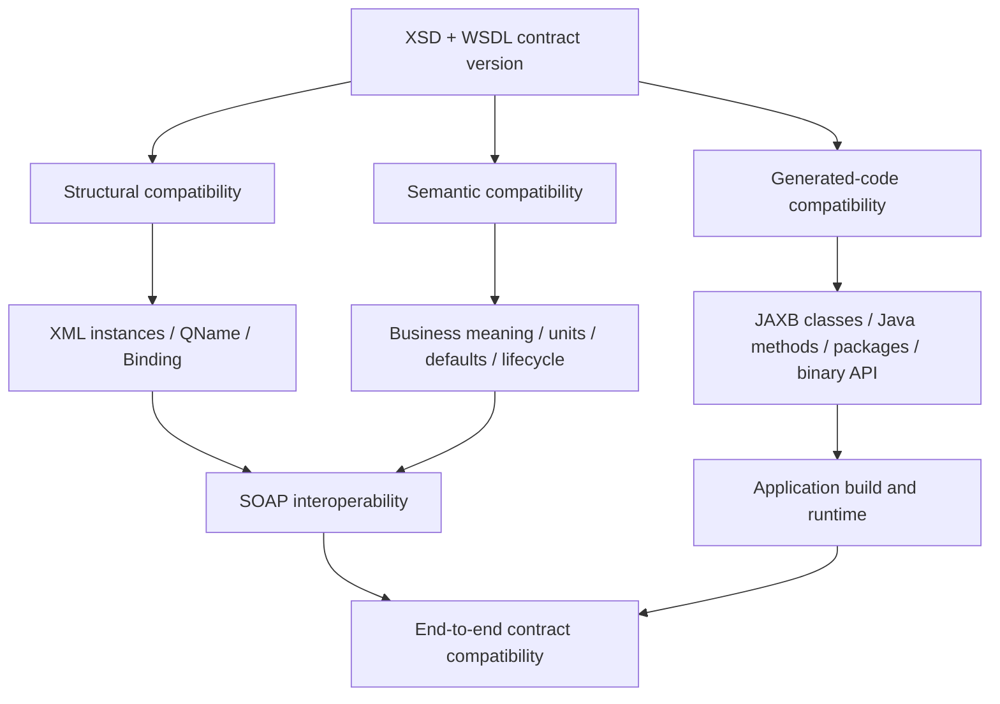
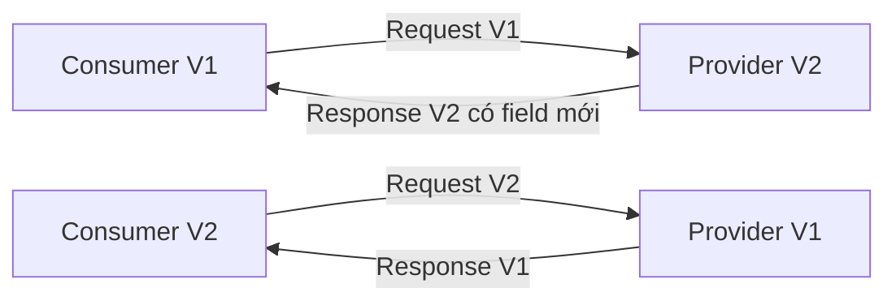
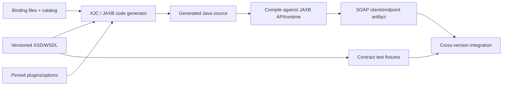
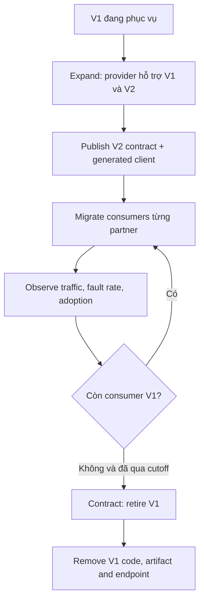
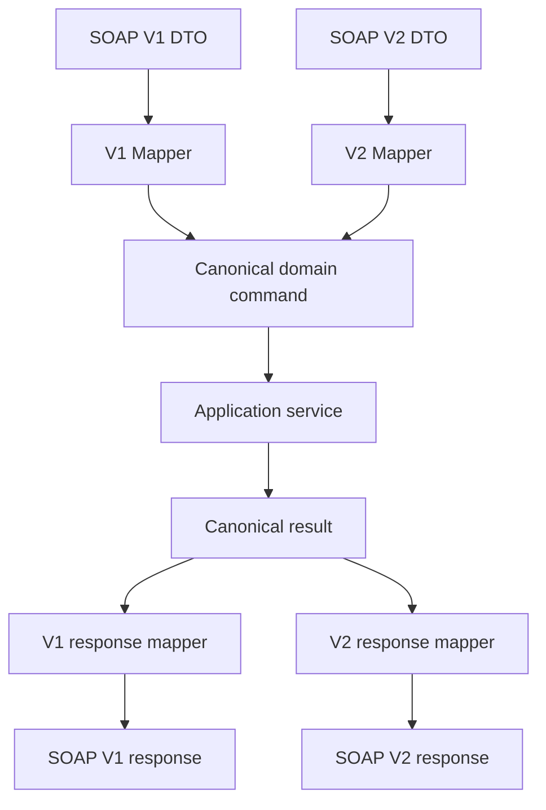

# Tương thích cấu trúc, tương thích ngữ nghĩa và tương thích mã đã được sinh

## 1. Bối cảnh: WSDL vẫn hợp lệ nhưng đối tác không còn gọi được dịch vụ

Một doanh nghiệp cung cấp SOAP service để đối tác tạo đơn hàng. Hợp đồng được thiết kế theo hướng **contract-first**: nhóm duy trì XSD mô tả `SubmitOrderRequest`, WSDL mô tả operation và binding SOAP; JAXB/XJC sinh Java classes; Spring Web Services dùng `@Endpoint`, `Jaxb2Marshaller` và `WebServiceTemplate` để nhận/gửi thông điệp.

Sau một lần nâng cấp, nhóm thêm trường `deliveryMode`, đổi một giá trị enum, làm `customerId` từ bắt buộc thành tùy chọn, đổi kiểu số tiền và regenerate JAXB classes. WSDL vẫn mở được trên trình duyệt, XML mới validate theo XSD mới và ứng dụng Java mới compile. Tuy nhiên:

- Client cũ gửi request không có `deliveryMode`, server mới không còn xử lý đúng.
- Client mới gửi enum value mà server cũ không nhận biết.
- Java consumer dùng `getAmount()` với kiểu `BigDecimal`, nhưng code đã sinh mới trả về một kiểu khác.
- Đối tác đọc trường `status` theo nghĩa “đã được chấp nhận”, trong khi server mới dùng cùng giá trị để biểu thị “đã xử lý xong”.

Những vấn đề đó thuộc các lớp **tương thích cấu trúc**, **tương thích ngữ nghĩa** và **tương thích mã đã được sinh**. Chúng liên quan nhau nhưng không đồng nghĩa:

1. **Tương thích cấu trúc (structural compatibility):** XML instance, QName, sequence, cardinality, type, WSDL operation và binding có còn được bên kia chấp nhận hay không?
2. **Tương thích ngữ nghĩa (semantic compatibility):** cùng một XML có còn mang ý nghĩa nghiệp vụ, đơn vị đo, trạng thái, default, thời điểm và side effect như trước không?
3. **Tương thích mã đã được sinh (generated-code compatibility):** Java source/API được JAXB/XJC sinh có còn tương thích với source, binary, serializer, mapper và các thành phần đã compile trước đó không?

Đây là đề mục **“Tương thích cấu trúc, tương thích ngữ nghĩa và tương thích mã đã được sinh”**, thuộc chương **Tương thích hợp đồng** của module **SPRING_WEB_SERVICES**. Module tập trung phát triển SOAP contract-first với XSD/WSDL, JAXB, endpoint/client, SOAP Fault, interceptor, XML security, WS-Security, chứng chỉ và kiểm thử tương thích cho tích hợp doanh nghiệp.

Sau bài học, bạn có thể:

- Đánh giá thay đổi XSD/WSDL theo chiều provider/consumer và phiên bản.
- Phân biệt backward, forward và full compatibility trong tích hợp SOAP.
- Phân tích thay đổi field, namespace, enum, numeric type, date/time và operation.
- Dự đoán tác động của regenerate JAXB/XJC với Java API.
- Lập chiến lược versioning, migration và contract tests cho nhiều đối tác.
- Tránh những thay đổi “vẫn validate” nhưng làm hỏng ngữ nghĩa hoặc runtime integration.

## 2. Ba lớp tương thích ở ba góc nhìn



### 2.1. Ví dụ một thay đổi ảnh hưởng cả ba lớp

Contract cũ:

```xml
<xs:element name="amount" type="xs:decimal"/>
```

JAXB có thể sinh property Java kiểu `BigDecimal`.

Contract mới:

```xml
<xs:element name="amount" type="xs:long"/>
```

Hệ quả:

| Lớp | Hệ quả |
|---|---|
| Cấu trúc | XML value có thể vẫn trông giống nhau nhưng XSD type thay đổi; các giá trị decimal không nguyên bị từ chối |
| Ngữ nghĩa | Số tiền có thể bị hiểu thành số đơn vị nhỏ nhất, hoặc mất phần lẻ; cần định nghĩa currency/scale |
| Generated code | Java property có thể đổi từ `BigDecimal` sang `long`; source consumer cũ có thể không compile |

**WSDL/XSD hợp lệ không chứng minh ba lớp tương thích.** Cần kiểm tra từng hợp đồng, code generator và cách đối tác diễn giải dữ liệu.

### 2.2. Provider và consumer

Trong bài học:

- **Provider:** bên công bố WSDL/XSD và cung cấp SOAP endpoint.
- **Consumer:** bên đọc contract, generate client và gọi provider.

Một thay đổi có thể backward-compatible với provider mới nhận request cũ nhưng lại không forward-compatible với provider cũ nhận request mới. Vì vậy luôn nói rõ **tương thích theo chiều nào**.

## 3. Backward, forward và full compatibility

Gọi contract cũ là V1, contract mới là V2.

| Khái niệm | Định nghĩa trong tích hợp | Câu hỏi ví dụ |
|---|---|---|
| Backward compatibility | Provider V2 tiếp tục phục vụ consumer V1 | Server mới có nhận request XML cũ không? |
| Forward compatibility | Consumer/provider cũ có xử lý dữ liệu phát sinh theo version mới theo cách cho phép không | Client cũ có chịu được response mới thêm field không? |
| Full compatibility | Cả hai chiều đáp ứng yêu cầu backward và forward | Có thể triển khai consumer/provider theo thứ tự nào mà không downtime? |

Các từ này đôi khi được dùng khác nhau giữa schema registry, API design và hệ thống event. Trong tài liệu SOAP, hãy **định nghĩa cụ thể bên nào nâng cấp trước, request hay response, field nào được thêm và ai phải chịu trách nhiệm bỏ qua field mới**.

### 3.1. Tương thích hai chiều qua sơ đồ



Hai đường có thể có kết quả rất khác:

- Provider V2 có thể nhận request V1 nếu field mới optional và có default semantics tương thích.
- Consumer V1 có thể không đọc response V2 nếu generated JAXB parser strict hoặc code giả định danh sách field/enum đã đóng.
- Provider V1 có thể reject request V2 nếu có element mới không nằm trong XSD cũ hoặc `xs:any` không được khai báo.
- Consumer V2 có thể hoạt động với response V1 nếu code xử lý field vắng mặt đúng cách.

**Không có quy tắc chung rằng “thêm field là backward-compatible”.** Cần xét vị trí trong XSD, minOccurs, maxOccurs, nillability, wildcard, JAXB binding và consumer behavior.

### 3.2. Deployment order là một phần của compatibility

Một rollout thường có hai trạng thái trung gian:

1. Provider mới, consumer cũ.
2. Consumer mới, provider cũ (nếu deployment order có thể đảo hoặc nhiều region cập nhật không đồng thời).

Nếu một change chỉ chạy khi cả hai phía nâng cấp cùng lúc, đó là **breaking coordinated change** và phải có kế hoạch cutover rõ ràng. Đừng gọi nó backward-compatible chỉ vì một integration test dùng cả client/server mới đều pass.

## 4. Tương thích cấu trúc trong XSD

XSD định nghĩa cấu trúc XML: element/attribute, namespace, type, occurrence constraints, order, value space và validation rules.

### 4.1. Thứ tự `xs:sequence`

XSD cũ:

```xml
<xs:complexType name="SubmitOrderRequest">
  <xs:sequence>
    <xs:element name="orderId" type="xs:string"/>
    <xs:element name="customerId" type="xs:string"/>
    <xs:element name="amount" type="xs:decimal"/>
  </xs:sequence>
</xs:complexType>
```

XSD mới thêm `deliveryMode` ở cuối:

```xml
<xs:complexType name="SubmitOrderRequest">
  <xs:sequence>
    <xs:element name="orderId" type="xs:string"/>
    <xs:element name="customerId" type="xs:string"/>
    <xs:element name="amount" type="xs:decimal"/>
    <xs:element name="deliveryMode"
                type="xs:string"
                minOccurs="0"/>
  </xs:sequence>
</xs:complexType>
```

Vì `minOccurs="0"`, XML cũ không có `deliveryMode` có thể vẫn validate theo XSD mới. Nhưng nếu thêm element **bắt buộc**:

```xml
<xs:element name="deliveryMode" type="xs:string"/>
```

thì provider V2 có thể từ chối request V1 thiếu field này.

### 4.2. Chèn field giữa sequence

Với `xs:sequence`, thứ tự element có ý nghĩa. Thêm field optional giữa các phần tử có thể khiến một số consumer cũ/strict parser, binding hoặc code xử lý XML theo vị trí gặp vấn đề.

Ví dụ mới:

```xml
<xs:sequence>
  <xs:element name="orderId" type="xs:string"/>
  <xs:element name="priority" type="xs:string" minOccurs="0"/>
  <xs:element name="customerId" type="xs:string"/>
  <xs:element name="amount" type="xs:decimal"/>
</xs:sequence>
```

Tùy XML parsing và contract, thêm một optional element **có thể** giữ tương thích instance cũ theo schema mới, nhưng các serializer/parser cũ có thể không hiểu hoặc code positional có thể sai. Thêm ở cuối thường giảm nguy cơ hơn, nhưng vẫn phải kiểm thử.

**Không thay `xs:sequence` thành `xs:all` chỉ để tránh thứ tự**: loại compositor có giới hạn khác nhau về cardinality và tool support, có thể phá contract/tooling.

### 4.3. Thay đổi `minOccurs` và `maxOccurs`

| Thay đổi | Tác động cấu trúc thường gặp |
|---|---|
| `minOccurs="1"` → `"0"` | Producer mới có thể bỏ field; consumer cũ có thể vẫn giả định field tồn tại |
| `minOccurs="0"` → `"1"` | Provider mới từ chối message cũ thiếu field |
| `maxOccurs="1"` → `"unbounded"` | Consumer cũ có thể chỉ đọc một instance hoặc sinh property API khác |
| `maxOccurs="unbounded"` → `"1"` | Message cũ có nhiều item có thể bị reject hoặc mất dữ liệu |
| Element đổi thành `nillable="true"` | `xsi:nil` thêm một trạng thái ngoài “vắng mặt” |
| Element đổi thành `nillable="false"` | Instance cũ có `xsi:nil="true"` bị từ chối |

### 4.4. Missing, empty và nil là ba trạng thái khác nhau

Trong XML, các dạng:

```xml
<!-- Vắng mặt -->
<request/>

<!-- Có element nhưng rỗng -->
<request><comment/></request>

<!-- Có element và nil -->
<request xmlns:xsi="http://www.w3.org/2001/XMLSchema-instance">
  <comment xsi:nil="true"/>
</request>
```

có thể biểu thị ba giá trị khác nhau. JAXB binding có thể phản ánh chúng qua null, empty string, `JAXBElement`, `isSet` hoặc wrapper/adapter tùy schema và binding.

**Nếu ứng dụng cần phân biệt “không gửi field” với “xóa giá trị hiện có”**, phải thiết kế contract update/patch rõ ràng. Chỉ đổi `minOccurs` hoặc `nillable` mà không chốt semantics có thể dẫn tới lỗi dữ liệu khó phát hiện.

### 4.5. Attributes cũng là một phần của contract

Thêm một `xs:attribute` bắt buộc có thể làm XML cũ không còn hợp lệ. Thay đổi `use="required"` sang `optional` có thể làm producer mới bỏ attribute; consumer cũ có thể giả định có mặt. Attributes và elements cũng có mapping JAXB/API khác nhau, nên không phải thay thế tương đương.

## 5. Namespace và QName: đổi prefix không giống đổi namespace

Một QName gồm namespace URI và local part. Prefix chỉ là alias trong tài liệu XML:

```xml
<a:SubmitOrderRequest xmlns:a="urn:example:orders:v1">
  <a:orderId>ORD-1001</a:orderId>
</a:SubmitOrderRequest>
```

và:

```xml
<order:SubmitOrderRequest
    xmlns:order="urn:example:orders:v1">
  <order:orderId>ORD-1001</order:orderId>
</order:SubmitOrderRequest>
```

có QName tương ứng giống nhau: `{urn:example:orders:v1}SubmitOrderRequest`.

Nhưng:

```xml
<order:SubmitOrderRequest
    xmlns:order="urn:example:orders:v2">
  <order:orderId>ORD-1001</order:orderId>
</order:SubmitOrderRequest>
```

có namespace URI khác và do đó là **QName khác**. Endpoint Spring-WS thường mapping bằng namespace + localPart:

```java
@PayloadRoot(
    namespace = "urn:example:orders:v1",
    localPart = "SubmitOrderRequest")
@ResponsePayload
public SubmitOrderResponse submit(
        @RequestPayload SubmitOrderRequest request) {
    // ...
}
```

Đổi prefix không buộc đổi `@PayloadRoot`; đổi namespace URI có thể khiến endpoint mapping không còn match, JAXB context không nhận root QName và client/server không tương thích.

### 5.1. Các nơi phải đồng bộ khi đổi namespace version

- `targetNamespace` và `elementFormDefault` trong XSD.
- `xmlns` và QName của root elements/types.
- `wsdl:definitions/@targetNamespace`, messages, portType, binding, service.
- `@XmlSchema`, package namespace metadata và external JAXB bindings.
- `@PayloadRoot`/endpoint mapping.
- `Jaxb2Marshaller` context path hoặc `packagesToScan`.
- Test fixtures, SOAPAction/WS-Addressing action và partner configuration.

**Chỉ thay chuỗi namespace trong một file XSD là chưa đủ** nếu WSDL hoặc generated JAXB artifacts vẫn trỏ namespace cũ.

## 6. Tương thích ngữ nghĩa: XML vẫn parse nhưng ý nghĩa đã thay đổi

Tương thích cấu trúc chỉ trả lời XML có đúng hình dạng. Hai XML instance cùng validate có thể được các bên diễn giải khác nhau. Lỗi ngữ nghĩa thường nguy hiểm hơn lỗi parse vì message **được xử lý thành công nhưng kết quả sai**.

### 6.1. Enum thêm giá trị mới

XSD V1:

```xml
<xs:simpleType name="OrderStatus">
  <xs:restriction base="xs:string">
    <xs:enumeration value="NEW"/>
    <xs:enumeration value="ACCEPTED"/>
    <xs:enumeration value="REJECTED"/>
  </xs:restriction>
</xs:simpleType>
```

V2 thêm `FULFILLED`:

```xml
<xs:enumeration value="FULFILLED"/>
```

Provider mới có thể gửi `FULFILLED`. Một consumer cũ có thể:

- Reject khi JAXB unmarshal vì enum không có constant tương ứng.
- Sinh giá trị `null` hoặc báo validation event tùy generator/runtime/binding.
- Rơi vào default branch trong business code và coi trạng thái không biết là `REJECTED`.

**Enum mở rộng là thay đổi rủi ro với consumer.** Trước khi thêm value, hãy thống nhất cách consumer xử lý unknown value; với JAXB enum generated closed, có thể dùng adapter/string representation phù hợp hoặc nâng consumer trước.

Đừng chuyển unknown value thành một status nghiệp vụ khác. Nếu không thể diễn giải, phải từ chối/đánh dấu unsupported theo policy, tránh im lặng biến “hoàn tất” thành “bị từ chối”.

### 6.2. Thay đổi meaning của một status hiện có

V1:

```text
ACCEPTED = Provider đã nhận yêu cầu và ghi nhận để xử lý.
```

V2:

```text
ACCEPTED = Yêu cầu đã được xử lý thành công hoàn toàn.
```

Cùng enum value và cùng XSD, nhưng đối tác có thể bắt đầu giao hàng hoặc trừ tiền sai thời điểm. Đây là **breaking semantic change** dù schema diff không có gì.

Hướng xử lý:

- Giữ nguyên nghĩa value cũ.
- Bổ sung status mới nếu cần, kèm quy tắc chuyển trạng thái.
- Version tài liệu nghiệp vụ và contract khi thay đổi semantics thật sự.
- Thêm integration tests dựa trên **expected lifecycle**, không chỉ kiểm tra XML string.

### 6.3. Đổi đơn vị tiền hoặc scale

Ví dụ V1:

```xml
<amount>125.50</amount>
<currency>USD</currency>
```

V2 dùng `amount` là số cents:

```xml
<amount>12550</amount>
<currency>USD</currency>
```

XSD vẫn có thể dùng `xs:decimal` và cả hai XML đều validate. Nhưng đối tác V1 hiểu là 12.550 USD (hoặc 125.50 USD theo decimal) trong khi V2 có thể hiểu 12.550 cents tùy scale. **Đơn vị và scale là dữ liệu contract**, không nên ẩn trong code.

Thiết kế tốt:

- Giữ `amount` là decimal theo ISO currency minor units và quy định scale, rounding rõ.
- Hoặc đổi tên field thành `amountMinorUnits` và khai báo integer/scale semantics rõ ràng trong contract mới.
- Không tái sử dụng cùng field/namespace nếu consumer cũ sẽ diễn giải khác.
- Kiểm thử boundary: 0, âm, số cực lớn, 2/3 chữ số lẻ theo currency, rounding.

Trong Java, dùng `BigDecimal` cho monetary decimal; không dùng `double`/`float` làm representation nghiệp vụ tiền.

### 6.4. Thay đổi timezone/date-time

`xs:date` và `xs:dateTime` có semantics khác nhau; một timestamp có timezone cũng khác timestamp không chỉ rõ timezone:

```xml
<createdAt>2026-11-27T10:00:00+07:00</createdAt>
<createdAt>2026-11-27T03:00:00Z</createdAt>
<createdAt>2026-11-27T10:00:00</createdAt>
```

Hai dòng đầu cùng thời điểm. Dòng thứ ba **không xác định timezone**, không thể mặc định đó là UTC hoặc giờ địa phương nếu contract chưa quy định.

Các vấn đề khi thay đổi:

- Server V1 gửi local wall-clock time, server V2 gửi UTC.
- Client cũ parse thành `XMLGregorianCalendar`/`OffsetDateTime` theo rule khác.
- `xs:dateTime` được đổi thành `xs:date`.
- Fractional seconds bị làm tròn/cắt.
- DST/timezone offset hoặc “midnight” ảnh hưởng ngày nghiệp vụ.

Phải định nghĩa rõ **instant vs local date-time**, timezone, độ chính xác, range và cách xử lý leap seconds nếu domain cần. Kiểm thử các thời điểm sát nửa đêm, khác offset và daylight-saving transitions.

### 6.5. Default value và fixed value

Trong XSD:

```xml
<xs:element name="priority"
            type="xs:string"
            minOccurs="0"
            default="NORMAL"/>
```

`default` có thể được schema processor áp dụng khi element vắng mặt trong những ngữ cảnh phù hợp. Nó không có nghĩa mọi JAXB generated object mới tự khởi tạo field thành `NORMAL` ở constructor; behavior phụ thuộc schema validation/binding/provider.

Phân biệt:

- **Vắng element:** không có node trong XML.
- **Default từ schema:** schema-aware processing có thể cung cấp giá trị default.
- **Default trong ứng dụng:** service tự đặt giá trị khi Java property null.
- **Fixed:** contract hạn chế giá trị gửi tới.

Nếu V1 khi vắng `priority` hiểu là `NORMAL` nhưng V2 thay default thành `EXPRESS`, XML cũ vẫn validate song **ngữ nghĩa và chi phí vận hành đã thay đổi**.

Đừng thay default trong XSD mà không đánh giá client/server đã sinh code, validation behavior và business defaults.

### 6.6. Optional không có nghĩa “không quan trọng”

Một field optional về cấu trúc có thể là điều kiện quyết định business:

```xml
<deliveryAddress minOccurs="0"/>
```

Nếu server V1 tự dùng địa chỉ mặc định, còn V2 reject khi field vắng nhưng schema vẫn cho optional, request **vẫn validate** nhưng service trả business Fault. Điều đó có thể được coi là breaking change với các consumer dựa trên default cũ.

Hãy mô tả quy tắc:

- Khi field vắng thì dùng địa chỉ nào?
- Khi empty thì có nghĩa xóa địa chỉ không?
- Khi nil thì có nghĩa yêu cầu không giao hàng không?
- Nếu không thể suy ra giá trị, trả typed SOAP Fault nào?

### 6.7. Idempotency, retry và status semantics

Đổi tên `clientRequestId` thành `requestId` hoặc giữ tên mà thay semantics từ “unique per attempt” thành “stable across retries” có thể làm hệ thống downstream tạo đơn trùng.

Tương tự, thêm một trường `retryCount` không thay thế idempotency key. Contract phải mô tả:

- Key có ổn định qua retry không?
- Scope uniqueness: partner, operation, tenant hay toàn hệ thống?
- Thời gian retention/deduplication?
- Cùng key nhưng payload khác được xử lý thế nào?
- SOAP timeout sau khi server đã commit được đối chiếu bằng operation nào?

Ngữ nghĩa retry là một phần của compatibility vì client cũ và mới có thể hành xử khác khi nhận lỗi transport.

## 7. Tương thích kiểu dữ liệu XSD và mapping JAXB

Generated Java type được quyết định bởi XSD type, JAXB version, XJC plugin/bindings và generator options. Thay kiểu XSD thường kéo theo thay đổi source API và hành vi serialize.

### 7.1. Numeric types

| XSD type | JAXB Java mapping thường gặp | Rủi ro khi đổi |
|---|---|---|
| `xs:decimal` | `BigDecimal` | Scale/precision và rounding |
| `xs:integer` | `BigInteger` hoặc kiểu số theo binding | Range và conversion |
| `xs:int` | `int` | 32-bit signed range |
| `xs:long` | `long` | 64-bit signed range |
| `xs:short` | `short` | Range hẹp hơn |
| `xs:unsignedInt` | Có thể là `long`/mapping theo generator | Unsigned value space khác Java primitive |
| `xs:float` | `float` | Precision binary floating point |
| `xs:double` | `double` | Precision binary floating point |

Ví dụ `xs:int` sang `xs:long`:

- XML cũ với giá trị trong 32-bit range vẫn có thể đọc được bởi server mới.
- Server mới có thể gửi giá trị lớn hơn range `int`; consumer cũ không thể biểu diễn.
- Generated method có thể đổi `int` thành `long`, làm code consumer cũ cần sửa.

Đây là thay đổi có thể **backward-compatible theo dữ liệu cũ nhưng forward-incompatible khi producer mới phát giá trị mở rộng**.

### 7.2. String restrictions

XSD:

```xml
<xs:simpleType name="OrderCode">
  <xs:restriction base="xs:string">
    <xs:minLength value="1"/>
    <xs:maxLength value="20"/>
    <xs:pattern value="[A-Z0-9-]+"/>
  </xs:restriction>
</xs:simpleType>
```

Thắt chặt `maxLength` từ 40 xuống 20 hoặc thêm pattern có thể khiến request cũ vốn hợp lệ bị reject. Nới lỏng thường cho phép thêm dữ liệu đầu vào, nhưng consumer cũ có thể không hỗ trợ format mới.

Pattern XSD regular expressions không hoàn toàn giống Java `Pattern`; không copy quy tắc validation giữa hai ngôn ngữ mà không kiểm thử.

### 7.3. Boolean và lexical values

XSD boolean có lexical representation `true`, `false`, `1`, `0`. Consumer không nên giả định server chỉ gửi literal lowercase true/false nếu contract cho phép các giá trị khác. Một schema custom hóa thành string enum có thể sinh API khác và thay đổi accepted values.

### 7.4. Binary types

`xs:base64Binary` có thể được JAXB sinh thành `byte[]`; với MTOM/XOP binding có thể sinh `DataHandler` hoặc kiểu khác tùy schema annotations/toolchain. Đổi giữa inline Base64 và MTOM không chỉ là generated field change: nó có thể đổi HTTP Content-Type/multipart packaging và yêu cầu đối tác hỗ trợ.

### 7.5. Date/time types

| XSD type | Mapping thường gặp | Cần lưu ý |
|---|---|---|
| `xs:date` | `XMLGregorianCalendar` hoặc Java time qua binding | Ngày không nhất thiết có timezone |
| `xs:dateTime` | `XMLGregorianCalendar`/adapter | Offset, fractional seconds, timezone |
| `xs:time` | `XMLGregorianCalendar`/adapter | Time-of-day không phải instant |
| `xs:duration` | `Duration` theo JAXB mapping | XML duration không giống mọi Java duration semantics |

Khi dùng JAXB adapter sang `OffsetDateTime`, `LocalDate`, `Instant`, phải thống nhất round-trip serialization và dữ liệu không có timezone.

## 8. Tương thích mã đã được sinh: JAXB/XJC và Java API

WSDL/XSD là contract nguồn; JAXB/XJC sinh code theo toolchain. **Generated Java classes là một đầu ra có version**, không nên xem nó là dữ liệu phụ có thể regenerate tùy ý mà không kiểm soát.

### 8.1. Những thứ generator có thể thay đổi

- Java package được suy ra từ target namespace hoặc external binding.
- Tên class/interface dựa vào element/type naming.
- Field/property name, accessor method và `ObjectFactory`.
- Primitive vs wrapper type, ví dụ `int` vs `Integer`.
- `BigDecimal`, `XMLGregorianCalendar`, `byte[]`, `DataHandler` hoặc adapter type.
- `JAXBElement<T>` wrapper và `@XmlElementDecl`.
- `@XmlElement(required=true)`, `@XmlType(propOrder=...)`, `@XmlRootElement`.
- Enum constants và enum mapping.
- `LiveList`/collection getter thay vì setter collection.
- Annotation namespace, schema metadata và serialization behavior.

Hai lần generate cùng XSD nhưng khác XJC version/plugin/options có thể tạo **Java source khác nhau**.

### 8.2. Ví dụ generated API đổi

V1:

```java
public BigDecimal getAmount() {
    return amount;
}

public void setAmount(BigDecimal value) {
    this.amount = value;
}
```

V2 do XSD/binding thay đổi:

```java
public long getAmount() {
    return amount;
}

public void setAmount(long value) {
    this.amount = value;
}
```

Consumer code:

```java
BigDecimal total = request.getAmount();
```

không còn compile. Nếu Java library đã phát hành và consumer compile against nó, đây là source compatibility break; binary compatibility cũng phải đánh giá theo method descriptor và generated class package/type cụ thể.

### 8.3. Thêm optional field có thể đổi Java object model

Thêm một element optional trong XSD có thể tạo getter/setter mới. Về Java source, việc thêm method thường ít phá vỡ hơn xóa/đổi type method, nhưng vẫn có thể ảnh hưởng:

- Snapshot tests hoặc code dùng reflection để liệt kê properties.
- JSON serialization nếu generated JAXB object bị tái sử dụng ngoài SOAP.
- Bean mappers/builders và constructors do plugin sinh.
- `equals/hashCode/toString` nếu plugin hoặc wrapper class tạo.
- Binary compatibility nếu class/interface/constructor kế thừa bị thay đổi.

Đặc biệt, `minOccurs="0"` có thể sinh wrapper `Integer` thay vì `int`, khiến code phải xử lý null. **Thêm field optional không có nghĩa Java code hoàn toàn không thay đổi.**

### 8.4. `JAXBElement<T>` và root/type mapping

XJC có thể sinh:

```java
@XmlElementDecl(
    namespace = "urn:example:orders:v1",
    name = "SubmitOrderRequest")
public JAXBElement<SubmitOrderRequest> createSubmitOrderRequest(
        SubmitOrderRequest value) {
    return new JAXBElement<>(
            _SubmitOrderRequest_QNAME,
            SubmitOrderRequest.class,
            null,
            value);
}
```

Nếu WSDL/XSD đổi global element thành local element, đổi namespace hoặc external binding thay class name, wrapper `JAXBElement`/`ObjectFactory` có thể khác. Code gọi `marshalSendAndReceive()` với object root phải đảm bảo QName đúng.

### 8.5. Generated source và compiled binary là hai kiểm tra khác nhau

| Kiểm tra | Điều trả lời |
|---|---|
| Regenerate + compile consumer source | Mã nguồn có còn build với API mới không? |
| Binary compatibility check | Consumer đã compile có chạy với library/API mới không? |
| JAXB marshal/unmarshal round-trip | XML serialization có giữ cấu trúc/giá trị không? |
| Cross-version SOAP integration | Client/server V1/V2 có trao đổi được không? |
| Semantic contract test | Hai phía có diễn giải dữ liệu như mong đợi không? |

Một project compile thành công sau khi regenerate **không chứng minh consumer bên ngoài chưa rebuild vẫn chạy được**. Nếu generated classes được phát hành thành Java library, hãy version artifact và cân nhắc API compatibility tooling.

## 9. Kiểm soát toolchain JAXB/XJC

### 9.1. Khóa phiên bản generator và runtime

Một pipeline contract-first thường bao gồm:



Cần quản lý:

- JDK version dùng để chạy generator.
- JAXB/XJC major/minor version.
- Plugin extensions và external binding files.
- Namespace-to-package mapping.
- `episode` files nếu generate theo nhiều schema/module.
- Dependency JAXB API/runtime cùng hệ `javax` hoặc `jakarta`.
- Encoding, locale và output options ảnh hưởng generated source.

**Không regenerate ở mỗi máy developer bằng generator mới nhất không khóa version.** Hai developer có thể tạo source khác nhau dù cùng đọc một XSD.

### 9.2. `javax.xml.bind` và `jakarta.xml.bind`

Các codebase chuyển từ Java EE cũ sang Jakarta có thể gặp:

```java
// JAXB cũ
import javax.xml.bind.annotation.XmlType;

// JAXB Jakarta
import jakarta.xml.bind.annotation.XmlType;
```

Hai package có tên tương tự nhưng là **API khác nhau**, không thể thay thế bằng cast. Generated source theo `javax` không tự tương thích với runtime chỉ hỗ trợ `jakarta`, và ngược lại.

Khi nâng Spring Boot/Spring-WS:

1. Đồng bộ JDK, Spring-WS, JAXB API và implementation.
2. Dùng XJC thuộc đúng hệ API target.
3. Regenerate code vào source set/artifact phù hợp.
4. Kiểm tra dependency tree không trộn hai hệ binding trên cùng pipeline.
5. Chạy round-trip tests, endpoint tests và cross-version tests.

### 9.3. Giữ generated code tách khỏi handwritten adapter

Không sửa trực tiếp file do XJC sinh vì lần generate tiếp theo sẽ ghi đè. Tách:

```text
contract/
  orders-v1.xsd
  orders-v1.wsdl
  bindings/
generated/
  com/example/orders/v1/
adapter/
  OrdersSoapMapper.java
  OrdersSoapGateway.java
domain/
  SubmitOrderCommand.java
  OrderStatus.java
```

Đây là cấu trúc minh họa. Mapper chuyển generated DTO sang domain model và ngược lại. Khi generated API thay đổi, phần adapter hấp thụ thay đổi; domain không cần mang annotations JAXB hoặc phụ thuộc tên class XJC.

### 9.4. Namespace-to-package binding ổn định

Có thể dùng external JAXB binding để giữ Java package ổn định khi generator/toolchain thay đổi:

```xml
<jaxb:bindings
    xmlns:jaxb="https://jakarta.ee/xml/ns/jaxb"
    version="3.0">
  <jaxb:bindings
      schemaLocation="orders-v1.xsd"
      node="/xs:schema"
      xmlns:xs="http://www.w3.org/2001/XMLSchema">
    <jaxb:schemaBindings>
      <jaxb:package name="com.example.orders.contract.v1"/>
    </jaxb:schemaBindings>
  </jaxb:bindings>
</jaxb:bindings>
```

Đoạn binding trên minh họa **Jakarta JAXB 3.x namespace**. JAXB 2.x dùng binding namespace/version khác; đừng copy binding Jakarta vào XJC cũ mà không kiểm tra. Package name là một phần Java API đã sinh, cần được version và giữ ổn định khi consumer phụ thuộc.

## 10. WSDL compatibility: operation, binding, service và Fault

WSDL không chỉ là danh sách XML types. Nó mô tả abstract interface và binding/endpoint cho SOAP transport.

### 10.1. Những thành phần cần so sánh giữa WSDL V1/V2

| WSDL component | Câu hỏi tương thích |
|---|---|
| `types` | XSD imports, namespaces và type definitions có đổi không? |
| `message` | Parts/elements/types có còn map tới đúng QName không? |
| `portType` | Operation/input/output/fault có thay đổi không? |
| `binding` | SOAP 1.1/1.2, document/RPC, literal/encoded, action có đổi không? |
| `service` | Port address/endpoint có đổi không? |
| `wsdl:operation` | Operation name, input/output/fault action có tương thích không? |
| SOAPAction/WS-Addressing | Client có tiếp tục gửi đúng action và server có route đúng không? |

### 10.2. Thêm operation mới

Thêm operation thường ít ảnh hưởng consumer cũ nếu:

- WSDL consumer cũ đã tải static và không strict validate toàn WSDL.
- Provider vẫn giữ portType/binding cũ.
- Server không thay endpoint/soapAction mapping hiện có.

Nhưng consumer mới gọi operation mới trên provider cũ sẽ thất bại. Đây là **backward-compatible cho consumer cũ** trong điều kiện provider giữ operation cũ, nhưng không forward-compatible với server cũ.

### 10.3. Đổi operation name hoặc SOAPAction

Đổi:

```text
SubmitOrder -> CreateOrder
urn:example:orders:SubmitOrder -> urn:example:orders:CreateOrder
```

có thể làm generated client gọi method mới hoặc gửi SOAPAction mới. Server cũ có thể không có mapping đó; gateway/WAF cũng có thể route theo action. Giữ operation cũ trong giai đoạn chuyển tiếp hoặc version endpoint/namespace rõ ràng.

### 10.4. Thay SOAP 1.1 bằng SOAP 1.2

SOAP 1.1 và 1.2 có namespace Envelope, Content-Type và action mechanisms khác nhau. Thay version binding có thể làm message factory/client không xử lý:

- SOAP 1.1 dùng namespace `http://schemas.xmlsoap.org/soap/envelope/`.
- SOAP 1.2 dùng namespace `http://www.w3.org/2003/05/soap-envelope`.
- SOAP 1.1 HTTP binding thường dùng `text/xml`.
- SOAP 1.2 HTTP binding dùng `application/soap+xml`.

Một endpoint có thể hỗ trợ cả hai binding, nhưng phải công bố/test rõ. Đổi một binding trong WSDL mà không duy trì port cũ thường là **breaking contract change**.

### 10.5. Thêm hoặc đổi Fault

Fault cũng là một phần contract. Consumer có thể phụ thuộc:

- QName/code/subcode.
- Fault detail element và namespace.
- Typed fault class được JAXB sinh.
- Mapping business exception sang fault detail.
- HTTP binding/status đi cùng SOAP Fault.

Thêm một typed fault có thể khiến consumer cũ không biết xử lý; đổi QName hoặc detail schema có thể làm JAXB unmarshal lỗi. Hãy xem Fault là **public response type**, không phải log nội bộ.

## 11. WSDL/XSD imports, catalog và phân phối contract

Một contract nhiều file có thể dùng:

- `xs:include` cho schema cùng target namespace.
- `xs:import` cho schema namespace khác.
- `wsdl:import` cho WSDL definitions khác.
- External JAXB bindings/XJC episode.

Đổi location hoặc namespace import có thể phá build/runtime nếu consumer không thể resolve dependency. Trong build reproducible:

1. Version tất cả XSD/WSDL dependency.
2. Dùng local XML catalog hoặc artifact repository tin cậy.
3. Không phụ thuộc schema URL có thể bị chỉnh sửa bất ngờ.
4. Validate import graph và tránh circular dependencies.
5. Đóng gói WSDL/XSD cần thiết trong client artifact hoặc publish contract package versioned.

Không tự động tải contract từ production URL trong mỗi build rồi regenerate code; build phải tái lập từ cùng nguồn versioned.

## 12. Versioning SOAP contract: namespace, endpoint và artifact

Khi thay đổi không tương thích, consumer cần cách nhận biết và lựa chọn contract version.

### 12.1. Version trong namespace

```text
V1 namespace: urn:example:orders:v1
V2 namespace: urn:example:orders:v2
```

Ưu điểm:

- QName của request/response/fault phân biệt rõ.
- JAXB có thể sinh vào package version riêng.
- Spring-WS endpoint mapping phân biệt bằng namespace + localPart.
- Có thể chạy song song endpoint V1/V2 để migrate dần.

Đổi namespace là thay đổi **structural contract**, chỉ nên làm khi có lý do versioning rõ. Không tăng namespace version chỉ vì thêm field optional vẫn giữ semantics; version quá dày gây gánh nặng vận hành.

### 12.2. Version trong endpoint path

```text
https://api.example.org/soap/v1/orders
https://api.example.org/soap/v2/orders
```

Ưu điểm là gateway, monitoring và consumer config dễ định tuyến; nhược điểm là đổi endpoint URL, routing/proxy và WSDL service port. Nếu giữ một URL nhưng đổi namespace, endpoint vẫn cần phân biệt message version trong SOAP Body.

Có thể kết hợp namespace v1 với endpoint `/soap/v1` và namespace v2 với `/soap/v2`. Không bắt buộc luôn dùng cả hai. Chọn một chiến lược nhất quán và kiểm tra WSDL `soap:address` của từng version.

### 12.3. Version Java artifact riêng

```text
com.example.contract:orders-soap-contract-v1
com.example.contract:orders-soap-contract-v2

com.example.orders.contract.v1
com.example.orders.contract.v2
```

Giữ cả hai version trong thời gian migration giúp application consumer nâng cấp có kiểm soát. Tránh để hai generator ghi đè vào cùng package/class khi cần hỗ trợ song song.

### 12.4. Deprecation và retirement

1. Công bố V2 và lý do không tương thích.
2. Cho V1/V2 cùng hoạt động trong cửa sổ chuyển tiếp đã thống nhất.
3. Có mapping/migration guide cho fields và error handling.
4. Telemetry nhận diện consumer đang gọi V1 (không log payload nhạy cảm).
5. Thông báo cutoff, hỗ trợ thử nghiệm và xác nhận partner.
6. Chỉ retire V1 khi đạt điều kiện adoption, SLA và rollback plan.

Đừng xóa V1 chỉ vì nội bộ đã migrate hết; đối tác có lịch release và compliance riêng.

## 13. Các quy tắc thay đổi an toàn và thay đổi rủi ro

Không có bảng safe/breaking đúng cho mọi JAXB implementation, nhưng bảng sau hữu ích khi review ban đầu:

| Thay đổi | Rủi ro mặc định | Lý do/cách xử lý |
|---|---|---|
| Thêm element optional ở cuối sequence | Trung bình | XML cũ có thể validate; consumer strict/generated API vẫn cần test |
| Thêm element required | Cao | Provider mới có thể reject XML cũ |
| Xóa element | Cao | Consumer mới/logic cũ có thể phụ thuộc |
| Đổi namespace URI | Cao | QName thay đổi, endpoint mapping/generated package có thể khác |
| Đổi prefix nhưng giữ namespace URI | Thấp về QName | Prefix là alias; vẫn test serializer/parser |
| Đổi sequence order | Cao | Instance/consumer có thể không còn validate |
| Nới minOccurs | Trung bình | Missing field và default semantics ảnh hưởng consumer |
| Thắt minOccurs | Cao | Message cũ có thể không còn hợp lệ |
| Đổi maxOccurs=1 thành unbounded | Trung bình/cao | Mapping collection và code consumers thay đổi |
| Thêm enum value | Trung bình/cao | Consumer generated enum có thể không xử lý unknown value |
| Xóa/đổi nghĩa enum value | Rất cao | Consumer hoặc business logic diễn giải sai |
| Đổi xs:decimal thành xs:long | Cao | Scale/value space và Java API thay đổi |
| Thắt pattern/maxLength | Cao | Producer cũ gửi dữ liệu hợp lệ trước đây nhưng bị reject |
| Nới validation facets | Trung bình | Consumer/provider cũ có thể không xử lý dữ liệu mới |
| Đổi default | Cao về semantics | XML giữ nguyên nhưng business behavior đổi |
| Đổi SOAPAction | Cao | Routing và generated operation invocation thay đổi |
| Đổi SOAP 1.1 sang 1.2 | Rất cao | Envelope namespace, media type, fault binding khác |
| Thêm operation mới giữ nguyên operation cũ | Thường thấp với consumer cũ | Server vẫn giữ interface cũ; server cũ không hiểu operation mới |
| Đổi Fault QName/detail | Cao | Consumer generated fault type/handler thay đổi |
| Chỉ đổi JAXB/XJC version | Rủi ro toolchain | Generated API/annotations có thể đổi dù XSD không đổi |

**Rủi ro mặc định không thay thế compatibility tests.** Một thay đổi được xem là low risk vẫn có thể phá consumer cụ thể do generator, parser strictness hoặc code assumptions.

## 14. Bộ kiểm thử compatibility cho SOAP contract

Một bộ test đáng tin phải bao phủ **schema, wire protocol, generated code, semantics và deployment version matrix**.

### 14.1. Các lớp test

| Lớp | Nội dung | Phát hiện |
|---|---|---|
| XSD validation | Validate XML fixtures V1/V2 theo từng schema | Structural breaking changes |
| WSDL comparison | So operation, messages, bindings, imports, SOAPAction | Contract/binding changes |
| JAXB generation diff | Generate bằng toolchain khóa và so source output | API/package/type/annotation changes |
| Compile compatibility | Compile consumer sample/source cũ với client API mới | Source break |
| Binary compatibility | Consumer compiled trước chạy với artifact mới | Method/class descriptor break |
| Marshal/unmarshal round-trip | JAXB object ↔ XML theo cả version | QName/type/serialization mismatch |
| Semantic tests | Default, units, statuses, timezone, retry lifecycle | Meaning changes |
| SOAP cross-version integration | Client V1 ↔ provider V2, client V2 ↔ provider V1 | Runtime interoperability |
| Fault tests | SOAP 1.1/1.2 fault detail/code behavior | Error contract break |
| Security tests | WSS4J signature, timestamp, TLS, parser | Security policy regressions |

### 14.2. Compatibility matrix

| Consumer | Provider | Câu hỏi phải kiểm thử |
|---|---|---|
| C1 | P1 | Baseline hiện tại còn pass? |
| C1 | P2 | Provider mới có phục vụ client cũ? |
| C2 | P1 | Client mới có thể gọi server cũ? |
| C2 | P2 | Hai bên mới hoạt động đúng semantics? |

Không thể chỉ test C2/P2 rồi kết luận deployment rolling an toàn. **C1/P2 và C2/P1 thường mới là hai trạng thái quyết định backward/forward compatibility.**

### 14.3. Ví dụ test fixtures nhiều version

```text
src/test/resources/contracts/
  v1/
    submit-order-request.xml
    submit-order-response.xml
    submit-order-invalid.xml
    order-fault.xml
  v2/
    submit-order-request.xml
    submit-order-response.xml
    submit-order-invalid.xml
    order-fault.xml
```

Fixture phải là message hợp lệ/không hợp lệ có mục đích cụ thể, được review và version hóa cùng contract. Tránh sinh mọi fixture từ cùng generated classes mới rồi dùng nó làm oracle cho server cũ: đó là **cùng một phía tự kiểm tra chính mình**.

### 14.4. XSD validator test

Ví dụ một test xác thực XML fixture:

```java
import static org.junit.jupiter.api.Assertions.*;

import java.io.InputStream;
import javax.xml.XMLConstants;
import javax.xml.transform.stream.StreamSource;
import javax.xml.validation.SchemaFactory;
import org.junit.jupiter.api.Test;

class OrderContractSchemaTest {
    @Test
    void v1RequestFixtureRemainsValidAgainstV1Schema()
            throws Exception {
        SchemaFactory factory = SchemaFactory.newInstance(
                XMLConstants.W3C_XML_SCHEMA_NS_URI);
        factory.setProperty(XMLConstants.ACCESS_EXTERNAL_DTD, "");
        factory.setProperty(XMLConstants.ACCESS_EXTERNAL_SCHEMA, "");

        try (InputStream xsd = getClass().getResourceAsStream(
                     "/contracts/v1/orders-v1.xsd");
             InputStream xml = getClass().getResourceAsStream(
                     "/contracts/v1/submit-order-request.xml")) {
            assertNotNull(xsd);
            assertNotNull(xml);
            var schema = factory.newSchema(new StreamSource(xsd));
            assertDoesNotThrow(() ->
                    schema.newValidator().validate(new StreamSource(xml)));
        }
    }
}
```

Đây là **một test schema validation minh họa**; XSD thực có thể import/include các schema khác và cần XML catalog/LSResourceResolver allowlist. Đoạn test không tải schema ngoài và phải fail nếu provider không hỗ trợ external-access properties theo policy.

### 14.5. JAXB round-trip test

Với từng version generated package:

1. Unmarshal fixture XML bằng JAXB context của version đó.
2. Kiểm tra giá trị Java, đặc biệt BigDecimal, enum, nil/optional/date-time.
3. Marshal object trở lại XML.
4. Validate XML output theo XSD cùng version.
5. So **XML infoset/QName/values** theo contract, không chỉ so chuỗi whitespace/prefix.

Round-trip V1 chỉ chứng minh JAXB V1 tự tương thích. Cần thêm V1 XML → V2 JAXB, V2 XML → V1 JAXB nếu đó là đường tương thích thực sự được yêu cầu.

### 14.6. WSDL structural diff không thể thay semantic review

Một WSDL/XSD diff tool có thể chỉ ra:

- Element mới/xóa/đổi type.
- QName, sequence hoặc minOccurs đổi.
- PortType/operation/action thay đổi.
- Fault/detail element đổi.

Nó không thể biết `ACCEPTED` chuyển từ “đã nhận” thành “đã hoàn thành”, hay `amount` đổi đơn vị từ major units sang minor units. Những thay đổi này cần **review tài liệu semantics và business tests**.

## 15. Contract testing ở cả provider và consumer

Một contract tốt không chỉ validate syntax. Provider và consumer phải cùng chứng minh mình tuân hợp đồng đã công bố.

### 15.1. Provider contract tests

Provider kiểm tra:

- WSDL/XSD đang publish đúng version, import graph hoàn chỉnh.
- XML request từ consumer V1 được chấp nhận nếu backward compatibility được cam kết.
- Response vẫn có QName/type/status semantics như contract.
- SOAP Fault detail/code phù hợp khi input không hợp lệ hoặc business rule bị vi phạm.
- SOAP 1.1/1.2 bindings và SOAPAction đúng cấu hình.
- WS-Security policy không bị thay đổi ngoài dự kiến.
- Generated server model không được dùng như nguồn hợp đồng thứ hai tách khỏi XSD.

Ví dụ một test endpoint qua Spring-WS test support:

```java
import static org.springframework.ws.test.server.RequestCreators.withPayload;
import static org.springframework.ws.test.server.ResponseMatchers.payload;

import org.junit.jupiter.api.Test;
import org.springframework.beans.factory.annotation.Autowired;
import org.springframework.boot.test.context.SpringBootTest;
import org.springframework.ws.test.server.MockWebServiceClient;
import org.springframework.xml.transform.StringSource;

@SpringBootTest
class OrdersProviderContractTest {
    @Autowired
    MockWebServiceClient client;

    @Test
    void acceptsV1RequestAndReturnsV1CompatibleResponse() {
        String request = """
            <o:SubmitOrderRequest xmlns:o="urn:example:orders:v1">
              <o:orderId>ORD-1001</o:orderId>
              <o:customerId>C-01</o:customerId>
              <o:amount>125.50</o:amount>
            </o:SubmitOrderRequest>
            """;

        String expectedResponse = """
            <o:SubmitOrderResponse xmlns:o="urn:example:orders:v1">
              <o:orderId>ORD-1001</o:orderId>
              <o:status>ACCEPTED</o:status>
            </o:SubmitOrderResponse>
            """;

        client.sendRequest(withPayload(new StringSource(request)))
                .andExpect(payload(new StringSource(expectedResponse)));
    }
}
```

Đây là **snippet minh họa Spring-WS test support**; trong project thật cần cấu hình `MockWebServiceClient` bean, endpoint, namespace và business fixtures. Test payload so XML payload theo matcher framework; với contract nhiều namespace, Fault detail hoặc SOAP Header, cần matcher bổ sung. Nếu endpoint yêu cầu WS-Security, phải gửi message đã ký bằng test fixture/peer phù hợp; `StringSource` XML thuần không tự có signature.

### 15.2. Consumer-driven contract tests

Consumer kiểm tra các giả định nó thực sự cần:

- Provider operation/action, endpoint, namespace.
- Required fields và optional fields theo version.
- Enum values và cách xử lý unknown value.
- Numeric precision, null/nil, dates/timezones.
- Fault codes/detail mà client sẽ xử lý.
- Security headers, certificate profile và SOAP version.

Consumer test **không nên yêu cầu provider giữ mọi chi tiết không nằm trong contract** như thứ tự attribute, prefix XML, whitespace hoặc internal stack trace. Chỉ kiểm tra semantics đã công bố.

### 15.3. Golden fixtures và contract snapshots

Giữ một tập XML fixtures đã được đối tác phê duyệt làm golden examples:

```text
contracts/
  orders/
    v1/
      request-valid.xml
      response-accepted.xml
      fault-invalid-order.xml
    v2/
      request-with-delivery-mode.xml
      response-with-tracking-id.xml
      fault-delivery-unavailable.xml
```

Khi thay đổi schema, review fixture diff cùng XSD/WSDL diff. Golden fixtures không thay thế live interop test; chúng chỉ cố định các ví dụ và expectations quan trọng.

## 16. Migration và rollout không downtime

Một thay đổi contract không tương thích cần migration plan, không chỉ một PR sửa XSD và regenerate client.

### 16.1. Expand–migrate–contract



### 16.2. Expand: mở rộng khả năng trước

- Giữ V1 endpoint/WSDL hoạt động.
- Triển khai V2 endpoint/namespace hoặc backward-compatible behavior.
- Cho provider hiểu request cũ và mới trong thời gian chuyển tiếp.
- Response V1 phải giữ semantics cũ cho consumer V1.
- Thiết lập metric theo contract version/partner.

Không gửi ngay response V2 cho consumer V1 nếu client cũ không chịu được field/enum mới. Có thể cần adapter map response theo version.

### 16.3. Migrate: chuyển từng consumer

- Publish WSDL/XSD V2 và artifact JAXB V2.
- Cung cấp mapping guide và semantic changes.
- Partner regenerate/compile/test client.
- Chạy cross-version contract tests ở staging.
- Canary một nhóm consumer trước khi chuyển rộng.
- Theo dõi SOAP Fault, schema errors, 401/403, WSS4J failures và latency.

### 16.4. Contract: retire version cũ

Chỉ retire V1 khi:

- Đã xác nhận consumer cần thiết chuyển V2.
- Không còn traffic V1 trong cửa sổ quan sát đủ dài.
- Partner đã xác nhận thời điểm cutoff.
- Backup/rollback plan và support runbook có sẵn.
- Security/certificate policy của V1 đã được retire đúng.

**Không xóa certificate/endpoint V1 quá sớm** nếu còn messages, retries hoặc partner batch jobs cần xử lý.

### 16.5. Rollback không phải luôn chỉ quay code lại

Nếu V2 đã ghi dữ liệu theo semantics mới, quay về V1 code có thể không hiểu database state hoặc outbound messages. Migration plan nên xác định:

- Có thay đổi schema database không?
- Có data transformation/reverse mapping không?
- Có gửi message V2 ra đối tác không thể thu hồi?
- Có idempotency/reconciliation khi hai version cùng xử lý request?
- Có cần compatibility adapter ở gateway?

Một rollback an toàn phải xem **contract, data và side effects** cùng nhau.

## 17. Spring-WS hỗ trợ nhiều contract version như thế nào?

### 17.1. Endpoint mapping theo QName

Nếu V1 và V2 dùng namespace riêng, có thể mapping hai endpoint methods:

```java
@Endpoint
public class VersionedOrdersEndpoint {
    private static final String V1 = "urn:example:orders:v1";
    private static final String V2 = "urn:example:orders:v2";

    private final OrdersApplicationService service;

    public VersionedOrdersEndpoint(OrdersApplicationService service) {
        this.service = service;
    }

    @PayloadRoot(namespace = V1, localPart = "SubmitOrderRequest")
    @ResponsePayload
    public com.example.orders.v1.SubmitOrderResponse submitV1(
            @RequestPayload com.example.orders.v1.SubmitOrderRequest request) {
        return service.submit(OrderV1Mapper.toCommand(request));
    }

    @PayloadRoot(namespace = V2, localPart = "SubmitOrderRequest")
    @ResponsePayload
    public com.example.orders.v2.SubmitOrderResponse submitV2(
            @RequestPayload com.example.orders.v2.SubmitOrderRequest request) {
        return OrderV2Mapper.toResponse(
                service.submit(OrderV2Mapper.toCommand(request)));
    }
}
```

Đây là **phác thảo endpoint**; các generated V1/V2 types, mapper và application service là thành phần dự án định nghĩa. Cần khai báo hai JAXB contexts/packages trong marshaller thích hợp và bảo đảm endpoint mapping phân biệt đúng QName. Không dùng cùng root element namespace cho hai schema version nếu không có cơ chế routing riêng.

### 17.2. JAXB marshaller cho nhiều package

Một cấu hình có thể dùng `setPackagesToScan(...)` hoặc context path chứa nhiều package, tùy JAXB/Spring OXM version:

```java
@Bean
Jaxb2Marshaller versionedOrdersMarshaller() {
    Jaxb2Marshaller marshaller = new Jaxb2Marshaller();
    marshaller.setContextPaths(
            "com.example.orders.v1",
            "com.example.orders.v2");
    return marshaller;
}
```

Tên method API cụ thể phụ thuộc Spring OXM version; kiểm tra compiler/Javadoc của dependency đã khóa. Mỗi generated package phải có JAXB annotations/context metadata tương thích; package collision hoặc duplicate global QNames cần được xử lý.

Nếu hai version cần cấu hình schema validation riêng, adapters riêng hoặc SOAP security profile riêng, có thể dùng **marshaller/template/endpoint adapter riêng** thay vì một context lớn khiến cấu hình khó kiểm soát.

### 17.3. Client template theo partner contract version

```java
@Bean("ordersV1Template")
WebServiceTemplate ordersV1Template(
        SaajSoapMessageFactory v1MessageFactory,
        @Qualifier("ordersV1Marshaller") Jaxb2Marshaller v1Marshaller) {
    WebServiceTemplate template =
            new WebServiceTemplate(v1MessageFactory);
    template.setMarshaller(v1Marshaller);
    template.setUnmarshaller(v1Marshaller);
    template.setDefaultUri("https://partner.example.org/soap/v1/orders");
    return template;
}
```

Đây là một ví dụ version-specific template. V2 có thể cần endpoint, marshaller, SOAPAction, WS-Security interceptor, certificate profile và trust material khác. Không mutate một singleton template giữa calls để thay version.

### 17.4. Adapter version → domain



Domain service không cần biết `SubmitOrderRequest` XJC V1 hay V2. Mapper chịu trách nhiệm translate differences, validate semantics và fail rõ nếu không thể biểu diễn một giá trị version mới vào domain model.

## 18. Checklist review một contract change trước khi merge

### Structural compatibility

- [ ] Có diff XSD/WSDL so với version phát hành trước.
- [ ] Đã xem QName, namespace URI, root element, type, `xs:sequence`.
- [ ] Đã đánh giá `minOccurs`, `maxOccurs`, `nillable`, attributes và wildcard.
- [ ] Đã kiểm tra enum values, facets, numeric/date/binary types.
- [ ] Đã so WSDL operation, SOAPAction, binding, endpoint address và Fault.
- [ ] Imports/includes được version hóa, build không phụ thuộc URL ngoài.

### Semantic compatibility

- [ ] Field meaning, unit, scale, default, null/nil và state transitions không đổi ngoài chủ đích.
- [ ] Các status/enum mới có hướng dẫn consumer xử lý unknown value.
- [ ] Retry, idempotency, timeout và side effects được mô tả.
- [ ] Timezone, precision, rounding, currency và locale đã được xác định.
- [ ] Business authorization và Fault behavior được kiểm tra theo semantics.

### Generated-code compatibility

- [ ] JDK/JAXB/XJC/plugin/options được khóa version.
- [ ] Generated source diff đã được review.
- [ ] Java package, class, method, property type và `ObjectFactory` đã được so sánh.
- [ ] Không sửa handwritten logic trong generated source.
- [ ] `javax`/`jakarta` APIs không bị trộn trên cùng pipeline.
- [ ] Compile source consumer và binary compatibility được đánh giá khi phát hành Java artifact.

### Runtime/interoperability

- [ ] V1 client ↔ V2 provider và V2 client ↔ V1 provider đã được test nếu rollout yêu cầu.
- [ ] JAXB round-trip và XSD validation có fixtures từng version.
- [ ] SOAP 1.1/1.2, Fault, SOAPAction/WS-Addressing đã được test.
- [ ] WS-Security/TLS/certificate profiles không vô tình đổi.
- [ ] Contract tests chạy với stack/provider độc lập hoặc partner sandbox.
- [ ] Có expand–migrate–contract, telemetry, cutoff và rollback plan.

## 19. Bài tập thực hành

### Bài tập 1 — Đánh giá thay đổi optional field

V1 request gồm `orderId`, `customerId`, `amount`. V2 thêm `deliveryMode`:

```xml
<xs:element name="deliveryMode"
            type="xs:string"
            minOccurs="0"/>
```

Hãy đánh giá:

1. XML V1 có validate theo XSD V2 không?
2. Consumer V1 nhận response mới có chịu được không?
3. XJC V2 sinh property mới nào và nullable ra sao?
4. Default khi field vắng là gì?
5. Có cần namespace version mới hay có thể giữ V1?
6. Test nào cần chạy để chứng minh rollout an toàn?

### Bài tập 2 — Enum forward compatibility

Enum V1 có `NEW`, `ACCEPTED`, `REJECTED`; V2 thêm `FULFILLED`.

Tạo một JAXB client V1 và gửi response chứa `FULFILLED`. Quan sát hành vi unmarshal với đúng generator/runtime đang dùng. Thiết kế adapter hoặc mapping an toàn để unknown value không bị biến thành trạng thái sai. Viết contract test cho unknown values.

### Bài tập 3 — Numeric type và đơn vị tiền

V1 dùng `xs:decimal` major currency units; một đề xuất V2 muốn đổi thành `xs:long` minor units.

Tính tác động tới:

- XSD value space và fixtures.
- JAXB Java mapping.
- Consumer source/binary API.
- Rounding và currency-specific minor units.
- Existing stored data và idempotency.

Đề xuất một thiết kế version mới có field semantics rõ ràng và mapper không làm mất precision.

### Bài tập 4 — Namespace versioning

Tạo hai root elements có cùng local name nhưng namespace V1/V2. Cấu hình hai `@PayloadRoot` methods và hai JAXB generated packages. Gửi mỗi version qua `MockWebServiceClient` và xác minh đúng method được gọi.

Sau đó đổi riêng prefix XML mà giữ namespace URI, chứng minh QName không đổi. Đổi URI sang V2 và chứng minh endpoint V1 không còn match.

### Bài tập 5 — Toolchain reproducibility

Generate JAXB classes với một toolchain đã khóa. Thay XJC/plugin version trong một branch test và so sánh:

- Package names.
- Class/property/method names.
- `BigDecimal`, `XMLGregorianCalendar`, collection wrappers.
- `ObjectFactory`/`JAXBElement`.
- Annotations và schema metadata.

Tìm nguyên nhân chênh lệch và đề xuất build reproducible. Không sửa generated source trực tiếp để làm diff biến mất.

### Bài tập 6 — SOAP 1.1/1.2 WSDL compatibility

Tạo WSDL V1 dùng SOAP 1.1, V2 hỗ trợ SOAP 1.2. Viết test xác minh Envelope namespace, HTTP Content-Type, action và SOAP Fault mapping. Dùng client stack độc lập để kiểm tra WSDL binding.

### Bài tập 7 — Fault compatibility

Thêm `OrderNotFoundFault` vào WSDL V2 và tạo typed fault detail bằng XSD. Kiểm tra:

- Consumer V1 nhận fault mới như thế nào?
- Consumer V2 parse detail ra Java type gì?
- Fault QName/detail namespace có ổn định không?
- SOAP 1.1/1.2 biểu diễn Fault ra sao?
- HTTP status có tương thích với client sender không?

### Bài tập 8 — Compatibility matrix

Triển khai server/client V1 và V2 trong môi trường test. Chạy đủ C1/P1, C1/P2, C2/P1, C2/P2. Lưu kết quả structural, semantic và generated-code separately. Đánh dấu cặp nào phải hoạt động trong từng bước rollout.

### Bài tập 9 — Expand–migrate–contract

Lập kế hoạch chuyển `orders-v1` sang `orders-v2` cho ba đối tác cập nhật theo lịch khác nhau. Định nghĩa:

- Khoảng thời gian V1/V2 đồng thời.
- Mốc publish XSD/WSDL/generated client.
- Metric nhận diện adoption theo partner.
- Cutoff/retirement.
- Rollback khi V2 đã ghi dữ liệu theo semantics mới.

### Bài tập 10 — Contract review

Cho một pull request đổi `status` semantics nhưng không đổi XSD. Viết review checklist để phát hiện breaking semantic change. Đề xuất versioning, typed status mới hoặc migration guide. Giải thích vì sao mọi schema diff tool đều có thể báo “no structural changes” nhưng release vẫn không an toàn.

## 20. Tổng kết

**Tương thích cấu trúc, tương thích ngữ nghĩa và tương thích mã đã được sinh là ba lớp kiểm tra độc lập nhưng phải cùng đạt.** Structural compatibility trả lời XML/QName/XSD/WSDL có còn được chấp nhận hay không. Semantic compatibility bảo đảm cùng một giá trị vẫn mang cùng ý nghĩa, đơn vị, trạng thái, default, timezone và lifecycle. Generated-code compatibility bảo đảm JAXB/XJC output, Java API, package, method signature và runtime annotations không phá consumer đã xây dựng trước đó.

Trong Spring Web Services contract-first, **XSD/WSDL là nguồn hợp đồng**, JAXB/XJC là công cụ sinh mã, endpoint/client là nơi hiện thực hóa contract trên SOAP wire. Một thay đổi có thể không làm schema diff báo breaking nhưng vẫn đổi status semantics; có thể validate XML cũ nhưng làm consumer Java không compile; hoặc code mới compile nhưng client V1 và provider V2 không trao đổi được.

Vì vậy, mỗi thay đổi cần đánh giá theo provider/consumer direction, backward/forward compatibility, XML sequence/cardinality/namespace, WSDL operation/binding/Fault, semantics và generated-code diff. Khóa JDK/JAXB/XJC toolchain, tách generated code khỏi domain adapter, giữ fixtures theo version và chạy **compatibility matrix C1/P1, C1/P2, C2/P1, C2/P2** trước rollout.

Với thay đổi breaking, dùng **expand–migrate–contract**: duy trì V1, phát hành V2, chuyển từng consumer, quan sát adoption rồi mới retire version cũ. Kết hợp schema validation, JAXB round-trip, source/binary checks, semantic tests và SOAP interoperability tests để bảo đảm đối tác không chỉ gửi được XML hợp lệ mà còn hiểu đúng dữ liệu. Đó là nền tảng để SOAP contract phát triển có kiểm soát mà không làm gián đoạn các tích hợp doanh nghiệp đang vận hành.

