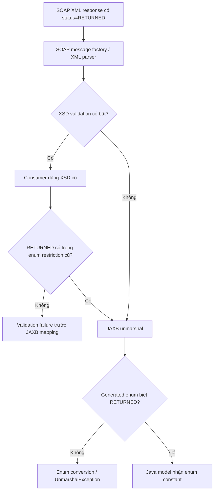

# Giá trị enum mới và giới hạn của mô hình JAXB được sinh trước đó

## 1. Tình huống: provider thêm một trạng thái, consumer cũ ngừng đọc được SOAP response

Một hệ thống quản lý đơn hàng công bố SOAP contract theo hướng **contract-first**. XSD định nghĩa trường `status` là kiểu enumeration:

```xml
<xs:simpleType name="OrderStatus">
    <xs:restriction base="xs:string">
        <xs:enumeration value="NEW"/>
        <xs:enumeration value="PROCESSING"/>
        <xs:enumeration value="SHIPPED"/>
        <xs:enumeration value="CANCELLED"/>
    </xs:restriction>
</xs:simpleType>
```

Consumer dùng JAXB/XJC sinh model Java. Model cũ có enum:

```java
public enum OrderStatus {
    NEW,
    PROCESSING,
    SHIPPED,
    CANCELLED
}
```

Sau một lần nâng cấp, provider thêm trạng thái `RETURNED`:

```xml
<xs:enumeration value="RETURNED"/>
```

Server mới trả SOAP response:

```xml
<ord:GetOrderResponse
    xmlns:ord="urn:example:orders:v1">
    <ord:orderId>ORD-100</ord:orderId>
    <ord:status>RETURNED</ord:status>
</ord:GetOrderResponse>
```

Consumer cũ có thể gặp một trong các lỗi sau:

- **XSD validation** từ chối response vì `RETURNED` không nằm trong enumeration mà consumer cũ đã biên dịch.
- Nếu không validate schema trước, JAXB unmarshaller vẫn có thể thất bại khi generated enum converter không tìm thấy giá trị.
- Một `XmlAdapter` hoặc parser tùy chỉnh có thể biến giá trị lạ thành `null`, làm mất thông tin và che giấu thay đổi contract.
- Nếu response là một phần của workflow thanh toán/vận chuyển, lỗi unmarshalling khiến client không biết giao dịch đã hoàn tất hay chưa.

Đây là vấn đề **schema evolution và consumer compatibility**, không đơn thuần là lỗi cú pháp XML. Thêm một enum value có vẻ chỉ là mở rộng tập giá trị, nhưng với nhiều consumer cũ, nó có thể là thay đổi không tương thích.

Bài này thuộc chương **Tương thích hợp đồng** của module `SPRING_WEB_SERVICES`, nơi xây dựng SOAP theo hướng contract-first, thiết kế XSD/WSDL, ánh xạ JAXB, endpoint và SOAP client; xử lý SOAP Fault/interceptors, XML security, WS-Security, certificates và kiểm thử tương thích hệ thống doanh nghiệp.

### Mục tiêu học tập

Sau bài này, bạn có thể:

1. Giải thích vì sao thêm giá trị vào XSD enumeration có thể phá vỡ consumer cũ.
2. Phân biệt lỗi do XSD validation với lỗi khi JAXB chuyển `xs:string` sang generated Java enum.
3. Nhận biết giới hạn của enum class do XJC sinh: tập constant đóng tại thời điểm code generation.
4. Chọn giữa regenerate model, giữ enum nghiêm ngặt, dùng `String`, `XmlAdapter` hoặc một kiểu “open enum” có lưu giá trị gốc.
5. Thiết kế contract enum có khả năng tiến hóa và quy tắc fallback an toàn cho business logic.
6. Đặt thứ tự đúng cho schema validation, unmarshalling, mapping và authorization.
7. Viết test provider/consumer compatibility, kiểm tra giá trị biết/không biết, nil/missing và giá trị sai định dạng.
8. Rollout thay đổi enum qua nhiều phiên bản mà không khiến SOAP client cũ ngừng hoạt động bất ngờ.

## 2. Enum trong XSD và enum Java được sinh từ JAXB khác nhau ở đâu?

### 2.1. XSD enumeration là constraint trên lexical value

XSD mô tả một tập giá trị hợp lệ cho một kiểu simple type:

```xml
<xs:simpleType name="OrderStatus">
    <xs:restriction base="xs:string">
        <xs:enumeration value="NEW"/>
        <xs:enumeration value="PROCESSING"/>
        <xs:enumeration value="SHIPPED"/>
    </xs:restriction>
</xs:simpleType>
```

Với schema này, một validator dùng đúng XSD sẽ chấp nhận các lexical values đã liệt kê và từ chối một giá trị khác như `RETURNED`. Kiểu dữ liệu cơ sở `xs:string` **không làm mất enumeration facet**.

Nếu provider thay schema bằng một phiên bản có thêm `RETURNED`, thì hai bộ validator có thể đưa ra kết luận khác nhau về cùng XML:

| XML value | Consumer validator theo XSD cũ | Provider validator theo XSD mới |
| --- | --- | --- |
| `NEW` | Hợp lệ | Hợp lệ |
| `PROCESSING` | Hợp lệ | Hợp lệ |
| `SHIPPED` | Hợp lệ | Hợp lệ |
| `RETURNED` | Không hợp lệ | Hợp lệ |

Đây là điểm đầu tiên cần kiểm tra: **consumer có validate response với XSD được đóng gói cùng generated model hay không?**

### 2.2. XJC sinh một tập Java constants đóng

Khi XJC ánh xạ enumeration thành Java enum, generated class thường có các constants tại thời điểm code generation và một hàm chuyển lexical value:

```java
@XmlType(name = "OrderStatus")
@XmlEnum
public enum OrderStatus {
    @XmlEnumValue("NEW")
    NEW("NEW"),
    @XmlEnumValue("PROCESSING")
    PROCESSING("PROCESSING"),
    @XmlEnumValue("SHIPPED")
    SHIPPED("SHIPPED");

    private final String value;

    OrderStatus(String value) {
        this.value = value;
    }

    public String value() {
        return value;
    }

    public static OrderStatus fromValue(String value) {
        for (OrderStatus item : OrderStatus.values()) {
            if (item.value.equals(value)) {
                return item;
            }
        }
        throw new IllegalArgumentException(value);
    }
}
```

Đây là **mẫu generated code minh họa**. Tên field, constructor và code converter có thể khác giữa XJC/JAXB provider, plugin và phiên bản. Cần đọc generated source thực tế trong dự án trước khi kết luận cách lỗi được biểu hiện.

Generated enum chỉ chứa những giá trị mà schema tại thời điểm sinh code đã biết. Nếu XML chứa `RETURNED` mà class cũ không có constant này, converter nghiêm ngặt không thể trả về một enum value phù hợp. Với các implementation JAXB dùng generated `fromValue`, kết quả có thể là `IllegalArgumentException` được bọc trong `UnmarshalException`/mapping exception.

### 2.3. Không phải enum Java tự động nhận giá trị lạ

Java enum là một kiểu có tập instance xác định:

```java
OrderStatus.valueOf("SHIPPED");  // constant tồn tại
OrderStatus.valueOf("RETURNED"); // IllegalArgumentException
```

JAXB không tự mở rộng enum class tại runtime khi server phát một string mới. Việc thêm enum constant vào server XSD không thể tự sửa bytecode/model đã compile trong consumer.

### 2.4. Có hai tầng từ chối, có thể xuất hiện ở các thời điểm khác nhau



Vị trí lỗi thực tế phụ thuộc SOAP message factory, `PayloadValidatingInterceptor`, schema configuration, `Jaxb2Marshaller` và generated conversion path. Không nên chỉ nhìn một `UnmarshalException` ở cuối rồi mặc định XSD validation không chạy.

### 2.5. “Schema hợp lệ” không đồng nghĩa “consumer hiểu nghiệp vụ”

Nếu thay enumeration bằng `xs:string`, XML có `RETURNED` có thể hợp lệ về XML/XSD, nhưng consumer cũ vẫn cần quyết định phải làm gì với trạng thái mà nó không hiểu.

Do đó cần phân biệt:

- **Syntactic compatibility:** parser đọc được XML, QName và kiểu dữ liệu.
- **Schema compatibility:** XML thỏa XSD mà consumer đang áp dụng.
- **Binding compatibility:** JAXB mapping chuyển dữ liệu thành Java objects được.
- **Semantic compatibility:** consumer hiểu ý nghĩa và xử lý đúng trạng thái.

Một thiết kế chỉ vượt qua ba tầng đầu vẫn có thể gây lỗi nghiệp vụ ở tầng cuối.

## 3. Thêm một enum value có phải thay đổi backward-compatible?

Không có câu trả lời đúng cho mọi contract. Phải xác định **chiều thay đổi**, hành vi của validator/binding và consumer policy.

### 3.1. Compatibility matrix

Giả sử:

- `C1`: consumer cũ biết {NEW, PROCESSING, SHIPPED}.
- `C2`: consumer mới biết thêm RETURNED.
- `P1`: provider cũ chỉ phát ba giá trị.
- `P2`: provider mới có thể phát RETURNED.

| Provider | Consumer | Có thể xảy ra | Nhận định |
| --- | --- | --- | --- |
| P1 | C1 | Chỉ giá trị cũ | Baseline |
| P1 | C2 | Consumer mới vẫn đọc giá trị cũ | Thường tương thích nếu model mới giữ constants cũ |
| P2 nhưng chưa phát RETURNED | C1 | Chỉ thấy giá trị cũ | Thường chưa lộ vấn đề |
| P2 phát RETURNED | C1 nghiêm ngặt | Validation/JAXB fail | **Rủi ro phá vỡ consumer cũ** |
| P2 phát RETURNED | C1 dùng tolerant string/open enum | Có thể giữ giá trị lạ | Phụ thuộc fallback semantics |
| P2 phát RETURNED | C2 | Biết constant mới | Có thể xử lý theo nghiệp vụ mới |

### 3.2. Backward compatibility và forward compatibility

Trong bài này:

- **Backward compatibility:** consumer/provider mới vẫn làm việc với bên cũ hoặc dữ liệu contract cũ.
- **Forward compatibility:** consumer cũ có thể tiếp nhận dữ liệu/giá trị mới được producer tương lai phát ra.

Các tổ chức đôi khi dùng từ “backward-compatible enum addition” để mô tả việc **thêm value không làm thay đổi giá trị cũ**. Nhưng kết luận đó không tự đúng với generated Java enum và strict XSD validation. Phải xác minh consumer cụ thể.

### 3.3. Vì sao thêm constant thường dễ hơn xóa/đổi tên constant?

Nếu regenerate consumer, enum mới chứa các constants cũ cộng thêm value mới. Code dùng `switch` trên enum có thể cần xử lý nhánh mới hoặc default; source compatibility tùy cách switch được viết và compiler/language version.

Ngược lại:

- Xóa một enum value đang được phát có thể làm consumer mới từ chối message từ provider cũ.
- Đổi lexical value có thể phá wire contract dù Java enum constant vẫn cùng tên.
- Đổi namespace/QName/type name có thể phá JAXB binding sâu hơn.

### 3.4. Consumer là nơi quyết định mức tolerant

Provider có thể phát value mới đúng XSD mới. Consumer không thể kiểm soát server phát gì; nhưng consumer có thể quyết định:

1. Từ chối ngay khi gặp giá trị không biết.
2. Giữ nguyên lexical string để chuyển tiếp/lưu trữ.
3. Ánh xạ về một constant `UNKNOWN`/`OTHER` và giữ raw value riêng.
4. Gửi đến workflow xử lý thủ công/quarantine.
5. Từ chối một số trạng thái không an toàn cho nghiệp vụ quan trọng.

“Tolerant” không có nghĩa “coi mọi giá trị chưa biết như thành công”. Chính sách phải tùy field và risk.

## 4. Chiến lược 1 — Regenerate JAXB model theo XSD mới

Đây là lựa chọn đơn giản nhất nếu tổ chức **kiểm soát được vòng đời của tất cả consumers**.

### 4.1. Khi nào nên chọn?

- Consumer được release đồng bộ hoặc có cửa sổ nâng cấp được quản lý.
- Provider có thể giữ behavior cũ trong giai đoạn rollout.
- Giá trị mới có ý nghĩa nghiệp vụ quan trọng, consumer phải hiểu chính xác.
- Từ chối unknown values là policy đúng (ví dụ một action/security mode).

### 4.2. Quy trình regenerate

1. Lấy XSD/WSDL version đã được review, có checksum/source control.
2. Chạy XJC bằng đúng plugin/toolchain version của dự án.
3. Review generated diff: enum constants, `@XmlEnumValue`, package, QName, adapters.
4. Compile tất cả consumers và các `switch`, persistence mappings, API mappings phụ thuộc enum.
5. Chạy compatibility tests với mọi lexical values cũ và mới.
6. Deploy consumer mới trước khi provider bắt đầu phát giá trị mới (consumer-first rollout).

Ví dụ generated enum sau khi cập nhật:

```java
public enum OrderStatus {
    NEW("NEW"),
    PROCESSING("PROCESSING"),
    SHIPPED("SHIPPED"),
    CANCELLED("CANCELLED"),
    RETURNED("RETURNED");

    private final String value;

    OrderStatus(String value) {
        this.value = value;
    }

    public String value() {
        return value;
    }

    public static OrderStatus fromValue(String value) {
        for (OrderStatus item : values()) {
            if (item.value.equals(value)) {
                return item;
            }
        }
        throw new IllegalArgumentException(value);
    }
}
```

Generated source thực tế được tạo bởi XJC, **không nên sửa tay** như một cách duy trì lâu dài. Sửa tay có thể bị ghi đè ở lần generate sau và làm generated source không còn khớp schema.

### 4.3. Regenerate có thể làm lộ các điểm phụ thuộc khác

Ví dụ Java:

```java
return switch (status) {
    case NEW -> "Chưa xử lý";
    case PROCESSING -> "Đang xử lý";
    case SHIPPED -> "Đã giao";
    case CANCELLED -> "Đã hủy";
};
```

Khi enum có thêm `RETURNED`, code switch expression phải được cập nhật hoặc có default phù hợp theo language/compiler rules. Các nơi khác có thể không báo lỗi compile:

- MapStruct mapping tới internal enums.
- JPA `@Enumerated(EnumType.STRING)` và dữ liệu cũ.
- JSON serialization sang REST clients.
- Database constraints/check constraints.
- Reporting/analytics và UI filters.

Vì vậy, regenerate JAXB thành công **chưa đồng nghĩa ứng dụng tương thích end-to-end**.

### 4.4. Consumer-first rollout

Một trình tự an toàn:

```text
Phase 1: Deploy consumer version that understands RETURNED
Phase 2: Confirm old provider values still work
Phase 3: Enable provider to emit RETURNED for eligible cases
Phase 4: Observe metrics, SOAP errors and downstream behavior
Phase 5: Retire compatibility code only after all consumers upgraded
```

Consumer-first chỉ hiệu quả khi provider có feature flag/rollout control hoặc có thể trì hoãn phát giá trị mới. Nếu provider phát `RETURNED` ngay trong phase 1, consumer cũ chưa được nâng cấp vẫn có thể thất bại.

## 5. Chiến lược 2 — Để wire-facing model dùng String

Nếu consumer phải tiếp nhận những giá trị enum do provider mở rộng trong tương lai, một cách rõ ràng là **không ánh xạ closed XSD enumeration thành Java enum ở ranh giới wire**.

### 5.1. XSD cho field có thể mở rộng

Thay vì enumeration đóng:

```xml
<xs:simpleType name="OrderStatus">
    <xs:restriction base="xs:string">
        <xs:enumeration value="NEW"/>
        <xs:enumeration value="PROCESSING"/>
        <xs:enumeration value="SHIPPED"/>
    </xs:restriction>
</xs:simpleType>
```

XSD có thể định nghĩa trường là string có ràng buộc độ dài/pattern phù hợp nhưng không liệt kê tập value đóng:

```xml
<xs:simpleType name="OrderStatus">
    <xs:restriction base="xs:token">
        <xs:minLength value="1"/>
        <xs:maxLength value="32"/>
        <xs:pattern value="[A-Z][A-Z0-9_]*"/>
    </xs:restriction>
</xs:simpleType>
```

Khi đó `RETURNED` có thể qua schema validation nếu thỏa lexical constraints. Pattern và length vẫn là contract rules; thêm value không đúng pattern vẫn bị từ chối.

**Đánh đổi:** XSD không còn tự enforce tập enum cụ thể. Việc lựa chọn value cho nghiệp vụ phải chuyển sang code/domain validation hoặc controlled vocabulary metadata.

### 5.2. Wire DTO dùng String

Ví dụ generated JAXB DTO (giả định XJC ánh xạ simple type này sang `String`):

```java
public class GetOrderResponseType {

    protected String orderId;
    protected String status;

    public String getOrderId() {
        return orderId;
    }

    public void setOrderId(String value) {
        this.orderId = value;
    }

    public String getStatus() {
        return status;
    }

    public void setStatus(String value) {
        this.status = value;
    }
}
```

Khi XML có `RETURNED`, JAXB có thể giữ lexical value nguyên dạng trong `String status`. Consumer không bị giới hạn bởi enum constants đã generate.

Nếu một generated model cũ đã có property `OrderStatus status`, chỉ thay Java field thành `String` bằng sửa tay không phải giải pháp bền vững. Hãy điều chỉnh XSD/binding customization và generate lại DTO, hoặc dùng wire DTO riêng được kiểm soát.

### 5.3. Tách wire value khỏi domain enum

Không nên truyền string không kiểm soát xuyên toàn bộ business service. Tạo một bước chuyển đổi rõ ràng:

```java
public enum KnownOrderStatus {
    NEW,
    PROCESSING,
    SHIPPED,
    CANCELLED
}

public record OrderStatusValue(
    KnownOrderStatus known,
    String rawValue
) {
    public boolean isKnown() {
        return known != null;
    }
}
```

Converter:

```java
public final class OrderStatusMapper {

    private OrderStatusMapper() {}

    public static OrderStatusValue fromWire(String raw) {
        if (raw == null) {
            throw new IllegalArgumentException(
                "Order status must not be null"
            );
        }

        return switch (raw) {
            case "NEW" ->
                new OrderStatusValue(KnownOrderStatus.NEW, raw);
            case "PROCESSING" ->
                new OrderStatusValue(
                    KnownOrderStatus.PROCESSING, raw
                );
            case "SHIPPED" ->
                new OrderStatusValue(
                    KnownOrderStatus.SHIPPED, raw
                );
            case "CANCELLED" ->
                new OrderStatusValue(
                    KnownOrderStatus.CANCELLED, raw
                );
            default ->
                new OrderStatusValue(null, raw);
        };
    }
}
```

`rawValue` giữ lexical string để chuyển tiếp/lưu trữ hoặc xử lý thủ công. `known == null` nghĩa là ứng dụng không biết semantics; **không được tự coi nó là status thành công**.

### 5.4. Xử lý unknown values theo từng operation

Một màn hình hiển thị có thể giữ nguyên trạng thái:

```java
String displayLabel(OrderStatusValue status) {
    if (status.isKnown()) {
        return localizedLabel(status.known());
    }
    return "Trạng thái mới: " + sanitizeForDisplay(
        status.rawValue()
    );
}
```

Nhưng một thao tác quyết định hoàn tiền có thể yêu cầu status phải được hiểu:

```java
RefundDecision decideRefund(OrderStatusValue status) {
    if (!status.isKnown()) {
        throw new UnsupportedStatusException(
            "Cannot decide refund for unknown order status"
        );
    }

    return switch (status.known()) {
        case SHIPPED -> RefundDecision.REVIEW_REQUIRED;
        case CANCELLED -> RefundDecision.ELIGIBLE;
        case NEW, PROCESSING -> RefundDecision.NOT_ELIGIBLE;
    };
}
```

Một unknown value có thể được **đọc, lưu, forward** an toàn trong một context; nhưng không nhất thiết được dùng để thực thi state transition hoặc financial action. Policy phụ thuộc operation.

### 5.5. Lưu raw value có giới hạn

Nếu raw enum value được lưu database:

- Dùng giới hạn length phù hợp với XSD và DB column.
- Giữ đúng casing/lexical value theo contract nếu cần forward.
- Validate XML character set/control characters và chuẩn hóa nếu contract yêu cầu.
- Không dùng raw string làm metric label.
- Không log raw value nếu nó có thể chứa dữ liệu nhạy cảm hoặc crafted log content.
- Thiết kế database migration để không bị CHECK constraint enum cũ từ chối.

## 6. Chiến lược 3 — Open enum/value object thay vì closed Java enum

Nếu muốn API Java có trải nghiệm “known constants” nhưng vẫn giữ được raw value lạ, dùng một value object thay vì chỉ Java enum.

### 6.1. Model biểu diễn known và unknown

```java
import java.util.Optional;

public final class OpenOrderStatus {

    public static final OpenOrderStatus NEW =
        new OpenOrderStatus("NEW");
    public static final OpenOrderStatus PROCESSING =
        new OpenOrderStatus("PROCESSING");
    public static final OpenOrderStatus SHIPPED =
        new OpenOrderStatus("SHIPPED");
    public static final OpenOrderStatus CANCELLED =
        new OpenOrderStatus("CANCELLED");

    private final String wireValue;

    private OpenOrderStatus(String wireValue) {
        if (wireValue == null || wireValue.isBlank()) {
            throw new IllegalArgumentException(
                "status must not be blank"
            );
        }
        this.wireValue = wireValue;
    }

    public static OpenOrderStatus of(String wireValue) {
        return new OpenOrderStatus(wireValue);
    }

    public String value() {
        return wireValue;
    }

    public Optional<OpenOrderStatus> knownConstant() {
        return switch (wireValue) {
            case "NEW" -> Optional.of(NEW);
            case "PROCESSING" -> Optional.of(PROCESSING);
            case "SHIPPED" -> Optional.of(SHIPPED);
            case "CANCELLED" -> Optional.of(CANCELLED);
            default -> Optional.empty();
        };
    }

    @Override
    public boolean equals(Object other) {
        return other instanceof OpenOrderStatus status
            && wireValue.equals(status.wireValue);
    }

    @Override
    public int hashCode() {
        return wireValue.hashCode();
    }

    @Override
    public String toString() {
        return wireValue;
    }
}
```

`OpenOrderStatus.of("RETURNED")` không vứt bỏ giá trị. `knownConstant()` cho phép code nghiệp vụ kiểm tra xem có semantics đã biết hay không.

### 6.2. JAXB XmlAdapter

Một `XmlAdapter` có thể chuyển đổi `String` trên wire sang `OpenOrderStatus`:

```java
import jakarta.xml.bind.annotation.adapters.XmlAdapter;

public final class OrderStatusAdapter
        extends XmlAdapter<String, OpenOrderStatus> {

    @Override
    public OpenOrderStatus unmarshal(String value) {
        return value == null ? null : OpenOrderStatus.of(value);
    }

    @Override
    public String marshal(OpenOrderStatus value) {
        return value == null ? null : value.value();
    }
}
```

Adapter giữ cả value đã biết lẫn value mới. `XmlAdapter<String, OpenOrderStatus>` là lựa chọn tự nhiên vì ValueType là String mở, BoundType là custom value object.

### 6.3. Gắn adapter vào JAXB property

Ví dụ nếu bạn sở hữu wire model:

```java
import jakarta.xml.bind.annotation.XmlElement;
import jakarta.xml.bind.annotation.adapters.XmlJavaTypeAdapter;

public class GetOrderResponseType {

    private OpenOrderStatus status;

    @XmlElement(required = true)
    @XmlJavaTypeAdapter(OrderStatusAdapter.class)
    public OpenOrderStatus getStatus() {
        return status;
    }

    public void setStatus(OpenOrderStatus status) {
        this.status = status;
    }
}
```

Đây là ví dụ JAXB Jakarta namespace. Với JAXB 2.x dùng `javax.xml.bind.*`; không trộn `javax` và `jakarta` annotations trong một JAXB runtime.

Nếu class được XJC generate, không sửa file generated source thủ công. Có thể:

- Dùng external binding customization/plugin được hỗ trợ để gắn adapter và custom Java type.
- Tách generated wire DTO dùng `String`, sau đó map sang open value object trong application layer.
- Duy trì một lớp JAXB model hand-written riêng nếu schema/toolchain cho phép.

Phương án đơn giản và minh bạch nhất thường là **generated String wire property + domain open value mapper**; nó tránh phụ thuộc plugin-specific enum customizations.

### 6.4. Adapter không cứu được schema validation nghiêm ngặt

Nếu XSD hiện tại vẫn liệt kê:

```xml
<xs:enumeration value="NEW"/>
<xs:enumeration value="PROCESSING"/>
<xs:enumeration value="SHIPPED"/>
```

validator cũ có thể từ chối `RETURNED` **trước khi `XmlAdapter.unmarshal()` chạy**. Muốn chấp nhận value tương lai, wire schema phải cho phép lexical value đó (ví dụ base type string với facets phù hợp), và validation configuration phải dùng schema tương ứng.

### 6.5. Không đổi mọi enum thành String một cách vô điều kiện

Một số trường enum là **security-sensitive closed vocabulary**:

- `SignatureAlgorithm`
- `AuthenticationMode`
- `EncryptionProfile`
- `AuthorizationDecision`
- `PaymentCaptureInstruction`

Đối với các trường này, unknown value có thể dẫn đến downgrade/interpretation ambiguity. Strict rejection có thể chính là yêu cầu bảo mật. Chỉ mở vocabulary khi contract semantics, fallback và security policy được review.

## 7. Chiến lược 4 — Constant UNKNOWN/OTHER và những gì nó không giải quyết

Một lựa chọn phổ biến là thêm constant:

```java
public enum OrderStatus {
    NEW,
    PROCESSING,
    SHIPPED,
    CANCELLED,
    UNKNOWN
}
```

Tuy nhiên, generated `fromValue()` thông thường chỉ chấp nhận lexical values đã được annotate/listed. Thêm `UNKNOWN` trong Java không tự tạo quy tắc “mọi string lạ map thành UNKNOWN”.

### 7.1. Nếu kiểm soát binding, cần adapter explicit

Adapter có thể map unknown value thành `UNKNOWN`, nhưng phải quyết định có giữ raw input không. Nếu chỉ trả `UNKNOWN`, thông tin `RETURNED` bị mất:

```java
public record MappedStatus(
    OrderStatus known,
    String rawValue
) {}
```

Đối với audit hoặc forward compatibility, giữ cả hai thường tốt hơn chỉ có `UNKNOWN`.

### 7.2. Unknown không đồng nghĩa null

Không nên:

```java
try {
    return OrderStatus.valueOf(raw);
} catch (IllegalArgumentException ex) {
    return null;
}
```

Kết quả `null` có thể bị hiểu nhầm là:

- XML element không tồn tại.
- Element có `xsi:nil="true"`.
- Dữ liệu bị thiếu do mapping.
- Giá trị lạ bị hạ cấp im lặng.

Hãy giữ trạng thái phân biệt `ABSENT`, `NIL`, `KNOWN`, `UNKNOWN` nếu contract/business cần phân biệt chúng.

### 7.3. Khi nào fallback UNKNOWN phù hợp?

- Hiển thị danh sách trạng thái, nơi unknown có thể được hiển thị là “Mới”.
- Lưu message để điều tra/forward qua gateway.
- Analytics có thể đếm unknown mà không cần suy luận nghiệp vụ.

Không tự dùng UNKNOWN để:

- Cho phép thanh toán/hoàn tiền.
- Bỏ qua authorization state.
- Quyết định đơn hàng đã giao hay chưa.
- Bỏ qua security policy vì thuật toán/role “lạ”.

### 7.4. Fallback phải quan sát được

Đặt metrics/log categories:

```text
soap_enum_unknown_total{field="orderStatus",contractVersion="v1"}
soap_enum_unknown_rejected_total{operation="CancelOrder"}
```

Không đưa raw enum values hoặc partner IDs có cardinality cao vào metrics labels. Raw value có thể lưu trong audit record được kiểm soát, có truncation/redaction và correlation ID.

## 8. Chiến lược 5 — Tách vocabulary nghiệp vụ khỏi XSD enum

Một schema có thể chọn enumeration đóng để kiểm soát contract hoặc chọn string có facets để cho phép mở rộng. Đối với hệ thống nhiều consumer, một lựa chọn bền vững là **phân biệt lexical vocabulary của wire contract và state machine nội bộ**.

### 8.1. Wire value không tự động là domain state

```text
SOAP wire:
  status = "RETURNED"

Integration model:
  OrderStatusValue(rawValue="RETURNED", known=null)

Domain state:
  không có KnownOrderStatus tương ứng

Business decision:
  không cho phép transition/refund khi chưa hiểu state
```

Wire model có thể tiếp nhận value mới và giữ nguyên cho mục đích forward/audit. Domain model chỉ chứa những trạng thái mà hệ thống hiểu và kiểm soát được.

### 8.2. State machine phải fail closed ở transition nhạy cảm

Một state machine không nên viết:

```java
if (status == null || status == UNKNOWN) {
    return RefundDecision.ELIGIBLE;
}
```

Đây là lỗi logic nghiêm trọng: một trạng thái không hiểu bị xem là điều kiện cho phép hoàn tiền.

Thay vào đó:

```java
public RefundDecision decideRefund(OrderStatusValue value) {
    KnownOrderStatus status = value.known();
    if (status == null) {
        return RefundDecision.MANUAL_REVIEW;
    }

    return switch (status) {
        case CANCELLED -> RefundDecision.ELIGIBLE;
        case SHIPPED -> RefundDecision.REVIEW_REQUIRED;
        case NEW, PROCESSING -> RefundDecision.NOT_ELIGIBLE;
    };
}
```

Fallback MANUAL_REVIEW là **business policy minh họa**; từng hệ thống phải xác định hành vi đúng với operation. Nguyên tắc quan trọng: unknown không được biến thành một quyền hoặc kết quả thuận lợi mặc định.

### 8.3. Closed vocabulary vẫn hữu ích cho request do consumer gửi

Không phải response enum nào cũng nên mở. Hãy xem riêng **request và response direction**:

- Consumer gọi CancelOrder có thể chỉ được phép gửi CANCELLED hoặc một instruction trong tập đóng.
- Provider trả GetOrderResponse có thể bổ sung state mới theo vòng đời đơn hàng.
- Consumer của một read-only query có thể giữ unknown để hiển thị; consumer thực hiện một command có thể bắt buộc hiểu chính xác state trước khi tiếp tục.

Một lựa chọn hợp lý là **request-side closed enum, response-side extensible string**, nếu business semantics và WSDL/XSD cho phép.

### 8.4. Phân biệt giá trị mới với lỗi dữ liệu

Nếu XSD đổi từ enum sang string, parser có thể tiếp nhận những giá trị như:

```text
RETURNED
returned
RETURNED␠
RETURNED␀
```

Không phải tất cả đều là “giá trị tương lai hợp lệ”. Cần xác định:

- Casing có phân biệt không?
- Whitespace được preserve, collapse hay reject theo XSD type?
- Character set/control characters có được phép?
- Lexical length tối đa?
- Value có phải từ controlled vocabulary đã đăng ký?

Không tự chuẩn hóa mọi input sang uppercase/trim nếu contract coi lexical values là case-sensitive; chuẩn hóa sai có thể làm hai value khác nhau bị nhập làm một.

### 8.5. Closed enum và unknown policy phải rõ ở mỗi field

Đừng đổi mọi simple type enumeration thành string chỉ để một consumer parse được thêm giá trị. Đối với thuật toán chữ ký, mode xác thực, quyền truy cập hoặc instruction thanh toán, unknown values có thể tạo downgrade/interpretation ambiguity. Strict rejection có thể chính là yêu cầu bảo mật.

## 9. Schema versioning và cách rollout thay enum

### 9.1. Lập inventory consumer trước khi thay contract

Một provider có thể phục vụ:

```text
Partner A -> client 2022 (generated enum v1)
Partner B -> client 2024 (generated enum v1)
Internal service C -> generated enum v2
New UI gateway -> string-tolerant wire DTO
```

Nếu provider deploy enum mới rồi phát ngay RETURNED, hai consumer v1 có thể fail. Phải lập inventory consumer và **kiểm tra behavior theo version thực**, không suy từ tên partner.

### 9.2. Provider-first hay consumer-first?

| Thay đổi | Thứ tự triển khai khuyến nghị |
| --- | --- |
| Consumer được regenerate để biết enum mới | Consumer trước, provider phát value mới sau |
| Consumer được đổi sang tolerant String/open value | Consumer tolerant trước, provider phát value mới sau |
| Provider chỉ thêm enum vào XSD nhưng chưa phát value | Phát schema, giữ behavior cũ cho đến khi consumers sẵn sàng |
| Provider bắt buộc phát value mới ngay | Cần versioned endpoint/contract hoặc đảm bảo mọi consumer được nâng cấp trước |
| Security-sensitive enum | Strict contract/versioning; không tự fallback unknown |

### 9.3. Namespace version hay endpoint version?

Khi semantic thay đổi đáng kể, có thể phát contract version mới:

```text
v1 namespace:
  urn:example:orders:v1

v2 namespace:
  urn:example:orders:v2

v1 endpoint:
  /ws/orders/v1

v2 endpoint:
  /ws/orders/v2
```

Ví dụ v2 có thể dùng extensible status string trong khi v1 giữ enum đóng. Namespace versioning và endpoint versioning là lựa chọn thiết kế; không nhất thiết phải đổi cả hai nếu deployment contract có cơ chế tương thích khác.

**Đừng giữ cùng QName nhưng đổi semantics không tương thích rồi kỳ vọng JAXB model cũ tự hiểu.**

### 9.4. XSD imports/includes và generated model version

JAXB model có thể được generate từ nhiều schema imports/includes. Một enum type có thể nằm trong XSD common:

```text
orders-service.xsd
  -> common-types.xsd
       -> OrderStatus enumeration
```

Thay common-types.xsd có thể ảnh hưởng nhiều operations và nhiều WSDL, không chỉ GetOrderResponse. Khi cập nhật:

- Pin schema dependency/version/checksum.
- Review mọi generated class phụ thuộc.
- Không để build kéo XSD từ URL remote không ổn định.
- Quản lý package/name conflicts khi nhiều namespace generate chung project.
- Kiểm tra JAXB episode/binding files nếu dùng codegen đa module.

### 9.5. Generated sources là artifact của toolchain

Trong Maven/Gradle project, XJC/plugin version, binding customization và Java/JAXB runtime đều ảnh hưởng generated class. Một build reproducible nên ghi:

```text
WSDL/XSD version or checksum
XJC/codegen plugin version
JAXB API/runtime version
Binding customization files
Generated package names
JDK/toolchain version
Generation command/task
```

Không sửa generated class trực tiếp trong target/generated-sources hoặc build/generated. Nếu cần đổi Java type, sửa schema/binding/plugin configuration hoặc xây adapter/model riêng.

## 10. XSD validation trong Spring-WS: thứ tự và hệ quả

### 10.1. Request và response validation là hai hướng riêng

PayloadValidatingInterceptor có thể validate SOAP request/response theo XSD khi được cấu hình. Một SOAP client cũng có thể validate response nếu marshaller/validator/interceptor phía client được cấu hình.

Một sơ đồ khái niệm:

```text
Client request:
  JAXB marshal
  -> optional request schema validation
  -> HTTP sender

Server:
  SOAP message factory
  -> optional request PayloadValidatingInterceptor
  -> JAXB unmarshal / endpoint
  -> response creation
  -> optional response validation
  -> sender

Client response:
  SOAP message parse
  -> optional response schema validation
  -> JAXB unmarshal
  -> application mapping
```

Actual interceptor/adaptor ordering phụ thuộc configuration và Spring-WS version. Không nên dùng sơ đồ trên như bảo đảm interceptor cụ thể chạy trước mọi parser operation.

### 10.2. Provider thêm enum nhưng client còn schema cũ

Nếu client bật response validation với XSD enum cũ:

1. XML well-formed và SOAP Envelope có thể parse được.
2. Validator đọc payload và thấy RETURNED không thuộc XSD restriction cũ.
3. Validation thất bại và client có thể không tiếp tục JAXB unmarshal.

Việc generated Java enum có hay không có một adapter không thay đổi schema cũ. Phải cập nhật schema/validation policy hoặc giữ provider phát các values cũ cho consumer đó.

### 10.3. Không tắt mọi schema validation để né lỗi

Một cách sửa nhanh là bỏ PayloadValidatingInterceptor hoặc ngừng validate mọi response. Điều này có thể làm system nhận được RETURNED, nhưng cũng làm mất kiểm tra:

- Element order/cardinality.
- Required fields/namespace/QName.
- Datatype bounds/lengths.
- Fault detail schema.
- Những malformed/hostile XML structures mà contract đã hạn chế.

Nếu cần open enum, hãy **mở đúng simpleType** hoặc dùng versioned contract, vẫn giữ validation các cấu trúc còn lại.

### 10.4. Tách schema cho transport và schema payload?

SOAP Envelope/Header schemas và payload XSD có thể được xử lý ở những tầng khác nhau. Tuy nhiên mở rộng enum payload không nên khiến ứng dụng bỏ qua toàn bộ SOAP security/Envelope validation. Chọn schema version phù hợp cho từng endpoint và giữ XSD payload kiểm tra tất cả fields ngoài enum có thể mở.

### 10.5. Xử lý UnmarshalException đúng cách

Ở SOAP client, phân biệt:

| Lỗi | Nguyên nhân | Xử lý |
| --- | --- | --- |
| Schema validation failure | Value không thuộc XSD enum cũ | Kiểm tra schema version/provider contract |
| JAXB enum conversion failure | Generated enum không biết lexical value | Regenerate hoặc dùng tolerant wire mapping |
| Unexpected element/QName | Namespace/root element sai | Kiểm tra WSDL/XSD/JAXB element mapping |
| Missing required property | XML thiếu dữ liệu hoặc version mismatch | Contract tests/provider response |
| SOAP Fault | Server chủ động trả Fault | Dùng Fault resolver/client exception handling |
| HTTP/TLS error | Chưa nhận SOAP response hợp lệ | Kiểm tra transport/certificates, không coi là enum failure |

Không chuyển mọi UnmarshalException thành SOAP Fault nghiệp vụ INVALID_STATUS: server có thể chưa hề phát Fault, và nguyên nhân thực sự có thể là contract mismatch.

## 11. Ví dụ kiểm thử giá trị enum mới và cũ

Các test nên chạy trên **đúng JAXB runtime, generated model, schema validator và Spring-WS version** của dự án. Các class dưới đây là test fixtures minh họa; chúng không thay thế kiểm thử interoperability với SOAP service thật.

### 11.1. Strict enum: giá trị biết được unmarshal

Giả sử generated class hiện tại có:

```java
@XmlEnum
public enum StrictOrderStatus {
    @XmlEnumValue("NEW")
    NEW,
    @XmlEnumValue("PROCESSING")
    PROCESSING,
    @XmlEnumValue("SHIPPED")
    SHIPPED;

    public static StrictOrderStatus fromValue(String value) {
        return switch (value) {
            case "NEW" -> NEW;
            case "PROCESSING" -> PROCESSING;
            case "SHIPPED" -> SHIPPED;
            default -> throw new IllegalArgumentException(value);
        };
    }
}
```

Với JAXB model đã được generate và có root element tương ứng:

```java
String knownXml = """
    <OrderStatus>SHIPPED</OrderStatus>
    """;

JAXBElement<StrictOrderStatus> known =
    unmarshaller.unmarshal(
        new StreamSource(new StringReader(knownXml)),
        StrictOrderStatus.class
    );

assertEquals(StrictOrderStatus.SHIPPED, known.getValue());
```

Mẫu trên giả định JAXB context biết global element/type tương ứng; trong dự án thực tế có thể cần root element namespace hoặc ObjectFactory đúng XSD. Không coi tên element không namespace trên đây là SOAP contract hoàn chỉnh.

### 11.2. Giá trị mới có thể làm strict enum fail

Một test có thể kiểm chứng hành vi generated converter trực tiếp:

```java
assertThrows(
    IllegalArgumentException.class,
    () -> StrictOrderStatus.fromValue("RETURNED")
);
```

Đây là test của **generated conversion method trong ví dụ**. Nếu XJC/provider version khác, kiểm tra method thực tế hoặc test trực tiếp JAXB unmarshal và assert exception class/cause phù hợp; không hard-code exception wrapper giống nhau ở mọi runtime.

### 11.3. XSD validation từ chối enum mới

Với schema cũ:

```java
String responseXml = """
    <ord:GetOrderResponse
        xmlns:ord="urn:example:orders:v1">
        <ord:orderId>ORD-100</ord:orderId>
        <ord:status>RETURNED</ord:status>
    </ord:GetOrderResponse>
    """;

assertThrows(
    SAXException.class,
    () -> oldSchema.newValidator().validate(
        new StreamSource(new StringReader(responseXml))
    )
);
```

Ví dụ giả định XSD cũ định nghĩa element/type đúng QName và status enum chỉ có values cũ. Exception thực có thể được bọc ở Spring interceptor/test framework; điều cần khẳng định là **validation fail trước JAXB nếu pipeline validate trước**.

### 11.4. String wire model giữ giá trị mới

```java
public class GetOrderResponseWire {
    private String status;

    public String getStatus() {
        return status;
    }

    public void setStatus(String status) {
        this.status = status;
    }
}
```

Test mapping:

```java
OrderStatusValue mapped =
    OrderStatusMapper.fromWire("RETURNED");

assertFalse(mapped.isKnown());
assertEquals("RETURNED", mapped.rawValue());
```

Đây là unit test của **application mapper**, không cần JAXB runtime. Test JAXB riêng để chứng minh response XML được parse thành property String khi schema/binding hỗ trợ.

### 11.5. Open value object giữ lexical value khi round-trip

```java
OpenOrderStatus unknown = OpenOrderStatus.of("RETURNED");

OrderStatusAdapter adapter = new OrderStatusAdapter();
String xmlValue = adapter.marshal(unknown);
OpenOrderStatus restored = adapter.unmarshal(xmlValue);

assertEquals("RETURNED", xmlValue);
assertEquals(unknown, restored);
assertTrue(restored.knownConstant().isEmpty());
```

Test này xác minh adapter round-trip raw value. Nó chưa chứng minh JAXB property annotation/binding customization của ứng dụng đã được XJC/JAXB runtime áp dụng.

### 11.6. Ma trận test tối thiểu

| Input | Strict enum/XSD đóng | String/open model |
| --- | --- | --- |
| NEW | Accept | Accept, known |
| PROCESSING | Accept | Accept, known |
| SHIPPED | Accept | Accept, known |
| RETURNED | Reject nếu schema/generated model cũ | Accept raw value, unknown |
| rỗng | Theo XSD minLength/nillability | Theo string constraints và mapper policy |
| Element absent | Theo minOccurs/required property | Phân biệt absent với null |
| xsi:nil=true | Theo nillable và JAXB mapping | Phân biệt NIL với ABSENT/UNKNOWN |
| whitespace/padding | Theo XSD base type/whitespace facet | Theo lexical policy rõ |
| rất dài | Reject theo maxLength/transport limits | Vẫn reject theo length constraints |
| value control characters | Reject theo XML/schema/application policy | Không chấp nhận vì chỉ dùng String |

Không dùng việc “String có thể chứa mọi giá trị” làm lý do bỏ XSD facets, length limits, XML parser security hoặc business validation.

## 12. Kiểm thử Spring-WS client và provider contract thực tế

### 12.1. Test JAXB độc lập chưa chứng minh SOAP response path

Một unit test gọi trực tiếp JAXB Unmarshaller chỉ xác minh JAXB conversion. Trong Spring-WS, response có thể còn đi qua:

1. HTTP sender nhận status/headers/body.
2. SOAP message factory parse Envelope/Header/Body.
3. Client interceptors và WS-Security validation.
4. Response schema validation nếu được cấu hình.
5. JAXB unmarshal payload.
6. Exception resolvers/mapping và application service.

Một lớp phía trên có thể fail trước khi JAXB được gọi. Vì vậy hãy giữ riêng test **JAXB binding**, **XSD validation**, **SOAP client integration** và **business handling**.

### 12.2. MockWebServiceServer cho SOAP client

Ví dụ test Spring-WS client nhận response có status mới khi wire DTO đã tolerant:

```java
import org.junit.jupiter.api.Test;
import org.springframework.ws.client.core.WebServiceTemplate;
import org.springframework.ws.test.client.MockWebServiceServer;
import org.springframework.xml.transform.StringSource;

import static org.junit.jupiter.api.Assertions.*;
import static org.springframework.ws.test.client.RequestMatchers.anything;
import static org.springframework.ws.test.client.ResponseCreators.withPayload;

class GetOrderClientCompatibilityTest {

    @Test
    void preservesUnknownStatusFromResponse() {
        WebServiceTemplate template =
            TestSoapClientFactory.createStringWireTemplate();

        MockWebServiceServer server =
            MockWebServiceServer.createServer(template);

        StringSource response = new StringSource("""
            <ord:GetOrderResponse
                xmlns:ord="urn:example:orders:v1">
                <ord:orderId>ORD-100</ord:orderId>
                <ord:status>RETURNED</ord:status>
            </ord:GetOrderResponse>
            """);

        server.expect(anything())
              .andRespond(withPayload(response));

        Object result = template.marshalSendAndReceive(
            new GetOrderRequestWire("ORD-100")
        );

        GetOrderResponseWire wire =
            (GetOrderResponseWire) result;
        assertEquals("RETURNED", wire.getStatus());

        server.verify();
    }
}
```

TestSoapClientFactory, GetOrderRequestWire và GetOrderResponseWire là test fixtures giả định. Trong project thực tế, phải cấu hình JAXB marshaller/unmarshaller, root element, namespace, SOAP version và request payload theo model.

**Lưu ý:** MockWebServiceServer thay transport sender và không kiểm tra network/TLS thật. Nếu client có response validation với XSD enum cũ, test này có thể fail trước JAXB; đó là behavior cần kiểm tra và ghi nhận, không phải lý do xóa validation tùy tiện.

### 12.3. Test response validation strict

Nếu project có interceptor/validator kiểm tra response:

- Cấu hình đúng old XSD fixture có enum đóng.
- Trả SOAP payload RETURNED.
- Xác nhận response bị reject ở validation layer.
- Kiểm tra exception/cause theo Spring-WS version thực tế.
- Assert business mapper không nhận response hoặc không chạy tiếp.

Test này chứng minh consumer cũ thực sự strict, thay vì chỉ suy luận từ generated source.

### 12.4. Test SOAP Fault và unknown enum không giống nhau

Server có thể trả một SOAP Fault hợp lệ với Fault Detail có field enum riêng. Client cần phân biệt:

- Normal response có status mới.
- SOAP Fault với fault code/detail đã biết.
- SOAP Fault detail chứa enum mới mà client chưa biết.
- XML malformed hoặc schema invalid.
- HTTP/TLS transport error.

Một Fault detail cũng có thể chứa generated enums và gặp cùng vấn đề. Không giả định nằm trong Fault nên không cần compatibility test.

### 12.5. Interceptor/logging không được làm mất lexical value

SOAP logging interceptors có thể ghi payload hoặc marshal/unmarshal lần nữa. Đối với tolerant design:

- Log field name, partner, contract version và classification (known/unknown).
- Giới hạn và sanitize raw value.
- Không sửa casing hoặc whitespace ngoài policy.
- Không làm message replay/unmarshal hai lần với model strict rồi tolerant khác nhau.
- Không log toàn bộ SOAP Body chứa PII/token/security headers chỉ để phát hiện enum lạ.

### 12.6. Test business không cho unknown state thực hiện side effects

Nếu unknown status được giữ trong read path, test riêng command path:

```java
@Test
void unknownStatusDoesNotPermitRefund() {
    OrderStatusValue status =
        OrderStatusMapper.fromWire("RETURNED");

    assertThrows(
        UnsupportedStatusException.class,
        () -> refundService.refund(status)
    );

    verify(paymentGateway, never()).refund(any());
}
```

refundService, paymentGateway và mapper là fixtures minh họa. Mục tiêu là xác nhận unknown enum **không tạo side effect** khi business không hiểu semantics.

## 13. Version matrix và contract tests trong CI

### 13.1. Lưu fixtures của provider cũ và mới

Một bộ contract fixtures có thể tổ chức:

```text
src/test/resources/contracts/orders/
  v1/
    get-order-response-new.xml
    get-order-response-shipped.xml
    get-order-response-cancelled.xml
    get-order-response-schema.xsd
  v2/
    get-order-response-returned.xml
    get-order-response-schema.xsd
```

Đây chỉ là cấu trúc ví dụ. Fixtures nên có nguồn gốc rõ (provider build/version, ngày lấy, WSDL/XSD checksum) và không chứa PII/secret thật.

### 13.2. Matrix consumer/provider

| Consumer build | Provider fixture | Kỳ vọng |
| --- | --- | --- |
| C1 strict enum | P1 old values | Pass |
| C1 strict enum | P2 new value | Reject rõ ràng, không side effect sai |
| C2 regenerated enum | P1 old values | Pass |
| C2 regenerated enum | P2 new value | Pass nếu đã implement semantics |
| C3 tolerant string | P1 old values | Pass, known mapping |
| C3 tolerant string | P2 new value | Parse/retain raw, business policy quyết định |
| C3 tolerant string | malformed lexical input | Reject theo XSD/validation rules |

### 13.3. Khi nào chạy schema compatibility checker?

CI có thể kiểm tra diff XSD/WSDL và báo:

- Enumeration value thêm/xóa/đổi.
- QName/namespace/type/element changes.
- minOccurs/maxOccurs, nillable, facets changes.
- Sequence/order/choice changes.
- Imports/includes đổi location hoặc checksum.
- SOAP binding/soapAction/addressing policy thay đổi.

Không phải mọi XSD diff đều có một kết luận compatibility tự động. Enum addition đặc biệt phụ thuộc consumer binding và validator. Một checker cần phân loại **potentially breaking** rồi yêu cầu test/approval, không chỉ báo “thêm enum là safe”.

### 13.4. Provider contract test

Provider nên test:

1. Mỗi enum value đã công bố có được serialize với lexical value đúng?
2. Provider chỉ phát RETURNED khi operation/state transition cho phép?
3. WSDL/XSD được publish đúng version, không mismatch giữa contract và runtime.
4. SOAP response namespaces, element order và optional fields đúng.
5. Response/Fault được validate bằng provider schema.
6. Consumer cũ đã được xác định và có rollout/compatibility plan.

### 13.5. Consumer contract test

Consumer nên test:

1. Tất cả known values map đúng domain semantics.
2. Unknown values theo đúng policy (reject, preserve, quarantine hoặc manual review).
3. Missing/nil/empty/whitespace khác nhau khi contract phân biệt.
4. Schema validator có đang bật không, và đang nạp đúng schema version?
5. Unknown không làm bỏ qua authorization hoặc state machine.
6. SOAP Fault/transport failures được phân loại riêng với JAXB exceptions.

### 13.6. Không dùng provider live WSDL làm nguồn build không ổn định

Build consumer tự tải WSDL/XSD mới nhất mỗi lần chạy có thể làm generated model đổi bất ngờ, không tái lập được. Pin contract artifacts, review diff và chủ động nâng version. Runtime dynamic WSDL discovery chỉ phù hợp nếu được thiết kế, cache, trust và compatibility policy rõ.

## 14. Migration plan cho nhiều consumer đang chạy

### 14.1. Phân loại consumer

| Consumer group | Model hiện tại | Chiến lược |
| --- | --- | --- |
| Internal service có release thường xuyên | Generated enum strict | Regenerate và deploy trước |
| Partner có release chậm | Generated enum strict | Giữ provider old value, endpoint/version riêng hoặc adapter gateway |
| Read-only reporting | Tự parse response | String/open value có thể phù hợp |
| Financial command client | Enum strict và state machine | Strict rejection/versioning, no implicit unknown fallback |
| Integration gateway/relay | Cần forward XML | Giữ raw lexical value, không tự diễn giải |
| Legacy runtime khó upgrade | JAXB cũ/không còn build tool | Adapter boundary hoặc versioned SOAP endpoint |

### 14.2. Gateway compatibility adapter

Một integration gateway có thể nhận SOAP response mới và chuyển đổi về contract cũ cho consumer legacy:

```text
Provider v2
  -> Gateway (understands new enum value)
     -> Partner A v1: map RETURNED to agreed legacy representation
     -> Partner B v1: reject/quarantine if no safe mapping
     -> Consumer v2: forward RETURNED
```

**Chỉ map sang một value cũ nếu business semantics tương đương.** Ví dụ RETURNED không nhất thiết tương đương CANCELLED; ánh xạ sai có thể gây sai báo cáo, tiền hoàn hoặc trạng thái giao hàng.

### 14.3. Không phát unknown cho tới khi consumer sẵn sàng

Provider có thể:

- Thêm enum vào schema nhưng giữ feature flag tắt.
- Enable theo partner/tenant/capability negotiation.
- Dùng endpoint v2 cho consumer đã nâng cấp.
- Ghi metrics về số consumer còn ở v1.
- Sau thời gian transition mới phát value mới mặc định.

Capability header hoặc partner registration chỉ là metadata; phải xác thực nguồn và không cho client tự khai “tôi hỗ trợ RETURNED” nếu không có enrollment/authorization đáng tin.

### 14.4. Hỗ trợ fallback có thời hạn

```text
Fallback rule:
  input status: RETURNED
  consumer group: Partner A / contract v1
  mapped output: [only if semantically agreed]
  reason: compatibility bridge
  owner: integration team
  expiry date: [approved date]
  removal condition: all v1 consumers migrated
```

Fallback không rõ owner/expiry dễ trở thành contract behavior vĩnh viễn và làm việc nâng version sau này khó hơn.

### 14.5. Database và downstream contracts cũng phải tiến hóa

Khi SOAP consumer giữ raw enum string:

- DB column phải đủ chiều dài và cho phép value mới.
- CHECK constraint/enum native DB type có thể vẫn từ chối.
- Kafka/event schema hoặc REST API downstream có thể lại dùng enum đóng.
- Mapping tới analytics/reporting phải có unknown bucket/retention policy.
- Search index/BI dimensions cần cập nhật vocabulary.

Không chỉ thay generated JAXB enum rồi coi toàn bộ hệ thống đã forward-compatible.

### 14.6. Kế hoạch rollout cụ thể

Một rollout có kiểm soát có thể gồm:

1. **Inventory:** xác định WSDL/XSD versions, JAXB model versions và consumer owners.
2. **Classify:** đánh dấu field enum nào closed/security-sensitive, field nào có thể mở.
3. **Design:** chọn strict regeneration, String wire model, open value object hoặc endpoint v2.
4. **Prepare:** cập nhật consumer model/validation và test mọi giá trị cũ trước.
5. **Deploy consumers:** nâng consumer tolerant/aware trước khi provider phát value mới.
6. **Enable provider:** bật phát value mới theo partner/tenant/feature flag.
7. **Observe:** theo dõi unknown value metrics, unmarshalling/validation failures, business rejection.
8. **Expand:** tăng phạm vi từng bước khi test/metrics cho thấy consumers sẵn sàng.
9. **Retire:** bỏ fallback/legacy endpoint sau khi hết consumer cũ và qua thời hạn đã thống nhất.

### 14.7. Rollback plan

Nếu unknown value làm consumer lỗi:

- Provider có thể tạm dừng phát value mới (nếu business cho phép).
- Quay về consumer version trước chỉ khi provider vẫn giữ các giá trị cũ.
- Gateway có thể quarantine/bridge những response không thể chuyển đổi an toàn.
- Không sửa dữ liệu đã commit để giả vờ giao dịch chưa xảy ra.
- Với operation side effect, tra cứu transaction state trước khi retry.

Rollback application binary không tự đảo ngược một giao dịch nghiệp vụ đã được thực thi.

## 15. Chẩn đoán lỗi enum/JAXB sau khi provider thay contract

| Triệu chứng | Nguyên nhân khả dĩ | Hướng kiểm tra |
| --- | --- | --- |
| Schema validation failure ở status RETURNED | Client đang validate bằng XSD cũ | Schema resource/validator thực tế, contract version |
| JAXB IllegalArgumentException từ fromValue | Generated enum không có lexical value | Generated source, XJC version, raw response value đã lọc |
| UnmarshalException nhưng chưa rõ nguyên nhân | Exception wrapper che enum conversion/schema error | Nested cause và pipeline ordering |
| XML hợp lệ nhưng property null | Adapter map unknown thành null hoặc field absent/nil | Adapter, JAXB annotations, nillability |
| Consumer mới vẫn reject value mới | JAXB model mới nhưng validator vẫn dùng XSD cũ | Schema cache, classpath resource, interceptor |
| Chỉ một operation fail | Operation dùng type enum khác/common XSD khác | QName/type mapping và imports/includes |
| Regenerate không thêm enum constant | XJC dùng schema artifact cũ | Resolved XSD/checksum/codegen task |
| Generated code thay đổi ngoài enum | Plugin/JAXB version hoặc bindings đổi | Review generated diff, pin toolchain |
| Giá trị mới parse được nhưng nghiệp vụ fail | Domain enum/state machine vẫn closed | Mapper, switch, DB constraint, downstream |
| Tất cả status biến thành UNKNOWN | Fallback quá rộng hoặc adapter không phân biệt | Mapping rules, unknown metrics, raw value retention |
| Unknown state cho phép refund/action | Fallback mặc định không an toàn | Fail-closed business policy, side-effect tests |
| Consumer cũ đột ngột fail sau deploy provider | Provider bắt đầu phát giá trị mới trước rollout | Release timeline, provider feature flags |
| Fault detail không unmarshal được | Enum mới nằm trong XSD Fault schema | Fault model và compatibility fixtures |
| JAXB chạy được nhưng SOAP client test fail | Validation/interceptor/security layer fail trước hoặc sau JAXB | Test từng pipeline layer |
| Một partner fail, partner khác pass | Contract/version/capability khác nhau | Partner-specific schema/model/feature flags |
| Database reject raw value | Column CHECK/native enum constraint cũ | DB migration và mapping |
| JSON downstream reject unknown | Downstream contract cũng có enum đóng | Version downstream or map explicitly |
| Schema pattern reject new value | New lexical value không thỏa facet | XSD pattern/length, không bỏ validation toàn bộ |

### 15.1. Quy trình phân tích theo thứ tự

```text
1. SOAP request/response có HTTP/TLS transport thành công không?
2. SOAP Envelope/Header có parse được không?
3. WS-Security signature/decryption có thành công không?
4. Có response XSD validator không; schema version/checksum nào?
5. JAXB unmarshaller dùng class generated nào; enum fromValue có value mới?
6. Có XmlAdapter hoặc mapping String -> domain enum nào?
7. Business service có unknown policy gì; có side effects nào chưa?
8. DB/downstream contract có chấp nhận raw value không?
```

Không vội sửa bằng cách tắt tất cả interceptors. Xác định **tầng đầu tiên từ chối** trước.

### 15.2. Log tối thiểu để debug mà không lộ dữ liệu

```text
event=SOAP_ENUM_UNRECOGNIZED
operation=GetOrder
field=status
contractNamespace=urn:example:orders:v1
consumerSchemaVersion=v1
providerVersion=...
classification=UNKNOWN_VALUE
requestId=req-42
outcome=PRESERVED_OR_REJECTED
```

Đây là metadata log đề xuất. Raw enum value chỉ nên được log nếu được phép, đã kiểm tra/truncate và không có rủi ro log injection. Không log raw SOAP Body, credentials, WS-Security tokens hoặc thông tin khách hàng.

## 16. Những anti-pattern cần tránh

### 16.1. Sửa generated enum bằng tay

Thêm constant RETURNED vào source XJC generate mà không đổi XSD/binding. Lần generate sau code có thể bị ghi đè, và model vẫn không khớp contract source of truth.

### 16.2. Map tất cả unknown về thành công

Unknown status không đồng nghĩa success, completed hoặc safe. Mapping như vậy có thể cho phép bước xử lý không được thiết kế.

### 16.3. Catch mọi exception rồi trả UNKNOWN

Một JAXB exception có thể do malformed XML, wrong namespace, security validation hoặc enum mới. Catch-all làm che giấu lỗi contract và có thể biến message độc hại thành object “hợp lệ”.

### 16.4. Tắt XSD validation toàn bộ

Mở một enum field không đòi hỏi bỏ kiểm tra sequence, required fields, length, namespace, datatype hoặc security constraints. Chỉ thay đúng type facet và test lại.

### 16.5. Đổi XSD nhưng không regenerate hoặc kiểm tra model

Schema mới ở runtime nhưng generated model cũ là một contract split. Hoặc consumer đọc WSDL remote mới trong khi build models vẫn từ XSD cũ.

### 16.6. Dùng enum Java nội bộ làm wire contract một cách ngẫu nhiên

Domain enum có thể chứa state nội bộ không được expose ra SOAP, hoặc thiếu một lexical value provider cần gửi. Tạo mapping boundary rõ giữa domain và wire.

### 16.7. Dùng raw String cho security-sensitive policy

Một algorithm/mode/authorization field không nên tự động chấp nhận mọi string chưa biết. Closed vocabulary và rejection là biện pháp bảo vệ cần thiết ở nhiều field.

### 16.8. Không test SOAP Fault và error payload

Enum có thể xuất hiện trong Fault Detail. Chỉ test happy-path response không chứng minh toàn bộ SOAP contract tương thích.

## 17. Bài thực hành có đáp án

### Bài 1. Thêm enum value có chắc backward-compatible không?

Provider thêm RETURNED vào XSD OrderStatus. Consumer cũ dùng XJC-generated Java enum chỉ có NEW/PROCESSING/SHIPPED.

**Đáp án:** Không chắc. Consumer có thể fail ở XSD validation nếu schema cũ được dùng; nếu không validate, generated enum converter vẫn có thể fail vì không có constant RETURNED. Phải kiểm thử đúng pipeline.

### Bài 2. XSD validation và JAXB enum converter khác nhau thế nào?

Một response có status RETURNED bị từ chối.

**Đáp án:** Validator XSD kiểm tra lexical value có thuộc enumeration facet của schema hay không. JAXB converter ánh xạ lexical value sang Java enum constant. Hai tầng có thể từ chối độc lập; lỗi xảy ra trước/sau tùy pipeline configuration.

### Bài 3. Generated enum có tự cập nhật theo server không?

**Đáp án:** Không. Generated class được tạo từ XSD/toolchain tại thời điểm code generation. Server thêm enum value không thay đổi bytecode trong consumer đã compile.

### Bài 4. Nếu tắt validation, consumer cũ có chắc parse được RETURNED?

**Đáp án:** Không. Generated enum cũ vẫn có thể ném exception khi converter không tìm được value. Tắt validation chỉ bỏ một tầng kiểm tra và có thể làm mất các schema protections khác.

### Bài 5. Regenerate JAXB có giải quyết toàn bộ compatibility không?

**Đáp án:** Không. Nó bổ sung constant mới ở wire model, nhưng code switch, MapStruct, database constraints, JSON API và business state machine có thể vẫn chưa hiểu trạng thái mới. Cần test downstream.

### Bài 6. Khi nào nên regenerate consumer?

**Đáp án:** Khi release của consumer được kiểm soát, giá trị mới cần semantics rõ ràng và consumer phải xử lý nghiệp vụ chính xác. Deploy consumer mới trước khi provider bắt đầu phát value mới.

### Bài 7. Khi nào dùng String trên wire?

**Đáp án:** Khi field là vocabulary có thể mở rộng, consumer cần tiếp nhận/forward giá trị tương lai, và contract không yêu cầu strict enumeration. Vẫn giữ length/pattern/character constraints và mapping nghiệp vụ rõ.

### Bài 8. Đổi Java property thành String nhưng giữ XSD enumeration có đủ không?

**Đáp án:** Không nếu XSD validator cũ vẫn chạy: validator có thể từ chối RETURNED trước JAXB. Muốn tolerant cần cập nhật schema validation path, dùng schema mở hoặc versioned contract.

### Bài 9. XmlAdapter có tự sửa generated enum đóng không?

**Đáp án:** Không. Adapter phải có ValueType có thể biểu diễn lexical value chưa biết (thường String), BoundType là open value object/custom type. Nếu adapter chỉ bọc generated enum closed, nó vẫn không thể biểu diễn RETURNED.

### Bài 10. Vì sao adapter String → OpenOrderStatus phù hợp?

**Đáp án:** String có thể giữ lexical value; OpenOrderStatus có thể lưu raw value và cung cấp known-constant lookup. Consumer vừa giữ thông tin mới vừa kiểm tra được semantics.

### Bài 11. Có nên thêm UNKNOWN vào generated enum rồi xong?

**Đáp án:** Không. Generated fromValue thường chỉ map các annotated/listed lexical values; UNKNOWN không tự trở thành wildcard. Cần adapter/mapping explicit và nên giữ raw value nếu cần audit/forward.

### Bài 12. Unknown status có nên map thành null?

**Đáp án:** Thường không. Null có thể mang nghĩa field absent, xsi:nil hoặc mapping loss. Dùng trạng thái UNKNOWN riêng và giữ raw lexical value để không mất thông tin.

### Bài 13. Unknown status có thể hiển thị UI không?

**Đáp án:** Có thể, nếu UI chỉ trình bày và sanitize/limit raw label. Nhưng không được coi đó là trạng thái đã hiểu để tự thực hiện thanh toán, hoàn tiền hay chuyển state.

### Bài 14. Unknown status trong command thanh toán?

**Đáp án:** Nên fail closed hoặc manual review theo business policy, không mặc định cho phép. Test phải xác nhận không có side effects.

### Bài 15. XSD simple type string có pattern?

Provider thêm RETURNED nhưng pattern cũ chỉ cho các từ bắt đầu bằng NEW/PROCESSING/SHIPPED.

**Đáp án:** Validator vẫn reject RETURNED vì pattern facet. Thay enum thành string không tự làm mọi lexical value hợp lệ; cần sửa facets có chủ đích và test.

### Bài 16. Dùng xs:token có khác xs:string không?

**Đáp án:** Có. xs:token có whitespace facet collapse theo XSD datatype semantics, trong khi xs:string preserve whitespace. Nếu lexical equality/casing quan trọng, chọn base type và normalization phù hợp, không tự trim/uppercase tùy tiện.

### Bài 17. Provider phát enum mới trước khi consumer nâng cấp

**Đáp án:** Consumer strict cũ có thể fail. Giữ provider feature flag tắt, triển khai tolerant/regenerated consumer trước, hoặc phát endpoint/namespace version mới. Với partner không thể nâng cấp, dùng compatibility bridge chỉ khi mapping ngữ nghĩa an toàn.

### Bài 18. Consumer dùng XSD mới nhưng generated JAXB model cũ

**Đáp án:** Validation có thể pass RETURNED, nhưng JAXB enum converter cũ vẫn có thể fail. Cần đồng bộ schema, generated model, binding configuration và test version matrix.

### Bài 19. Generated JAXB mới nhưng validator nạp XSD cũ

**Đáp án:** JAXB model biết constant mới, nhưng response validator vẫn có thể từ chối trước unmarshal. Kiểm tra schema resource/cache/config và version hóa cả validator với model.

### Bài 20. Làm sao kiểm chứng SOAP response thật?

**Đáp án:** Dùng fixtures/provider versions đã pin, MockWebServiceServer cho client SOAP mapping, integration test qua HTTP/SOAP thật khi cần security/transport, và assert riêng schema validation, JAXB mapping, business behavior. Mock không chứng minh TLS hoặc provider thực.

### Bài 21. Có phải mọi enum mới trong SOAP Fault đều vô hại?

**Đáp án:** Không. Fault Detail cũng là XML contract và có thể chứa generated enum. Test Fault schema/model riêng, không chỉ normal response.

### Bài 22. Đổi RETURNED thành CANCELLED cho consumer cũ được không?

**Đáp án:** Chỉ khi hai trạng thái thật sự tương đương theo nghiệp vụ và được hai bên phê duyệt. Nếu không, mapping có thể làm sai hoàn tiền, giao hàng và audit. Từ chối/quarantine an toàn hơn mapping sai.

### Bài 23. Vì sao database cũng phải kiểm tra?

Consumer đã parse raw status RETURNED nhưng lưu vào cột native enum/CHECK constraint chỉ cho NEW/PROCESSING/SHIPPED.

**Đáp án:** XML/JAXB compatibility không tự mở database vocabulary. Cần migration phù hợp, lưu raw status có kiểm soát hoặc tách wire value/domain mapping.

### Bài 24. Khi nào không nên làm tolerant enum?

**Đáp án:** Với signature algorithm, authentication mode, authorization decision, payment instruction hoặc field security-sensitive khác, unknown semantics có thể gây downgrade/ambiguity. Strict rejection và versioned contract thường an toàn hơn.

## 18. Checklist production và nghiệm thu

| Nhóm | Câu hỏi kiểm tra |
| --- | --- |
| Contract source | XSD/WSDL nào là source of truth? Có version/checksum? |
| XSD enum | Enum field là closed vocabulary hay có thể mở rộng? |
| Change review | Enum addition/removal/rename đã được phân loại potentially breaking? |
| Consumers | Có inventory tất cả consumer versions/owners? |
| JAXB generation | XJC/plugin/JAXB runtime version và binding files có được pin? |
| Generated diff | Review constants, @XmlEnumValue, fromValue, packages và QName? |
| Validation | Client/server có PayloadValidatingInterceptor/schema validator nào? Schema version nào? |
| Ordering | Validation hay JAXB mapping là tầng đầu tiên reject? Đã test chưa? |
| Wire DTO | String/open value chỉ áp dụng cho fields có vocabulary mở? |
| Adapter | Adapter có giữ raw value và phân biệt unknown/null/absent/nil? |
| Unknown semantics | Mỗi operation định nghĩa reject/preserve/manual review/forward thế nào? |
| Business state | Unknown không tự cho phép refund/payment/authorization/transition? |
| Security | Closed enum cho algorithm/auth mode/access policy vẫn strict? |
| Length/lexical | maxLength/pattern/whitespace/case/character set được giữ? |
| Database | Columns, check constraints, persistence enums đã tương thích? |
| Downstream | REST/events/Kafka/reporting/UI có enum closed khác? |
| Fault | SOAP Fault detail enums có fixtures/version tests? |
| Test fixtures | Có old/new provider XML + XSD/WSDL được pin? |
| Matrix | Old consumer/new provider và new consumer/old provider đã test? |
| CI checks | XSD diff checker báo breaking risks và yêu cầu approval? |
| Rollout | Consumer-first, feature flags, partner gating và rollback plan rõ? |
| Gateway | Legacy mapping có được review semantics, owner và expiry? |
| Observability | Metrics unknown values/validation failures có low cardinality? |
| Logging | Raw values/XML/secrets có được sanitize/redact? |
| Side effects | Unknown/unmarshal errors không tạo giao dịch sai hoặc duplicate? |
| Release decision | Có test integration với đúng JAXB/Spring-WS runtime/provider? |

### 18.1. Mẫu quyết định cho từng enum field

```text
Contract field: OrderStatus
QName/type: {urn:example:orders:v1}OrderStatus
Direction: response / request / Fault Detail
Current XSD restriction: [...]
Current generated Java type: [...]
Validation enabled: yes/no; schema version [...]
New values proposed: [...]
Vocabulary policy: CLOSED / EXTENSIBLE
Unknown policy: REJECT / PRESERVE / QUARANTINE / MANUAL_REVIEW
Business operations allowed for unknown: none / explicitly listed
Raw value retention: location, length cap, retention [...]
Consumers affected: [...]
Rollout order: [...]
Test evidence: [...]
Owner/expiry: [...]
```

Đây là mẫu review để team điền; không điền giả định PASS khi chưa có test evidence.

### 18.2. Thứ tự làm việc khi có enum value mới

1. Xác định field và semantics của value mới.
2. Xác định vocabulary đóng hay mở; phân loại rủi ro business/security.
3. Kiểm tra XSD facets và generated JAXB model đang triển khai.
4. Quyết định regenerate, String/open value, adapter hoặc versioned contract.
5. Cập nhật validation schema đúng nơi; giữ những validations còn lại.
6. Chạy old/new consumer-provider matrix và SOAP Fault tests.
7. Test business state machine, persistence và downstream side effects.
8. Deploy consumer/provider theo rollout plan.
9. Quan sát unknown metrics, SOAP errors và partner health.
10. Retire fallback khi mọi consumer đã sẵn sàng.

## 19. Tổng kết

**Thêm một giá trị XSD enumeration có thể phá vỡ consumer cũ**, bởi schema validation và JAXB generated enum đều có thể hoạt động theo tập giá trị đóng đã biết từ lúc code được build.

- XSD enumeration xác định tập lexical values mà validator chấp nhận.
- XJC thường sinh Java enum có constants cố định và conversion method; giá trị không có trong model có thể gây mapping/unmarshal failure.
- Regenerate model phù hợp khi kiểm soát được consumer rollout và cần semantics cụ thể cho value mới.
- Wire DTO dùng String hoặc open value object hữu ích cho vocabulary có thể mở rộng; giữ raw value và tách khỏi domain state.
- XmlAdapter cần một ValueType có thể biểu diễn string lạ; adapter không thể vượt qua strict XSD validator chạy trước.
- UNKNOWN không đồng nghĩa null, success hay quyền thực hiện nghiệp vụ.
- Không tắt toàn bộ XSD validation chỉ để nhận một value mới; mở đúng type/facets hoặc version contract.
- Request enums/security-sensitive fields có thể cần closed vocabulary và strict rejection.
- Consumer-first rollout, fixtures/version matrix, provider/consumer contract tests và observability giúp phát hiện incompatibility trước production.
- Kiểm tra database/downstream schemas và SOAP Fault detail; JAXB không phải ranh giới duy nhất.

### Mô hình tư duy

```text
Provider XSD v2 adds RETURNED
          |
          v
SOAP response contains RETURNED
          |
          v
Consumer XML / SOAP parsing
          |
          v
Response XSD validation?
   | yes, old closed enum -> reject
   | no / open schema
          v
JAXB binding
   | generated closed enum -> conversion may fail
   | String/open value -> retain raw lexical value
          v
Domain mapping
   | known -> known business state
   | unknown -> reject / preserve / quarantine / manual review
          v
Business authorization + state machine
          |
          v
No unsafe side effects for unknown semantics
```

**Thông điệp cốt lõi:** tính tương thích của enum không nằm riêng trong XSD hoặc Java enum. Nó là kết quả của schema validation, code generation, binding, business semantics, persistence và thứ tự rollout giữa provider với mọi consumer.

### Tài liệu tham khảo

- [Jakarta XML Binding Specification](https://jakarta.ee/specifications/xml-binding/).
- [Jakarta XML Binding API — XmlAdapter](https://jakarta.ee/specifications/xml-binding/4.0/apidocs/jakarta.xml.bind/jakarta/xml/bind/annotation/adapters/XmlAdapter).
- [Eclipse JAXB RI — JAXB/XJC](https://eclipse-ee4j.github.io/jaxb-ri/).
- [Spring Web Services — Reference Documentation](https://docs.spring.io/spring-ws/docs/current/reference/html/).
- [Spring Web Services — PayloadValidatingInterceptor API](https://docs.spring.io/spring-ws/docs/current/api/org/springframework/ws/soap/server/endpoint/interceptor/PayloadValidatingInterceptor.html).
- [W3C — XML Schema Part 1: Structures](https://www.w3.org/TR/xmlschema-1/).
- [W3C — XML Schema Part 2: Datatypes](https://www.w3.org/TR/xmlschema-2/).
- [W3C — SOAP 1.1](https://www.w3.org/TR/2000/NOTE-SOAP-20000508/).
- [W3C — SOAP 1.2 Part 1: Messaging Framework](https://www.w3.org/TR/soap12-part1/).
- [W3C — WSDL 1.1](https://www.w3.org/TR/2001/NOTE-wsdl-20010315).
