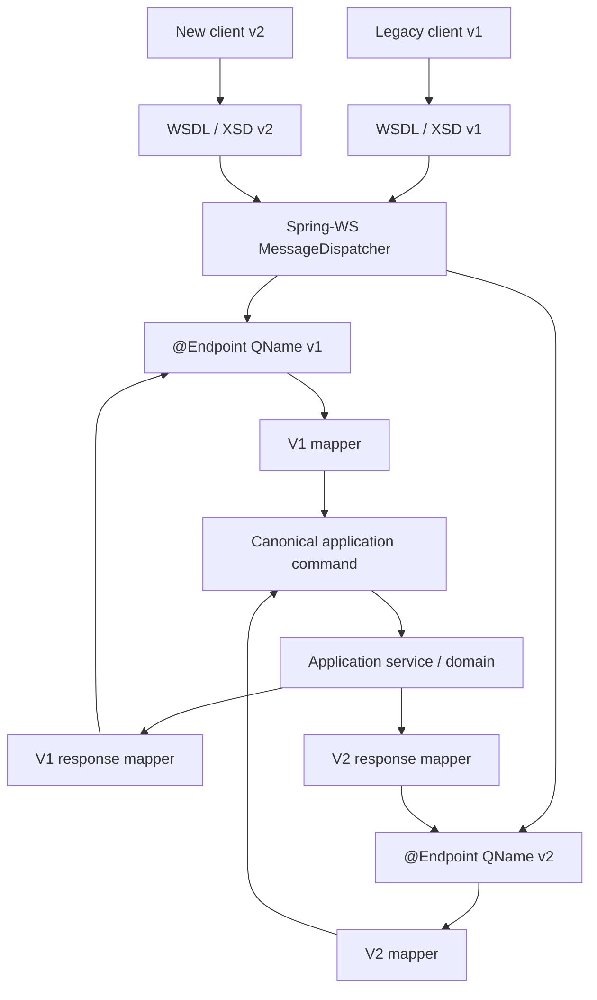
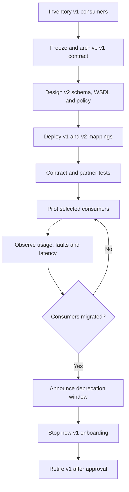

# Hỗ trợ song song hợp đồng cũ, mới và định tuyến rõ ràng

## Mục tiêu học tập

Trong module **SPRING_WEB_SERVICES**, dịch vụ SOAP contract-first dùng WSDL/XSD làm wire contract, JAXB để ánh xạ XML và Spring Web Services (Spring-WS) để dispatch request tới endpoint. Khi nhiều hệ thống đối tác nâng cấp ở thời điểm khác nhau, việc thay XSD tại chỗ có thể làm client cũ ngừng hoạt động. Bài học này hướng dẫn duy trì contract cũ, phát hành contract mới và định tuyến từng request một cách rõ ràng.

Sau bài học, bạn có thể phân biệt backward/forward/wire/semantic compatibility; version hóa namespace, WSDL, URI và SOAPAction; dùng QName trong Spring-WS; triển khai adapter v1/v2; xây dựng lộ trình migration/deprecation và kiểm thử tương thích.

## 1. Tình huống tích hợp

Dịch vụ Order đã cung cấp v1 cho nhiều client. Request có orderId, customerCode, orderDate và items. Một dự án mới cần currency, unitPrice, deliveryWindow và tệp đính kèm. Một số client cũ được sinh JAXB từ WSDL v1 và không thể nâng cấp ngay.

Sửa XSD v1 để thêm trường required có thể khiến client cũ không gửi đủ dữ liệu. Đổi namespace hoặc response shape có thể làm JAXB client cũ không parse được. Đổi SOAPAction, signed parts hoặc SOAP version có thể làm security/binding thất bại.

Mục tiêu là giữ v1 hoạt động theo contract đã công bố, mở v2 với định danh riêng, cho phép hai version cùng tồn tại trong giai đoạn chuyển đổi và chỉ retire v1 sau khi có bằng chứng consumer đã di chuyển.

## 2. Các chiều tương thích

| Loại | Câu hỏi | Ví dụ |
| --- | --- | --- |
| Backward compatibility | Server mới có nhận request từ client cũ không? | V1 adapter tiếp tục nhận XML v1. |
| Forward compatibility | Client cũ có hiểu response mới không? | Parser cho phép bỏ optional fields chưa biết. |
| Wire compatibility | QName, namespace, headers và media type có giữ nguyên? | Namespace v1 không đổi. |
| Schema compatibility | XML có hợp lệ với schema consumer dùng? | Thêm optional element vẫn có thể phá strict validator. |
| Semantic compatibility | Ý nghĩa dữ liệu có giữ nguyên? | Không đổi ý nghĩa quantity=0. |
| Security compatibility | Signature, encryption, token và policy còn phù hợp? | Client v1 vẫn ký đúng SOAP Body theo policy v1. |
| Operational compatibility | Fault, timeout, size limit và SLA có giữ được? | V2 MTOM lớn hơn giới hạn gateway cũ. |

Không thể kết luận thay đổi an toàn chỉ vì đó là additive change. Consumer có thể validate nghiêm ngặt bằng schema snapshot cũ hoặc reject unknown element. Thay đổi semantics còn nguy hiểm hơn đổi cấu trúc XML.

## 3. Chiến lược version hóa

| Cơ chế | Ví dụ | Vai trò |
| --- | --- | --- |
| Namespace | `urn:example:orders:v1` / `urn:example:orders:v2` | Tạo QName riêng trong SOAP Body. |
| WSDL artifact | `orders-v1.wsdl` / `orders-v2.wsdl` | Phân phối contract versioned cho code generation. |
| XSD artifact | `orders-v1.xsd` / `orders-v2.xsd` | Giữ schema/imports ổn định theo version. |
| Endpoint URI | `/ws/orders/v1` / `/ws/orders/v2` | Gateway policy, deployment và rollout. |
| SOAPAction | `urn:example:orders:v1/SubmitOrder` | Binding/routing metadata bổ sung. |
| Security profile | Policy v1/v2 | Tiến hóa token, signed parts và algorithms có kiểm soát. |

Khuyến nghị dùng namespace versioning cùng WSDL artifact versioning. URI có thể hỗ trợ tách gateway/deployment. SOAPAction chỉ là tín hiệu bổ sung, không phải identity hay authorization.

### 3.1. Namespace versioning

```xml
<!-- Contract v1 -->
<ord:SubmitOrderRequest
    xmlns:ord="urn:example:orders:v1">
    ...
</ord:SubmitOrderRequest>

<!-- Contract v2 -->
<ord:SubmitOrderRequest
    xmlns:ord="urn:example:orders:v2">
    ...
</ord:SubmitOrderRequest>
```

Hai phần tử cùng local name nhưng QName khác vì namespace URI khác. Prefix XML chỉ là alias; đổi prefix mà giữ namespace URI không đổi QName. Namespace URI là định danh wire, không nhất thiết là URL phải tải được từ browser.

### 3.2. Endpoint URI không tự định tuyến Spring-WS

Spring-WS thường dispatch qua EndpointMapping như PayloadRoot mapping, không mặc định sử dụng path như MVC PostMapping. Nếu hai URI cùng vào một MessageDispatcherServlet, cùng QName có thể vẫn gọi cùng handler. Muốn URI là ranh giới thật, cần servlet/context riêng, custom EndpointMapping đã kiểm thử hoặc deployment/backend riêng. Với một servlet chung, versioned QName là cách đơn giản để phân biệt payload.

## 4. Kiến trúc hai contract, một application core



Mỗi version có JAXB DTO riêng. Adapter chuyển DTO thành command/query nội bộ. Domain giữ business rules chung khi semantics thực sự giống nhau; response mapper riêng chuyển kết quả về XML shape của version. Không dùng JAXB DTO trực tiếp làm entity/database model.

## 5. Naming convention và governance

| Thành phần | v1 | v2 |
| --- | --- | --- |
| Namespace | `urn:example:orders:v1` | `urn:example:orders:v2` |
| XSD | `orders-v1.xsd` | `orders-v2.xsd` |
| WSDL | `orders-v1.wsdl` | `orders-v2.wsdl` |
| JAXB package | `com.example.orders.contract.v1` | `com.example.orders.contract.v2` |
| SOAPAction | `...:v1/SubmitOrder` | `...:v2/SubmitOrder` |
| Telemetry | `contract_version=v1` | `contract_version=v2` |

Không dùng latest/current làm version wire ổn định. Mọi thay đổi phải có changelog và quy tắc: patch không đổi wire; additive/minor chỉ giữ namespace khi consumer tests chứng minh tương thích; breaking change tạo major contract mới. Đây là convention tổ chức, không phải tự động của WSDL.

## 6. XSD v1/v2 và breaking fields

V1 có thể định nghĩa orderId, customerCode, orderDate và items. V2 có namespace khác và thêm currency bắt buộc, unitPrice trong từng item và deliveryWindow tùy chọn.

Ví dụ khai báo v2 rút gọn:

```xml
<xs:schema xmlns:xs="http://www.w3.org/2001/XMLSchema"
    targetNamespace="urn:example:orders:v2"
    elementFormDefault="qualified">
  <xs:element name="SubmitOrderRequest">
    <xs:complexType>
      <xs:sequence>
        <xs:element name="orderId" type="xs:string"/>
        <xs:element name="customerCode" type="xs:string"/>
        <xs:element name="orderDate" type="xs:date"/>
        <xs:element name="currency" type="xs:string"/>
        <xs:element name="deliveryWindow" minOccurs="0">
          <xs:complexType>
            <xs:sequence>
              <xs:element name="from" type="xs:dateTime"/>
              <xs:element name="to" type="xs:dateTime"/>
            </xs:sequence>
          </xs:complexType>
        </xs:element>
      </xs:sequence>
    </xs:complexType>
  </xs:element>
</xs:schema>
```

Không thêm currency required trực tiếp vào v1 nếu client cũ không gửi. Adapter v1 chỉ được lấy default từ partner/business profile đã duyệt; không đoán currency từ địa chỉ hoặc locale, không tự gán giá trị 0 cho tiền tệ. Thiếu dữ liệu cần thiết thì trả Fault nghiệp vụ và không tạo đơn.

## 7. Publish hai WSDL/XSD với Spring-WS

Spring-WS có thể publish nhiều WsdlDefinition beans trong cùng context. Ví dụ cấu hình:

```java
@Configuration
public class ContractConfiguration {

    @Bean
    XsdSchema ordersV1Schema() {
        return new SimpleXsdSchema(
            new ClassPathResource("xsd/orders-v1.xsd"));
    }

    @Bean
    XsdSchema ordersV2Schema() {
        return new SimpleXsdSchema(
            new ClassPathResource("xsd/orders-v2.xsd"));
    }

    @Bean(name = "orders-v1")
    DefaultWsdl11Definition ordersV1(XsdSchema ordersV1Schema) {
        var wsdl = new DefaultWsdl11Definition();
        wsdl.setPortTypeName("OrdersV1Port");
        wsdl.setLocationUri("/ws/orders/v1");
        wsdl.setTargetNamespace("urn:example:orders:v1");
        wsdl.setSchema(ordersV1Schema);
        return wsdl;
    }

    @Bean(name = "orders-v2")
    DefaultWsdl11Definition ordersV2(XsdSchema ordersV2Schema) {
        var wsdl = new DefaultWsdl11Definition();
        wsdl.setPortTypeName("OrdersV2Port");
        wsdl.setLocationUri("/ws/orders/v2");
        wsdl.setTargetNamespace("urn:example:orders:v2");
        wsdl.setSchema(ordersV2Schema);
        return wsdl;
    }
}
```

Với MessageDispatcherServlet map /ws/*, bean names thường tạo URL /ws/orders-v1.wsdl và /ws/orders-v2.wsdl. Kiểm tra WSDL thật sau khi publish: messages, portType, binding, SOAP version, actions, schema imports và soap:address. Generator đơn giản không tự tạo mọi MIME/WS-Policy profile; contract phức tạp có thể cần WSDL tĩnh.

### 7.1. Schema imports

Liệt kê mọi WSDL imports, XSD imports/includes/redefines và test tải từ môi trường bên ngoài. Auth policy, URL rewriting và cache cần nhất quán cho toàn bộ dependency closure. Không công bố WSDL nhưng để imported XSD trả 403 ngoài dự kiến.

### 7.2. Không ghi đè WSDL v1

Không cập nhật nội dung ở orders-v1.wsdl thành v2. Client codegen và cache có thể đang sử dụng snapshot v1. Công bố version mới tại artifact/namespace khác.

## 8. Định tuyến bằng QName với PayloadRoot

Spring-WS dùng PayloadRootAnnotationMethodEndpointMapping để ánh xạ payload theo namespace URI và localPart.

```java
@Endpoint
public class OrderEndpoint {

    @PayloadRoot(namespace = "urn:example:orders:v1",
                 localPart = "SubmitOrderRequest")
    @ResponsePayload
    public SubmitOrderV1Response submitV1(
            @RequestPayload SubmitOrderV1Request request) {
        CanonicalSubmitOrder command = v1Mapper.toCommand(request);
        return v1Mapper.toResponse(service.submit(command));
    }

    @PayloadRoot(namespace = "urn:example:orders:v2",
                 localPart = "SubmitOrderRequest")
    @ResponsePayload
    public SubmitOrderV2Response submitV2(
            @RequestPayload SubmitOrderV2Request request) {
        CanonicalSubmitOrder command = v2Mapper.toCommand(request);
        return v2Mapper.toResponse(service.submit(command));
    }
}
```

JAXB types và mapper là generated/application abstractions. QName v1 là `{urn:example:orders:v1}SubmitOrderRequest`; QName v2 là `{urn:example:orders:v2}SubmitOrderRequest`. Hai localPart giống nhau vẫn có thể route khác nhờ namespace.

Không so sánh raw XML prefix hoặc chỉ localPart. Nếu custom EndpointMapping bỏ namespace, request v2 có thể bị route vào v1.

### 8.1. Mapping order

Spring-WS có thể có nhiều EndpointMapping. Một custom action/path mapping ưu tiên cao hơn payload-root mapping có thể bắt nhầm request. Đặt order rõ ràng và test mọi QName/Action combination; unknown QName phải bị reject thay vì fallback mặc định.

## 9. SOAPAction là ràng buộc bổ sung

SOAP 1.1 thường dùng HTTP SOAPAction; SOAP 1.2 thường thể hiện action trong media type application/soap+xml hoặc binding. SOAPAction có thể vắng mặt, sai hoặc bị proxy rewrite. Nếu contract yêu cầu action, kiểm tra exact value và tính nhất quán với QName. Không dùng action làm identity, quyền truy cập hoặc cơ chế downgrade.

Spring-WS có SoapActionEndpointMapping nếu thực sự cần action-based mapping. Khi kết hợp với PayloadRoot mapping, kiểm soát precedence và test action thiếu/sai. Body v2 nhưng action v1 nên bị từ chối theo policy, không tự chuyển sang handler v1.

## 10. URI routing và message routing

Có thể công bố các đường /ws/orders/v1 và /ws/orders/v2. Nhưng URI chỉ là routing thật nếu servlet/context/custom mapping/gateway deployment thực thi nó. Một servlet chung có thể nhận cả hai URI rồi vẫn dispatch dựa vào QName.

| Mô hình | Routing | Phù hợp |
| --- | --- | --- |
| Một servlet, QName versioned | Dispatcher chọn namespace. | Cùng ứng dụng và policy. |
| Servlet/context riêng | Mỗi context có endpoint mappings riêng. | Cần lifecycle/filter riêng. |
| Deployment riêng | Gateway route tới backend version riêng. | Rollback/runtime legacy độc lập. |

Không viết router dùng substring SOAPAction; dùng exact QName/URI allowlist, default deny và kiểm thử mismatch URL/payload.

## 11. Adapter layer và canonical model

Adapter chuyển DTO versioned sang command/query nội bộ. Response mapper riêng chuyển kết quả domain về response v1/v2.

```java
public final class SubmitOrderV1Mapper {

    public CanonicalSubmitOrder toCommand(
            SubmitOrderV1Request request,
            ApprovedPartnerProfile profile) {

        return new CanonicalSubmitOrder(
            request.getOrderId(),
            request.getCustomerCode(),
            profile.getDefaultCurrency(),
            mapItems(request.getItems()));
    }
}
```

Ví dụ giả định profile đã được xác thực và default currency đã được phê duyệt. Không lấy tenant/currency từ SOAP body tự khai làm trust, không tự đặt giá trị nếu business rule không quy định.

Adapter cần xử lý explicit fields, enums, date/timezone, decimal precision, defaults, Fault mapping và attachment rules. Không nuốt unknown values rồi báo thành công.

## 12. Additive và breaking changes

| Thay đổi | Có thể tương thích? | Kiểm tra |
| --- | --- | --- |
| Thêm optional element | Có thể | Strict validator, JAXB, ordering, unknown elements. |
| Thêm operation | Thường ít ảnh hưởng | Codegen và dispatch. |
| Thêm enum value | Không chắc | Consumer enum binding. |
| Thêm required element | Thường breaking | Client cũ không gửi. |
| Đổi string thành date | Breaking | Lexical format và generated type. |
| Đổi namespace | Breaking wire change | QName và signature references. |
| Đổi element order | Có thể breaking | xs:sequence. |
| Đổi business meaning | Semantic breaking | Business calculations/defaults. |
| Đổi Fault shape | Có thể breaking | Client switch/retry behavior. |
| Đổi security profile | Security breaking | WSS4J algorithms/keys/signed parts. |

## 13. Tách contract version, SOAP version và security profile

Ba khái niệm độc lập:
- Contract version: namespace, XSD/WSDL và business payload.
- SOAP version: Envelope namespace, HTTP media type và binding 1.1/1.2.
- Security profile: token, signature, encryption, certificates và algorithms.

V2 không bắt buộc phải dùng SOAP 1.2. Nếu v2 thay WS-Security policy, version hóa policy/endpoint/provisioning mà không thay cấu hình chung làm v1 ngừng verify.

## 14. SOAP Fault theo version

Mỗi version cần Fault mapper đúng namespace/detail. Không trả detail v2 từ endpoint v1. Phân biệt contract mismatch, schema validation, WSS4J failure, business rejection, timeout và infrastructure error. Fault công khai không chứa stack trace, keystore path, token hoặc dữ liệu tenant.

Không biến QName không biết thành OrderNotFound. Contract unsupported và lỗi nghiệp vụ là hai loại khác nhau, cần retry behavior và telemetry khác nhau.

## 15. Bảo mật khi phục vụ song song

Quy định partner nào được gọi version nào, scopes/roles, WS-Security signature/encryption/Timestamp, certificate rotation, rate/size limits và attachment integrity. Kiểm tra mismatch giữa URL, QName, SOAPAction và security profile. Không cho request header chưa xác thực chọn profile yếu hơn. Legacy algorithms chỉ được giữ trong phạm vi có owner/risk/deprecation date.

## 16. Idempotency và side effects khi dual run

Không gửi cùng lệnh ghi qua v1 và v2 chỉ để so sánh response nếu cả hai có thể commit. Dùng business request ID/idempotency key đã được bảo vệ, transaction boundary, unique constraint và reconciliation. Shadow validation nên không side-effect, dùng dữ liệu test hoặc môi trường được phê duyệt, có kill switch. Không mirror credentials hoặc dữ liệu nhạy cảm sang môi trường không được phép.

## 17. Lộ trình migration



1. **Inventory:** ghi nhận partner, owner, WSDL snapshot, SOAP version, action, security profile, operations và traffic. Không dựa riêng User-Agent/header tự khai.
2. **Freeze v1:** archive WSDL/XSD, checksum, fixtures và changelog.
3. **Publish v2:** namespace/WSDL/XSD mới, JAXB classes riêng, endpoint/security mapping.
4. **Pilot:** chọn partner, kiểm thử client thật, fault, security, attachment và throughput.
5. **Observe:** metrics version/partner/operation; theo dõi batch jobs theo chu kỳ.
6. **Deprecate:** thông báo replacement, ngày sunset, test endpoint, migration guide và exception process.
7. **Retire:** chỉ sau phê duyệt owner/partner/operations, đủ thời gian quan sát và có rollback/reconciliation plan.

## 18. Deprecation và sunset

Thông báo rõ version/namespace/URL bị retire, ngày thông báo/ngừng nhận request, partner bị ảnh hưởng, replacement WSDL/XSD/SDK, security changes và contact. HTTP Deprecation/Sunset headers có thể bổ sung nếu hạ tầng/client hỗ trợ; không thay thế thông báo B2B. Không xóa v1 chỉ vì metrics 7 ngày bằng 0 nếu consumer chạy batch theo tháng/quý.

## 19. Telemetry theo version

Theo dõi request count, operation, authenticated partner, Fault category, validation/mapping failure, latency, attachment bytes, WSS4J failure, retries/idempotency conflicts và last-seen time. Labels phải có cardinality thấp; không dùng orderId, token, raw Content-ID hoặc payload. Chỉ gắn partner/version từ principal đã xác thực.

## 20. Contract publication và URL

WSDL/XSD có thể public, partner-only hoặc offline theo quyết định. Kiểm tra WSDL v1/v2 service/port/binding/address, XSD imports, schemaLocation, URL rewriting, auth, cache và hostnames. Không để soap:address trỏ localhost/internal DNS. Authorization GET contract riêng với POST SOAP. Giữ artifact v1 để audit kể cả khi endpoint production đã retire.

## 21. SOAP client chọn đúng contract

Mỗi client nên generate JAXB classes từ WSDL tương ứng và package riêng:

```text
client-v1:
  orders-v1.wsdl
  com.example.orders.contract.v1

client-v2:
  orders-v2.wsdl
  com.example.orders.contract.v2
```

Giữ JAXBContext/ObjectFactory/marshaller/unmarshaller đúng version. Nếu SOAP version, MTOM, TLS, WSS4J policy hoặc endpoint khác nhau, cấu hình WebServiceTemplate riêng thường dễ review hơn. Không thay global sender/interceptor để phục vụ v2 nếu làm client v1 mất tương thích.

## 22. Phát hiện payload/version mismatch

Các mismatch gồm URI v1 nhưng QName v2, URI v2 nhưng QName v1, QName v2 nhưng SOAPAction v1, WSDL v1 nhưng media type/binding không hỗ trợ. Reject theo policy trước nghiệp vụ, ghi metric. Không parse thử v1 rồi fallback v2 khi lỗi: behavior phụ thuộc parser và có thể tạo downgrade/ambiguity.

## 23. Kiểm thử routing bằng Spring-WS Test

```java
@SpringJUnitConfig(SoapTestConfiguration.class)
class ContractVersionRoutingTest {

    @Autowired
    ApplicationContext context;

    @Test
    void routesV1ByPayloadQName() {
        MockWebServiceClient client =
            MockWebServiceClient.createClient(context);

        String envelope = """
            <soap:Envelope
              xmlns:soap="http://schemas.xmlsoap.org/soap/envelope/"
              xmlns:v1="urn:example:orders:v1">
              <soap:Body>
                <v1:SubmitOrderRequest>
                  <!-- Required fields omitted in this abbreviated example -->
                </v1:SubmitOrderRequest>
              </soap:Body>
            </soap:Envelope>
            """;

        client.sendRequest(
            withSoapEnvelope(new StringSource(envelope)))
            .andExpect(payload(
                new StringSource("<v1:SubmitOrderResponse/>")));
    }
}
```

Đây là skeleton cần imports, test configuration, generated JAXB classes và matcher phù hợp. Request phải chứa fields hợp lệ theo XSD khi chạy thật. Thêm test v2, unknown namespace và action mismatch, đồng thời xác minh application service không tạo side effect khi contract invalid.

### 23.1. Test WSDL output

GET v1/v2 WSDL và xác minh target namespace, portType, SOAP binding, action, soap:address và schema imports. HTTP 200 đơn thuần không chứng minh WSDL đúng.

## 24. Contract compatibility test matrix

| ID | Trường hợp | Kết quả mong muốn |
| --- | --- | --- |
| C01 | V1 request hợp lệ | V1 mapper/handler. |
| C02 | V2 request hợp lệ | V2 mapper/handler. |
| C03 | Same localPart, namespace khác | Route đúng QName. |
| C04 | Prefix khác, namespace giống | Vẫn route đúng. |
| C05 | Unknown namespace | Reject, không fallback. |
| C06 | URI v1, QName v2 | Reject hoặc route theo quy tắc đã công bố, không downgrade. |
| C07 | QName v2, SOAPAction v1 | Reject mismatch. |
| C08 | WSDL v1 | Contract v1 ổn định. |
| C09 | WSDL v2 | Contract v2 đúng. |
| C10 | Imported XSDs | Dependency closure tải được. |
| C11 | Client v1 response | Validate theo v1. |
| C12 | V2 required currency missing | Reject trước side effect. |
| C13 | V1 không có currency | Approved rule hoặc reject rõ. |
| C14 | Fault v1/v2 | Detail namespace đúng version. |
| C15 | WS-Security v1 | Signed parts/key/trust đúng. |
| C16 | WS-Security v2 | Policy v2 không phá v1. |
| C17 | MTOM v2 | CID, size và integrity đúng. |
| C18 | SOAP 1.1/1.2 | Binding/media type rõ. |
| C19 | Retry cùng idempotency key | Không double side effect. |
| C20 | V1 sunset | Reject có kiểm soát, v2 tiếp tục chạy. |

## 25. Shadow traffic và dual run

Shadow pipeline chỉ nên chuyển đổi/validate hoặc so sánh read-only, không commit lệnh ghi. Nếu cần mirror production traffic, phải có phê duyệt dữ liệu, masking, credentials và environment. Có kill switch, giới hạn tải, correlation ID và so sánh canonical outputs. Không thực hiện hai thanh toán/tạo đơn/hủy đơn.

## 26. Troubleshooting

| Triệu chứng | Nguyên nhân | Kiểm tra |
| --- | --- | --- |
| V2 payload vào handler v1 | Match localPart đơn lẻ hoặc namespace sai. | QName và mapping order. |
| Không tìm thấy endpoint | Namespace/localPart sai hoặc bean không scan. | Payload root và component scan. |
| WSDL v2 trả schema v1 | Bean wiring/target namespace sai. | Đọc WSDL output. |
| URL v2 nhưng dispatch v1 | URI không được EndpointMapping sử dụng. | QName/deployment route. |
| Action mismatch vẫn chạy | Không validate action. | Binding profile và matcher. |
| Client v1 không parse response | V1 handler trả v2 namespace/fields. | Wire capture/XSD. |
| V2 thiếu XSD import | SchemaLocation/auth/URL rewrite sai. | GET từng import. |
| WSS4J v1 fail sau rollout | Policy/interceptor global bị thay. | Security chain version-specific. |
| SOAP 1.2 trả 415 | Media type/binding chưa hỗ trợ. | WSDL/MessageFactory/gateway. |
| Duplicate orders | Dual-run/retry không idempotent. | Business request key. |
| V1 vẫn có traffic sau sunset date | Inventory/notice/telemetry chưa đủ. | Partner usage and batch schedule. |

## 27. Anti-pattern

- Sửa XSD v1 trực tiếp và buộc client cũ nâng cấp cùng lúc.
- Đổi tên WSDL nhưng không định danh namespace/version rõ ràng.
- Nghĩ path tự route trong một MessageDispatcherServlet.
- So localPart mà bỏ namespace.
- Dùng SOAPAction làm identity/authorization.
- Fallback sang parser/handler version khác khi lỗi.
- Dùng DTO JAXB làm domain entity.
- Đoán currency/price/timezone để lấp dữ liệu thiếu.
- Dual-write không có idempotency.
- Đổi WSS4J global làm client cũ mất khả năng verify.
- Mở mọi WSDL/XSD chỉ vì tool codegen không gửi credential.
- Retire v1 khi chưa kiểm tra chu kỳ batch và partner inventory.
- Log raw SOAP Body/token/attachment để debug.
- Coi HTTP 200 WSDL là bằng chứng mọi binding/import/address hợp lệ.

## 28. Bài tập thực hành và đáp án

1. **Cùng local name, khác namespace?** Route được riêng bằng QName namespace + localPart.
2. **Đổi prefix nhưng giữ URI?** QName không đổi.
3. **Đổi namespace v1 sang v2?** Đây là wire breaking change.
4. **Thêm required currency vào v1?** Client cũ không gửi; dùng major version hoặc thiết kế additive đã kiểm thử.
5. **URL v2 nhưng QName v1?** Xử lý theo quy tắc đã công bố hoặc reject; không giả định URL tự route.
6. **SOAPAction v1 nhưng Body v2?** Reject mismatch, không downgrade.
7. **V1 thiếu currency?** Chỉ dùng approved partner/business rule, nếu không reject.
8. **WSDL 200 nhưng XSD 403?** Kiểm tra imports, auth và schemaLocation.
9. **Một JAXB class cho v1/v2?** Dùng DTO versioned riêng, mapper về canonical command.
10. **V2 đổi WS-Security?** Version hóa policy, giữ v1 chain hoạt động.
11. **Dual-run SubmitOrder?** Không commit cả hai; shadow/no-side-effect hoặc idempotency.
12. **Optional element luôn backward-compatible?** Không; test client strict validation/parser thực.
13. **V2 buộc SOAP 1.2?** Không; contract và SOAP version độc lập.
14. **Unknown QName?** Deny, không default v1.
15. **Một tháng không traffic v1?** Kiểm tra batch cycles, consumer inventory và exception trước retire.
16. **Fault detail v1 trong response v2?** Sai contract; dùng mapper đúng version.
17. **Raw orderId/token làm metric label?** Không; dùng partner/version đã xác thực và label cardinality thấp.
18. **WSDL soap:address lộ DNS nội bộ?** Cấu hình canonical external URL/trusted proxy và test từ ngoài.

## 29. Checklist phát hành contract mới

- [ ] Inventory consumer, owner, WSDL snapshot và security profile v1.
- [ ] Lưu XSD/WSDL v1 bất biến, có compatibility fixtures.
- [ ] V2 có namespace, schema, WSDL, JAXB package và action rõ.
- [ ] Breaking semantics/defaults được business review.
- [ ] URI routing tách khỏi message QName mapping.
- [ ] @PayloadRoot dùng namespace + localPart đầy đủ.
- [ ] SOAPAction được validate nếu binding yêu cầu, không dùng làm auth.
- [ ] WSDL v1/v2 output đúng binding/address/import.
- [ ] XSD dependency closure tải được theo policy.
- [ ] Adapter và response mapper riêng cho từng version.
- [ ] Business defaults có nguồn/approval; không tự đoán.
- [ ] SOAP Fault detail theo đúng namespace/version.
- [ ] WS-Security/TLS/MTOM policies được version hóa và test.
- [ ] Dual-run không gây side effect kép.
- [ ] Retry/idempotency/reconciliation được thiết kế.
- [ ] Metrics phân biệt version/partner/operation.
- [ ] Có pilot, migration guide, sunset window và rollback.
- [ ] Theo dõi batch consumers đủ chu kỳ trước retire.
- [ ] Authorization không bị nới khi công bố v2.
- [ ] Logs không chứa raw SOAP payload, token, private key hay file.
- [ ] Có interoperability tests với stack client của partner.
- [ ] Unknown namespace/action/version mismatch bị từ chối rõ ràng.

## 30. Tài liệu tham khảo chính thức

1. [Spring Web Services 4.1.4 Reference](https://docs.spring.io/spring-ws/docs/4.1.4/reference/html/) — contract-first, WSDL/XSD, endpoint mappings và testing.
2. [Spring-WS 4.1.4 MessageDispatcher API](https://docs.spring.io/spring-ws/docs/4.1.4/api/org/springframework/ws/server/MessageDispatcher.html) — dispatch qua EndpointMappings.
3. [PayloadRootAnnotationMethodEndpointMapping](https://docs.spring.io/spring-ws/docs/4.1.4/api/org/springframework/ws/server/endpoint/mapping/PayloadRootAnnotationMethodEndpointMapping.html) — QName từ @PayloadRoot.
4. [SoapActionEndpointMapping](https://docs.spring.io/spring-ws/docs/4.1.4/api/org/springframework/ws/soap/server/endpoint/mapping/SoapActionEndpointMapping.html) — routing theo SOAPAction.
5. [DefaultWsdl11Definition](https://docs.spring.io/spring-ws/docs/4.1.4/api/org/springframework/ws/wsdl/wsdl11/DefaultWsdl11Definition.html) — tạo WSDL từ schema.
6. [MessageDispatcherServlet](https://docs.spring.io/spring-ws/docs/4.1.4/api/org/springframework/ws/transport/http/MessageDispatcherServlet.html) — SOAP servlet và contract publication.
7. [MockWebServiceClient](https://docs.spring.io/spring-ws/docs/4.1.4/api/org/springframework/ws/test/server/MockWebServiceClient.html) — test dispatcher.
8. [WSDL 1.1](https://www.w3.org/TR/wsdl11/) — messages, portType, binding, service và imports.
9. [XML Schema 1.1](https://www.w3.org/TR/xmlschema11-1/) — QName và schema composition.
10. [SOAP 1.1](https://www.w3.org/TR/SOAP/) và [SOAP 1.2](https://www.w3.org/TR/soap12-part1/) — Envelope, binding và Fault.
11. [OASIS WS-SecurityPolicy 1.3](https://docs.oasis-open.org/ws-sx/ws-securitypolicy/200702/ws-securitypolicy-1.3-spec-os.html) — security policy assertions.
12. [OASIS WS-Security SOAP Message Security](https://docs.oasis-open.org/wss-m/wss/v1.1.1/os/wss-SOAPMessageSecurity-v1.1.1-os.html) — message security.
13. [Martin Fowler — Strangler Fig Application](https://martinfowler.com/bliki/StranglerFigApplication.html) — chuyển đổi hệ thống theo từng phần.
14. [OWASP API Security Top 10](https://owasp.org/API-Security/editions/2023/en/0x00-header/) — authentication, authorization và misconfiguration.

**Phạm vi ví dụ:** Java/XSD snippets là hướng dẫn kiến trúc, chưa chạy Maven/Gradle hoặc xác minh với SOAP runtime của dự án. JAXB DTO, mappers, service và test fixtures cần được sinh/triển khai trong project thật. Trước production cần kiểm tra WSDL output, endpoint mapping order, SOAP version, WSS4J policy và interoperability của đối tác.

## Tổng kết

**Hỗ trợ song song contract cũ và mới cần định danh version rõ trên wire và mapping rõ trong ứng dụng.** Namespace/QName giúp Spring-WS phân biệt payload; WSDL/XSD versioned giúp client sinh model phù hợp; EndpointMapping chọn handler; adapter chuyển DTO từng version về application command/query. URI và SOAPAction có thể bổ sung routing, nhưng không tự bảo đảm payload được xử lý đúng version.

Giữ v1 ổn định trong migration window, phát hành v2 với schema/policy riêng, kiểm thử consumer cũ và mới, theo dõi traffic theo partner/version, tránh side effects kép và chỉ retire v1 sau khi có bằng chứng cùng phê duyệt. Cách làm này giúp SOAP contract-first **tiến hóa có kiểm soát mà vẫn giữ tương thích, bảo mật và vận hành ổn định giữa các hệ thống doanh nghiệp**.

