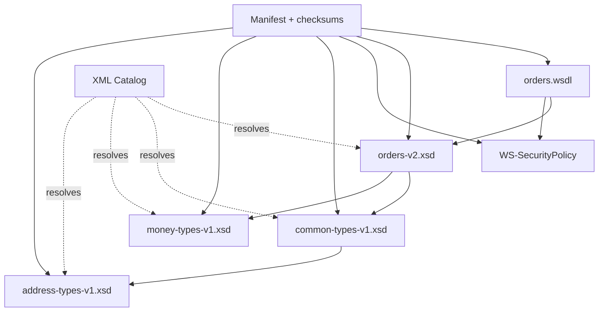
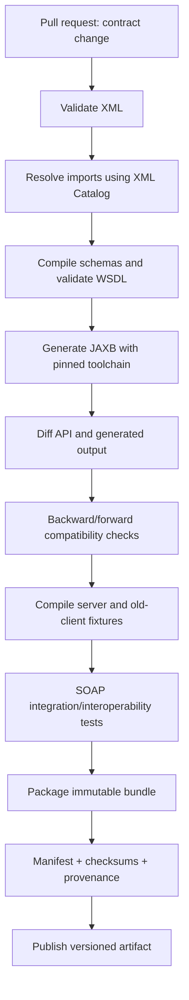

# Quản lý WSDL tĩnh, XSD dùng chung và bộ tạo tác hợp đồng

Trong hệ thống SOAP **contract-first** với **Spring Web Services (Spring-WS)**, WSDL, XSD và chính sách bảo mật là giao diện công khai giữa nhiều service và consumer. Một thay đổi schema có thể ảnh hưởng JAXB classes, endpoint mapping, SOAPAction, SOAP Fault và WS-Security. Nếu từng service tự sao chép schema hoặc tự tạo WSDL bằng cấu hình runtime không được kiểm soát, các team dễ sử dụng những phiên bản hợp đồng khác nhau.

Cách quản lý ổn định là coi **WSDL, XSD, policy, catalog và cấu hình tạo mã là một bộ tạo tác hợp đồng có version**:

- **WSDL tĩnh** được lưu, review, version hóa và publish như artifact xác định.
- **XSD dùng chung** được tổ chức theo namespace và dependency graph rõ ràng.
- **Contract bundle** chứa WSDL, mọi XSD tham chiếu, WS-Policy khi có, XML Catalog, manifest và checksum.
- **JAXB/client stubs** được sinh lặp lại từ đúng artifact/version bằng toolchain cố định.
- **CI compatibility checks** phát hiện thay đổi phá vỡ hợp đồng trước khi server hoặc client phát hành.

Bài thuộc chương **Tương thích hợp đồng** của module `SPRING_WEB_SERVICES`. Mục tiêu là giữ giao diện SOAP nhất quán qua nhiều service, nhiều client Java/.NET, nhiều môi trường và nhiều chu kỳ versioning.

> **Nguyên tắc:** hợp đồng đã publish phải là phiên bản xác định, có thể tải lại và kiểm tra checksum. Runtime server, code generation và consumer tests cần tham chiếu cùng bộ WSDL/XSD. Một file WSDL đơn lẻ không đủ nếu schema import hoặc policy bên ngoài có thể thay đổi.

## 1. Vì sao phải quản lý cả bộ hợp đồng?

WSDL 1.1 có thể khai báo schema trong `wsdl:types` hoặc tham chiếu XSD bên ngoài qua import/include. Một XSD có thể tiếp tục import schema khác. WS-Policy có thể được gắn ở service, binding, operation hoặc message. Nếu chỉ lưu WSDL gốc mà bỏ qua dependency, consumer có thể không tái tạo được contract.



| Thành phần | Trách nhiệm |
| --- | --- |
| WSDL | Service/port, binding, operation, messages, SOAP version/action và endpoint contract |
| XSD | Payload structure, namespace, element, type, occurrence và restriction |
| WS-Policy | Security assertions mà runtime/client cần hỗ trợ và enforce |
| XML Catalog | Ánh xạ URI import logic sang schema artifact đã quản lý |
| Manifest | Version, file list, dependency, codegen settings và checksums |
| Compatibility report | Bằng chứng thay đổi tương thích hoặc phá vỡ |

Không phải service nào cũng cần tất cả các file. Nhưng nếu WSDL tham chiếu policy hoặc XSD dùng chung, dependency đó phải được quản lý và resolve độc lập.

## 2. WSDL tĩnh và WSDL sinh động trong Spring-WS

Spring-WS có thể publish WSDL theo hai cách:

- **Static WSDL:** publish file WSDL đã soạn và review, ví dụ qua `SimpleWsdl11Definition`.
- **Dynamic WSDL:** Spring-WS tạo WSDL từ schema và cấu hình definition, ví dụ `DefaultWsdl11Definition` cùng `XsdSchema`.

| Tiêu chí | Static WSDL | Dynamic WSDL |
| --- | --- | --- |
| Nguồn hợp đồng | File WSDL quản lý trong repo/artifact | WSDL sinh từ schema và cấu hình |
| Kiểm soát binding/operation | Review trực tiếp từng phần | Phụ thuộc naming/convention và generator |
| Contract diff | Diff file WSDL | Cần snapshot output được sinh |
| Rủi ro thay schema | Chỉ đổi khi artifact cập nhật có chủ đích | Schema/config có thể đổi output |
| Phù hợp | Nhiều consumer, cần kiểm soát chi tiết | Service đơn giản, schema là nguồn chính |
| Vận hành | Đồng bộ file và dependencies | Cố định generator và settings |

Static không tự có nghĩa bất biến; tính ổn định đến từ versioning, review, compatibility checks và immutable publish. Dynamic vẫn phù hợp nếu contract đơn giản, nhưng CI phải snapshot WSDL output thực tế để phát hiện thay đổi về binding, action, wrapper element và address.

## 3. Publish WSDL tĩnh trong Spring-WS

Một cấu hình Spring-WS điển hình expose bean tên `orders`:

```java
import org.springframework.context.annotation.Bean;
import org.springframework.context.annotation.Configuration;
import org.springframework.core.io.ClassPathResource;
import org.springframework.ws.wsdl.wsdl11.SimpleWsdl11Definition;

@Configuration
public class OrdersWsdlConfiguration {

    @Bean(name = "orders")
    public SimpleWsdl11Definition ordersWsdl() {
        return new SimpleWsdl11Definition(
                new ClassPathResource("contracts/orders/v2/orders.wsdl"));
    }
}
```

Với servlet mapping như `/ws/*`, WSDL thường được publish theo tên bean, ví dụ `/ws/orders.wsdl`. URL thực tế phụ thuộc context path, servlet mapping, reverse proxy và deployment; phải kiểm tra bằng HTTP integration test.

Lưu ý:

1. WSDL nằm trong classpath/resources hoặc artifact location cố định.
2. Relative XSD imports phải resolve đúng sau khi đóng gói JAR/WAR.
3. Không để `soap:address` trỏ localhost/dev hostname trong production.
4. Policy imports phải được publish/resolve theo URI và version quản lý.
5. Không sửa WSDL trong container đang chạy hoặc phụ thuộc mutable shared folder.

### Kiểm tra WSDL đã publish

HTTP integration test nên xác minh URL trả XML hợp lệ; root element đúng WSDL namespace; service, port, binding, operation, Fault có mặt; SOAP version, transport URI và SOAPAction phù hợp; mọi schema/policy imports resolve; endpoint address không công bố hostname nội bộ.

**WSDL publishing endpoint không phải SOAP POST endpoint.** URL lấy WSDL thường khác địa chỉ service trong `soap:address`.

## 4. Tổ chức XSD theo namespace và domain

Không gom mọi type vào một file `common.xsd` chỉ vì nhiều service dùng chung. Tách theo vocabulary và lifecycle ổn định.

```text
contracts/
  orders/v2/
    orders.wsdl
    orders-v2.xsd
    ws-security-policy.xml
  shared/
    common/v1/common-types-v1.xsd
    address/v1/address-types-v1.xsd
    money/v1/money-types-v1.xsd
catalog/catalog.xml
manifest/orders-v2-contract.json
```

| Schema | Target namespace | Nội dung |
| --- | --- | --- |
| orders-v2.xsd | `https://example.com/orders/v2` | Request/response/Fault của Orders |
| common-types-v1.xsd | `https://example.com/common/v1` | Identifier, pagination, metadata |
| address-types-v1.xsd | `https://example.com/address/v1` | Postal address |
| money-types-v1.xsd | `https://example.com/money/v1` | Amount/currency |

Namespace định danh vocabulary XML, không chỉ là thư mục. Không dùng cùng namespace cho hai cấu trúc không tương thích. Cũng không tạo namespace mới cho thay đổi comment không ảnh hưởng wire contract.

### Import và include

- `xsd:include` đưa schema components cùng target namespace vào schema hiện tại (hoặc chameleon schema theo XML Schema).
- `xsd:import` tham chiếu schema có namespace khác; thuộc tính namespace xác định namespace đích.
- Không dùng include thay import khi target namespaces khác nhau.
- Kiểm soát dependency graph, tránh circular imports khó resolve.
- Không để cùng QName có nhiều định nghĩa cạnh tranh.

## 5. Ví dụ shared XSD và import

Schema chung định nghĩa kiểu RequestId:

```xml
<?xml version="1.0" encoding="UTF-8"?>
<xs:schema xmlns:xs="http://www.w3.org/2001/XMLSchema"
           targetNamespace="https://example.com/common/v1"
           xmlns:com="https://example.com/common/v1"
           elementFormDefault="qualified">
  <xs:simpleType name="RequestId">
    <xs:restriction base="xs:string">
      <xs:minLength value="1"/>
      <xs:maxLength value="64"/>
      <xs:pattern value="[A-Za-z0-9._-]+"/>
    </xs:restriction>
  </xs:simpleType>
</xs:schema>
```

Schema Orders import namespace common:

```xml
<?xml version="1.0" encoding="UTF-8"?>
<xs:schema xmlns:xs="http://www.w3.org/2001/XMLSchema"
           xmlns:ord="https://example.com/orders/v2"
           xmlns:com="https://example.com/common/v1"
           targetNamespace="https://example.com/orders/v2"
           elementFormDefault="qualified">
  <xs:import namespace="https://example.com/common/v1"
             schemaLocation="../../shared/common/v1/common-types-v1.xsd"/>
  <xs:element name="GetOrderRequest">
    <xs:complexType>
      <xs:sequence>
        <xs:element name="requestId" type="com:RequestId"/>
        <xs:element name="orderId" type="xs:positiveInteger"/>
      </xs:sequence>
    </xs:complexType>
  </xs:element>
</xs:schema>
```

Relative schemaLocation chỉ minh họa. Trong production, dùng URI import ổn định và XML Catalog/resource resolver được kiểm soát; không phụ thuộc working directory của developer.

## 6. XML Catalog và giải quyết dependency

Nếu schema import một URL công khai, code generator hoặc parser có thể truy cập Internet lúc build. Hợp đồng khi đó phụ thuộc nội dung mutable, network availability và có nguy cơ truy cập tài nguyên ngoài ý muốn.

XML Catalog ánh xạ URI logic sang artifact local đã quản lý:

```xml
<?xml version="1.0" encoding="UTF-8"?>
<catalog xmlns="urn:oasis:names:tc:entity:xmlns:xml:catalog">
  <uri name="https://schemas.example.com/common/v1/common-types.xsd"
       uri="../shared/common/v1/common-types-v1.xsd"/>
  <uri name="https://schemas.example.com/address/v1/address-types.xsd"
       uri="../shared/address/v1/address-types-v1.xsd"/>
</catalog>
```

Catalog phải được cấu hình trong tool resolve: XJC, schema compiler, XML parser hoặc resolver. Chỉ đặt catalog trong repo không khiến mọi tool tự dùng nó.

Biện pháp:

- Build dùng schema artifact local/versioned và có thể chạy offline.
- Thiếu catalog mapping phải fail build, không âm thầm fetch mạng.
- Giới hạn external DTD/schema access ở parser không cần truy cập ngoài.
- Không nhận `xsi:schemaLocation` do client gửi làm nguồn schema tin cậy.
- Kiểm tra URI normalization, redirect và path traversal trong resolver.
- Review imports/includes như một phần của contract.

## 7. WSDL tham chiếu XSD dùng chung

WSDL có thể chứa schema trong `wsdl:types` hoặc import schema bên ngoài:

```xml
<wsdl:definitions
    xmlns:wsdl="http://schemas.xmlsoap.org/wsdl/"
    xmlns:soap="http://schemas.xmlsoap.org/wsdl/soap/"
    xmlns:xs="http://www.w3.org/2001/XMLSchema"
    targetNamespace="https://example.com/orders/v2/wsdl">
  <wsdl:types>
    <xs:schema>
      <xs:import
          namespace="https://example.com/orders/v2"
          schemaLocation="https://schemas.example.com/orders/v2/orders-v2.xsd"/>
    </xs:schema>
  </wsdl:types>
  <!-- messages, portType, binding và service được lược giản -->
</wsdl:definitions>
```

Đây là fragment, không phải WSDL hoàn chỉnh. Khi publish static WSDL, consumer phải resolve được schemaLocation từ URL công bố. Lỗi thường gặp: WSDL GET thành công nhưng XSD import trỏ tới file không được publish hoặc URI nội bộ.

| Location | Ưu điểm | Rủi ro |
| --- | --- | --- |
| Relative schemaLocation | Dễ đóng gói cùng bundle | Hỏng nếu copy file lẻ/đổi base URI |
| Absolute versioned URL | URI ổn định, dễ chia sẻ | Cần registry/catalog và nội dung immutable |
| Catalog alias | Tách public URI khỏi storage nội bộ | Tool phải nạp catalog đúng |

Kiểm tra WSDL từ public URL sau deployment, không chỉ parse source file trong repository.

## 8. Đóng gói contract artifacts và manifest

Một release bundle có thể có dạng:

```text
contract-bundles/
  orders/2.3.0/
    orders.wsdl
    schemas/
      orders-v2.xsd
      common-types-v1.xsd
      address-types-v1.xsd
    policy/orders-security-policy.xml
    catalog/catalog.xml
    manifest.json
    checksums.sha256
```

Bundle release phải **immutable**. Version `2.3.0` đã publish không được thay nội dung phía sau cùng version. Nếu sửa schema, phát hành artifact/version mới.

Manifest minh họa:

```json
{
  "contract": "orders",
  "version": "2.3.0",
  "wsdl": "orders.wsdl",
  "namespaces": {
    "service": "https://example.com/orders/v2",
    "common": "https://example.com/common/v1"
  },
  "files": [
    "orders.wsdl",
    "schemas/orders-v2.xsd",
    "schemas/common-types-v1.xsd",
    "policy/orders-security-policy.xml",
    "catalog/catalog.xml"
  ],
  "codegen": {
    "tool": "JAXB XJC",
    "bindingFile": "bindings/orders-bindings.xjb"
  }
}
```

Manifest production có thể thêm checksum, tool version, source revision và ownership. Không đưa secret/password vào manifest.

Checksum SHA-256 giúp xác minh nội dung khớp artifact đã phát hành khi so sánh qua kênh tin cậy; nó không thay chữ ký artifact, access control hay provenance.

## 9. JAXB code generation phải tái lập

JAXB classes nên là **build output từ contract artifact**, không phải source được chỉnh tay. Cần cố định:

- JAXB/XJC plugin và runtime version.
- JDK/toolchain.
- XSD set và XML Catalog.
- Binding files (.xjb) và package mapping.
- Encoding, namespace-to-package mapping và compiler options.
- Episode files nếu nhiều module cùng sinh schema.
- Output directory và quy tắc regenerate/clean.

Ví dụ Maven plugin fragment (placeholder version được thay bằng version đã được pin trong build):

```xml
<plugin>
  <groupId>org.jvnet.jaxb</groupId>
  <artifactId>jaxb-maven-plugin</artifactId>
  <version>PINNED_PLUGIN_VERSION</version>
  <executions>
    <execution>
      <id>generate-orders-contract</id>
      <goals><goal>generate</goal></goals>
      <configuration>
        <schemaDirectory>src/main/resources/contracts/orders/v2</schemaDirectory>
        <schemaIncludes>
          <include>orders-v2.xsd</include>
        </schemaIncludes>
        <catalog>src/main/resources/contracts/catalog/catalog.xml</catalog>
        <generateDirectory>target/generated-sources/xjc</generateDirectory>
      </configuration>
    </execution>
  </executions>
</plugin>
```

Đây là ví dụ minh họa; plugin coordinates, goal và catalog configuration phụ thuộc plugin/JAXB version. Với Jakarta XML Binding 3/4, API package khác JAXB 2.x (`javax.xml.bind`), nên dependency, generated imports và runtime phải nhất quán.

Không chỉnh generated source thủ công. Nếu cần đổi Java name, collection property hoặc adapter, dùng binding customization/adapter được quản lý. Cùng input + toolchain + config cần tạo output tương đương.

## 10. Shared schema qua nhiều module

Khi nhiều SOAP services dùng common XSD, phát hành schema đó như **artifact độc lập có version**:

```text
orders-contracts 2.3.0
  ├── common-contracts 1.6.0
  ├── address-contracts 2.1.0
  └── money-contracts 1.3.0
```

Không để build của Orders tự lấy “latest common schema”. Điều đó có thể đổi JAXB output ngoài release plan.

Namespace version và artifact version không nhất thiết giống nhau. Có thể phát hành lại artifact sửa metadata mà XML schema không đổi. Ngược lại, thay namespace làm thay QName và có thể tạo contract version mới. Không tăng namespace chỉ vì artifact metadata thay đổi; cũng không tái sử dụng namespace cho breaking changes.

## 11. Versioning và tính tương thích

Phân biệt artifact update, compatible schema evolution, breaking change và operational contract change.

| Thay đổi | Khả năng tương thích | Nhận xét |
| --- | --- | --- |
| Sửa documentation/comment | Thường không ảnh hưởng wire contract | Kiểm generator annotations |
| Thêm optional element cuối sequence | Có thể tương thích | Generated strict clients vẫn cần test |
| Thêm required element | Thường breaking | Client cũ không gửi field |
| Xóa element | Breaking với consumer sử dụng | Response có thể mất dữ liệu |
| Đổi element/type/namespace | Thường breaking | QName/type thay đổi |
| Siết minLength/pattern | Có thể breaking | Dữ liệu cũ có thể bị reject |
| Mở rộng enum | Có thể phá consumer strict | Consumer không biết value mới |
| Đổi SOAPAction/binding | Integration change hoặc breaking | Routing/client callback phụ thuộc |
| Thêm WS-Security requirement | Có thể breaking vận hành | Client cũ không tạo token/signature |
| Đổi soap:address | Operational change | Client/deployment cần cập nhật |

Backward compatible không chỉ là XSD compile được. Phải kiểm semantics, generated client behavior, SOAP version, binding, action, Fault, WS-Policy và security.

## 12. Quy tắc schema evolution

Ví dụ schema request:

```xml
<xs:complexType name="CreateOrderRequestType">
  <xs:sequence>
    <xs:element name="requestId" type="com:RequestId"/>
    <xs:element name="customerId" type="xs:string"/>
    <xs:element name="items" type="ord:OrderItems"/>
  </xs:sequence>
</xs:complexType>
```

Các nguyên tắc:

1. Không đổi QName public trong compatible release.
2. Không đổi minOccurs, maxOccurs, nillable hoặc thứ tự sequence nếu chưa đánh giá consumer.
3. Không siết pattern/min/max trên dữ liệu đang gửi thực tế nếu chưa migration.
4. Enum mở rộng có thể làm client strict lỗi.
5. Element optional mới không được ngầm thành business requirement bắt buộc.
6. Kiểm cách JAXB consumer cũ xử lý unknown response element.
7. Nếu dùng xs:any/wildcard, định nghĩa namespace và processContents.
8. Không dùng default/fixed để âm thầm đổi meaning của request cũ.
9. Breaking change cần namespace/operation version mới hoặc migration được công bố.
10. Kiểm tra request và response schema; tác động hai chiều khác nhau.

Thêm element vào giữa xs:sequence có thể làm payload cũ sai thứ tự. Thêm optional element cuối sequence thường ít rủi ro hơn nhưng vẫn phải test client thực.

## 13. WSDL compatibility: binding cũng là contract

XSD payload giống nhau vẫn có thể không interoperable nếu binding thay đổi. Kiểm tra:

- wsdl:service và wsdl:port.
- wsdl:portType operation, input/output/fault messages.
- SOAP 1.1/1.2 binding và transport.
- soap:operation SOAPAction và document/literal use.
- Wrapper QName phù hợp PayloadRoot mapping.
- soap:address theo môi trường/proxy.
- WS-Addressing Action khi có.
- WS-SecurityPolicy token, signed parts, encryption và algorithm suite.
- Mọi WSDL/XSD/policy imports resolve mà không fetch mạng ngoài policy.

CI có thể fetch WSDL từ artifact/server test, resolve dependencies và so với snapshot. Không chỉ string diff vì prefix XML có thể đổi nhưng QName semantics tương đương; dùng XML/WSDL-aware comparison và giữ raw checksum để audit.

## 14. Repository và artifact strategy

| Chiến lược | Ưu điểm | Đánh đổi |
| --- | --- | --- |
| Monorepo contract + service | Review đồng bộ | Release coupling |
| Contract repository riêng | Consumer độc lập lấy artifact | Cần ownership/publish workflow |
| Maven/Gradle artifact registry | Version dependency rõ | Packaging/import paths cần thiết kế |
| Git tag release bundle | Audit history tốt | Consumer cần tải/đóng gói |
| Schema registry chuyên dụng | Catalog/metadata/governance | Cần phù hợp XML/WSDL workflow |

Dù chọn công cụ nào, artifact cần owner, version duy nhất, immutable publish, dependency đầy đủ, checksum/provenance, compatibility report và migration/retention policy.

## 15. CI pipeline



Pipeline có thể chạy XML well-formedness, schema compilation, WSDL validation, XJC, generated API diff, old-client fixtures, SOAP request/response/Fault tests, security policy tests, package manifest/checksum và publish immutable bundle.

Không để CI âm thầm tải schema từ Internet. Pin plugin, JDK, JAXB runtime, binding config và catalog; dependency chưa được quản lý phải fail rõ.

## 16. Kiểm tra tương thích với client cũ

Giả sử server thêm optional field `deliveryNote` vào CreateOrderRequest:

- Dùng JAXB classes sinh từ contract cũ để marshal request.
- Gửi request cũ tới server mới.
- Server mới phải parse/validate và xử lý đúng nếu yêu cầu backward compatibility.
- Dùng client/schema mới kiểm response.
- Kiểm consumer cũ đọc response có field mới nếu response cũng thay đổi.
- Test unknown/optional fields, namespace và sequence order.
- Test SOAPAction, operation mapping, Fault và WS-Security requirements.

Payload cũ minh họa:

```xml
<ord:CreateOrderRequest xmlns:ord="https://example.com/orders/v2">
  <ord:requestId>req-1001</ord:requestId>
  <ord:customerId>C-42</ord:customerId>
  <ord:items>
    <!-- existing item structure -->
  </ord:items>
</ord:CreateOrderRequest>
```

Nếu schema mới thêm optional element cuối sequence, payload cũ có thể vẫn hợp lệ. Cần kiểm JAXB unmarshal, XSD validation và semantics của field thiếu.

## 17. Quản lý endpoint address theo môi trường

Static WSDL có `soap:address location`. Nếu commit dev/staging hostname vào artifact, production consumer có thể gọi nhầm môi trường.

Các cách tổ chức:

- Publish WSDL theo môi trường, address rewrite có kiểm soát.
- Dùng placeholder và deployment step inject endpoint URI.
- Gateway cung cấp stable public address.
- Client lấy endpoint URI từ environment/registry, không hard-code trong generated source.

Nếu rewrite WSDL lúc deploy, test snapshot output từng môi trường. Không global string replacement thiếu hiểu biết XML. Không công bố internal hostname, private IP hoặc endpoint admin.

## 18. Bảo mật khi publish contract

WSDL/XSD có thể public để đối tác codegen, nhưng cần kiểm soát:

- Chỉ publish contract dành cho partner; không lộ internal admin operations.
- Không nhúng credential/token hoặc ví dụ có dữ liệu thật.
- WS-Policy phản ánh security requirement được enforce ở runtime.
- Import không ép parser tải arbitrary external entities.
- XML Catalog/parser fail closed khi URI chưa được quản lý.
- Chặn XXE/DTD/entity expansion ở runtime SOAP parser độc lập với codegen.
- Không để request xsi:schemaLocation quyết định schema server tải.
- Giữ version cũ trong thời gian consumer còn dùng theo retention policy.
- Kiểm authorization truy cập WSDL nếu contract chứa operation nội bộ.

Publish WSDL không có nghĩa publish implementation details nội bộ.

## 19. Quan sát contract/runtime drift

Contract có thể không khớp server nếu runtime deploy JAR cũ, XSD copy thủ công khác checksum, gateway rewrite address sai, JAXB sinh từ version khác, endpoint mapping còn QName cũ hoặc WSS4J enforce policy cũ.

| Metadata | Mục đích |
| --- | --- |
| Contract name/version | Nhận biết API đang phục vụ |
| WSDL/XSD checksum | Xác nhận runtime artifact |
| Build/release revision | Trace source/provenance |
| Public WSDL URL | Xác định contract consumer tải |
| SOAP namespace/action | Phát hiện version mismatch |
| JAXB codegen version | Trace generated classes |
| Security policy revision | Phát hiện auth/signature drift |

Có thể publish diagnostic metadata nếu không lộ thông tin nhạy cảm. Logs/metrics nên chứa version đã chuẩn hóa, không chứa raw SOAP Body/token.

## 20. Interoperability test với nhiều SOAP stacks

XJC compile thành công không bảo đảm Java, .NET và partner stacks hiểu contract giống nhau. Kiểm tra:

- QName, namespace và qualified elements.
- elementFormDefault, attributeFormDefault.
- sequence, choice, all, minOccurs, maxOccurs, nillable.
- Decimal precision, date/time timezone, binary/MTOM.
- Enum, pattern và restriction.
- Optional element, absent và xsi:nil.
- SOAP 1.1/1.2 Content-Type/action.
- WS-Addressing Action/ReplyTo/MessageID.
- SOAP Fault code/detail.
- UsernameToken, signature/encryption và signed parts.
- HTTP/JMS transport metadata theo binding.

**Prefix không phải identity của QName**; namespace URI và local name mới quyết định QName. Serializer/parser vẫn phải tạo namespace declarations và qualified elements đúng XSD.

## 21. Quy trình cập nhật shared schema

Khi sửa common XSD được nhiều service import:

1. Xác định mọi consumer/service phụ thuộc version hiện tại từ manifest/dependency graph.
2. Phân loại thay đổi compatible, conditional hay breaking.
3. Tạo artifact version mới nếu cần; không overwrite bản đã publish.
4. Chạy codegen bằng toolchain pinned và catalog mới.
5. So generated API và WSDL/XSD snapshot.
6. Chạy client fixtures từ contract version cũ.
7. Kiểm server mới xử lý payload cũ nếu cần compatibility.
8. Cập nhật imports, manifest và checksums.
9. Publish artifact và migration notes.
10. Rollout có overlap khi consumer không thể nâng cùng lúc.
11. Theo dõi validation failures theo contract/client version.
12. Sunset version cũ sau khi xác nhận consumer migration.

## 22. Ma trận 40 ca kiểm thử quản lý contract

| Mã | Tình huống | Kết quả cần xác minh |
| --- | --- | --- |
| C01 | Static WSDL classpath resource tồn tại | Publish đúng WSDL |
| C02 | GET public WSDL URL | XML response hợp lệ |
| C03 | Thiếu wsdl:service/port | CI từ chối |
| C04 | SOAP address chứa localhost/dev host | Release check phát hiện |
| C05 | WSDL import XSD relative | Resolve từ deployed URL |
| C06 | Import versioned URI | Catalog/runtime resolve đúng |
| C07 | XSD import shared namespace | QName/type resolve |
| C08 | Include schema namespace khác | Validation từ chối |
| C09 | Circular schema imports | CI phát hiện |
| C10 | Thiếu catalog mapping | Build fail closed, không fetch mạng |
| C11 | Schema URL redirect host ngoài | Resolver/network policy chặn |
| C12 | Checksum lệch manifest | Artifact verification fail |
| C13 | Overwrite artifact đã publish | Registry/pipeline từ chối |
| C14 | XJC/JAXB version đổi | Generated diff được review |
| C15 | JDK/JAXB namespace mismatch | Build phát hiện |
| C16 | Binding file không được áp | Generated API diff phát hiện |
| C17 | Shared XSD đổi, consumer chưa rebuild | Compatibility check phát hiện |
| C18 | Thêm optional element cuối sequence | Old-client fixture test |
| C19 | Thêm required element | Breaking check |
| C20 | Đổi thứ tự sequence | Compatibility test |
| C21 | Đổi QName/targetNamespace | Breaking change phát hiện |
| C22 | Siết pattern/minLength | Payload cũ được kiểm tra |
| C23 | Mở rộng enum | Consumer strict được test |
| C24 | Đổi minOccurs/nillable | Request/response compatibility |
| C25 | SOAPAction đổi | Mapping/client callback test |
| C26 | SOAP 1.1 sang 1.2 | Interoperability test |
| C27 | Endpoint QName lệch XSD | Integration test từ chối |
| C28 | Dynamic WSDL output đổi | Snapshot diff phát hiện |
| C29 | Static WSDL khác snapshot | Artifact diff fail |
| C30 | WS-Security policy đổi | WSS enforcement test |
| C31 | WSDL advertise policy runtime chưa enforce | Drift alert |
| C32 | SOAP Fault detail đổi | Consumer fault compatibility |
| C33 | Catalog path sau package JAR/WAR | Resolve thành công |
| C34 | External DTD trong schema/request | Parser hardening chặn |
| C35 | Client cung cấp schemaLocation | Server không fetch tùy ý |
| C36 | WSDL/XSD lộ internal host | Publish policy phát hiện |
| C37 | Runtime checksum lệch build | Drift monitoring phát hiện |
| C38 | Java client v1 gọi server v2 | Backward test |
| C39 | .NET/partner stack dùng bundle | Cross-stack interoperability |
| C40 | Rollout khi consumer cũ còn hoạt động | Overlap/version migration |

Kết quả phải dựa trên **wire behavior và consumer compatibility**, không chỉ codegen pass.

## 23. Chẩn đoán drift và lỗi codegen

| Triệu chứng | Nguyên nhân thường gặp | Hướng điều tra |
| --- | --- | --- |
| WSDL tải được nhưng codegen fail | XSD import không resolve/auth redirect | Fetch từng import, catalog, content type |
| Local build pass, CI fail | Toolchain/network khác | Pin versions, offline catalog |
| JAXB classes khác giữa build | XJC/JDK/binding khác | Compare tool versions/config |
| Server reject request cũ | Schema breaking hoặc runtime schema lệch | Namespace, order, occurrence, hash |
| PayloadRoot không match | QName/namespace sai | So request root và endpoint mapping |
| SOAPAction gọi sai operation | Binding/action drift | WSDL binding và callback |
| .NET fail, Java pass | Interop differences | Nillable, ordering, enum, date, SOAP version |
| WSDL address trỏ staging | Address rewrite sai | Published WSDL snapshot |
| Security Fault sau rollout | WS-Policy/WSS drift | Token, signed parts, algorithm, certificate |
| Parser truy cập Internet lúc build | Catalog chưa nạp | Resolver và network policy |
| Consumer cũ lỗi khi đọc response | Element/enum/namespace mới | Old-client fixture |
| Runtime WSDL khác artifact | Deploy stale JAR/cache/proxy | Hash/version metadata |

### Quy trình điều tra

1. Lấy WSDL thực tế từ public URL consumer gọi.
2. Ghi version/checksum và endpoint address.
3. Resolve mọi XSD/WSDL/Policy import bằng đúng catalog.
4. So WSDL runtime với artifact đã phát hành.
5. Kiểm targetNamespace, QName, import/include và constraints.
6. Kiểm XJC/JAXB toolchain và binding files.
7. So PayloadRoot, SOAPAction, SOAP version và binding.
8. Đối chiếu WS-Policy với WSS4J runtime.
9. Chạy consumer fixtures cũ và mới qua endpoint.
10. Ghi compatibility result và rollout version.

## 24. Bài tập: shared XSD cho ba SOAP services

**Bối cảnh:** Orders, Payments và Customer cùng import `common-types.xsd`. Team sửa RequestId từ maxLength 64 xuống 32. JAXB classes vẫn sinh thành công nhưng client cũ gửi request ID dài 48 ký tự.

**Câu hỏi:** Có thể publish schema đã sửa dưới cùng URI không? Cần test gì trước deploy?

**Hướng giải quyết:**

1. Siết maxLength là compatibility risk dù Java property vẫn là String; request trước đây hợp lệ nay bị từ chối.
2. Không overwrite schema artifact/version đã publish; tạo version mới hoặc migration plan.
3. Lập dependency graph cả ba service và consumer; xác định ai import common v1/v2.
4. Chạy payload fixture client cũ có ID dài 48 qua server mới.
5. Nếu cần rollout không gián đoạn, tiếp tục hỗ trợ v1 trong overlap/migration window.
6. Regenerate JAXB bằng XJC pinned; compare output/API.
7. Cập nhật catalog, WSDL imports, manifest/checksum.
8. Test Java/.NET clients, XSD validation, QName, action và SOAP Fault.
9. Deploy overlap, đo validation errors theo contract version.
10. Sunset v1 sau khi consumer migration xác nhận.

**Tiêu chí đạt:** v1 không bị thay nội dung lén; old-client wire tests có kết quả; service dependencies và migration version được công bố.

## 25. Checklist phát hành WSDL/XSD và contract artifacts

1. **Xác định contract owner** cho từng WSDL và shared namespace.
2. **Lưu WSDL/XSD/policy trong repo hoặc artifact registry** có review/history.
3. **Publish static WSDL** khi cần kiểm soát chi tiết; snapshot dynamic WSDL nếu dùng generator.
4. **Tách shared schema theo namespace/domain lifecycle**, tránh common schema quá rộng.
5. **Chọn đúng import/include** theo targetNamespace.
6. **Duy trì XML Catalog** và fail closed khi mapping thiếu.
7. **Không tải schema tùy ý từ network** trong codegen/runtime parser.
8. **Package transitive dependencies**: WSDL, XSD, policy, catalog, manifest.
9. **Gắn version immutable**; không overwrite artifact đã publish.
10. **Tính checksum/provenance** cho file và bundle.
11. **Pin JDK, XJC/JAXB plugin/runtime và binding files**.
12. **Không chỉnh generated JAXB source thủ công**.
13. **Kiểm QName, order, cardinality, nillable, restriction và enum**.
14. **Phân loại thay đổi** compatible, conditional hay breaking.
15. **Test client cũ và mới**, Java/.NET/partner stacks khi thuộc phạm vi.
16. **Kiểm SOAP 1.1/1.2 binding, action, Fault và WS-Addressing**.
17. **Đối chiếu WS-SecurityPolicy với WSS4J runtime**.
18. **Test WSDL qua public URL sau deploy**, gồm imports và address.
19. **Không công bố internal endpoint/secret**.
20. **Theo dõi runtime contract version/checksum** để phát hiện drift.
21. **Lập overlap/migration/sunset plan** cho shared XSD.
22. **Kiểm cache/proxy/CDN** không phục vụ bundle sai version.
23. **Ghi compatibility report và kết quả test** trong release artifact.
24. **Nêu rõ giới hạn hỗ trợ version** trong thông tin tích hợp đối tác.

**Kết luận:** Quản lý hợp đồng SOAP ổn định cần coi WSDL, XSD, policy, catalog và codegen settings là **một bộ artifact có version, dependency và checksum**. WSDL tĩnh cho phép review/publish chính xác; XSD dùng chung cần namespace/import/version rõ; JAXB được sinh từ toolchain cố định; CI kiểm schema/WSDL compatibility và chạy client fixtures. Với Spring-WS, endpoint code chỉ là một phần của hợp đồng: consumer tương tác qua QName, binding, action, Fault, security policy và endpoint address đã publish. Khi mọi thành phần cùng tham chiếu một contract release immutable, nhiều service và consumer có thể nâng cấp theo kế hoạch mà không vô tình làm drift hoặc phá vỡ tích hợp.
