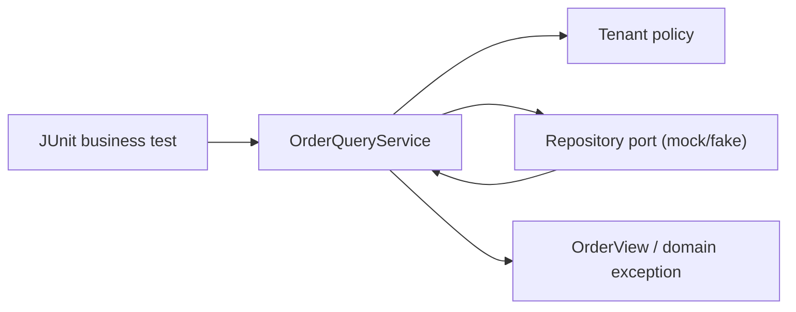
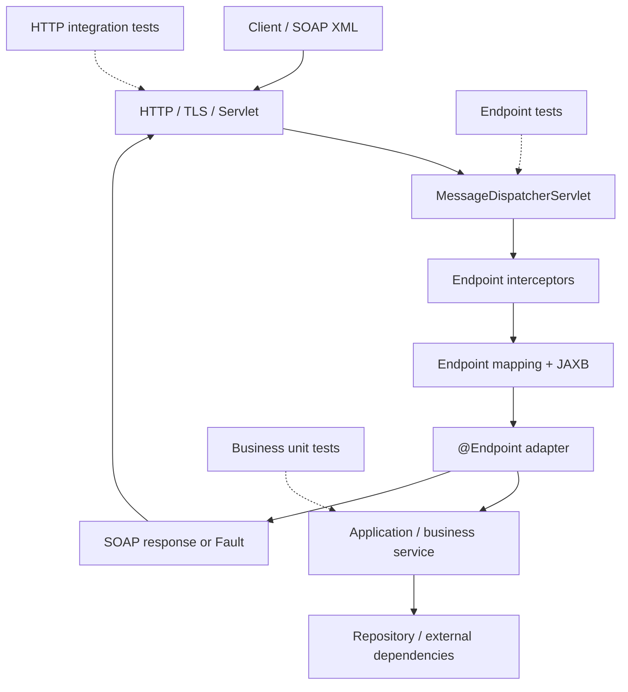

# Kiểm thử nghiệp vụ thuần và kiểm thử endpoint là các phạm vi khác nhau

Trong ứng dụng Spring Web Services, một test gọi service Java trực tiếp có thể xác nhận quy tắc nghiệp vụ đúng, nhưng chưa chứng minh SOAP endpoint thực sự nhận thông điệp và gọi đúng service. Ngược lại, test gửi SOAP request qua endpoint có thể xác nhận dispatch, JAXB mapping và SOAP Fault, nhưng chưa chứng minh mọi quy tắc nghiệp vụ đúng ở các biên dữ liệu.

**Kiểm thử nghiệp vụ thuần** và **kiểm thử endpoint** trả lời hai nhóm câu hỏi khác nhau:

- Kiểm thử nghiệp vụ: với input và trạng thái miền cụ thể, service có tính toán, kiểm tra điều kiện và thay đổi trạng thái đúng không?
- Kiểm thử endpoint: SOAP message được Spring-WS tiếp nhận, dispatch, unmarshal, validate, chuyển thành lời gọi ứng dụng và marshal response/Fault theo hợp đồng không?

Bài thuộc chương **Kiểm thử máy chủ** của module **SPRING_WEB_SERVICES**. Module học phát triển SOAP theo hướng contract-first, thiết kế XSD/WSDL, ánh xạ JAXB, xây endpoint và SOAP client, xử lý SOAP Fault, interceptor, XML security, WS-Security, certificates và kiểm thử tương thích. Các lớp test phải bao phủ cả **domain behavior** và **hợp đồng SOAP/server pipeline**, đồng thời giữ ranh giới rõ ràng để test nhanh, ổn định và dễ chẩn đoán.

Ví dụ dùng JUnit 5, Mockito, Spring-WS Test và Spring Boot 3/Jakarta ở mức khái niệm. Tên class domain/JAXB là minh họa; API chính xác cần khớp phiên bản Spring-WS của dự án.

## 1. Hai phạm vi kiểm thử khác nhau

### 1.1. Kiểm thử nghiệp vụ thuần (business/service test)

Business test gọi application/domain service trực tiếp, không tạo SOAP Envelope và không cần chạy Spring-WS message dispatcher.



Lớp này phù hợp để kiểm:

- Quy tắc trạng thái đơn hàng, tính giá, giới hạn và điều kiện nghiệp vụ.
- Tenant/resource authorization ở tầng service nếu thuộc trách nhiệm use case.
- Dependency được gọi đúng hoặc không được gọi khi điều kiện không đạt.
- Thay đổi trạng thái đúng trong tình huống thành công/thất bại.
- Idempotency/duplicate ở mức application/domain nếu là yêu cầu use case.
- Mapping lỗi miền sang exception có ý nghĩa ở tầng ứng dụng.

Business test không cần biết SOAP namespace, @PayloadRoot, SOAP 1.1/1.2, JAXB annotation hoặc WS-Addressing Header, trừ khi logic miền thực sự phụ thuộc dữ liệu ấy đã được adapter chuyển thành kiểu miền.

### 1.2. Kiểm thử endpoint (endpoint/adapter test)

Endpoint test gửi SOAP message vào Spring-WS dispatcher, thường qua MockWebServiceClient, để xác minh:

- QName payload dispatch tới đúng @Endpoint/@PayloadRoot.
- SOAP Body được unmarshal vào JAXB request đúng.
- Header, SOAP Action hoặc WS-Addressing metadata được đọc theo contract.
- Interceptor, schema validation và security hooks chạy đúng.
- Endpoint gọi application service với dữ liệu đã chuyển đổi.
- Response được marshal đúng QName/namespace/element.
- Exception được ánh xạ thành SOAP Fault đúng version/code/reason/detail đã thỏa thuận.

Endpoint test kiểm **hợp đồng và bộ chuyển đổi**, không nên lặp lại hàng loạt tổ hợp quy tắc domain vốn đã thuộc business tests.

### 1.3. Bảng phân biệt

| Câu hỏi | Business test | Endpoint test |
| --- | --- | --- |
| Partner A chỉ có quyền tenant A? | Có | Chỉ nếu endpoint/security adapter chịu trách nhiệm truyền principal |
| Order thuộc tenant khác có bị chặn? | Có | Có thể thêm ca xuyên tầng |
| XML orderId được unmarshal đúng? | Không | Có |
| Payload QName sai bị reject? | Không | Có |
| Header RequestedTenant thiếu/trùng? | Không nếu đã chuyển thành input hợp lệ | Có |
| @PayloadRoot mapping đúng? | Không | Có |
| Fault code/reason SOAP đúng? | Không | Có |
| Tính phí đúng mọi edge cases? | Có | Không nên nhân bản toàn bộ |
| TLS/mTLS handshake thật? | Không | Cần HTTP/TLS integration test |

## 2. Vì sao không thể dùng một loại test thay loại kia?

Test gọi trực tiếp OrderQueryService có thể pass dù @PayloadRoot sai namespace, JAXB mapping làm mất field, Header reader dùng sai namespace URI, WSS4J interceptor chưa đăng ký, schema validation không chạy, exception resolver trả Fault sai hoặc MessageDispatcherServlet chưa map đúng URL.

Endpoint test chỉ gửi happy path có thể pass dù repository query không scope tenant, business policy cho phép trạng thái sai, retry ghi dữ liệu hai lần, amount/limit sai ở giá trị biên hoặc nhánh nghiệp vụ hiếm chưa được kiểm thử.

**Không có test nào tự động bao gồm test kia.** Business test chứng minh logic miền; endpoint test chứng minh adapter SOAP và luồng dispatcher trong phạm vi test; HTTP/TLS integration test chứng minh transport thực.

## 3. Bản đồ các lớp kiểm thử server Spring-WS



| Lớp | Công cụ thường dùng | Mục tiêu |
| --- | --- | --- |
| Domain/business unit | JUnit, Mockito, AssertJ | Quy tắc nghiệp vụ nhanh, cô lập |
| Application integration | Spring Test, test database/fakes | Wiring, transaction, repository |
| Spring-WS endpoint | MockWebServiceClient | Dispatch, JAXB, Header, interceptor, Fault |
| SOAP client adapter | MockWebServiceServer | Request/response của WebServiceTemplate |
| HTTP server integration | SpringBootTest + HTTP client | Servlet mapping, filter chain, sender/receiver |
| TLS/mTLS/security integration | Test PKI, HTTP/TLS server, WSS4J fixtures | Certificate, signature, trust |
| Partner interoperability | Contract fixtures/staging | Serializer, SOAP version, WS-* khác biệt |

Chọn tầng test theo rủi ro và ranh giới cần chứng minh; không phải mọi bài toán đều cần mọi tầng.

## 4. Business test tập trung vào hành vi

Giả sử service nhận tenant và order ID đã được endpoint adapter đọc; caller là identity đã xác minh. Tenant policy do server quản lý, repository truy vấn theo tenant scope.

### 4.1. Domain contracts

```java
package com.example.orders;

import java.util.Optional;

public interface OrderRepository {
    Optional<Order> findByTenantIdAndOrderId(
            String tenantId, String orderId);
}
```

```java
package com.example.orders;

public record Order(
        String id, String tenantId,
        OrderStatus status, long totalMinorUnits) { }

public enum OrderStatus {
    CREATED, PAID, CANCELLED
}
```

Ví dụ dùng số nguyên theo đơn vị tiền nhỏ nhất để tránh sai số floating point; domain tiền thực tế cần currency và scale rõ ràng.

### 4.2. Service chứa quy tắc ứng dụng

```java
package com.example.orders;

import org.springframework.stereotype.Service;

@Service
public class OrderQueryService {
    private final OrderRepository repository;
    private final OrderTenantPolicy tenantPolicy;

    public OrderQueryService(
            OrderRepository repository,
            OrderTenantPolicy tenantPolicy) {
        this.repository = repository;
        this.tenantPolicy = tenantPolicy;
    }

    public OrderView getOrder(
            VerifiedPartner caller,
            String requestedTenant,
            String orderId) {
        if (!tenantPolicy.canRead(caller, requestedTenant)) {
            throw new OrderAccessDeniedException();
        }
        Order order = repository
                .findByTenantIdAndOrderId(requestedTenant, orderId)
                .orElseThrow(OrderNotFoundException::new);
        return new OrderView(order.id(),
                order.status().name(), order.totalMinorUnits());
    }
}
```

Kiểu phụ:

```java
package com.example.orders;

public record VerifiedPartner(String partnerId) { }
public record OrderView(
        String orderId, String status, long totalMinorUnits) { }
public interface OrderTenantPolicy {
    boolean canRead(VerifiedPartner caller, String tenantId);
}
public final class OrderAccessDeniedException
        extends RuntimeException { }
public final class OrderNotFoundException
        extends RuntimeException { }
```

Trong dự án thật, mỗi public type nằm trong file riêng. VerifiedPartner phải đến từ identity đã xác minh, không lấy trực tiếp từ SOAP Header.

### 4.3. Unit test với JUnit và Mockito

```java
package com.example.orders;

import java.util.Optional;
import org.junit.jupiter.api.BeforeEach;
import org.junit.jupiter.api.Test;
import org.junit.jupiter.api.extension.ExtendWith;
import org.mockito.Mock;
import org.mockito.junit.jupiter.MockitoExtension;

import static org.junit.jupiter.api.Assertions.*;
import static org.mockito.Mockito.*;

@ExtendWith(MockitoExtension.class)
class OrderQueryServiceTest {
    @Mock OrderRepository repository;
    @Mock OrderTenantPolicy tenantPolicy;
    private OrderQueryService service;
    private final VerifiedPartner partner =
            new VerifiedPartner("partner-A");

    @BeforeEach
    void setUp() {
        service = new OrderQueryService(repository, tenantPolicy);
    }

    @Test
    void returnsOrderWithinAllowedTenant() {
        when(tenantPolicy.canRead(partner, "TENANT-A"))
                .thenReturn(true);
        when(repository.findByTenantIdAndOrderId(
                "TENANT-A", "ORD-1001"))
                .thenReturn(Optional.of(new Order(
                        "ORD-1001", "TENANT-A",
                        OrderStatus.PAID, 12500)));

        OrderView result = service.getOrder(
                partner, "TENANT-A", "ORD-1001");

        assertEquals("ORD-1001", result.orderId());
        assertEquals("PAID", result.status());
        assertEquals(12500, result.totalMinorUnits());
        verify(repository).findByTenantIdAndOrderId(
                "TENANT-A", "ORD-1001");
    }

    @Test
    void rejectsTenantBeforeRepositoryAccess() {
        when(tenantPolicy.canRead(partner, "TENANT-B"))
                .thenReturn(false);

        assertThrows(OrderAccessDeniedException.class,
                () -> service.getOrder(
                        partner, "TENANT-B", "ORD-2002"));
        verifyNoInteractions(repository);
    }

    @Test
    void reportsMissingOrderInAllowedTenant() {
        when(tenantPolicy.canRead(partner, "TENANT-A"))
                .thenReturn(true);
        when(repository.findByTenantIdAndOrderId(
                "TENANT-A", "ORD-MISSING"))
                .thenReturn(Optional.empty());

        assertThrows(OrderNotFoundException.class,
                () -> service.getOrder(
                        partner, "TENANT-A", "ORD-MISSING"));
    }
}
```

Test không dựng SOAP message vì đang kiểm service. verifyNoInteractions chứng minh policy từ chối trước khi đọc dữ liệu. Repository method mang cả tenant và order ID để thể hiện data scope. Không mock chính service vì như vậy chỉ kiểm setup mock.

## 5. Business test và Spring Method Security

Nếu service dùng @PreAuthorize, phân biệt test policy/domain thuần với test method security integration. Unit test tạo object bằng new không chạy Spring AOP proxy, do đó không chứng minh annotation hoạt động.

Method-security test cần Spring context có @EnableMethodSecurity, service bean và dependency. Cài SecurityContext bằng Spring Security Test support hoặc test authentication provider, rồi clear context sau test.

Các điểm dễ bỏ sót:

- Method security phải được bật.
- Self-invocation qua this.protectedMethod() có thể không đi qua proxy.
- @WithMockUser tạo principal giả cho authorization test; không kiểm JWT signature, issuer, mTLS hay WS-Security.
- Không gán authority từ SOAP Header tự khai.
- Kiểm repository/object policy độc lập để ngăn IDOR/cross-tenant query.

## 6. Kiểm thử endpoint bằng MockWebServiceClient

Spring-WS Test có MockWebServiceClient để gửi SOAP message qua Spring-WS MessageDispatcher trong test context. Nó phù hợp kiểm endpoint adapter mà không cần mở HTTP server.

### 6.1. Cấu hình test endpoint

```java
import org.junit.jupiter.api.BeforeEach;
import org.springframework.beans.factory.annotation.Autowired;
import org.springframework.context.ApplicationContext;
import org.springframework.test.context.junit.jupiter.SpringJUnitConfig;
import org.springframework.ws.test.server.MockWebServiceClient;

@SpringJUnitConfig(OrdersEndpointTestConfiguration.class)
class OrdersEndpointTest {
    @Autowired ApplicationContext applicationContext;
    MockWebServiceClient client;

    @BeforeEach
    void setUp() {
        client = MockWebServiceClient.createClient(
                applicationContext);
    }
}
```

OrdersEndpointTestConfiguration là test configuration của dự án, cung cấp endpoint, schema/JAXB marshaller, interceptors và mock application service. Ví dụ thể hiện cách tạo client, không định nghĩa toàn bộ dependency graph.

### 6.2. Gửi SOAP request và kiểm response

```java
import org.junit.jupiter.api.Test;
import org.springframework.xml.transform.StringSource;
import static org.springframework.ws.test.server.RequestCreators.withPayload;
import static org.springframework.ws.test.server.ResponseMatchers.noFault;
import static org.springframework.ws.test.server.ResponseMatchers.payload;

class OrdersEndpointPayloadTest {
    // client được cấu hình trong Spring test context.
    @Test
    void mapsGetOrderPayloadToResponse() {
        String request = """
                <o:GetOrderRequest
                    xmlns:o="https://example.org/orders/v1">
                    <o:orderId>ORD-1001</o:orderId>
                </o:GetOrderRequest>
                """;
        String expected = """
                <o:GetOrderResponse
                    xmlns:o="https://example.org/orders/v1">
                    <o:orderId>ORD-1001</o:orderId>
                    <o:status>PAID</o:status>
                </o:GetOrderResponse>
                """;
        client.sendRequest(
                withPayload(new StringSource(request)))
            .andExpect(noFault())
            .andExpect(payload(new StringSource(expected)));
    }
}
```

Đây là fragment minh họa; context cần mock service trả OrderView và Header nếu endpoint yêu cầu. API matcher cần đối chiếu Spring-WS Test version. So payload XML theo semantics thay vì string toàn Envelope vì prefix/whitespace có thể khác nhưng nội dung tương đương.

### 6.3. Xác minh endpoint gọi đúng service

```java
verify(orderQueryService).getOrder(
        verifiedPartner, "TENANT-A", "ORD-1001");
```

Assertion chứng minh endpoint chuyển đúng input xuống application boundary, không chứng minh domain logic. Business test xác minh logic; integration test khác có thể nối service thật với test repository.

## 7. Kiểm thử SOAP Header riêng với Body

SOAP Header không mặc nhiên là payload JAXB ánh xạ từ Body. Nếu endpoint đọc RequestedTenant hoặc CorrelationId qua MessageContext, endpoint test cần gửi Envelope:

```xml
<s:Envelope
    xmlns:s="http://schemas.xmlsoap.org/soap/envelope/"
    xmlns:ctx="https://example.org/context/v1"
    xmlns:o="https://example.org/orders/v1">
    <s:Header>
        <ctx:RequestedTenant>TENANT-A</ctx:RequestedTenant>
        <ctx:CorrelationId>corr-1001</ctx:CorrelationId>
    </s:Header>
    <s:Body>
        <o:GetOrderRequest>
            <o:orderId>ORD-1001</o:orderId>
        </o:GetOrderRequest>
    </s:Body>
</s:Envelope>
```

Kiểm Header đúng QName/namespace; prefix khác nhưng URI giống; local name giống nhưng namespace khác; Header bắt buộc thiếu; Header trùng/mơ hồ; độ dài/format; nested XML; mustUnderstand và SOAP role/actor. Context Header vẫn là input; principal/authority đến từ security layer.

Một reader unit test nhanh hơn, nhưng cần ít nhất một endpoint test bảo đảm reader được gọi đúng trong pipeline.

## 8. Kiểm thử JAXB marshalling và unmarshalling

Contract-first thường sinh JAXB classes từ XSD. Lỗi thường gặp gồm namespace URI/elementFormDefault không khớp, optional/nillable sai, minOccurs/maxOccurs hoặc sequence order không đúng, date/time/decimal/enum/timezone mapping không thống nhất và generated classes không đồng bộ khi XSD đổi.

Nên có mapping tests nhỏ cho kiểu/schema nhạy cảm và endpoint tests xác minh tích hợp trong SOAP Body:

```java
@Test
void unmarshalsOrderRequestWithExpectedNamespace() throws Exception {
    String xml = """
            <o:GetOrderRequest
                xmlns:o="https://example.org/orders/v1">
                <o:orderId>ORD-1001</o:orderId>
            </o:GetOrderRequest>
            """;
    GetOrderRequest request =
            (GetOrderRequest) marshaller.unmarshal(
                    new StreamSource(new StringReader(xml)));
    assertEquals("ORD-1001", request.getOrderId());
}
```

Fragment cần marshaller cấu hình với XSD/generated classes và imports tương ứng. Nó kiểm JAXB mapping, chưa kiểm Envelope, dispatch hay interceptor.

## 9. Kiểm thử XSD validation và lỗi payload

Nếu server dùng PayloadValidatingInterceptor, test cả:

| Input | Kỳ vọng |
| --- | --- |
| Payload hợp lệ | Đi tiếp endpoint |
| Thiếu orderId bắt buộc | Validation fault |
| orderId sai type/pattern | Validation fault |
| Element không thuộc schema | Reject theo cấu hình |
| Namespace sai | Không dispatch/validation fault |
| XML well-formed nhưng schema-invalid | Reject |
| Envelope malformed | SOAP parse/protocol fault ở tầng phù hợp |

Schema validation không phải business validation. orderId đúng format nhưng không tồn tại là lỗi domain; amount hợp lệ kiểu decimal nhưng vượt hạn mức vẫn bị business policy từ chối.

Với payload sai schema, endpoint test nên xác minh service không được gọi:

```java
verifyNoInteractions(orderQueryService);
```

Kiểm pipeline thực tế thay vì giả định interceptor nào cũng chạy ở vị trí đã định.

## 10. Kiểm thử SOAP Fault và exception mapping

Business test xác nhận service ném đúng domain exception; endpoint test xác nhận exception được chuyển thành SOAP Fault đúng SOAP version, code/subcode, reason và detail được phép công khai.

| Tình huống | Business test | Endpoint test |
| --- | --- | --- |
| Order không tồn tại | OrderNotFoundException | Fault code/reason theo contract |
| Caller không có quyền | Access denied | Fault/HTTP behavior an toàn |
| XML không hợp lệ | Không thuộc domain service | SOAP parse/validation Fault |
| Header bắt buộc thiếu | Không thuộc domain service nếu adapter validate | Client/Sender Fault |
| Dependency timeout | Application error mapping/retry | Fault/HTTP response contract |
| Lỗi lập trình bất ngờ | Không lộ stack ra API | Generic server Fault, không lộ nội bộ |

Không assert stack trace/detail nội bộ. Client cần mã lỗi ổn định; log nội bộ dùng correlation ID. HTTP filter/TLS handshake có thể từ chối trước SOAP dispatcher nên không nhất thiết có SOAP Fault.

## 11. Kiểm thử interceptor và WS-Security

Endpoint test có thể xác minh interceptor được đăng ký và hành vi cơ bản:

- Request thiếu security action bị từ chối nếu policy yêu cầu.
- XML Signature sai hoặc cert không trusted bị từ chối.
- Timestamp hết hạn/replay được xử lý theo policy.
- SOAP Body/Header bắt buộc thực sự được ký.
- Schema validation chạy theo cấu hình.
- Request bị reject không gọi service và không có side effect.

Không chỉ kiểm có ds:Signature hoặc một SOAP Fault. Với XML Signature, dùng test fixture ký bằng test key; thêm ca **signature math hợp lệ nhưng Body không được ký** nếu policy yêu cầu Body signed. Kiểm signer trust, actual signed parts và đúng DOM node endpoint tiêu thụ để phòng XML Signature Wrapping.

### 11.1. MockWebServiceClient không thay HTTP/TLS test

MockWebServiceClient chạy qua Spring-WS MessageDispatcher trong test context; nó không tự chứng minh servlet mapping URL, Spring Security FilterChain/HTTP 401-403, TLS/mTLS handshake, proxy header stripping, DNS rebinding hoặc egress policy. Các ranh giới này cần HTTP/server/network integration tests.

## 12. Phối hợp business test và endpoint test

Một bộ test hợp lý cho GetOrder:

1. **Business unit tests:** tenant policy, object ownership, order missing, status, amount và edge cases.
2. **Endpoint tests:** request QName, JAXB field mapping, tenant Header, dispatch, service invocation và response XML.
3. **Fault tests:** exception mapping và SOAP 1.1/1.2 behavior.
4. **Security integration tests:** JWT/WS-Security/mTLS, signed parts và authorization theo principal.
5. **HTTP contract tests:** đi qua servlet/filter chain, kiểm URL, media type, status và SOAP Envelope.
6. **Partner interoperability tests:** fixtures/response của stack đối tác để phát hiện khác biệt namespace, encoding, SOAP Action và WS-*.

Không chuyển mọi business edge case thành SOAP endpoint test; setup lớn làm suite chậm và khó xác định lỗi. Cũng không chỉ có business tests rồi kết luận WSDL/JAXB/endpoint mapping đúng.

## 13. So sánh XML response bền vững

SOAP/XML tương đương về ngữ nghĩa có thể khác prefix namespace, vị trí khai báo namespace, indentation/whitespace, attribute ordering hoặc XML declaration. So string thô dễ false-negative.

Dùng XML-aware matcher hoặc parse DOM và assert QName, attributes, text values, child order theo contract. Không normalize bằng cách bỏ qua khác biệt có ý nghĩa như namespace URI, element order khi XSD dùng sequence hoặc nil/absent.

Một response test nên kiểm SOAP version, payload QName, namespace URI, required elements/attributes, optional/nillable semantics, Fault/normal response và Header Action/RelatesTo nếu hợp đồng yêu cầu.

## 14. Fixtures và tính độc lập

- Dùng factory/helper tạo Order, VerifiedPartner và JAXB request hợp lệ.
- Dữ liệu deterministic, không phụ thuộc giờ hệ thống hoặc thứ tự chạy.
- Reset mock/database/context sau mỗi test.
- Không dùng certificate/private key production; tạo test PKI riêng.
- Không gọi đối tác thật trong unit/endpoint tests thông thường.
- Lưu XML fixture theo tên phản ánh case: valid request, invalid namespace, missing header, invalid signature.

Không chia sẻ mutable SOAP message/JAXB object giữa các test chạy song song. Tránh phụ thuộc dữ liệu test khác tạo.

## 15. Lỗi thiết kế test thường gặp

| Cách làm | Vấn đề | Cải thiện |
| --- | --- | --- |
| Chỉ test service Java | Bỏ sót dispatch/JAXB/Header/interceptor | Thêm endpoint tests |
| Chỉ test endpoint happy path | Thiếu business edge cases | Unit test service riêng |
| Mock toàn bộ endpoint và service | Không chạy logic thực | Mock boundary ngoài |
| So response bằng string toàn Envelope | Prefix/whitespace gây nhiễu | XML-aware assertions |
| new service rồi tin @PreAuthorize | Không chạy proxy | Method-security test qua Spring context |
| MockWebServiceClient chứng minh TLS | Không có handshake thật | HTTP/TLS integration test |
| Chỉ assert Fault xuất hiện | Không biết Fault mapping đúng | Assert SOAP Fault contract |
| Không kiểm no-interaction với invalid input | Service vẫn có thể bị gọi | Assert không có side effect |
| Dùng production key làm fixture | Lộ private key | Test PKI riêng |
| Endpoint test quá nhiều domain logic | Suite chậm, khó chẩn đoán | Tách business và adapter tests |

## 16. Ma trận kiểm thử đề xuất

| Nhóm | Ca thành công | Ca từ chối/lỗi |
| --- | --- | --- |
| Business | Tenant được phép, order tồn tại | Tenant sai, order thiếu, state sai |
| Mapping | Payload QName/field hợp lệ | Namespace sai, required field thiếu |
| Header | RequestedTenant đúng định dạng | Thiếu, duplicate, namespace lạ |
| XSD | Body đúng schema | Schema-invalid, element lạ |
| Dispatch | Đúng operation/action | QName/action mismatch |
| SOAP Fault | Success response | Domain/validation/security exception |
| WS-Security | Trusted signer, parts signed | Signature sai, cert lạ, Body unsigned, replay |
| Authorization | Principal có quyền tenant/object | Cross-tenant, scope thiếu |
| HTTP/TLS | URL/hostname/client cert đúng | 401/403, hostname mismatch, mTLS fail |
| Reliability | Retry/idempotency đúng | Timeout, duplicate, dependency failure |

Không cần nhân Cartesian product của toàn bộ nhóm. Chọn ca độc lập cho từng policy và một số ca xuyên tầng ở ranh giới có thể tương tác.

## 17. Quy trình viết test mới

1. Xác định câu hỏi: domain rule, mapping hay transport?
2. Chọn tầng test nhỏ nhất có thể chứng minh câu hỏi.
3. Chuẩn bị fixture hợp lệ tối thiểu.
4. Chỉ mock dependency nằm ngoài phạm vi kiểm thử.
5. Assert output, exception/Fault và side effect quan trọng.
6. Thêm negative case đối xứng cho ranh giới bảo mật/validation.
7. Nếu behavior phụ thuộc Spring config, chạy qua context/proxy thật.
8. Nếu behavior phụ thuộc HTTP/TLS, chạy integration test qua transport thực.
9. Khi fail, phân loại domain, adapter, dispatcher, security, transport hay partner compatibility.

Một test tốt thất bại vì một lý do đọc được. Tránh assert nhiều implementation details không thuộc contract.

## 18. Bài tập tự kiểm tra

**Câu 1.** Unit test gọi OrderQueryService thành công. Nó chứng minh @PayloadRoot mapping đúng không?

**Đáp án:** Không. Unit test không chạy Spring-WS dispatcher; cần endpoint test gửi SOAP payload QName.

**Câu 2.** MockWebServiceClient test endpoint thành công có chứng minh business edge cases đúng?

**Đáp án:** Không. Nó kiểm adapter theo fixture; edge cases thuộc business tests.

**Câu 3.** Vì sao không gửi full SOAP Envelope cho mọi test?

**Đáp án:** Setup lớn, chậm và khó xác định lỗi. Logic miền có thể kiểm trực tiếp; chỉ dùng SOAP test khi ranh giới SOAP cần xác minh.

**Câu 4.** Test new Service có kiểm @PreAuthorize không?

**Đáp án:** Không nếu gọi object ngoài Spring proxy. Cần context có method security và gọi bean qua proxy.

**Câu 5.** JAXB unmarshalling test pass đã chứng minh endpoint dispatch đúng chưa?

**Đáp án:** Chưa. Cần endpoint test qua MockWebServiceClient.

**Câu 6.** Payload đúng XSD nhưng order không tồn tại. Lỗi thuộc schema hay nghiệp vụ?

**Đáp án:** Nghiệp vụ/domain. XSD kiểm cấu trúc và kiểu dữ liệu.

**Câu 7.** Vì sao endpoint test cần verifyNoInteractions(service) khi request sai schema?

**Đáp án:** Chứng minh validation chặn request trước khi business logic được gọi.

**Câu 8.** Có thể so response SOAP bằng string không?

**Đáp án:** Có thể ở format cố định, nhưng XML-aware assertion thường bền hơn và vẫn kiểm namespace/structure.

**Câu 9.** noFault() đủ kiểm Fault contract chưa?

**Đáp án:** Không. Khi test lỗi cần assert Fault code/reason/detail và không lộ nội bộ.

**Câu 10.** MockWebServiceClient chứng minh HTTP 401 của Spring Security không?

**Đáp án:** Không nhất thiết; nó thường gọi dispatcher mà không qua servlet filter chain. Cần HTTP integration test.

**Câu 11.** Test ký SOAP có cần kiểm actual signed Body không?

**Đáp án:** Có. Signature hiện diện chưa chứng minh Body/Headers được ký hoặc signer trusted.

**Câu 12.** Business test dùng principal giả có chứng minh JWT decoder verify issuer/audience đúng?

**Đáp án:** Không. Nó chỉ kiểm policy với principal fixture; cần resource-server integration test.

## Ghi nhớ

- **Business/service test** xác minh quy tắc nghiệp vụ, policy, trạng thái và dependency; không kiểm SOAP dispatch/JAXB/interceptor.
- **Endpoint test** xác minh Spring-WS nhận SOAP message, dispatch, mapping, Header, validation, service invocation và response/Fault; không thay thế toàn bộ business edge-case tests.
- **MockWebServiceClient** kiểm message dispatcher trong test context; không tự chứng minh HTTP filter chain, TLS/mTLS, DNS hoặc proxy.
- **MockWebServiceServer** kiểm SOAP client request/response; không chứng minh endpoint server hoặc authorization.
- **XSD validation không phải business validation**; JAXB mapping không phải authorization.
- Test method security phải đi qua Spring proxy; object khởi tạo trực tiếp không chứng minh @PreAuthorize.
- Kiểm SOAP/XML bằng QName, namespace và cấu trúc thay vì phụ thuộc prefix/whitespace; test Fault theo contract.
- Thêm negative tests cho Header, schema, signature, tenant và side effects; chọn tầng test nhỏ nhất có thể chứng minh hành vi.
