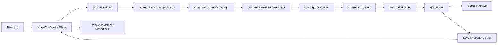

# MockWebServiceClient và tạo client từ ApplicationContext

## 1. Vai trò của MockWebServiceClient trong kiểm thử server SOAP

**Spring Web Services (Spring-WS)** xây dựng SOAP service theo hướng contract-first: XSD định nghĩa cấu trúc payload, WSDL mô tả message/operation/binding, JAXB ánh xạ XML sang Java objects, còn endpoint xử lý nghiệp vụ. Khi kiểm thử máy chủ, chỉ gọi trực tiếp method Java của endpoint thường chưa đủ: cách đó bỏ qua phần XML payload, namespace/QName, SOAP Envelope, endpoint mapping, message factory và response serialization.

`MockWebServiceClient` thuộc package `org.springframework.ws.test.server` và là điểm vào cho **server-side integration tests**. Nó tạo SOAP request message, gửi vào `WebServiceMessageReceiver` (thường là `MessageDispatcher`) đang được cấu hình, để Spring-WS tìm endpoint và xử lý request, sau đó cho test kiểm tra response.

Với `MockWebServiceClient.createClient(ApplicationContext)`, test có thể lấy cấu hình từ một Spring `ApplicationContext` hiện hữu. Đây là cách thuận tiện khi muốn xác minh endpoint beans, mappings, adapters, interceptors và message factory cùng hoạt động như cấu hình server. API cũng hỗ trợ `createClient(WebServiceMessageReceiver, WebServiceMessageFactory)` khi test đã có receiver và message factory riêng.

Điều quan trọng: đây là **test message-processing pipeline trong bộ nhớ**, không khởi động HTTP server, không mở socket, không kiểm thử TLS, servlet container, reverse proxy hay mạng thật. Vì thế, `MockWebServiceClient` phù hợp để test endpoint/server configuration và SOAP message semantics; cần thêm HTTP/container integration tests cho các behavior ở transport boundary.

### Mục tiêu học tập

Sau bài, bạn có thể:

1. Giải thích `MockWebServiceClient` khác unit test gọi endpoint trực tiếp và HTTP integration test thế nào.
2. Tạo client từ `ApplicationContext` hoặc receiver/message factory tường minh.
3. Dùng `RequestCreators` để tạo SOAP requests từ XML `Source`.
4. Dùng `ResponseMatchers` để kiểm tra payload, XSD validity, XPath, SOAP header/envelope và Fault.
5. Xây dựng test cho `@PayloadRoot`, namespace, SOAPAction, endpoint adapters và interceptors.
6. Kiểm tra SOAP 1.1/1.2, request headers, attachments và response metadata phù hợp.
7. Tách domain tests, Spring-WS message pipeline tests và HTTP transport tests.
8. Kiểm soát test data, external dependencies, ApplicationContext caching và parallel execution.
9. Xác định những điều `MockWebServiceClient` không chứng minh được.
10. Tạo test suite đáng tin cậy cho SOAP server.

## 2. Test trực tiếp endpoint, MockWebServiceClient hay HTTP thật?

Ba tầng test bổ trợ nhau:

| Cách test | Đường đi được kiểm tra | Phù hợp để xác minh |
|---|---|---|
| Unit test gọi endpoint method | Java method → domain collaborators | Business rules, validation, orchestration |
| `MockWebServiceClient` | SOAP message → Spring-WS receiver/dispatcher → endpoint mapping/adapter/endpoint → SOAP response | XML/QName, mapping, interceptor, marshalling và SOAP Fault |
| HTTP integration test | TCP/HTTP → servlet/container/filter/TLS (nếu cấu hình) → Spring-WS → endpoint | URL, HTTP headers/status, servlet wiring, TLS, proxy và transport |

Ví dụ endpoint method có thể hoạt động khi gọi trực tiếp bằng Java, nhưng SOAP payload có namespace sai làm `@PayloadRoot` không tìm thấy operation. Unit test không bắt được; `MockWebServiceClient` có thể bắt được vì nó gửi message qua dispatcher.

Ngược lại, một test `MockWebServiceClient` thành công không chứng minh ứng dụng được deploy đúng URL, SOAP servlet có mapping /ws/*, HTTPS certificate hợp lệ hay reverse proxy forward header đúng. Những điều đó thuộc HTTP/container test.

**Chiến lược hợp lý:** test nghiệp vụ nhanh ở unit layer; test contract và Spring-WS message pipeline bằng `MockWebServiceClient`; chạy một số HTTP end-to-end tests để xác minh transport/deployment.

## 3. Cách MockWebServiceClient hoạt động

Luồng xử lý:



Các thành phần:

- `RequestCreator` tạo request message từ message factory.
- `WebServiceMessageFactory` tạo SOAP message phù hợp.
- `WebServiceMessageReceiver` nhận request; thường là `SoapMessageDispatcher`.
- Dispatcher chọn endpoint mapping, endpoint adapter và endpoint method.
- Endpoint xử lý business request, trả payload hoặc Fault.
- `ResponseMatcher` kiểm tra message response và ném assertion failure nếu expectation không đạt.

### 3.1. Hai factory method

`MockWebServiceClient` có hai cách tạo client:

| Factory | Khi dùng |
|---|---|
| `createClient(ApplicationContext)` | Muốn dùng cấu hình receiver/message factory từ Spring context, gần với server context đã cấu hình |
| `createClient(WebServiceMessageReceiver, WebServiceMessageFactory)` | Muốn cung cấp receiver và message factory tường minh, không cần lấy chúng từ context |

Với factory method nhận `ApplicationContext`, Spring-WS tìm `WebServiceMessageReceiver` và `WebServiceMessageFactory` trong context. Nếu không có receiver, implementation tạo `SoapMessageDispatcher` mặc định; nếu không có factory, implementation tạo `SaajSoapMessageFactory` mặc định. Tuy nhiên, default dispatcher không tự làm xuất hiện endpoint bean/mapping/adapter chưa được đăng ký. Test cần cấu hình application context phù hợp để endpoint thực sự được tìm thấy.

Đây là chi tiết quan trọng: `createClient(applicationContext)` không có nghĩa «tự khởi tạo toàn bộ production configuration» hoặc tự scan tất cả project. Nó dựa vào context được truyền.

## 4. Phụ thuộc test và namespace phiên bản

`MockWebServiceClient` nằm trong Spring-WS test module. Với Maven, thêm dependency test scope tương thích đúng Spring-WS version đang dùng:

```xml
<dependency>
    <groupId>org.springframework.ws</groupId>
    <artifactId>spring-ws-test</artifactId>
    <scope>test</scope>
</dependency>
```

Quản lý version bằng Spring-WS/Spring Boot dependency management mà project đang sử dụng; không thêm một version độc lập khiến `spring-ws-core`, `spring-ws-test` và Spring Framework lệch nhau.

Với Gradle:

```kotlin
dependencies {
    testImplementation("org.springframework.ws:spring-ws-test")
}
```

Các ví dụ theo Java 17+/Spring Framework 6+/Spring-WS 4.x có thể dùng jakarta.* cho Jakarta EE APIs. Spring-WS test package và các loại `ApplicationContext` vẫn thuộc Spring API; không nhầm Jakarta XML Web Services/JAX-WS với Spring-WS. Dự án cũ có thể thuộc thế hệ javax.*; tất cả Spring modules và XML/SOAP provider phải tương thích cùng một dependency line.

## 5. Chuẩn bị ApplicationContext cho server-side test

Khi dùng `createClient(ApplicationContext)`, hãy dùng **context chứa server-side Spring-WS beans**. Trong cấu hình cổ điển, các beans đó thường được đặt trong context của `MessageDispatcherServlet`; trong Spring Boot hoặc Java configuration, test context phải import/scan đúng cấu hình endpoint.

Một cấu trúc đơn giản:

```text
src/main/java/
  com/example/orders/
    endpoint/
      OrdersEndpoint.java
    service/
      OrderApplicationService.java
    ws/
      OrdersWsConfiguration.java

src/main/resources/
  xsd/
    orders.xsd

src/test/java/
  com/example/orders/
    endpoint/
      OrdersEndpointTest.java
```

Các beans thường cần:

- `@Endpoint` hoặc endpoint objects tương đương.
- Endpoint mapping phù hợp, ví dụ annotation-driven payload root mapping.
- Endpoint adapter xử lý annotation như `@PayloadRoot`, `@RequestPayload`, `@ResponsePayload`.
- `WebServiceMessageFactory`, thường là SAAJ hoặc factory tương ứng.
- Marshaller/unmarshaller nếu endpoint adapter sử dụng JAXB.
- Interceptors, validators, exception resolvers và collaborators liên quan.

Không cần cấu hình HTTP server chỉ để dùng `MockWebServiceClient`. Nhưng nếu context import một cấu hình có ServletContext, container startup, network client hoặc broker thật thì test có thể kéo theo dependencies đó. Tạo một context test vừa đủ, nhưng phải giữ các thành phần server message pipeline mà mục tiêu test cần xác minh.

### 5.1. Ví dụ Java configuration cho endpoint

```java
package com.example.orders.ws;

import org.springframework.context.annotation.Bean;
import org.springframework.context.annotation.Configuration;
import org.springframework.ws.config.annotation.EnableWs;
import org.springframework.ws.soap.saaj.SaajSoapMessageFactory;

@EnableWs
@Configuration
public class OrdersWsConfiguration {

    @Bean
    public SaajSoapMessageFactory messageFactory() {
        return new SaajSoapMessageFactory();
    }

    @Bean
    public OrdersEndpoint ordersEndpoint(OrderApplicationService service) {
        return new OrdersEndpoint(service);
    }
}
```

Đây là phần minh họa vai trò các bean, không phải server configuration hoàn chỉnh cho mọi phiên bản. `@EnableWs` và Spring-WS infrastructure đăng ký endpoint adapters/mappings theo cách cấu hình được hỗ trợ; tránh khai báo bean trùng với infrastructure đã tự đăng ký. Nếu dùng XML, Spring Boot auto-configuration hoặc context riêng của servlet, hãy giữ một nguồn cấu hình nhất quán.

### 5.2. Context import dependencies của endpoint

Trong test, domain service có thể là bean thật hoặc mock tùy mục tiêu:

- Dùng service thật khi muốn kiểm thử orchestration và service logic trong cùng test.
- Dùng Mockito mock khi chỉ muốn xác minh message → endpoint → collaborator invocation.
- Dùng repository/database thật trong integration tests riêng để kiểm chứng transaction/query behavior.
- Không mock `MessageDispatcher`, endpoint mapping hoặc message factory trong test đang muốn xác minh chính các phần đó.

`MockWebServiceClient` chỉ chứng minh những beans được context nạp. Nếu endpoint phụ thuộc validator/interceptor nhưng test config vô tình bỏ chúng, test có thể pass mà production pipeline vẫn có lỗi. Ngược lại, test với toàn bộ production context có thể nặng và khó kiểm soát. Hãy ghi rõ test đang đại diện cho context nào.

## 6. Tạo MockWebServiceClient từ ApplicationContext

Cách dùng phổ biến là inject Spring context vào test, sau đó gọi `MockWebServiceClient.createClient(applicationContext)` một lần cho mỗi test instance/context.

### 6.1. Ví dụ JUnit 5 với Spring TestContext

```java
package com.example.orders.endpoint;

import org.junit.jupiter.api.BeforeEach;
import org.junit.jupiter.api.Test;
import org.springframework.beans.factory.annotation.Autowired;
import org.springframework.context.ApplicationContext;
import org.springframework.test.context.junit.jupiter.SpringJUnitConfig;
import org.springframework.ws.test.server.MockWebServiceClient;
import org.springframework.xml.transform.StringSource;

import javax.xml.transform.Source;

import static org.springframework.ws.test.server.RequestCreators.withPayload;
import static org.springframework.ws.test.server.ResponseMatchers.payload;
import static org.springframework.ws.test.server.ResponseMatchers.noFault;

@SpringJUnitConfig(OrdersWsTestConfiguration.class)
class OrdersEndpointTest {

    @Autowired
    private ApplicationContext applicationContext;

    private MockWebServiceClient mockClient;

    @BeforeEach
    void setUp() {
        mockClient = MockWebServiceClient.createClient(applicationContext);
    }

    @Test
    void submitsOrder() throws Exception {
        Source request = new StringSource("""
            <ord:SubmitOrderRequest
                xmlns:ord="https://example.org/orders/v1">
                <ord:requestId>REQ-1001</ord:requestId>
                <ord:customerId>C-42</ord:customerId>
            </ord:SubmitOrderRequest>
            """);

        Source expected = new StringSource("""
            <ord:SubmitOrderResponse
                xmlns:ord="https://example.org/orders/v1">
                <ord:orderId>ORD-9001</ord:orderId>
                <ord:status>ACCEPTED</ord:status>
            </ord:SubmitOrderResponse>
            """);

        mockClient.sendRequest(withPayload(request))
            .andExpect(noFault())
            .andExpect(payload(expected));
    }
}
```

Imports ở ví dụ minh họa cách viết test. `Source` là Java XML transform API; `StringSource` là tiện ích của Spring XML. Package và version phải phù hợp dependency line của project.

### 6.2. Test context tường minh

```java
package com.example.orders.endpoint;

import org.springframework.context.annotation.Bean;
import org.springframework.context.annotation.Configuration;
import org.springframework.ws.config.annotation.EnableWs;

@Configuration
@EnableWs
class OrdersWsTestConfiguration {

    @Bean
    OrderApplicationService orderApplicationService() {
        return request -> new OrderResult("ORD-9001", "ACCEPTED");
    }

    @Bean
    OrdersEndpoint ordersEndpoint(OrderApplicationService service) {
        return new OrdersEndpoint(service);
    }
}
```

Đây là fake service đơn giản để kết quả xác định, không phải domain implementation. `@EnableWs` cung cấp Spring-WS infrastructure cho endpoint annotations. Nếu production server dùng interceptors, validators, JAXB marshaller hoặc custom exception resolvers, test config cần import các cấu hình đó khi mục tiêu là kiểm tra chúng.

### 6.3. Lifecycle và test isolation

Tạo client trong `@BeforeEach` giúp mỗi test method có client gắn với context phù hợp. Không cần tạo client trước mỗi matcher hoặc dùng nó như singleton toàn JVM. Nếu Spring TestContext cache context, beans/configuration có thể được dùng chung; mock interactions và mutable test data cần reset để không rò trạng thái giữa tests.

## 7. Tạo client với WebServiceMessageReceiver và WebServiceMessageFactory

Không phải test nào cũng cần cả ApplicationContext. Khi đã có receiver và message factory, dùng factory overload:

```java
import org.springframework.ws.test.server.MockWebServiceClient;
import org.springframework.ws.soap.server.SoapMessageDispatcher;
import org.springframework.ws.soap.saaj.SaajSoapMessageFactory;

SaajSoapMessageFactory messageFactory = new SaajSoapMessageFactory();
messageFactory.afterPropertiesSet();

SoapMessageDispatcher dispatcher = new SoapMessageDispatcher();

// Configure endpoint mappings/adapters/endpoints on the dispatcher
// using the supported Spring-WS infrastructure of the application.

MockWebServiceClient client =
    MockWebServiceClient.createClient(dispatcher, messageFactory);
```

Overload này phù hợp khi test tự quản lý receiver/factory. Nhưng nó không tự nạp endpoint, adapter, mappings hoặc interceptors từ Spring context; bạn phải cấu hình đầy đủ trước khi gửi request. Nếu mục tiêu test là xác minh bean wiring, dùng `createClient(ApplicationContext)`.

| Chọn factory nào? | Lý do |
|---|---|
| ApplicationContext | Kiểm thử cấu hình Spring server đã được nạp |
| Receiver + MessageFactory | Kiểm thử pipeline tự lắp ráp, ít Spring context hơn |

### 7.1. Hai khái niệm không nên nhầm

- `WebServiceMessageReceiver` là thành phần nhận và xử lý SOAP message. Trong server Spring-WS, nó thường là `MessageDispatcher`.
- `WebServiceMessageFactory` tạo message abstraction tương ứng; ví dụ SAAJ factory tạo SOAP message theo SOAP implementation/provider được cấu hình.

Không truyền client-side `WebServiceTemplate` vào factory overload. `MockWebServiceClient` kiểm thử **server receiver**; để test outgoing SOAP client, Spring-WS cung cấp cơ chế khác là `MockWebServiceServer`.

## 8. RequestCreators: tạo SOAP request đầu vào

`sendRequest(...)` nhận một `RequestCreator`. Đây là strategy interface tạo `WebServiceMessage` từ factory mà client đang dùng. Spring-WS cung cấp `RequestCreators.withPayload(Source)` để tạo request từ SOAP payload source.

### 8.1. Tạo payload với StringSource

```java
import javax.xml.transform.Source;
import org.springframework.xml.transform.StringSource;

Source requestPayload = new StringSource("""
    <ord:SubmitOrderRequest
        xmlns:ord="https://example.org/orders/v1">
        <ord:requestId>REQ-1002</ord:requestId>
        <ord:customerId>C-84</ord:customerId>
    </ord:SubmitOrderRequest>
    """);

mockClient.sendRequest(withPayload(requestPayload))
    .andExpect(noFault());
```

`Source` là Java SE XML transform API. Với Spring-WS 4.x, XML transform types không đổi sang Jakarta namespace. `StringSource` là tiện ích Spring XML phù hợp XML fixture ngắn trong test.

### 8.2. XML fixture trong file Resource

Khi request dài hoặc được dùng lại, đặt fixture trong thư mục test resources:

```text
src/test/resources/
  soap/
    requests/
      submit-order.xml
    responses/
      submit-order-response.xml
    faults/
      invalid-order-fault.xml
```

Đọc resource thành `Source` bằng tiện ích Spring XML hoặc XML parser mà test project đang dùng. Nên giữ fixture UTF-8, namespace rõ ràng và không phụ thuộc whitespace/attribute order ngoài điều contract yêu cầu.

### 8.3. Payload khác SOAP Envelope

`withPayload(Source)` nhận XML payload, tức phần nội dung ở SOAP Body. Helper tạo SOAP message và đặt payload vào body. Nếu test cần kiểm tra Envelope/Headers chính xác hoặc cần control SOAP version, tạo full envelope qua request creator thích hợp hoặc custom `RequestCreator`.

Không đặt SOAP Envelope lồng trong `withPayload`; nếu truyền cả Envelope như payload, message sẽ chứa một Envelope bên trong Body và endpoint mapping không nhìn thấy QName operation mong muốn.


## 9. ResponseMatchers: kiểm tra response

`sendRequest(...)` trả về `ResponseActions`, nơi test gọi `andExpect(ResponseMatcher)`. Có thể nối nhiều matcher để một test kiểm tra nhiều khía cạnh của response.

Các matcher chính thức của Spring-WS 4.1.x:

| Matcher | Điều xác minh |
|---|---|
| `payload(Source/Resource)` | Response SOAP Body có payload XML mong đợi |
| `validPayload(Resource schema, ...)` | Payload hợp lệ theo một hoặc nhiều XSD |
| `xpath(expression)` | XPath tồn tại/không tồn tại hoặc evaluate ra giá trị |
| `soapHeader(QName)` | SOAP Header chứa header QName mong muốn |
| `soapEnvelope(Source/Resource)` | Toàn bộ SOAP Envelope khớp fixture mong đợi |
| `noFault()` | Response không chứa SOAP Fault |
| `clientOrSenderFault()` | SOAP 1.1 Client hoặc SOAP 1.2 Sender Fault |
| `serverOrReceiverFault()` | SOAP 1.1 Server hoặc SOAP 1.2 Receiver Fault |
| `mustUnderstandFault()` | MustUnderstand Fault |
| `versionMismatchFault()` | VersionMismatch Fault |

Có thể kết hợp matcher:

```java
mockClient.sendRequest(withPayload(request))
    .andExpect(noFault())
    .andExpect(payload(expectedResponse))
    .andExpect(validPayload(orderResponseSchema));
```

Dùng matcher hẹp nhất tương ứng contract. `payload` tập trung vào Body; `soapEnvelope` kiểm tra cả Envelope/Header/Body và có thể nhạy với header/namespace differences; `validPayload` kiểm tra schema validity nhưng không xác minh nghiệp vụ đúng. Một response hợp lệ XSD vẫn có thể chứa order ID không đúng với request.

### 9.1. Kiểm tra XPath với namespace

XPath hữu ích khi chỉ cần kiểm tra một trường:

```java
import java.util.Map;

mockClient.sendRequest(withPayload(request))
    .andExpect(xpath(
        "/ord:SubmitOrderResponse/ord:status",
        Map.of("ord", "https://example.org/orders/v1"))
        .evaluatesTo("ACCEPTED"));
```

Khi XML dùng namespace mặc định, XPath vẫn nên dùng prefix được ánh xạ rõ ràng. Prefix trong XPath là alias do test khai báo; nó không cần giống prefix lexical trong SOAP XML, nhưng URI namespace phải giống contract.

Các expectation XPath hỗ trợ kiểm tra node/value theo API. Hãy dùng code completion/Javadoc của đúng version cho các overload và matcher methods như `exists()`, `doesNotExist()` hoặc `evaluatesTo(...)`. Tránh dùng XPath quá rộng có thể match nhầm node trùng tên ở namespace khác.

### 9.2. Kiểm tra SOAP Header

`soapHeader(QName)` xác minh response có header với QName mong đợi:

```java
import javax.xml.namespace.QName;

QName correlationHeader =
    new QName("https://example.org/common/v1", "CorrelationId");

mockClient.sendRequest(withPayload(request))
    .andExpect(soapHeader(correlationHeader))
    .andExpect(noFault());
```

Matcher này xác minh sự tồn tại của header; nếu cần kiểm tra giá trị, actor/role, mustUnderstand hoặc nội dung XML, bổ sung XPath/full-envelope assertion hoặc custom matcher phù hợp. Header QName là cặp namespace URI + local part, không chỉ là tên hiển thị.

### 9.3. Kiểm tra toàn SOAP Envelope

Khi contract yêu cầu SOAP Header, namespaces, Body và Fault shape chính xác, dùng `soapEnvelope(Source)`:

```java
Source expectedEnvelope = new StringSource("""
    <soap:Envelope
        xmlns:soap="http://schemas.xmlsoap.org/soap/envelope/"
        xmlns:ord="https://example.org/orders/v1">
      <soap:Header>
        <ord:CorrelationId>corr-1001</ord:CorrelationId>
      </soap:Header>
      <soap:Body>
        <ord:SubmitOrderResponse>
          <ord:orderId>ORD-9001</ord:orderId>
          <ord:status>ACCEPTED</ord:status>
        </ord:SubmitOrderResponse>
      </soap:Body>
    </soap:Envelope>
    """);

mockClient.sendRequest(withPayload(request))
    .andExpect(soapEnvelope(expectedEnvelope));
```

SOAP 1.1 và 1.2 có Envelope namespace khác nhau; fixture phải khớp message factory/protocol thực. Nếu chỉ quan tâm Body, nên dùng `payload` để tránh test quá chặt vào serialization details không thuộc contract.

### 9.4. XMLUnit placeholders và so sánh XML

Spring-WS payload/envelope matchers hỗ trợ XMLUnit placeholders theo tài liệu. Placeholder hữu ích khi response có timestamp, UUID hoặc giá trị động. Tuy nhiên, đừng biến mọi trường thành wildcard: test cần giữ các assertion business-critical như amount, customer ID, order status và namespace.

Nếu cần so sánh có rule phức tạp (ignore một attribute có tính kỹ thuật, so unordered child elements theo semantics), có thể dùng XMLUnit trực tiếp hoặc tự tạo matcher; ghi rõ vì sao khác biệt đó không thuộc hợp đồng.

## 10. Kiểm tra request đến đúng endpoint

Một happy-path response assertion chưa luôn chứng minh đúng endpoint method được gọi. Endpoint mapping có thể nhầm namespace/localPart hoặc một fallback mapping trả response tương tự.

Dùng mock collaborator để xác minh lời gọi cụ thể, đồng thời vẫn gửi XML thật qua dispatcher:

```java
@ExtendWith(MockitoExtension.class)
class OrdersEndpointMessageTest {

    @Mock
    private OrderApplicationService service;

    @InjectMocks
    private OrdersEndpoint endpoint;

    // This test style is a unit test of the endpoint method;
    // it does not exercise the Spring-WS dispatcher by itself.
}
```

Đoạn trên minh họa mock service/endpoint, nhưng nếu muốn kiểm tra dispatcher thì endpoint phải được đăng ký trong context và client phải được tạo từ context đó. Ví dụ assertion trong integration test:

```java
when(service.submit(any(SubmitOrderRequest.class)))
    .thenReturn(new OrderResult("ORD-9001", "ACCEPTED"));

mockClient.sendRequest(withPayload(request))
    .andExpect(noFault())
    .andExpect(xpath(
        "/ord:SubmitOrderResponse/ord:orderId",
        Map.of("ord", "https://example.org/orders/v1"))
        .evaluatesTo("ORD-9001"));

verify(service).submit(argThat(
    value -> "REQ-1001".equals(value.getRequestId())));
```

Đảm bảo service mock là bean được endpoint thực sự inject. Nếu tự tạo endpoint qua `@InjectMocks` nhưng context dùng endpoint bean khác, assertion có thể không quan sát đúng instance mà dispatcher gọi.

### 10.1. Kiểm tra endpoint mapping âm

Gửi payload có QName sai namespace hoặc local part:

- Request cùng localPart nhưng sai namespace.
- Request đúng namespace nhưng operation không được hỗ trợ.
- Request có root element khác với mapping.
- SOAPAction (nếu mapping sử dụng) không khớp.

Kiểm tra lỗi mapping/Fault theo configuration đã định nghĩa, và xác minh domain service không được gọi. Điều này giúp phát hiện fallback mapping quá rộng hoặc endpoint vô tình xử lý operation không thuộc contract.

### 10.2. Kiểm tra SOAPAction và mapping

SOAPAction thuộc binding/version/profile tương ứng; endpoint mapping có thể dùng payload root QName hoặc SOAP action tùy cấu hình. Đừng giả định mọi endpoint method luôn kiểm tra SOAPAction. Nếu action là một phần interoperability contract, phải tạo request có action header/property theo message factory/profile và test nó một cách tường minh; thêm HTTP test nếu hành vi phụ thuộc HTTP header ngoài message abstraction.


## 11. Kiểm thử XSD validation và JAXB mapping

`validPayload(schemaResource)` kiểm tra payload response có hợp lệ với XSD. Đây là cách bắt lỗi contract ở phía output: thiếu required element, sai datatype, sai namespace hoặc element order không theo schema.

Ví dụ:

```java
import org.springframework.core.io.ClassPathResource;

mockClient.sendRequest(withPayload(request))
    .andExpect(noFault())
    .andExpect(validPayload(
        new ClassPathResource("xsd/orders-response.xsd")));
```

Matcher `validPayload` nhận một schema Resource và có thể nhận thêm schemas để giải quyết imports/includes. Hãy kiểm tra XSD fixture có cùng encoding và namespace như schema published. XSD validation không tự chứng minh request/response mapping sang đúng business object hay rule nghiệp vụ đúng.

### 11.1. Request validation không phải response matcher mặc định

`ResponseMatchers.validPayload` xác minh **response payload**. Nếu muốn đảm bảo endpoint từ chối request không hợp lệ theo XSD, phải cấu hình request validation trong server pipeline, gửi request sai schema và assert Fault/exception cùng việc domain service không được gọi.

Không suy luận «response hợp lệ XSD» nghĩa là «request cũng đã được validate». Hai chiều có thể dùng schema và validator khác nhau.

### 11.2. Test namespace, element order và optional fields

Các lỗi thường gặp khi dùng JAXB/XSD:

- Java package generated từ một target namespace khác với namespace trong XML fixture.
- Root element là `JAXBElement` nhưng test gửi object không được khai báo là global element.
- Sai case-sensitive local part.
- Element order không theo `xs:sequence`.
- Optional element bị serialize thành empty element trong khi contract mong muốn omit.
- `nillable`/`minOccurs` semantics bị nhầm.
- Decimal/date/time timezone được serialize khác format mong đợi.
- Schema imports/includes không resolve được trong test classpath.

Test nên dùng payload XML thực và matcher schema; khi cần kiểm tra mapping Java, kiểm tra collaborator nhận object có field đúng. Không chỉ snapshot toàn XML nếu điều quan trọng là semantics của contract.

## 12. Kiểm thử SOAP Fault

Spring-WS `ResponseMatchers` cung cấp matchers kiểm tra các loại Fault phổ biến:

| Matcher | SOAP 1.1 | SOAP 1.2 |
|---|---|---|
| `clientOrSenderFault()` | Client | Sender |
| `serverOrReceiverFault()` | Server | Receiver |
| `mustUnderstandFault()` | MustUnderstand | MustUnderstand |
| `versionMismatchFault()` | VersionMismatch | VersionMismatch |

Ví dụ khi request không hợp lệ theo business contract và endpoint trả Sender/Client Fault:

```java
mockClient.sendRequest(withPayload(invalidRequest))
    .andExpect(clientOrSenderFault());
```

Có thể truyền fault string/reason mong đợi cho các overload hỗ trợ:

```java
mockClient.sendRequest(withPayload(invalidRequest))
    .andExpect(clientOrSenderFault("Invalid order request"));
```

### 12.1. SOAP Fault detail và contract

Các matcher loại Fault xác minh fault code/category và có thể xác minh reason text; chúng không thay thế kiểm tra đầy đủ detail XML khi contract có fault detail cụ thể.

Nếu WSDL/XSD định nghĩa detail element, dùng XPath hoặc full SOAP Envelope matcher để kiểm tra:

- Fault code QName phù hợp SOAP version.
- Fault reason/string có nội dung ổn định theo contract.
- Detail root element đúng namespace/localPart.
- Detail fields cần thiết có mặt và đúng kiểu.
- Không có stack trace, database URL hoặc internal class names bị lộ.

Không assert toàn bộ exception message do runtime tạo nếu text đó thay đổi giữa JDK/provider/locales. Ưu tiên fault code, reason contract và detail fields có ý nghĩa.

### 12.2. MustUnderstand và VersionMismatch

Đối với Header có `mustUnderstand`, test cần gửi SOAP message với header block đúng namespace/role và flag; matcher `mustUnderstandFault()` kiểm tra kết quả. Nếu muốn chứng minh custom interceptor/endpoint có xử lý header, cần test nó trong context thật của server pipeline.

VersionMismatch thường liên quan Envelope namespace/version không phù hợp. Hãy tạo message SOAP 1.1 và 1.2 tương ứng, không chỉ thay một prefix XML; SOAP version được xác định bởi Envelope namespace và message factory/protocol behavior.

## 13. Kiểm tra SOAP Header, role và mustUnderstand

SOAP Header có thể mang correlation ID, tenant, WS-Addressing, WS-Security hoặc metadata khác. Test header nên xác minh QName và behavior của pipeline.

Ví dụ cấu trúc Header:

```xml
<soap:Envelope
    xmlns:soap="http://schemas.xmlsoap.org/soap/envelope/"
    xmlns:ord="https://example.org/orders/v1">
  <soap:Header>
    <ord:CorrelationId>corr-1001</ord:CorrelationId>
  </soap:Header>
  <soap:Body>
    <ord:SubmitOrderRequest>
      <ord:requestId>REQ-1001</ord:requestId>
    </ord:SubmitOrderRequest>
  </soap:Body>
</soap:Envelope>
```

Có thể kiểm tra header presence bằng `soapHeader(QName)`. Nếu cần test endpoint/handler sử dụng giá trị correlation, verify collaborator được gọi với metadata đúng hoặc viết custom matcher/receiver assertion. Header có thể được đọc bởi interceptor thay vì endpoint, vì vậy xác định layer sở hữu behavior.

### 13.1. Role/actor và mustUnderstand

SOAP 1.1 dùng actor; SOAP 1.2 dùng role. Header block có thể được nhắm vào một intermediary/receiver cụ thể. Các test quan trọng:

- Header targeted đến ultimate receiver có được xử lý?
- Header không thuộc role của server có được bỏ qua đúng protocol?
- Header đánh dấu mustUnderstand mà không có handler có tạo Fault?
- Interceptor có tiêu thụ/đánh dấu header đã hiểu đúng cách?
- SOAP 1.1 và 1.2 có behavior khác nhau như contract yêu cầu?

Một matcher chỉ kiểm tra QName header tồn tại không chứng minh role/mustUnderstand semantics. Dùng full envelope request + Fault matcher để test hành vi.

## 14. Kiểm thử interceptors, validators và exception resolvers

Trong Spring-WS, interceptor có thể kiểm tra request trước endpoint, bổ sung header, ghi audit, xác minh security hoặc biến đổi response. `MockWebServiceClient.createClient(applicationContext)` hữu ích nếu context chứa các interceptor thật.

Một số test case:

| Thành phần | Kịch bản | Kỳ vọng |
|---|---|---|
| Payload validation interceptor | XSD-invalid request | Reject/Fault trước domain |
| Security interceptor | Signature/token không hợp lệ | Reject, service không được gọi |
| Locale/tenant interceptor | Header hợp lệ | Context được truyền đúng |
| Audit interceptor | Request được nhận | Audit event được ghi theo policy |
| Response interceptor | Bổ sung correlation/metadata | Header response đúng |
| EndpointExceptionResolver | Domain exception có mapping | SOAP Fault code/detail đúng |

### 14.1. Verifying interceptor effects

Mock collaborator là cách dễ xác minh interceptor đã gọi security/audit service, nhưng vẫn gửi message qua `MockWebServiceClient` để bảo đảm nó thuộc pipeline:

```java
mockClient.sendRequest(withPayload(request))
    .andExpect(noFault())
    .andExpect(payload(expectedResponse));

verify(auditService).record(
    argThat(event -> "SubmitOrder".equals(event.operation())));
```

Với request bị từ chối:

```java
mockClient.sendRequest(withPayload(unsignedOrInvalidRequest))
    .andExpect(clientOrSenderFault());

verifyNoInteractions(orderApplicationService);
```

Loại Fault thực tế phụ thuộc interceptor/resolver và SOAP version. Không cố định Sender/Client Fault nếu implementation chuẩn trả Server/Receiver Fault hoặc fault detail riêng; assert theo contract đã chọn.

### 14.2. Interceptor order

Nếu nhiều interceptors được cấu hình, thứ tự có thể quan trọng: correlation extraction trước audit, authentication trước authorization, validation trước business call. Test nên chứng minh outcome/interaction theo thứ tự yêu cầu khi thứ tự đó là requirement. Đừng kiểm tra thứ tự toàn bộ interceptors nội bộ nếu không có behavior contract nào phụ thuộc.

### 14.3. Security interceptors và giới hạn của test trong bộ nhớ

`MockWebServiceClient` có thể kiểm tra WSS4J interceptor/message-level security khi nó được đăng ký và nhận SOAP message thật trong context. Tuy nhiên, không thay thế test TLS/mTLS, truststore file permissions, HSM, hostname validation hay gateway security. Nếu dùng real cryptographic material, fixture/test keys phải riêng cho test và không commit production private keys.


## 15. SOAP 1.1, SOAP 1.2 và message factory

SOAP version ảnh hưởng Envelope namespace, Fault structure, content type/serialization và protocol behavior. `MockWebServiceClient` dùng `WebServiceMessageFactory` từ context hoặc factory được truyền; do đó test phải tạo và expect messages theo version mà service hỗ trợ.

| Thuộc tính | SOAP 1.1 | SOAP 1.2 |
|---|---|---|
| Envelope namespace | `http://schemas.xmlsoap.org/soap/envelope/` | `http://www.w3.org/2003/05/soap-envelope` |
| Fault code phổ biến cho lỗi request | Client | Sender |
| Fault code phổ biến cho lỗi server | Server | Receiver |
| MustUnderstand | Có | Có, semantics theo SOAP 1.2 |
| Content type qua HTTP | Thường text/xml | application/soap+xml |

Test trong bộ nhớ không kiểm tra HTTP Content-Type do web server trả về. Nó xác minh cách SOAP message factory/dispatcher parse và tạo response. Nếu endpoint phải tương thích với cả SOAP 1.1 và 1.2, tạo test context/message factory cho từng version và xác nhận Fault/Envelope tương ứng.

Đừng giả định một test dùng SOAP 1.1 fixture chứng minh SOAP 1.2 support.

## 16. Attachments, MTOM và custom message assertions

Các SOAP message có thể chứa MIME attachments hoặc dùng MTOM/XOP để tối ưu binary payload. Nếu operation có attachment:

- Đặt message factory phù hợp attachment/MTOM configuration.
- Tạo request message gồm payload và attachment bằng API/message factory tương thích.
- Xác minh endpoint đọc đúng attachment content, content type và Content-ID.
- Kiểm tra response attachment tương tự nếu server phát file/binary response.
- Test kích thước lớn và resource cleanup ở integration layer.

`withPayload(Source)` tập trung tạo Body payload; nó không đủ biểu diễn mọi MIME multipart/MTOM use case. Với attachments, dùng custom `RequestCreator` tạo `WebServiceMessage` và thêm attachment qua SOAP message API tương ứng; hoặc dùng HTTP integration test khi cần kiểm tra MIME wire formatting qua transport.

### 16.1. Không dùng payload matcher cho attachment bytes

`payload` kiểm tra phần XML payload, không xác minh nội dung attachment. Để xác minh attachment, cần đọc attachments từ response SOAP message qua API của message implementation hoặc custom matcher; đối chiếu content ID, media type, byte length và checksum. Không log binary bytes.

### 16.2. Custom RequestCreator

`RequestCreator` là strategy interface tạo request message. Khi helper có sẵn không đủ, có thể tự cài đặt:

`F`java
import java.io.IOException;
import javax.xml.transform.Source;
import org.springframework.ws.WebServiceMessage;
import org.springframework.ws.WebServiceMessageFactory;
import org.springframework.ws.test.server.RequestCreator;

final class EnvelopeRequestCreator implements RequestCreator {

    private final Source payload;

    EnvelopeRequestCreator(Source payload) {
        this.payload = payload;
    }

    @Override
    public WebServiceMessage createRequest(
            WebServiceMessageFactory messageFactory) throws IOException {

        WebServiceMessage message = messageFactory.createWebServiceMessage();
        message.getPayloadResult(); // write XML payload using a Transformer
        return message;
    }
}
`F`

Đây là skeleton minh họa interface; một implementation thực phải dùng Transformer/XML writer để ghi Source vào payload result, xử lý IOException/TransformerException và tạo SOAP headers/attachments theo message type. Không để đoạn placeholder trên được hiểu như một implementation copy/paste hoàn chỉnh.

### 16.3. Custom ResponseMatcher

`ResponseMatcher` nhận request và response message, có thể ném `AssertionError` khi expectation không đạt. Dùng nó cho assertions đặc thù như kiểm tra attachment digest, metadata SOAP hoặc một quy tắc response không có matcher built-in.

```java
import java.io.IOException;
import org.springframework.ws.WebServiceMessage;
import org.springframework.ws.test.server.ResponseMatcher;

final class ResponseHasExpectedMessageSize implements ResponseMatcher {

    private final long expectedMinimumBytes;

    ResponseHasExpectedMessageSize(long expectedMinimumBytes) {
        this.expectedMinimumBytes = expectedMinimumBytes;
    }

    @Override
    public void match(
            WebServiceMessage request,
            WebServiceMessage response) throws IOException {

        // Read the relevant response representation and assert here.
        // This is intentionally domain-specific.
        if (response == null) {
            throw new AssertionError("SOAP response is missing");
        }
    }
}
```

Matcher trên chỉ minh họa hợp đồng interface và việc có thể truy cập response. Để đo bytes chính xác, phải định nghĩa representation đang đo (SOAP serialization hay payload/attachment riêng), vì kích thước serialized Envelope có thể khác payload length. Không viết assertion mơ hồ «message size» nếu contract chưa định nghĩa.

## 17. Kiểm thử với MockWebServiceServer không phải MockWebServiceClient

Tên hai class gần giống nhưng mục tiêu ngược nhau:

| Công cụ | Kiểm thử | Hướng request |
|---|---|---|
| `MockWebServiceClient` | Server-side endpoint/message receiver | Test tạo request → Spring-WS server xử lý |
| `MockWebServiceServer` | Client-side WebServiceTemplate | WebServiceTemplate gửi request → mock server expectation xác minh |

Dùng `MockWebServiceClient` để test endpoint và server pipeline. Dùng `MockWebServiceServer` để kiểm tra SOAP client của ứng dụng gửi đúng request, SOAPAction/headers và xử lý response từ một endpoint giả. Chúng bổ trợ nhau nhưng không thay thế nhau.

Một integration test end-to-end có thể ghép SOAP client với server thật (thông qua HTTP hoặc broker) khi cần chứng minh cả hai phía và transport. Không dùng MockWebServiceClient để giả lập remote server cho `WebServiceTemplate`.

## 18. Test slice, ApplicationContext caching và isolation

### 18.1. Tạo context nhỏ nhưng đúng mục tiêu

Context nhỏ giúp tests nhanh và độc lập. Một test endpoint có thể import endpoint, message factory, mapper, adapter và interceptors liên quan; mock domain service. Nhưng nếu cần xác minh configuration production, hãy import cấu hình server thật hoặc tạo một nhóm smoke tests dùng application context gần production.

Tránh hai cực:

- Context quá nhỏ, bỏ mất interceptor/validator/adapter khiến test pass giả.
- Context quá lớn, khởi tạo database, broker, network client hoặc cloud SDK không cần thiết làm tests chậm và khó ổn định.

### 18.2. Spring TestContext cache

Spring TestContext Framework có thể cache ApplicationContexts giữa test classes nếu configuration keys giống nhau. Điều này cải thiện tốc độ nhưng cũng có nghĩa singleton beans giữ state. Nếu dùng Mockito mocks, reset stubbings/interactions theo lifecycle; nếu dùng mutable singleton state, tránh rò dữ liệu giữa tests.

Không đóng context hoặc tạo context mới thủ công trong mỗi test nếu không cần. Cấu hình test phải thể hiện rõ beans nào là fake/mock và beans nào giống production.

### 18.3. Parallel execution

Có thể chạy tests song song khi:

- Fixtures chỉ đọc hoặc được tạo riêng cho từng test.
- Mocks không chia sẻ không an toàn.
- Database state cô lập theo test.
- Endpoint/service không chứa mutable singleton state dùng chung.
- Test không cạnh tranh trên tài nguyên bên ngoài.

Nếu test cần dùng một application context chứa mutable test bean hoặc static state, tránh parallel execution hoặc thiết kế isolation riêng. Không dùng cùng request ID/business key cho nhiều tests nếu database hoặc idempotency store dùng trạng thái thật.

## 19. Những điều MockWebServiceClient không kiểm tra

`MockWebServiceClient` hữu ích nhưng phạm vi có ranh giới:

| Không được chứng minh đầy đủ | Cần test bổ sung |
|---|---|
| HTTP URL, servlet path và dispatcher servlet mapping | Embedded server/container HTTP test |
| HTTP headers/status, SOAPAction transport header | HTTP client/server integration |
| TLS, mTLS, hostname verification và certificate chain | HTTPS test với keystore/truststore test |
| Reverse proxy, ingress, load balancer, gateway | Deployed environment smoke test |
| Network timeout, retry, connection pooling | Transport/client integration |
| JMS broker, queues, delivery/replay | Broker integration tests |
| Multipart MIME trên wire qua HTTP | HTTP integration với attachment |
| Real HSM/secret manager/production PKI | Security integration test với test credentials/provider |
| Deployment packaging/context startup trong container thật | Application startup/deployment test |

Không được gọi pass của MockWebServiceClient là «SOAP API end-to-end PASS». Hãy ghi rõ phạm vi: Spring-WS message pipeline hoặc endpoint integration.


## 20. Bộ test mẫu cho endpoint SubmitOrder

Một bộ test có giá trị nên kiểm tra cả happy path, contract, negative paths và side effects. Giả sử operation SubmitOrder có request/response XSD và endpoint dùng domain service.

### 20.1. Happy path

- Gửi request XML đúng namespace/QName.
- Kiểm tra không có Fault.
- Kiểm tra payload response.
- Kiểm tra response schema.
- Kiểm tra business service được gọi với request ID/customer ID chính xác.

### 20.2. Namespace và routing

- Gửi root element đúng local name nhưng sai namespace.
- Gửi root element đúng namespace nhưng local name không được map.
- Gửi action không đúng nếu mapping dùng action.
- Xác minh domain service không được gọi khi mapping thất bại.

### 20.3. Validation và business fault

- Thiếu required element.
- Sai datatype/facet.
- Request XSD hợp lệ nhưng business validation thất bại.
- Service ném domain exception có mapping Fault.
- Kiểm tra fault code/reason/detail và không lộ implementation details.

### 20.4. Header và interceptor

- Correlation header hợp lệ được truyền vào audit/context.
- Header thiếu hoặc không hợp lệ bị reject theo policy.
- Header mustUnderstand không được xử lý tạo Fault phù hợp.
- Security header/Signature invalid bị từ chối trước khi endpoint chạy.
- Response interceptor bổ sung correlation/header được kiểm tra bằng soapHeader/XPath.

### 20.5. Regression các transport profiles

- Test SOAP 1.1 và 1.2 nếu service công bố cả hai.
- Test HTTP path/servlet mapping trong HTTP integration suite riêng.
- Nếu service có JMS endpoint hoặc attachment/MTOM, có broker/MIME tests riêng.
- Không đưa transport-specific assumptions vào MockWebServiceClient test rồi gọi đó là wire-level proof.

## 21. Bảng lỗi thường gặp

| Triệu chứng | Nguyên nhân có thể | Cách kiểm tra |
|---|---|---|
| Không tìm thấy endpoint | Endpoint bean không ở context hoặc mapping sai | Context beans, namespace/localPart |
| Client tạo được nhưng request không đi tới mapping | Dispatcher thiếu mapping/adapter hoặc config không được import | Context config, @EnableWs, endpoint adapters |
| NullPointerException trong endpoint | Dependency bean không được tạo/inject | Test configuration, constructor injection |
| JAXB marshalling error | Context path/generated root element không khớp | XJC classes, ObjectFactory, QName |
| Expected payload mismatch | Namespace/value/order khác contract | XML diff, XPath, XSD |
| validPayload thất bại | Response vi phạm XSD hoặc schema imports không resolve | Schema resource/classpath/imports |
| XPath không match | Thiếu namespace mapping hoặc sai URI | XPath prefix-to-URI mapping |
| soapHeader matcher không match | Header QName sai hoặc header không nằm trong response | Namespace URI/localPart, direction |
| Fault matcher sai | SOAP version/code mapping khác expectation | SOAP 1.1/1.2 Envelope, Fault resolver |
| Test pass nhưng production fail | Test context bỏ interceptor/validator/adapter production | Compare context configurations |
| Test fail không xác định | Singleton mock/state dùng chung | Reset mocks, isolate test data |
| Test gọi nhầm collaborator | Endpoint instance trong context khác mock instance đang verify | Bean wiring/context injection |
| SOAP 1.2 behavior khác 1.1 | Message factory/protocol fixture chưa tương ứng | Envelope namespace, factory configuration |
| Attachment không được assert | Dùng payload matcher thay vì đọc MIME attachment | Custom RequestCreator/Matcher hoặc HTTP test |
| Test không bắt URL/TLS issue | Mock client chạy in-memory | HTTP/container test |

### Quy trình điều tra khi test fail

1. Đọc nguyên nhân assertion đầu tiên và response SOAP thực tế trong test output.
2. Kiểm tra request fixture: Envelope/body, namespace, QName và SOAP version.
3. Xác nhận `MockWebServiceClient` dùng đúng ApplicationContext.
4. Kiểm tra message factory, receiver/dispatcher, mappings và endpoint adapters.
5. Kiểm tra interceptor chain và exception resolver.
6. So sánh response payload với XSD, sau đó dùng XPath để khoanh vùng field.
7. Xác minh domain mock/bean là đúng instance mà endpoint sử dụng.
8. Nếu vấn đề nằm ngoài in-memory pipeline, chuyển sang HTTP/container integration test.

## 22. Những anti-pattern nên tránh

### 22.1. Chỉ gọi endpoint method và gọi đó là server integration test

Method test không đi qua SOAP XML parsing, endpoint mapping hay dispatcher. Giữ unit tests cho business logic, nhưng thêm MockWebServiceClient cho message pipeline.

### 22.2. Chỉ assert HTTP-style status hoặc không có exception

MockWebServiceClient không chạy HTTP. Assert đúng SOAP payload/Fault/header/schema thay vì tìm một HTTP status không tồn tại ở đây.

### 22.3. Chỉ dùng payload equality cho mọi thứ

Payload matcher không kiểm tra XSD validity, SOAP headers, security metadata hoặc attachment bytes. Chọn thêm matcher phù hợp với requirement.

### 22.4. Dùng context test thiếu interceptor quan trọng

Nếu production pipeline có security/validation/audit interceptor nhưng test context không import, test pass không chứng minh các interceptor hoạt động. Tách test context tối thiểu và một context integration gần production.

### 22.5. Assert toàn bộ SOAP Envelope khi không cần

SOAP implementation có thể khác formatting/prefix ordering hoặc metadata không thuộc hợp đồng. Assert payload/XPath/header cụ thể; chỉ dùng full envelope snapshot khi wire structure thực sự là contract.

### 22.6. Không test negative path

Một endpoint chỉ có happy path có thể map nhầm QName hoặc chấp nhận request không hợp lệ. Cần test namespace mismatch, malformed XML, schema-invalid payload, unauthorized request, unknown header/mustUnderstand và domain fault.

### 22.7. Chia sẻ mutable mock state giữa test methods

Spring context cache giữ singleton beans; reset mocks/stubs và database state. Nếu chạy parallel, không dùng chung state mutable không an toàn.

## 23. Bài thực hành: kiểm thử một SOAP endpoint từ ApplicationContext

Tạo endpoint SubmitOrder theo XSD/WSDL và kiểm thử bằng MockWebServiceClient.

### Giai đoạn A — Chuẩn bị context

1. Tạo XSD global elements SubmitOrderRequest và SubmitOrderResponse.
2. Sinh JAXB classes, xác minh namespace và root element.
3. Tạo OrdersEndpoint và OrderApplicationService interface.
4. Tạo Java test configuration có @EnableWs, endpoint bean và service mock/fake.
5. Xác nhận endpoint mapping/adapter/message factory ở context.
6. Tạo test client trong @BeforeEach bằng createClient(applicationContext).

### Giai đoạn B — Happy path và contract

7. Tạo Source request từ StringSource với QName/namespace đúng.
8. Gửi request bằng withPayload.
9. Assert noFault.
10. Assert response payload bằng payload matcher.
11. Assert schema bằng validPayload.
12. Assert một số field quan trọng bằng XPath có namespace map.
13. Verify domain service nhận request values đúng.

### Giai đoạn C — Fault và negative cases

14. Gửi request thiếu dữ liệu bắt buộc; kiểm tra server validation Fault.
15. Gửi QName sai namespace; kiểm tra mapping failure.
16. Tạo business exception; kiểm tra SOAP Fault theo resolver contract.
17. Kiểm tra fault detail QName/fields bằng XPath hoặc envelope.
18. Gửi header mustUnderstand không được xử lý; xác minh MustUnderstand Fault.
19. Gửi security header không hợp lệ; endpoint/domain service không được gọi.
20. Kiểm tra response không lộ stack trace, class name hoặc database details.

### Giai đoạn D — Server configuration và interoperability

21. Tạo context thiếu validator/interceptor để thấy test nào bắt được lỗi wiring.
22. Import lại server config đúng và xác minh request đi qua interceptor.
23. Tạo test SOAP 1.1; sau đó tạo test SOAP 1.2 nếu service hỗ trợ.
24. Tạo full-envelope fixture nếu Header structure thuộc contract.
25. Nếu dùng MTOM/attachments, tạo custom message creator/matcher hoặc HTTP MIME integration test.
26. Chạy một HTTP test riêng xác minh servlet URL, HTTP headers và SOAP version.

### Câu hỏi tự kiểm tra

1. MockWebServiceClient kiểm thử server-side hay client-side?
2. Hai overload createClient khác nhau thế nào?
3. Khi createClient(ApplicationContext) không tìm thấy WebServiceMessageReceiver, framework sử dụng gì?
4. Tại sao default SoapMessageDispatcher không tự tìm thấy endpoint nếu context thiếu beans/mappings?
5. RequestCreator và ResponseMatcher có trách nhiệm gì?
6. withPayload nhận phần nào của SOAP message?
7. payload matcher khác soapEnvelope matcher như thế nào?
8. validPayload xác minh điều gì và không xác minh điều gì?
9. XPath cần namespace mapping vì sao?
10. soapHeader(QName) có xác minh header value không?
11. Làm thế nào kiểm tra Fault detail đúng XSD/QName?
12. SOAP 1.1 Client/Server tương ứng với code nào trong SOAP 1.2?
13. Tại sao phải test namespace mismatch dù localPart đúng?
14. Làm thế nào chứng minh interceptor chạy trước domain endpoint?
15. Khi nào dùng createClient(receiver, messageFactory)?
16. MockWebServiceClient có kiểm thử TLS, servlet mapping hoặc reverse proxy không?
17. Tại sao test ApplicationContext phải chứa đúng production interceptors?
18. MockWebServiceServer khác MockWebServiceClient ở hướng request nào?
19. Làm sao kiểm thử attachments/MTOM khi payload matcher chỉ đọc Body?
20. Khi nào cần HTTP/container integration tests ngoài MockWebServiceClient?

## 24. Definition of Done — MockWebServiceClient

Một bộ server-side Spring-WS message-pipeline tests được xem là hoàn tất khi:

### Setup và context

- [ ] Có dependency spring-ws-test đúng version với Spring-WS/Spring Framework.
- [ ] Test dùng context đúng purpose và ApplicationContext không bị thiếu endpoint/mapping/adapter cần thiết.
- [ ] MockWebServiceClient được tạo bằng ApplicationContext hoặc receiver/message factory phù hợp.
- [ ] Message factory/SOAP version được chọn rõ ràng.
- [ ] Test fixtures dùng namespace/QName đúng XSD/WSDL.

### Request/response assertions

- [ ] Request được tạo qua RequestCreator hoặc custom creator phù hợp.
- [ ] Happy path assert noFault và response payload.
- [ ] Response schema được kiểm tra khi contract yêu cầu.
- [ ] XPath assertion có namespace mapping rõ ràng.
- [ ] SOAP Header/Envelope được kiểm tra khi nằm trong contract.
- [ ] SOAP Fault code/reason/detail được kiểm tra.
- [ ] Negative namespace/mapping/validation/business cases có assertions.
- [ ] Endpoint side effects/collaborator calls được xác minh.

### Pipeline/security

- [ ] Endpoint mapping, adapter, marshaller và interceptors được nạp đúng.
- [ ] Security/validation failure được kiểm tra trước domain processing.
- [ ] Exception resolver tạo Fault đúng SOAP version/contract.
- [ ] Test context đủ gần production để bắt lỗi wiring; không mock các thành phần mục tiêu test.
- [ ] Test data/mocks được reset và cô lập, kể cả khi parallel execution.

### Phạm vi và vận hành

- [ ] Mọi test report nêu rõ đây là in-memory Spring-WS pipeline test.
- [ ] HTTP URL/servlet mapping/HTTP headers/TLS được test trong HTTP integration suite riêng.
- [ ] Broker/JMS được test bằng broker integration nếu service dùng JMS.
- [ ] Attachments/MTOM được test bằng message-level hoặc MIME integration phù hợp.
- [ ] Test failure logs không làm lộ token, credentials hoặc dữ liệu nhạy cảm.

**Ghi nhớ:** `MockWebServiceClient` cho phép kiểm thử SOAP request qua Spring-WS receiver, endpoint mapping và endpoint trong một ApplicationContext thật. Tạo client từ ApplicationContext khi muốn xác minh server wiring; dùng receiver + message factory khi cần lắp pipeline tường minh. Kết hợp RequestCreators và ResponseMatchers để kiểm tra payload, schema, XPath, headers, envelope và Fault. Kết quả này chứng minh message-processing pipeline, còn HTTP/TLS/container/deployment phải được kiểm tra ở tầng integration khác.

## 25. Tài liệu tham khảo

- [Spring Web Services 4.1.4 — Server-side Testing](https://docs.spring.io/spring-ws/docs/4.1.4/reference/html/#server-side-testing): tổng quan MockWebServiceClient, ApplicationContext, RequestCreator và ResponseMatcher.
- [MockWebServiceClient API 4.1.x](https://docs.spring.io/spring-ws/docs/4.1.x/api/org/springframework/ws/test/server/MockWebServiceClient.html): hai createClient overloads và sendRequest.
- [RequestCreators API 4.1.x](https://docs.spring.io/spring-ws/docs/4.1.x/api/org/springframework/ws/test/server/RequestCreators.html): helper tạo SOAP request.
- [ResponseMatchers API 4.1.x](https://docs.spring.io/spring-ws/docs/4.1.x/api/org/springframework/ws/test/server/ResponseMatchers.html): payload, validPayload, XPath, SOAP headers/envelopes và Fault matchers.
- [Spring Framework — Testing](https://docs.spring.io/spring-framework/reference/testing.html): TestContext Framework, ApplicationContext caching và integration testing.
- [Spring Framework — TestContext Framework](https://docs.spring.io/spring-framework/reference/testing/testcontext-framework.html): JUnit integration, context loading và test lifecycle.
- [W3C — SOAP 1.1](https://www.w3.org/TR/2000/NOTE-SOAP-20000508/): SOAP Envelope, Header, Body và Fault.
- [W3C — SOAP 1.2 Part 1](https://www.w3.org/TR/soap12-part1/): SOAP 1.2 Envelope, roles, mustUnderstand và Fault.
- [W3C — XML Schema](https://www.w3.org/TR/xmlschema11-1/): schema validation và XML contract.
- [W3C — XPath 1.0](https://www.w3.org/TR/1999/REC-xpath-19991116/): biểu thức XPath để kiểm tra XML.

