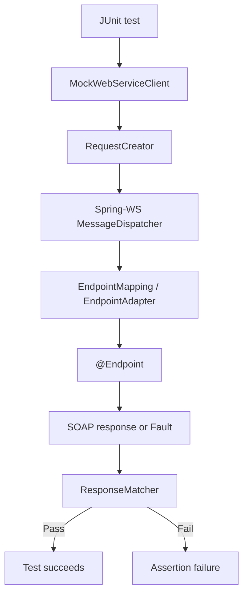

# ResponseMatcher, ResponseMatchers và khai báo phản hồi mong đợi

## Mục tiêu học tập

Trong module **SPRING_WEB_SERVICES**, kiểm thử máy chủ SOAP cần xác nhận service trả về đúng nội dung theo WSDL/XSD, đúng SOAP version, headers và Fault behavior. Spring Web Services (Spring-WS) cung cấp API kiểm thử phía server với MockWebServiceClient, ResponseMatcher và lớp tiện ích ResponseMatchers. Bài học tập trung vào cách khai báo response mong đợi bằng matcher có sẵn, ghép nhiều assertion và viết matcher riêng khi quy tắc contract đặc thù chưa được biểu đạt.

Sau bài học, bạn có thể phân biệt ResponseMatcher và ResponseMatchers; hiểu MockWebServiceClient; dùng payload, soapEnvelope, soapHeader, xpath, validPayload, noFault và fault matchers; xác minh SOAP Fault; viết custom matcher; tránh assertion quá lỏng; và hiểu giới hạn của dispatcher test so với HTTP/TLS integration test.

## 1. Response SOAP gồm những gì?

Một response có nhiều lớp:

| Thành phần | Nội dung cần kiểm tra |
| --- | --- |
| Payload | Phần tử nghiệp vụ trong SOAP Body, QName và fields. |
| Envelope | SOAP version, Header, Body và namespace. |
| Header | Correlation ID, WS-Addressing hoặc custom business header. |
| Fault | SOAP code, reason và typed detail. |
| Schema | Payload có hợp lệ theo XSD. |
| Transport | HTTP status, Content-Type, TLS, MIME/MTOM và framing. |

Một assertion chỉ kiểm tra payload có thể bỏ sót SOAP version hoặc header bắt buộc. Ngược lại, so XML bằng raw string có thể fail chỉ vì prefix, whitespace hay serialization khác mà vẫn tương đương theo XML.

Ví dụ response payload:

```xml
<ord:GetOrderResponse xmlns:ord="urn:example:orders:v1">
  <ord:orderId>ORD-42</ord:orderId>
  <ord:status>ACCEPTED</ord:status>
</ord:GetOrderResponse>
```

Test nên xác nhận QName, dữ liệu quan trọng và schema khi cần. Không nhất thiết yêu cầu output bytes giống hệt fixture nếu wire contract không yêu cầu byte-level identity.

## 2. Vị trí của ResponseMatcher trong server testing

| Thành phần | Trách nhiệm |
| --- | --- |
| MockWebServiceClient | Tạo mock client, gửi SOAP request qua Spring-WS server-side dispatcher và nhận response. |
| ResponseMatcher | Hợp đồng một phép kiểm tra response. |
| ResponseMatchers | Static factory methods tạo matcher dựng sẵn. |
| RequestCreator | Tạo SOAP request từ payload hoặc envelope để gửi vào dispatcher. |

Luồng:



MockWebServiceClient kiểm tra Spring-WS dispatcher trong application context. Nó hữu ích để kiểm tra endpoint mapping, endpoint invocation, interceptor trong dispatcher chain và response serialization. Nó **không tự mở TCP socket**, không chạy đầy đủ servlet filter chain, TLS, reverse proxy hay gateway.

## 3. ResponseMatcher là gì?

ResponseMatcher là interface biểu diễn một assertion trên response của SOAP invocation. Chữ ký API Spring-WS:

```java
package org.springframework.ws.test.server;

public interface ResponseMatcher {
    void match(
        java.net.URI uri,
        org.springframework.ws.WebServiceMessage request,
        org.springframework.ws.WebServiceMessage response)
        throws java.io.IOException, AssertionError;
}
```

MockWebServiceClient gọi matcher qua expectation chain; test thông thường không gọi match trực tiếp. Matcher nhận cả URI, request và response nên có thể đối chiếu quan hệ giữa request và response, ví dụ correlation ID hoặc orderId được phản ánh lại.

Một matcher chỉ nên kiểm tra observable contract behavior. Tránh truy cập database hoặc lặp lại business rules bên trong matcher; các quy tắc đó nên có service-level tests riêng.

## 4. ResponseMatchers và nhóm matcher dựng sẵn

ResponseMatchers là lớp tiện ích cung cấp static methods tạo ResponseMatcher.

| Matcher | Mục đích |
| --- | --- |
| payload(Source) | So sánh SOAP Body payload với XML mong đợi. |
| soapEnvelope(Source) | So sánh toàn SOAP Envelope. |
| soapHeader(QName, Source) | Kiểm tra header theo QName và nội dung mong đợi. |
| xpath(expression, namespaces, matcher) | Đánh giá XPath rồi kiểm tra giá trị bằng Hamcrest matcher. |
| validPayload(Source) | Xác minh payload hợp lệ theo schema được cung cấp. |
| noFault() | Xác nhận response không phải SOAP Fault. |
| clientOrSenderFault(...) | Xác nhận Client Fault SOAP 1.1 hoặc Sender Fault SOAP 1.2. |
| serverOrReceiverFault(...) | Xác nhận Server Fault SOAP 1.1 hoặc Receiver Fault SOAP 1.2. |

Overload cụ thể cần đối chiếu Javadoc đúng version/BOM. Bài hướng tới Spring-WS 4.1.4; không giả định mọi phiên bản cũ có cùng overload.

## 5. Tạo server test với MockWebServiceClient

Tạo mock client từ application context chứa endpoint, mappings và message factory:

```java
import org.springframework.context.ApplicationContext;
import org.springframework.ws.test.server.MockWebServiceClient;

MockWebServiceClient client =
        MockWebServiceClient.createClient(applicationContext);
```

Gửi request và khai báo response:

```java
import static org.springframework.ws.test.server.RequestCreators.withPayload;
import static org.springframework.ws.test.server.ResponseMatchers.payload;

import org.springframework.xml.transform.StringSource;

client.sendRequest(
        withPayload(new StringSource("""
            <ord:GetOrderRequest
                xmlns:ord="urn:example:orders:v1">
              <ord:orderId>ORD-42</ord:orderId>
            </ord:GetOrderRequest>
            """)))
    .andExpect(
        payload(new StringSource("""
            <ord:GetOrderResponse
                xmlns:ord="urn:example:orders:v1">
              <ord:orderId>ORD-42</ord:orderId>
              <ord:status>ACCEPTED</ord:status>
            </ord:GetOrderResponse>
            """)));
```

Application context phải chứa endpoint, endpoint mapping, adapter và fixtures đúng contract. Request/response XML ở ví dụ phải được điều chỉnh theo XSD thực tế.

## 6. Fluent expectation chain

Có thể ghép nhiều matcher:

```java
client.sendRequest(withPayload(request))
    .andExpect(noFault())
    .andExpect(payload(expectedPayload))
    .andExpect(xpath(
        "count(/ord:GetOrderResponse/ord:items/ord:item)",
        namespaces,
        org.hamcrest.Matchers.is(2.0)));
```

Mỗi andExpect là một expectation. Đặt điều kiện nền tảng trước, ví dụ noFault và payload root, sau đó kiểm tra chi tiết. Khi matcher fail, test dừng ở assertion đó; thứ tự hợp lý giúp chẩn đoán nhanh.

## 7. payload: so sánh SOAP Body

payload(Source expectedPayload) kiểm tra payload của response Body. Nó phù hợp khi cần kiểm tra phần tử nghiệp vụ mà không cần assert mọi Header hoặc Envelope metadata.

```java
.andExpect(payload(new StringSource("""
    <ord:GetOrderResponse xmlns:ord="urn:example:orders:v1">
      <ord:orderId>ORD-42</ord:orderId>
      <ord:status>ACCEPTED</ord:status>
    </ord:GetOrderResponse>
    """)));
```

QName gồm namespace URI và local name. Hai payload có cùng local name nhưng namespace v1/v2 khác nhau không phải cùng contract. Prefix có thể khác; namespace URI phải đúng. Tránh response.toString().equals(expectedXml), vì attribute order, whitespace và prefix serialization không phải lúc nào cũng thuộc contract.

## 8. soapEnvelope: kiểm tra toàn Envelope

Dùng soapEnvelope(Source expectedEnvelope) khi cần xác nhận cả SOAP Header, Body và Envelope namespace.

```xml
<soap:Envelope
    xmlns:soap="http://schemas.xmlsoap.org/soap/envelope/"
    xmlns:ord="urn:example:orders:v1"
    xmlns:ctx="urn:example:context:v1">
  <soap:Header>
    <ctx:CorrelationId>corr-123</ctx:CorrelationId>
  </soap:Header>
  <soap:Body>
    <ord:GetOrderResponse>
      <ord:orderId>ORD-42</ord:orderId>
    </ord:GetOrderResponse>
  </soap:Body>
</soap:Envelope>
```

Matcher toàn Envelope hữu ích khi SOAP version/header là contract requirement. Nó có thể quá chặt nếu serialization thêm header hợp lệ hoặc thay prefix; nếu chỉ cần kiểm tra một header, dùng soapHeader hoặc XPath.

## 9. soapHeader: kiểm tra header theo QName

soapHeader(QName, Source) dùng để kiểm tra header có QName cụ thể.

```java
import static org.springframework.ws.test.server.ResponseMatchers.soapHeader;
import javax.xml.namespace.QName;

QName correlation = new QName(
        "urn:example:context:v1", "CorrelationId");

client.sendRequest(withPayload(request))
    .andExpect(soapHeader(
        correlation,
        new StringSource("""
            <ctx:CorrelationId xmlns:ctx="urn:example:context:v1">
              corr-123
            </ctx:CorrelationId>
            """)));
```

QName gồm namespace URI và local part. Prefix trong expected XML không cần giống prefix thực tế.

Nếu contract yêu cầu chính xác một header, kiểm tra cardinality. Chỉ xác nhận một header tồn tại có thể không phát hiện duplicate header. Nếu có actor/role hoặc mustUnderstand, test semantics xử lý header ở node tương ứng; header chỉ xuất hiện không chứng minh node đã hiểu nó.

## 10. xpath: kiểm tra một phần response

xpath(expression, namespaces, matcher) sử dụng XPath trên response và kiểm tra giá trị với Hamcrest.

```java
import static org.springframework.ws.test.server.ResponseMatchers.xpath;
import static org.hamcrest.Matchers.equalTo;

Map<String, String> namespaces = Map.of(
        "ord", "urn:example:orders:v1");

client.sendRequest(withPayload(request))
    .andExpect(xpath(
        "/ord:GetOrderResponse/ord:status",
        namespaces,
        equalTo("ACCEPTED")));
```

Prefix XPath do test khai báo; không cần giống prefix trong document. Namespace map phải ánh xạ đúng URI. Nếu dùng XPath count, XPath 1.0 trả về number, thường được biểu diễn bằng Double:

```java
.andExpect(xpath(
    "count(/ord:GetOrderResponse/ord:items/ord:item)",
    namespaces,
    org.hamcrest.Matchers.is(2.0)));
```

Tránh XPath quá rộng như //* [contains(., 'ACCEPTED')] nếu bất kỳ node nào chứa chữ đó cũng làm test pass. Dùng đường dẫn chính xác và kiểm tra absence/presence rõ ràng.

## 11. validPayload: xác minh response theo XSD

validPayload(Source schema) xác minh payload SOAP Body hợp lệ với schema cung cấp.

```java
import static org.springframework.ws.test.server.ResponseMatchers.validPayload;

Source schema = new StreamSource(
        new ClassPathResource("xsd/orders-v1.xsd").getInputStream());

client.sendRequest(withPayload(request))
    .andExpect(validPayload(schema));
```

Trong code thật cần quản lý InputStream/Resource lifecycle đúng cách và resolver cho schema imports/includes. Dùng overload đúng kiểu theo Javadoc version.

Schema validity không chứng minh business correctness: status có thể hợp XSD nhưng sai workflow. Ghép validPayload với XPath hoặc expected payload. Matcher này kiểm tra **response**; muốn xác minh server từ chối invalid request thì cần request validation path và test Fault/no side effects riêng.

## 12. noFault: response bình thường

noFault() diễn đạt kỳ vọng response không phải SOAP Fault:

```java
client.sendRequest(withPayload(request))
    .andExpect(noFault())
    .andExpect(payload(expectedResponse));
```

Payload matcher có thể tự thất bại khi response là Fault; noFault vẫn hữu ích vì nêu rõ ý định và failure message. Nó không thay payload/schema assertion.

## 13. clientOrSenderFault: lỗi phía caller

SOAP 1.1 dùng Fault code Client; SOAP 1.2 dùng Sender. Matcher phù hợp cho request invalid hoặc caller gửi dữ liệu không được chấp nhận:

```java
import static org.springframework.ws.test.server.ResponseMatchers.clientOrSenderFault;

client.sendRequest(withPayload(invalidRequest))
    .andExpect(clientOrSenderFault());
```

Có overload nhận reason/fault string theo API version:

```java
.andExpect(clientOrSenderFault("Invalid order identifier"));
```

Không phụ thuộc nguyên văn reason nếu contract không cam kết text ổn định. Ưu tiên Fault code/detail QName và error category. Nếu kiểm tra detail, dùng XPath hoặc custom matcher.

## 14. serverOrReceiverFault: lỗi phía server

SOAP 1.1 dùng Server; SOAP 1.2 dùng Receiver. Matcher này xác minh server fault khi error handling policy biểu đạt exception dưới dạng Fault:

```java
import static org.springframework.ws.test.server.ResponseMatchers.serverOrReceiverFault;

client.sendRequest(withPayload(request))
    .andExpect(serverOrReceiverFault());
```

Không suy luận mọi exception phải tạo loại Fault này. Exception resolver, security handler, SOAP version hoặc transport có thể tạo kết quả khác. Fault công khai không được lộ stack trace hoặc thông tin nội bộ.

## 15. Kiểm tra typed SOAP Fault detail

Fault có code, reason và detail. Matcher client/server fault thường xác nhận loại Fault; nếu WSDL có typed detail, kiểm tra detail QName/code riêng.

```xml
<soap:Fault xmlns:soap="http://schemas.xmlsoap.org/soap/envelope/">
  <faultcode>soap:Client</faultcode>
  <faultstring>Invalid order identifier</faultstring>
  <detail>
    <ord:OrderValidationFault
        xmlns:ord="urn:example:orders:faults:v1">
      <ord:code>ORDER_ID_INVALID</ord:code>
    </ord:OrderValidationFault>
  </detail>
</soap:Fault>
```

Không assert exception class hoặc stack trace trong public detail. Với SOAP 1.2, cấu trúc Code/Reason/Subcode khác SOAP 1.1; viết test riêng cho từng version.

## 16. Ghép expectation mà không tạo test brittle

Một test thành công có thể kiểm tra:

```java
client.sendRequest(withPayload(request))
    .andExpect(noFault())
    .andExpect(payload(expectedPayload))
    .andExpect(validPayload(schema))
    .andExpect(soapHeader(correlationQName, expectedHeader))
    .andExpect(xpath(
        "/ord:GetOrderResponse/ord:status",
        namespaces,
        org.hamcrest.Matchers.equalTo("ACCEPTED")));
```

Không cần assert toàn envelope và mọi field nếu payload/header matcher đã đủ. Mỗi matcher nên có một mục tiêu: SOAP protocol, QName/payload, required header, XSD, Fault semantics hoặc correlation invariant. Đặt checks nền tảng trước checks chi tiết để failure dễ hiểu.

## 17. Custom ResponseMatcher

Khi matcher dựng sẵn không biểu đạt được quy tắc như response phải phản ánh orderId từ request, có thể triển khai ResponseMatcher.

```java
package com.example.orders.test;

import java.io.IOException;
import java.net.URI;

import org.springframework.ws.WebServiceMessage;
import org.springframework.ws.soap.SoapMessage;
import org.springframework.ws.test.server.ResponseMatcher;
import org.w3c.dom.Document;
import org.w3c.dom.NodeList;

public final class ResponseOrderIdMatcher implements ResponseMatcher {

    private final String expectedOrderId;

    public ResponseOrderIdMatcher(String expectedOrderId) {
        this.expectedOrderId = expectedOrderId;
    }

    @Override
    public void match(
            URI uri,
            WebServiceMessage request,
            WebServiceMessage response)
            throws IOException, AssertionError {

        if (!(response instanceof SoapMessage soap)) {
            throw new AssertionError("Response is not a SOAP message");
        }

        try {
            Document document = XmlTestSupport.toDocument(
                    soap.getSoapBody().getPayloadSource());

            NodeList nodes = document.getElementsByTagNameNS(
                    "urn:example:orders:v1", "orderId");

            if (nodes.getLength() != 1) {
                throw new AssertionError(
                        "Expected exactly one orderId element");
            }

            String actual = nodes.item(0).getTextContent().trim();
            if (!expectedOrderId.equals(actual)) {
                throw new AssertionError(
                        "Response orderId does not match request");
            }
        } catch (javax.xml.transform.TransformerException ex) {
            throw new AssertionError(
                    "Cannot inspect SOAP response payload", ex);
        }
    }
}
```

XmlTestSupport.toDocument là helper của test project, cần dùng parser XML hardened và không bật DTD/external entities. Code minh họa nhận expected ID từ fixture; có thể parse request để đối chiếu nhưng phải dùng QName và parser an toàn. Không đưa order ID nhạy cảm vào assertion message/log nếu policy không cho phép.

### 17.1. Khi nên dùng matcher dựng sẵn?

Nếu payload/xpath/soapHeader/validPayload biểu đạt được assertion, ưu tiên built-in matcher. Custom matcher phù hợp khi một invariant dùng lại nhiều nơi hoặc cần đối chiếu nhiều phần message. Đừng biến matcher thành integration harness hoặc truy cập database.

## 18. ResponseMatcher và Hamcrest Matcher khác nhau

ResponseMatcher kiểm tra toàn bộ SOAP response ở cấp Spring-WS test. Hamcrest Matcher<T> kiểm tra một giá trị Java, ví dụ String/Number mà XPath trả về.

Ví dụ xpath dùng cả hai:

```java
.andExpect(xpath(
    "/ord:GetOrderResponse/ord:status",
    namespaces,
    org.hamcrest.Matchers.equalTo("ACCEPTED")));
```

Không truyền ResponseMatcher vào vị trí Hamcrest matcher hoặc ngược lại. Cùng tên “matcher” nhưng hợp đồng và dữ liệu đầu vào khác nhau.

## 19. SOAP version và envelope assertions

SOAP 1.1 Envelope namespace là `http://schemas.xmlsoap.org/soap/envelope/`. SOAP 1.2 dùng `http://www.w3.org/2003/05/soap-envelope`. Payload matcher một mình không nhất thiết chứng minh Envelope version đúng.

Dùng soapEnvelope hoặc custom matcher xác minh version khi contract cần. Nếu WSDL công bố cả SOAP 1.1 và SOAP 1.2 bindings, test mỗi binding riêng với media type/headers phù hợp.

## 20. Lỗi thường gặp

| Triệu chứng | Nguyên nhân | Cách xử lý |
| --- | --- | --- |
| Payload nhìn giống nhưng matcher fail | Namespace URI khác, wrapper khác. | Kiểm tra QName và SOAP Body root. |
| XPath không tìm thấy node | Namespace map thiếu/sai. | Khai prefix-to-URI rõ. |
| Count assertion sai | XPath count trả number/Double. | So sánh 2.0 phù hợp. |
| soapHeader không match | QName/role sai. | Kiểm tra namespace, local name và role. |
| validPayload fail | XML sai XSD hoặc import lỗi. | Kiểm tra schema fixture/resolver. |
| Fault matcher fail | Resolver map khác SOAP fault code mong đợi. | Xác định SOAP version và exception path. |
| noFault fail | Request tạo Fault thay vì normal response. | Điều tra validation/endpoint/resolver. |
| Mock pass, HTTP production fail | Filter/transport chưa chạy trong dispatcher test. | Bổ sung HTTP integration test. |
| Envelope matcher brittle | Assertion cả chi tiết serialization không thuộc contract. | Dùng payload/header/XPath riêng. |
| Custom matcher lỗi I/O | Source/stream lifecycle sai. | Đảm bảo quản lý source và exception. |

## 21. Phạm vi của MockWebServiceClient

| Layer | Kiểm tra phù hợp | Không thể kết luận |
| --- | --- | --- |
| MockWebServiceClient | Endpoint mapping, invocation, dispatcher interceptors, SOAP response/Fault. | HTTP socket, TLS, gateway/proxy. |
| Spring context test | Bean wiring, endpoint và WSDL/XSD definitions. | External deployment URL. |
| HTTP integration test | Servlet filter chain, status, method, Content-Type, WSDL GET. | Mọi partner WS-Security/MTOM interoperability. |
| Real HTTP partner test | SOAP 1.1/1.2, sender, certificates, MIME và stack tương thích. | Capacity/load nếu không có load tests. |

Muốn kiểm tra MessageDispatcherServlet GET WSDL/XSD, dùng HTTP GET qua embedded server hoặc test servlet phù hợp. MockWebServiceClient tập trung SOAP dispatch, không phải tool kiểm tra toàn bộ HTTP publication.

## 22. Positive và negative response assertions

Positive tests nên xác minh request đúng QName/schema, endpoint được gọi đúng số lần, response không Fault, payload hợp XSD và required headers có mặt.

Negative tests nên xác minh invalid schema, unknown QName, security failure, business rejection và unexpected exception được xử lý đúng. Đồng thời kiểm tra application service **không tạo side effect** khi validation hoặc authorization thất bại. Chỉ assert một status hay một Fault không đủ để chứng minh nghiệp vụ an toàn.

## 23. Test fixtures và dữ liệu ổn định

Giữ fixture nhỏ, theo version và tên thể hiện mục đích:

- valid-get-order-request.xml
- expected-get-order-response.xml
- invalid-order-fault.xml
- soap12-receiver-fault.xml
- orders-v1.xsd
- orders-v2.xsd

Không dùng một expected.xml chung cho mọi SOAP version/namespace. Test credentials/certificates phải là dữ liệu riêng cho test, không dùng secret production. Nếu fixture có thời gian, kiểm soát clock/timezone để test ổn định.

## 24. Ma trận kiểm thử ResponseMatcher

| ID | Kỳ vọng | Matcher/strategy |
| --- | --- | --- |
| R01 | Normal response | noFault |
| R02 | Body đúng XML | payload |
| R03 | Envelope đúng | soapEnvelope |
| R04 | Correlation header | soapHeader |
| R05 | Status ACCEPTED | xpath |
| R06 | Có hai item | XPath count |
| R07 | Hợp XSD v1 | validPayload |
| R08 | Hợp XSD v2 | validPayload với schema v2 |
| R09 | Client/Sender Fault | clientOrSenderFault |
| R10 | Server/Receiver Fault | serverOrReceiverFault |
| R11 | Fault detail QName | XPath/custom matcher |
| R12 | Correlation phản ánh request | custom ResponseMatcher |
| R13 | SOAP 1.1 | Envelope/version assertion |
| R14 | SOAP 1.2 | Envelope/version assertion |
| R15 | Unknown QName bị reject | negative dispatcher test |
| R16 | Signature fail, không side effect | WSS4J test + service not called |
| R17 | Required header thiếu | header matcher/negative assertion |
| R18 | Wrong fault reason/detail | custom Fault assertion |
| R19 | Routing v1/v2 | QName + schema matcher |
| R20 | MTOM response | Real MIME integration test |

## 25. Bài tập thực hành và đáp án

1. **Chỉ kiểm tra Body:** dùng payload; không cần soapEnvelope nếu Header không thuộc assertion.
2. **Local name đúng, namespace sai:** matcher phải fail vì QName thay đổi.
3. **Prefix khác nhưng URI giống:** không fail chỉ vì prefix; URI/local name mới là yếu tố.
4. **XPath thiếu namespace map:** khai prefix-to-URI tương ứng trong map.
5. **count trả 2.0:** dùng numeric matcher cho Double, không so Integer sai kiểu.
6. **Response hợp XSD nhưng status sai:** thêm XPath/business assertion.
7. **Header bắt buộc:** dùng soapHeader(QName, expected Source) và negative test khi thiếu.
8. **SOAP 1.2 Sender Fault:** dùng clientOrSenderFault.
9. **SOAP 1.1 Server Fault:** dùng serverOrReceiverFault.
10. **Correlation phản ánh request:** dùng XPath/Header matcher cho fixture tĩnh, custom matcher khi phải đối chiếu request động.
11. **Expected success nhưng server trả Fault:** noFault làm ý định rõ, sau đó payload assertion.
12. **Mock pass nhưng HTTP 403:** dispatcher mock không kiểm tra servlet filter chain; thêm HTTP test.
13. **Prefix serialization thay đổi:** dùng XML-aware matcher, không so raw string.
14. **Typed Fault:** ngoài fault class, assert detail QName và code.
15. **Payload pass có chứng minh signature hợp lệ?** Không; cần client/security-aware verification test riêng.
16. **xop:Include đúng CID có chứng minh file đúng?** Không; cần MIME/MTOM test trên wire.

## 26. Checklist

- [ ] Test context chứa endpoint và EndpointMapping đúng version.
- [ ] MockWebServiceClient được tạo từ application context phù hợp.
- [ ] RequestCreator gửi đúng payload hoặc full SOAP Envelope.
- [ ] Success tests có noFault và payload.
- [ ] QName/namespace được xác nhận.
- [ ] Required headers được kiểm tra theo QName.
- [ ] XPath namespace map tường minh.
- [ ] XPath count dùng numeric matcher đúng.
- [ ] validPayload kiểm tra schema khi phù hợp.
- [ ] SOAP 1.1 và 1.2 Fault được test riêng.
- [ ] Typed Fault detail được xác minh.
- [ ] Public Fault không lộ stacktrace/token/secret.
- [ ] Custom ResponseMatcher có assertion message an toàn.
- [ ] Negative tests xác nhận không có side effects.
- [ ] V1/v2 có fixtures/schema tương ứng.
- [ ] Không so raw XML nếu serialization không thuộc contract.
- [ ] Dispatcher mock không bị coi là HTTP/TLS proof.
- [ ] Có HTTP test cho status, filter chain, WSDL GET và MIME.
- [ ] Có partner interoperability test cho WSS4J/SOAP version/attachments.
- [ ] Fixtures không chứa production credentials.

## 27. Tài liệu tham khảo chính thức

1. [Spring Web Services 4.1.4 Reference — Testing](https://docs.spring.io/spring-ws/docs/4.1.4/reference/html/#server-side-testing) — server-side testing.
2. [ResponseMatcher API](https://docs.spring.io/spring-ws/docs/4.1.4/api/org/springframework/ws/test/server/ResponseMatcher.html) — custom matcher contract.
3. [ResponseMatchers API](https://docs.spring.io/spring-ws/docs/4.1.4/api/org/springframework/ws/test/server/ResponseMatchers.html) — built-in matcher factories.
4. [MockWebServiceClient API](https://docs.spring.io/spring-ws/docs/4.1.4/api/org/springframework/ws/test/server/MockWebServiceClient.html) — createClient/sendRequest/expectation.
5. [RequestCreators API](https://docs.spring.io/spring-ws/docs/4.1.4/api/org/springframework/ws/test/server/RequestCreators.html) — withPayload/withSoapEnvelope.
6. [W3C SOAP 1.1](https://www.w3.org/TR/SOAP/) — Envelope/Fault.
7. [W3C SOAP 1.2 Part 1](https://www.w3.org/TR/soap12-part1/) — Code/Reason/Subcode.
8. [W3C XPath 1.0](https://www.w3.org/TR/1999/REC-xpath-19991116/) — namespace context và number functions.
9. [W3C XML Schema 1.1](https://www.w3.org/TR/xmlschema11-1/) — schema validation.
10. [Hamcrest](https://hamcrest.org/JavaHamcrest/) — value matchers.
11. [JUnit 5 User Guide](https://junit.org/junit5/docs/current/user-guide/) — test lifecycle/assertions.
12. [OWASP XML Security Cheat Sheet](https://cheatsheetseries.owasp.org/cheatsheets/XML_Security_Cheat_Sheet.html) — parser/XML security tests.
13. [Apache WSS4J Documentation](https://ws.apache.org/wss4j/) — security validation tests.

**Phạm vi ví dụ:** Code hướng tới Spring-WS 4.1.4/JUnit 5. Application context, XSD fixtures, endpoint classes, JAXB types và test helpers phải có trong project. Các ví dụ khung chưa chạy Maven/Gradle/JUnit trong STEP 4. Đối chiếu package/overload với BOM thực tế trước khi copy.

## Tổng kết

**ResponseMatcher** là hợp đồng cho một phép kiểm tra response; **ResponseMatchers** cung cấp factory giúp diễn đạt kỳ vọng theo payload, envelope, header, XPath, XSD và SOAP Fault. Kết hợp với MockWebServiceClient, chúng cho phép kiểm tra server-side dispatch và response behavior ở cấp Spring-WS mà không cần HTTP socket. Hãy dùng matcher hẹp theo contract, khai namespace rõ ràng, kiểm tra cả success lẫn Fault và viết custom matcher cho invariant request-response đặc thù.

Giữ đúng giới hạn công cụ: dispatcher test không chứng minh servlet filter, TLS/mTLS, gateway, MIME transport hoặc client interoperability. Dùng ResponseMatchers cho điều nó kiểm tra tốt và bổ sung HTTP/transport/security integration tests ở layer phù hợp để dịch vụ SOAP vận hành ổn định.