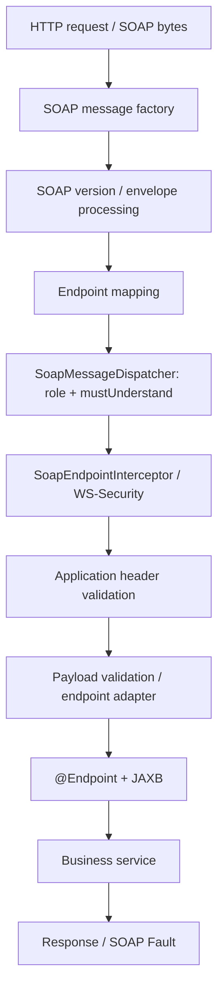

# Kiểm tra header, mustUnderstand và các loại SOAP Fault

## 1. Tình huống: SOAP Body đúng nhưng server vẫn phải từ chối request

Một đối tác gọi endpoint Spring Web Services (Spring-WS) để lấy thông tin đơn hàng. SOAP Body có đúng QName, XSD hợp lệ và JAXB có thể unmarshal. Tuy nhiên request còn có các SOAP Header:

- `wsa:Action` để xác định operation.
- `wsse:Security` để mang thông tin bảo mật.
- `ord:TenantContext` để xác định tenant.
- `trace:RequestContext` để chuyển correlation ID.

Một ngày đối tác gửi thêm header `sec:NewPolicy`, đánh dấu `mustUnderstand="1"`. Server chưa hỗ trợ header này. Nếu server âm thầm bỏ qua, hai bên có thể hiểu khác nhau về chính sách bảo mật. Nếu server trả một Fault sai version/code hoặc không chỉ rõ header gây lỗi, client cũng khó chẩn đoán và xử lý.

Đây là lúc kiểm thử **SOAP Header, mustUnderstand và SOAP Fault** trở nên quan trọng. Endpoint không chỉ nhận một XML payload; nó phải thực thi quy tắc xử lý message, header targeting, protocol version, security và error reporting.

Bài học thuộc chương **Kiểm thử máy chủ** trong module `SPRING_WEB_SERVICES`, tập trung vào dịch vụ SOAP contract-first với Spring-WS, XSD/WSDL, JAXB, endpoint, interceptors, SOAP Fault, XML security, WS-Security và kiểm thử tương thích.

### Mục tiêu học tập

Sau bài này, bạn có thể:

1. Phân biệt SOAP Envelope, Header, Body và Fault.
2. Giải thích `mustUnderstand` trong SOAP 1.1 và SOAP 1.2, kể cả khác biệt lexical value và fault code.
3. Hiểu header role/actor: một node chỉ phải xử lý header được gửi cho role mà nó đảm nhiệm.
4. Phân biệt header được hiểu, header được xử lý, header bị bỏ qua hợp lệ và header bắt buộc nhưng không được hiểu.
5. Kiểm tra header bằng Spring-WS SOAP APIs/interceptors và không phụ thuộc HTTP trong business logic.
6. Phân biệt SOAP 1.1 Client/Server Fault với SOAP 1.2 Sender/Receiver, VersionMismatch, MustUnderstand và DataEncodingUnknown.
7. Xây test cho header hợp lệ, thiếu, sai namespace, sai role, mustUnderstand và Fault Detail.
8. Đảm bảo Fault không làm lộ stack trace, thông tin xác thực hoặc nội dung nhạy cảm.

## 2. Vị trí của header trong SOAP message

SOAP Envelope gồm một Header tùy chọn và một Body bắt buộc. Header chứa metadata điều khiển, routing hoặc security; Body chứa nội dung operation và có thể chứa Fault.

### 2.1. SOAP 1.1 envelope

```xml
<soap:Envelope
    xmlns:soap="http://schemas.xmlsoap.org/soap/envelope/"
    xmlns:ord="urn:example:orders:v1"
    xmlns:wsa="http://www.w3.org/2005/08/addressing"
    xmlns:trace="urn:example:trace:v1">
    <soap:Header>
        <wsa:Action>urn:example:orders:GetOrder</wsa:Action>
        <trace:RequestId>req-100</trace:RequestId>
    </soap:Header>
    <soap:Body>
        <ord:GetOrderRequest>
            <ord:orderId>ORD-100</ord:orderId>
        </ord:GetOrderRequest>
    </soap:Body>
</soap:Envelope>
```

### 2.2. Header và Body có vai trò khác nhau

| Thành phần | Mục đích | Ví dụ |
| --- | --- | --- |
| Envelope | Đóng khung SOAP version và namespaces | SOAP 1.1/1.2 Envelope |
| Header | Metadata cho routing, security, context, extensions | WS-Addressing, WS-Security |
| Body | Payload ứng dụng hoặc SOAP Fault | `GetOrderRequest` |
| Fault | Mô tả lỗi SOAP ở cấp protocol/application | Sender/Receiver, Detail |

Không đưa mọi metadata vào Body. Header có semantics về role, processing và `mustUnderstand`; payload XSD có semantics nghiệp vụ. Việc đặt sai vị trí có thể làm interceptor/endpoint mapping không xử lý đúng.

### 2.3. Header element được nhận diện bằng QName

Một header element phải được phân biệt bằng **namespace URI + local name**, không dựa vào prefix:

```xml
<a:TenantContext xmlns:a="urn:example:tenant:v1">
    tenant-42
</a:TenantContext>

<b:TenantContext xmlns:b="urn:example:tenant:v1">
    tenant-42
</b:TenantContext>
```

Hai header trên có cùng QName `{urn:example:tenant:v1}TenantContext`, dù prefix khác nhau. Test không nên so chuỗi XML thô hoặc yêu cầu prefix phải là `a`.

Ngược lại, `TenantContext` thuộc namespace khác là một QName khác, dù local name giống nhau:

```xml
<x:TenantContext xmlns:x="urn:other:tenant:v1">
    tenant-42
</x:TenantContext>
```

### 2.4. Header không tự trở thành danh tính đã xác thực

Một header như `TenantContext`, `PartnerId` hay `UserRole` có thể do client tự khai. Server chỉ được dùng nó để quyết định quyền truy cập sau khi xác minh nguồn theo policy, chẳng hạn WS-Security signature, mTLS principal hoặc gateway identity đã được bảo vệ. **XML well-formed không đồng nghĩa trusted identity.**

## 3. mustUnderstand: ý nghĩa và trách nhiệm của SOAP node

`mustUnderstand` cho biết một header block được đánh dấu là bắt buộc phải được hiểu/xử lý bởi SOAP node mà nó nhắm tới. Nó giúp tránh tình trạng một intermediary hoặc ultimate receiver âm thầm bỏ qua semantics quan trọng.

### 3.1. SOAP 1.1

SOAP 1.1 dùng thuộc tính:

```xml
<sec:Policy
    xmlns:sec="urn:example:security:v1"
    xmlns:soap="http://schemas.xmlsoap.org/soap/envelope/"
    soap:mustUnderstand="1">
    Strict
</sec:Policy>
```

Các giá trị lexical của SOAP 1.1 `mustUnderstand` là `"0"` hoặc `"1"`. `"1"` có nghĩa bắt buộc; `"0"` hoặc không có thuộc tính có nghĩa không bắt buộc. Không thay chúng bằng chuỗi `true`/`false` khi tạo SOAP 1.1 message.

### 3.2. SOAP 1.2

SOAP 1.2 dùng namespace Envelope khác:

```xml
<sec:Policy
    xmlns:sec="urn:example:security:v1"
    xmlns:env="http://www.w3.org/2003/05/soap-envelope"
    env:mustUnderstand="true">
    Strict
</sec:Policy>
```

SOAP 1.2 dùng kiểu boolean lexical với giá trị `true`/`false` (các forms hợp lệ theo XML Schema boolean cũng cần được xét đúng specification). Không copy SOAP 1.1 lexical form vào một SOAP 1.2 test và ngược lại.

### 3.3. Điều gì xảy ra khi node không hiểu một header bắt buộc?

Giả sử client gửi:

```xml
<env:Header
    xmlns:env="http://www.w3.org/2003/05/soap-envelope"
    xmlns:ext="urn:example:future-extension">
    <ext:NewPolicy env:mustUnderstand="true">
        enabled
    </ext:NewPolicy>
</env:Header>
```

Nếu SOAP node là recipient của header block, nhưng nó không hiểu header có `mustUnderstand=true`, nó phải tạo SOAP MustUnderstand Fault theo SOAP 1.2. Server không được lặng lẽ bỏ qua một extension bắt buộc thuộc role mà node đảm nhiệm.

### 3.4. Không phải header lạ nào cũng là MustUnderstand fault

| Header block | Targeted role | `mustUnderstand` | Node có hiểu? | Kết quả khái niệm |
| --- | --- | --- | --- | --- |
| Header A | Node hiện tại | false | Không | Có thể bỏ qua |
| Header B | Node hiện tại | true | Có | Phải xử lý theo semantics |
| Header C | Node hiện tại | true | Không | MustUnderstand Fault |
| Header D | Role khác | true | Không | Node hiện tại không có trách nhiệm xử lý header đó |
| Header E | Node hiện tại | Không khai báo | Không | Không bắt buộc theo `mustUnderstand`; extension policy vẫn có thể quy định khác |

Điểm quan trọng: **“không biết QName” và “không xử lý được mustUnderstand header nhắm tới mình” là hai điều kiện riêng.** Chỉ tìm mọi element lạ rồi trả MustUnderstand fault là không đúng.

## 4. Role/actor: header được gửi cho ai?

SOAP message có thể đi qua nhiều node: sender, intermediary và ultimate receiver. Một header block có thể được nhắm tới một SOAP role/actor cụ thể.

### 4.1. SOAP 1.1 dùng actor

SOAP 1.1 header block có thể chỉ định `soap:actor` bằng URI. Nếu không chỉ định, header được nhắm tới ultimate destination/receiver theo quy tắc SOAP 1.1.

```xml
<trace:Audit
    xmlns:trace="urn:example:audit:v1"
    xmlns:soap="http://schemas.xmlsoap.org/soap/envelope/"
    soap:actor="urn:example:gateway"
    soap:mustUnderstand="1">
    route-a
</trace:Audit>
```

Node không đảm nhiệm `urn:example:gateway` không nên xử lý header này như một header được nhắm tới chính nó. Node gateway có trách nhiệm xử lý; sau đó có thể chuyển tiếp message theo semantics của SOAP intermediaries.

### 4.2. SOAP 1.2 dùng role

SOAP 1.2 dùng `env:role`:

```xml
<trace:Audit
    xmlns:trace="urn:example:audit:v1"
    xmlns:env="http://www.w3.org/2003/05/soap-envelope"
    env:role="urn:example:gateway"
    env:mustUnderstand="true">
    route-a
</trace:Audit>
```

SOAP 1.2 định nghĩa các role URI chuẩn, gồm `next`, `none` và `ultimateReceiver`. Các role khác có thể được ứng dụng/intermediary quy ước. Cần thống nhất role URI giữa sender, intermediary và receiver; không tự tạo role rồi giả định mọi node đều biết.

### 4.3. none và next có semantics đặc biệt

- `next`: nhắm tới node tiếp theo trong SOAP message path.
- `ultimateReceiver`: nhắm tới SOAP ultimate receiver.
- `none`: không node nào được xử lý header block theo role này.

Role `none` không phải một cách lách `mustUnderstand` để gửi metadata tùy ý cho ứng dụng. Nó mang semantics SOAP cụ thể và phải được xử lý đúng specification.

### 4.4. Test role cùng mustUnderstand

Một test hữu ích phải phân biệt:

1. Header không có role: node ultimate receiver xử lý theo default targeting.
2. Header có role đúng của server: server phải xét `mustUnderstand`.
3. Header có role của intermediary khác: ultimate receiver hiện tại không xử lý như header nhắm tới mình.
4. Header có role `none` trong SOAP 1.2: không có node nào xử lý block theo role đó.

Không chỉ assert rằng request có header lạ trả Fault; phải kiểm tra **targeting** có đúng hay không.

## 5. Spring-WS server đọc và kiểm tra SOAP Header

Spring-WS biểu diễn SOAP message qua `SoapMessage`, `SoapHeader` và `SoapHeaderElement`. Endpoint/interceptor có thể đọc các header đã được parser nhận diện, xác minh QName và áp policy.

### 5.1. Đọc header bằng QName

Ví dụ một helper kiểm tra header `RequestId`:

```java
import java.util.Iterator;
import javax.xml.namespace.QName;

import org.springframework.ws.soap.SoapHeader;
import org.springframework.ws.soap.SoapHeaderElement;
import org.springframework.ws.soap.SoapMessage;

public final class SoapHeaderReader {

    private static final QName REQUEST_ID =
        new QName("urn:example:trace:v1", "RequestId");

    private SoapHeaderReader() {}

    public static String readRequestId(SoapMessage message) {
        SoapHeader header = message.getSoapHeader();
        Iterator<SoapHeaderElement> elements =
            header.examineAllHeaderElements();

        while (elements.hasNext()) {
            SoapHeaderElement element = elements.next();
            if (REQUEST_ID.equals(element.getName())) {
                return element.getText();
            }
        }
        return null;
    }
}
```

Ví dụ dùng `javax.xml.namespace.QName` vì QName thuộc Java SE và vẫn nằm trong `javax` package, kể cả ứng dụng dùng Jakarta EE APIs. Không nhầm nó với `javax.xml.bind`, vốn thuộc JAXB namespace đời cũ.

`examineAllHeaderElements()` chỉ duyệt các header element. Với header lặp lại, helper này trả phần tử đầu tiên tìm thấy; contract nên quy định header là singleton hay repeatable và code phải reject duplicate khi chỉ chấp nhận một instance.

### 5.2. Kiểm tra `mustUnderstand` và role

`SoapHeaderElement` cung cấp metadata như tên header, actor/role và `mustUnderstand` tùy SOAP version/provider. Một bước kiểm tra policy có thể được biểu diễn:

```java
public record HeaderPolicy(
    QName name,
    String expectedRole,
    boolean required,
    boolean mustBeUnderstood
) {}
```

Policy của ứng dụng nên xác định:

- Header QName nào được nhận.
- Header có bắt buộc phải xuất hiện không.
- Header được nhắm tới role/actor nào.
- Header có được phép lặp không.
- Ai có trách nhiệm xác thực nội dung.
- Có được chuyển tiếp hay phải loại bỏ sau khi xử lý.

Không viết logic chỉ dựa vào prefix, vị trí header trong XML hoặc chuỗi text mà bỏ qua QName/role.

### 5.3. Không tự triển khai lại toàn bộ SOAP processor

Một ứng dụng tự duyệt header rồi bỏ qua phần `mustUnderstand` protocol processing có thể xung đột với SOAP implementation của Spring-WS/SAAJ/Axiom. Cần phân biệt:

1. **SOAP runtime processing:** parser/message implementation và dispatcher thực thi protocol behavior.
2. **Application header policy:** code/interceptor kiểm tra các header mà service nghiệp vụ quan tâm.
3. **Security processing:** WS-Security verifier kiểm tra signature, timestamp, tokens và signed parts.

Custom header interceptor không nên tự nhận đã thay thế MustUnderstand processing của SOAP engine nếu chưa thực sự triển khai toàn bộ role/actor/version semantics.

### 5.4. Cơ chế mustUnderstand thực tế của Spring-WS

Trong Spring-WS 4.1.4, `SoapMessageDispatcher` xử lý header nhắm tới actor/role của endpoint invocation chain. Với mandatory header, dispatcher kiểm tra các interceptor triển khai `SoapEndpointInterceptor` và gọi `understands(SoapHeaderElement)` để xác định interceptor nào hiểu header. Nếu không có interceptor phù hợp, dispatcher tạo MustUnderstand Fault và dừng dispatch.

Điều này tạo ra một khác biệt quan trọng:

- `EndpointInterceptor` thông thường có thể đọc/check request trong `handleRequest`.
- `SoapEndpointInterceptor` bổ sung method `understands` để khai báo SOAP header QName mà interceptor hỗ trợ.
- `SoapMessageDispatcher` dùng khả năng này trong mustUnderstand processing.

Vì vậy, `RequestIdInterceptor` ở ví dụ sau là interceptor kiểm tra application metadata; **không tự động khai báo hiểu một mandatory SOAP header**. Với header có `mustUnderstand`, cần một SOAP-specific interceptor hoặc cơ chế SOAP interceptor được cấu hình đúng.

Ví dụ một interceptor hỗ trợ `TenantContext`:

```java
import java.util.Iterator;
import javax.xml.namespace.QName;

import org.springframework.ws.context.MessageContext;
import org.springframework.ws.server.EndpointInterceptor;
import org.springframework.ws.soap.SoapHeader;
import org.springframework.ws.soap.SoapHeaderElement;
import org.springframework.ws.soap.SoapMessage;
import org.springframework.ws.soap.server.SoapEndpointInterceptor;

public final class TenantContextSoapInterceptor
        implements SoapEndpointInterceptor {

    private static final QName TENANT_CONTEXT =
        new QName("urn:example:tenant:v1", "TenantContext");

    @Override
    public boolean understands(SoapHeaderElement header) {
        return TENANT_CONTEXT.equals(header.getName());
    }

    @Override
    public boolean handleRequest(
            MessageContext context,
            Object endpoint) throws Exception {

        if (!(context.getRequest() instanceof SoapMessage soap)) {
            return true;
        }

        SoapHeader header = soap.getSoapHeader();
        Iterator<SoapHeaderElement> values =
            header.examineHeaderElements(TENANT_CONTEXT);

        if (!values.hasNext()) {
            return true; // Optional trong ví dụ này.
        }

        SoapHeaderElement element = values.next();
        String tenant = element.getText();
        if (tenant == null || tenant.isBlank()) {
            throw new IllegalArgumentException(
                "TenantContext must not be blank"
            );
        }

        // Chỉ lưu sau khi caller/header identity đã được xác minh
        // theo security policy thực tế của ứng dụng.
        context.setProperty("tenantContext", tenant);
        return true;
    }

    @Override
    public boolean handleResponse(
            MessageContext context,
            Object endpoint) {
        return true;
    }

    @Override
    public boolean handleFault(
            MessageContext context,
            Object endpoint) {
        return true;
    }

    @Override
    public void afterCompletion(
            MessageContext context,
            Object endpoint,
            Exception ex) {
        // Không log raw credentials hoặc SOAP body.
    }
}
```

Method `understands` chỉ khai báo interceptor hỗ trợ semantics của QName. Nó **không** xác thực nội dung header. Phần `handleRequest` vẫn phải validate, verify trust/authorization và reject các giá trị không hợp lệ. Cũng cần bảo đảm interceptor này nằm trong invocation chain/endpoint mapping thực sự được chọn.

### 5.5. Interceptor kiểm tra application header

Một server-side `EndpointInterceptor` có thể kiểm tra metadata đã được SOAP layer parse:

```java
import java.util.Iterator;
import javax.xml.namespace.QName;

import org.springframework.ws.context.MessageContext;
import org.springframework.ws.server.EndpointInterceptor;
import org.springframework.ws.soap.SoapHeader;
import org.springframework.ws.soap.SoapHeaderElement;
import org.springframework.ws.soap.SoapMessage;

public final class RequestIdInterceptor
        implements EndpointInterceptor {

    private static final QName REQUEST_ID =
        new QName("urn:example:trace:v1", "RequestId");

    @Override
    public boolean handleRequest(
            MessageContext context,
            Object endpoint) throws Exception {

        if (!(context.getRequest() instanceof SoapMessage soap)) {
            return true;
        }

        SoapHeader header = soap.getSoapHeader();
        Iterator<SoapHeaderElement> iterator =
            header.examineHeaderElements(REQUEST_ID);

        if (!iterator.hasNext()) {
            // Ví dụ: RequestId không bắt buộc trong contract này.
            return true;
        }

        SoapHeaderElement element = iterator.next();
        String requestId = element.getText();
        if (requestId == null || requestId.isBlank()) {
            // Ví dụ chính sách: đánh dấu lỗi ứng dụng.
            throw new IllegalArgumentException(
                "RequestId must not be blank"
            );
        }

        context.setProperty("requestId", requestId);
        return true;
    }

    @Override
    public boolean handleResponse(
            MessageContext context,
            Object endpoint) {
        return true;
    }

    @Override
    public boolean handleFault(
            MessageContext context,
            Object endpoint) {
        return true;
    }

    @Override
    public void afterCompletion(
            MessageContext context,
            Object endpoint,
            Exception ex) {
        // Không log SOAP body/secret; chỉ ghi correlation metadata đã lọc.
    }
}
```

Đây là ví dụ kiểm tra một **application header tùy chọn**, không phải một implementation tổng quát cho `mustUnderstand`. Khi header bắt buộc theo contract, hãy kiểm tra sự hiện diện và nội dung theo policy, rồi tạo lỗi ứng dụng có mapping Fault rõ ràng. `mustUnderstand` protocol semantics vẫn thuộc SOAP runtime.

### 5.6. Đăng ký interceptor cho đúng endpoint mapping

Có thể đăng ký interceptor trong Spring-WS configuration:

```java
import org.springframework.context.annotation.Bean;
import org.springframework.context.annotation.Configuration;
import org.springframework.ws.config.annotation.WsConfigurerAdapter;
import org.springframework.ws.server.EndpointInterceptor;
import org.springframework.ws.config.annotation.EnableWs;

import java.util.List;

@Configuration
@EnableWs
public class SoapServerConfiguration extends WsConfigurerAdapter {

    @Bean
    public RequestIdInterceptor requestIdInterceptor() {
        return new RequestIdInterceptor();
    }

    @Override
    public void addInterceptors(
            List<EndpointInterceptor> interceptors) {
        interceptors.add(requestIdInterceptor());
    }
}
```

Đây là cách đăng ký interceptor trong cấu hình Spring-WS cổ điển; phiên bản Spring-WS/framework có thể cung cấp configuration style khác. Đảm bảo interceptor được thêm vào **đúng endpoint mapping** đang phục vụ request test, không chỉ tồn tại như một bean chưa được dùng.

### 5.7. Phân biệt absent, empty, duplicate và nil

Với một header `RequestId`, các trường hợp sau có thể mang ý nghĩa khác:

```xml
<!-- absent: không có RequestId header -->

<trace:RequestId xmlns:trace="urn:example:trace:v1"/>

<trace:RequestId xmlns:trace="urn:example:trace:v1"></trace:RequestId>

<trace:RequestId
    xmlns:trace="urn:example:trace:v1"
    xmlns:xsi="http://www.w3.org/2001/XMLSchema-instance"
    xsi:nil="true"/>

<trace:RequestId xmlns:trace="urn:example:trace:v1">req-1</trace:RequestId>
<trace:RequestId xmlns:trace="urn:example:trace:v1">req-2</trace:RequestId>
```

Không dùng một check `getText().isEmpty()` để suy ra absent/nil/duplicate. Với header có XSD contract, validate schema; nếu Header không nằm trong JAXB payload schema, hãy viết policy kiểm tra cardinality và nil semantics riêng.

### 5.8. Không tiêu thụ header trước khi security verifier cần nó

Nếu `wsse:Security` hoặc WS-Addressing header cần được interceptor xác minh, không xóa/consume header bằng custom logic trước khi security processing hoàn thành. Một header có thể cần giữ để signature reference validation hoặc downstream endpoint adapter sử dụng.

Đặc biệt, không đọc `TenantContext` làm tenant đã xác thực trước khi kiểm tra chữ ký hoặc nguồn identity tương ứng.

## 6. Header targeting và processing trong Spring-WS

### 6.1. Header có role khác không phải header dành cho endpoint hiện tại

Nếu một header nhắm tới intermediary, ultimate receiver không nên tùy tiện diễn giải nó như policy của chính mình. Điều này đặc biệt quan trọng trong SOAP message path có gateway, routing node hoặc security intermediary.

### 6.2. Header được hiểu phải được xử lý theo semantics

Nếu server đã hỗ trợ QName `TenantContext`, và header có `mustUnderstand=true`, server không chỉ đánh dấu nó “recognized”. Nó phải thực hiện semantics đã thỏa thuận, chẳng hạn:

- Parse tenant identifier đúng schema.
- Verify nguồn tin cậy của tenant identity.
- Áp policy isolation.
- Từ chối request nếu context không hợp lệ.

Không được bỏ qua giá trị tenant nhưng vẫn coi header đã hiểu chỉ vì code nhận diện QName.

### 6.3. Unknown optional header

Một header extension không nhắm tới node hiện tại hoặc không bật `mustUnderstand` có thể được bỏ qua theo SOAP semantics. Tuy nhiên service vẫn có quyền quy định profile chặt hơn qua contract, allowlist hoặc gateway policy; khi đó lỗi cần được ánh xạ thành Fault phù hợp thay vì giả vờ đây là protocol MustUnderstand fault.

### 6.4. Header forwarding ở intermediary

SOAP intermediary có thể xử lý một header targeted cho chính nó rồi chuyển tiếp các header block khác theo SOAP processing model. Khi forward:

- Không làm mất header phải được chuyển tiếp.
- Không forward header đã được xử lý với semantics yêu cầu remove/consume.
- Không thay đổi signed parts làm chữ ký trở nên vô hiệu.
- Nếu thay đổi SOAP Envelope, phải hiểu WS-Security/WS-Addressing consequences.
- Giữ nguyên correlation/trace khi hợp đồng yêu cầu.

Một endpoint ứng dụng thông thường không nên tự giả làm SOAP intermediary nếu nó không đảm nhiệm forwarding role.

## 7. Các loại SOAP Fault và cấu trúc lỗi

SOAP Fault nằm trong SOAP Body và dùng để biểu diễn lỗi ở tầng SOAP/application. Fault không phải HTTP status, không phải Java exception và cũng không đồng nhất với lỗi TLS.

### 7.1. SOAP 1.1 Fault structure

SOAP 1.1 Fault có các child fields quen thuộc:

```xml
<soap:Envelope
    xmlns:soap="http://schemas.xmlsoap.org/soap/envelope/"
    xmlns:ord="urn:example:orders:v1">
    <soap:Body>
        <soap:Fault>
            <faultcode>soap:Client</faultcode>
            <faultstring>Invalid order identifier</faultstring>
            <faultactor>https://api.example.org/orders</faultactor>
            <detail>
                <ord:OrderError>
                    <ord:code>INVALID_ORDER_ID</ord:code>
                    <ord:requestId>req-100</ord:requestId>
                </ord:OrderError>
            </detail>
        </soap:Fault>
    </soap:Body>
</soap:Envelope>
```

`faultcode` là QName; `faultstring` là thông tin con người đọc; `faultactor` nhận diện node gây Fault khi phù hợp; `detail` mang chi tiết ứng dụng. Không đặt stack trace hoặc credentials vào `detail`.

### 7.2. SOAP 1.1 fault codes chuẩn

| Fault code local name | Ý nghĩa khái quát |
| --- | --- |
| `VersionMismatch` | Envelope namespace/version không được hỗ trợ |
| `MustUnderstand` | Header bắt buộc nhắm tới node nhưng không được hiểu |
| `Client` | Request/message có vấn đề phía sender; gửi lại nguyên message thường không giải quyết |
| `Server` | Lỗi xử lý ở phía server; retry chỉ khi operation/idempotency policy cho phép |

SOAP 1.1 cho phép application-defined QName làm `faultcode` để phân loại lỗi chi tiết (ví dụ `ord:OrderNotFound`) theo contract của hai bên. `detail` vẫn mang dữ liệu lỗi ứng dụng dạng XML. Không dùng một custom fault code thay thế tùy tiện `VersionMismatch` hoặc `MustUnderstand`.

### 7.3. SOAP 1.2 Fault structure

SOAP 1.2 thay cấu trúc Fault:

```xml
<env:Envelope
    xmlns:env="http://www.w3.org/2003/05/soap-envelope"
    xmlns:ord="urn:example:orders:v1">
    <env:Body>
        <env:Fault>
            <env:Code>
                <env:Value>env:Sender</env:Value>
                <env:Subcode>
                    <env:Value>ord:InvalidOrderId</env:Value>
                </env:Subcode>
            </env:Code>
            <env:Reason>
                <env:Text xml:lang="en">
                    Invalid order identifier
                </env:Text>
                <env:Text xml:lang="vi">
                    Mã đơn hàng không hợp lệ
                </env:Text>
            </env:Reason>
            <env:Node>https://api.example.org/orders</env:Node>
            <env:Role>http://www.w3.org/2003/05/soap-envelope/role/ultimateReceiver</env:Role>
            <env:Detail>
                <ord:OrderError>
                    <ord:code>INVALID_ORDER_ID</ord:code>
                    <ord:requestId>req-100</ord:requestId>
                </ord:OrderError>
            </env:Detail>
        </env:Fault>
    </env:Body>
</env:Envelope>
```

SOAP 1.2 sử dụng `Code/Value`, có thể có `Subcode`, `Reason/Text` hỗ trợ nhiều ngôn ngữ, `Node`, `Role` và `Detail`. QName values phải có namespace binding hợp lệ; đừng so chỉ prefix `env` hoặc `ord`.

### 7.4. SOAP 1.2 top-level fault codes

| Code | Ý nghĩa | Gợi ý xử lý |
| --- | --- | --- |
| `VersionMismatch` | Envelope version không được hỗ trợ | Client sửa SOAP 1.1/1.2 protocol |
| `MustUnderstand` | Một mandatory header block không được hiểu | Xử lý header/profile hoặc bỏ header chỉ khi contract cho phép |
| `DataEncodingUnknown` | Encoding style không được hỗ trợ | Thống nhất encoding/serialization profile |
| `Sender` | Request có lỗi từ phía sender | Kiểm tra payload/header/auth/profile trước khi retry |
| `Receiver` | Lỗi xử lý ở phía receiver | Có thể transient, nhưng phải xét idempotency/outcome trước retry |

SOAP 1.2 cho phép Subcode application-defined để phân loại lỗi chi tiết, ví dụ `ord:OrderNotFound` dưới `env:Sender`. Không biến tất cả business failures thành `Receiver` chỉ vì chúng xảy ra trong server code.

### 7.5. Phân loại lỗi ở nhiều lớp

| Lớp | Ví dụ | Có SOAP Fault không? |
| --- | --- | --- |
| Network/TLS | DNS, timeout, handshake, certificate validation | Thường chưa có SOAP message |
| HTTP transport | 404/401/502, proxy error | Có thể không có SOAP Fault hợp lệ |
| SOAP protocol | VersionMismatch, MustUnderstand | Có |
| WS-Security | Signature/token/timestamp validation | Thường có security Fault nếu reply được tạo |
| Payload/schema | XSD violation, unsupported QName | Có thể map thành SOAP Fault theo implementation/policy |
| Application | OrderNotFound, InvalidState | Có thể map thành custom Fault |
| Internal server | Database/service unavailable | Có thể map thành Receiver/Server Fault |

Không biến certificate failure hoặc HTTP 502 HTML thành Fault Detail giả; client có thể chưa nhận được SOAP Envelope.

## 8. MustUnderstand Fault cụ thể

### 8.1. SOAP 1.1 MustUnderstand

Một ví dụ Fault body SOAP 1.1:

```xml
<soap:Fault
    xmlns:soap="http://schemas.xmlsoap.org/soap/envelope/">
    <faultcode>soap:MustUnderstand</faultcode>
    <faultstring>
        A mandatory header block was not understood
    </faultstring>
</soap:Fault>
```

Client nên kiểm tra QName Fault code và correlation ID nếu có; không phụ thuộc chính xác câu `faultstring` vì text có thể được bản địa hóa hoặc thay đổi.

### 8.2. SOAP 1.2 MustUnderstand và NotUnderstood

SOAP 1.2 MustUnderstand Fault có Code `env:MustUnderstand`. Envelope có thể có thêm `env:NotUnderstood` header block để chỉ rõ QName chưa được xử lý:

```xml
<env:Envelope
    xmlns:env="http://www.w3.org/2003/05/soap-envelope"
    xmlns:ext="urn:example:future-extension">
    <env:Header>
        <env:NotUnderstood qname="ext:NewPolicy"/>
    </env:Header>
    <env:Body>
        <env:Fault>
            <env:Code>
                <env:Value>env:MustUnderstand</env:Value>
            </env:Code>
            <env:Reason>
                <env:Text xml:lang="en">
                    Mandatory header was not understood
                </env:Text>
            </env:Reason>
        </env:Fault>
    </env:Body>
</env:Envelope>
```

Đây là ví dụ minh họa SOAP 1.2 `NotUnderstood`; attribute `qname` chứa QName value có prefix binding hợp lệ. Không tự tạo header `NotUnderstood` theo kiểu ad-hoc nếu SOAP runtime đã tạo Fault header tương ứng.

### 8.3. Test positive và negative cho mustUnderstand

| Trường hợp | Kỳ vọng |
| --- | --- |
| Header được hỗ trợ, targeted tới server, mustUnderstand=true | Server xử lý semantics và tiếp tục nếu hợp lệ |
| Header không được hỗ trợ, targeted tới server, mustUnderstand=true | MustUnderstand Fault |
| Header không được hỗ trợ, targeted tới server, mustUnderstand=false | Có thể tiếp tục theo SOAP semantics/policy |
| Header mustUnderstand=true targeted tới intermediary khác | Server hiện tại không fault chỉ vì không hiểu nó |
| Header QName giống nhưng namespace khác | Xem như QName khác; không nhận nhầm thành header đã hỗ trợ |
| Header trùng khi contract yêu cầu singleton | Application/contract policy reject rõ ràng |

### 8.4. MustUnderstand không thay business validation

Một `TenantContext` header có thể được hiểu về protocol nhưng nội dung `tenant-unknown` không hợp lệ. Đây là application/security validation failure, không phải MustUnderstand Fault. Ngược lại, một `NewPolicy` header hoàn toàn có nội dung hợp lệ nhưng node không hiểu QName và nó được đánh dấu bắt buộc, khi đó phải xét MustUnderstand.

## 9. Mapping exception sang SOAP Fault trong Spring-WS

Spring-WS tách exception của endpoint khỏi SOAP Fault gửi ra client qua cơ chế `EndpointExceptionResolver`. Nhờ đó implementation exception không phải là wire contract.

### 9.1. SOAP Fault definition resolver

`SoapFaultMappingExceptionResolver` hỗ trợ map exception class sang `SoapFaultDefinition`. Ví dụ cấu hình:

```java
import java.util.Properties;

import org.springframework.context.annotation.Bean;
import org.springframework.context.annotation.Configuration;
import org.springframework.ws.soap.server.endpoint.SoapFaultDefinition;
import org.springframework.ws.soap.server.endpoint.SoapFaultMappingExceptionResolver;

@Configuration
public class SoapFaultConfiguration {

    @Bean
    public SoapFaultMappingExceptionResolver faultResolver() {
        SoapFaultMappingExceptionResolver resolver =
            new SoapFaultMappingExceptionResolver();

        Properties mappings = new Properties();
        mappings.setProperty(
            "com.example.orders.InvalidOrderException",
            "CLIENT,Invalid order"
        );
        mappings.setProperty(
            "com.example.orders.OrderServiceUnavailableException",
            "SERVER,Order service temporarily unavailable"
        );

        resolver.setExceptionMappings(mappings);

        SoapFaultDefinition fallback = new SoapFaultDefinition();
        fallback.setFaultCode(SoapFaultDefinition.SERVER);
        fallback.setFaultStringOrReason(
            "The server could not process the request"
        );
        resolver.setDefaultFault(fallback);
        resolver.setOrder(1);
        return resolver;
    }
}
```

Đây là ví dụ Spring-WS resolver theo API cổ điển; kiểm tra `SoapFaultDefinition` constants và mapping syntax trên đúng version đang dùng. SOAP version quyết định wire representation tương ứng (SOAP 1.1 Client/Server hoặc SOAP 1.2 Sender/Receiver). Không dựa vào string `CLIENT` để giả định mọi SOAP runtime đều serialize cùng một QName.

### 9.2. Không expose exception message trực tiếp

Không nên dùng:

```java
fault.setFaultStringOrReason(exception.getMessage());
```

`exception.getMessage()` có thể chứa SQL, table names, filesystem paths, hostnames nội bộ, tokens hoặc PII. Tạo message public ổn định và detail đã kiểm soát:

```text
Public fault:
  code = ORDER_SERVICE_UNAVAILABLE
  reason = "The order service is temporarily unavailable"
  requestId = req-100

Internal log:
  exception class + stack trace (access controlled)
  partner/request correlation + diagnostic metadata
```

### 9.3. Fault Detail là contract riêng

Nếu consumer cần machine-readable code, định nghĩa XSD cho Fault Detail, ví dụ:

```xml
<xs:element name="OrderError">
    <xs:complexType>
        <xs:sequence>
            <xs:element name="code" type="xs:string"/>
            <xs:element name="requestId" type="xs:string"
                        minOccurs="0"/>
        </xs:sequence>
    </xs:complexType>
</xs:element>
```

Không parse `faultstring` để ra quyết định nghiệp vụ. Text có thể đổi ngôn ngữ/wording; Fault QName và Detail schema mới là contract ổn định.

### 9.4. Tạo Fault Detail

Khi cần custom detail, có thể làm qua resolver/exception resolver chuyên biệt. Ý tưởng:

```java
QName detailName =
    new QName("urn:example:orders:fault:v1", "OrderError");

SoapFaultDetail detail =
    soapFault.addFaultDetail();

SoapFaultDetailElement element =
    detail.addFaultDetailElement(detailName);

element.addText("ORDER_NOT_FOUND");
```

Đây là **phác thảo dùng Spring-WS SOAP Fault detail API**; cần điều chỉnh theo concrete SOAP implementation và cấu trúc detail XSD thực tế. Với detail có nhiều child elements/attributes, hãy marshal một JAXB Fault Detail object hoặc xây DOM theo schema, thay vì nhét một string tự do.

### 9.5. Lỗi header và lỗi operation nên được phân loại khác nhau

| Lỗi | Ví dụ Fault category |
| --- | --- |
| SOAP version không hỗ trợ | VersionMismatch |
| Mandatory header không được hiểu | MustUnderstand |
| Request XML/payload vi phạm contract | Sender/Client hoặc protocol error theo SOAP version/policy |
| Header application thiếu/không hợp lệ | Sender/Client hoặc custom subcode + Detail |
| Caller không được phép | Security/policy Fault theo security profile |
| Business record không tồn tại | Custom application Fault |
| Downstream service unavailable | Receiver/Server |
| Lỗi lập trình không dự kiến | Receiver/Server với public reason tổng quát |

Đừng dùng MustUnderstand Fault cho header đã được hiểu nhưng chứa tenant không hợp lệ. Đừng dùng VersionMismatch cho SOAP Body QName sai.

### 9.6. Resolver không thay SOAP runtime MustUnderstand processing

SOAP implementation có thể phát hiện MustUnderstand trước khi gọi endpoint và resolver nghiệp vụ. Đừng kỳ vọng `SoapFaultMappingExceptionResolver` tự xử lý được mọi mandatory header. Protocol-level Fault có thể được tạo ở SOAP layer; application resolver chủ yếu xử lý exceptions phát sinh trong endpoint dispatch/processing theo thứ tự configured.

## 10. Spring-WS server test với MockWebServiceClient

`MockWebServiceClient` kiểm tra endpoint mapping/adapter/interceptors và SOAP response mà không cần mở HTTP port thật. Đây là cách phù hợp để viết test protocol/business Fault ở lớp Spring-WS server.

### 10.1. Test request payload và SOAP response

```java
import org.junit.jupiter.api.Test;
import org.springframework.context.ApplicationContext;
import org.springframework.ws.test.server.MockWebServiceClient;
import org.springframework.xml.transform.StringSource;

import static org.springframework.ws.test.server.RequestCreators.withPayload;
import static org.springframework.ws.test.server.ResponseMatchers.payload;

class OrdersEndpointTest {

    private final ApplicationContext context =
        TestContextFactory.ordersServerContext();

    @Test
    void returnsOrderPayload() {
        MockWebServiceClient client =
            MockWebServiceClient.createClient(context);

        StringSource request = new StringSource("""
            <ord:GetOrderRequest
                xmlns:ord="urn:example:orders:v1">
                <ord:orderId>ORD-100</ord:orderId>
            </ord:GetOrderRequest>
            """);

        StringSource expected = new StringSource("""
            <ord:GetOrderResponse
                xmlns:ord="urn:example:orders:v1">
                <ord:orderId>ORD-100</ord:orderId>
                <ord:status>SHIPPED</ord:status>
            </ord:GetOrderResponse>
            """);

        client.sendRequest(withPayload(request))
              .andExpect(payload(expected));
    }
}
```

`TestContextFactory` là helper minh họa; application context phải nạp đúng endpoint, mappings, adapter, marshaller/unmarshaller và business fixtures. So sánh payload matcher thường phù hợp hơn so sánh chuỗi XML vì prefix/formatting có thể thay đổi nhưng QName/content vẫn tương đương.

### 10.2. Test header element theo QName

`ResponseMatchers.soapHeader(QName)` xác minh một SOAP Header response có phần tử với QName đã cho. Ví dụ:

```java
QName requestIdName =
    new QName("urn:example:trace:v1", "RequestId");

client.sendRequest(withPayload(request))
      .andExpect(soapHeader(requestIdName));
```

Matcher này kiểm tra sự hiện diện của header; nếu cần kiểm tra text/value, dùng XPath hoặc một custom `ResponseMatcher` trên SOAP response. API `soapHeader` được Spring-WS 4.1.4 công bố với một đối số QName.

### 10.3. Test Client/Sender Fault

Spring-WS test support có response matchers như `clientOrSenderFault()` và `serverOrReceiverFault()` để phân biệt category Fault theo SOAP version. Ví dụ:

```java
import static org.springframework.ws.test.server.ResponseMatchers.clientOrSenderFault;

client.sendRequest(withPayload(invalidRequest))
      .andExpect(clientOrSenderFault());
```

Matcher category cho biết nhóm Fault, nhưng test contract tốt còn phải xác minh QName code/subcode và Detail. Không chỉ assert một boolean “có Fault”.

### 10.4. Test Fault Reason và Detail

Có thể dùng matcher tương ứng `faultStringOrReason(...)` để kiểm tra reason text, nhưng text nên chỉ được test khi contract/UX yêu cầu ổn định. Với Detail, cân nhắc:

- Extract SOAP Fault từ response message trong custom matcher.
- Assert QName của detail root.
- Validate detail subtree bằng XSD Fault Detail.
- Assert public code/request ID.
- Assert không có stack trace/secret.

Không kiểm tra toàn bộ XML Fault bằng string equality nếu namespace prefixes, language text hoặc indentation có thể đổi mà semantics không đổi.

### 10.5. Test Fault không tạo side effect

Khi request có mandatory header lạ hoặc header application invalid, server nên từ chối trước business processing theo đúng security/validation order.

Ví dụ assertion:

```java
client.sendRequest(withPayload(requestWithUnknownMandatoryHeader))
      .andExpect(clientOrSenderFault());

verify(orderService, never()).getOrder(anyString());
```

Đây là pattern assertion với Mockito minh họa; cần đảm bảo request fixture thực sự có header `mustUnderstand` hợp lệ và đúng SOAP version. Nếu implementation xử lý MustUnderstand ở SOAP runtime trước endpoint, endpoint/service không được gọi.

### 10.6. Test phải phân biệt Fault từ protocol với Fault do application

Tạo hai fixture:

1. Unknown mandatory header nhắm tới server.
2. Header `TenantContext` được hiểu nhưng chứa tenant không tồn tại.

Kỳ vọng:

- Case 1: MustUnderstand Fault.
- Case 2: application/security Fault theo contract (ví dụ Sender/Client + custom detail).

Nếu hai trường hợp đều trả cùng một lỗi tùy tiện, debugging và compatibility sẽ khó.

### 10.7. Test mustUnderstand bằng toàn bộ SOAP Envelope

`withPayload(...)` chỉ tạo payload và để message factory dựng Envelope/Body. Để kiểm thử SOAP Header cùng `mustUnderstand`, dùng `RequestCreators.withSoapEnvelope(...)`:

```java
import org.junit.jupiter.api.Test;
import org.springframework.context.ApplicationContext;
import org.springframework.ws.test.server.MockWebServiceClient;
import org.springframework.xml.transform.StringSource;

import static org.springframework.ws.test.server.RequestCreators.withSoapEnvelope;
import static org.springframework.ws.test.server.ResponseMatchers.mustUnderstandFault;

class MustUnderstandServerTest {

    private final ApplicationContext context =
        TestContextFactory.ordersServerContext();

    @Test
    void rejectsUnknownMandatoryHeaderForUltimateReceiver() {
        MockWebServiceClient client =
            MockWebServiceClient.createClient(context);

        StringSource envelope = new StringSource("""
            <soap:Envelope
                xmlns:soap="http://schemas.xmlsoap.org/soap/envelope/"
                xmlns:ord="urn:example:orders:v1"
                xmlns:ext="urn:example:future-extension">
                <soap:Header>
                    <ext:NewPolicy soap:mustUnderstand="1">
                        enabled
                    </ext:NewPolicy>
                </soap:Header>
                <soap:Body>
                    <ord:GetOrderRequest>
                        <ord:orderId>ORD-100</ord:orderId>
                    </ord:GetOrderRequest>
                </soap:Body>
            </soap:Envelope>
            """);

        client.sendRequest(withSoapEnvelope(envelope))
              .andExpect(mustUnderstandFault());
    }
}
```

Test context cần dùng SOAP 1.1 message factory và endpoint mapping/dispatcher thực tế. Không đăng ký `SoapEndpointInterceptor` nào tuyên bố hiểu QName `NewPolicy`; request nhắm tới ultimate receiver nên dispatcher phải trả MustUnderstand Fault. Với SOAP 1.2, thay Envelope namespace và lexical `mustUnderstand` thành giá trị boolean hợp lệ rồi chạy test tương ứng.

### 10.8. Test header được hỗ trợ thì không phát MustUnderstand Fault

Đăng ký `TenantContextSoapInterceptor` (mục 5.4) trong invocation chain của endpoint mapping. Gửi SOAP Envelope có:

```xml
<soap:Header>
    <ten:TenantContext
        xmlns:ten="urn:example:tenant:v1"
        xmlns:soap="http://schemas.xmlsoap.org/soap/envelope/"
        soap:mustUnderstand="1">
        tenant-42
    </ten:TenantContext>
</soap:Header>
```

Kỳ vọng:

- `SoapMessageDispatcher` hỏi các `SoapEndpointInterceptor` trong chain.
- `TenantContextSoapInterceptor.understands(...)` trả `true` cho đúng QName.
- `handleRequest(...)` xác thực/kiểm tra giá trị theo policy.
- Endpoint chỉ chạy khi header processing thành công.
- Response không phải MustUnderstand Fault.

Test cần chứng minh **semantics thực sự được xử lý**, chẳng hạn tenant identity được verify và request service nhận context đúng. Chỉ assert `noFault()` chưa đủ nếu header được nhận diện nhưng bị bỏ qua.

### 10.9. Test role khác và namespace gần giống

Thêm test negative/positive:

- Header mandatory có role của intermediary khác không làm ultimate receiver phát MustUnderstand Fault chỉ vì node không xử lý nó.
- Header cùng local name nhưng namespace lạ không được đánh dấu hiểu nhầm bởi `understands(...)`.
- Header duplicate được reject theo policy singleton.
- Header cùng QName nhưng nội dung invalid tạo Fault application/security, không phải MustUnderstand Fault.

## 11. Kiểm thử tích hợp qua HTTP và SOAP version

Mock client test endpoint dispatcher và SOAP message processing; nó không thay thế network integration test. Với server thực tế, cần kiểm tra servlet/container, HTTP status, content type, SOAP action và transport behavior.

### 11.1. SOAP 1.1 và SOAP 1.2 cần message factory/endpoint support phù hợp

Một server có thể hỗ trợ một hoặc cả hai SOAP versions. Kiểm thử riêng:

| Test | SOAP 1.1 | SOAP 1.2 |
| --- | --- | --- |
| Envelope namespace | `http://schemas.xmlsoap.org/soap/envelope/` | `http://www.w3.org/2003/05/soap-envelope` |
| Content type thường dùng | `text/xml` | `application/soap+xml` |
| mustUnderstand true | `1` | `true` |
| Fault sender category | `Client` | `Sender` |
| Fault receiver category | `Server` | `Receiver` |
| Fault details structure | `faultcode/faultstring/detail` | `Code/Reason/Detail` |

Đừng chỉ đổi XML namespace trong request test mà giữ nguyên HTTP content type/action khi chạy test transport thật. Cấu hình SOAP message factory, HTTP sender/receiver và WSDL binding phải thống nhất.

### 11.2. MustUnderstand qua HTTP không có status code riêng cố định

SOAP Fault có thể được HTTP transport mang theo với HTTP status phụ thuộc SOAP version/binding/implementation. SOAP 1.1 thường trả Fault với HTTP 500 theo SOAP 1.1 HTTP binding; SOAP 1.2 HTTP binding cũng định nghĩa mapping status/Fault riêng. Hãy kiểm tra đồng thời:

- HTTP status và response headers.
- SOAP Envelope namespace.
- Fault code/subcode và Detail.
- Correlation/request ID.

Không suy loại Fault chỉ từ HTTP 500.

### 11.3. Test sai SOAP version

Gửi SOAP 1.2 Envelope tới endpoint chỉ được cấu hình SOAP 1.1 (hoặc ngược lại). Kỳ vọng `VersionMismatch`/protocol handling phù hợp, thay vì endpoint xử lý body như bình thường. Dùng `ResponseMatchers.versionMismatchFault()` khi mock SOAP runtime tạo ra Fault tương ứng.

### 11.4. Test không có SOAP Envelope

Gửi body XML thường hoặc HTML vào SOAP endpoint qua HTTP. Đây là malformed/non-SOAP request; lỗi có thể ở message factory/protocol layer trước endpoint. Không khẳng định luôn có một SOAP Fault chuẩn nếu parser/transport không tạo được SOAP message.

## 12. Thứ tự xử lý header, WS-Security và validation

Một SOAP server có nhiều interceptor. Thứ tự chạy ảnh hưởng trực tiếp việc header có được tin, được hiểu và được phép dùng hay không.

### 12.1. Một pipeline khái niệm



Đây là sơ đồ logic để phân chia trách nhiệm, không phải cam kết mọi interceptor/framework version luôn chạy theo thứ tự duy nhất trên. Spring-WS dispatch, endpoint mapping, interceptor ordering và SOAP message factory quyết định chi tiết. Hãy xác minh trong đúng runtime.

### 12.2. WS-Security cần header trước khi business dùng

Nếu `wsse:Security` có XML Signature tham chiếu tới SOAP Body hoặc một header, server phải xác minh chữ ký trên **chính các XML parts được business sử dụng**. Nếu custom interceptor đọc `TenantContext` trước security verification và coi đó là tenant đã xác thực, một header bị giả mạo có thể điều khiển tenant selection.

Một thứ tự an toàn điển hình:

1. SOAP runtime nhận diện Envelope/Header và xử lý mandatory header rules.
2. WS-Security verifier xác thực timestamp, signature, tokens, signed parts theo policy.
3. Application header policy lấy identity/context đã xác minh và validate nội dung.
4. XSD/JAXB mapping và endpoint adapter xử lý payload.
5. Business service áp authorization và state transition.

Thứ tự thực tế phải được cấu hình/test, đặc biệt khi endpoint mapping/interceptors có order khác nhau hoặc dùng WS-Addressing.

### 12.3. Signature phải bao phủ header/body quan trọng

Nếu hệ thống quyết định tenant từ `TenantContext`, thì policy WS-Security cần đảm bảo header đó được ký hoặc được ràng buộc bằng cơ chế xác thực đáng tin tương đương. Chỉ xác minh một chữ ký trên SOAP Body không tự bảo vệ một header tenant chưa được ký.

Kiểm thử:

- Sửa `TenantContext` sau khi ký: chữ ký phải thất bại khi header thuộc signed parts.
- Giữ chữ ký hợp lệ nhưng thay header namespace/QName: mapping phải reject hoặc không nhầm header khác.
- Thêm header duplicate: reject theo policy.
- Gửi header chưa ký khi contract yêu cầu signed: Fault bảo mật và không gọi business service.

### 12.4. Không ghi raw SOAP message vào log để debug header

SOAP Header có thể chứa UsernameToken, BinarySecurityToken, certificate references, WS-Addressing metadata, partner identifiers và PII. Log cấu trúc đã lọc:

```text
event=SOAP_HEADER_REJECTED
operation=GetOrder
headerQName={urn:example:tenant:v1}TenantContext
reason=UNTRUSTED_SOURCE
soapVersion=1.2
requestId=req-100
faultCategory=Sender
```

Không ghi token, password, raw signature, private key, toàn bộ Body hoặc header value nhạy cảm. `faultstring` trả client cần ngắn gọn và không mang exception internals.

## 13. Thiết kế bộ test header

### 13.1. Header contract matrix

| Test case | Header input | Kỳ vọng |
| --- | --- | --- |
| H-01 | RequestId optional vắng mặt | Endpoint xử lý nếu contract cho phép |
| H-02 | RequestId đúng QName, value hợp lệ | Interceptor trích xuất đúng |
| H-03 | Prefix khác, namespace/local name giống | Nhận đúng theo QName |
| H-04 | Local name giống, namespace khác | Không nhận nhầm |
| H-05 | RequestId rỗng | Reject theo application policy |
| H-06 | RequestId duplicate | Reject nếu singleton |
| H-07 | Header có `xsi:nil=true` | Xử lý theo nillability/schema/policy |
| H-08 | Header required nhưng absent | Fault/application validation error theo contract |
| H-09 | Unknown optional header nhắm server | Bỏ qua nếu SOAP/application policy cho phép |
| H-10 | Unknown mandatory header nhắm server | MustUnderstand Fault |
| H-11 | Known mandatory header và interceptor hiểu | Semantics thực sự chạy; không Fault |
| H-12 | Unknown mandatory header nhắm role khác | Node hiện tại không MustUnderstand-fault vì header đó |
| H-13 | MustUnderstand lexical sai theo SOAP version | SOAP parsing/protocol error |
| H-14 | SOAP 1.1 request tới SOAP 1.2-only endpoint | VersionMismatch/protocol handling |
| H-15 | SOAP 1.2 request tới SOAP 1.1-only endpoint | VersionMismatch/protocol handling |

### 13.2. Positive test cần kiểm tra effect của header

Một test header thành công không nên chỉ assert response status. Ví dụ `TenantContext=tenant-42`:

- Context được verify bởi security layer.
- Interceptor chuyển context đã xác thực tới endpoint/request scope.
- Service query chỉ dữ liệu thuộc tenant đó.
- Tenant khác không truy xuất được cùng order.
- Header bị sửa không làm thay đổi tenant context hợp lệ.

### 13.3. Negative test cần assert không có side effect

Với MustUnderstand, WS-Security, invalid tenant hoặc duplicate header:

- Business service không được gọi.
- Không ghi database/audit event nghiệp vụ thành công.
- Không phát message downstream.
- Fault public category/code đúng.
- Internal log có correlation ID nhưng không chứa secrets.

## 14. Kiểm thử SOAP Fault như một phần của contract

### 14.1. Fault code và Detail là API mà consumer sử dụng

Một test tốt xác nhận:

1. SOAP 1.1 hay SOAP 1.2 Envelope namespace.
2. Fault code QName hoặc Code/Value/Subcode.
3. Reason/faultstring có mặt, nhưng không parse business logic từ text.
4. Detail root QName và XSD.
5. Detail public code ổn định.
6. Không có stack trace/password/token.
7. Correlation/request ID có nếu contract quy định.

### 14.2. Matrix loại Fault

| Scenario | SOAP 1.1 | SOAP 1.2 | Không nên retry mù? |
| --- | --- | --- | --- |
| Wrong Envelope namespace | VersionMismatch | VersionMismatch | Có |
| Unknown mandatory header | MustUnderstand | MustUnderstand | Có; sửa header/capability |
| Invalid request/payload | Client | Sender | Có; sửa request |
| Unsupported encoding | Theo protocol/error handling | DataEncodingUnknown | Có; sửa profile |
| Downstream outage | Server | Receiver | Có thể, sau khi xét operation outcome |
| Unexpected internal exception | Server | Receiver | Chỉ theo idempotency/retry policy |
| Order not found | Custom QName/detail hoặc Client/Sender theo contract | Custom subcode/detail hoặc Sender theo contract | Thường không |

Không gán một business `OrderNotFound` vào Fault code bắt buộc phải là MustUnderstand/VersionMismatch. Dùng custom detail/subcode theo contract, đồng thời giữ top-level classification phù hợp.

### 14.3. Test MustUnderstand matcher đúng loại

Spring-WS 4.1.4 `ResponseMatchers` có matcher `mustUnderstandFault()` để assert category Fault mà không phải so sánh fault text. Tương tự có `clientOrSenderFault()`, `serverOrReceiverFault()` và `versionMismatchFault()`.

Ví dụ:

```java
client.sendRequest(withSoapEnvelope(unknownMandatoryHeader))
      .andExpect(mustUnderstandFault());

client.sendRequest(withSoapEnvelope(wrongVersionEnvelope))
      .andExpect(versionMismatchFault());
```

Nếu application Fault dùng custom QName/Detail, tạo custom matcher hoặc inspect Fault object/Detail và validate bằng XSD. Matcher `serverOrReceiverFault()` chỉ xác nhận nhóm lỗi, không xác minh mọi semantic field bên trong.

### 14.4. SOAP Fault và HTTP status cần được test đồng thời

Với HTTP integration test, kiểm tra response status/content type và SOAP body. Với MustUnderstand hoặc Sender/Client fault, client có thể nhận HTTP error status nhưng vẫn có SOAP Fault hợp lệ. Không dùng HTTP status làm nguồn duy nhất để phân loại protocol/business failure.

### 14.5. Fault Detail schema

Nên quản lý Fault Detail XSD như một phần contract:

```xml
<xs:schema
    xmlns:xs="http://www.w3.org/2001/XMLSchema"
    xmlns:err="urn:example:orders:fault:v1"
    targetNamespace="urn:example:orders:fault:v1"
    elementFormDefault="qualified">
    <xs:element name="OrderError">
        <xs:complexType>
            <xs:sequence>
                <xs:element name="code" type="xs:string"/>
                <xs:element name="requestId" type="xs:string"
                            minOccurs="0"/>
            </xs:sequence>
        </xs:complexType>
    </xs:element>
</xs:schema>
```

Khi thêm fault code/detail field mới, kiểm tra compatibility của Fault consumers riêng. Consumer có thể có JAXB model riêng cho Fault Detail; nó cũng chịu rủi ro enum/header/schema evolution.

## 15. Troubleshooting header và SOAP Fault

| Triệu chứng | Nguyên nhân khả dĩ | Hướng kiểm tra |
| --- | --- | --- |
| Header có `mustUnderstand=1` nhưng server vẫn xử lý tiếp | Header không nhắm role hiện tại hoặc interceptor không nằm trong invocation chain/dispatcher được dùng | Actor/role, endpoint mapping, `SoapEndpointInterceptor.understands(...)` |
| Header hợp lệ nhưng nhận MustUnderstand Fault | Không có SOAP-specific interceptor khai báo hiểu QName; role mapping sai; interceptor không đăng ký | QName URI/local name, `SoapEndpointInvocationChain`, bean/interceptor registration |
| `EndpointInterceptor` đọc được header nhưng dispatcher vẫn fault | Interceptor thường không triển khai `SoapEndpointInterceptor.understands` | Dùng SOAP-specific interceptor cho mandatory header |
| Header same local name bị nhận nhầm | So local name/prefix thay vì QName | So namespace URI + local part |
| Header targeted cho gateway nhưng ultimate receiver trả MustUnderstand | Role/actor hoặc routing path bị hiểu sai | SOAP 1.1 actor, SOAP 1.2 role và intermediary behavior |
| SOAP 1.1 `mustUnderstand=true` không parse như mong đợi | Dùng lexical value sai version | SOAP 1.1 dùng `0/1`; SOAP 1.2 dùng boolean lexical |
| SOAP 1.2 request bị báo VersionMismatch | Server/message factory không hỗ trợ SOAP 1.2 | Envelope namespace, factory configuration, WSDL binding |
| SOAP 1.1 Client Fault và SOAP 1.2 Sender Fault bị nhầm | So chuỗi/code không tính SOAP version | Inspect QName/Code value trong version tương ứng |
| Client nhận HTTP 500 nhưng không có SOAP Fault | HTTP/proxy/server error xảy ra ngoài SOAP layer | Response Content-Type/body, proxy logs, transport trace |
| MustUnderstand Fault không có application detail | Protocol fault được tạo ở SOAP dispatcher | Đây có thể là behavior đúng; không đòi application detail nếu SOAP spec không yêu cầu |
| `faultstring` thay đổi ngôn ngữ làm test fail | Test phụ thuộc text không ổn định | Assert QName/category/Detail; chỉ assert text khi cần |
| SOAP Fault bị lộ stack trace | Resolver copy exception message/stack vào reason/detail | Public fault mapping, redaction, generic reason |
| Custom Detail không unmarshal được | QName/schema/package/JAXB context không khớp | Detail XSD, namespace, element form, generated JAXB model |
| `SoapHeaderElement` không tìm thấy dù nhìn thấy XML | Header namespace URI khác, parser/message factory khác | QName đầy đủ, SOAP version, namespace declarations |
| Header duplicate nhưng chỉ lấy phần tử đầu | Helper chỉ trả first match | Đếm phần tử, enforce cardinality |
| Header nil bị coi như empty string | Không phân biệt `xsi:nil`, absent và empty | XSD nillability, SOAP DOM/JAXB mapping, application policy |
| MustUnderstand test qua `withPayload` không kích hoạt | Request creator chỉ dựng Body, không đưa raw Header mong muốn | Dùng `withSoapEnvelope(Source)` |
| Response header test compile lỗi | Dùng sai overload `soapHeader` | Spring-WS 4.1.4 API `soapHeader(QName)` |
| Security signature pass nhưng tenant bị đổi | Tenant header không thuộc signed parts/identity binding | WSS4J signed parts, signature coverage, security ordering |
| Invalid tenant trả MustUnderstand Fault | Đã nhầm understood header với unknown mandatory header | Dùng application/security Fault cho nội dung sai |
| Fault resolver không bắt exception | Exception xảy ra trước endpoint/resolver hoặc resolver order/context sai | Dispatcher logs, resolver registration/order, SOAP runtime layer |
| MustUnderstand không đi qua `SoapFaultMappingExceptionResolver` | SOAP dispatcher tạo protocol fault trước endpoint exception resolver | Test response matcher trực tiếp, không giả định resolver xử lý |
| Fault Detail bị thiếu sau endpoint exception | Resolver chỉ tạo top-level code/reason | Custom resolver hoặc JAXB detail mapper |
| `MockWebServiceClient` pass nhưng HTTP endpoint fail | Mock không kiểm tra servlet/container/proxy/TLS | HTTP integration test với server đang chạy |

### 15.1. Quy trình điều tra theo tầng

```text
1. Có nhận đúng SOAP Envelope không?
   -> kiểm tra SOAP 1.1/1.2 namespace và message factory.

2. Header có parse đúng QName/attributes không?
   -> kiểm tra namespace URI, local name, mustUnderstand lexical value.

3. Header nhắm tới role/actor nào?
   -> kiểm tra endpoint invocation chain và SOAP node role.

4. Có SoapEndpointInterceptor nào hiểu header?
   -> kiểm tra understands(QName) và interceptor registration.

5. Security/header semantics có được thực hiện không?
   -> kiểm tra WSS4J, signature coverage, business context.

6. Fault xuất phát ở protocol, security, payload hay business?
   -> kiểm tra Fault QName/Code/Detail và logs an toàn.

7. Có side effects trước khi Fault không?
   -> kiểm tra endpoint/service invocation, transaction và outbox.
```

### 15.2. Phân biệt lỗi protocol với lỗi application

**Protocol MustUnderstand:** node không thể xử lý mandatory header block nhắm tới mình. SOAP dispatcher có thể trả Fault trước endpoint.

**Application validation:** node hiểu header nhưng nội dung không hợp lệ, thiếu quyền hoặc không tồn tại. Đây là lỗi theo application/security policy, cần Fault category/detail tương ứng.

**Transport failure:** không có SOAP message/response hợp lệ. Đây không phải SOAP Fault, dù HTTP status có thể là 500.

## 16. Bài thực hành có đáp án

### Bài 1. Header lạ có luôn gây MustUnderstand Fault?

Request chứa `trace:NewContext` mà server chưa biết.

**Đáp án:** Không. Phải kiểm tra header có `mustUnderstand` bật không và có targeted tới role/actor của node hiện tại không. Unknown optional header có thể được bỏ qua theo policy.

### Bài 2. SOAP 1.1 dùng giá trị nào cho mustUnderstand?

**Đáp án:** `0` hoặc `1`. `1` là mandatory; `0` hoặc vắng mặt không bắt buộc. Không gửi `true/false` theo kiểu SOAP 1.2.

### Bài 3. SOAP 1.2 dùng giá trị nào?

**Đáp án:** Boolean lexical như `true/false` (và forms hợp lệ của XML Schema boolean). Dùng đúng Envelope namespace và message factory SOAP 1.2.

### Bài 4. Header mustUnderstand=true nhắm tới intermediary khác

Ultimate receiver không đảm nhiệm role đó nhưng không hiểu header.

**Đáp án:** Không phải phát MustUnderstand Fault chỉ vì không hiểu. Phải xét targeting role/actor; node hiện tại không phải recipient của block.

### Bài 5. Cùng local name, namespace khác

`a:TenantContext` và `b:TenantContext` có local name giống nhưng namespace URI khác.

**Đáp án:** Hai QName khác nhau. Không nhận header bằng local name/prefix; dùng QName(namespace URI, local part).

### Bài 6. EndpointInterceptor có đủ đánh dấu header được hiểu không?

**Đáp án:** Không tự động. Trong Spring-WS SOAP dispatch, `SoapMessageDispatcher` xem các `SoapEndpointInterceptor` và method `understands(SoapHeaderElement)` để đánh giá mandatory headers. Interceptor thường có thể đọc header nhưng không khai báo semantics hỗ trợ theo cơ chế đó.

### Bài 7. understands(...) trả true có đồng nghĩa header hợp lệ?

**Đáp án:** Không. Nó chỉ khai báo interceptor hiểu QName/semantics. `handleRequest` vẫn phải validate nội dung, verify trust/authorization, cardinality và policy.

### Bài 8. SOAP 1.1 Fault code Client và Server

**Đáp án:** `Client` thể hiện lỗi request/sender cần sửa trước khi retry. `Server` thể hiện lỗi xử lý phía server; retry chỉ khi operation/outcome/idempotency policy cho phép.

### Bài 9. SOAP 1.2 Sender và Receiver

**Đáp án:** `Sender` tương ứng lỗi message/request phía gửi; `Receiver` là lỗi xử lý phía nhận. Chúng là SOAP 1.2 top-level Code values, không phải text tùy chọn.

### Bài 10. VersionMismatch Fault xuất hiện khi nào?

**Đáp án:** Envelope SOAP version/namespace không được processing node hỗ trợ. Đây khác lỗi payload QName sai bên trong SOAP Body.

### Bài 11. DataEncodingUnknown là gì?

**Đáp án:** SOAP 1.2 Fault code khi encoding style không được hiểu/hỗ trợ. Cần thống nhất encoding profile, không map nó thành Business OrderNotFound.

### Bài 12. SOAP Fault có phải HTTP status 500?

**Đáp án:** Không. SOAP Fault là cấu trúc lỗi ở SOAP Body; HTTP status là transport behavior. Có thể nhận HTTP 500 cùng SOAP Fault, nhưng HTTP 500 từ proxy cũng có thể không chứa SOAP Envelope.

### Bài 13. faultstring có nên dùng làm business code?

**Đáp án:** Không. Text có thể đổi ngôn ngữ/wording. Dùng Fault QName/Code/Subcode và machine-readable Detail đã version hóa.

### Bài 14. Vì sao không đưa exception message vào faultstring?

**Đáp án:** Có thể lộ SQL, hostname, đường dẫn, token, PII hoặc nội dung nội bộ. Dùng reason công khai ổn định; log stack trace ở kênh nội bộ có kiểm soát.

### Bài 15. Unknown mandatory header và invalid tenant value khác nhau thế nào?

**Đáp án:** Header QName chưa được hiểu và mandatory là MustUnderstand Fault. Header QName đã hiểu nhưng tenant không hợp lệ là application/security Fault.

### Bài 16. Vì sao test MustUnderstand phải dùng full SOAP Envelope?

**Đáp án:** `withPayload` chỉ cung cấp Body; `mustUnderstand` nằm trong SOAP Header. Dùng `RequestCreators.withSoapEnvelope(Source)` để test header, role và SOAP version chính xác.

### Bài 17. ResponseMatchers.soapHeader dùng tham số gì trong Spring-WS 4.1.4?

**Đáp án:** `soapHeader(QName)` xác minh header tồn tại theo QName. Nếu cần kiểm tra value, dùng XPath hoặc custom ResponseMatcher.

### Bài 18. Test matcher nào xác nhận MustUnderstand Fault?

**Đáp án:** `ResponseMatchers.mustUnderstandFault()`. Không chỉ so `faultstring`, vì wording/language có thể thay đổi.

### Bài 19. Vì sao Fault Detail cần XSD?

**Đáp án:** Detail là machine-readable contract giữa provider và consumer. XSD giúp ổn định QName/fields/types và hỗ trợ generated JAXB client.

### Bài 20. Có thể dùng MustUnderstand Fault cho một tenant không tồn tại?

**Đáp án:** Không nên. Server hiểu header nhưng nội dung/identity không hợp lệ; hãy trả application/security Fault theo contract.

### Bài 21. WS-Security signature ký Body nhưng không ký TenantContext

**Đáp án:** Tenant header có thể bị thay đổi mà chữ ký Body vẫn hợp lệ. Nếu business quyết định tenant từ header này, security policy phải ký hoặc ràng buộc nó với identity đáng tin.

### Bài 22. Interceptor xóa header trước khi WSS4J verify

**Đáp án:** Có thể làm signature reference verification thất bại hoặc tạo bypass. Không consume/modify header trước security processing nếu verifier/downstream còn cần.

### Bài 23. Test mock pass nhưng request HTTP thật bị lỗi

**Đáp án:** `MockWebServiceClient` kiểm thử Spring-WS message/endpoint flow, không thay servlet/container/network/TLS integration. Cần test qua HTTP server thật và xác minh status, content type, SOAP envelope/fault.

### Bài 24. Unknown mandatory header đã bị dispatcher reject; endpoint service có được gọi không?

**Đáp án:** Không nên. `SoapMessageDispatcher` xử lý targeted mandatory headers trước endpoint invocation; test phải verify business service không được gọi và không tạo side effects.

## 17. Checklist nghiệm thu server

| Nhóm | Câu hỏi kiểm tra |
| --- | --- |
| SOAP version | Server hỗ trợ SOAP 1.1, SOAP 1.2 hay cả hai? Message factory/WSDL binding có khớp? |
| Envelope | Envelope namespace đúng; parser không chấp nhận nhầm version? |
| Header QName | Kiểm tra namespace URI + local name, không dựa prefix? |
| Header cardinality | Singleton/repeatable được quy định; duplicate được test? |
| Optional/required | Absent, empty, nil và malformed được phân biệt? |
| mustUnderstand | SOAP 1.1 dùng `0/1`; SOAP 1.2 dùng boolean lexical đúng? |
| Role/actor | Default role, `next`, `none`, `ultimateReceiver` và custom role được hiểu đúng? |
| Dispatcher | Dùng SOAP dispatcher thực tế; endpoint mapping tạo invocation chain đúng role? |
| SoapEndpointInterceptor | Mandatory header được `understands(...)` đúng QName? |
| Header semantics | `handleRequest` thực sự xử lý dữ liệu, không chỉ khai báo understood? |
| Security order | WSS4J verify trước khi app tin tenant/partner context? |
| Signature coverage | Header/Body dùng trong authorization/routing được ký khi policy yêu cầu? |
| Schema validation | Payload và Fault Detail được validate bằng đúng XSD version? |
| Exception mapping | Sender/Client, Receiver/Server và custom Fault mapping ổn định? |
| Fault code | SOAP 1.1/1.2 code/subcode đúng; test bằng QName/value? |
| Fault reason | Text công khai ngắn gọn, không lộ exception nội bộ? |
| Fault Detail | QName/schema/code/requestId nhất quán, không chứa secrets/stack trace? |
| Security rejection | Invalid signature/token/tenant không gọi business service? |
| Side effects | MustUnderstand/validation Fault không ghi dữ liệu hoặc phát event sai? |
| Mock tests | `MockWebServiceClient` test full Envelope cho headers/Fault? |
| Integration tests | HTTP server thật test content type/status/SOAP version/TLS? |
| Compatibility | Consumer cũ xử lý Fault QName/Detail theo contract? |
| Observability | Fault category, request ID và header QName được log có kiểm soát? |
| Privacy | Không log SOAP Body/header credentials/signature/token/raw PII? |
| Documentation | WSDL, XSD Header/Fault Detail và partner profile được version hóa? |

### 17.1. Mẫu test matrix tối thiểu trước release

```text
SOAP 1.1:
  known optional header                 -> normal response
  known mandatory header + understands  -> normal response
  unknown mandatory to server           -> MustUnderstand Fault
  unknown optional to server            -> ignore or contract policy
  mandatory header for other actor      -> no local MU fault
  wrong envelope version                -> VersionMismatch
  bad application header value          -> application Fault

SOAP 1.2:
  repeat the applicable cases using SOAP 1.2 envelope,
  role, boolean lexical value and Fault structure.

Security:
  valid signature / signed header       -> accept
  tampered signed header                -> security Fault
  unsigned protected header             -> reject
  wrong tenant                          -> application/security Fault

Side effects:
  every rejected message                -> no business commit
```

### 17.2. Mẫu Fault contract inventory

```text
Operation: GetOrder
SOAP versions: 1.1 / 1.2

Protocol faults:
  VersionMismatch
  MustUnderstand

Application faults:
  {urn:example:orders:fault:v1}OrderNotFound
  {urn:example:orders:fault:v1}InvalidTenant

Server faults:
  Receiver/Server for unexpected/internal failure

Fault Detail:
  XSD version: ...
  root QName: ...
  public code: ...
  requestId: optional

Sensitive data excluded:
  stack traces, SQL, tokens, passwords, private key material
```

## 18. Tổng kết

Kiểm thử SOAP server phải xác nhận cả payload lẫn **message processing contract**:

- SOAP Header được định danh bằng QName, có role/actor, `mustUnderstand` và cardinality rules.
- SOAP 1.1 dùng `actor` và `mustUnderstand` lexical `0/1`; SOAP 1.2 dùng `role` và boolean lexical.
- Header bắt buộc chỉ phải được xử lý bởi node mà header block nhắm tới.
- Spring-WS `SoapMessageDispatcher` kiểm tra mandatory headers cho role của endpoint; `SoapEndpointInterceptor.understands(...)` khai báo interceptor hiểu header QName nào.
- `understands(...)` không thay validate nội dung hoặc xác thực nguồn; application/security processing vẫn phải chạy đúng.
- SOAP 1.1 Fault có `faultcode/faultstring/faultactor/detail`; SOAP 1.2 dùng `Code/Value/Subcode`, `Reason/Text`, `Node`, `Role` và `Detail`.
- MustUnderstand, VersionMismatch, Sender/Client, Receiver/Server và DataEncodingUnknown là các protocol categories khác nhau; application Fault cần custom QName/detail theo contract.
- SOAP Fault không đồng nghĩa HTTP status hoặc transport/TLS error.
- `MockWebServiceClient` và `withSoapEnvelope(...)` phù hợp test server header/Fault; HTTP integration test vẫn cần xác minh transport thật.
- Không để invalid header/security context tạo side effects; không lộ stack trace/secrets trong Fault hoặc logs.

### Mô hình xử lý cần nhớ

```text
Incoming SOAP bytes
      |
      v
Parse Envelope + SOAP version
      |
      v
Resolve endpoint invocation chain and roles
      |
      v
Process targeted mustUnderstand headers
      |
      +--> no SoapEndpointInterceptor understands
      |        -> MustUnderstand Fault
      |
      v
WS-Security validation / signed-parts
      |
      v
Application header validation
      |
      v
XSD / JAXB / endpoint / business authorization
      |
      +--> protocol / security / application exception
      |        -> SOAP Fault with correct code/detail
      |
      v
Response + response security
```

**Nguyên tắc thực hành:** một header chỉ được xem là “đã hiểu” khi đúng SOAP node nhận trách nhiệm xử lý nó và application semantics thực sự được thực thi. Một Fault chỉ hữu ích khi đúng SOAP version, code/detail ổn định và không tiết lộ thông tin nội bộ.

### Tài liệu tham khảo

- [Spring Web Services 4.1.4 — Reference Documentation, Server-side Testing](https://docs.spring.io/spring-ws/docs/4.1.4/reference/html/).
- [Spring-WS 4.1.4 — SoapMessageDispatcher API](https://docs.spring.io/spring-ws/docs/4.1.4/api/org/springframework/ws/soap/server/SoapMessageDispatcher.html).
- [Spring-WS 4.1.4 — SoapEndpointInterceptor API](https://docs.spring.io/spring-ws/docs/4.1.4/api/org/springframework/ws/soap/server/SoapEndpointInterceptor.html).
- [Spring-WS 4.1.4 — ResponseMatchers API](https://docs.spring.io/spring-ws/docs/4.1.4/api/org/springframework/ws/test/server/ResponseMatchers.html).
- [Spring-WS 4.1.4 — RequestCreators API](https://docs.spring.io/spring-ws/docs/4.1.4/api/org/springframework/ws/test/server/RequestCreators.html).
- [Spring-WS 4.1.4 — SoapFaultMappingExceptionResolver API](https://docs.spring.io/spring-ws/docs/4.1.4/api/org/springframework/ws/soap/server/endpoint/SoapFaultMappingExceptionResolver.html).
- [W3C — SOAP 1.1: Header and Fault](https://www.w3.org/TR/soap11/).
- [W3C — SOAP 1.2 Part 1: Messaging Framework](https://www.w3.org/TR/soap12/).
- [W3C — SOAP 1.2 Part 2: Adjuncts](https://www.w3.org/TR/soap12-part2/).
- [OASIS — Web Services Security](https://www.oasis-open.org/committees/tc_home.php?wg_abbrev=wss).
