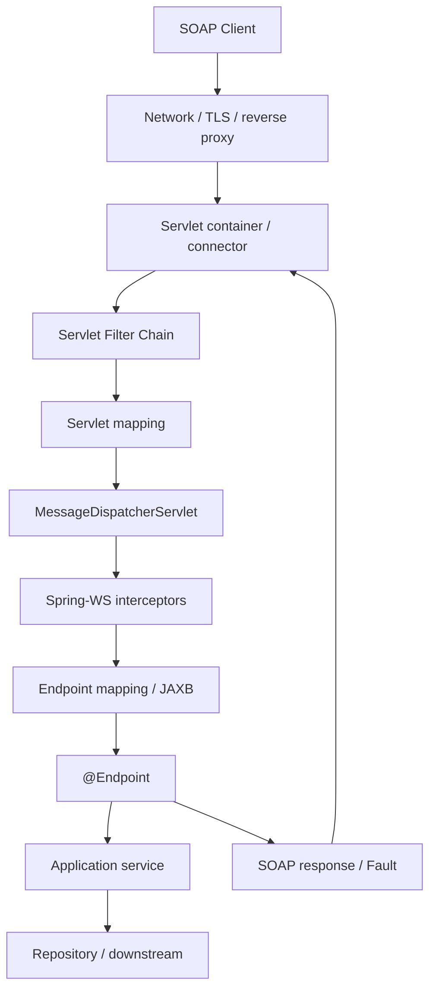

# Giới hạn của mock khi chưa đi qua HTTP server và bộ lọc thật

Một test dùng MockWebServiceClient gửi SOAP request tới Spring-WS dispatcher có thể xác nhận endpoint mapping, JAXB conversion và SOAP Fault. Nhưng request ấy thường **không đi qua mạng HTTP, servlet container và toàn bộ Spring Security FilterChain như một client thực**. Vì vậy, test pass không chứng minh URL endpoint đã map đúng, HTTP authentication đã chạy, CSRF policy hợp lý, mTLS/TLS hoạt động, proxy header được xử lý an toàn hoặc response status/media type đúng trên wire.

Mock không phải công cụ kém; nó cô lập đúng một lớp để kiểm hành vi nhanh. Vấn đề xuất hiện khi kết quả ở lớp mock bị diễn giải rộng hơn phạm vi mà test thực sự chạy.

Bài thuộc chương **Kiểm thử máy chủ** của module **SPRING_WEB_SERVICES**. Module học SOAP contract-first với Spring Web Services, thiết kế XSD/WSDL, ánh xạ JAXB, xây endpoint và SOAP client, xử lý SOAP Fault, interceptor, XML security, WS-Security, chứng chỉ và kiểm thử tương thích. Bài này làm rõ ranh giới giữa **mock message dispatcher** và **HTTP/server integration thực**, bao gồm servlet mapping, filter chain, authentication, transport, TLS, proxy và cách viết test đi qua server.

Ví dụ dùng Java 17+, JUnit 5, Spring Boot 3, Spring Security 6 và Spring-WS Test. API test client cụ thể có thể khác theo phiên bản; code minh họa cần điều chỉnh theo dependency thực tế.

## 1. Một SOAP request đi qua những lớp nào?



Không phải ứng dụng nào cũng có từng thành phần tách biệt (gateway có thể terminate TLS, transport có thể là JMS), nhưng sơ đồ giúp xác định ranh giới test.

| Lớp | Ví dụ trách nhiệm | MockWebServiceClient tự kiểm? |
| --- | --- | --- |
| Network/TLS | TCP, TLS handshake, hostname, mTLS | Không |
| Reverse proxy/gateway | Public path, forwarded headers, stripping | Không |
| Servlet container | Context path, servlet registration, connector | Không |
| Servlet filters | Spring Security, CORS, tracing, request limits | Thông thường không |
| Servlet mapping | URL tới MessageDispatcherServlet | Không nếu gọi trực tiếp dispatcher |
| Spring-WS dispatcher | Message dispatch, endpoint adapter | Có |
| Spring-WS interceptors | Interceptors trong test context | Có trong phạm vi context |
| JAXB/MessageFactory | Parse/marshal SOAP message | Có nếu test dùng đúng cấu hình |
| Business service | Quy tắc nghiệp vụ | Chỉ nếu test gọi service thật |

**Kết quả test chỉ có giá trị trong phạm vi những lớp thực sự được thực thi.**

## 2. MockWebServiceClient, MockWebServiceServer và HTTP integration test

### 2.1. MockWebServiceClient

Spring-WS Test cung cấp MockWebServiceClient để gửi message tới Spring-WS MessageDispatcher trong một Spring ApplicationContext. Nó phù hợp để kiểm:

- Endpoint mapping theo payload QName/SOAP Action.
- Unmarshal SOAP Body vào JAXB request.
- Endpoint gọi application service với input đã chuyển đổi.
- Spring-WS interceptors được đăng ký trong test context.
- Schema validation và SOAP Fault mapping trong pipeline được test.
- SOAP response có payload/Header theo contract.

Nó không tự chứng minh HTTP server hoặc servlet FilterChain thực tế đã nhận request.

### 2.2. MockWebServiceServer

MockWebServiceServer chủ yếu dùng phía **SOAP client** để kỳ vọng request mà WebServiceTemplate gửi và trả response giả. Nó hữu ích cho client adapter, nhưng không phải server HTTP integration test và không kiểm Spring Security server-side.

### 2.3. HTTP integration test

HTTP integration test khởi động ứng dụng với server thật trong test process (thường dùng random port), rồi dùng HTTP client gửi SOAP Envelope qua URL được công bố. Nó có thể kiểm:

- Servlet mapping/context path.
- Servlet filter chain và Spring Security.
- HTTP authentication/authorization.
- HTTP status, response headers, Content-Type và SOAP Envelope trên wire.
- MessageDispatcherServlet và endpoint trong ứng dụng đã khởi động.
- TLS/mTLS nếu test setup thực sự bật HTTPS và có test certificates.

Nó vẫn chưa tự động kiểm proxy production, firewall hoặc certificate chain production nếu các thành phần đó không nằm trong test environment.

### 2.4. Chọn đúng công cụ

| Câu hỏi | Công cụ |
| --- | --- |
| Endpoint nhận đúng QName? | MockWebServiceClient |
| JAXB mapping đúng? | JAXB unit test + endpoint test |
| Header/interceptor xử lý đúng? | MockWebServiceClient trong context có interceptor |
| POST tới /ws/orders có tới servlet? | HTTP integration test |
| Thiếu Bearer token có bị từ chối? | HTTP integration test |
| JWT decoder xác minh signature/issuer? | HTTP test với signed JWT fixture và decoder |
| HTTP 401/403/status/header đúng? | HTTP integration test |
| TLS hostname/mTLS handshake? | HTTPS integration test với test PKI |
| Proxy strip header giả mạo? | Gateway/proxy integration test |
| WSS4J kiểm XML Signature? | WS-Security test với key/cert fixture; thêm HTTP test để kiểm pipeline |

## 3. Vì sao MockWebServiceClient có thể cho “xanh giả”?

Giả sử ứng dụng có MessageDispatcherServlet map tại /ws/*, Spring Security yêu cầu Bearer JWT, endpoint GetOrder dùng @PayloadRoot và WSS4J interceptor xác minh signature. MockWebServiceClient có thể gửi payload trực tiếp tới dispatcher. Nếu endpoint trả đúng response, test đã xác minh một phần Spring-WS pipeline. Nhưng nó có thể chưa hề:

1. POST HTTP tới /ws/orders.
2. Đi qua servlet registration và URL mapping.
3. Chạy DelegatingFilterProxy và Spring Security filters.
4. Kiểm Authorization header/JWT decoder.
5. Kiểm Content-Type, SOAPAction, HTTP status và transport error.
6. Chạy TLS handshake hoặc kiểm client certificate.
7. Đi qua reverse proxy/gateway giống production.

Do đó, mock test pass nhưng ứng dụng vẫn có thể trả 404 do servlet mapping, 401 do security config, 415 do media type hoặc TLS handshake fail trước khi có SOAP message.

## 4. HTTP integration test với random port

Với Spring Boot, có thể khởi động ứng dụng trên cổng ngẫu nhiên:

```java
import org.junit.jupiter.api.Test;
import org.springframework.beans.factory.annotation.Autowired;
import org.springframework.boot.test.context.SpringBootTest;
import org.springframework.boot.test.web.server.LocalServerPort;
import org.springframework.boot.test.web.client.TestRestTemplate;
import org.springframework.http.HttpEntity;
import org.springframework.http.HttpHeaders;
import org.springframework.http.HttpMethod;
import org.springframework.http.ResponseEntity;

import static org.junit.jupiter.api.Assertions.*;

@SpringBootTest(
        webEnvironment = SpringBootTest.WebEnvironment.RANDOM_PORT)
class SoapHttpIntegrationTest {
    @LocalServerPort
    int port;

    @Autowired
    TestRestTemplate http;

    @Test
    void reachesPublishedSoapUrl() {
        String envelope = """
                <?xml version="1.0" encoding="UTF-8"?>
                <s:Envelope
                    xmlns:s="http://schemas.xmlsoap.org/soap/envelope/"
                    xmlns:o="https://example.org/orders/v1">
                    <s:Body>
                        <o:GetOrderRequest>
                            <o:orderId>ORD-1001</o:orderId>
                        </o:GetOrderRequest>
                    </s:Body>
                </s:Envelope>
                """;
        HttpHeaders headers = new HttpHeaders();
        headers.set("Content-Type", "text/xml; charset=UTF-8");
        headers.set("SOAPAction", "\"urn:example:orders:GetOrder\"");

        ResponseEntity<String> response = http.exchange(
                "http://localhost:" + port + "/ws/orders",
                HttpMethod.POST,
                new HttpEntity<>(envelope, headers),
                String.class);

        assertEquals(200, response.getStatusCode().value());
        assertNotNull(response.getBody());
        assertTrue(response.getBody().contains("GetOrderResponse"));
    }
}
```

Đây là cấu trúc minh họa. Ứng dụng phải map MessageDispatcherServlet tại /ws/* và endpoint address đúng /ws/orders. SOAP 1.1 thường sử dụng text/xml và SOAPAction theo binding; SOAP 1.2 thường sử dụng application/soap+xml với action parameter. Không dùng cùng headers cho cả hai version mà không xét contract.

TestRestTemplate có error handling phụ thuộc phiên bản/cấu hình. Với 4xx/5xx, hãy kiểm response status/body rõ ràng thay vì giả định mọi lỗi đều ném exception. Có thể dùng RestClient, WebClient hoặc Java HttpClient để kiểm chi tiết wire.

## 5. Kiểm servlet mapping, Content-Type và WSDL path

| Request | Kỳ vọng |
| --- | --- |
| POST đúng path + SOAP 1.1 media type | Vào MessageDispatcherServlet |
| POST đúng path + SOAP 1.2 media type | Vào endpoint SOAP 1.2 nếu binding hỗ trợ |
| POST sai path | 404 hoặc handler khác |
| POST đúng path nhưng media type không hỗ trợ | 415/protocol error theo stack |
| GET WSDL trên public path | Trả WSDL nếu publish và policy cho phép |
| POST vào WSDL URL | Không mặc định là SOAP endpoint |
| Envelope malformed | Parse/protocol error ở tầng phù hợp |

Kiểm cả HTTP status, Content-Type/charset, SOAP version, Fault, SOAPAction/Action, URL public và context path. 404 WSDL có thể do servlet mapping/publication path; 415 có thể do Content-Type trước endpoint dispatch, không nhất thiết là lỗi JAXB/business validation.

## 6. Kiểm Spring Security FilterChain thật

Spring Security servlet integration thường đặt security filters qua DelegatingFilterProxy. Khi HTTP request đi qua servlet container, FilterChainProxy chọn SecurityFilterChain, thực thi authentication/authorization và thiết lập SecurityContext.

MockWebServiceClient gọi dispatcher ở test abstraction nên không chứng minh cơ chế HTTP này. Muốn xác minh filter chain, phải gửi request HTTP tới ứng dụng đã khởi động.

### 6.1. Request không có credential

Nếu endpoint yêu cầu Bearer token, HTTP test không gửi Authorization và kỳ vọng 401:

```java
@Test
void rejectsRequestWithoutBearerToken() {
    ResponseEntity<String> response = http.exchange(
            soapUrl(),
            HttpMethod.POST,
            new HttpEntity<>(validSoapEnvelope(), soapHeaders()),
            String.class);

    assertEquals(401, response.getStatusCode().value());
}
```

soapUrl(), validSoapEnvelope() và soapHeaders() là test helpers. Request XML hợp lệ nhưng thiếu token phải bị từ chối trước endpoint nếu policy yêu cầu HTTP authentication.

Trong test context, có thể inject một spy/mock application service để kiểm tra request không lọt xuống business layer:

```java
import static org.mockito.Mockito.verifyNoInteractions;
import org.springframework.boot.test.mock.mockito.SpyBean;

@SpyBean
OrderQueryService orderQueryService;

@Test
void unauthenticatedHttpRequestNeverInvokesBusinessService() {
    ResponseEntity<String> response = http.exchange(
            soapUrl(),
            HttpMethod.POST,
            new HttpEntity<>(validSoapEnvelope(), soapHeaders()),
            String.class);

    assertEquals(401, response.getStatusCode().value());
    verifyNoInteractions(orderQueryService);
}
```

Đây là fragment; @SpyBean đã bị deprecated trong một số dòng Spring Boot mới và có thể được thay bằng @MockitoSpyBean theo version. Nếu test context có startup/background calls, cần reset spy hoặc giới hạn assertion vào method cụ thể. Điều cần chứng minh là **request không xác thực không gọi business operation**, không phải mọi bean trong context tuyệt đối không được tương tác.

### 6.2. Token đúng, token sai và quyền thiếu

Resource Server test nên dùng test signing key và JwtDecoder theo issuer/audience/lifetime policy. Kiểm:

- Token signature, issuer, audience và lifetime hợp lệ.
- Token thiếu, sai signature, hết hạn hoặc chưa có hiệu lực.
- Issuer không được tin.
- Audience không dành cho SOAP API.
- Token đúng nhưng thiếu scope.
- Token có scope nhưng partner/tenant không được truy cập resource.

Không dùng JWT production hoặc private signing key production trong test. Spring Security Test có thể tạo mock JWT để kiểm authorization, nhưng mock JWT không chứng minh signature/issuer/JWK decoding.

| Fixture | Chứng minh | Không chứng minh |
| --- | --- | --- |
| Mock JWT/principal | Authorization logic với claims giả lập | Chữ ký JWT, issuer/JWK retrieval |
| JWT ký test key + decoder thực | Decoder, signature và validators trong test config | IdP production/key rotation nếu không tích hợp |
| Token IdP staging | Interoperability staging | Mọi cấu hình production chưa được test |

### 6.3. Access denied

Principal hợp lệ nhưng thiếu authority có thể bị từ chối ở filter layer hoặc method security tùy thiết kế. Nếu policy nằm trong service và exception được mapping thành SOAP Fault, test phải xác định contract thực tế là HTTP 403 hay SOAP Fault trong HTTP response. Không ép mọi ứng dụng dùng một kiểu; điều cần kiểm là behavior nhất quán và được tài liệu hóa.

## 7. CSRF, CORS và session policy là vấn đề HTTP

SOAP endpoint không tự động miễn servlet security:

| Credential | CSRF concern |
| --- | --- |
| Bearer token trong Authorization do client chủ động gắn, không tự gửi bởi browser | Threat model khác cookie; cấu hình theo cách credential được gửi |
| Cookie/session tự động gửi bởi browser | Có CSRF risk nếu browser gửi cross-site |
| mTLS client certificate | Không tự loại trừ mọi browser CSRF scenario |
| WS-Security token | Xét cách token được cấp và browser có tự động gửi credential không |

Không vô hiệu CSRF toàn cục chỉ vì URL kết thúc bằng /soap. Nếu endpoint dùng cookie/session hoặc browser tự động gửi credential, cần CSRF protection phù hợp.

CORS chỉ điều khiển browser cross-origin policy; nó không phải authentication/authorization. Nếu browser SOAP client là use case, test OPTIONS/preflight và response headers; curl/Java HTTP client thành công không chứng minh CORS đúng.

## 8. TLS/mTLS: mock message không có handshake

MockWebServiceClient không mở TCP/TLS connection, nên không thể xác nhận server certificate chain/validity, hostname/SAN, TLS protocol/cipher policy, client certificate mTLS, truststore thực tế hoặc reverse proxy TLS termination.

Để kiểm mTLS, cần HTTPS server/container yêu cầu client certificate, test client có test keystore và truststore chứa test CA/certificate. Test certificate không trusted, hết hạn, sai clientAuth EKU nếu policy yêu cầu và client hợp lệ.

Nếu TLS terminate ở gateway production, test HTTPS local không chứng minh gateway configuration. Cần gateway integration/staging test hoặc test boundary tương đương trong environment kiểm thử.

## 9. Reverse proxy và forwarded headers

Ứng dụng sau proxy có thể dùng Forwarded/X-Forwarded-* để tái tạo public scheme/host/client address. Mock dispatcher không test:

- Proxy có strip Header giả do client gửi không.
- Proxy có tạo forwarded headers từ nguồn đáng tin không.
- Backend có thể bị gọi trực tiếp bỏ qua proxy không.
- Host/scheme dùng khi tạo WSDL/public URL có đúng không.
- TLS identity assertion từ gateway có được bảo vệ và verify không.

Nếu dùng X-Verified-Client/X-Forwarded-User làm identity, gateway phải strip input cùng tên từ Internet, tự tạo assertion, bảo vệ channel tới backend và backend chỉ nhận từ proxy tin cậy. Không coi tên Header là bằng chứng xác thực.

## 10. Tách HTTP helpers và kiểm side effects

HTTP test có thể gom helper tạo request:

```java
private String soapUrl() {
    return "http://localhost:" + port + "/ws/orders";
}

private HttpHeaders soapHeaders() {
    HttpHeaders headers = new HttpHeaders();
    headers.set("Content-Type", "text/xml; charset=UTF-8");
    headers.set("SOAPAction", "\"urn:example:orders:GetOrder\"");
    return headers;
}

private String validSoapEnvelope() {
    return """
            <?xml version="1.0" encoding="UTF-8"?>
            <s:Envelope
                xmlns:s="http://schemas.xmlsoap.org/soap/envelope/"
                xmlns:o="https://example.org/orders/v1">
                <s:Body>
                    <o:GetOrderRequest>
                        <o:orderId>ORD-1001</o:orderId>
                    </o:GetOrderRequest>
                </s:Body>
            </s:Envelope>
            """;
}
```

Khi gửi authenticated request, gắn token theo resource-server test setup. Test không chỉ kiểm 401 mà còn kiểm service/repository không bị gọi và không có side effect khi credential thiếu/sai.

Với endpoint dùng WS-Security thay HTTP Bearer, test gửi signed SOAP Envelope qua HTTP server thật để chứng minh MessageDispatcher và security interceptor được nối đúng application pipeline.

## 11. Phân biệt HTTP error, SOAP Fault và transport failure

| Tầng | Ví dụ | Kết quả có thể thấy |
| --- | --- | --- |
| DNS/TCP | Host không resolve, connection refused | Transport exception |
| TLS | Certificate/hostname/mTLS fail | SSLHandshakeException |
| Proxy/gateway | 404/413/429/502 | HTTP response, có thể không phải SOAP |
| Spring Security filter | Token thiếu/sai | HTTP 401/403, có thể không có SOAP Envelope |
| Servlet mapping | Sai URL | HTTP 404 |
| MessageFactory/parser | Envelope malformed | Protocol fault/HTTP error tùy stack |
| Spring-WS interceptor | Signature/schema/role fail | SOAP Fault theo cấu hình |
| Endpoint/application | Domain rule reject | SOAP Fault/business response theo contract |

Client không nên assume mọi response body là SOAP XML. Kiểm status và Content-Type trước khi parse; HTTP error body không phải SOAP cần được xử lý ở transport layer.

## 12. SOAP 1.1 và SOAP 1.2

| Nội dung | SOAP 1.1 | SOAP 1.2 |
| --- | --- | --- |
| Envelope namespace | http://schemas.xmlsoap.org/soap/envelope/ | http://www.w3.org/2003/05/soap-envelope |
| HTTP media type thường dùng | text/xml | application/soap+xml |
| Action | SOAPAction header theo binding | Action parameter/content-type theo binding |
| Fault structure | faultcode/faultstring/detail | Code/Subcode/Reason/Detail |

Một test dispatcher có thể dùng message factory version tương ứng; HTTP test phải gửi đúng media type/header. Không gửi SOAP 1.1 Envelope với media type SOAP 1.2 rồi kết luận JAXB mapping sai nếu protocol parsing thất bại trước.

## 13. MessageDispatcherServlet và test context

HTTP integration test cần nạp đúng các cấu hình ứng dụng sử dụng:

- @EnableWs và WS configuration.
- MessageDispatcherServlet registration/mapping.
- Endpoint beans và endpoint mappings.
- Jaxb2Marshaller hoặc marshaller/unmarshaller tương ứng.
- XSD schema validation/interceptors.
- WSS4J/security interceptors trong test profile.
- Exception resolvers và SOAP Fault mapping.
- Spring Security FilterChain.

Tránh test configuration tối giản vô tình bỏ interceptor/filter rồi gọi đó là production integration test. Nếu profile test thay IdP/database, ghi rõ dependency được giả lập.

Có hai loại context hữu ích: **focused context test** chỉ nạp endpoint config/service mock để kiểm mapping nhanh; và **application HTTP integration test** khởi động servlet, filters, endpoint và adapter thật, thay dependency ngoài có kiểm soát. Không cần mọi test ở full HTTP level; chỉ ranh giới phụ thuộc HTTP mới cần.

## 14. Database, downstream và Testcontainers

HTTP integration test có thể nối test database/Testcontainers để kiểm transaction, repository query, tenant data scope, migration, lỗi database ánh xạ thành Fault và downstream timeout/retry.

Không gọi SOAP partner production trong suite thường. Dùng fake/container giả lập hoặc staging contract suite riêng. Nếu TLS trust/mTLS là ranh giới cần chứng minh, fake downstream không thay thế test certificate thực.

## 15. Ma trận test theo phạm vi

| Scenario | MockWebServiceClient | HTTP integration | TLS/proxy E2E |
| --- | --- | --- | --- |
| QName/endpoint mapping | Có | Có thể | Có thể |
| JAXB mapping | Có | Có | Có thể |
| Header/interceptor | Có | Có | Có thể |
| XSD validation/Fault | Có | Có | Có thể |
| Servlet URL mapping | Không | Có | Có |
| Spring Security FilterChain | Không tự kiểm | Có | Có |
| HTTP 401/403 | Không | Có | Có |
| Content-Type/SOAPAction | Giới hạn message context | Có | Có |
| TLS hostname verification | Không | Nếu HTTPS test server bật | Có |
| mTLS client cert | Không | Nếu server HTTPS được cấu hình | Có |
| Gateway strip spoofed headers | Không | Chỉ nếu có gateway | Có |
| WSS4J signature | Có thể với interceptor | Có nếu configured | Có |
| DNS/firewall/egress | Không | Chỉ khi test network thực | Có |
| Partner interoperability | Fixture/message | Có thể | Tốt nhất staging/partner suite |

## 16. Những lỗi diễn giải kết quả mock

| Nhận định | Vì sao sai | Test cần bổ sung |
| --- | --- | --- |
| MockWebServiceClient pass nên URL /ws đúng | Không kiểm servlet mapping | HTTP POST random port |
| Endpoint test pass nên JWT đã verify | Có thể không chạy FilterChain | HTTP test signed token |
| Mock JWT pass nên issuer tin cậy | Không xác minh signature/JWK | Signed JWT + decoder |
| SOAP Fault test pass nên HTTP status đúng | Fault và status có thể khác | Kiểm status/content type trên wire |
| TLS test bằng mock đã đủ | Không có handshake | HTTPS/mTLS integration |
| X-Forwarded-User đúng trong mock nên proxy an toàn | Không chạy proxy | Gateway integration |
| MockWebServiceServer chứng minh server authorization | Đây là client-side mock | Server endpoint/HTTP test |
| Test context chạy nên production wiring giống | Có thể bỏ filter/interceptor/profile | Application integration theo cấu hình gần thật |

## 17. Thiết kế test suite hiệu quả

1. Dùng nhiều business unit tests cho logic thuần và edge cases.
2. Dùng endpoint tests cho mapping, JAXB, Header, interceptor và Fault.
3. Dùng một số HTTP integration tests cho servlet URL, filter chain, status, content type và security boundary.
4. Dùng TLS/mTLS/proxy tests cho deployment boundary mà code local không chứng minh.
5. Dùng contract/interoperability tests cho partner-specific SOAP/WSDL/WS-* variation.

Giữ fixture nhỏ, deterministic; mock đúng dependency ngoài; không chia sẻ mutable state; dùng test certificate riêng; không phụ thuộc mạng production. Nếu HTTP integration tests chậm, tối ưu số ca/context reuse thay vì xóa toàn bộ lớp xác minh.

## 18. Bài tập tự kiểm tra

**Câu 1.** MockWebServiceClient gửi payload qua dispatcher thành công. Có chứng minh servlet mapping /ws/orders đúng?

**Đáp án:** Không. Cần khởi động HTTP server và POST tới URL thực.

**Câu 2.** Vì sao MockWebServiceClient thường không kiểm Spring Security FilterChain?

**Đáp án:** Nó gửi message ở mức dispatcher/test abstraction, thường không qua servlet container và DelegatingFilterProxy như HTTP request thật.

**Câu 3.** Test dùng mock Jwt và trả 200 có chứng minh JWT signature được verify?

**Đáp án:** Không. MockJwt giả lập principal; cần signed token test key qua decoder thực.

**Câu 4.** MockWebServiceServer dùng kiểm lớp nào?

**Đáp án:** Chủ yếu kiểm outbound SOAP client/WebServiceTemplate request-response, không kiểm server-side filter chain.

**Câu 5.** Endpoint trả SOAP Fault đúng trong mock nhưng HTTP client nhận 401. Có mâu thuẫn?

**Đáp án:** Không. HTTP security filter có thể chặn trước SOAP dispatcher.

**Câu 6.** Làm sao chứng minh Content-Type SOAP 1.1 được xử lý đúng?

**Đáp án:** Gửi HTTP request thật với media type/SOAPAction theo binding và kiểm status/body/headers.

**Câu 7.** HTTPS local pass có chứng minh production gateway mTLS đúng?

**Đáp án:** Không. Gateway là boundary riêng; cần gateway/staging test.

**Câu 8.** Java HTTP client thành công có chứng minh CORS đúng?

**Đáp án:** Không. CORS do browser enforce; cần test OPTIONS/preflight/response headers và có thể browser test.

**Câu 9.** HTTP test trả 200 nhưng service không nên được gọi khi thiếu token. Cần assert gì thêm?

**Đáp án:** Kiểm service/repository không bị gọi và không có side effect.

**Câu 10.** Có nên chuyển mọi business edge case thành HTTP integration test?

**Đáp án:** Không. Chọn tầng nhỏ nhất đủ chứng minh; HTTP test dành cho behavior phụ thuộc servlet/filter/transport.

**Câu 11.** SOAP 1.2 Envelope gửi với text/xml bị lỗi. Có thể kết luận JAXB sai?

**Đáp án:** Không. Protocol/media type có thể fail trước JAXB.

**Câu 12.** Vì sao test context phải nạp đúng interceptor và filter?

**Đáp án:** Nếu bỏ chúng, test pass không chứng minh pipeline production có các bảo vệ đó.

## Ghi nhớ

- **MockWebServiceClient kiểm Spring-WS dispatcher**, không tự kiểm HTTP server, servlet mapping hoặc servlet filter chain.
- **MockWebServiceServer kiểm phía SOAP client**, không chứng minh server-side authentication/authorization.
- Muốn kiểm **Spring Security FilterChain**, gửi HTTP request tới ứng dụng khởi động thật; kiểm status, principal, side effects và response.
- Mock JWT kiểm authorization với principal giả; signed test JWT qua decoder mới kiểm signature/issuer/audience trong test config.
- **TLS/mTLS, proxy, forwarded headers, DNS và egress** cần integration test đúng boundary; mock dispatcher không có network handshake.
- Kiểm SOAP 1.1/1.2 đúng Envelope namespace, media type và action binding; phân biệt protocol error với JAXB/business error.
- Test context phải nạp đúng servlet, filter, endpoint, interceptor và Fault resolver; ghi rõ dependency nào được giả lập.
- Chọn tầng test nhỏ nhất đủ chứng minh hành vi, bổ sung HTTP/TLS tests cho bảo đảm phụ thuộc transport thật.
