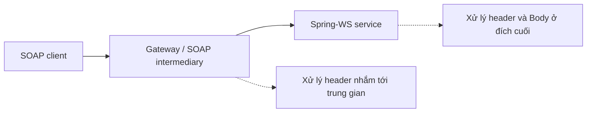
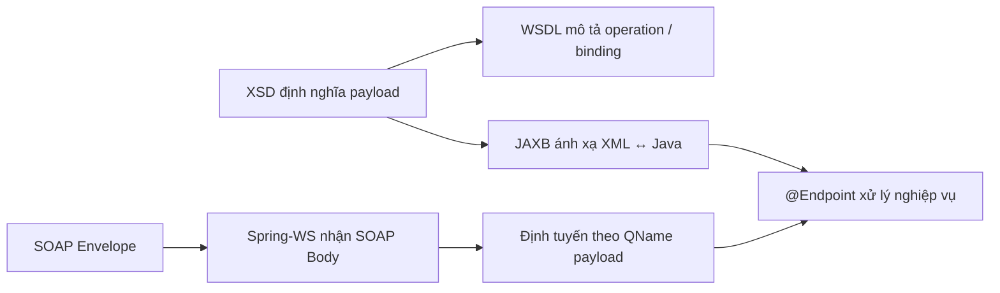
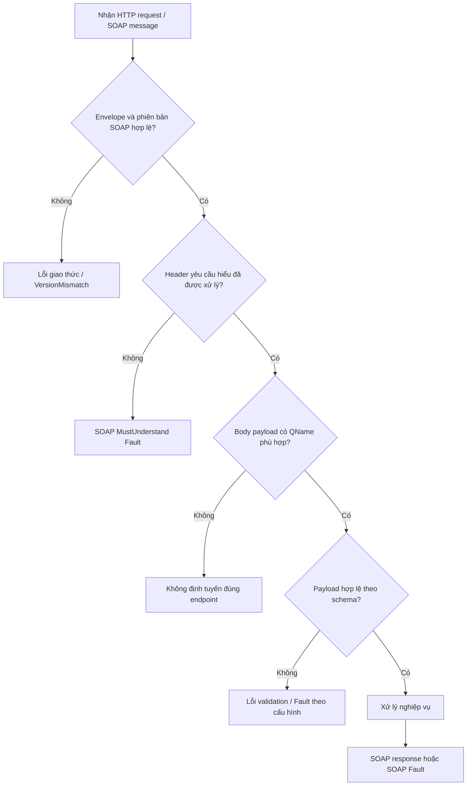

# SOAP Envelope, Header, Body và vai trò của từng thành phần

## 1. Bức tranh tổng thể: một thông điệp SOAP gồm những gì?

**SOAP (Simple Object Access Protocol)** là giao thức trao đổi thông điệp dựa trên XML. SOAP xác định cấu trúc thông điệp, cách các nút xử lý phần mở rộng của thông điệp và cách biểu diễn lỗi. SOAP thường được truyền qua HTTP/HTTPS trong hệ thống doanh nghiệp, nhưng mô hình thông điệp của SOAP **không đồng nhất với HTTP** và có thể dùng các cơ chế truyền tải khác.

Trong **Spring Web Services (Spring-WS)**, hiểu cấu trúc SOAP là điều kiện nền tảng để thiết kế dịch vụ **contract-first**: xây dựng dữ liệu bằng XSD, công bố hợp đồng WSDL, ánh xạ XML qua JAXB, xử lý bằng endpoint, gọi bằng SOAP client và kiểm thử tính tương thích. Các chủ đề mở rộng như SOAP Fault, interceptor, XML security, WS-Security, chứng chỉ và chính sách bảo mật cũng tác động lên những thành phần của thông điệp được giới thiệu ở đây.

Mỗi SOAP message có **một phần tử gốc `Envelope`**, trong đó có thể có `Header` và phải có `Body`:

```text
SOAP Envelope
├── SOAP Header (tùy chọn)
│   ├── Header block: định danh/định tuyến
│   ├── Header block: bảo mật
│   └── Header block: ngữ cảnh nghiệp vụ
└── SOAP Body (bắt buộc)
    ├── Payload: yêu cầu hoặc phản hồi nghiệp vụ
    └── hoặc SOAP Fault: thông tin lỗi theo cấu trúc SOAP
```

| Thành phần | Bắt buộc? | Chức năng chính | Ví dụ |
| --- | --- | --- | --- |
| **Envelope** | Có | Đánh dấu tài liệu là một thông điệp SOAP, thiết lập phiên bản SOAP bằng namespace và bao chứa các phần. | `env:Envelope` |
| **Header** | Không | Chứa những **header block** bổ sung để nút SOAP xử lý: định tuyến, xác thực, chữ ký, mã theo dõi, giao dịch… | `wsse:Security`, `wsa:Action`, `ctx:Tracking` |
| **Body** | Có | Chứa nội dung chính của thông điệp: payload yêu cầu/phản hồi hoặc cấu trúc `Fault` khi xảy ra lỗi. | `ord:GetOrderRequest`, `ord:GetOrderResponse` |
| **Fault** | Chỉ khi báo lỗi SOAP | Mô tả lỗi xử lý SOAP theo dạng được tiêu chuẩn hóa; nằm **bên trong Body**, không đứng ngang hàng với Header hoặc Body. | `env:Fault` |

> Một SOAP message có thể **không có `Header`**, nhưng **không được thiếu `Envelope` hoặc `Body`**. `Body` vẫn có thể không mang payload nghiệp vụ trong một số kịch bản; việc rỗng hay không phải phù hợp với hợp đồng và cách trao đổi thông điệp.

### Mục tiêu sau bài học

Bạn sẽ đọc được XML SOAP, giải thích trách nhiệm của `Envelope`/`Header`/`Body`, phân biệt SOAP Header với HTTP header, xác định header nào cần hiểu theo `mustUnderstand`, nhận diện SOAP Fault, và liên hệ đúng từng phần với mô hình lập trình Spring-WS.

## 2. Phân tích một thông điệp SOAP 1.1 hoàn chỉnh

Giả sử một ứng dụng đối tác gọi dịch vụ tra cứu đơn hàng `GetOrder`. Hai bên thống nhất namespace nghiệp vụ `https://example.com/orders/v1` và namespace metadata `https://example.com/context/v1`.

```xml
<?xml version="1.0" encoding="UTF-8"?>
<env:Envelope
    xmlns:env="http://schemas.xmlsoap.org/soap/envelope/"
    xmlns:ord="https://example.com/orders/v1"
    xmlns:ctx="https://example.com/context/v1">

    <env:Header>
        <ctx:Tracking env:mustUnderstand="0">
            <ctx:correlationId>req-2026-0007</ctx:correlationId>
        </ctx:Tracking>
    </env:Header>

    <env:Body>
        <ord:GetOrderRequest>
            <ord:orderId>ORD-2026-001</ord:orderId>
        </ord:GetOrderRequest>
    </env:Body>
</env:Envelope>
```

Đọc từ ngoài vào trong:

1. `env:Envelope` là phần tử gốc thuộc **namespace của SOAP 1.1**.
2. `env:Header` chứa `ctx:Tracking`, một header block do ứng dụng định nghĩa để chuyển mã tương quan nhằm truy vết yêu cầu.
3. `env:mustUnderstand="0"` cho biết nút nhận được header này **không bắt buộc** phải hiểu và xử lý nó theo cơ chế `mustUnderstand` của SOAP.
4. `env:Body` chứa `ord:GetOrderRequest`, là phần tử gốc của payload nghiệp vụ.
5. `ord:orderId` là dữ liệu cần xử lý. Các ràng buộc của nó được mô tả trong XSD nghiệp vụ và kiểm tra ở tầng schema hoặc nghiệp vụ.

**Điểm cốt lõi:** `env`, `ord`, `ctx` chỉ là **tiền tố** do người viết XML chọn. XML được xác định bằng cặp `{namespace URI}localName` (QName). Đổi `env` thành `soap`, hoặc `ord` thành `o`, không đổi ý nghĩa nếu URI namespace vẫn giữ nguyên. Ngược lại, đổi URI sẽ đổi tên định danh của phần tử.

Ví dụ hai cách ghi sau là tương đương về QName:

```xml
<ord:GetOrderRequest xmlns:ord="https://example.com/orders/v1"/>
<o:GetOrderRequest xmlns:o="https://example.com/orders/v1"/>
```

Nhưng cách ghi này **không tương đương**, vì namespace khác:

```xml
<ord:GetOrderRequest xmlns:ord="https://example.com/orders/v2"/>
```

## 3. Envelope: khung bên ngoài và định danh phiên bản SOAP

`Envelope` có ba trách nhiệm quan trọng:

- **Định danh SOAP:** Một thông điệp SOAP không chỉ là XML bất kỳ; phần tử gốc phải thuộc namespace SOAP tương ứng.
- **Tổ chức thông điệp:** Envelope bao chứa `Header` tùy chọn và `Body` bắt buộc, với `Header` đứng **trước** `Body` nếu hiện diện.
- **Tạo phạm vi xử lý:** Các vai trò (role/actor), cơ chế `mustUnderstand` và Fault được diễn giải theo mô hình xử lý SOAP của phiên bản tương ứng.

Ví dụ Envelope tối giản của SOAP 1.1:

```xml
<soap:Envelope xmlns:soap="http://schemas.xmlsoap.org/soap/envelope/">
    <soap:Body>
        <m:Ping xmlns:m="https://example.com/health/v1"/>
    </soap:Body>
</soap:Envelope>
```

`Envelope` không quy định sẵn phần tử `m:Ping` có nghĩa gì. Tầng nghiệp vụ hoặc hợp đồng WSDL/XSD mới xác định ý nghĩa, kiểu dữ liệu và thao tác xử lý của payload.

### 3.1. Namespace SOAP 1.1 và SOAP 1.2

Hai phiên bản SOAP quan trọng nhất trong tích hợp doanh nghiệp là **SOAP 1.1** và **SOAP 1.2**. Không thể chỉ đổi cách viết tiền tố để chuyển giữa hai phiên bản, vì **namespace, một số quy tắc xử lý và định dạng Fault khác nhau**.

| Thuộc tính | SOAP 1.1 | SOAP 1.2 |
| --- | --- | --- |
| Namespace của Envelope | `http://schemas.xmlsoap.org/soap/envelope/` | `http://www.w3.org/2003/05/soap-envelope` |
| HTTP `Content-Type` thường dùng | `text/xml; charset=utf-8` | `application/soap+xml; charset=utf-8` |
| Thuộc tính xác định đích header | `env:actor` | `env:role` |
| Yêu cầu hiểu header | `env:mustUnderstand="0"` hoặc `"1"` | `env:mustUnderstand="true"`/`"false"` hoặc `"1"`/`"0"` |
| Hỗ trợ chuyển tiếp header không xử lý | Không có thuộc tính `relay` như SOAP 1.2 | Có `env:relay` theo quy tắc SOAP 1.2 |
| Cấu trúc Fault | `faultcode`, `faultstring`, `faultactor`, `detail` | `Code`, `Reason`, `Node`, `Role`, `Detail` (có phần tùy chọn) |

Với SOAP 1.1 qua HTTP, header HTTP `SOAPAction` có vai trò riêng và nhiều tích hợp mong đợi giá trị cụ thể. Với SOAP 1.2, tham số `action` có thể nằm trong media type `application/soap+xml` khi được sử dụng; cách cấu hình phụ thuộc binding và hợp đồng. Không suy ra phiên bản chỉ từ tên endpoint `/ws` hay từ lớp Java.

Ví dụ SOAP 1.2 tương đương về ý định tra cứu đơn hàng:

```xml
<env:Envelope
    xmlns:env="http://www.w3.org/2003/05/soap-envelope"
    xmlns:ord="https://example.com/orders/v1">
    <env:Body>
        <ord:GetOrderRequest>
            <ord:orderId>ORD-2026-001</ord:orderId>
        </ord:GetOrderRequest>
    </env:Body>
</env:Envelope>
```

**Lỗi thường gặp:** gửi XML có namespace SOAP 1.2 nhưng HTTP `Content-Type: text/xml` theo SOAP 1.1; hoặc dùng SOAP 1.1 trong khi binding máy chủ chỉ hỗ trợ SOAP 1.2. Endpoint có thể từ chối thông điệp trước khi vào mã nghiệp vụ.

### 3.2. Thứ tự và tính hợp lệ của Envelope

SOAP quy định cấu trúc khung; ví dụ sau **sai** vì `Header` đặt sau `Body`:

```xml
<env:Envelope xmlns:env="http://schemas.xmlsoap.org/soap/envelope/">
    <env:Body/>
    <env:Header/>
</env:Envelope>
```

Ví dụ sau cũng **sai** vì thiếu `Body`:

```xml
<env:Envelope xmlns:env="http://schemas.xmlsoap.org/soap/envelope/">
    <env:Header/>
</env:Envelope>
```

Các kiểm tra cấu trúc này độc lập với việc payload nghiệp vụ có hợp lệ theo XSD của đơn hàng hay không.

## 4. Header: metadata và yêu cầu xử lý trên đường đi

`Header` là khu vực mở rộng của SOAP. Mỗi phần tử con trực tiếp của `env:Header` là một **header block**. Một thông điệp có thể chứa nhiều block, mỗi block có namespace riêng và chính sách xử lý riêng.

Các ví dụ header trong hệ thống doanh nghiệp:

| Nhóm | Dữ liệu thường gặp | Mục đích |
| --- | --- | --- |
| Truy vết | `correlationId`, `requestId` | Liên kết log và sự kiện của cùng một yêu cầu đi qua nhiều hệ thống. |
| Định tuyến | WS-Addressing `To`, `Action`, `MessageID`, `ReplyTo` | Cung cấp thông tin định tuyến/trao đổi thông điệp khi ứng dụng dùng WS-Addressing. |
| Bảo mật thông điệp | WS-Security `Security` với token, timestamp, chữ ký… | Mang dữ liệu an ninh ở tầng thông điệp khi cấu hình chính sách bảo mật thích hợp. |
| Điều phối | Mã giao dịch, bối cảnh tương tác | Truyền thông tin liên quan đến giao dịch hoặc luồng xử lý. |
| Nghiệp vụ liên hệ | Tenant, kênh bán hàng, locale | Bổ sung ngữ cảnh xử lý theo hợp đồng tích hợp. |

`Header` **không tự động bảo mật**. Một trường `Authentication` tùy ý trong header không tương đương cơ chế xác thực đáng tin cậy. Muốn xác thực hoặc bảo vệ nội dung, phải có quy tắc tin cậy, kiểm tra token/chữ ký/timestamp phù hợp, kiểm tra quyền truy cập và bảo vệ kênh truyền như TLS khi cần.

### 4.1. Header block và phần tử con

```xml
<env:Header xmlns:env="http://schemas.xmlsoap.org/soap/envelope/"
            xmlns:ctx="https://example.com/context/v1">
    <ctx:Tracking env:mustUnderstand="0">
        <ctx:correlationId>req-2026-0007</ctx:correlationId>
    </ctx:Tracking>
    <ctx:ClientContext>
        <ctx:channel>PARTNER_API</ctx:channel>
    </ctx:ClientContext>
</env:Header>
```

Trong ví dụ này, `ctx:Tracking` và `ctx:ClientContext` là **hai header block**; `ctx:correlationId` và `ctx:channel` chỉ là các phần tử con bên trong block. Các thuộc tính SOAP như `mustUnderstand`, `actor`/`role` được đặt trên **header block** cần điều khiển, không được hiểu là áp dụng tùy ý cho toàn bộ thông điệp.

### 4.2. `mustUnderstand`: khi nào không được bỏ qua header?

Thuộc tính `env:mustUnderstand` cho biết **nút SOAP được nhắm đến bởi header block** có bắt buộc hiểu và xử lý đúng phần mở rộng đó hay không.

```xml
<sec:Security env:mustUnderstand="1"
              xmlns:sec="http://docs.oasis-open.org/wss/2004/01/oasis-200401-wss-wssecurity-secext-1.0.xsd"
              xmlns:env="http://schemas.xmlsoap.org/soap/envelope/">
    <!-- Nội dung bảo mật được tạo bởi công cụ WS-Security -->
</sec:Security>
```

Với SOAP 1.1, `"1"` nghĩa là bắt buộc hiểu; `"0"` nghĩa là không bắt buộc. SOAP 1.2 cho phép cả dạng `true`/`false` lẫn `1`/`0`.

Quy tắc xử lý cốt lõi:

1. Nút SOAP xác định những header block **nhắm tới nó**.
2. Với block có `mustUnderstand=true`/`1`, nút đó phải hiểu và xử lý đúng ngữ nghĩa của block.
3. Nếu không thể hiểu hoặc không thể thực hiện quy tắc bắt buộc của header, nút phải phát sinh **SOAP Fault kiểu `MustUnderstand`** theo phiên bản SOAP đang dùng, thay vì lặng lẽ bỏ qua.
4. Với block không bắt buộc, việc xử lý hoặc bỏ qua được quyết định theo vai trò nút và chính sách của ứng dụng; không có nghĩa dữ liệu đó luôn vô hại.

**Lưu ý quan trọng:** `mustUnderstand` **không chứng minh** chữ ký hợp lệ, token đúng hay người gọi có quyền. Đây là quy tắc xử lý header ở tầng SOAP. Việc xác thực, xác minh chữ ký và chống phát lại do cơ chế bảo mật thực sự đảm trách.

### 4.3. `actor`/`role`: header gửi cho nút nào?

Một thông điệp SOAP có thể đi qua nhiều nút trung gian trước khi tới đích cuối. Mỗi nút có thể nhận trách nhiệm với một số header, trong khi payload ở `Body` thường dành cho **ultimate receiver** (nút nhận cuối).



**SOAP 1.1:** Dùng `env:actor` để nhắm header tới vai trò xử lý nhất định; có URI đặc biệt `http://schemas.xmlsoap.org/soap/actor/next` dành cho nút SOAP tiếp theo. Header không khai báo `actor` thường được hiểu là dành cho nút nhận cuối.

**SOAP 1.2:** Dùng `env:role`. Các role chuẩn gồm `next` (nút SOAP xử lý tiếp theo), `ultimateReceiver` (đích cuối) và `none` (không nhắm tới nút xử lý nào). Header không khai báo `role` mặc định nhắm tới ultimate receiver. SOAP 1.2 cũng có thuộc tính `relay` để kiểm soát trường hợp một header chưa được xử lý cần được chuyển tiếp qua trung gian theo các quy tắc cụ thể của giao thức.

Ví dụ SOAP 1.2 nhắm header tới nút SOAP tiếp theo:

```xml
<env:Header xmlns:env="http://www.w3.org/2003/05/soap-envelope"
            xmlns:ctx="https://example.com/context/v1">
    <ctx:HopInfo
        env:role="http://www.w3.org/2003/05/soap-envelope/role/next"
        env:mustUnderstand="false"
        env:relay="true">
        <ctx:traceId>trace-123</ctx:traceId>
    </ctx:HopInfo>
</env:Header>
```

`relay` là quy tắc chuyển tiếp của SOAP 1.2, không phải yêu cầu trung gian tự ý sao chép mọi header, và cũng không phải cơ chế thay thế cho bảo mật. Việc dùng trung gian trong thực tế cần tuân thủ chính sách định tuyến/bảo mật và các vai trò SOAP mà nút công bố hỗ trợ.

### 4.4. Phân biệt SOAP Header và HTTP header

Một yêu cầu gửi qua HTTPS có **hai lớp header độc lập**:

```http
POST /ws HTTP/1.1
Host: api.example.com
Content-Type: text/xml; charset=utf-8
SOAPAction: "https://example.com/orders/GetOrder"

<env:Envelope xmlns:env="http://schemas.xmlsoap.org/soap/envelope/">
  <env:Header>
    <!-- SOAP header blocks nằm trong nội dung XML -->
  </env:Header>
  <env:Body>
    <!-- XML payload nằm trong nội dung XML -->
  </env:Body>
</env:Envelope>
```

| Tiêu chí | HTTP header | SOAP Header |
| --- | --- | --- |
| Vị trí | Phần đầu thông điệp HTTP, nằm ngoài XML. | Nằm trong phần tử `Envelope` của XML SOAP. |
| Ví dụ | `Content-Type`, `Authorization`, `SOAPAction`. | `wsse:Security`, `wsa:Action`, `ctx:Tracking`. |
| Quy tắc xử lý | Theo HTTP, giao thức truyền tải và cấu hình máy chủ. | Theo phiên bản SOAP, vai trò header, `mustUnderstand` và các phần mở rộng. |
| Liên hệ WSDL | Có thể được ràng buộc bởi SOAP/HTTP binding và chính sách tích hợp. | Có thể được mô tả trong binding/chính sách và schema của header. |

**Không nhầm `SOAPAction` của HTTP với phần tử `wsa:Action` của WS-Addressing**: hai cơ chế có thể liên quan theo quy định của hệ thống nhưng không phải cùng một trường hay luôn có cùng giá trị.

## 5. Body: nơi đặt payload yêu cầu, phản hồi hoặc Fault

Trong mô hình document/literal phổ biến của SOAP doanh nghiệp, `Body` mang một phần tử XML nghiệp vụ gốc, kèm các phần tử con được mô tả bằng XSD.

Ví dụ request:

```xml
<env:Body xmlns:env="http://schemas.xmlsoap.org/soap/envelope/"
          xmlns:ord="https://example.com/orders/v1">
    <ord:GetOrderRequest>
        <ord:orderId>ORD-2026-001</ord:orderId>
    </ord:GetOrderRequest>
</env:Body>
```

Ví dụ response:

```xml
<env:Body xmlns:env="http://schemas.xmlsoap.org/soap/envelope/"
          xmlns:ord="https://example.com/orders/v1">
    <ord:GetOrderResponse>
        <ord:orderId>ORD-2026-001</ord:orderId>
        <ord:status>CONFIRMED</ord:status>
    </ord:GetOrderResponse>
</env:Body>
```

Điểm cần phân biệt:

- `env:Body` thuộc **namespace SOAP**; `ord:GetOrderRequest` thuộc **namespace nghiệp vụ**.
- `Body` không nhất thiết chứa tên phương thức Java. Trong Spring-WS, endpoint thường được chọn dựa trên **QName của phần tử payload**.
- XML payload phải thỏa mãn hợp đồng XSD: tên phần tử, namespace, kiểu dữ liệu, thứ tự `xs:sequence` và tính bắt buộc/tùy chọn của trường.
- SOAP cho phép những kiểu trao đổi thông điệp khác nhau; ví dụ một chiều (one-way) không đòi hỏi phản hồi nghiệp vụ trong mọi trường hợp. Không mặc định mọi `Body` đều có cặp request–response.
- XSD cho biết **hình dạng** dữ liệu; hành vi nghiệp vụ, quyền truy cập và tác dụng phụ của thao tác vẫn do ứng dụng thực thi.

### 5.1. SOAP Body không nhất thiết là RPC

SOAP từng được sử dụng cho các kiểu biểu diễn dựa trên RPC, nhưng **SOAP không bắt buộc mô hình RPC**. Trong dịch vụ **document/literal**, phần tử của Body đại diện một tài liệu/thông điệp nghiệp vụ đã thống nhất. `GetOrderRequest` là tên phần tử XML trong hợp đồng, không có yêu cầu phải bằng tên phương thức Java xử lý nó.

Ở hướng **contract-first**, trình tự phù hợp với Spring-WS thường là:



WSDL mô tả cách phía khách gọi và trao đổi thông điệp; XSD mô tả phần tử payload và kiểu dữ liệu. `Envelope` là lớp giao thức bao ngoài những dữ liệu đó.

### 5.2. Header có thể thay đổi mà Body vẫn giữ nguyên

Hai ứng dụng có thể gửi cùng `GetOrderRequest` trong Body, nhưng sử dụng cách truy vết hoặc chính sách bảo mật khác nhau ở Header. Điều này giúp giữ payload nghiệp vụ ổn định trong khi bổ sung những thông tin xuyên suốt hệ thống.

Tuy nhiên, nếu một header **bắt buộc theo hợp đồng tích hợp** mà phía client không gửi, dịch vụ vẫn có thể từ chối xử lý dù Body hợp lệ theo XSD. Các ràng buộc này có thể được mô tả bằng WSDL, WS-Policy hoặc tài liệu tích hợp bổ sung, tùy hệ thống.

## 6. SOAP Fault nằm ở đâu và để làm gì?

Khi xử lý thông điệp gặp lỗi, SOAP định nghĩa phần tử `Fault` **bên trong Body**. Fault thường thay cho payload phản hồi nghiệp vụ bình thường, cung cấp mã lỗi, diễn giải và thông tin chi tiết khi được phép.

Ví dụ lỗi theo **SOAP 1.1**:

```xml
<env:Envelope
    xmlns:env="http://schemas.xmlsoap.org/soap/envelope/"
    xmlns:err="https://example.com/errors/v1">
    <env:Body>
        <env:Fault>
            <faultcode>env:Client</faultcode>
            <faultstring xml:lang="vi">Yêu cầu không hợp lệ</faultstring>
            <detail>
                <err:ValidationError>
                    <err:field>orderId</err:field>
                    <err:message>Không được để trống</err:message>
                </err:ValidationError>
            </detail>
        </env:Fault>
    </env:Body>
</env:Envelope>
```

- `faultcode` cho biết nhóm lỗi; SOAP 1.1 thường có các mã cơ bản như `Client`, `Server`, `MustUnderstand`, `VersionMismatch`.
- `faultstring` cung cấp diễn giải dễ đọc.
- `faultactor` (khi có) chỉ ra nút phát sinh Fault theo cơ chế SOAP 1.1.
- `detail` (khi có) mang dữ liệu chi tiết liên quan lỗi xử lý Body, ví dụ mã lỗi nghiệp vụ có namespace riêng.

Với **SOAP 1.2**, hình dạng Fault **khác**, không dùng `faultcode`/`faultstring` như SOAP 1.1:

```xml
<env:Envelope
    xmlns:env="http://www.w3.org/2003/05/soap-envelope">
    <env:Body>
        <env:Fault>
            <env:Code>
                <env:Value>env:Sender</env:Value>
            </env:Code>
            <env:Reason>
                <env:Text xml:lang="vi">Yêu cầu không hợp lệ</env:Text>
            </env:Reason>
        </env:Fault>
    </env:Body>
</env:Envelope>
```

SOAP 1.2 còn cho phép các phần thông tin như `Subcode`, `Node`, `Role`, `Detail` theo ngữ cảnh. Mã lỗi phía gửi là `Sender`; phía xử lý là `Receiver`; các nhóm khác gồm `MustUnderstand`, `VersionMismatch`, `DataEncodingUnknown`.

**Một số lỗi SOAP xảy ra trước khi gọi endpoint.** Ví dụ sai namespace của Envelope có thể gây `VersionMismatch`; header có `mustUnderstand=1` mà nút nhận không hỗ trợ có thể gây `MustUnderstand`. Một `orderId` không tồn tại lại thường là lỗi nghiệp vụ cần được ánh xạ nhất quán thành SOAP Fault hoặc phản hồi nghiệp vụ theo hợp đồng.

Đừng suy ra thành công hay thất bại chỉ từ HTTP status: khi tích hợp SOAP qua HTTP phải kiểm tra cả **HTTP status, loại SOAP message và nội dung Body/Fault** theo binding và chính sách thực tế. Không trả lộ stack trace, thông tin bí mật hoặc chi tiết nội bộ không cần thiết trong `detail`.

## 7. Spring-WS nhìn các thành phần của SOAP như thế nào?

Spring-WS xây dựng quanh ý tưởng **message-oriented** (xử lý theo thông điệp). Mã endpoint thường quan tâm trực tiếp tới phần tử payload của SOAP Body, trong khi thông tin Header được truy cập và kiểm tra riêng khi cần.

### 7.1. Định tuyến theo Body bằng `@PayloadRoot`

Giả sử `GetOrderRequest`/`GetOrderResponse` là các lớp được sinh từ XSD bằng JAXB, cấu hình marshalling đã được thiết lập và `OrderService` là dịch vụ nghiệp vụ do ứng dụng triển khai:

```java
import org.springframework.ws.server.endpoint.annotation.Endpoint;
import org.springframework.ws.server.endpoint.annotation.PayloadRoot;
import org.springframework.ws.server.endpoint.annotation.RequestPayload;
import org.springframework.ws.server.endpoint.annotation.ResponsePayload;

@Endpoint
public class OrderEndpoint {
    private static final String NS = "https://example.com/orders/v1";

    private final OrderService orderService;

    public OrderEndpoint(OrderService orderService) {
        this.orderService = orderService;
    }

    @PayloadRoot(namespace = NS, localPart = "GetOrderRequest")
    @ResponsePayload
    public GetOrderResponse handle(@RequestPayload GetOrderRequest request) {
        return orderService.getOrder(request);
    }
}
```

Điều kiện định tuyến nằm ở **`{https://example.com/orders/v1}GetOrderRequest` trong Body**. Tên Java `handle`, tên class `OrderEndpoint` và tiền tố XML `ord` không quyết định endpoint có khớp hay không.

Đoạn code là **minh họa về điểm mở rộng**, không phải project tự chạy: cần cấu hình Spring-WS, `MessageDispatcherServlet`, JAXB marshal/unmarshal, lớp nghiệp vụ và lỗi tương ứng. Không nên dựa vào chữ ký phương thức Java để kết luận WSDL đã được sinh tự động; trong mô hình contract-first của Spring-WS, XSD/WSDL vẫn phải được quản lý riêng.

### 7.2. Truy cập Header và Body của thông điệp gốc

Đối với header cần xử lý trong endpoint, Spring-WS cho phép truy cập `MessageContext` và kiểu `SoapMessage`:

```java
import org.springframework.ws.context.MessageContext;
import org.springframework.ws.server.endpoint.annotation.Endpoint;
import org.springframework.ws.server.endpoint.annotation.PayloadRoot;
import org.springframework.ws.server.endpoint.annotation.RequestPayload;
import org.springframework.ws.server.endpoint.annotation.ResponsePayload;
import org.springframework.ws.soap.SoapHeader;
import org.springframework.ws.soap.SoapMessage;

@Endpoint
public class OrderEndpointWithContext {
    private static final String NS = "https://example.com/orders/v1";

    private final OrderService orderService;

    public OrderEndpointWithContext(OrderService orderService) {
        this.orderService = orderService;
    }

    @PayloadRoot(namespace = NS, localPart = "GetOrderRequest")
    @ResponsePayload
    public GetOrderResponse handle(
            @RequestPayload GetOrderRequest request,
            MessageContext messageContext) {

        SoapMessage soapRequest = (SoapMessage) messageContext.getRequest();
        SoapHeader soapHeader = soapRequest.getSoapHeader();

        // Một bộ phận chuyên trách phải kiểm tra các header bắt buộc,
        // chính sách bảo mật và quyền truy cập trước khi xử lý nghiệp vụ.
        // soapHeader có thể được sử dụng làm đầu vào cho bộ xử lý đó.
        return orderService.getOrder(request);
    }
}
```

Ví dụ này minh họa **vị trí lấy SOAP Header**, chưa thực thi kiểm tra Header hay xác thực. Trong ứng dụng thật, nếu header bắt buộc thì phải kiểm tra đúng loại header, giá trị, quyền xử lý và biểu diễn lỗi khi thiếu/sai; không được coi việc chỉ gọi `getSoapHeader()` là đã xử lý bảo mật. Nhiều quy tắc chung nên đặt trong **interceptor** hoặc tích hợp **WS-Security** tương thích để tránh lặp mã tại từng endpoint.

Spring-WS còn cung cấp `WebServiceTemplate` ở phía SOAP client để gửi thông điệp, marshal/unmarshal payload qua OXM/JAXB và tùy biến thông điệp gửi đi (ví dụ thêm header phù hợp với hợp đồng). Thư viện có các lớp thao tác SOAP message và SOAP Fault; sử dụng API phù hợp phiên bản Spring-WS đang triển khai.

### 7.3. Nơi thực thi các loại ràng buộc

| Ràng buộc | Lớp xử lý phù hợp |
| --- | --- |
| Envelope đúng phiên bản SOAP, thông điệp có cấu trúc SOAP hợp lệ | SOAP message factory/stack giao thức. |
| Nhận diện header và kiểm tra quy tắc `mustUnderstand`/role | SOAP processing layer và các phần mở rộng được đăng ký. |
| Kiểm tra chữ ký, token, timestamp, quyền truy cập | Cấu hình WS-Security, cơ chế xác thực/ủy quyền và interceptor bảo mật. |
| Validate cấu trúc dữ liệu ở Body | XSD/schema validation; có thể dùng `PayloadValidatingInterceptor` của Spring-WS. |
| Ánh xạ XML payload ↔ Java object | JAXB/OXM. |
| Xử lý `GetOrderRequest` thành kết quả nghiệp vụ | `@Endpoint` cùng service nghiệp vụ. |
| Ánh xạ lỗi thành SOAP Fault | Cơ chế exception resolver/ fault handling theo hợp đồng. |

Phân chia trách nhiệm này giúp cùng một endpoint nghiệp vụ giữ cấu trúc rõ ràng trong khi bổ sung truy vết, an ninh và xử lý lỗi.

## 8. Quy trình đọc một yêu cầu SOAP khi xảy ra sự cố

Khi một request không được xử lý như dự kiến, hãy đi theo thứ tự sau:



Sơ đồ là một **checklist chẩn đoán khái niệm**, không phải cam kết thứ tự gọi nội bộ của mọi cấu hình Spring-WS. Một interceptor bảo mật có thể từ chối yêu cầu sớm; một stack SOAP có thể phát hiện lỗi cấu trúc trước khi chuyển đến endpoint.

### Tình huống A — Sai namespace của Envelope

Client gửi SOAP 1.2 tới endpoint/stack chỉ chấp nhận SOAP 1.1. Kết quả có thể là lỗi phiên bản hoặc từ chối tại tầng giao thức. Cần xem đúng namespace `Envelope`, HTTP media type và binding WSDL.

### Tình huống B — Header chưa được hỗ trợ nhưng bắt buộc

Client gửi header tùy biến với `mustUnderstand="1"`; nút nhận là đích của header nhưng không có xử lý tương ứng. Đây là lỗi tuân thủ SOAP, thường cần SOAP Fault `MustUnderstand`. Không được bỏ qua chỉ vì Body trông hợp lệ.

### Tình huống C — Body sai QName

`GetOrderRequest` nằm ở namespace `.../v2` nhưng endpoint ánh xạ namespace `.../v1`. Kết quả có thể không tìm được endpoint đúng. Chỉ sửa tên hàm Java không khắc phục; phải sửa hợp đồng/routing hoặc gửi request thuộc namespace đúng.

### Tình huống D — XML hợp schema nhưng vi phạm nghiệp vụ

`orderId` đúng kiểu string và đúng namespace, nhưng đơn hàng không tồn tại hoặc người gọi không có quyền xem. XSD không phát hiện được. Mã nghiệp vụ và lớp bảo mật cần xử lý theo hợp đồng lỗi phù hợp.

## 9. Những quy tắc thiết kế và bảo mật nên áp dụng

1. **Giữ ranh giới rõ ràng:** Envelope/Header thuộc khung SOAP; payload của Body thuộc schema nghiệp vụ. Không nhét mọi metadata vào payload khi dữ liệu đó được quy định là header dùng chung.
2. **Công bố các header thật sự bắt buộc:** Mô tả rõ namespace, tên header, giá trị, vai trò xử lý, thời điểm gửi, cách ứng xử khi thiếu hoặc không hợp lệ; phối hợp với WSDL và chính sách bảo mật khi cần.
3. **Không đặt tên theo tiền tố cố định:** Dùng QName (`namespace URI` + `localName`) khi định tuyến, kiểm tra và truy xuất XML, vì tiền tố do người gửi lựa chọn.
4. **Kiểm tra phiên bản SOAP và binding:** SOAP 1.1/1.2 có namespace, media type, actor/role, Fault và quy tắc truyền tải khác nhau.
5. **Không coi SOAP Header là kênh bí mật:** SOAP qua HTTP vẫn là dữ liệu XML có thể bị ghi log hoặc đi qua trung gian. Dùng TLS, WS-Security, quản trị chứng chỉ và quy định che dữ liệu nhạy cảm trong log theo yêu cầu tích hợp.
6. **Tách xử lý lỗi giao thức với lỗi nghiệp vụ:** `VersionMismatch`/`MustUnderstand` khác với lỗi `OrderNotFound`. Thiết kế Fault rõ, nhất quán và không lộ dữ liệu nội bộ.
7. **Cấu hình bộ phân tích XML an toàn:** Áp dụng biện pháp phòng chống XXE, giới hạn kích thước/tài nguyên xử lý, kiểm soát attachment khi có MTOM và kiểm tra chữ ký trên đúng nội dung được sử dụng.
8. **Kiểm thử trên thông điệp XML thực:** Tương thích không chỉ là compile thành công; cần kiểm tra cả Envelope, Header, QName của Body, SOAP Fault, WSDL/XSD và client đối tác.

## 10. Tình huống thực hành: xử lý thông điệp từ một đối tác

Đối tác gửi SOAP 1.1 sau:

```xml
<s:Envelope xmlns:s="http://schemas.xmlsoap.org/soap/envelope/"
            xmlns:o="https://example.com/orders/v1"
            xmlns:c="https://example.com/context/v1">
    <s:Header>
        <c:Tracking s:mustUnderstand="0">
            <c:correlationId>t-00091</c:correlationId>
        </c:Tracking>
        <c:PolicyContext s:mustUnderstand="1">
            <c:policyId>POLICY-A</c:policyId>
        </c:PolicyContext>
    </s:Header>
    <s:Body>
        <o:GetOrderRequest>
            <o:orderId>ORD-2026-001</o:orderId>
        </o:GetOrderRequest>
    </s:Body>
</s:Envelope>
```

**Cách đánh giá:**

- **Envelope:** đúng namespace của SOAP 1.1, các phần tử `Header` và `Body` ở đúng thứ tự.
- **Header block 1:** `Tracking` không bắt buộc hiểu theo `mustUnderstand`; có thể dùng cho truy vết nếu có bộ xử lý phù hợp.
- **Header block 2:** `PolicyContext` bắt buộc hiểu tại nút nhận được nhắm tới (không khai báo `actor`, nên mặc định là đích cuối). Nếu dịch vụ không hỗ trợ ý nghĩa và xử lý của `PolicyContext`, phải trả `MustUnderstand` Fault; không được tiếp tục xử lý như thể header không tồn tại.
- **Body:** payload root có QName `{https://example.com/orders/v1}GetOrderRequest`, khớp với ví dụ `@PayloadRoot` ở trên. Tuy nhiên, điều này mới xác nhận khả năng định tuyến; cần validate schema và xử lý nghiệp vụ trước khi tạo phản hồi.

**Nếu chỉ có `Tracking` và không có `PolicyContext`**, thông điệp có thể đi tới bước xử lý Body mà không mắc lỗi `MustUnderstand` này. Dịch vụ vẫn có thể yêu cầu `PolicyContext` theo **hợp đồng nghiệp vụ/chính sách**; trường hợp đó phải được kiểm tra như một yêu cầu tích hợp riêng. `mustUnderstand` và “header bắt buộc phải được gửi” là **hai khái niệm khác nhau**.

## 11. Các nhầm lẫn phổ biến

| Nhầm lẫn | Cách hiểu đúng |
| --- | --- |
| “SOAP = XML truyền bằng HTTP.” | SOAP có mô hình thông điệp và quy tắc xử lý riêng; HTTP là một cách truyền tải phổ biến. |
| “Header và Body ngang hàng với Envelope.” | `Envelope` là phần tử gốc; `Header` và `Body` là các phần tử con của Envelope. |
| “Mọi SOAP message đều phải có Header.” | `Header` tùy chọn; `Body` và `Envelope` bắt buộc. |
| “Header đứng sau Body cũng không sao.” | Nếu có `Header`, nó phải đứng trước `Body` theo cấu trúc SOAP. |
| “`mustUnderstand=1` có nghĩa header đã được xác thực.” | Chỉ nói nút đích bắt buộc hiểu/xử lý header; xác thực và ủy quyền là trách nhiệm khác. |
| “SOAP Header chính là HTTP `Authorization`/`SOAPAction`.” | HTTP header nằm ngoài XML; SOAP Header là một phần của XML Envelope. |
| “Body luôn chứa tên phương thức Java.” | Trong Spring-WS, QName của XML payload có thể độc lập với tên phương thức Java. |
| “SOAP Fault đứng trong Header.” | SOAP Fault là cấu trúc lỗi nằm trong `Body`. |
| “Đổi prefix `soap` thành `env` sẽ đổi phiên bản SOAP.” | Phiên bản được xác định bằng namespace URI của Envelope. |
| “XSD valid thì Header bảo mật cũng hợp lệ.” | Validate schema payload không đồng nghĩa đã xác minh token, chữ ký hay chính sách bảo mật. |

## 12. Câu hỏi tự kiểm tra

1. Trong SOAP message, phần tử nào là gốc, phần tử nào tùy chọn và phần tử nào bắt buộc?
2. `env:Header` có ba phần tử con trực tiếp. Có bao nhiêu header block? Một phần tử con của một block có tự động trở thành block khác không?
3. Client gửi `s:GetOrderRequest` thay vì `ord:GetOrderRequest` nhưng hai prefix cùng trỏ tới URI `https://example.com/orders/v1`. Endpoint định tuyến theo `@PayloadRoot` có thể nhận không?
4. Tại sao `mustUnderstand="1"` không đồng nghĩa với việc xác thực WS-Security thành công?
5. Trường hợp nào sinh SOAP Fault `MustUnderstand`, và lỗi đó nằm ở đâu trong Envelope?
6. Một client gửi SOAP 1.2 Envelope với HTTP `Content-Type: text/xml`. Cần kiểm tra những gì khi máy chủ từ chối request?
7. `SOAPAction` HTTP và `wsa:Action` trong SOAP Header có phải là một trường không?
8. Nếu `Body` hợp lệ theo XSD nhưng mã đơn hàng không tồn tại, nên xử lý lỗi ở lớp giao thức, validation hay nghiệp vụ?

**Ghi nhớ:** `Envelope` xác định khung và phiên bản SOAP; `Header` mang các thông tin bổ sung và quy tắc xử lý hướng tới từng nút SOAP; `Body` chứa nội dung nghiệp vụ hoặc `Fault`. Đọc đúng ranh giới giữa ba thành phần giúp thiết kế hợp đồng XSD/WSDL chính xác, ánh xạ JAXB và `@Endpoint` trong Spring-WS ổn định, đồng thời kiểm soát tốt bảo mật và khả năng tương thích giữa các hệ thống doanh nghiệp.
