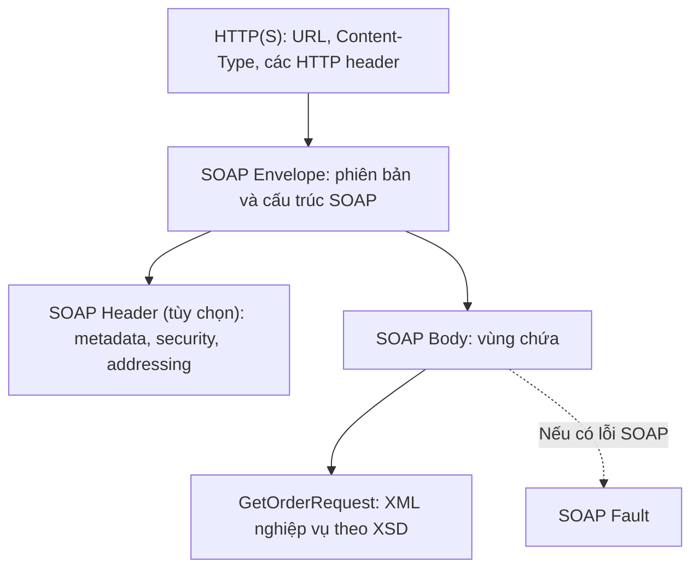
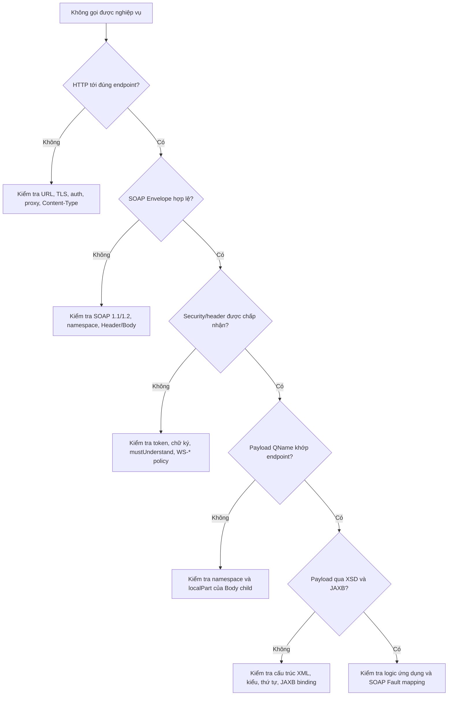

# Payload ứng dụng và phong bì SOAP là hai lớp khác nhau

Khi phát triển dịch vụ SOAP với **Spring Web Services (Spring-WS)**, một nhầm lẫn thường gặp là xem toàn bộ XML gửi qua mạng là “payload nghiệp vụ”. Thực tế, **SOAP Envelope (phong bì SOAP)** là lớp đóng gói theo giao thức, còn **application payload (payload ứng dụng)** là dữ liệu nghiệp vụ được đặt *bên trong* `SOAP Body`. Hai lớp có namespace, quy tắc và trách nhiệm xử lý khác nhau.

Đây là kiến thức nền tảng của chương **Giao thức SOAP**, đặc biệt quan trọng với cách tiếp cận **contract-first**: dùng XSD để thiết kế dữ liệu, WSDL để mô tả dịch vụ, JAXB để ánh xạ XML–Java, Spring-WS endpoint/client để trao đổi thông điệp và các interceptor để kiểm tra schema, lỗi hoặc bảo mật. Hiểu đúng ranh giới giữa Envelope và payload giúp tránh lỗi định tuyến endpoint, lỗi namespace, nhầm SOAP Header với HTTP header và lỗi khi tích hợp WS-Security.

## 1. Hai lớp XML cùng xuất hiện trong một thông điệp

Giả sử hệ thống đặt hàng cần gửi yêu cầu `GetOrderRequest` để tra cứu đơn hàng `42`. Dữ liệu cần cho nghiệp vụ chỉ là yêu cầu cùng mã đơn hàng:

```xml
<ord:GetOrderRequest xmlns:ord="https://example.com/contracts/orders/v1">
    <ord:orderId>42</ord:orderId>
</ord:GetOrderRequest>
```

Đoạn XML trên là **payload ứng dụng**. Nó cho biết “muốn tra cứu đơn hàng 42”, nhưng tự nó không nói đây là SOAP 1.1 hay SOAP 1.2, có header bảo mật nào, hoặc lỗi giao thức phải được biểu diễn ra sao.

Khi gửi bằng SOAP 1.1, hệ thống thường đặt payload vào một `Envelope` đầy đủ:

```xml
<?xml version="1.0" encoding="UTF-8"?>
<soap:Envelope
    xmlns:soap="http://schemas.xmlsoap.org/soap/envelope/"
    xmlns:ord="https://example.com/contracts/orders/v1"
    xmlns:meta="https://example.com/integration/metadata/v1">

    <soap:Header>
        <meta:CorrelationId>req-00042</meta:CorrelationId>
    </soap:Header>

    <soap:Body>
        <ord:GetOrderRequest>
            <ord:orderId>42</ord:orderId>
        </ord:GetOrderRequest>
    </soap:Body>
</soap:Envelope>
```

Ở đây có **ba phạm vi nội dung** cần nhận diện:

- **`soap:Envelope`:** phần tử gốc theo chuẩn SOAP, xác định đây là một thông điệp SOAP và phiên bản SOAP qua namespace của Envelope.
- **`soap:Header`:** phần tùy chọn, mang metadata phục vụ xử lý thông điệp như định danh tương quan, định tuyến hoặc bảo mật.
- **`soap:Body`:** vùng chứa nội dung chính. Trong request thành công của ví dụ này, phần tử `ord:GetOrderRequest` bên trong Body mới là **payload ứng dụng** mà endpoint nghiệp vụ cần xử lý.

Bản thân `soap:Body` **không đồng nghĩa** với phần tử `GetOrderRequest`. Body là *vỏ chứa do SOAP quy định*; `GetOrderRequest` là *nội dung có cấu trúc do hợp đồng nghiệp vụ quy định*. Phân biệt này càng quan trọng khi Body chứa `soap:Fault` thay cho phản hồi nghiệp vụ.



Sơ đồ có mục đích phân biệt trách nhiệm. Khi có Fault, Body chứa Fault theo quy tắc SOAP; không phải lúc nào cũng có payload `GetOrderRequest`/`GetOrderResponse`. HTTPS là kênh vận chuyển, không phải một phần tử XML của Envelope.

## 2. Namespace giúp phân biệt “vỏ giao thức” và “ruột nghiệp vụ”

XML cho phép các phần tử có cùng tên ngắn nhưng thuộc những namespace khác nhau. Một phần tử được định danh bằng **QName** (*qualified name*): cặp `{namespace URI}localName`.

Trong request trên:

| Phần tử | Namespace URI | Ai định nghĩa? |
| --- | --- | --- |
| `soap:Envelope` | `http://schemas.xmlsoap.org/soap/envelope/` | Đặc tả SOAP 1.1 |
| `soap:Header` | `http://schemas.xmlsoap.org/soap/envelope/` | Đặc tả SOAP 1.1 |
| `soap:Body` | `http://schemas.xmlsoap.org/soap/envelope/` | Đặc tả SOAP 1.1 |
| `ord:GetOrderRequest` | `https://example.com/contracts/orders/v1` | Hợp đồng nghiệp vụ của dịch vụ |
| `ord:orderId` | `https://example.com/contracts/orders/v1` | XSD nghiệp vụ, với cấu hình phần tử qualified |
| `meta:CorrelationId` | `https://example.com/integration/metadata/v1` | Hợp đồng metadata của hệ thống tích hợp |

Tên tiền tố như `soap`, `env` hoặc `ord` chỉ là bí danh trong tài liệu XML. Ví dụ, `env:Body` vẫn là SOAP Body nếu `env` ánh xạ đến đúng namespace SOAP. Không nên kiểm tra bằng chuỗi tiền tố cố định; phải đối chiếu **namespace URI và local name**.

Dạng QName của phần tử payload trong ví dụ là:

```text
{https://example.com/contracts/orders/v1}GetOrderRequest
```

Đây chính là thông tin Spring-WS thường dùng để chọn endpoint với `@PayloadRoot`. Trái lại, QName của container `Body` là:

```text
{http://schemas.xmlsoap.org/soap/envelope/}Body
```

Do đó, ánh xạ một endpoint nghiệp vụ bằng `localPart = "Body"` là sai ý định. Cũng cần tránh đưa `GetOrderRequest` vào namespace SOAP: namespace SOAP dành cho các thành phần giao thức, còn namespace ứng dụng dành cho dữ liệu nghiệp vụ.

**Một thay đổi nhỏ nhưng gây lỗi lớn:** nếu client gửi `<ord:GetOrderRequest>` với `ord` trỏ đến `https://example.com/contracts/orders/v2`, đó là một QName khác. Kể cả tên `GetOrderRequest` và các trường bên trong trông giống hệt, server đã cấu hình cho namespace `v1` có thể không tìm thấy endpoint hoặc từ chối validation.

## 3. XSD định nghĩa payload, còn đặc tả SOAP định nghĩa Envelope

Trong phát triển **contract-first**, nên bắt đầu từ hình dạng dữ liệu nghiệp vụ. Ví dụ XSD sau khai báo request và response:

```xml
<?xml version="1.0" encoding="UTF-8"?>
<xs:schema xmlns:xs="http://www.w3.org/2001/XMLSchema"
           xmlns:tns="https://example.com/contracts/orders/v1"
           targetNamespace="https://example.com/contracts/orders/v1"
           elementFormDefault="qualified">

    <xs:element name="GetOrderRequest">
        <xs:complexType>
            <xs:sequence>
                <xs:element name="orderId" type="xs:positiveInteger"/>
            </xs:sequence>
        </xs:complexType>
    </xs:element>

    <xs:element name="GetOrderResponse">
        <xs:complexType>
            <xs:sequence>
                <xs:element name="orderId" type="xs:positiveInteger"/>
                <xs:element name="status" type="xs:string"/>
            </xs:sequence>
        </xs:complexType>
    </xs:element>
</xs:schema>
```

XSD quy định payload `GetOrderRequest` phải chứa `orderId` là số nguyên dương. Nó không cần tự khai báo lại `soap:Envelope`, `soap:Header` hay `soap:Body`. Các phần tử đó thuộc chuẩn SOAP và được SOAP runtime xử lý.

Với đoạn XSD trên, request hợp lệ ở mức payload là:

```xml
<ord:GetOrderRequest xmlns:ord="https://example.com/contracts/orders/v1">
    <ord:orderId>42</ord:orderId>
</ord:GetOrderRequest>
```

Request sau vẫn là XML có cú pháp đúng, nhưng **sai XSD nghiệp vụ**:

```xml
<ord:GetOrderRequest xmlns:ord="https://example.com/contracts/orders/v1">
    <ord:orderId>-42</ord:orderId>
</ord:GetOrderRequest>
```

Bởi `xs:positiveInteger` không chấp nhận số âm.

Ngược lại, một XML chứa payload hợp lệ vẫn có thể là **SOAP message không hợp lệ** nếu thiếu `Envelope`, dùng sai namespace của SOAP hoặc đặt phần tử sai vị trí. Hai loại kiểm tra phải được phân biệt:

- **Kiểm tra SOAP:** thông điệp có cấu trúc Envelope/Header/Body phù hợp với phiên bản SOAP hay không, header bắt buộc có được xử lý hay không.
- **Kiểm tra XSD nghiệp vụ:** phần tử bên trong Body có đúng cấu trúc, kiểu dữ liệu, thứ tự và namespace theo hợp đồng hay không.

Trong Spring-WS, `PayloadValidatingInterceptor` có thể được dùng để kiểm tra XML payload với XSD khi được cấu hình. Nó không có chức năng thay thế toàn bộ cơ chế phân tích cú pháp SOAP, xử lý `mustUnderstand`, WS-Security hay kiểm tra lỗi tầng transport.

### Khi nào Envelope cũng xuất hiện trong schema?

Về mặt kỹ thuật, có thể xây dựng một XML Schema liên quan đến Envelope hoặc kiểm tra toàn bộ SOAP XML bằng các công cụ XML. Tuy nhiên, trong thiết kế dịch vụ Spring-WS theo contract-first, **schema nghiệp vụ thông thường tập trung vào các phần tử payload**, còn cấu trúc Envelope thuộc chuẩn SOAP và xử lý của SOAP stack. Tự đưa `Envelope` vào XSD nghiệp vụ thường tạo sự phụ thuộc không cần thiết vào phiên bản SOAP và làm khó việc tái sử dụng hợp đồng dữ liệu.

## 4. WSDL nối phần tử nghiệp vụ với SOAP binding

XSD mô tả “payload hợp lệ trông như thế nào”, còn **WSDL 1.1** mô tả “dịch vụ nhận/trả message gì và truyền chúng bằng cơ chế nào”. Với kiểu **document/literal**, một `wsdl:part` thường tham chiếu đến một phần tử XSD toàn cục:

```xml
<!-- Trích đoạn bên trong một tài liệu WSDL 1.1;
     prefix ord, wsdl và soap đã được khai báo trong definitions. -->

<wsdl:message name="GetOrderInput">
    <wsdl:part name="parameters" element="ord:GetOrderRequest"/>
</wsdl:message>

<wsdl:message name="GetOrderOutput">
    <wsdl:part name="parameters" element="ord:GetOrderResponse"/>
</wsdl:message>

<wsdl:portType name="OrdersPortType">
    <wsdl:operation name="GetOrder">
        <wsdl:input message="tns:GetOrderInput"/>
        <wsdl:output message="tns:GetOrderOutput"/>
    </wsdl:operation>
</wsdl:portType>

<wsdl:binding name="OrdersBinding" type="tns:OrdersPortType">
    <soap:binding style="document"
                  transport="http://schemas.xmlsoap.org/soap/http"/>
    <wsdl:operation name="GetOrder">
        <soap:operation soapAction="urn:orders:GetOrder"/>
        <wsdl:input><soap:body use="literal"/></wsdl:input>
        <wsdl:output><soap:body use="literal"/></wsdl:output>
    </wsdl:operation>
</wsdl:binding>
```

`wsdl:part element="ord:GetOrderRequest"` chỉ đến **phần tử payload ứng dụng**, không phải `soap:Envelope`. Trong khi đó, `soap:binding` và `soap:body` mô tả cách kết nối message trừu tượng với SOAP. Để một WSDL 1.1 hoàn chỉnh sử dụng được, còn cần những phần như `definitions`, `types`/XSD import và `service`/`port`/địa chỉ endpoint. Đoạn trên chỉ tập trung vào mối liên hệ giữa dữ liệu và binding.

Với cách thiết kế document/literal thông dụng, bên gửi đặt phần tử `GetOrderRequest` vào SOAP Body, bên nhận trích payload ra để xử lý. Cụm từ **“document/literal wrapped”** thường chỉ một quy ước thiết kế trong đó phần tử document root bao bọc các tham số của operation; nó không có nghĩa SOAP Envelope được sinh từ lớp `GetOrderRequest`.

Cần chú ý thêm:

1. WSDL có thể mô tả **SOAP Header** bằng các khai báo binding phù hợp, hoặc đi kèm các policy về bảo mật; không phải mọi header đều nằm trong XSD payload nghiệp vụ.
2. **Thay đổi XSD payload** có thể làm thay đổi hợp đồng dù tên operation WSDL giữ nguyên.
3. **Thay đổi SOAP binding/phiên bản** có thể khiến client không tương thích dù payload XSD không đổi.

## 5. Header của SOAP không phải header của HTTP

Thông điệp SOAP đi qua HTTP(S) thường có **hai loại header**: HTTP header ở ngoài XML và SOAP Header ở bên trong Envelope. Chúng có vị trí và ý nghĩa khác nhau.

Ví dụ giao tiếp SOAP 1.1 ở mức HTTP (minh họa):

```http
POST /ws/orders HTTP/1.1
Host: api.example.com
Content-Type: text/xml; charset=utf-8
SOAPAction: "urn:orders:GetOrder"

<soap:Envelope xmlns:soap="http://schemas.xmlsoap.org/soap/envelope/"
               xmlns:ord="https://example.com/contracts/orders/v1">
    <soap:Body>
        <ord:GetOrderRequest>
            <ord:orderId>42</ord:orderId>
        </ord:GetOrderRequest>
    </soap:Body>
</soap:Envelope>
```

Hai khái niệm cần phân biệt:

| Thành phần | Nằm ở đâu? | Công dụng điển hình |
| --- | --- | --- |
| HTTP `Content-Type` | Header của HTTP request | Xác định media type, charset và quy ước nội dung |
| HTTP `SOAPAction` trong SOAP 1.1 | Header của HTTP request | Thể hiện action theo SOAP HTTP binding; cần khớp yêu cầu của endpoint/đối tác |
| `soap:Header` | Bên trong XML Envelope | Mang các SOAP header block như WS-Security hoặc WS-Addressing |
| `soap:Body` | Bên trong XML Envelope | Mang XML payload nghiệp vụ hoặc SOAP Fault |
| `ord:GetOrderRequest` | Bên trong Body | Mang dữ liệu theo XSD của nghiệp vụ |

Nếu dùng **WS-Addressing**, có thể xuất hiện một phần tử `wsa:Action` trong SOAP Header. `wsa:Action` **khác** HTTP `SOAPAction`: cả hai có thể cùng tồn tại nhưng thuộc các lớp khác nhau và cần được cấu hình nhất quán theo hợp đồng.

Một số HTTP header như `Authorization` phục vụ bảo vệ đường truy cập HTTP; chúng không tự trở thành `wsse:Security` trong SOAP Header. Tương tự, token/chữ ký trong SOAP Header không tự thay thế yêu cầu thiết lập kết nối HTTPS hoặc cơ chế xác thực mà hệ thống triển khai ở tầng HTTP.

## 6. SOAP 1.1 và SOAP 1.2 dùng Envelope khác nhau

Namespace Envelope là dấu hiệu quan trọng để nhận biết phiên bản SOAP.

| Khía cạnh | SOAP 1.1 | SOAP 1.2 |
| --- | --- | --- |
| Namespace Envelope | `http://schemas.xmlsoap.org/soap/envelope/` | `http://www.w3.org/2003/05/soap-envelope` |
| Media type HTTP thông dụng | `text/xml` | `application/soap+xml` |
| Action qua HTTP | HTTP `SOAPAction` theo SOAP 1.1 HTTP binding | Có thể dùng tham số `action` của `application/soap+xml` theo binding SOAP 1.2 |
| Fault | `faultcode`, `faultstring`, `detail` | `Code`, `Reason`, `Detail` cùng cấu trúc khác |

Envelope SOAP 1.2 rút gọn:

```xml
<env:Envelope xmlns:env="http://www.w3.org/2003/05/soap-envelope"
              xmlns:ord="https://example.com/contracts/orders/v1">
    <env:Body>
        <ord:GetOrderRequest>
            <ord:orderId>42</ord:orderId>
        </ord:GetOrderRequest>
    </env:Body>
</env:Envelope>
```

**Payload nghiệp vụ vẫn có thể giữ nguyên** khi chuyển giữa hai phiên bản SOAP; thứ thay đổi là quy tắc Envelope, binding và transport. Tuy nhiên, không thể đổi SOAP 1.1 thành SOAP 1.2 chỉ bằng việc thay tên media type: client, server, namespace Envelope, SOAP message factory và WSDL binding phải tương thích.

Trong Spring-WS, thành phần tạo/xử lý SOAP message (chẳng hạn cấu hình dựa trên `SaajSoapMessageFactory`) chịu trách nhiệm về phiên bản SOAP. Lớp JAXB sinh từ XSD payload không nên phải biết Envelope là SOAP 1.1 hay SOAP 1.2.

## 7. Spring-WS xử lý lớp nào ở từng bước?

Spring-WS khuyến khích lập trình dựa trên **payload XML**. Điều này giúp logic nghiệp vụ ít phụ thuộc vào các chi tiết về SOAP Header, transport hoặc phiên bản Envelope.

```mermaid
sequenceDiagram
    participant C as SOAP client
    participant M as SOAP message factory
    participant I as Interceptor / security
    participant E as Spring-WS endpoint
    participant S as Ứng dụng nghiệp vụ
    C->>M: Payload Java/XML + metadata
    M->>I: SOAP Envelope chứa Body/Header
    I->>E: SOAP message hợp lệ; lấy payload từ Body
    E->>S: GetOrderRequest đã ánh xạ
    S-->>E: GetOrderResponse
    E-->>M: Payload XML của response
    M-->>C: SOAP Envelope của response
```

Sơ đồ mô tả trách nhiệm chức năng, không khẳng định mọi interceptor chạy theo đúng một thứ tự cố định. Spring-WS có các bước xử lý request và response/fault với thứ tự phụ thuộc cấu hình.

### 7.1. Endpoint định tuyến theo payload root

Ví dụ endpoint với các lớp request/response do JAXB/XJC sinh từ XSD:

```java
import org.springframework.ws.server.endpoint.annotation.Endpoint;
import org.springframework.ws.server.endpoint.annotation.PayloadRoot;
import org.springframework.ws.server.endpoint.annotation.RequestPayload;
import org.springframework.ws.server.endpoint.annotation.ResponsePayload;

@Endpoint
public class OrdersEndpoint {

    private static final String ORDER_NS =
            "https://example.com/contracts/orders/v1";

    private final OrderService orderService;

    public OrdersEndpoint(OrderService orderService) {
        this.orderService = orderService;
    }

    @PayloadRoot(namespace = ORDER_NS, localPart = "GetOrderRequest")
    @ResponsePayload
    public GetOrderResponse getOrder(
            @RequestPayload GetOrderRequest request) {

        return orderService.findById(request);
    }
}
```

Trong ví dụ, `OrderService` là lớp nghiệp vụ tự triển khai; `GetOrderRequest` và `GetOrderResponse` biểu diễn model JAXB được cấu hình cho ứng dụng. Với cơ chế endpoint mapping dựa trên payload root, Spring-WS chọn handler theo QName:

```text
{https://example.com/contracts/orders/v1}GetOrderRequest
```

Không phải theo tên `Envelope`, `Body`, URL đầy đủ hay tên Java method `getOrder`. Để Spring-WS chuyển payload thành các đối tượng JAXB, ứng dụng phải có cấu hình marshaller/adapter tương thích với phiên bản Spring-WS và JAXB đang sử dụng.

**Đường đi khi nhận request:**

1. Runtime tiếp nhận SOAP message và phân tích Envelope theo phiên bản SOAP.
2. Các thành phần xử lý chung có thể kiểm tra header, WS-Security hoặc schema.
3. Endpoint mapping dựa trên phần tử gốc của **payload trong Body** để chọn `@PayloadRoot` tương ứng.
4. Bộ ánh xạ dữ liệu chuyển XML payload thành đối tượng request Java.
5. Endpoint gọi nghiệp vụ và trả đối tượng response; runtime serialize payload thành XML và đặt nó vào SOAP Body của response.

Nếu request XML có `<ord:GetOrderRequest>` nhưng prefix `ord` trỏ đến namespace sai, bước ánh xạ endpoint có thể thất bại dù business code hoàn toàn đúng.

### 7.2. JAXB marshalling chỉ phụ trách nội dung nghiệp vụ

JAXB có thể ánh xạ đối tượng `GetOrderRequest` thành:

```xml
<ord:GetOrderRequest xmlns:ord="https://example.com/contracts/orders/v1">
    <ord:orderId>42</ord:orderId>
</ord:GetOrderRequest>
```

JAXB **không tự quyết định** các phần bao ngoài như `soap:Envelope`, HTTP `Content-Type`, SOAP Header bảo mật hoặc địa chỉ endpoint. Những phần này do SOAP stack, cấu hình client và các interceptor/callback phối hợp xử lý.

Ở client Spring-WS, `WebServiceTemplate` thường dùng `Jaxb2Marshaller` để biến Java object thành payload gửi đi:

```java
import java.math.BigInteger;
import org.springframework.ws.soap.client.core.SoapActionCallback;

// webServiceTemplate đã được cấu hình marshaller, unmarshaller
// và SOAP message factory tương thích với endpoint đích.

GetOrderRequest request = new GetOrderRequest();
request.setOrderId(BigInteger.valueOf(42));

GetOrderResponse response = (GetOrderResponse)
        webServiceTemplate.marshalSendAndReceive(
                "https://api.example.com/ws/orders",
                request,
                new SoapActionCallback("urn:orders:GetOrder"));
```

`SoapActionCallback` dùng để đặt action theo SOAP 1.1 trong trường hợp tích hợp này. Đoạn code không tự khai báo WS-Security, timeout hoặc SOAP Header riêng; các yêu cầu đó phải được cấu hình/thực hiện thêm theo hợp đồng. Kiểu Java của `orderId` có thể thay đổi theo binding JAXB và cách sinh lớp cụ thể.

### 7.3. Muốn xử lý Header thì dùng thành phần phù hợp

Không nên nhồi thông tin của `soap:Header` vào lớp JAXB `GetOrderRequest` chỉ để endpoint đọc được chúng. Có thể dùng:

- **Endpoint/interceptor xử lý header:** dành cho metadata như correlation ID, routing hoặc tiêu chí kiểm soát truy cập.
- **`Wss4jSecurityInterceptor`:** cấu hình xác minh/tạo WS-Security theo chính sách, bao gồm token, chữ ký và mã hóa khi phù hợp.
- **`WebServiceMessageCallback` trên client:** bổ sung header hoặc tùy chỉnh thông điệp trước khi gửi.
- **Endpoint exception resolver:** chuyển ngoại lệ trong quá trình xử lý thành SOAP Fault hợp lệ.

Khi dùng annotation hỗ trợ đọc SOAP Header hoặc thao tác trực tiếp trên `SoapMessage`, phải kiểm tra namespace và cấu trúc header độc lập với payload XSD.

## 8. SOAP Header có thể điều khiển xử lý nhưng không phải dữ liệu nghiệp vụ chính

Một header có thể mang `CorrelationId` để nối log giữa nhiều dịch vụ. Nó không nhất thiết thay đổi cách tra cứu đơn hàng. Một header khác có thể yêu cầu **xử lý bắt buộc**:

```xml
<soap:Header xmlns:soap="http://schemas.xmlsoap.org/soap/envelope/"
             xmlns:meta="https://example.com/integration/metadata/v1">
    <meta:PolicyCheck soap:mustUnderstand="1">
        strict
    </meta:PolicyCheck>
</soap:Header>
```

Đây là **fragment minh họa SOAP 1.1**, không phải thông điệp hoàn chỉnh. Với `mustUnderstand="1"`, một SOAP node được nhắm đến bởi header phải hiểu và xử lý đúng header block đó theo quy tắc SOAP; nếu không, node có thể phải phát sinh `MustUnderstand` Fault. Header `meta:PolicyCheck` chỉ là ví dụ tự định nghĩa, không phải một chuẩn WS-* có sẵn.

Ở SOAP 1.1, thuộc tính `actor` dùng để xác định node/role xử lý header; SOAP 1.2 dùng khái niệm `role` và các quy tắc `mustUnderstand` tương ứng. Vì vậy không được xóa hoặc bỏ qua tùy tiện những SOAP Header bắt buộc, kể cả khi payload ứng dụng vẫn hợp lệ.

### WS-Security làm việc với Envelope nhưng có thể bảo vệ Body

Các yêu cầu doanh nghiệp như **WS-Security** thường đưa phần tử `wsse:Security` vào SOAP Header. Header này có thể mang thông tin chữ ký XML, timestamp, token hoặc dữ liệu hỗ trợ mã hóa; phần **được ký/mã hóa** có thể bao gồm chính payload trong Body.

Vì vậy cần phân biệt:

- **Nơi chứa metadata bảo mật:** thường là SOAP Header.
- **Đối tượng được bảo vệ:** có thể là SOAP Body và các header liên quan.
- **Ngữ nghĩa nghiệp vụ:** vẫn đến từ XSD payload sau khi thông điệp đã được xác minh/giải mã hợp lệ.

Chữ ký số yêu cầu kiểm tra dữ liệu được ký, thuật toán, chứng chỉ/khóa công khai, thời gian và chính sách tin cậy. Chỉ nhìn thấy `wsse:Security` trong Header không đủ để kết luận thông điệp đã được xác thực. Với XML Encryption, dữ liệu Body quan sát trên đường truyền có thể ở dạng mã hóa và chỉ xuất hiện như payload XML nghiệp vụ sau khi giải mã.

**HTTPS/TLS** bảo vệ kênh truyền; **WS-Security** bảo vệ ở mức thông điệp. Các hệ thống qua trung gian có thể yêu cầu cả hai. Điều này không làm thay đổi vai trò cơ bản: SOAP Envelope tổ chức message, payload mô tả yêu cầu nghiệp vụ.

## 9. Khi có lỗi: SOAP Fault nằm trong Body nhưng không phải response nghiệp vụ

Một response tra cứu đơn hàng thành công có thể là:

```xml
<soap:Envelope
    xmlns:soap="http://schemas.xmlsoap.org/soap/envelope/"
    xmlns:ord="https://example.com/contracts/orders/v1">
    <soap:Body>
        <ord:GetOrderResponse>
            <ord:orderId>42</ord:orderId>
            <ord:status>PAID</ord:status>
        </ord:GetOrderResponse>
    </soap:Body>
</soap:Envelope>
```

Nếu không thể xử lý message, SOAP 1.1 có thể trả Fault:

```xml
<soap:Envelope
    xmlns:soap="http://schemas.xmlsoap.org/soap/envelope/"
    xmlns:err="https://example.com/contracts/errors/v1">
    <soap:Body>
        <soap:Fault>
            <faultcode>soap:Client</faultcode>
            <faultstring>orderId không hợp lệ</faultstring>
            <detail>
                <err:ValidationError>
                    <err:code>INVALID_ORDER_ID</err:code>
                </err:ValidationError>
            </detail>
        </soap:Fault>
    </soap:Body>
</soap:Envelope>
```

Ở đây:

- `soap:Fault` là cấu trúc giao thức trong SOAP Body.
- `faultcode` và `faultstring` được SOAP 1.1 quy định; `detail` có thể chứa thông tin lỗi chi tiết.
- `err:ValidationError` là XML lỗi ứng dụng minh họa và **chưa được khai báo trong XSD nghiệp vụ ở mục 3**. Nếu muốn có lỗi theo hợp đồng, cần khai báo phần tử/type lỗi và mô tả `wsdl:fault` phù hợp.
- SOAP Fault không tương đương với `GetOrderResponse` có `status="ERROR"`. Client SOAP thường xử lý Fault qua cơ chế fault riêng.

SOAP 1.2 dùng cấu trúc khác cho Fault, chẳng hạn `Code`/`Reason`/`Detail` và mã `Sender`/`Receiver` thay cho mô hình `Client`/`Server` của SOAP 1.1. Cấu hình Fault resolver hoặc interceptor trong Spring-WS phải tuân theo SOAP version đã dùng.

**Lưu ý về HTTP:** khi SOAP chạy trên HTTP, response có HTTP status code ở lớp transport. Tuy vậy, để biết nguyên nhân lỗi SOAP hay nghiệp vụ, cần phân tích message và Fault theo binding thực tế; không được chỉ kiểm tra nội dung XML hoặc chỉ kiểm tra HTTP status rồi bỏ qua lớp còn lại.

## 10. Kiểm thử nên xác minh riêng từng lớp

Khi triển khai endpoint và client SOAP theo contract-first, có thể chia kiểm thử thành ba nhóm nhằm phát hiện đúng nguyên nhân:

| Nhóm kiểm thử | Đầu vào/vật chứng | Điều cần xác minh |
| --- | --- | --- |
| **Payload XML/XSD** | Phần tử `GetOrderRequest` đứng riêng | Namespace, `orderId`, thứ tự/kiểu dữ liệu, ràng buộc XSD |
| **SOAP message** | `Envelope` đầy đủ chứa Body/Header | SOAP version, cấu trúc Envelope, Header bắt buộc, Fault, bảo mật |
| **Transport & binding** | HTTP request/response, WSDL | URL, Content-Type, SOAPAction/action, TLS, binding và địa chỉ dịch vụ |

Các kịch bản cụ thể nên thử:

1. **Payload đúng:** gửi request `orderId=42` với namespace khớp XSD; endpoint nhận được giá trị và phản hồi đúng loại payload.
2. **Payload sai schema:** gửi `orderId=-42`. Nếu bật schema validation ở server, yêu cầu phải bị từ chối theo cơ chế đã cấu hình.
3. **Payload đúng nhưng namespace sai:** dùng `v2` thay cho `v1`; xác nhận endpoint không xử lý nhầm request.
4. **Envelope sai phiên bản:** gửi Envelope SOAP 1.2 tới endpoint chỉ hỗ trợ SOAP 1.1; xác nhận hệ thống có phản hồi lỗi phù hợp.
5. **Header không bắt buộc:** thêm correlation ID vào Header; xác nhận nghiệp vụ vẫn nhận đúng payload.
6. **Header bắt buộc nhưng không được hiểu:** gửi `mustUnderstand` nhắm tới node tương ứng; kiểm tra hành vi Fault theo chuẩn và cấu hình runtime.
7. **WS-Security:** thử chữ ký đúng/sai, timestamp hết hạn, chứng chỉ không tin cậy; xác minh kiểm tra trước khi gọi nghiệp vụ.
8. **Fault:** gây lỗi đầu vào và lỗi server có kiểm soát; xác nhận client phân biệt SOAP Fault với business response.
9. **Client độc lập:** sinh/khởi tạo client từ WSDL đã công bố; gửi request thực tế và so sánh XML trên đường truyền với hợp đồng.

Trong Spring-WS, **`MockWebServiceClient`** hữu ích để kiểm thử endpoint và payload; **`MockWebServiceServer`** hữu ích để kiểm thử request do client tạo ra và phản hồi giả lập. Kiểm thử mock nên được bổ sung bằng ít nhất một phép thử tích hợp thực qua HTTP(S) với SOAP version, header và security của đối tác khi hệ thống yêu cầu chúng.

### Quy trình chẩn đoán nhanh khi request không tới nghiệp vụ



Đây là quy trình kiểm tra, không khẳng định tất cả bước chạy tuần tự như nhau ở mọi stack. Ví dụ, interceptor xác minh bảo mật có thể chạy trước cả khi dữ liệu được unmarshal.

## 11. Các nhầm lẫn thường gặp và cách sửa

| Nhầm lẫn | Vì sao sai? | Cách hiểu/khắc phục |
| --- | --- | --- |
| “Payload là toàn bộ `soap:Envelope`.” | Envelope còn chứa container, header và thông tin giao thức. | Với API document/literal thông dụng, payload nghiệp vụ là phần tử XML bên trong Body. |
| “XSD nghiệp vụ phải khai báo `Envelope` và `Body`.” | Những phần tử này thuộc đặc tả SOAP. | Định nghĩa phần tử request/response trong XSD nghiệp vụ; cấu hình SOAP stack cho Envelope. |
| “`@PayloadRoot` phải nhận `Body`.” | Spring-WS ánh xạ theo QName của phần tử gốc payload. | Dùng namespace nghiệp vụ và `GetOrderRequest`. |
| “Đổi prefix `ord` thành `x` làm sai message.” | Prefix chỉ là tên bí danh. | Kiểm tra URI namespace được ánh xạ; đổi URI mới là thay QName. |
| “Header `Authorization` của HTTP là `soap:Header`.” | HTTP và SOAP là hai lớp khác nhau. | Xử lý HTTP auth, SOAP Header và WS-Security theo đúng tầng của chúng. |
| “SOAP Header chỉ để ghi log.” | Có header yêu cầu bảo mật hoặc `mustUnderstand` bắt buộc. | Kiểm tra role, policy và cơ chế xử lý header phù hợp. |
| “JAXB marshal là đủ để gọi SOAP.” | JAXB sinh XML payload, chưa tự chọn endpoint, SOAP binding hay tạo mọi header. | Dùng SOAP message factory, `WebServiceTemplate` và cấu hình client. |
| “Payload hợp lệ thì toàn bộ SOAP request hợp lệ.” | Envelope, Header, version và transport vẫn có thể sai. | Kiểm tra riêng cú pháp SOAP, XSD và chính sách tích hợp. |
| “SOAP Fault là `GetOrderResponse` thất bại.” | Fault có cấu trúc SOAP đặc thù. | Dùng cơ chế xử lý fault và quy ước lỗi có hợp đồng rõ ràng. |

### Trường hợp nâng cao: payload có dữ liệu nhị phân

Với SOAP sử dụng MTOM/XOP, payload logic có thể mang dữ liệu nhị phân (ví dụ trường XSD `xs:base64Binary`) qua cơ chế tối ưu hóa cùng MIME attachments. Khi quan sát thông điệp trên đường truyền, nội dung có thể là `multipart/related` với `xop:Include` trỏ đến phần nhị phân, thay vì một chuỗi base64 lớn nằm ngay trong XML. Điều này làm hình dạng **đóng gói trên đường truyền** phức tạp hơn, nhưng vẫn cần phân biệt **payload dữ liệu**, **SOAP Envelope** và **transport/MIME packaging**. MTOM không biến SOAP Header thành payload nghiệp vụ.

## 12. Bài tập tự kiểm tra

**Tình huống 1:** Client gửi phần tử:

```xml
<x:GetOrderRequest xmlns:x="https://example.com/contracts/orders/v1">
    <x:orderId>42</x:orderId>
</x:GetOrderRequest>
```

Server khai báo `@PayloadRoot(namespace = "https://example.com/contracts/orders/v1", localPart = "GetOrderRequest")`. Việc dùng `x` thay vì `ord` có làm sai mapping không?

**Đáp án:** Không. QName vẫn giống nhau vì namespace URI và local name không đổi.

**Tình huống 2:** Payload hợp lệ theo XSD, nhưng Envelope của request dùng SOAP 1.2 trong khi server được cấu hình chỉ cho SOAP 1.1. Request có nên được xử lý nghiệp vụ chỉ vì XML payload hợp lệ không?

**Đáp án:** Không. Kiểm tra SOAP version và binding là điều kiện độc lập với kiểm tra dữ liệu XSD; runtime có thể từ chối message trước khi endpoint nhận payload.

**Tình huống 3:** Đối tác yêu cầu header WS-Security có chữ ký bao phủ SOAP Body. Có nên thêm phần tử `<Signature>` vào bên trong `GetOrderRequest` để JAXB sinh ra nó?

**Đáp án:** Không. Cần xử lý WS-Security ở SOAP message layer (thường qua interceptor và SOAP Header), ký chính xác các phần được chính sách yêu cầu. Không sửa XSD payload nghiệp vụ chỉ để chứa các phần tử giao thức bảo mật.

**Tình huống 4:** Client nhận được `soap:Fault` trong Body. Có nên unmarshal nó như `GetOrderResponse` không?

**Đáp án:** Không. SOAP Fault có khuôn dạng và cơ chế xử lý riêng, dù phần `detail` có thể mang XML lỗi được hai bên quy định bằng XSD/WSDL.

Bài học quan trọng nhất khi phát triển SOAP với Spring Web Services là giữ **ranh giới trách nhiệm** rõ ràng: XML/XSD định nghĩa dữ liệu nghiệp vụ; WSDL liên kết dữ liệu với operation và binding; SOAP Envelope/Header/Body/Fault tổ chức và điều khiển thông điệp; JAXB, endpoint, client, interceptor và WS-Security hiện thực việc xử lý theo hợp đồng. Khi những lớp này được thiết kế và kiểm thử độc lập nhưng phối hợp nhất quán, tích hợp SOAP giữa các hệ thống doanh nghiệp sẽ dễ bảo trì và tương thích hơn.

