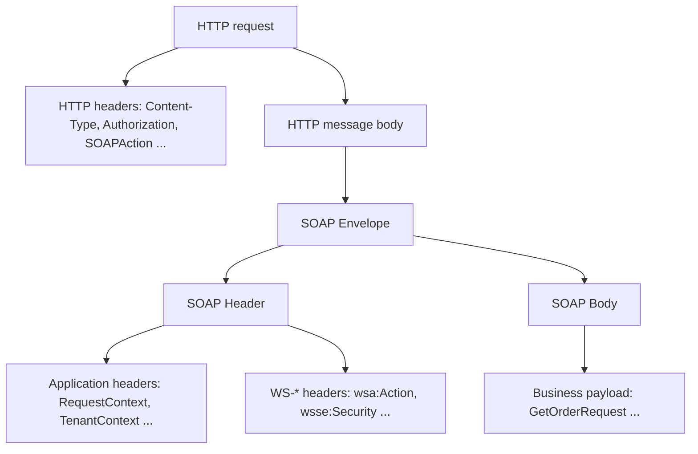
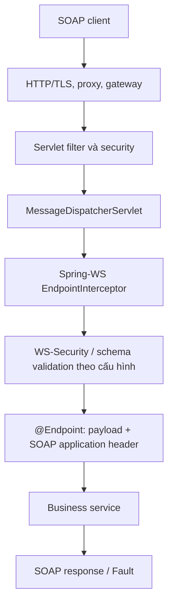

# Header ứng dụng, header WS-* và HTTP header trong SOAP

## 1. Mục tiêu học tập

Trong một lời gọi SOAP, từ “header” có thể chỉ **ba loại thông tin ở những tầng khác nhau**:

1. **HTTP header** thuộc yêu cầu/phản hồi HTTP, ví dụ `Content-Type`, `Authorization`, `SOAPAction`, `X-Correlation-ID`.
2. **SOAP application header** là các phần tử XML do ứng dụng hoặc doanh nghiệp tự định nghĩa trong `<soap:Header>`, ví dụ `RequestContext`, `TenantContext`, `BusinessChannel`.
3. **SOAP header theo họ đặc tả WS-*** tuân theo một chuẩn bổ sung, ví dụ `wsa:Action` của WS-Addressing, `wsse:Security` của WS-Security hoặc các header của WS-ReliableMessaging.

Mục đích của bài là phân biệt **vị trí, phạm vi, ý nghĩa và cách xử lý** ba loại header; hiểu cơ chế `mustUnderstand` và vai trò SOAP node; chọn header phù hợp với yêu cầu hợp đồng; và thực hành với Spring Web Services (Spring-WS) theo hướng **contract-first**, sử dụng XSD/WSDL, JAXB, endpoint, SOAP client và interceptor.

Đây là nội dung của chương **Giao thức SOAP** trong module `SPRING_WEB_SERVICES`. Bài này không giả định có đặc tả WS-* bắt buộc cho mọi hệ thống; các chính sách cụ thể phải được xác nhận với đối tác tích hợp.

## 2. Phân biệt ba tầng header

| Tiêu chí | HTTP header | SOAP application header | SOAP WS-* header |
| --- | --- | --- | --- |
| **Nằm ở đâu?** | Trong phần header của HTTP request/response, bên ngoài SOAP XML. | Các phần tử con của `soap:Header`. | Các phần tử con của `soap:Header`, thuộc namespace của đặc tả WS-*. |
| **Do ai định nghĩa?** | HTTP, binding SOAP/HTTP, gateway hoặc ứng dụng. | Đội phát triển/đối tác theo hợp đồng XML riêng. | Đặc tả tương ứng, ví dụ WS-Addressing, WS-Security. |
| **Ví dụ** | `Content-Type`, `SOAPAction`, `Authorization`. | `m:RequestContext`, `m:PartnerId`. | `wsa:Action`, `wsa:MessageID`, `wsse:Security`. |
| **Biểu diễn** | Tên trường và giá trị header HTTP. | XML element với QName (namespace + local name). | XML element với QName được chuẩn hóa. |
| **Ai xử lý?** | HTTP server, proxy, gateway, lớp transport; đôi khi ứng dụng. | SOAP endpoint/interceptor theo hợp đồng. | Middleware và bộ xử lý WS-* có cấu hình tương thích. |
| **Có thuộc SOAP Envelope?** | Không. | Có. | Có. |
| **`mustUnderstand` áp dụng?** | Không; HTTP có quy tắc riêng. | Có, trên từng SOAP header block. | Có, trên từng SOAP header block. |
| **Ảnh hưởng khi đổi transport?** | Phụ thuộc transport HTTP. | Có thể giữ nguyên ý nghĩa SOAP message trên transport khác. | Phụ thuộc đặc tả WS-* và transport/binding được hỗ trợ. |

> **Điểm mấu chốt:** `SOAPAction` (HTTP header trong SOAP 1.1) và `wsa:Action` (SOAP header của WS-Addressing) là **hai trường ở hai tầng khác nhau**. Chúng có thể cần nhất quán theo cấu hình hoặc policy, nhưng không thể thay thế nhau một cách tùy ý.

SOAP thường truyền qua HTTP/HTTPS. Tuy nhiên, khuôn dạng SOAP Envelope và semantics của SOAP header không đồng nhất với semantics của HTTP header.

### 2.1. Sơ đồ vị trí



Tên `Header` trong SOAP là một **phần tử XML của Envelope**. Từ `header` trong HTTP là một **trường ở tầng giao thức truyền tải**. Điều này quyết định chúng được parse, xác thực, định tuyến và ghi log ở đâu.

## 3. Cấu trúc `soap:Header`

Thông điệp SOAP cơ bản có `Envelope` chứa tối đa một `Header` và đúng một `Body`. Nếu có `Header`, nó phải đứng trước `Body`. Mỗi phần tử con trực tiếp của `Header` được gọi là một **SOAP header block**. Các block mang dữ liệu độc lập hoặc theo một đặc tả xử lý nhất định.

Ví dụ SOAP 1.2 với header ứng dụng:

```xml
<env:Envelope
    xmlns:env="http://www.w3.org/2003/05/soap-envelope"
    xmlns:meta="urn:example:orders:meta:v1"
    xmlns:ord="urn:example:orders:api:v1">
  <env:Header>
    <meta:RequestContext env:mustUnderstand="true">
      <meta:PartnerId>partner-17</meta:PartnerId>
      <meta:CorrelationId>req-20261127-0042</meta:CorrelationId>
    </meta:RequestContext>
  </env:Header>
  <env:Body>
    <ord:GetOrderRequest>
      <ord:orderId>ORD-0042</ord:orderId>
    </ord:GetOrderRequest>
  </env:Body>
</env:Envelope>
```

Ở đây:

- `env:Header` là container của SOAP.
- `meta:RequestContext` là header block do hệ thống tự định nghĩa.
- `env:mustUnderstand="true"` yêu cầu SOAP node được nhắm tới phải hiểu và xử lý header theo ngữ nghĩa đã công bố; không thể âm thầm bỏ qua header bắt buộc.
- `ord:GetOrderRequest` là payload nghiệp vụ trong SOAP Body.

Namespace `urn:example:orders:meta:v1` tách hợp đồng metadata khỏi namespace của nghiệp vụ `urn:example:orders:api:v1`. Tên prefix `meta`, `env` hay `ord` chỉ là bí danh XML; danh tính phần tử được xác định bởi **namespace URI và local name**.

Header block nên là phần tử XML có namespace rõ ràng. Tránh dựa trên prefix cố định hoặc so sánh nguyên chuỗi XML vì prefix, khoảng trắng và thứ tự thuộc tính có thể thay đổi mà thông điệp vẫn có cùng nghĩa.

## 4. SOAP 1.1 và SOAP 1.2: `mustUnderstand`, `actor`, `role` và `relay`

### 4.1. `mustUnderstand` có nghĩa gì?

`mustUnderstand` là thuộc tính do SOAP định nghĩa để yêu cầu SOAP node **được nhắm tới** phải xử lý đúng ngữ nghĩa header block. Nếu không hiểu header bắt buộc, node phải báo SOAP Fault với mã **MustUnderstand** theo phiên bản SOAP tương ứng.

Ví dụ SOAP 1.1:

```xml
<soap:Header xmlns:soap="http://schemas.xmlsoap.org/soap/envelope/"
             xmlns:meta="urn:example:orders:meta:v1">
  <meta:RequestContext soap:mustUnderstand="1">
    <meta:PartnerId>partner-17</meta:PartnerId>
  </meta:RequestContext>
</soap:Header>
```

Ví dụ SOAP 1.2:

```xml
<env:Header xmlns:env="http://www.w3.org/2003/05/soap-envelope"
            xmlns:meta="urn:example:orders:meta:v1">
  <meta:RequestContext env:mustUnderstand="true">
    <meta:PartnerId>partner-17</meta:PartnerId>
  </meta:RequestContext>
</env:Header>
```

Trong SOAP 1.1, `mustUnderstand` dùng giá trị `"0"` hoặc `"1"`. Trong SOAP 1.2, giá trị lexical boolean theo XML Schema cho phép `"false"`/`"true"` hoặc `"0"`/`"1"`. Nên bám đúng SOAP version/binding được công bố và bộ kiểm thử của đối tác.

**`mustUnderstand` không phải một cơ chế xác thực hoặc phân quyền.** Nó đánh dấu nghĩa vụ xử lý header ở tầng SOAP. Một header đã được parse vẫn có thể có giá trị sai, thiếu quyền truy cập hoặc không đáp ứng quy tắc nghiệp vụ.

### 4.2. Header dành cho node nào?

Một thông điệp SOAP có thể đi qua các node trung gian như gateway hoặc bộ định tuyến trước khi đến ứng dụng cuối. SOAP cho phép header nhắm tới một vai trò thay vì mặc định mọi header đều chỉ dành cho ứng dụng cuối.

| Khía cạnh | SOAP 1.1 | SOAP 1.2 |
| --- | --- | --- |
| Tên thuộc tính chỉ đích | `soap:actor` | `env:role` |
| Không khai báo đích | Ngầm định hướng tới nơi nhận cuối theo mô hình xử lý SOAP 1.1. | Mặc định role `ultimateReceiver`. |
| Đích “node tiếp theo” | `http://schemas.xmlsoap.org/soap/actor/next` | `http://www.w3.org/2003/05/soap-envelope/role/next` |
| Role “bên nhận cuối” được định danh sẵn | Không có URI role chuẩn tương đương trong SOAP 1.1. | `http://www.w3.org/2003/05/soap-envelope/role/ultimateReceiver` |
| Role “không node nào xử lý” | Không có giá trị tương đương được chuẩn hóa. | `http://www.w3.org/2003/05/soap-envelope/role/none` |
| Thuộc tính yêu cầu chuyển tiếp header khi không xử lý | Không có `relay` tương đương. | `env:relay`. |

Ví dụ SOAP 1.2 hướng header tới node tiếp theo:

```xml
<meta:RouteHint
    xmlns:meta="urn:example:orders:meta:v1"
    xmlns:env="http://www.w3.org/2003/05/soap-envelope"
    env:role="http://www.w3.org/2003/05/soap-envelope/role/next"
    env:mustUnderstand="false"
    env:relay="true">
  region-apac
</meta:RouteHint>
```

Ví dụ này mô tả metadata định tuyến không bắt buộc; khi node không xử lý header, thuộc tính `relay` ở SOAP 1.2 ảnh hưởng đến việc chuyển tiếp theo mô hình xử lý SOAP. Nó **không tự tạo ra một proxy** hoặc bảo đảm có trung gian chuyển tiếp.

Cần tránh ba suy luận sai:

1. Header có `mustUnderstand="true"` không đồng nghĩa **mọi node trên đường đi** đều phải xử lý; nghĩa vụ áp dụng cho node được nhắm tới bằng `actor`/`role`.
2. Một node hiểu cú pháp XML của header chưa chắc đã **thực hiện ngữ nghĩa** header đó.
3. Khi dùng intermediary, việc header được giữ, thay đổi, loại bỏ hoặc chuyển tiếp phải theo mô hình xử lý của phiên bản SOAP và hợp đồng tích hợp, không mặc định gateway HTTP nào cũng là SOAP intermediary.

### 4.3. SOAP Fault `MustUnderstand`

Nếu bên nhận không có handler cho một header bắt buộc nhắm tới mình, phản hồi đúng ở tầng SOAP là Fault, thay vì xử lý payload như không có header. SOAP 1.1 thường dùng `faultcode` mang mã `soap:MustUnderstand`; SOAP 1.2 có `env:Code/env:Value` là `env:MustUnderstand` và có thể cung cấp `env:NotUnderstood` để chỉ định header liên quan.

Khi debug, cần kiểm tra tên phần tử đầy đủ (QName), SOAP version, vai trò header, cấu hình interceptor và năng lực WS-* của cả hai phía. Việc đánh dấu một header là bắt buộc trong request không tự động khiến endpoint Spring-WS biết cách xử lý nó.

## 5. Header ứng dụng: khi nào cần và thiết kế ra sao?

Header ứng dụng dùng để đưa vào phần **metadata chung** của lời gọi, chẳng hạn nguồn gửi, mã tương quan, phiên bản kênh tích hợp hoặc ngữ cảnh xử lý được nhiều operation dùng chung.

Những dữ liệu trực tiếp quyết định nghiệp vụ của một operation, như `orderId`, `amount`, `currency`, thường nên ở **Body** để hợp đồng request/response rõ ràng. Đặt dữ liệu trong header không làm dữ liệu tự được bảo mật hoặc đáng tin.

### 5.1. Ví dụ một hợp đồng metadata dùng chung

| Trường | Vai trò | Lưu ý thiết kế |
| --- | --- | --- |
| `PartnerId` | Mã đối tác khai báo. | Phải đối chiếu với danh tính đã xác thực; không dùng riêng giá trị client tự gửi để cấp quyền. |
| `CorrelationId` | Theo dõi cùng một luồng xử lý trong log và tracing. | Kiểm tra định dạng/độ dài, không dùng làm chứng cứ bảo mật. |
| `ClientVersion` | Hỗ trợ chẩn đoán tương thích. | Không sử dụng thay cho version của namespace/XSD. |
| `Channel` | Đánh dấu kênh tích hợp: B2B, batch, portal. | Hạn chế các giá trị được chấp nhận và quy tắc xử lý đi kèm. |
| `Locale` | Gợi ý ngôn ngữ thông báo. | Không làm thay đổi semantic của các mã lỗi có cấu trúc. |

Đối với contract-first, nên định nghĩa application header trong XSD riêng hoặc dùng chung, rồi công bố trong WSDL theo binding thích hợp.

### 5.2. XSD cho application header

Ví dụ XSD rút gọn:

```xml
<xs:schema xmlns:xs="http://www.w3.org/2001/XMLSchema"
           targetNamespace="urn:example:orders:meta:v1"
           xmlns:tns="urn:example:orders:meta:v1"
           elementFormDefault="qualified">

  <xs:element name="RequestContext" type="tns:RequestContextType"/>

  <xs:complexType name="RequestContextType">
    <xs:sequence>
      <xs:element name="PartnerId" type="xs:string"/>
      <xs:element name="CorrelationId" type="xs:string"/>
      <xs:element name="ClientVersion" type="xs:string"
                  minOccurs="0"/>
    </xs:sequence>
  </xs:complexType>
</xs:schema>
```

XSD quy định cấu trúc và kiểu dữ liệu. Khi xuất bản WSDL, với SOAP 1.1 hoặc SOAP 1.2 binding tương ứng, có thể dùng phần tử `soap:header` của **WSDL 1.1 SOAP binding** để chỉ message part nào được mang trong SOAP Header; không nhầm phần tử binding này với `<soap:Header>` trong thông điệp chạy thực tế.

Đồng thời cần đặc tả bổ sung:

- Header nào bắt buộc với operation nào; khi thiếu trả Fault hay lỗi nghiệp vụ nào.
- Header có được ký/mã hóa không; ai được phép sửa tại intermediary.
- Có yêu cầu `mustUnderstand` hay chỉ yêu cầu validation ở ứng dụng.
- Quy định version và tương thích khi thêm trường/đổi namespace.
- Các quy tắc bảo vệ log, dữ liệu nhạy cảm và độ dài giá trị.

**XSD validation không phải là toàn bộ yêu cầu bảo mật.** Header `PartnerId` hợp lệ theo XSD vẫn có thể bị giả mạo nếu không ràng buộc nó với danh tính thực của bên gọi.

## 6. WS-* header: dùng chuẩn khi có chính sách tương ứng

“WS-*” là tên gọi chung của nhiều đặc tả web services. Không phải mọi WS-* đều được hỗ trợ bởi một SOAP stack, và không phải cứ thêm phần tử vào SOAP Header là đã tuân thủ chuẩn. Những đặc tả quan trọng trong tích hợp doanh nghiệp gồm:

| Nhóm | Header điển hình | Mục đích |
| --- | --- | --- |
| **WS-Addressing** | `wsa:Action`, `wsa:To`, `wsa:MessageID`, `wsa:ReplyTo`, `wsa:RelatesTo` | Địa chỉ logic, ý định của message và quan hệ giữa request/response. |
| **WS-Security** | `wsse:Security` chứa token, timestamp, chữ ký hoặc thông tin mã hóa theo policy | Bảo vệ ở cấp thông điệp khi được cấu hình đúng. |
| **WS-ReliableMessaging** | Header sequence và acknowledgment theo phiên bản WS-RM | Hỗ trợ các đảm bảo truyền thông cụ thể nếu toàn bộ stack và hai phía cùng triển khai. |
| **WS-Policy / WS-SecurityPolicy** | Không phải một header dữ liệu cố định; policy có thể được công bố qua metadata/WSDL. | Diễn tả khả năng/yêu cầu như thuật toán, token, phần nội dung cần ký. |

### 6.1. WS-Addressing

WS-Addressing phân biệt danh tính thông điệp và địa chỉ logic với các chi tiết transport. Một số thành phần:

- `wsa:To`: địa chỉ đích logic.
- `wsa:Action`: URI mô tả ý định/operation message theo hợp đồng.
- `wsa:MessageID`: định danh riêng của thông điệp.
- `wsa:ReplyTo`: endpoint reference chỉ địa chỉ phản hồi trong những trường hợp được hỗ trợ.
- `wsa:RelatesTo`: chỉ thông điệp có liên hệ, thường dùng để liên kết phản hồi với request.

Ví dụ đơn giản:

```xml
<env:Header
    xmlns:env="http://www.w3.org/2003/05/soap-envelope"
    xmlns:wsa="http://www.w3.org/2005/08/addressing">
  <wsa:Action env:mustUnderstand="true">
    urn:example:orders:v1/GetOrder
  </wsa:Action>
  <wsa:To env:mustUnderstand="true">
    https://api.example.com/ws/orders
  </wsa:To>
  <wsa:MessageID>
    urn:uuid:550e8400-e29b-41d4-a716-446655440000
  </wsa:MessageID>
</env:Header>
```

`wsa:Action` không phải `SOAPAction` của SOAP 1.1. Nếu hai phía áp dụng WS-Addressing và SOAP binding có action ở tầng HTTP, cần kiểm tra các quy tắc nhất quán action của binding/đặc tả áp dụng. Cũng không nên giả định mọi đối tác hỗ trợ asynchronous reply chỉ vì gửi được `ReplyTo`.

### 6.2. WS-Security

WS-Security khai báo thông tin bảo mật trong một hoặc nhiều `wsse:Security` header block, chẳng hạn timestamp, security token, chữ ký XML hoặc chỉ dẫn mã hóa. Ví dụ **minh họa timestamp, chưa phải một thông điệp đã được xác thực bằng chữ ký số**:

```xml
<wsse:Security
    xmlns:wsse="http://docs.oasis-open.org/wss/2004/01/oasis-200401-wss-wssecurity-secext-1.0.xsd"
    xmlns:wsu="http://docs.oasis-open.org/wss/2004/01/oasis-200401-wss-wssecurity-utility-1.0.xsd"
    xmlns:env="http://www.w3.org/2003/05/soap-envelope"
    env:mustUnderstand="true">
  <wsu:Timestamp wsu:Id="TS-1">
    <wsu:Created>2026-11-27T02:00:00Z</wsu:Created>
    <wsu:Expires>2026-11-27T02:05:00Z</wsu:Expires>
  </wsu:Timestamp>
</wsse:Security>
```

Timestamp cho phép kiểm tra cửa sổ thời gian nếu receiver thực sự cấu hình xác minh nó. **Timestamp đơn lẻ không chứng minh danh tính, tính toàn vẹn hay ngăn replay.** Cần chính sách xác thực, chữ ký/token, đồng bộ đồng hồ, nonce/unique identifier và/hoặc lưu trạng thái chống replay khi yêu cầu.

Trong Spring-WS, `Wss4jSecurityInterceptor` có thể hỗ trợ xử lý một số cơ chế WS-Security dựa trên WSS4J. Cấu hình cụ thể phải khớp chính sách và phiên bản thư viện: keystore/truststore, chứng chỉ, thuật toán, nội dung ký, kiểm tra thời hạn, token và thứ tự xử lý.

### 6.3. WS-ReliableMessaging không phải tính năng mặc định

Các header WS-RM có thể mô tả sequence và acknowledgment để cung cấp các bảo đảm gửi nhận được đặc tả định nghĩa. Việc có SOAP không khiến request tự retry an toàn hay có exactly-once business processing.

Nếu đối tác yêu cầu WS-RM, hãy xác nhận phiên bản, engine triển khai, persistence, timeout, xử lý mất kết nối và kiểm thử tương thích. Trong nhiều hệ thống, **idempotency nghiệp vụ** vẫn là yêu cầu riêng dù tầng thông điệp có cơ chế gửi nhận tin cậy.

## 7. HTTP header trong SOAP/HTTP

HTTP header được xử lý ở transport, proxy, gateway, servlet container hoặc lớp security trước khi SOAP message đi đến endpoint.

| HTTP header | Vai trò phổ biến | Cạm bẫy cần tránh |
| --- | --- | --- |
| `Content-Type` | Khai báo media type và encoding của HTTP request body. | SOAP 1.1 và SOAP 1.2 có binding/media type khác nhau. |
| `SOAPAction` | Trường của HTTP binding SOAP 1.1 dùng để biểu thị ý định request. | Không phải cùng một header với `wsa:Action` trong SOAP Envelope. |
| `Authorization` | Thông tin xác thực ở tầng HTTP, ví dụ Basic/Bearer theo hệ thống. | Không thay thế WS-Security khi hợp đồng đòi bảo mật thông điệp. |
| `Accept` | Các loại response mà client chấp nhận theo HTTP. | Không tự quyết định SOAP version phía server sẽ xử lý. |
| `X-Correlation-ID` hoặc `traceparent` | Theo dõi request qua hạ tầng HTTP. | Gateway có thể thay đổi hoặc bỏ header; cần chiến lược propagation. |
| `Host` | Định danh host HTTP gửi tới. | Có thể khác URI logic `wsa:To` khi qua reverse proxy. |
| `Content-Encoding` | Ví dụ nén gzip ở HTTP. | Chi phí giải nén và khả năng tương thích phải được kiểm tra. |

### 7.1. Ví dụ HTTP của SOAP 1.1

```http
POST /ws/orders HTTP/1.1
Host: api.example.com
Content-Type: text/xml; charset=utf-8
SOAPAction: "urn:example:orders:v1/GetOrder"
Authorization: Bearer <access-token>
X-Correlation-ID: req-20261127-0042
```

Phần **HTTP body** sau header chứa SOAP 1.1 Envelope có namespace `http://schemas.xmlsoap.org/soap/envelope/`. Token ở trên chỉ là placeholder, không phải thông tin đăng nhập thật.

### 7.2. Ví dụ HTTP của SOAP 1.2

```http
POST /ws/orders HTTP/1.1
Host: api.example.com
Content-Type: application/soap+xml; charset=utf-8; action="urn:example:orders:v1/GetOrder"
Authorization: Bearer <access-token>
X-Correlation-ID: req-20261127-0042
```

Phần **HTTP body** sau header chứa SOAP 1.2 Envelope có namespace `http://www.w3.org/2003/05/soap-envelope`. Trong SOAP 1.2 HTTP binding, tham số `action` của media type `application/soap+xml` có thể biểu thị ý định message. **Đừng tự thêm/sao chép trường `SOAPAction` theo thói quen SOAP 1.1** khi dịch vụ đã thống nhất SOAP 1.2; phải theo binding và policy của đối tác.

### 7.3. Các giới hạn cần hiểu

- HTTP headers thuộc một kết nối HTTP request/response. Khi dịch vụ SOAP đi qua transport khác, các trường HTTP cụ thể không tự tồn tại.
- Proxy có thể bổ sung, loại bỏ hoặc viết lại HTTP header. Một SOAP intermediary ở tầng message có vai trò và trách nhiệm khác với HTTP reverse proxy.
- Header HTTP được phân tích theo quy tắc HTTP, trong đó tên trường không phân biệt hoa/thường. Tên phần tử XML là QName và phân biệt hoa/thường.
- TLS/mTLS bảo vệ kết nối theo cấu hình; WS-Security có thể bảo vệ thông điệp và nội dung ký qua nhiều chặng. Hai lớp có thể cùng cần thiết.
- Đừng lấy `Host`, `X-Forwarded-*` hay application header do client tự khai làm nguồn quyết định danh tính/ủy quyền nếu không có đường tin cậy và kiểm tra tương ứng.

## 8. Ví dụ hoàn chỉnh: một lời gọi có cả ba tầng header

Giả sử ứng dụng tra cứu đơn hàng bằng SOAP 1.2. Hợp đồng xác định:

- SOAP Body chứa `GetOrderRequest`.
- SOAP application header `meta:RequestContext` chứa `PartnerId` và `CorrelationId`.
- WS-Addressing yêu cầu `wsa:Action` và `wsa:To`.
- HTTP sử dụng `Content-Type: application/soap+xml` và mã tương quan ở gateway.
- Bảo mật ở tầng HTTP dùng Bearer token theo chính sách giả định; nếu đối tác yêu cầu ký số thông điệp thì bổ sung WS-Security theo policy đã thỏa thuận.

**HTTP request:**

```http
POST /ws/orders HTTP/1.1
Host: api.example.com
Content-Type: application/soap+xml; charset=utf-8; action="urn:example:orders:v1/GetOrder"
Authorization: Bearer <access-token>
X-Correlation-ID: req-20261127-0042
```

**SOAP Envelope trong HTTP body:**

```xml
<env:Envelope
    xmlns:env="http://www.w3.org/2003/05/soap-envelope"
    xmlns:meta="urn:example:orders:meta:v1"
    xmlns:wsa="http://www.w3.org/2005/08/addressing"
    xmlns:ord="urn:example:orders:api:v1">
  <env:Header>
    <meta:RequestContext env:mustUnderstand="true">
      <meta:PartnerId>partner-17</meta:PartnerId>
      <meta:CorrelationId>req-20261127-0042</meta:CorrelationId>
    </meta:RequestContext>
    <wsa:Action env:mustUnderstand="true">
      urn:example:orders:v1/GetOrder
    </wsa:Action>
    <wsa:To env:mustUnderstand="true">
      https://api.example.com/ws/orders
    </wsa:To>
    <wsa:MessageID>urn:uuid:550e8400-e29b-41d4-a716-446655440000</wsa:MessageID>
  </env:Header>
  <env:Body>
    <ord:GetOrderRequest>
      <ord:orderId>ORD-0042</ord:orderId>
    </ord:GetOrderRequest>
  </env:Body>
</env:Envelope>
```

Bảng chỉ rõ bên nhận có thể xử lý gì:

| Thông tin | Nguồn | Cách dùng |
| --- | --- | --- |
| `Content-Type` và action parameter | HTTP header | Xác định media type SOAP và xử lý binding phù hợp. |
| `Authorization` | HTTP header | Xác thực người gọi ở tầng transport/gateway theo policy. |
| `X-Correlation-ID` | HTTP header | Theo dõi request qua hạ tầng HTTP. |
| `meta:RequestContext` | SOAP application header | Đọc ngữ cảnh đối tác và mã tương quan sau khi xác thực/validate. |
| `wsa:Action`, `wsa:To` | WS-Addressing SOAP header | Cung cấp ý định message và địa chỉ logic khi stack có hỗ trợ WS-Addressing. |
| `ord:GetOrderRequest` | SOAP Body | Truyền yêu cầu nghiệp vụ đến endpoint. |

Hai `CorrelationId` ở HTTP và SOAP header trong ví dụ được đặt giống nhau vì **quy ước tích hợp**. SOAP và HTTP không tự đồng bộ chúng. Nếu khác nhau, hệ thống phải có quy tắc chọn nguồn tin cậy, kiểm tra nhất quán hoặc ghi lại cặp giá trị để truy vết.

`wsa:MessageID` là định danh thông điệp WS-Addressing; nó không mặc nhiên là idempotency key của giao dịch. Với lệnh thay đổi trạng thái, client và server vẫn phải thống nhất chiến lược idempotency nghiệp vụ.

## 9. Xử lý header trong Spring Web Services

### 9.1. Đường đi từ HTTP tới endpoint

Một luồng thường gặp khi dùng Spring-WS trên servlet stack:



Sơ đồ thể hiện **ranh giới trách nhiệm**, không áp đặt thứ tự interceptor thực tế. Cấu hình interceptor cụ thể quyết định thứ tự chạy. HTTP filter xử lý ở tầng servlet; `EndpointInterceptor` xem SOAP message; `@Endpoint` thực thi nghiệp vụ.

### 9.2. Đọc application header bằng `@SoapHeader`

Giả sử client gửi `meta:RequestContext`. Spring-WS hỗ trợ tham số `SoapHeaderElement` trong phương thức `@Endpoint` khi sử dụng annotation `@SoapHeader`.

```java
import org.springframework.ws.server.endpoint.annotation.Endpoint;
import org.springframework.ws.server.endpoint.annotation.PayloadRoot;
import org.springframework.ws.server.endpoint.annotation.RequestPayload;
import org.springframework.ws.server.endpoint.annotation.ResponsePayload;
import org.springframework.ws.soap.SoapHeaderElement;
import org.springframework.ws.soap.server.endpoint.annotation.SoapHeader;

@Endpoint
public class OrderEndpoint {
    private static final String NS = "urn:example:orders:api:v1";
    private final OrderQueryService orderQueryService;

    public OrderEndpoint(OrderQueryService orderQueryService) {
        this.orderQueryService = orderQueryService;
    }

    @PayloadRoot(namespace = NS, localPart = "GetOrderRequest")
    @ResponsePayload
    public GetOrderResponse getOrder(
            @RequestPayload GetOrderRequest request,
            @SoapHeader("{urn:example:orders:meta:v1}RequestContext")
            SoapHeaderElement requestContext) {

        // Chuyển requestContext.getSource() thành mô hình XML đã
        // validate theo XSD bằng Unmarshaller hoặc cơ chế phù hợp.
        // Xác thực quyền truy cập dựa trên danh tính đã xác thực.
        RequestContext context = parseAndValidate(requestContext.getSource());
        return orderQueryService.getOrder(request.getOrderId(), context);
    }

    private RequestContext parseAndValidate(javax.xml.transform.Source source) {
        // Minh họa vị trí ánh xạ/kiểm tra; triển khai cụ thể
        // tùy JAXB context, XSD và chính sách bảo mật.
        throw new UnsupportedOperationException("Implement XML validation");
    }
}
```

Đây là **khung minh họa** về vị trí đọc header, chưa phải một endpoint chạy ngay. Để hoàn chỉnh cần có DTO/JAXB generated classes, `OrderQueryService`, cấu hình marshaling và thực thi `parseAndValidate`. Nếu thiếu header bắt buộc, phải chuyển thành phản hồi lỗi theo hợp đồng; không dựa vào lỗi `NullPointerException`.

Tùy phiên bản Spring-WS và kiểu lớp JAXB sinh từ XSD, phương thức có thể nhận/trả `JAXBElement<T>` hoặc các đối tượng có `@XmlRootElement`. Cần ghép code theo output sinh JAXB thực tế.

### 9.3. Dùng `EndpointInterceptor` cho logic chung

Nếu nhiều endpoint đều cần kiểm tra header chung, interceptor thường phù hợp hơn sao chép parsing ở từng endpoint.

```java
import org.springframework.ws.context.MessageContext;
import org.springframework.ws.server.EndpointInterceptor;
import org.springframework.ws.soap.SoapHeader;
import org.springframework.ws.soap.SoapMessage;

public class RequestContextInterceptor implements EndpointInterceptor {

    @Override
    public boolean handleRequest(MessageContext context, Object endpoint)
            throws Exception {
        SoapMessage message = (SoapMessage) context.getRequest();
        SoapHeader header = message.getSoapHeader();

        // Định vị block theo QName; validate nội dung; kết hợp
        // danh tính đã xác thực để kiểm tra PartnerId/tenant.
        // Nếu không hợp lệ, phát sinh Fault theo hợp đồng.
        // Với header bắt buộc, phải đáp ứng semantics SOAP
        // mustUnderstand theo cấu hình stack thực tế.
        return true;
    }

    @Override
    public boolean handleResponse(MessageContext context, Object endpoint)
            throws Exception {
        return true;
    }

    @Override
    public boolean handleFault(MessageContext context, Object endpoint)
            throws Exception {
        return true;
    }

    @Override
    public void afterCompletion(
            MessageContext context, Object endpoint, Exception ex)
            throws Exception {
        // Cleanup nếu cần.
    }
}
```

Mẫu trên chỉ cho thấy điểm mở rộng. Cần đăng ký interceptor vào cấu hình Spring-WS, định nghĩa schema validation và ánh xạ lỗi, kiểm tra `mustUnderstand` đúng SOAP version, và thử với client thực. Đặc biệt, việc có `@SoapHeader` hoặc `EndpointInterceptor` **không tự bảo đảm xử lý mọi WS-* protocol**.

### 9.4. Ghi application header từ SOAP client

Trong client dùng `WebServiceTemplate`, callback cho phép bổ sung SOAP header khi gửi request. Có thể tận dụng JAXB marshaller thay vì nối XML thủ công.

```java
GetOrderRequest request = new GetOrderRequest();
request.setOrderId("ORD-0042");

RequestContext context = new RequestContext();
context.setPartnerId("partner-17");
context.setCorrelationId("req-20261127-0042");

Object response = webServiceTemplate.marshalSendAndReceive(
    request,
    message -> {
        SoapMessage soap = (SoapMessage) message;
        // Áp dụng khi hợp đồng SOAP 1.1 yêu cầu SOAPAction;
        // với SOAP 1.2 cần xác nhận binding/action tương ứng.
        soap.setSoapAction("urn:example:orders:v1/GetOrder");

        // headerMarshaller được cấu hình với JAXB metadata
        // của RequestContext và phần tử gốc RequestContext.
        headerMarshaller.marshal(
            context, soap.getSoapHeader().getResult());
    });
```

Đoạn ví dụ giả định `webServiceTemplate`, `headerMarshaller` và JAXB classes đã được cấu hình. Phần comment về `setSoapAction` cần được điều chỉnh theo SOAP binding thực; đừng dùng cùng cấu hình gửi cho SOAP 1.1 và 1.2 mà không kiểm tra.

Đối với WS-Security, nên dùng cơ chế interceptor/policy được hỗ trợ thay vì tự nối token hoặc tự ký XML dưới dạng chuỗi. Các yêu cầu ký số bao gồm canonicalization, tham chiếu phần tử, chứng chỉ và xác thực chữ ký, nên không thể xử lý an toàn bằng string replacement.

### 9.5. Đọc hoặc ghi HTTP header

HTTP header thuộc filter, gateway hoặc transport layer. Trong ứng dụng Spring chạy servlet, có thể đọc ở servlet filter:

```java
String correlationId = request.getHeader("X-Correlation-ID");
String authorization = request.getHeader("Authorization");
```

Ở đây `request` là `HttpServletRequest` trong servlet filter đã được đăng ký. Với HTTP security thông thường, xác thực token nên giao cho Spring Security/filter chain hoặc gateway đáng tin cậy; không tự đưa raw bearer token vào SOAP application header để “dễ chuyển tiếp”.

Ở SOAP client, HTTP header có thể được thêm thông qua message sender hoặc transport callback phù hợp với phiên bản Spring-WS và HTTP client đang dùng. Cần kiểm tra thư viện sender thực tế thay vì giả định `@SoapHeader` thao tác được với HTTP header.

## 10. Chọn đúng chỗ đặt dữ liệu

Đặt thông tin ở đâu ảnh hưởng đến compatibility, bảo mật và khả năng di chuyển giữa các transport:

| Dữ liệu | Vị trí nên cân nhắc | Lý do |
| --- | --- | --- |
| Mã đơn hàng, số tiền, nội dung nghiệp vụ | SOAP Body | Gắn với operation và schema của request/response. |
| Metadata đối tác dùng chung nhiều operation | SOAP application header | Hợp đồng XML riêng, tái sử dụng, có quy tắc `mustUnderstand` nếu cần. |
| Địa chỉ logic, Action, MessageID theo chuẩn | WS-Addressing SOAP header | Hệ sinh thái WS-* có semantics xác định khi đã thống nhất sử dụng. |
| Chữ ký, security token và timestamp cấp message | WS-Security SOAP header | Chính sách bảo mật thông điệp và khả năng verify xuyên chặng. |
| Authentication cho kết nối HTTP API | HTTP `Authorization`, TLS/mTLS | Được xử lý bởi lớp HTTP/security tương ứng. |
| Media type và SOAP/HTTP binding | HTTP `Content-Type`, `SOAPAction` ở SOAP 1.1 | Bộ xử lý HTTP/SOAP chọn binding đúng. |
| Trace ID xuyên các HTTP hop | HTTP `traceparent`/correlation header | Có công cụ observability hỗ trợ; nếu cần xuyên SOAP transport, thiết kế thêm mapping rõ. |
| Idempotency của lệnh cập nhật nghiệp vụ | Hợp đồng request/metadata có quy định | Phải được lưu và kiểm tra ở tầng nghiệp vụ; không suy ra từ message ID tự phát sinh. |

Một tiêu chí có ích: nếu trường chỉ có ý nghĩa với **operation**, ưu tiên Body; nếu dùng chung nhiều operation và thuộc hợp đồng thông điệp, cân nhắc application header; nếu đã có chuẩn WS-* phù hợp, cân nhắc chuẩn đó; nếu là nhiệm vụ của HTTP/TLS, dùng transport layer.

## 11. Bảo mật, tương thích và giám sát

### 11.1. Tránh nhầm header với mức độ tin cậy

Không có header nào mặc nhiên đáng tin chỉ vì nằm trong XML hay HTTP. Một client có thể tự điền `PartnerId`, `CorrelationId`, `wsa:To` hoặc `X-Forwarded-For`. Hệ thống phải xác định nguồn tin cậy, ràng buộc danh tính với quyền, và dùng chữ ký nếu cần bảo vệ tính toàn vẹn của một phần nội dung.

Nếu ký SOAP message, chính sách phải quy định **chính xác thành phần nào được ký**, gồm Body và các header quan trọng. Chỉ ký Body nhưng tin vào header điều phối/đối tác chưa được bảo vệ có thể tạo khoảng trống bảo mật. Đồng thời phải chống các kiểu tấn công XML signature wrapping và xử lý tham chiếu phần tử đúng.

### 11.2. Bảo vệ XML parser

Dữ liệu XML ở SOAP Body và Header đều là đầu vào không tin cậy. Cần giới hạn kích thước message, độ sâu cấu trúc, kích thước header, xử lý entity expansion và tắt external entity resolution (XXE) ở các parser thích hợp. Nên sử dụng JAXB/XML API của framework với cấu hình an toàn, không parse trực tiếp bằng regex.

### 11.3. Kiểm thử tương thích theo hợp đồng

Checklist thực hành:

1. **SOAP version:** namespace Envelope, `Content-Type`, `SOAPAction`/action parameter khớp WSDL/binding.
2. **Application header:** QName, phần tử bắt buộc, thứ tự con theo XSD, version và namespace đúng.
3. **`mustUnderstand` và vai trò:** thử header chưa biết, header bắt buộc và header hướng tới intermediary/ultimate receiver.
4. **WS-Addressing:** kiểm tra `wsa:Action`, `To`, `MessageID`, `RelatesTo` nếu áp dụng; kiểm tra consistency với binding.
5. **WS-Security:** kiểm tra token, chữ ký, timestamp, trust chain, certificate expiration, replay và phần tử quan trọng được ký theo policy.
6. **HTTP transport:** thử gateway/reverse proxy có giữ `Authorization`, correlation headers, media type và header giới hạn độ dài hay không.
7. **Lỗi:** thử SOAP Fault có cấu trúc, HTTP status, trường hợp authentication/authorization thất bại, timeout và log correlation.
8. **Client thật:** kiểm tra bằng WSDL/XSD và message thực của đối tác, không chỉ unit test trên DTO nội bộ.

### 11.4. Các triệu chứng debug hay gặp

| Triệu chứng | Kiểm tra trước |
| --- | --- |
| `415 Unsupported Media Type` | SOAP 1.1 gửi `text/xml` hay SOAP 1.2 gửi `application/soap+xml`? Proxy có sửa `Content-Type` không? |
| Không tìm thấy operation dù Body đúng | QName của payload, namespace, `SOAPAction`/action parameter, `wsa:Action` và mapping ở endpoint. |
| SOAP Fault `MustUnderstand` | Header bắt buộc nào không có bộ xử lý? Đúng role/actor và SOAP version chưa? |
| Không xác thực được WS-Security | Chứng chỉ, timestamp, phạm vi chữ ký, token, canonicalization và trust chain. |
| Không tìm được request trong trace | Correlation ID bị thay đổi ở gateway, khác giữa SOAP/HTTP hoặc không được propagate. |
| Một client được, client khác lỗi XML | Namespace/prefix, schema version, thứ tự phần tử, optional element, mapping JAXB. |
| Lộ token trong log | Logging HTTP/SOAP header chưa được mask; cần sửa điểm ghi log và chính sách retention. |

Đối với hệ thống vận hành thực tế, log nên chứa correlation ID, QName của operation, loại SOAP Fault và thời gian xử lý. Hạn chế ghi toàn bộ `wsse:Security`, `Authorization` hay payload có dữ liệu cá nhân/chứng từ.

## 12. Bài tập áp dụng

**Tình huống:** Một đối tác kết nối dịch vụ `SubmitInvoice`. Họ cần mã đơn vị tích hợp (`PartnerId`), dùng HTTP Basic authentication trong môi trường thử nghiệm, có `wsa:MessageID` và yêu cầu ký SOAP Body cùng `PartnerId`. Gateway muốn có `X-Correlation-ID` trong log.

Hãy tự xác định vị trí từng thông tin trước khi xem gợi ý:

- `InvoiceNumber` và nội dung hóa đơn: **SOAP Body**, vì đây là dữ liệu của operation.
- `PartnerId`: **SOAP application header** theo XSD/WSDL của hai bên; cần ràng buộc với danh tính thực của bên gửi.
- `wsa:MessageID`: **WS-Addressing SOAP header**; dùng để nhận diện thông điệp, không mặc nhiên thay idempotency key.
- Chữ ký của SOAP Body và `PartnerId`: **WS-Security header** mang chữ ký và thông tin tham chiếu theo security policy; phần được ký phải đúng tài liệu hợp đồng.
- HTTP Basic credentials: **HTTP `Authorization`** trên kết nối được bảo vệ bằng TLS, theo chính sách của đối tác.
- `X-Correlation-ID`: **HTTP header**, có thể đồng bộ theo quy ước với một application header nếu cần trace xuyên transport.

Thử nghiệm cần có: đúng SOAP version và binding, request thiếu `PartnerId`, header `mustUnderstand` không được xử lý, chữ ký sai, timestamp quá hạn, proxy làm mất `X-Correlation-ID`, và lệnh `SubmitInvoice` được gửi lại sau timeout. Với retry, cần **idempotency theo nghiệp vụ** để tránh tạo hóa đơn trùng.

## 13. Tổng kết kiến thức

Trong SOAP, `<soap:Header>` là nơi chứa các **SOAP header block**, chứ không phải danh sách HTTP header. **Application header** mô tả ngữ cảnh riêng của hợp đồng tích hợp; **WS-* header** thực hiện semantics của một đặc tả như WS-Addressing hoặc WS-Security; còn **HTTP header** điều khiển lớp truyền tải.

Khi xây dựng dịch vụ bằng Spring-WS theo hướng contract-first, hãy thiết kế XSD/WSDL và chính sách header rõ ràng, ánh xạ JAXB có kiểm soát, đọc/ghi application header qua API SOAP, dùng interceptor cho xử lý chung và xử lý WS-Security bằng cơ chế chuẩn. Luôn kiểm tra `mustUnderstand`, `actor`/`role`, version SOAP, giới hạn transport và tính tương thích với client thực. Việc phân tách đúng ba loại header giúp tránh lỗi định tuyến, bảo mật và xử lý thông điệp khi tích hợp giữa các hệ thống doanh nghiệp.
