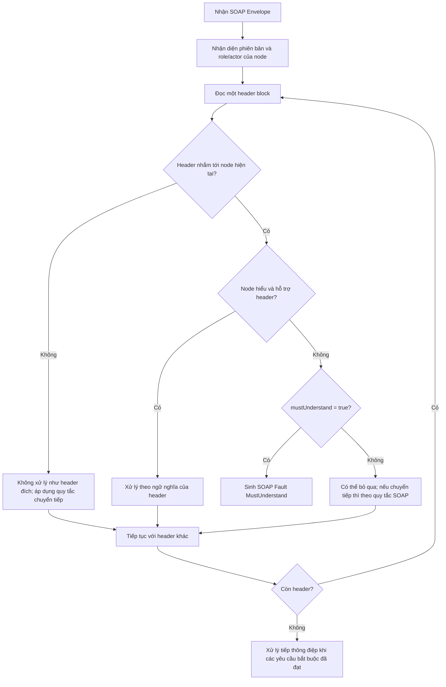

# mustUnderstand, actor, role và trách nhiệm xử lý header trong SOAP

## Mục tiêu học tập

Sau bài học, bạn có thể:

- Phân biệt **SOAP Header**, **header block** và **SOAP Body**, giải thích vì sao các thành phần trung gian cần xử lý header riêng với payload nghiệp vụ.
- Hiểu chính xác ý nghĩa của `mustUnderstand` trong SOAP 1.1 và SOAP 1.2: **node nhận đúng vai trò phải hiểu và xử lý một header bắt buộc**, nếu không phải sinh SOAP Fault.
- Phân biệt thuộc tính `actor` của SOAP 1.1 với `role` của SOAP 1.2; nhận biết các URI vai trò định nghĩa sẵn và giá trị mặc định.
- Xác định trách nhiệm của **sender**, **intermediary** (nút trung gian) và **ultimate receiver** (nút đích cuối cùng) khi một thông điệp đi qua nhiều hệ thống.
- Biết ý nghĩa của `relay` trong SOAP 1.2 và giới hạn của cơ chế chuyển tiếp header.
- Vận dụng các quy tắc trên vào dịch vụ **Spring Web Services (Spring-WS)** phát triển theo hướng **contract-first**, có XSD/WSDL, JAXB, interceptor, WS-Security và SOAP Fault.

## 1. Vì sao SOAP cần header?

SOAP là giao thức trao đổi thông điệp dựa trên XML. **Body** mang dữ liệu nghiệp vụ chính (ví dụ `GetOrderRequest`), còn **Header** chứa các khối thông tin bổ trợ phục vụ việc xử lý thông điệp: bảo mật, định tuyến, tương quan yêu cầu, giao dịch, chính sách hoặc theo dõi luồng xử lý.

Ví dụ một bản tin SOAP 1.1:

```xml
<?xml version="1.0" encoding="UTF-8"?>
<soap:Envelope
    xmlns:soap="http://schemas.xmlsoap.org/soap/envelope/"
    xmlns:ord="urn:example:orders:v1"
    xmlns:trk="urn:example:tracking:v1">
    <soap:Header>
        <trk:CorrelationId soap:mustUnderstand="0">req-2026-001</trk:CorrelationId>
    </soap:Header>
    <soap:Body>
        <ord:GetOrderRequest>
            <ord:orderId>42</ord:orderId>
        </ord:GetOrderRequest>
    </soap:Body>
</soap:Envelope>
```

Trong ví dụ:

- `soap:Envelope` là phần tử gốc của thông điệp.
- `soap:Header` là nơi đặt các **header block**. `trk:CorrelationId` là một header block vì nó là *phần tử con trực tiếp* của `Header`.
- `soap:Body` chứa payload nghiệp vụ `ord:GetOrderRequest`.
- `soap:mustUnderstand="0"` cho biết header `CorrelationId` không bắt buộc phải được hiểu theo quy tắc `mustUnderstand`.

Đừng nhầm **SOAP Header** với **HTTP header**. `soap:Header` nằm *trong XML Envelope*, còn các trường như `Content-Type` hay `SOAPAction`, khi áp dụng, thuộc lớp truyền tải HTTP. Cũng đừng nhầm header block với mọi phần tử lồng sâu bên trong nó: các thuộc tính xử lý của SOAP gắn vào **header block**, không tự động gắn cho từng phần tử con.

### Luồng thông điệp có trung gian

```text
Ứng dụng gọi dịch vụ
        |
        v
SOAP client ----[Envelope + Header + Body]----> Gateway
                                             (intermediary)
                                                    |
                                           xử lý header được nhắm tới
                                                    |
                                                    v
                                              SOAP endpoint
                                           (ultimate receiver)
                                                    |
                                              xử lý nghiệp vụ
```

Gateway và endpoint cuối có thể **không cùng trách nhiệm**. Một header chứa chính sách bảo mật cho gateway không nhất thiết phải được endpoint nghiệp vụ diễn giải, và ngược lại. Thuộc tính `actor`/`role` cho biết header được nhắm tới **loại node hoặc vai trò nào**, còn `mustUnderstand` quy định **nghĩa vụ hiểu/xử lý** của node đã được nhắm tới.

## 2. Header block, namespace và thuộc tính xử lý của SOAP

Các thuộc tính điều khiển SOAP phải thuộc **namespace của phiên bản SOAP tương ứng**. Chúng xuất hiện trên phần tử header block, chẳng hạn:

```xml
<sec:Security
    xmlns:sec="urn:example:security:v1"
    xmlns:soap="http://schemas.xmlsoap.org/soap/envelope/"
    soap:mustUnderstand="1"
    soap:actor="http://schemas.xmlsoap.org/soap/actor/next">
    <sec:Token>example-token</sec:Token>
</sec:Security>
```

Đây là một **minh họa header bảo mật tự định nghĩa**; `sec:Security` ở ví dụ này không phải cú pháp WS-Security chuẩn. Điểm cần chú ý là `soap:mustUnderstand` và `soap:actor` thuộc namespace Envelope của **SOAP 1.1**, không phải namespace `sec`. Việc dùng cùng tên thuộc tính nhưng bỏ tiền tố SOAP sẽ thay đổi nghĩa:

```xml
<!-- Không tương đương: mustUnderstand ở đây không nằm trong namespace SOAP -->
<sec:Security xmlns:sec="urn:example:security:v1"
              mustUnderstand="1"/>
```

Một SOAP node phải xét **tên đầy đủ** của thuộc tính (namespace URI và local name), không chỉ xét chuỗi ký tự hiển thị. Tương tự, tên header `sec:Security` được xác định bằng cặp namespace URI + `Security`; tiền tố `sec` có thể thay đổi mà không đổi định danh phần tử.

## 3. mustUnderstand: yêu cầu phải hiểu và xử lý header

`mustUnderstand` là thuộc tính của **header block**, cho phép sender nói với SOAP node được nhắm tới rằng: *Header này là điều kiện bắt buộc để xử lý đúng thông điệp*.

### 3.1. Giá trị hợp lệ theo phiên bản

| Nội dung | SOAP 1.1 | SOAP 1.2 |
| --- | --- | --- |
| Namespace Envelope | `http://schemas.xmlsoap.org/soap/envelope/` | `http://www.w3.org/2003/05/soap-envelope` |
| Thuộc tính | `env:mustUnderstand` | `env:mustUnderstand` |
| Giá trị biểu thị bắt buộc | `"1"` | `"true"` hoặc `"1"` |
| Giá trị biểu thị không bắt buộc | `"0"` | `"false"` hoặc `"0"` |
| Khi không khai báo | Tương đương không bắt buộc | Tương đương không bắt buộc |
| Khi node đích không hiểu header bắt buộc | Sinh SOAP Fault mã `MustUnderstand` | Sinh SOAP Fault có `env:Code/env:Value` là `env:MustUnderstand` |

**Không dùng `mustUnderstand="true"` trong SOAP 1.1**: SOAP 1.1 quy định giá trị `0` hoặc `1`. Trong SOAP 1.2, thuộc tính này tuân theo biểu diễn boolean phù hợp và có thể dùng `true/false` hoặc `1/0`.

### 3.2. Điều kiện để phải xử lý

Quy tắc chính gồm hai điều kiện **đồng thời**:

1. Header block được **nhắm tới** SOAP node hiện tại (theo `actor` hoặc `role`).
2. Header block có `mustUnderstand` mang giá trị **true**.

Khi cả hai đúng, node phải **hiểu và xử lý header theo ngữ nghĩa được định nghĩa cho header đó**, hoặc tạo SOAP Fault `MustUnderstand`. Không được âm thầm bỏ qua rồi tiếp tục xử lý body như thể không có header.

Nếu `mustUnderstand` là false hoặc vắng mặt, SOAP không bắt node phải hiểu header đó theo quy tắc này. Tuy nhiên, *không bắt buộc theo giao thức* không đồng nghĩa với *không quan trọng với nghiệp vụ*: chính sách ứng dụng vẫn có thể yêu cầu xử lý, kiểm tra hoặc từ chối thông điệp vì lý do riêng.

Nếu header bắt buộc được gửi cho **node khác**, nó không làm node hiện tại phải phát sinh `MustUnderstand` Fault chỉ vì node hiện tại không hiểu nội dung. Việc chuyển tiếp thông điệp vẫn phải tuân thủ mô hình xử lý SOAP.

### 3.3. “Understand” không chỉ là đọc được XML

“Hiểu” một header không đơn thuần là parser đọc được XML hay schema cho phép phần tử đó tồn tại. Node phải có phần mềm thực thi **ý nghĩa xử lý của header**.

Ví dụ, header yêu cầu xác thực chữ ký không được coi là đã xử lý chỉ vì gateway đã đọc tên phần tử `Security`. Gateway phải thực hiện bước xác minh tương ứng. Nếu không hỗ trợ loại header bắt buộc, lỗi `MustUnderstand` là phù hợp; nếu đã hỗ trợ nhưng chữ ký **không hợp lệ**, đó là lỗi xử lý hoặc bảo mật theo đặc tả áp dụng, không nên mặc định diễn giải thành “không hiểu header”.

> `mustUnderstand="1"` không làm cho một header trở nên bảo mật hơn. Thuộc tính chỉ biểu thị **nghĩa vụ xử lý**; việc bảo mật thật sự phụ thuộc vào xác minh chữ ký, token, timestamp, chứng chỉ, chính sách tin cậy và các biện pháp phù hợp.

## 4. SOAP 1.1: actor xác định node nhận header

Trong **SOAP 1.1**, thuộc tính `soap:actor` chỉ ra SOAP actor dự kiến xử lý header. Giá trị là một URI; hệ thống phải có cách xác định vai trò mà từng node đảm nhiệm.

### 4.1. Ba tình huống thường gặp

**Không có `actor`:** header được nhắm tới **ultimate receiver**, tức node đích cuối cùng của đường đi SOAP.

```xml
<trk:CorrelationId
    xmlns:trk="urn:example:tracking:v1"
    soap:mustUnderstand="1"
    xmlns:soap="http://schemas.xmlsoap.org/soap/envelope/">
    req-2026-001
</trk:CorrelationId>
```

**`actor="http://schemas.xmlsoap.org/soap/actor/next"`:** header được nhắm tới **SOAP node kế tiếp** trên đường xử lý thông điệp. Đây là URI actor đặc biệt được SOAP 1.1 định nghĩa.

```xml
<gw:GatewayPolicy
    xmlns:gw="urn:example:gateway:v1"
    xmlns:soap="http://schemas.xmlsoap.org/soap/envelope/"
    soap:actor="http://schemas.xmlsoap.org/soap/actor/next"
    soap:mustUnderstand="1">
    enforce-policy-v1
</gw:GatewayPolicy>
```

**`actor="urn:example:roles:audit-gateway"`:** header được nhắm tới node đảm nhận actor do hệ thống định nghĩa. URI này không tự tạo tuyến đường mạng; chỉ node được thiết kế/cấu hình đảm nhiệm actor đó mới là đối tượng xử lý phù hợp.

```xml
<aud:AuditContext
    xmlns:aud="urn:example:audit:v1"
    xmlns:soap="http://schemas.xmlsoap.org/soap/envelope/"
    soap:actor="urn:example:roles:audit-gateway"
    soap:mustUnderstand="1">
    order-read
</aud:AuditContext>
```

### 4.2. Trách nhiệm của intermediary trong SOAP 1.1

Một intermediary xử lý các header block **được nhắm tới mình**. Nếu header đó có `mustUnderstand="1"` mà không thể hiểu và xử lý, intermediary phải trả về SOAP Fault. Khi trung gian chuyển tiếp bản tin, các header mà nó đã xử lý dành cho chính nó không mặc nhiên được giữ nguyên như thể chưa xử lý; nếu cần truyền kết quả xuống node sau, cơ chế giao thức có thể tạo header thích hợp cho chặng tiếp theo.

Lưu ý: `actor/next` nghĩa là **node xử lý kế tiếp**, không có nghĩa là “chỉ gateway đầu tiên trên mọi hệ thống” hoặc “endpoint cuối cùng”. Khi bản tin được chuyển tiếp qua nhiều hop, một header `actor/next` còn xuất hiện trên thông điệp chuyển tiếp có thể lại được nhắm tới hop kế tiếp.

## 5. SOAP 1.2: role thay cho actor, thêm relay

SOAP 1.2 dùng thuộc tính `env:role` (không dùng `env:actor` như SOAP 1.1). Cách xác định node đích cụ thể hơn nhờ các **role URI chuẩn**:

| Vai trò SOAP 1.2 | URI | Ý nghĩa |
| --- | --- | --- |
| `next` | `http://www.w3.org/2003/05/soap-envelope/role/next` | Mọi SOAP node nhận và xử lý bản tin trên đường đi có thể đảm nhiệm role này, gồm intermediary và ultimate receiver. |
| `ultimateReceiver` | `http://www.w3.org/2003/05/soap-envelope/role/ultimateReceiver` | Node đích cuối cùng. Đây cũng là role mặc định khi header block không có `role`. |
| `none` | `http://www.w3.org/2003/05/soap-envelope/role/none` | Không SOAP node nào được nhận xử lý header với tư cách role này. Hữu ích khi muốn mang thông tin qua các hop mà không nhắm đến node nào để xử lý. |
| Role tùy biến | Ví dụ `urn:example:roles:security-gateway` | Chỉ những node đảm nhiệm role do hệ thống quy định mới là đối tượng xử lý. |

SOAP 1.2 **không định nghĩa** thuộc tính `actor` trên header theo cách SOAP 1.1. Ngược lại, `role` và `relay` của SOAP 1.2 không phải thuộc tính điều khiển tương đương trong SOAP 1.1.

### 5.1. Ví dụ role tùy biến

```xml
<?xml version="1.0" encoding="UTF-8"?>
<env:Envelope
    xmlns:env="http://www.w3.org/2003/05/soap-envelope"
    xmlns:gw="urn:example:gateway:v1"
    xmlns:ord="urn:example:orders:v1">
    <env:Header>
        <gw:Policy
            env:role="urn:example:roles:security-gateway"
            env:mustUnderstand="true">policy-v1</gw:Policy>
    </env:Header>
    <env:Body>
        <ord:GetOrderRequest>
            <ord:orderId>42</ord:orderId>
        </ord:GetOrderRequest>
    </env:Body>
</env:Envelope>
```

Nếu gateway được cấu hình đảm nhiệm role `urn:example:roles:security-gateway`, nó phải hiểu và xử lý `gw:Policy`. Nếu gateway không đảm nhiệm role đó, chỉ riêng giá trị `mustUnderstand="true"` **không khiến gateway phải xử lý** header.

### 5.2. relay trong SOAP 1.2

SOAP 1.2 có thêm thuộc tính `env:relay` trên header block để điều khiển việc **chuyển tiếp header chưa được xử lý** ở intermediary. Thuộc tính này nhận giá trị boolean, thường viết `"true"` hoặc `"false"` (cũng có thể `"1"` hoặc `"0"`). Khi vắng mặt, giá trị mặc định là false.

Ví dụ:

```xml
<diag:TraceContext
    xmlns:diag="urn:example:diagnostics:v1"
    xmlns:env="http://www.w3.org/2003/05/soap-envelope"
    env:role="urn:example:roles:observability"
    env:mustUnderstand="false"
    env:relay="true">
    trace-abc
</diag:TraceContext>
```

Một intermediary được nhắm tới nhưng **không xử lý** header tùy chọn này có thể phải chuyển tiếp nó theo quy tắc `relay`, để hop sau còn có cơ hội dùng. Với các header không nhắm tới intermediary hiện tại, quá trình chuyển tiếp còn phụ thuộc các quy tắc chung về relay và đường đi của SOAP.

Cần phân biệt:

- `mustUnderstand` quyết định **khi nào node được nhắm tới bắt buộc hiểu/xử lý**.
- `role` quyết định **header nhắm tới ai**.
- `relay` liên quan đến **việc giữ/chuyển tiếp header chưa xử lý** khi thông điệp đi qua intermediary.

`relay="true"` **không xóa nghĩa vụ** xử lý một header `mustUnderstand="true"` được nhắm tới node hiện tại. Intermediary không thể tùy tiện chuyển tiếp một header bắt buộc mà nó không hiểu để né lỗi `MustUnderstand`.

## 6. Quy trình quyết định xử lý một SOAP Header

Mỗi SOAP node cần xác định vai trò của mình và chọn những header block được nhắm tới mình. Có thể dùng quy trình tư duy sau:



Sơ đồ minh họa quyết định về **khả năng hiểu header**. Nếu node hiểu header nhưng **xử lý thất bại** (ví dụ token sai, chữ ký không khớp), thông điệp vẫn có thể phải dừng và phát sinh một SOAP Fault thích hợp khác tùy đặc tả và chính sách.

### 6.1. Bảng quyết định nhanh

| Nhắm tới node hiện tại? | `mustUnderstand` | Node hiểu và xử lý được? | Kết quả theo quy tắc mustUnderstand |
| --- | --- | --- | --- |
| Có | True | Có | Phải thực hiện việc xử lý bắt buộc; nếu thành công thì tiếp tục. |
| Có | True | Không | **Bắt buộc phát sinh Fault `MustUnderstand`.** |
| Có | False/vắng mặt | Không | SOAP không buộc sinh `MustUnderstand`; có thể bỏ qua theo chính sách. |
| Có | False/vắng mặt | Có | Có thể xử lý theo nhu cầu hoặc quy tắc ứng dụng. |
| Không | True | Không | Không phát sinh `MustUnderstand` chỉ vì node hiện tại không hiểu; xử lý tuyến/chuyển tiếp theo giao thức. |
| Không | False/vắng mặt | Bất kỳ | Không có nghĩa vụ xử lý theo cơ chế mustUnderstand tại node này. |

Đừng suy luận rằng **bất cứ header nào có mustUnderstand=true cũng phải được mọi node xử lý**. Điều kiện được nhắm tới bởi `actor`/`role` là thiết yếu.

## 7. Ví dụ thực tế: client → gateway → endpoint

Giả sử ứng dụng gửi yêu cầu đọc đơn hàng qua một gateway bảo mật trước khi tới endpoint nghiệp vụ.

### 7.1. SOAP 1.1: header bắt buộc cho hop kế tiếp

```xml
<?xml version="1.0" encoding="UTF-8"?>
<soap:Envelope
    xmlns:soap="http://schemas.xmlsoap.org/soap/envelope/"
    xmlns:gw="urn:example:gateway:v1"
    xmlns:ord="urn:example:orders:v1"
    xmlns:trk="urn:example:tracking:v1">
    <soap:Header>
        <gw:GatewayPolicy
            soap:actor="http://schemas.xmlsoap.org/soap/actor/next"
            soap:mustUnderstand="1">validate-client</gw:GatewayPolicy>
        <trk:CorrelationId soap:mustUnderstand="0">req-001</trk:CorrelationId>
    </soap:Header>
    <soap:Body>
        <ord:GetOrderRequest>
            <ord:orderId>42</ord:orderId>
        </ord:GetOrderRequest>
    </soap:Body>
</soap:Envelope>
```

Diễn giải:

1. **Client:** chọn `gw:GatewayPolicy` với `actor/next` và `mustUnderstand="1"` vì chính sách gateway là điều kiện bắt buộc trước khi xử lý yêu cầu. Header `trk:CorrelationId` không có actor nên mặc định nhắm tới ultimate receiver.
2. **Gateway:** là SOAP node kế tiếp, vì vậy `gw:GatewayPolicy` được nhắm tới nó. Nếu không hỗ trợ `GatewayPolicy`, gateway phải tạo SOAP Fault `MustUnderstand`. Nếu hiểu, gateway thực hiện chính sách; nếu kiểm tra thất bại, trả lỗi thích hợp.
3. **Chuyển tiếp:** nếu gateway đã xử lý `GatewayPolicy` thành công, thông điệp chuyển tiếp không nên vô tình khiến backend phải xử lý lại cùng header bắt buộc như một `actor/next` chưa được giải quyết. Việc loại bỏ hoặc thay thế header phải tuân thủ quy tắc forwarding của SOAP và chính sách hệ thống.
4. **Endpoint cuối:** nhận payload `ord:GetOrderRequest` và header `trk:CorrelationId` nhắm tới mình. Vì `mustUnderstand="0"`, việc endpoint không hiểu correlation ID không tự tạo lỗi `MustUnderstand`; ứng dụng vẫn có thể yêu cầu header này theo chính sách riêng.

Header `gw:GatewayPolicy` là ví dụ đào tạo tự định nghĩa. Trong tích hợp thật, nếu triển khai WS-Security, cần dùng đúng cấu trúc header và chuẩn token/chữ ký theo hồ sơ WS-Security áp dụng.

### 7.2. SOAP 1.2: role rõ ràng và header relay

```xml
<?xml version="1.0" encoding="UTF-8"?>
<env:Envelope
    xmlns:env="http://www.w3.org/2003/05/soap-envelope"
    xmlns:gw="urn:example:gateway:v1"
    xmlns:obs="urn:example:observability:v1"
    xmlns:ord="urn:example:orders:v1">
    <env:Header>
        <gw:GatewayPolicy
            env:role="urn:example:roles:security-gateway"
            env:mustUnderstand="true">validate-client</gw:GatewayPolicy>
        <obs:Trace
            env:role="urn:example:roles:observability"
            env:mustUnderstand="false"
            env:relay="true">trace-001</obs:Trace>
    </env:Header>
    <env:Body>
        <ord:GetOrderRequest>
            <ord:orderId>42</ord:orderId>
        </ord:GetOrderRequest>
    </env:Body>
</env:Envelope>
```

Trong ví dụ này, gateway **phải được cấu hình đảm nhiệm** role `urn:example:roles:security-gateway` để header chính sách nhắm tới nó. Trace header dùng role khác và `relay=true` để hỗ trợ luồng chuyển tiếp nếu chưa được xử lý. Việc header đến được node quan sát hay không còn phụ thuộc tuyến SOAP, các role được node đảm nhiệm và quy tắc xử lý của từng intermediary; `role` không phải địa chỉ định tuyến HTTP.

## 8. Khi nào phát sinh SOAP Fault MustUnderstand?

Một node được nhắm tới bởi header bắt buộc mà không hiểu ngữ nghĩa của header phải **dừng quy trình xử lý tương ứng** và phát sinh SOAP Fault `MustUnderstand`. Cú pháp Fault khác giữa SOAP 1.1 và SOAP 1.2.

### 8.1. SOAP 1.1 Fault

```xml
<?xml version="1.0" encoding="UTF-8"?>
<soap:Envelope xmlns:soap="http://schemas.xmlsoap.org/soap/envelope/">
    <soap:Body>
        <soap:Fault>
            <faultcode>soap:MustUnderstand</faultcode>
            <faultstring>Header GatewayPolicy bắt buộc nhưng không được hỗ trợ</faultstring>
        </soap:Fault>
    </soap:Body>
</soap:Envelope>
```

Trong SOAP 1.1, `faultcode` mang giá trị QName `soap:MustUnderstand`; `faultstring` cung cấp lý do ở dạng văn bản. Một SOAP Fault là thành phần của **Body**, không đặt trực tiếp trong Header. Lỗi này nói về nghĩa vụ hiểu header, **không trực tiếp khẳng định** token hoặc chữ ký đã bị xác định sai.

### 8.2. SOAP 1.2 Fault

```xml
<?xml version="1.0" encoding="UTF-8"?>
<env:Envelope xmlns:env="http://www.w3.org/2003/05/soap-envelope">
    <env:Body>
        <env:Fault>
            <env:Code>
                <env:Value>env:MustUnderstand</env:Value>
            </env:Code>
            <env:Reason>
                <env:Text xml:lang="vi">Header bắt buộc không được hỗ trợ</env:Text>
            </env:Reason>
        </env:Fault>
    </env:Body>
</env:Envelope>
```

SOAP 1.2 dùng `env:Code` và `env:Reason` thay cho `faultcode` và `faultstring`. Trong SOAP 1.2 còn có thể dùng header chuẩn `env:NotUnderstood` để chỉ rõ header block nào không được hiểu theo đặc tả. Để tương thích, client cần phân tích Fault theo **đúng phiên bản Envelope**, không áp dụng cùng một XPath trích `faultcode` cho cả hai phiên bản.

### 8.3. Phân biệt MustUnderstand với các lỗi khác

| Tình huống | Cách phân loại hợp lý |
| --- | --- |
| Header bắt buộc nhắm tới node nhưng node không triển khai ngữ nghĩa header. | SOAP `MustUnderstand`. |
| Node hiểu header chữ ký nhưng xác minh chữ ký thất bại. | Lỗi bảo mật theo chính sách/WS-Security (SOAP Fault tương ứng), không mặc định là `MustUnderstand`. |
| Header XML sai cấu trúc, SOAP Envelope sai phiên bản hoặc không thể parse. | Lỗi cú pháp/phiên bản/bản tin; không đánh đồng với `MustUnderstand`. |
| Body sai XSD của hợp đồng sau khi đọc thông điệp. | Lỗi validation/payload theo cơ chế của dịch vụ, không nhất thiết là `MustUnderstand`. |
| Endpoint xử lý được header nhưng dữ liệu nghiệp vụ không tồn tại. | Lỗi nghiệp vụ hoặc SOAP Fault nghiệp vụ tùy hợp đồng. |

## 9. Liên hệ với Spring Web Services và contract-first

Trong module `SPRING_WEB_SERVICES`, ta xây dựng dịch vụ SOAP theo hướng **contract-first**: thiết kế XSD cho payload, công bố hoặc duy trì WSDL, ánh xạ XML qua JAXB và xử lý bằng Spring-WS endpoint. Cần nhận ra ranh giới trách nhiệm:

| Tầng | Trách nhiệm điển hình với SOAP Header |
| --- | --- |
| **Hợp đồng XSD/WSDL** | Mô tả phần tử payload, kiểu dữ liệu; WSDL có thể mô tả header được truyền theo binding và cách các bên trao đổi thông điệp. Bản thân WSDL/XSD không thay thế quy tắc xử lý header khi chạy thực tế. |
| **SOAP message/stack** | Nhận biết phiên bản Envelope, phần Header/Body và quy tắc xử lý SOAP, bao gồm những yêu cầu `mustUnderstand` khi áp dụng. |
| **Intermediary/gateway** | Đảm nhiệm các actor/role đã cấu hình, xử lý header nhắm tới mình, tạo Fault hoặc chuyển tiếp theo giao thức. |
| **Interceptor của Spring-WS** | Xử lý yêu cầu trước/sau endpoint; phù hợp cho kiểm tra bảo mật, log/correlation, kiểm tra header và các chính sách dùng chung. |
| **Endpoint Spring-WS** | Xử lý payload nghiệp vụ khi các điều kiện thông điệp liên quan đã được đáp ứng; có thể truy cập header khi nghiệp vụ thực sự cần. |
| **JAXB** | Ánh xạ XML payload (và các kiểu được cấu hình) sang đối tượng Java; không tự xác nhận mọi header SOAP đã được hiểu/xử lý. |
| **SOAP client** | Tạo Envelope và các header cần thiết theo hợp đồng, phiên bản SOAP, role/actor và chính sách bảo mật đã thỏa thuận. |

### 9.1. Endpoint và header không phải cùng một bài toán

Ví dụ một endpoint được ánh xạ theo payload root:

```java
@Endpoint
public class OrderEndpoint {
    private static final String NS = "urn:example:orders:v1";

    @PayloadRoot(namespace = NS, localPart = "GetOrderRequest")
    @ResponsePayload
    public GetOrderResponse getOrder(@RequestPayload GetOrderRequest request) {
        // Xử lý nghiệp vụ sau các bước xác nhận/xử lý thông điệp cần thiết.
        GetOrderResponse response = new GetOrderResponse();
        // Đặt dữ liệu trả về theo mô hình JAXB của dự án.
        return response;
    }
}
```

Đoạn Java chỉ minh họa **định tuyến endpoint theo payload**, giả sử các kiểu JAXB tương ứng đã được định nghĩa. `@PayloadRoot` không bảo đảm rằng mọi SOAP header bắt buộc đều đã được xử lý, và không thay thế cơ chế bảo mật. Đừng đánh đồng “route đúng endpoint” với “thỏa yêu cầu header”.

### 9.2. Nơi xử lý header trong ứng dụng

Một thiết kế Spring-WS thực tế thường phân việc như sau:

1. **SOAP client** tạo header với namespace và giá trị `mustUnderstand` phù hợp, đồng thời không trộn thuộc tính SOAP 1.1/1.2.
2. **Gateway (nếu có)** xác định actor/role mà nó thực sự đảm nhiệm, kiểm tra các header bắt buộc được nhắm tới và chuyển tiếp thông điệp an toàn.
3. **Security interceptor** (ví dụ interceptor dùng WSS4J khi triển khai WS-Security) xác minh các yêu cầu như chữ ký, timestamp hoặc token trước khi cho phép thao tác nghiệp vụ. Cần xác nhận cấu hình về version, bộ xác thực, khóa/chứng chỉ và xử lý Fault.
4. **Custom interceptor** hoặc thành phần xử lý SOAP message đảm nhiệm các header đặc thù như correlation, giao dịch hay chính sách riêng. Xác nhận nó đọc đúng namespace/local name và có hành vi rõ ràng khi không hỗ trợ.
5. **Endpoint** tập trung vào payload đã được phép xử lý; nếu cần dữ liệu header, sử dụng cơ chế truy cập header thích hợp với API Spring-WS đang dùng.
6. **Client và server** kiểm thử các trường hợp có/không có header, sai role, sai namespace, header bắt buộc không hiểu và header bảo mật không hợp lệ.

Chính sách xử lý **tự động** `mustUnderstand` ở một ứng dụng cụ thể phụ thuộc vào SOAP stack, bộ xử lý thông điệp, các interceptor và cấu hình triển khai. Không nên mặc định rằng chỉ vì cấu hình WSDL hay có một interceptor bất kỳ, Spring-WS sẽ tự động thực thi mọi header tùy biến.

### 9.3. WS-Security không chỉ là một nhãn header

Trong tích hợp bảo mật, header WS-Security mang các cấu trúc chuẩn, chẳng hạn thông tin token, timestamp, chữ ký hoặc dữ liệu tham chiếu cần kiểm tra. Nếu sender đánh dấu header bảo mật là bắt buộc đối với node nhận, node không thể chỉ thấy tên header rồi coi như đã hiểu.

Những việc cần kiểm tra thường gồm: thuật toán/chính sách cho phép, tính hợp lệ của token, chứng chỉ và chuỗi tin cậy, tính toàn vẹn chữ ký, giới hạn thời gian và phòng chống replay theo chính sách. Thất bại **xác minh bảo mật** phải được xử lý theo cơ chế lỗi bảo mật tương ứng; `MustUnderstand` chỉ dành cho tình huống không thể hiểu/xử lý ngữ nghĩa header bắt buộc.

Vì vậy, ba cơ chế có mục đích khác nhau: **XSD validation** bảo đảm dữ liệu hợp đồng; **mustUnderstand** buộc node đích xử lý một header; **WS-Security** xác minh các yêu cầu bảo mật thực tế.

## 10. Những nhầm lẫn thường gây lỗi tích hợp

### “Header có mustUnderstand=true thì mọi hop đều phải hiểu”

Sai. Chỉ SOAP node được **nhắm tới** bởi `actor`/`role` mới chịu nghĩa vụ đó. Một header bảo mật dành cho role gateway tùy biến không tự động phải được endpoint nghiệp vụ ở phía sau hiểu.

### “actor và role đổi tên cho nhau là đủ”

Không đúng. `actor` là thuộc tính của SOAP 1.1; `role` là thuộc tính của SOAP 1.2. Namespace Envelope, giá trị hợp lệ của `mustUnderstand`, các URI role chuẩn và hình dạng SOAP Fault đều khác nhau.

### “Chỉ cần đặt role URI trong XML thì gateway sẽ nhận được thông điệp”

Không. `actor`/`role` chỉ định **trách nhiệm xử lý header ở cấp SOAP**; chúng không thay thế DNS, URL, HTTP routing hay cấu hình gateway. Một role tùy biến chỉ có tác dụng khi node được thiết kế đảm nhiệm role đó.

### “Header có mustUnderstand=false thì phải bỏ qua”

Không. Nó chỉ không yêu cầu hành vi bắt buộc theo cơ chế `mustUnderstand`. Node vẫn có thể hiểu/xử lý header, và ứng dụng có thể đặt chính sách riêng.

### “relay=true giúp không cần hiểu header bắt buộc”

Không. Nếu node hiện tại được nhắm tới bởi một header bắt buộc nhưng không hiểu, nó không thể dùng `relay` như cách né lỗi. `relay` của SOAP 1.2 điều chỉnh việc chuyển tiếp header **chưa được xử lý** theo quy tắc giao thức.

### “Khai báo header ở WSDL là bảo đảm an toàn”

Không. WSDL mô tả hợp đồng; thực thi lúc chạy vẫn phải xác nhận namespace, role, giá trị `mustUnderstand`, quy tắc forwarding và cơ chế bảo mật thực sự.

## 11. Kiểm thử tương thích SOAP Header

Khi kiểm thử endpoint hoặc hệ thống tích hợp Spring-WS, hãy tạo **bản tin SOAP thật** và kiểm tra cả phản hồi lẫn hành vi của các intermediary. Chỉ gọi trực tiếp phương thức Java của endpoint sẽ bỏ qua nhiều cơ chế xử lý SOAP.

| Tình huống kiểm thử | Điều cần quan sát |
| --- | --- |
| Header bắt buộc, đúng role, node có hỗ trợ. | Header được xử lý; request chỉ tiếp tục khi các điều kiện bắt buộc đạt. |
| Header bắt buộc, đúng role, node không hỗ trợ. | Sinh SOAP Fault `MustUnderstand`; không lặng lẽ bỏ qua. |
| Header bắt buộc nhưng nhắm role khác. | Node hiện tại không sinh `MustUnderstand` chỉ vì không hiểu; quan sát forwarding. |
| Header tùy chọn, đúng role, node không hỗ trợ. | Không bắt buộc trả `MustUnderstand`; hành vi ứng dụng phải có chủ đích. |
| SOAP 1.1 dùng `actor/next`. | Node kế tiếp nhận nghĩa vụ xử lý; kiểm tra việc chuyển tiếp sau khi xử lý. |
| SOAP 1.2 dùng role `none`. | Không node nào xử lý như header được nhắm tới role đó; quan sát quy tắc relay. |
| SOAP 1.2 có `relay=true` trên header chưa xử lý. | Kiểm tra header có được chuyển tiếp theo quy tắc SOAP ở mỗi hop liên quan. |
| Gửi header sai namespace SOAP hoặc sai phiên bản. | Kiểm tra parser/stack từ chối hoặc không coi đó là thuộc tính điều khiển đúng; không âm thầm hiểu nhầm. |
| Header WS-Security được nhận diện nhưng chứng thực thất bại. | Lỗi bảo mật đúng loại, không mặc nhiên trả `MustUnderstand`. |
| Dịch vụ SOAP 1.1 và client SOAP 1.2 không khớp. | Lỗi version/binding rõ ràng thay vì xử lý sai nội dung. |

Khi kiểm thử, ghi lại tối thiểu: **SOAP version**, namespace của Envelope và header, **actor/role mà node đảm nhiệm**, giá trị `mustUnderstand`/`relay`, node/hop xử lý, phản hồi SOAP Fault và trạng thái nghiệp vụ. Nếu dùng bộ SOAP message mock, bổ sung kiểm thử tích hợp qua gateway/HTTP thật để kiểm chứng đường chuyển tiếp.

## 12. Bài tập thực hành và đáp án

### Bài 1. mustUnderstand có tạo lỗi ở gateway?

Client gửi SOAP 1.2 với header:

```xml
<cust:Context
    xmlns:cust="urn:example:customer:v1"
    xmlns:env="http://www.w3.org/2003/05/soap-envelope"
    env:role="http://www.w3.org/2003/05/soap-envelope/role/ultimateReceiver"
    env:mustUnderstand="true">VIP</cust:Context>
```

Gateway không phải ultimate receiver và không hiểu `cust:Context`. Gateway có bắt buộc trả `MustUnderstand` Fault không?

**Đáp án:** Không, chỉ vì không hiểu header này. Header nhắm tới ultimate receiver, nên nghĩa vụ `mustUnderstand` thuộc về node cuối. Gateway vẫn phải tuân thủ các quy tắc SOAP về chuyển tiếp header không nhắm tới mình.

### Bài 2. Bắt buộc nhưng không hỗ trợ

Một gateway SOAP 1.1 nhận `gw:GatewayPolicy` có `soap:actor="http://schemas.xmlsoap.org/soap/actor/next"` và `soap:mustUnderstand="1"`. Gateway không triển khai ý nghĩa của header. Có thể chuyển thẳng request đến endpoint không?

**Đáp án:** Không. Header được nhắm tới gateway và bắt buộc phải hiểu/xử lý. Gateway phải sinh SOAP Fault `MustUnderstand`, không được bỏ qua để tiếp tục theo đường bình thường.

### Bài 3. Nhận diện lỗi phiên bản

Một client gửi Envelope SOAP 1.1 nhưng đặt `soap:mustUnderstand="true"` và `soap:role="urn:example:roles:gateway"`. Tại sao thông điệp không đúng mục đích?

**Đáp án:** SOAP 1.1 yêu cầu giá trị `mustUnderstand` dạng `"0"` hoặc `"1"` và dùng thuộc tính `actor` để định danh node nhận header, không dùng `role` của SOAP 1.2. Cần sửa cả giá trị và thuộc tính để khớp đúng SOAP 1.1; nếu muốn dùng `role`, phải thực hiện toàn bộ hợp đồng/Envelope theo SOAP 1.2.

### Bài 4. Phân biệt hiểu và xác minh

Một endpoint hỗ trợ WS-Security, nhận diện và phân tích header bảo mật, nhưng chữ ký XML không hợp lệ. Có nên tự động trả `MustUnderstand` không?

**Đáp án:** Không. Endpoint đã có khả năng hiểu loại header; vấn đề nằm ở **xác minh bảo mật thất bại**. Phản hồi cần tuân thủ lỗi bảo mật và chính sách tương ứng.

### Bài 5. Thiết kế header cho dịch vụ doanh nghiệp

Một hệ thống cần (a) gateway kiểm tra chính sách trước khi chuyển tiếp, (b) endpoint đích đọc mã tương quan nếu có. Hãy chọn cách biểu diễn ở mức SOAP.

**Gợi ý đáp án:** Đối với SOAP 1.1, gửi header chính sách gateway với `actor/next` và `mustUnderstand="1"` nếu gateway chính là SOAP node kế tiếp; gửi header correlation không có `actor` (mặc định nhắm ultimate receiver) và `mustUnderstand="0"` nếu tùy chọn. Với SOAP 1.2, dùng role tùy biến phù hợp cho gateway (node đã cấu hình đảm nhiệm role), đánh dấu chính sách `mustUnderstand="true"`, còn correlation có thể dùng role mặc định `ultimateReceiver` và `mustUnderstand="false"`. Kiểm thử cả đường đi và lỗi khi header bắt buộc không được hỗ trợ.

## Ghi nhớ

**`actor` (SOAP 1.1) và `role` (SOAP 1.2) trả lời câu hỏi “node nào chịu trách nhiệm xử lý header?”. `mustUnderstand` trả lời câu hỏi “khi được nhắm tới, node có bắt buộc phải hiểu/xử lý header này không?”. `relay` trong SOAP 1.2 điều chỉnh việc chuyển tiếp header chưa xử lý qua intermediary.**

Ba cơ chế phối hợp để các bên thực thi đúng trách nhiệm khi thông điệp SOAP đi qua client, gateway và endpoint. Trong Spring Web Services, thực hiện điều này cần thiết kế hợp đồng rõ ràng, interceptor phù hợp, cấu hình WS-Security đúng, xử lý Fault chính xác và kiểm thử tương thích trên đường truyền thực tế.
