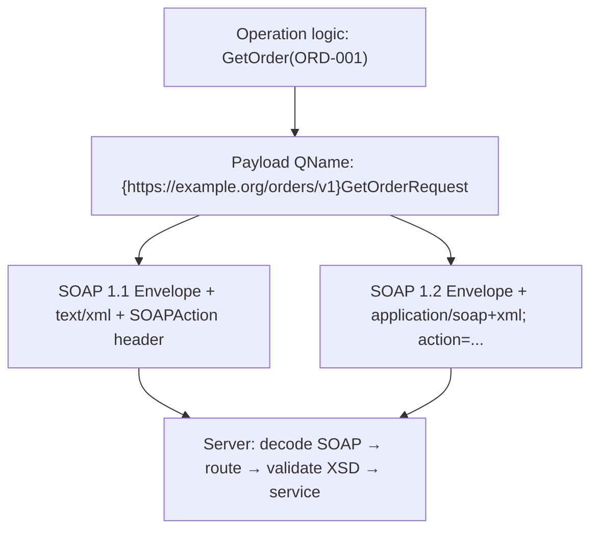

# SOAPAction trong SOAP 1.1 và tham số action trong SOAP 1.2

## 1. Vai trò của action khi gửi một SOAP message

Trong giao thức SOAP, phần **SOAP Envelope** chứa nội dung thông điệp XML; khi SOAP đi qua HTTP, các HTTP header cung cấp thêm thông tin cho bên nhận. Một trong những thông tin đó là **ý định xử lý thông điệp** (*intent of the message*), thường gọi là **action**.

Với **SOAP 1.1**, giá trị này nằm ở HTTP request header `SOAPAction`. Với **SOAP 1.2**, cơ chế tương đương là tham số `action` tùy chọn của media type `application/soap+xml`, nằm bên trong HTTP header `Content-Type`.

Đây là chủ đề quan trọng khi phát triển dịch vụ SOAP theo hướng **contract-first** bằng **Spring Web Services (Spring-WS)**: XSD mô tả cấu trúc XML, WSDL mô tả operation và SOAP binding, JAXB ánh xạ dữ liệu, còn endpoint/client phải phát và nhận metadata giao thức phù hợp với hợp đồng. Nếu gửi sai action, dịch vụ có thể không định tuyến được, bị gateway từ chối, hoặc không tương thích với client khác nền tảng, dù XML trong `Body` hoàn toàn hợp lệ.

Bài học sử dụng một thao tác minh họa xuyên suốt:

- **Operation nghiệp vụ:** `GetOrder` — tra cứu đơn hàng.
- **Action được công bố:** `urn:example:orders:GetOrder`.
- **Request element:** `{https://example.org/orders/v1}GetOrderRequest`.
- **Endpoint URL minh họa:** `https://api.example.org/ws/orders`.

Ba giá trị **action URI**, **QName của phần tử XML** và **endpoint URL** có vai trò khác nhau. Dù có thể trông giống nhau về tên, không được suy ra một giá trị từ giá trị khác khi hợp đồng chưa quy định.

### Kết quả học tập

Sau bài này, bạn có thể:

1. Phân biệt chính xác cách truyền action của SOAP 1.1 và SOAP 1.2 qua HTTP.
2. Đọc giá trị action từ WSDL, biết lúc nào action có thể rỗng hoặc vắng mặt.
3. Tạo request SOAP hợp lệ bằng HTTP/cURL và Spring-WS client.
4. Phân biệt action ở HTTP với `wsa:Action` của WS-Addressing.
5. Phân tích lỗi từ gateway, endpoint mapping, phiên bản SOAP và kiểm thử tương thích.

## 2. SOAP 1.1: HTTP header `SOAPAction`

### 2.1. Vị trí và ý nghĩa

Trong **SOAP 1.1 HTTP binding** (thường là HTTP POST), bên gửi phải có HTTP request header `SOAPAction`. Theo SOAP 1.1, giá trị header là **URI-reference** nhằm gợi ý ý định của request; URI này **không bắt buộc phải truy cập được bằng mạng**.

Ví dụ minh họa phần HTTP header:

```http
POST /ws/orders HTTP/1.1
Host: api.example.org
Content-Type: text/xml; charset=utf-8
SOAPAction: "urn:example:orders:GetOrder"
```

Phần SOAP Envelope XML được đặt trong **HTTP request body**, không phải trong `SOAPAction`. Với SOAP 1.1, media type thường dùng là `text/xml`; namespace của SOAP Envelope là `http://schemas.xmlsoap.org/soap/envelope/`.

Trên thực tế, một số gateway hoặc SOAP framework chọn operation dựa vào `SOAPAction`. Một số khác định tuyến theo QName của payload trong SOAP Body. Hợp đồng và chính sách phía server mới là căn cứ để biết bên nhận dùng tín hiệu nào.

### 2.2. Ba giá trị phải phân biệt

Đặc tả SOAP 1.1 phân biệt:

```http
SOAPAction: "urn:example:orders:GetOrder"
SOAPAction: ""
SOAPAction:
```

| Cách viết | Ngữ nghĩa trong SOAP 1.1 | Điểm cần nhớ |
|---|---|---|
| `SOAPAction: "urn:example:orders:GetOrder"` | Gửi URI-reference định danh intent | Nên lấy **chính xác** từ hợp đồng WSDL |
| `SOAPAction: ""` | Chuỗi rỗng có dấu nháy: intent được biểu thị bởi HTTP Request-URI | **Có header và có giá trị chuỗi rỗng** |
| `SOAPAction:` | Header có mặt nhưng **không có giá trị**; không cung cấp chỉ dấu intent | Khác về ngữ nghĩa với `SOAPAction: ""` |
| Không có header `SOAPAction` | Thiếu trường mà SOAP 1.1 HTTP binding yêu cầu | Có thể bị từ chối bởi dịch vụ/gateway tuân thủ chặt |

Điều này đặc biệt quan trọng với công cụ tự sinh client. Khi WSDL 1.1 của SOAP 1.1 công bố `soapAction=""`, client theo **WS-I Basic Profile 1.1** gửi `SOAPAction: ""` — không thay thế bằng một action tự tạo và không bỏ hẳn header.

> **Phân biệt chuẩn gốc và quy tắc tương thích:** SOAP 1.1 cho phép dạng header không có giá trị, nhưng **WS-I Basic Profile** yêu cầu HTTP request chứa giá trị **được bao trong dấu nháy kép**, khớp với `soapAction` trong WSDL nếu có, hoặc `""` nếu WSDL không khai báo hoặc khai báo rỗng. Khi tích hợp doanh nghiệp, nên ưu tiên quy tắc nghiêm ngặt hơn của hợp đồng/profiles đối tác áp dụng.

### 2.3. Action là định danh, không nhất thiết là URL gọi dịch vụ

Các giá trị sau đều có thể xuất hiện ở các ngữ cảnh của SOAP 1.1:

```text
SOAPAction: "urn:example:orders:GetOrder"
SOAPAction: "https://example.org/orders/actions/GetOrder"
SOAPAction: ""
```

URI nằm ở action **không phải** HTTP endpoint. Cả `urn:...` và `https://...` đều có thể đóng vai trò định danh ý định. Máy khách không tự động gửi request đến URI trong action; nó vẫn gọi địa chỉ thực được cấu hình hoặc ghi tại `soap:address location` của WSDL.

Action cũng không tự mang dữ liệu nghiệp vụ. Không truyền `orderId`, mật khẩu, token hoặc thông tin cá nhân bằng cách nối chúng vào action URI.

## 3. SOAP 1.2: tham số `action` của `application/soap+xml`

### 3.1. Vị trí mới trong HTTP request

SOAP 1.2 thay đổi cách biểu diễn intent ở lớp HTTP. Thay cho yêu cầu sử dụng HTTP header `SOAPAction` như SOAP 1.1, SOAP 1.2 dùng **tham số `action` tùy chọn của media type `application/soap+xml`**:

```http
POST /ws/orders HTTP/1.1
Host: api.example.org
Content-Type: application/soap+xml; charset=utf-8; action="urn:example:orders:GetOrder"
```

Trong ví dụ, `Content-Type` là **một** HTTP header. `charset` và `action` là **hai tham số của cùng media type**; `action` không phải HTTP header riêng, query parameter trên URL hoặc phần tử con của SOAP Body.

SOAP 1.2 sử dụng namespace envelope `http://www.w3.org/2003/05/soap-envelope`. Gửi `Content-Type: application/soap+xml` nhưng dùng SOAP 1.1 Envelope có thể gây lỗi phiên bản hoặc lỗi diễn giải dữ liệu.

### 3.2. Quy tắc theo RFC 3902 và SOAP 1.2

Theo [RFC 3902](https://www.rfc-editor.org/rfc/rfc3902), tham số `action`:

- **Tùy chọn** ở cấp media type: một thông điệp SOAP 1.2 có thể hợp lệ dù không có `action`.
- **Nếu xuất hiện, giá trị phải là absolute URI-reference không rỗng**, chẳng hạn `urn:example:orders:GetOrder`.
- Không phải URL phải mở được; nó chỉ định danh intent, thường được xác lập ngoài thông điệp qua hợp đồng hoặc thỏa thuận tích hợp.
- Không có quy tắc chung để tự suy ra action từ tên operation hoặc nội dung SOAP Envelope.
- Có thể hỗ trợ định tuyến hoặc tối ưu hóa xử lý, nhưng bản thân nó không phải cơ chế xác thực.

Phân biệt các trường hợp:

| HTTP header SOAP 1.2 | Đánh giá |
|---|---|
| `Content-Type: application/soap+xml; charset=utf-8` | Hợp lệ ở cấp media type; không có action |
| `Content-Type: application/soap+xml; action="urn:example:orders:GetOrder"` | Có action là absolute URI không rỗng |
| `Content-Type: application/soap+xml; action=""` | **Không hợp lệ** theo yêu cầu action không rỗng |
| `Content-Type: application/soap+xml; action="GetOrder"` | Không đạt yêu cầu **absolute URI** |
| `Content-Type: text/xml` với SOAP 1.2 Envelope | Sai media type chuẩn cho SOAP 1.2/XML |

Trong SOAP 1.2, việc **action có thể vắng mặt theo RFC** không có nghĩa mọi dịch vụ đều chấp nhận vắng mặt. WSDL SOAP 1.2 binding, WS-Addressing, chính sách gateway hoặc hợp đồng đối tác có thể quy định action cần hiện diện và khớp giá trị được công bố. Cần kiểm tra thỏa thuận cụ thể trước khi kết luận request hợp lệ về mặt tích hợp.

### 3.3. Không dùng SOAPAction 1.1 làm cơ chế chuẩn của SOAP 1.2

Đối với SOAP 1.2 HTTP binding, cách truyền action chuẩn là tham số của `Content-Type`; không nên chỉ đặt:

```http
Content-Type: application/soap+xml; charset=utf-8
SOAPAction: "urn:example:orders:GetOrder"
```

Một server hoặc gateway tùy biến có thể đọc header bổ sung, nhưng đó không phải cơ chế SOAP 1.2 tiêu chuẩn. Client cần phát đúng wire format mà binding thực sự sử dụng.

## 4. Bảng so sánh SOAP 1.1 và SOAP 1.2

| Tiêu chí | SOAP 1.1 qua HTTP | SOAP 1.2 qua HTTP |
|---|---|---|
| Namespace SOAP Envelope | `http://schemas.xmlsoap.org/soap/envelope/` | `http://www.w3.org/2003/05/soap-envelope` |
| Media type XML thông dụng | `text/xml` | `application/soap+xml` |
| Vị trí của action | HTTP header **`SOAPAction`** | Tham số **`action`** trong `Content-Type` |
| Ví dụ | `SOAPAction: "urn:example:orders:GetOrder"` | `Content-Type: application/soap+xml; action="urn:example:orders:GetOrder"` |
| Tính bắt buộc theo cơ chế cơ bản | SOAP 1.1 HTTP request phải có `SOAPAction` | Media type không bắt buộc có `action` |
| Giá trị rỗng | `SOAPAction: ""` có ý nghĩa riêng | `action=""` không hợp lệ |
| Kiểu URI | URI-reference theo SOAP 1.1 | Absolute URI-reference không rỗng |
| Thông tin từ WSDL | SOAP 1.1 `soap:operation@soapAction` | SOAP 1.2 binding/extension, có thể `soap12:operation@soapAction` |
| Liên quan đến payload | Action không thay thế kiểm tra `Body` | Action không thay thế kiểm tra `Body` |
| Bảo mật | Không phải bằng chứng xác thực | Không phải bằng chứng xác thực |

Một cách dễ nhớ: **SOAP 1.1 → `SOAPAction` là HTTP header riêng; SOAP 1.2 → `action` nằm trong `Content-Type`.** Các ràng buộc về sự hiện diện và giá trị phải được xác nhận qua WSDL, WS-I profile và chính sách triển khai.

## 5. Ví dụ cùng một operation trên hai phiên bản SOAP

Để thấy action nằm ở đâu, hãy dùng một request `GetOrder` với mã đơn `ORD-001`. Namespace nghiệp vụ `https://example.org/orders/v1` giữ nguyên giữa hai ví dụ; chỉ các yếu tố SOAP/HTTP thay đổi.

### 5.1. SOAP 1.1

File mẫu `get-order-soap11.xml`:

```xml
<?xml version="1.0" encoding="UTF-8"?>
<soapenv:Envelope
    xmlns:soapenv="http://schemas.xmlsoap.org/soap/envelope/"
    xmlns:ord="https://example.org/orders/v1">
  <soapenv:Header/>
  <soapenv:Body>
    <ord:GetOrderRequest>
      <ord:orderId>ORD-001</ord:orderId>
    </ord:GetOrderRequest>
  </soapenv:Body>
</soapenv:Envelope>
```

Gửi bằng cURL:

```bash
curl -i -X POST "https://api.example.org/ws/orders" \
  -H 'Content-Type: text/xml; charset=utf-8' \
  -H 'SOAPAction: "urn:example:orders:GetOrder"' \
  --data-binary @get-order-soap11.xml
```

`curl` phải được thay bằng công cụ thích hợp nếu dùng shell không hỗ trợ cú pháp trích dẫn trên (ví dụ PowerShell truyền argument theo quy tắc riêng). Domain `example.org` là placeholder: dùng URL thử nghiệm thực tế được cấp bởi hệ thống của bạn.

### 5.2. SOAP 1.2

File mẫu `get-order-soap12.xml`:

```xml
<?xml version="1.0" encoding="UTF-8"?>
<env:Envelope
    xmlns:env="http://www.w3.org/2003/05/soap-envelope"
    xmlns:ord="https://example.org/orders/v1">
  <env:Header/>
  <env:Body>
    <ord:GetOrderRequest>
      <ord:orderId>ORD-001</ord:orderId>
    </ord:GetOrderRequest>
  </env:Body>
</env:Envelope>
```

Gửi bằng cURL:

```bash
curl -i -X POST "https://api.example.org/ws/orders" \
  -H 'Content-Type: application/soap+xml; charset=utf-8; action="urn:example:orders:GetOrder"' \
  --data-binary @get-order-soap12.xml
```

Nếu SOAP 1.2 binding chấp nhận không có action, có thể thử:

```bash
curl -i -X POST "https://api.example.org/ws/orders" \
  -H 'Content-Type: application/soap+xml; charset=utf-8' \
  --data-binary @get-order-soap12.xml
```

Kết quả nhận được phụ thuộc chính sách của endpoint thực tế; không suy diễn rằng mọi server bắt buộc xử lý request này. Cũng không suy diễn rằng một endpoint hỗ trợ cả hai phiên bản SOAP: cấu hình message factory, servlet và WSDL binding phải tương thích.

### 5.3. Những gì giữ nguyên và thay đổi



Ở đây **payload nghiệp vụ** vẫn là `GetOrderRequest`, nhưng cách đóng gói và metadata giao thức thay đổi. Nếu lỗi phát sinh khi chuyển phiên bản, cần kiểm tra **cả envelope namespace, media type, action và SOAP binding**, không chỉ tên operation.

## 6. Đọc action từ WSDL trong thiết kế contract-first

Trong kiến trúc contract-first, client và server dùng **hợp đồng WSDL/XSD đã thống nhất** làm điểm xuất phát. Không nên tự tính action từ tên Java method hoặc copy một giá trị cũ từ dịch vụ khác.

### 6.1. WSDL 1.1: `soap:operation@soapAction`

Đoạn WSDL 1.1 sau minh họa SOAP 1.1 binding; đây là **fragment**, không phải toàn bộ WSDL:

```xml
<wsdl:binding name="OrdersSoap11Binding"
              type="tns:OrdersPortType"
              xmlns:wsdl="http://schemas.xmlsoap.org/wsdl/"
              xmlns:soap="http://schemas.xmlsoap.org/wsdl/soap/"
              xmlns:tns="https://example.org/orders/v1">
  <soap:binding style="document"
                transport="http://schemas.xmlsoap.org/soap/http"/>
  <wsdl:operation name="GetOrder">
    <soap:operation
        soapAction="urn:example:orders:GetOrder"
        style="document"/>
    <wsdl:input>
      <soap:body use="literal"/>
    </wsdl:input>
    <wsdl:output>
      <soap:body use="literal"/>
    </wsdl:output>
  </wsdl:operation>
</wsdl:binding>
```

Trong ví dụ này:

- `wsdl:operation@name="GetOrder"` là tên operation trong interface.
- `soap:operation@soapAction="urn:example:orders:GetOrder"` là action mà HTTP client gửi.
- `soap:binding@transport` cho biết SOAP chạy qua HTTP.
- `soap:body@use="literal"` mô tả kiểu biểu diễn Body.
- `soap:address@location`, nằm tại phần `service/port` của WSDL đầy đủ, quyết định URL gọi dịch vụ và **không phải** action URI.

Nếu `soapAction` trong WSDL 1.1 là chuỗi rỗng, request theo WS-I Basic Profile phải gửi `SOAPAction: ""`. Nếu WSDL không có giá trị này, bộ công cụ tương thích profile thường cũng dùng chuỗi rỗng có dấu nháy. Không sửa lại action vì tưởng «thiếu tên operation».

### 6.2. WSDL 1.1 mô tả SOAP 1.2

Với một WSDL 1.1 sử dụng **SOAP 1.2 Binding Extension**, có thể gặp fragment:

```xml
<soap12:operation
    xmlns:soap12="http://schemas.xmlsoap.org/wsdl/soap12/"
    soapAction="urn:example:orders:GetOrder"
    soapActionRequired="true"/>
```

Ở đây, `soapAction` mô tả **tham số action của `application/soap+xml`**, không có nghĩa client SOAP 1.2 phải gửi HTTP header `SOAPAction` riêng. Thuộc tính `soapActionRequired` thể hiện yêu cầu của binding đối với việc truyền action; trong đề xuất SOAP 1.2 Binding Extension cho WSDL 1.1, giá trị mặc định của thuộc tính này là `true` khi bị bỏ qua.

**Điểm cần phân biệt:** RFC 3902 nói tham số media type là **tùy chọn** về mặt định dạng; còn một WSDL binding cụ thể vẫn có thể **yêu cầu** client gửi action. Không đánh đồng «tùy chọn theo chuẩn chung» với «không bắt buộc trong hợp đồng đang tích hợp».

### 6.3. Quy trình đọc hợp đồng khi nhận WSDL từ đối tác

1. Tìm `service/port` và `binding` mà client thực sự sử dụng.
2. Xác định SOAP 1.1 hay 1.2 qua binding namespace, không chỉ nhìn tên WSDL.
3. Tìm operation và `soapAction` (hoặc thuộc tính tương đương trong phiên bản WSDL/binding).
4. Kiểm tra xem action được yêu cầu, cho phép rỗng hoặc được mô tả bằng profile khác không.
5. Tìm `soap:address`, XSD của request/response, quy định SOAP Header/WS-Addressing và yêu cầu WS-Security.
6. Dùng chính WSDL để sinh hoặc cấu hình client; kiểm tra HTTP request thực tế trước khi triển khai.

WSDL có thể chỉ chứa một phần hợp đồng; một số yêu cầu về gateway, WS-Security hoặc action có thể được công bố thêm bằng WS-Policy hay tài liệu tích hợp. Những yêu cầu đó phải được kiểm tra cùng WSDL.

## 7. Spring-WS: nhận và gửi action đúng hợp đồng

Spring-WS xử lý SOAP qua `MessageDispatcherServlet`, các `EndpointMapping` và message factory. Trong ứng dụng contract-first, endpoint thường nhận dữ liệu JAXB đã sinh từ XSD; client gửi bằng `WebServiceTemplate`.

### 7.1. Định tuyến bằng payload QName với `@PayloadRoot`

Cách rõ ràng cho thao tác có phần tử request riêng là:

```java
@Endpoint
public class OrdersEndpoint {
    private static final String NS =
        "https://example.org/orders/v1";

    private final OrdersService service;

    public OrdersEndpoint(OrdersService service) {
        this.service = service;
    }

    @PayloadRoot(namespace = NS, localPart = "GetOrderRequest")
    @ResponsePayload
    public GetOrderResponse getOrder(@RequestPayload GetOrderRequest request) {
        var order = service.findOrder(request.getOrderId());

        GetOrderResponse response = new GetOrderResponse();
        response.setOrderId(order.id());
        response.setStatus(order.status());
        return response;
    }
}
```

Đây là mã minh họa: `OrdersService`, `GetOrderRequest` và `GetOrderResponse` phải được định nghĩa hoặc sinh theo XSD thực tế; kiểu trả về của `order.status()` cần tương thích model JAXB.

`@PayloadRoot` định tuyến theo **QName của root element trong SOAP Body**. Cơ chế này không yêu cầu action tự trở thành «tên method» và cũng **không tự kiểm tra action có trùng WSDL hay không**. Vì vậy, nếu đối tác/gateway đòi action nhất quán, vẫn phải kiểm thử action ở lớp HTTP.

### 7.2. Định tuyến theo action với `@SoapAction`

Spring-WS cũng có annotation `org.springframework.ws.soap.server.endpoint.annotation.SoapAction` để đánh dấu method xử lý một giá trị SOAP action, thông qua `SoapActionAnnotationMethodEndpointMapping`:

```java
@Endpoint
public class OrdersActionEndpoint {
    @SoapAction("urn:example:orders:GetOrder")
    @ResponsePayload
    public GetOrderResponse getOrder(@RequestPayload GetOrderRequest request) {
        // Tra cứu đơn hàng và tạo response theo contract.
        return findOrderAndBuildResponse(request);
    }
}
```

Đây là **phương án định tuyến minh họa thay thế** cách ở mục 7.1; method `findOrderAndBuildResponse` là placeholder cho logic ứng dụng. Không đăng ký hai endpoint trùng thao tác chỉ để thử cả hai annotation mà không kiểm soát precedence của các `EndpointMapping`.

`@SoapAction` chủ yếu được mô tả bằng thuật ngữ header SOAPAction của SOAP 1.1. Khi chạy SOAP 1.2, không tự suy đoán rằng mapping theo action có hành vi hoàn toàn giống SOAP 1.1; hãy xác nhận message factory/binding đang sử dụng, cách framework phiên bản cụ thể trích xuất action và test request thực trên wire. Với mục tiêu chỉ định tuyến theo phần tử SOAP Body, `@PayloadRoot` giúp thể hiện trực tiếp hợp đồng XML.

**Lưu ý quan trọng:** định tuyến bằng action **không thay thế** validation XSD, xác thực hoặc kiểm tra quyền. Bên gửi có thể tự thay đổi action trong HTTP request.

### 7.3. Client: `WebServiceTemplate` và `SoapActionCallback`

Khi sử dụng client Spring-WS, action có thể được đặt qua `SoapActionCallback`:

```java
String endpointUrl = "https://api.example.org/ws/orders";
String action = "urn:example:orders:GetOrder";

GetOrderRequest request = new GetOrderRequest();
request.setOrderId("ORD-001");

Object result = webServiceTemplate.marshalSendAndReceive(
    endpointUrl,
    request,
    new SoapActionCallback(action)
);

GetOrderResponse response = (GetOrderResponse) result;
```

Ví dụ giả định `webServiceTemplate` đã được cấu hình marshaller/unmarshaller tương thích JAXB và các class request/response có thể marshal trực tiếp. Nếu XJC sinh phần tử gốc qua `JAXBElement`, cần dùng `ObjectFactory` và xử lý kiểu trả về tương ứng.

`SoapActionCallback` làm việc trên `SoapMessage`. Tuy nhiên, **phiên bản SOAP là trách nhiệm của message factory/binding**: callback đơn lẻ không tự biến một envelope SOAP 1.1 thành SOAP 1.2. Nếu chuyển SOAP version, cấu hình message factory, media type và endpoint phải phù hợp; nên kiểm tra network trace để chắc chắn action được biểu diễn đúng.

Không tự bọc thêm dấu nháy kép vào chuỗi Java chỉ vì HTTP header hiển thị `"urn:..."`; hãy truyền giá trị URI thuần qua API và để tầng tạo SOAP/HTTP serialize theo phiên bản tương ứng. Điều này giúp tránh header hai lớp dấu nháy.

### 7.4. Kiểm tra hai hướng và giữ hợp đồng ổn định

- **Server:** xác nhận WSDL công bố đúng action và SOAP version; endpoint mapping hoạt động với request mẫu có action đúng.
- **Client:** xác nhận `WebServiceTemplate` tạo đúng envelope namespace, media type và action khi gửi request.
- **Tương thích:** kiểm tra với client ngoài Spring-WS (ví dụ .NET/WCF hoặc Apache CXF) vì hai phía cùng dùng Spring-WS có thể cùng chấp nhận một cách biểu diễn không tương thích với hệ thống khác.
- **Hồi quy:** lưu mẫu HTTP request và kiểm tra mỗi lần thay đổi WSDL, phiên bản SOAP, gateway hoặc cấu hình message factory.

## 8. Đừng nhầm action của HTTP với `wsa:Action` trong WS-Addressing

**WS-Addressing** là một đặc tả bổ sung giúp mô tả thông tin định tuyến và quan hệ message ở **SOAP Header**. Một trường quan trọng là `wsa:Action`. Nó khác về **vị trí và nguồn quy định** so với `SOAPAction` / `Content-Type action`.

Ví dụ SOAP 1.2 có WS-Addressing 1.0:

```xml
<env:Envelope
    xmlns:env="http://www.w3.org/2003/05/soap-envelope"
    xmlns:wsa="http://www.w3.org/2005/08/addressing"
    xmlns:ord="https://example.org/orders/v1">
  <env:Header>
    <wsa:Action>urn:example:orders:GetOrder</wsa:Action>
    <wsa:To>https://api.example.org/ws/orders</wsa:To>
  </env:Header>
  <env:Body>
    <ord:GetOrderRequest>
      <ord:orderId>ORD-001</ord:orderId>
    </ord:GetOrderRequest>
  </env:Body>
</env:Envelope>
```

So sánh:

| Giá trị | Vị trí | Ai định nghĩa/cấu hình? |
|---|---|---|
| SOAP 1.1 `SOAPAction` | HTTP request header | SOAP 1.1 binding + WSDL/policy |
| SOAP 1.2 `action` | Tham số HTTP `Content-Type` | SOAP 1.2 media type + WSDL/policy |
| `wsa:Action` | Phần tử trong **SOAP Header** | WS-Addressing và chính sách dịch vụ |
| `soap:operation@soapAction` | Thuộc tính trong **WSDL** | Hợp đồng SOAP binding, được client dùng để tạo request |

`wsa:Action` **không tự động là cùng một HTTP header với `SOAPAction`**. Trong nhiều kịch bản, action của SOAP/HTTP và WS-Addressing cần khớp nhau. Chẳng hạn, WS-Addressing 1.0 SOAP 1.1 binding yêu cầu HTTP `SOAPAction` bằng `wsa:Action` (có dấu nháy) hoặc bằng `""` trong trường hợp được đặc tả cho phép. Các profile/gateway khác có thể kiểm tra tính nhất quán giữa `Content-Type action` và `wsa:Action` khi dùng SOAP 1.2.

Đối với Spring-WS, **`SoapActionCallback`** phục vụ SOAP action, còn **`org.springframework.ws.soap.addressing.client.ActionCallback`** phục vụ WS-Addressing action. Đây là hai công cụ khác nhau; nếu hợp đồng cần cả hai, phải cấu hình và kiểm chứng rõ ràng thay vì cho rằng một callback tự động thiết lập mọi thành phần.

## 9. Routing, SOAP Fault và bảo mật: action chỉ là tín hiệu

### 9.1. Khi action không trùng nội dung SOAP Body

Xét request có:

```http
SOAPAction: "urn:example:orders:CancelOrder"
```

nhưng SOAP Body lại chứa `GetOrderRequest`. Đây là **mâu thuẫn giữa metadata và nội dung**. Tùy cách định tuyến, gateway có thể chọn `CancelOrder` trong khi Spring-WS endpoint chọn `GetOrderRequest`; dẫn đến lỗi sai operation, SOAP Fault hoặc thậm chí xử lý không đúng ý định.

Vì vậy:

1. Định nghĩa action và payload QName theo hợp đồng cho từng operation.
2. Khi hệ thống sử dụng action để lọc/định tuyến, kiểm tra tính nhất quán với operation và payload thực tế.
3. Không dùng action làm bằng chứng người gửi có quyền gọi operation.
4. Test chủ động tình huống «action của operation A, Body của operation B».

Trong SOAP 1.2, RFC 3902 cũng cảnh báo rằng action không phải cơ chế bảo mật và khuyến nghị kiểm tra lại cơ sở định tuyến/lọc bằng SOAP Envelope.

### 9.2. Action sai không có một mã lỗi HTTP duy nhất

Các triệu chứng có thể gặp:

| Triệu chứng | Giả thuyết thường gặp | Điều cần kiểm tra |
|---|---|---|
| HTTP 415 Unsupported Media Type | `Content-Type` sai SOAP version | `text/xml` so với `application/soap+xml`; envelope namespace |
| HTTP 400, 404 hoặc lỗi từ gateway | Action không được chấp nhận, sai route hoặc endpoint URL | HTTP request thực, cấu hình gateway, WSDL binding |
| HTTP 500 kèm SOAP Fault | Lỗi trong quá trình xử lý SOAP hoặc nghiệp vụ | SOAP Fault Code/Reason và detail an toàn |
| SOAP Fault `VersionMismatch` | SOAP Envelope không đúng phiên bản dịch vụ hỗ trợ | Namespace envelope, message factory và binding |
| «No endpoint mapping found» | Payload QName hoặc action mapping không khớp cấu hình | `@PayloadRoot`, `@SoapAction`, QName, mapping precedence |
| Client chạy nhưng đối tác từ chối | Action khác WSDL, thiếu dấu nháy SOAP 1.1 hoặc thiếu WS-Addressing | So sánh wire request với hợp đồng |

Đây là **chỉ báo để điều tra**, không phải bảng ánh xạ mã lỗi bắt buộc. HTTP code cụ thể phụ thuộc phần mềm gateway, container, thư viện SOAP và chính sách fault của dịch vụ. Không nên dựa riêng vào status 500 để kết luận «sai SOAPAction».

### 9.3. Action không phải lớp bảo mật

Một người gửi có thể tự đặt `SOAPAction: "urn:example:orders:GetOrder"` hoặc `action="..."` khi gọi HTTP. Vì thế không được sử dụng action như một token xác thực.

Với dịch vụ doanh nghiệp dùng Spring-WS, cần kết hợp:

- **TLS/mTLS** để bảo vệ kết nối và xác thực máy chủ/client khi được yêu cầu.
- **WS-Security** nếu hợp đồng quy định ký SOAP Body/Header, xác thực bằng chứng chỉ X.509, timestamp hoặc bảo vệ ở cấp thông điệp.
- **Authorization** tại nghiệp vụ để đảm bảo caller có quyền đọc hoặc thay đổi dữ liệu.
- **XSD validation** để kiểm tra cấu trúc payload; bảo vệ XML parser trước XXE/external entity và payload quá lớn.
- **Logging an toàn** để ghi operation, correlation ID, phiên bản SOAP, action (nếu phù hợp) và kết quả mà không lộ token/chữ ký/dữ liệu nhạy cảm.

Không đánh đồng validation XML với validation quyền truy cập, cũng không đánh đồng action URI với chữ ký số.

## 10. Ma trận kiểm thử action và tương thích

Trong thử nghiệm, cần ghi lại **request trên wire** thay vì chỉ xác nhận Java method đã được gọi. Đặc biệt, phải phân biệt lỗi do giao thức với lỗi do dữ liệu nghiệp vụ.

| # | Tình huống kiểm thử | Kết quả cần xác minh |
|---|---|---|
| 1 | SOAP 1.1 + `text/xml` + `SOAPAction` đúng WSDL + Body hợp lệ | Request định tuyến đến `GetOrder`, trả response hợp đồng |
| 2 | SOAP 1.1 + `SOAPAction: ""` khi WSDL công bố action rỗng | Client/server tuân theo quy tắc empty action đã thống nhất |
| 3 | SOAP 1.1 thiếu `SOAPAction` | Ghi nhận phản ứng của server/gateway; đánh giá vi phạm SOAP 1.1 HTTP binding |
| 4 | SOAP 1.1 action không có nháy kép | Kiểm tra tương thích với WS-I Basic Profile và đối tác |
| 5 | SOAP 1.1 có action khác WSDL | Không được âm thầm thực thi operation sai; ghi lỗi hoặc đối chiếu hợp đồng |
| 6 | SOAP 1.2 + `application/soap+xml; action="urn:..."` + Body hợp lệ | Hoạt động khi binding hỗ trợ/yêu cầu action |
| 7 | SOAP 1.2 không có tham số `action` | Xác minh chính sách WSDL/binding; không giả định luôn bị từ chối |
| 8 | SOAP 1.2 có `action=""` hoặc action tương đối | Bị phát hiện là không tuân thủ ràng buộc media type |
| 9 | SOAP 1.2 chỉ gửi `SOAPAction`, thiếu `Content-Type action` | Phát hiện phụ thuộc vào header SOAP 1.1 không chuẩn cho SOAP 1.2 |
| 10 | `Content-Type` là SOAP 1.2 nhưng Envelope là SOAP 1.1 | Bị phát hiện lỗi media type/phiên bản |
| 11 | `wsa:Action` khác action HTTP trong hệ thống yêu cầu WS-Addressing | Phát hiện mâu thuẫn hoặc nhận fault theo WS-Addressing policy |
| 12 | Action của `CancelOrder` nhưng Body là `GetOrderRequest` | Gateway và endpoint xử lý nhất quán, không thực thi nhầm |
| 13 | Request SOAP hợp lệ từ client khác stack | Interoperability test đạt với cả response và fault |
| 14 | WSDL thay đổi action/phiên bản SOAP | Regression test phát hiện thay đổi trước phát hành |

### 10.1. Quy trình điều tra lỗi tích hợp thực tế

Khi client báo «SOAP action mismatch», «Operation not found» hoặc một lỗi HTTP không rõ nguyên nhân, kiểm tra theo thứ tự:

1. **Xác nhận hợp đồng:** lấy WSDL đúng môi trường, tìm binding và operation được client sử dụng; xem action được công bố.
2. **Xác nhận URL:** endpoint phải là `soap:address location` hoặc địa chỉ cấu hình tương đương, không phải action URI.
3. **Xem HTTP request thật:** method, `Content-Type`, `SOAPAction` hoặc tham số `action`, dấu nháy và chính xác giá trị URI.
4. **Xem Envelope:** phiên bản SOAP, namespace của root payload, SOAP Header và WS-Addressing nếu dùng.
5. **Xem cấu hình server:** message factory, endpoint mapping theo QName/action, interceptor validation và gateway route.
6. **Thử lại bằng mẫu độc lập:** dùng cURL/SoapUI/client khác, giữ nguyên XML rồi chỉ thay một yếu tố để khoanh vùng.
7. **Đưa case vào regression test:** lưu WSDL phiên bản, request mẫu và kết quả kỳ vọng để lỗi không tái xuất hiện.

Nếu lỗi chỉ xuất hiện sau khi chuyển SOAP 1.1 sang 1.2, hãy so sánh **cả bốn yếu tố**: envelope namespace, media type, vị trí action và WSDL binding. Việc chỉ thay `SOAPAction` thành `action` mà giữ SOAP 1.1 Envelope là chưa đủ.

### 10.2. Bài tập thực hành

Giả sử WSDL công bố SOAP 1.1 operation:

```xml
<soap:operation soapAction="urn:example:orders:GetOrder"/>
```

Hãy tự xác định:

1. Header nào được gửi khi dùng SOAP 1.1? Vì sao giá trị có dấu nháy kép?
2. Nếu WSDL đổi thành `soapAction=""`, request cần thay đổi như thế nào theo WS-I Basic Profile?
3. Khi chọn SOAP 1.2 binding với cùng action URI, giá trị sẽ nằm ở đâu trong HTTP request?
4. Với SOAP 1.2, điều gì xảy ra về mặt tuân thủ chuẩn nếu đặt `action=""`? Nếu bỏ hẳn action thì sao?
5. Nếu HTTP action là `GetOrder` nhưng SOAP Body chứa `CancelOrderRequest`, có thể tin action để cấp quyền không?
6. `wsa:Action` khác gì `SoapActionCallback` và action của HTTP?

**Gợi ý tự chấm:** trả lời đúng phải phân biệt được «header vắng mặt» với «header giá trị rỗng» của SOAP 1.1; biết SOAP 1.2 action **có thể vắng mặt** nhưng **không thể rỗng khi hiện diện**; và phân biệt rõ action với quyền truy cập.

## 11. Checklist áp dụng trong dự án Spring Web Services

Trước khi bàn giao một tích hợp SOAP, có thể dùng checklist sau:

- [ ] Đã cố định và lưu phiên bản **XSD/WSDL**, có mẫu XML request/response/fault.
- [ ] Đã xác nhận SOAP version bằng **binding** và SOAP Envelope namespace.
- [ ] Nếu dùng SOAP 1.1, đã đối chiếu `SOAPAction` với WSDL, bao gồm dấu nháy và trường hợp action rỗng.
- [ ] Nếu dùng SOAP 1.2, đã dùng `application/soap+xml` và tham số `action` đúng quy tắc khi binding yêu cầu.
- [ ] Nếu dùng WS-Addressing, đã kiểm tra `wsa:Action` và sự nhất quán với action của binding.
- [ ] Đã kiểm tra endpoint mapping theo QName hoặc action, kể cả request có action/Body mâu thuẫn.
- [ ] Đã xác nhận `WebServiceTemplate` và message factory tạo đúng wire format.
- [ ] Đã chạy kiểm thử âm tính, kiểm thử SOAP Fault, XML validation, TLS/WS-Security khi áp dụng.
- [ ] Đã kiểm thử liên thông với ít nhất một client độc lập và cấu hình gateway thực tế.
- [ ] Đã đưa các quy tắc action, SOAP version và WSDL diff vào kiểm thử hồi quy.

Khi các điều kiện này được kiểm chứng, action trở thành một phần giao diện tích hợp được quản lý rõ ràng, thay vì một HTTP header bị đặt tùy tiện. Đó là nền tảng để endpoint và SOAP client của Spring-WS hoạt động ổn định giữa các hệ thống doanh nghiệp.

## 12. Tài liệu chuẩn và API tham khảo

- [W3C — SOAP 1.1, mục 6.1.1 SOAPAction HTTP Header Field](https://www.w3.org/TR/soap11/#_Toc478383528): vai trò, yêu cầu và sự khác biệt giữa giá trị rỗng và không có giá trị.
- [W3C — WSDL 1.1, mục 3.4 soap:operation](https://www.w3.org/TR/wsdl.html#_soap:operation): mối liên hệ giữa `soapAction` và SOAP HTTP binding.
- [WS-I — Basic Profile 1.1, mục 4.7.25](https://www.ws-i.org/Profiles/BasicProfile-1.1-2004-08-24.html): quy tắc header `SOAPAction` có dấu nháy để tăng khả năng tương thích.
- [IETF — RFC 3902, The "application/soap+xml" Media Type](https://www.rfc-editor.org/rfc/rfc3902): định nghĩa tham số `action` tùy chọn, giá trị tuyệt đối không rỗng và lưu ý bảo mật.
- [W3C — SOAP 1.2 Part 2, mục 6.5 SOAP Action Feature](https://www.w3.org/TR/soap12-part2/#soapactionfeature): action feature và mối quan hệ với media type.
- [W3C — WSDL 1.1 Binding Extension for SOAP 1.2](https://www.w3.org/submissions/wsdl11soap12/): `soap12:operation@soapAction` và `soapActionRequired`.
- [W3C — WS-Addressing 1.0 SOAP Binding](https://www.w3.org/TR/ws-addr-soap/): quy tắc WS-Addressing action, bao gồm tương tác với SOAP 1.1 SOAPAction.
- [Spring-WS — `SoapActionCallback` API](https://docs.spring.io/spring-ws/docs/current/api/org/springframework/ws/soap/client/core/SoapActionCallback.html) và [`@SoapAction` API](https://docs.spring.io/spring-ws/docs/current/api/org/springframework/ws/soap/server/endpoint/annotation/SoapAction.html): callback phía client và định tuyến theo action phía server.
