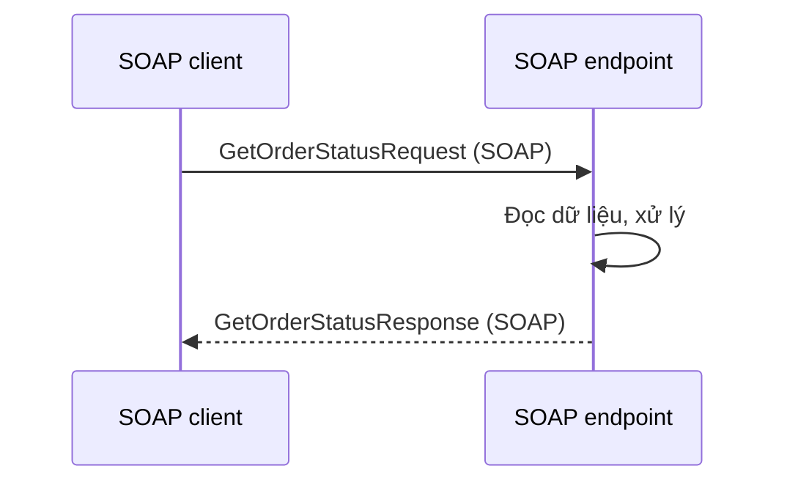
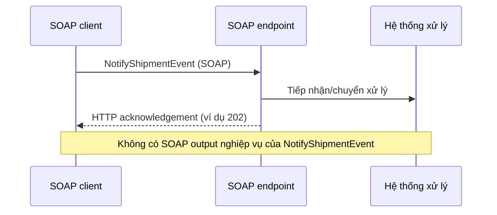
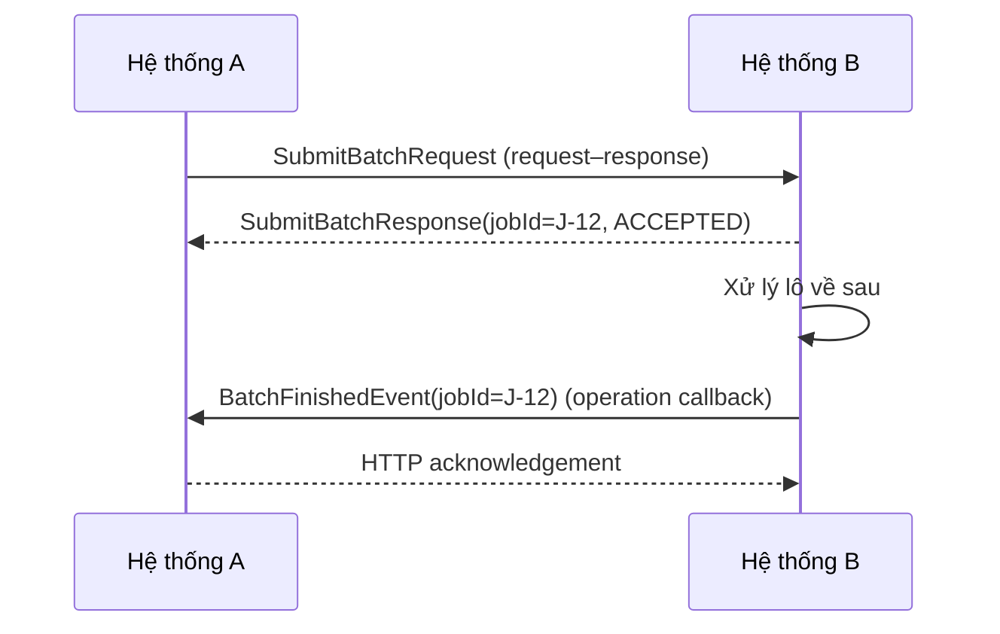

# Trao đổi yêu cầu, phản hồi và thông điệp một chiều

Trong **Spring Web Services (Spring-WS)**, SOAP là giao thức trao đổi thông điệp XML giữa các hệ thống. Cùng một phần tử nghiệp vụ, cách trao đổi có thể khác nhau: client gửi yêu cầu rồi nhận kết quả ngay, hoặc gửi một thông báo mà phía nhận không trả về thông điệp nghiệp vụ tương ứng. Sự khác biệt này ảnh hưởng đến hợp đồng WSDL, cách viết endpoint và SOAP client, xử lý lỗi, timeout, khả năng thử lại và độ tin cậy khi tích hợp doanh nghiệp.

Trong cách tiếp cận **contract-first**, nhóm phát triển cần quyết định trước **mẫu trao đổi thông điệp** (Message Exchange Pattern — MEP), khai báo nó trong WSDL và định nghĩa cấu trúc các payload bằng XSD. Sau đó, Spring-WS và JAXB triển khai đúng hợp đồng đó. Bài học tập trung vào hai mẫu phổ biến nhất: **request–response** và **one-way**, đồng thời phân biệt chúng với xử lý bất đồng bộ.

## Mục tiêu học tập

Sau bài này, bạn có thể:

- Đọc và mô tả luồng SOAP request–response và one-way ở mức thông điệp ứng dụng và mức HTTP.
- Phân biệt SOAP Envelope, payload, phản hồi nghiệp vụ, SOAP Fault và xác nhận của giao thức truyền tải.
- Nhận diện mẫu trao đổi của một `wsdl:operation` trong WSDL 1.1.
- Thiết kế endpoint và SOAP client Spring-WS phù hợp với mẫu trao đổi đã định nghĩa.
- Đánh giá timeout, thử lại, trùng lặp thông điệp, đồng bộ/bất đồng bộ và cách đối soát trạng thái.
- Đề xuất cách kiểm thử để bảo đảm tích hợp SOAP ổn định.

## 1. SOAP message và Message Exchange Pattern

Một **SOAP message** là một tài liệu XML với phần tử gốc `Envelope`. Nó có thể mang `Header` và chứa `Body`. Phần tử nghiệp vụ trực tiếp trong `Body` thường là dữ liệu quan trọng để Spring-WS định tuyến đến endpoint.

Ví dụ yêu cầu SOAP 1.1:

```xml
<soap:Envelope
    xmlns:soap="http://schemas.xmlsoap.org/soap/envelope/"
    xmlns:ord="https://example.org/contracts/order/v1">
    <soap:Header/>
    <soap:Body>
        <ord:GetOrderStatusRequest>
            <ord:orderId>ORD-1024</ord:orderId>
        </ord:GetOrderStatusRequest>
    </soap:Body>
</soap:Envelope>
```

Namespace của Envelope phía trên là **SOAP 1.1**. SOAP 1.2 dùng `http://www.w3.org/2003/05/soap-envelope`; hai phiên bản có khác biệt về HTTP binding và định dạng Fault. Các ví dụ trong bài chủ yếu dùng SOAP 1.1 để giữ nhất quán.

**Message Exchange Pattern (MEP)** mô tả các thông điệp có thể đi theo hướng nào và quan hệ giữa chúng. MEP trả lời những câu hỏi như:

- Một thao tác có cần thông điệp phản hồi nghiệp vụ không?
- Phản hồi có gắn với yêu cầu nào?
- Lỗi được trả trong cùng lượt gọi hay báo qua cơ chế khác?
- Khi nào bên gửi có thể kết luận công việc đã hoàn thành?

MEP **khác với giao thức truyền tải**. SOAP có thể đi qua HTTP, JMS hoặc cơ chế khác nếu hệ thống hỗ trợ binding tương ứng. HTTP là giao thức request–response ở mức truyền tải, kể cả khi **thao tác SOAP được khai báo one-way**.

## 2. Hai mẫu trao đổi chính

| Tiêu chí | Request–response | One-way |
|---|---|---|
| Ý nghĩa nghiệp vụ | Gửi yêu cầu và mong nhận thông điệp phản hồi. | Gửi một thông điệp, không định nghĩa phản hồi nghiệp vụ cho cùng thao tác. |
| WSDL 1.1 `portType` | `input` và `output`. | Chỉ có `input`. |
| SOAP Body từ phía nhận | Thường có payload phản hồi hoặc SOAP Fault nếu có lỗi. | Không có payload phản hồi nghiệp vụ theo hợp đồng one-way. |
| HTTP | Có HTTP response mang kết quả hoặc Fault, tùy binding và lỗi. | HTTP vẫn có thể trả mã trạng thái hoặc phản hồi rỗng để báo nhận ở mức truyền tải. |
| Cách dùng phổ biến | Tra cứu dữ liệu, kiểm tra điều kiện, yêu cầu cần kết quả trực tiếp. | Gửi sự kiện, thông báo thay đổi, lệnh gửi vào quy trình xử lý tách rời. |
| Rủi ro thiết kế | Timeout, gọi chặn, kết quả không xác định khi mất phản hồi. | Người gửi không biết kết quả xử lý cuối cùng nếu thiếu cơ chế theo dõi riêng. |

Cần hiểu đúng: **one-way không có nghĩa là “không có byte nào trả về”**. Một lời gọi HTTP vẫn nhận status line và có thể nhận header/response body ở tầng giao thức. One-way chỉ nói rằng hợp đồng thao tác không chứa **thông điệp output nghiệp vụ** tương ứng.

### Sơ đồ luồng





Sơ đồ thứ hai minh họa một kiến trúc có hàng đợi hoặc hệ thống nhận xử lý riêng; **hàng đợi không phải thành phần bắt buộc** của one-way. Endpoint cũng có thể xử lý ngay trong cùng luồng mà vẫn không trả về output nghiệp vụ.

## 3. Request–response: yêu cầu và phản hồi có quan hệ trực tiếp

Một trao đổi request–response thường diễn ra như sau:

1. Client tạo SOAP Envelope chứa yêu cầu, gắn đúng QName theo XSD và gửi đến endpoint.
2. Endpoint đọc payload, xác thực dữ liệu và thực thi nghiệp vụ.
3. Endpoint tạo SOAP response mang kết quả, hoặc tạo SOAP Fault khi không thể thực hiện yêu cầu theo hợp đồng/lỗi xử lý.
4. Client giải mã response, kiểm tra Fault và sử dụng kết quả.

Ví dụ request ở mục 1 có thể nhận SOAP response sau:

```xml
<soap:Envelope
    xmlns:soap="http://schemas.xmlsoap.org/soap/envelope/"
    xmlns:ord="https://example.org/contracts/order/v1">
    <soap:Body>
        <ord:GetOrderStatusResponse>
            <ord:orderId>ORD-1024</ord:orderId>
            <ord:status>SHIPPED</ord:status>
        </ord:GetOrderStatusResponse>
    </soap:Body>
</soap:Envelope>
```

**Không xác định request hay response chỉ bằng tên thẻ.** Hợp đồng quyết định phần tử nào là input và phần tử nào là output. Tên `GetOrderStatusRequest` và `GetOrderStatusResponse` là quy ước dễ đọc; WSDL vẫn có thể dùng tên khác miễn khai báo QName hợp lệ.

Ví dụ trao đổi SOAP 1.1 qua HTTP (các header chỉ mang tính minh họa):

```http
POST /ws/orders HTTP/1.1
Host: api.example.org
Content-Type: text/xml; charset=utf-8
SOAPAction: "https://example.org/actions/GetOrderStatus"

[SOAP Envelope của GetOrderStatusRequest]
```

```http
HTTP/1.1 200 OK
Content-Type: text/xml; charset=utf-8

[SOAP Envelope của GetOrderStatusResponse]
```

Với SOAP 1.1 over HTTP, phản hồi thành công thường dùng HTTP 200, còn SOAP Fault thường dùng HTTP 500 theo binding SOAP 1.1. Với SOAP 1.2, media type thường là `application/soap+xml` và hành vi mã trạng thái gắn với binding của phiên bản đó; không nên áp dụng máy móc quy tắc HTTP của SOAP 1.1 cho mọi giao thức hoặc mọi phiên bản SOAP.

### SOAP Fault là phản hồi lỗi, không phải response thành công

Khi không tìm thấy đơn hàng hoặc request không hợp lệ, dịch vụ có thể trả Fault. Ví dụ SOAP 1.1:

```xml
<soap:Envelope
    xmlns:soap="http://schemas.xmlsoap.org/soap/envelope/">
    <soap:Body>
        <soap:Fault>
            <faultcode>soap:Client</faultcode>
            <faultstring>Order identifier is invalid</faultstring>
        </soap:Fault>
    </soap:Body>
</soap:Envelope>
```

Lỗi SOAP được biểu diễn bằng phần tử `Fault` trong SOAP Body; nó không tương đương với việc trả một business response `status=FAILED`. Nên dùng SOAP Fault cho lỗi ở cấp độ thông điệp, hợp đồng, bảo mật hoặc điều kiện thực thi mà API quy định là lỗi; còn trạng thái nghiệp vụ hợp lệ, chẳng hạn đơn hàng `CANCELLED`, thường nên là dữ liệu trong response bình thường.

Một SOAP Fault có thể chứa chi tiết lỗi phù hợp trong `detail`; không đưa stack trace, khóa bí mật hoặc dữ liệu nhạy cảm vào phản hồi công khai.

### Request–response không đồng nghĩa “toàn bộ xử lý phải đồng bộ”

Client có thể nhận phản hồi `Accepted` cùng một mã giao dịch trong khi nghiệp vụ dài hạn còn đang chạy. Khi đó lượt SOAP đầu vẫn là **request–response** vì có output nghiệp vụ, nhưng kết quả phản hồi chỉ xác nhận đã tiếp nhận và có thể cần thao tác tra cứu tiến độ tiếp theo.

```text
SubmitOrderRequest
    -> SubmitOrderResponse(transactionId="TX-88", state="ACCEPTED")
    -> [xử lý nền]
    -> GetTransactionStatusRequest(transactionId="TX-88")
    -> GetTransactionStatusResponse(state="COMPLETED")
```

Mô hình này hữu ích nếu phía gọi cần biết request đã được chấp nhận mà không muốn giữ kết nối tới khi xử lý toàn bộ.

## 4. One-way: gửi thông điệp không có output nghiệp vụ

Một thao tác one-way định nghĩa **một input message** gửi đến dịch vụ mà **không định nghĩa output message** trả về trong cùng thao tác.

Ví dụ hệ thống bán hàng gửi thông báo đã giao hàng:

```xml
<soap:Envelope
    xmlns:soap="http://schemas.xmlsoap.org/soap/envelope/"
    xmlns:ord="https://example.org/contracts/order/v1">
    <soap:Body>
        <ord:NotifyShipmentEvent>
            <ord:eventId>EVT-20261127-001</ord:eventId>
            <ord:orderId>ORD-1024</ord:orderId>
            <ord:shipmentId>SHP-774</ord:shipmentId>
            <ord:eventType>DELIVERED</ord:eventType>
        </ord:NotifyShipmentEvent>
    </soap:Body>
</soap:Envelope>
```

Lời gọi one-way qua HTTP có thể kết thúc bằng:

```http
HTTP/1.1 202 Accepted
Content-Length: 0
```

**HTTP 202 là ví dụ về xác nhận ở tầng HTTP; không phải cam kết mặc định của mọi SOAP one-way.** Tùy binding và cách triển khai, có thể có mã trạng thái khác hoặc lỗi HTTP. Đặc biệt, 202 chỉ cho biết phía nhận đã chấp nhận yêu cầu theo ý nghĩa mà server định nghĩa; nó **không chứng minh** sự kiện đã được xử lý thành công hay dữ liệu đã được lưu bền vững.

Một phương án khác là endpoint tiếp nhận nội dung, xử lý trong cùng lượt gọi rồi kết thúc mà không gửi payload nghiệp vụ. Nó vẫn là one-way ở mức hợp đồng WSDL.

### Ranh giới quan trọng của one-way

| Điều có thể kết luận | Điều không thể tự kết luận |
|---|---|
| Client đã gửi request xuống transport thành công. | Đối tác đã thực thi xong nghiệp vụ. |
| Client đã nhận một HTTP status từ server. | Hệ thống đích đã cập nhật cơ sở dữ liệu đúng. |
| WSDL không khai báo output của operation. | Không thể có lỗi mạng, lỗi phân tích XML hay lỗi bảo mật. |
| Có thể thiết kế xử lý bất đồng bộ phía nhận. | Cơ chế giao nhận tự động có bảo đảm exactly-once. |

One-way còn có thể tạo phản hồi ở mức lỗi do binding hoặc implementation, ví dụ kết nối bị từ chối, HTTP 4xx/5xx hoặc Fault trong các trường hợp cụ thể. Tuy vậy, **không nên thiết kế client phụ thuộc vào việc nhận business output hoặc SOAP Fault ứng dụng trên một operation one-way**, vì WSDL không quy định output như request–response.

Muốn biết chắc kết quả về sau, hãy định nghĩa **operation tra cứu**, **callback** hoặc kênh thông báo độc lập có hợp đồng rõ ràng.

## 5. Biểu diễn hai mẫu bằng WSDL 1.1

Đối với dự án Spring-WS theo hướng contract-first, XSD định nghĩa các phần tử payload và WSDL 1.1 mô tả các operation. Trong `wsdl:portType`, thứ tự và sự có mặt của `wsdl:input`/`wsdl:output` cho biết mẫu trao đổi.

Ví dụ rút gọn:

```xml
<wsdl:definitions
    xmlns:wsdl="http://schemas.xmlsoap.org/wsdl/"
    xmlns:tns="https://example.org/contracts/order/service/v1"
    xmlns:ord="https://example.org/contracts/order/v1"
    targetNamespace="https://example.org/contracts/order/service/v1">

    <wsdl:message name="GetOrderStatusInput">
        <wsdl:part name="parameters"
                   element="ord:GetOrderStatusRequest"/>
    </wsdl:message>
    <wsdl:message name="GetOrderStatusOutput">
        <wsdl:part name="parameters"
                   element="ord:GetOrderStatusResponse"/>
    </wsdl:message>
    <wsdl:message name="NotifyShipmentInput">
        <wsdl:part name="parameters"
                   element="ord:NotifyShipmentEvent"/>
    </wsdl:message>

    <wsdl:portType name="OrderPortType">
        <wsdl:operation name="GetOrderStatus">
            <wsdl:input message="tns:GetOrderStatusInput"/>
            <wsdl:output message="tns:GetOrderStatusOutput"/>
        </wsdl:operation>

        <wsdl:operation name="NotifyShipment">
            <wsdl:input message="tns:NotifyShipmentInput"/>
        </wsdl:operation>
    </wsdl:portType>
</wsdl:definitions>
```

Đây là **đoạn trích về message và portType**, chưa phải WSDL triển khai hoàn chỉnh: cần bổ sung hoặc import XSD chứa các phần tử `ord:*`, cùng `wsdl:binding` và `wsdl:service` để quy định transport, SOAP action, địa chỉ endpoint và các chi tiết binding khác.

Trong WSDL 1.1:

- `GetOrderStatus` là **request–response**, vì operation có `input` và `output`.
- `NotifyShipment` là **one-way**, vì operation chỉ có `input`.
- WSDL 1.1 còn mô tả `solicit–response` và `notification` ở mức trừu tượng, nhưng chúng ít được dùng trong mô hình SOAP/HTTP client gọi server phổ biến của Spring-WS.
- `wsdl:message` và `wsdl:part` liên kết operation với QName của phần tử XSD. Prefix `ord` trong WSDL chỉ là bí danh của namespace URI.

Đừng nhầm **SOAPAction** với QName payload. SOAPAction là một thông tin của SOAP HTTP binding, còn Spring-WS thường định tuyến với `@PayloadRoot` theo namespace URI và local part của phần tử payload. Chúng cần nhất quán với hợp đồng nhưng không phải là một giá trị.

### Tách yêu cầu phản hồi tương lai thành operation độc lập

Nếu đối tác yêu cầu xác nhận kết quả xử lý theo lô sau một giờ, một operation `NotifyShipment` one-way không thể tự biến thành request–response sau một giờ. Cần thiết kế thêm operation như:

```text
NotifyShipment (one-way)
  input: NotifyShipmentEvent

GetShipmentProcessingStatus (request–response)
  input: GetShipmentProcessingStatusRequest
  output: GetShipmentProcessingStatusResponse
```

Cách làm này thể hiện rõ API contract và cho phép sinh SOAP client phù hợp.

## 6. Spring-WS endpoint triển khai đúng kiểu trao đổi

Trong Spring-WS, `@Endpoint` đánh dấu lớp xử lý SOAP payload. `@PayloadRoot` chọn phương thức dựa trên QName của phần tử nghiệp vụ trong SOAP Body.

### Request–response endpoint

Giả sử mã JAXB đã được sinh từ XSD, có hai kiểu `GetOrderStatusRequest` và `GetOrderStatusResponse` phù hợp với cấu hình marshalling:

```java
import org.springframework.ws.server.endpoint.annotation.Endpoint;
import org.springframework.ws.server.endpoint.annotation.PayloadRoot;
import org.springframework.ws.server.endpoint.annotation.RequestPayload;
import org.springframework.ws.server.endpoint.annotation.ResponsePayload;

@Endpoint
public class OrderQueryEndpoint {
    private static final String NS =
        "https://example.org/contracts/order/v1";

    @PayloadRoot(namespace = NS, localPart = "GetOrderStatusRequest")
    @ResponsePayload
    public GetOrderStatusResponse getStatus(
            @RequestPayload GetOrderStatusRequest request) {
        GetOrderStatusResponse response = new GetOrderStatusResponse();
        response.setOrderId(request.getOrderId());
        response.setStatus("SHIPPED");
        return response;
    }
}
```

Ví dụ minh họa dùng các lớp JAXB đã có và giả định cấu hình Spring-WS hỗ trợ marshal/unmarshal chúng. Trong ứng dụng thực, mã sinh có thể cần `JAXBElement<T>` hoặc `ObjectFactory` tùy XSD và phiên bản JAXB; có thể dùng annotation `javax.xml.bind` hoặc `jakarta.xml.bind` tùy thế hệ Spring.

Điểm cốt lõi là **phương thức trả output và gắn `@ResponsePayload`** để Spring-WS ghi một payload SOAP response.

### One-way endpoint

Với thông báo không cần output nghiệp vụ, phương thức có thể trả về `void` và không gắn `@ResponsePayload`:

```java
import org.springframework.ws.server.endpoint.annotation.Endpoint;
import org.springframework.ws.server.endpoint.annotation.PayloadRoot;
import org.springframework.ws.server.endpoint.annotation.RequestPayload;
import org.w3c.dom.Element;

@Endpoint
public class ShipmentEventEndpoint {
    private static final String NS =
        "https://example.org/contracts/order/v1";

    private final ShipmentEventService service;

    public ShipmentEventEndpoint(ShipmentEventService service) {
        this.service = service;
    }

    @PayloadRoot(namespace = NS, localPart = "NotifyShipmentEvent")
    public void notifyShipment(@RequestPayload Element payload) {
        service.accept(payload); // kiểm tra và tiếp nhận thông báo
    }
}
```

`ShipmentEventService` ở ví dụ là thành phần nghiệp vụ do dự án tự xây dựng; cách tiếp nhận có thể là ghi dữ liệu hoặc chuyển vào hàng đợi. `Element` chỉ minh họa cách nhận DOM payload, không yêu cầu phải dùng DOM trong thực tế: có thể dùng JAXB nếu đã sinh lớp contract phù hợp.

**Đừng coi việc trả `void` là đủ để bảo đảm one-way end-to-end.** WSDL, SOAP binding, client, xử lý lỗi và cơ chế xác nhận cũng cần được thiết kế tương ứng. Nếu code xử lý lâu và client bị timeout, người gửi không tự biết yêu cầu đã được tiếp nhận hay chưa.

## 7. Spring-WS SOAP client: chọn lời gọi phù hợp hợp đồng

`WebServiceTemplate` là API phổ biến để tạo và gửi SOAP message từ Spring-WS. Với request–response, client thường dùng `marshalSendAndReceive`:

```java
GetOrderStatusRequest request = new GetOrderStatusRequest();
request.setOrderId("ORD-1024");

GetOrderStatusResponse response =
    (GetOrderStatusResponse) webServiceTemplate.marshalSendAndReceive(
        "https://api.example.org/ws/orders",
        request
    );

System.out.println(response.getStatus());
```

Đoạn ví dụ giả định request/response có thể marshal và unmarshal trực tiếp bằng `WebServiceTemplate` đã cấu hình `Marshaller`/`Unmarshaller`. Nếu JAXB sinh `JAXBElement` hoặc có nhiều lựa chọn mapping, lớp truyền vào và kiểu kết quả cần điều chỉnh theo hợp đồng thực tế.

Với thao tác one-way, sử dụng nhóm API gửi **không trông đợi SOAP response payload**, chẳng hạn `sendSource`:

```java
import javax.xml.transform.Source;
import org.springframework.xml.transform.StringSource;

String xml =
    "<ord:NotifyShipmentEvent " +
    "xmlns:ord='https://example.org/contracts/order/v1'>" +
    "<ord:eventId>EVT-001</ord:eventId>" +
    "<ord:orderId>ORD-1024</ord:orderId>" +
    "<ord:shipmentId>SHP-774</ord:shipmentId>" +
    "<ord:eventType>DELIVERED</ord:eventType>" +
    "</ord:NotifyShipmentEvent>";

Source payload = new StringSource(xml);

webServiceTemplate.sendSource(
    "https://api.example.org/ws/orders",
    payload
);
```

`sendSource` minh họa việc gửi XML payload; mã sản xuất cần cấu hình transport, security, logging, thời gian chờ và xử lý ngoại lệ. Hoàn thành phương thức gửi **không chứng minh** tất cả bước xử lý nghiệp vụ ở phía nhận đã hoàn tất.

Đối với API phức tạp, có thể dùng `WebServiceMessageCallback` để thêm SOAP Header, SOAPAction hoặc WS-Addressing theo hợp đồng. Nếu phải gửi thông tin bảo mật như chữ ký hay token, interceptor và cấu hình WS-Security cần áp dụng nhất quán trên client/server.

### Timeout trong request–response có thể gây trạng thái không xác định

Ví dụ client gửi yêu cầu tạo đơn hàng, server lưu đơn thành công nhưng kết nối đứt trước khi client nhận response. Khi đó:

```text
Client                       Server
  |--- CreateOrderRequest ---->|
  |                             | Đã commit đơn hàng
  |<-- mất kết nối ------------X|
  |                             |
  |  Client thấy timeout        | Đơn hàng đã tồn tại
```

Client **không thể suy ra rằng nghiệp vụ đã thất bại** chỉ từ timeout. Thử lại không có cơ chế chống trùng lặp có thể tạo hai đơn hàng. Biện pháp thường dùng là `requestId`/idempotency key ổn định, kiểm tra trùng yêu cầu và cung cấp một operation đối soát kết quả.

Rủi ro tương tự xuất hiện trong one-way: không nhận được HTTP acknowledgement có thể nghĩa là request chưa đến nơi, hoặc đã được nhận và xử lý nhưng phản hồi truyền tải bị mất.

## 8. Đồng bộ, bất đồng bộ và one-way là các chiều thiết kế khác nhau

Ba cách nói “request–response”, “one-way” và “asynchronous” thường bị dùng lẫn lộn, nhưng chúng không giống nhau:

| Thiết kế | Có SOAP output trong operation ban đầu? | Kết quả được biết bằng cách nào? |
|---|---|---|
| Request–response xử lý ngay | Có. | Payload response/Fault trong lượt gọi ban đầu. |
| Request–response trả `Accepted` | Có, nhưng chỉ xác nhận tiếp nhận. | Theo dõi bằng mã giao dịch, polling hoặc callback. |
| One-way qua SOAP/HTTP | Không. | Không có business output; cần cơ chế riêng nếu muốn biết kết quả. |
| One-way gửi vào queue | Không. | Kiểm tra trạng thái xử lý qua queue, log, callback hoặc operation độc lập. |
| Callback bất đồng bộ | Operation gửi ban đầu có thể one-way hoặc request–response. | Hệ thống nhận chủ động gọi một operation **khác** ở phía ban đầu. |

Với callback, thông điệp phản hồi tương lai là một lần trao đổi SOAP độc lập, phải có contract, endpoint, xác thực và mã tương quan riêng. WS-Addressing có thể hỗ trợ định tuyến các phản hồi đến địa chỉ khác với kênh HTTP ban đầu, nhưng nó **không tự tạo** cơ chế callback hoặc lưu trữ thông điệp đáng tin cậy.

Ví dụ thiết kế callback:



Nếu giao tiếp qua hàng đợi, nhiều lời gọi có thể bất đồng bộ dù payload SOAP được đóng gói giống nhau. Chất lượng giao nhận khi đó còn phụ thuộc cấu hình queue, persistence, acknowledgement và chính sách retry/DLQ; chỉ khai báo one-way trong WSDL không tự mang lại bảo đảm giao nhận.

## 9. Định danh, tương quan và chống xử lý trùng

Khi trao đổi thông điệp giữa hệ thống doanh nghiệp, nên chuẩn hóa các định danh sau trong contract hoặc header phù hợp:

| Trường | Vai trò |
|---|---|
| `requestId` | Định danh duy nhất của yêu cầu; hỗ trợ idempotency và truy vết. |
| `messageId` | Định danh một SOAP message cụ thể; hữu ích cho tương quan và audit. |
| `correlationId` | Kết nối các thông điệp thuộc cùng chuỗi xử lý nghiệp vụ. |
| `eventId` | Định danh sự kiện để phía nhận khử trùng lặp. |
| `transactionId` / `jobId` | Định danh công việc chạy dài để tra cứu kết quả. |

Trong SOAP Header, **WS-Addressing** định nghĩa các khái niệm chuẩn như `MessageID`, `RelatesTo`, `To`, `Action` và `ReplyTo` khi hai phía thống nhất sử dụng chuẩn đó. Không nên tự ý thêm header rồi giả định đối tác hiểu; phải xác nhận phiên bản WS-Addressing, namespace và chính sách xử lý header trong hợp đồng.

Ví dụ đối soát one-way:

1. Phía gửi tạo `eventId=EVT-001`, lưu trạng thái `PENDING` và gửi SOAP notification.
2. Phía nhận kiểm tra `eventId`. Nếu chưa có, nó ghi nhận và xử lý; nếu đã có, nó tránh chạy lại tác động nghiệp vụ.
3. Phía gửi có thể thử lại cùng `eventId` khi lỗi mạng hoặc quá thời gian chờ.
4. Trạng thái hoàn tất được báo qua callback, operation tra cứu hoặc kênh vận hành riêng.
5. Lỗi không thể xử lý có cơ chế phân loại, lưu và đưa sang dead-letter queue nếu kiến trúc có queue.

Không gọi đây là exactly-once nếu hệ thống chưa chứng minh tính nguyên tử giữa lưu trạng thái, phát thông điệp và thực thi tác động. Trong thực tế thường kết hợp **at-least-once delivery** với **idempotent consumption** để chống trùng lặp một cách hữu dụng.

## 10. Các lỗi thiết kế và lỗi tích hợp thường gặp

| Hiện tượng | Nguyên nhân khả dĩ | Cách xử lý |
|---|---|---|
| Client đợi mãi một SOAP response từ one-way | Chọn API request–response cho operation chỉ có input, hoặc cấu hình transport không tương thích. | Kiểm tra WSDL và chọn cách gọi client đúng MEP; xác minh HTTP acknowledgement. |
| Client nhận 202 nhưng nghiệp vụ đích không hoàn thành | 202 chỉ là trạng thái tiếp nhận của HTTP. | Thiết kế xác nhận xử lý cuối cùng, operation tra cứu hoặc callback. |
| Sau retry có hai bản ghi giống nhau | Yêu cầu đã được xử lý trước khi client timeout. | Sử dụng request/event ID ổn định và idempotency ở server. |
| Server trả SOAP Fault nhưng client báo lỗi HTTP chung | Sai hoặc thiếu cấu hình xử lý Fault/transport, binding không khớp. | Kiểm tra HTTP status, SOAP Envelope và Fault resolver. |
| SOAP Body có phần tử đúng tên nhưng không vào endpoint | Namespace URI hoặc local name khác `@PayloadRoot`. | So sánh QName thực tế với XSD và annotation. |
| “One-way” nhưng server chặn request lâu | Endpoint thực thi tác vụ nặng trước khi trả HTTP acknowledgement. | Chuyển xử lý dài sang worker/queue nếu yêu cầu thời gian đáp ứng thấp; đo latency. |
| Callback không đến | Sai địa chỉ callback, thiếu quyền truy cập mạng, chứng chỉ/WS-Security không phù hợp. | Kiểm tra endpoint callback, routing, TLS, chính sách security và correlation ID. |
| Cùng thông điệp được xử lý nhiều lần | Retry phía gửi/queue nhưng phía nhận không khử trùng lặp. | Tạo cơ chế dedup theo khóa bền vững và nghiệp vụ. |

Đối với SOAP Fault, cần phân biệt lỗi parse XML, XSD validation, xác thực, nghiệp vụ và lỗi transport. Một interceptor hoặc Fault resolver của Spring-WS có thể chuyển ngoại lệ thành SOAP Fault theo chính sách; tuy nhiên **một operation one-way không nên dựa vào Fault làm kênh báo trạng thái nghiệp vụ cuối cùng**.

## 11. Kiểm thử request–response và one-way

### Ca kiểm thử request–response

1. Gửi SOAP request hợp lệ với đúng QName, namespace và SOAP version; xác nhận nhận SOAP response hợp lệ theo XSD.
2. Kiểm tra status nghiệp vụ không hợp lệ/không tìm thấy dữ liệu; xác nhận API trả response bình thường hay Fault theo contract.
3. Gửi dữ liệu sai schema và kiểm tra quy tắc validation, Fault code và log.
4. Mô phỏng timeout **sau khi server đã xử lý**; đảm bảo retry cùng `requestId` không tạo tác động trùng.
5. Kiểm tra SOAPAction/WS-Addressing, chứng chỉ, chữ ký hoặc token nếu hợp đồng yêu cầu.
6. Thử prefix XML khác nhưng cùng namespace URI để phát hiện mã định tuyến dựa nhầm vào prefix.

### Ca kiểm thử one-way

1. Gửi thông điệp hợp lệ; xác nhận request được nhận đúng operation và **không yêu cầu SOAP business output**.
2. Kiểm tra hành vi HTTP acknowledgement của binding đã thống nhất; đo thời gian trả nếu phía nhận có xử lý nền.
3. Gửi lại cùng `eventId`; xác nhận hệ thống không thực hiện tác động nghiệp vụ lần thứ hai.
4. Mô phỏng gián đoạn mạng trước/sau lúc phía nhận ghi dữ liệu; kiểm tra chiến lược retry và đối soát.
5. Mô phỏng xử lý nền thất bại; xác nhận có trạng thái quan sát được, retry có giới hạn và cơ chế đưa vào DLQ nếu sử dụng queue.
6. Đánh giá callback/operation tra cứu, correlation ID và phân quyền trên kênh theo dõi.
7. Kiểm tra lỗi bảo mật, XML parser và schema validation để bảo đảm thông điệp không hợp lệ bị từ chối hoặc xử lý theo chính sách.

Trong dự án Spring-WS, có thể dùng **MockWebServiceClient** để thử endpoint với SOAP payload mô phỏng, và **MockWebServiceServer** để thử client gọi ra ngoài. Kiểm thử ở mức mock nên được bổ sung bằng kiểm thử tích hợp thật qua transport để xác nhận HTTP status, content type, SOAP version, TLS, xác thực và hành vi timeout.

Đối với tài liệu kiểm thử tương thích, nên ghi **bằng chứng** ở từng lớp: SOAP Envelope đầu vào, QName của Body child, HTTP status/headers, SOAP output hoặc sự vắng mặt của output, định danh tương quan và trạng thái nghiệp vụ cuối cùng. Nhờ vậy, một lỗi one-way không bị hiểu nhầm là lỗi kết nối hay lỗi response parser.

## 12. Tình huống thực hành: chọn MEP cho tích hợp vận chuyển

Một hệ thống bán hàng cần tích hợp đối tác giao nhận với ba yêu cầu:

1. **Tra cứu trạng thái đơn hàng** và hiển thị kết quả ngay cho nhân viên.
2. **Thông báo đã đóng gói** cho đối tác để họ tiếp nhận sự kiện.
3. **Yêu cầu tạo vận đơn** mất vài phút, nhưng người dùng cần biết ngay yêu cầu đã được ghi nhận và có thể kiểm tra tiến độ.

Thiết kế tham khảo:

| Yêu cầu | Operation | MEP | Lý do |
|---|---|---|---|
| Tra cứu đơn | `GetOrderStatus` | Request–response | Cần trả payload dữ liệu ngay. |
| Thông báo đóng gói | `NotifyPackageReady` | One-way | Chỉ truyền sự kiện, không cần business response trong cùng operation; cần `eventId` để chống trùng. |
| Khởi tạo vận đơn | `CreateShipmentJob` | Request–response | Trả `jobId` và `ACCEPTED` nhanh; quy trình nền hoàn tất sau. |
| Xem kết quả tạo vận đơn | `GetShipmentJobStatus` | Request–response | Cho phép đối soát trạng thái/chi tiết lỗi khi xử lý nền kết thúc. |

Phần hợp đồng XSD cần định nghĩa input/output tương ứng, WSDL khai báo chính xác từng operation, còn Spring-WS endpoint/JAXB thực thi đúng QName và MEP. Nếu có callback, thiết kế thêm operation callback riêng, bảo vệ bằng TLS/WS-Security theo yêu cầu và gắn `jobId` để tương quan.

### Câu hỏi tự kiểm tra

1. Một SOAP operation được khai báo one-way và chạy trên HTTP. Vì sao client vẫn có thể nhận mã HTTP 202?
2. Server đã ghi giao dịch thành công nhưng client timeout. Nên retry như thế nào để tránh tạo bản ghi trùng?
3. Trong WSDL 1.1, dấu hiệu nào giúp phân biệt request–response và one-way?
4. Vì sao thao tác trả `ACCEPTED` kèm `jobId` vẫn là request–response dù công việc chạy nền?
5. Khi gửi thông điệp one-way, cần bổ sung gì để người gửi biết kết quả xử lý cuối cùng?

**Gợi ý đáp án:** (1) HTTP vẫn có phản hồi truyền tải; one-way chỉ thiếu SOAP output nghiệp vụ. (2) Gửi lại cùng idempotency key và đối soát trạng thái. (3) Operation có cả `input` và `output` hoặc chỉ có `input`. (4) Có một SOAP output trong lượt gọi đầu tiên. (5) Callback, operation tra cứu, trạng thái xử lý và cơ chế tương quan/quan sát.

## Tổng kết

Trong SOAP, **request–response** mô tả một yêu cầu kèm thông điệp phản hồi nghiệp vụ; **one-way** mô tả thao tác chỉ có thông điệp đầu vào. Cả hai có thể sử dụng HTTP, nhưng phản hồi HTTP ở tầng transport không đồng nghĩa có SOAP output hoặc nghiệp vụ đã hoàn tất.

Khi xây dựng **Spring Web Services** theo **contract-first**, hãy bắt đầu từ nhu cầu trả kết quả và tính nhất quán nghiệp vụ, chọn MEP trong WSDL, định nghĩa QName và payload bằng XSD, sau đó mới viết endpoint, SOAP client và ánh xạ JAXB. Tích hợp doanh nghiệp ổn định còn cần chiến lược SOAP Fault, timeout, idempotency, correlation ID, an toàn XML/WS-Security và kiểm thử xuyên suốt đến trạng thái xử lý cuối cùng.
