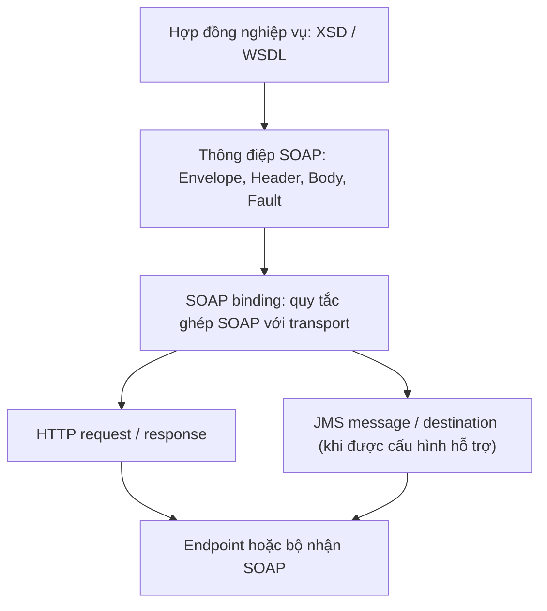
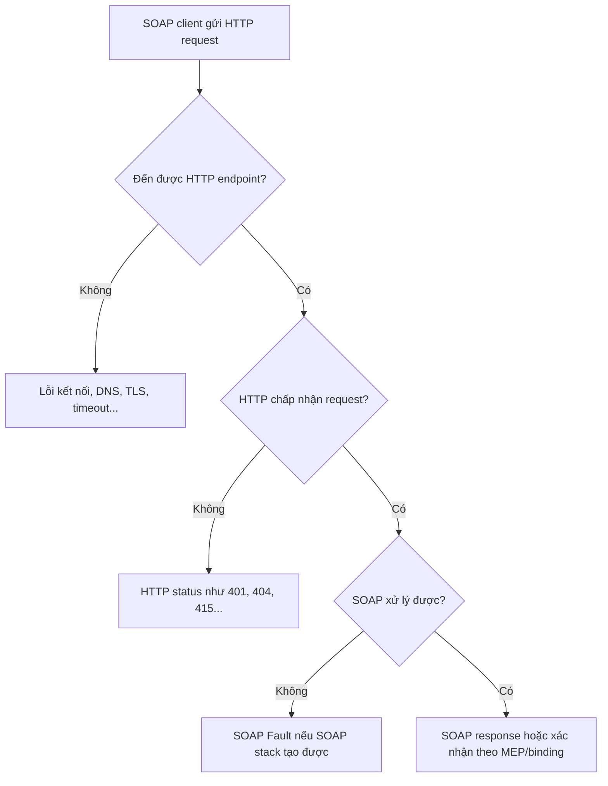
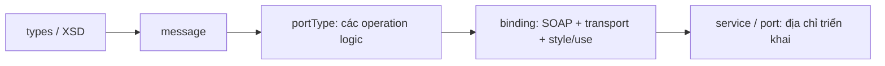

# SOAP qua HTTP và sự độc lập giữa thông điệp với phương tiện truyền tải

## 1. Bài toán: SOAP là thông điệp, HTTP là một cách vận chuyển

Giả sử một hệ thống quản lý kho cung cấp thao tác `GetStock` để đối tác tra cứu tồn kho theo mã sản phẩm. Đối tác có thể gọi hệ thống bằng HTTP. Nhưng nếu doanh nghiệp chuyển một phần tích hợp sang hàng đợi tin nhắn, ta cần phân biệt hai trách nhiệm:

- **SOAP** xác định cách tổ chức thông điệp XML: `Envelope`, `Header`, `Body`, quy tắc xử lý và `Fault`.
- **Phương tiện truyền tải** (*transport*) chuyển thông điệp giữa các hệ thống: HTTP là lựa chọn phổ biến; các mô hình truyền tải khác như thông điệp qua JMS hoặc thư điện tử cần binding và quy ước hỗ trợ tương ứng.

Điều này đặc biệt quan trọng trong module **SPRING_WEB_SERVICES**: học phát triển SOAP service **contract-first** bằng XSD/WSDL, ánh xạ JAXB, viết endpoint và SOAP client, đồng thời xử lý SOAP Fault, interceptor, XML security, WS-Security, chứng chỉ và kiểm thử tích hợp doanh nghiệp. Muốn thiết kế ổn định, trước tiên phải hiểu **phần nào thuộc hợp đồng SOAP, phần nào thuộc HTTP và phần nào phụ thuộc cách triển khai Spring-WS**.

**Mục tiêu sau bài học:**

1. Đọc được một SOAP request/response nằm trong HTTP request/response và phân biệt hai lớp.
2. Nêu đúng khác biệt giữa SOAP 1.1 và SOAP 1.2 khi đi qua HTTP.
3. Giải thích được tính độc lập về mô hình thông điệp của SOAP với transport, cùng giới hạn của tính độc lập này.
4. Chỉ ra quan hệ giữa XSD, WSDL, HTTP binding, SOAPAction và Spring-WS.
5. Chẩn đoán được lỗi HTTP, lỗi xử lý SOAP và lỗi contract mà không nhầm chúng là một.

## 2. Nhìn kiến trúc theo từng lớp



Trong mô hình trên, **hợp đồng dữ liệu** mô tả request/response về mặt nghiệp vụ; **SOAP envelope** là cấu trúc thông điệp; **binding** định nghĩa cách gửi, nhận và diễn giải SOAP trên một phương tiện cụ thể. HTTP còn có riêng phương thức `POST`, URL, header, status code và cơ chế kết nối.

Không nên hiểu hình này theo nghĩa chỉ cần thay chuỗi URL là có thể chạy SOAP trên mọi giao thức. Một binding dùng JMS phải được cả client và server hỗ trợ, phải định nghĩa đích nhận, cách tương quan phản hồi, xử lý lỗi, bảo mật và cơ chế delivery.

| Câu hỏi | Thuộc lớp nào? | Ví dụ |
| --- | --- | --- |
| Request cần mã sản phẩm và response trả số lượng ra sao? | XSD/WSDL và nghiệp vụ | `GetStockRequest` chứa `sku` |
| Gói XML có `Envelope`, `Header` và `Body` nào? | SOAP | `soap:Body` chứa `GetStockRequest` |
| Gửi request tới địa chỉ nào? | Transport / triển khai | `https://inventory.example.org/ws` |
| HTTP dùng phương thức, media type, mã trạng thái gì? | SOAP-over-HTTP binding / HTTP | `POST`, `Content-Type`, `200` |
| Lỗi xử lý nghiệp vụ trong SOAP được mô tả thế nào? | SOAP Fault và contract lỗi | `soap:Fault`, `detail` |
| Có xác thực bằng TLS hoặc chữ ký XML không? | Bảo mật transport hoặc message | HTTPS/mTLS và WS-Security |

## 3. Cấu trúc SOAP độc lập với HTTP header

Một SOAP 1.1 envelope có dạng tổng quát:

```xml
<?xml version="1.0" encoding="UTF-8"?>
<soap:Envelope
    xmlns:soap="http://schemas.xmlsoap.org/soap/envelope/"
    xmlns:inv="urn:example:inventory:v1">
    <soap:Header>
        <inv:CorrelationId>corr-982</inv:CorrelationId>
    </soap:Header>
    <soap:Body>
        <inv:GetStockRequest>
            <inv:sku>SKU-100</inv:sku>
        </inv:GetStockRequest>
    </soap:Body>
</soap:Envelope>
```

Các thành phần có vai trò riêng:

- `Envelope` là phần tử gốc của thông điệp SOAP; namespace của nó quyết định phiên bản SOAP.
- `Header` là phần tùy chọn, chứa các *SOAP header block* phục vụ chức năng xuyên suốt như metadata xử lý, định tuyến thông điệp hoặc WS-Security (theo đặc tả liên quan).
- `Body` là phần bắt buộc, chứa nội dung dành cho bên nhận cuối cùng; trong SOAP document/literal thông dụng, phần tử nghiệp vụ là payload được định nghĩa bằng XSD.
- `Fault`, nếu xuất hiện theo quy tắc của phiên bản SOAP, biểu diễn lỗi xử lý **SOAP** và được đặt trong `Body`.

### 3.1. HTTP header không phải SOAP Header

Khi gửi envelope trên qua HTTP, request có thể có hai lớp header:

```text
HTTP request
├── Request line: POST /ws HTTP/1.1
├── HTTP headers: Host, Content-Type, SOAPAction, Authorization, ...
└── HTTP body
    └── XML SOAP Envelope
        ├── SOAP Header: inv:CorrelationId, wsse:Security, ...
        └── SOAP Body: inv:GetStockRequest
```

| Điểm so sánh | HTTP header | SOAP Header |
| --- | --- | --- |
| Vị trí | Ngoài XML envelope, thuộc HTTP message | Bên trong `soap:Envelope` |
| Cú pháp | Tên và giá trị theo quy tắc HTTP | Các phần tử XML có namespace |
| Vòng đời | Gắn với một lượt truyền tải HTTP | Gắn với thông điệp SOAP |
| Ví dụ | `Content-Type`, `Authorization` | `wsse:Security`, `inv:CorrelationId` |
| Khi đổi transport | Cần ánh xạ/thay cơ chế tương ứng | Có thể duy trì ở cấp SOAP nếu bên nhận hỗ trợ |

Ví dụ, `Authorization: Bearer ...` là HTTP header, còn token trong `wsse:Security` là dữ liệu của SOAP Header. Chúng có vị trí, quy tắc bảo mật và cách xử lý khác nhau. **Không được cho rằng một HTTP header tự động trở thành SOAP Header khi chuyển sang JMS.**

## 4. SOAP 1.1 qua HTTP: một vòng request-response hoàn chỉnh

Đây là ví dụ có tính minh họa, với giả định endpoint phục vụ SOAP 1.1 trên `/ws`, payload được XSD khai báo trong namespace `urn:example:inventory:v1`.

### 4.1. HTTP request chứa SOAP 1.1 envelope

```http
POST /ws HTTP/1.1
Host: inventory.example.org
Content-Type: text/xml; charset=utf-8
SOAPAction: "urn:example:inventory:v1:GetStock"

<?xml version="1.0" encoding="UTF-8"?>
<soap:Envelope
    xmlns:soap="http://schemas.xmlsoap.org/soap/envelope/"
    xmlns:inv="urn:example:inventory:v1">
    <soap:Body>
        <inv:GetStockRequest>
            <inv:sku>SKU-100</inv:sku>
        </inv:GetStockRequest>
    </soap:Body>
</soap:Envelope>
```

Phân tích theo lớp:

| Thành phần | Ý nghĩa |
| --- | --- |
| `POST /ws HTTP/1.1` | HTTP request gửi dữ liệu tới đường dẫn `/ws` |
| `Host` | Host của HTTP server |
| `Content-Type: text/xml; charset=utf-8` | Media type thông dụng cho SOAP 1.1 qua HTTP, với mã hóa UTF-8 |
| `SOAPAction: "..."` | HTTP header của SOAP 1.1 HTTP binding, thể hiện ý định của request; giá trị phải phù hợp contract/cấu hình nếu bên nhận dùng để định tuyến |
| Dòng trống sau headers | Ranh giới giữa HTTP headers và HTTP body |
| `soap:Envelope` | XML SOAP message, độc lập về mặt mô hình với cấu trúc header HTTP |
| `inv:GetStockRequest` | Phần tử payload nghiệp vụ trong namespace contract |

**SOAPAction không phải tên SOAP Body.** Nó là một chỉ dẫn nằm trong HTTP header của SOAP 1.1. Một server có thể dùng action để kiểm soát/định tuyến, trong khi một Spring-WS endpoint khác định tuyến theo QName của phần tử gốc trong payload. Vì vậy không thể chỉ dựa vào `SOAPAction` để khẳng định request đã đúng XSD.

Ở SOAP 1.1 qua HTTP, đặc tả nêu client sử dụng header `SOAPAction`; giá trị có thể là URI được trích dẫn hoặc chuỗi rỗng tùy hợp đồng. Một số SOAP stack cũ có cách xử lý riêng nên việc kiểm thử tương thích với đối tác là cần thiết.

### 4.2. HTTP response chứa SOAP 1.1 response

```http
HTTP/1.1 200 OK
Content-Type: text/xml; charset=utf-8

<?xml version="1.0" encoding="UTF-8"?>
<soap:Envelope
    xmlns:soap="http://schemas.xmlsoap.org/soap/envelope/"
    xmlns:inv="urn:example:inventory:v1">
    <soap:Body>
        <inv:GetStockResponse>
            <inv:quantity>42</inv:quantity>
        </inv:GetStockResponse>
    </soap:Body>
</soap:Envelope>
```

HTTP `200 OK` báo việc xử lý yêu cầu ở cấp HTTP thành công. Bản thân response còn phải được kiểm tra xem có đúng SOAP Envelope, đúng phiên bản, đúng phần tử response và đúng XSD hay không.

Không phải mọi HTTP `200` đều có nghĩa dữ liệu nghiệp vụ đã đúng: server có thể trả XML sai contract hoặc client parse sai. Tương tự, khi nhận `500`, cần đọc response body để phân biệt SOAP Fault hợp lệ với lỗi hạ tầng trả HTML/text thuần.

## 5. SOAP 1.2 qua HTTP: điểm khác với SOAP 1.1

SOAP 1.2 vẫn có `Envelope`/`Header`/`Body` nhưng **namespace envelope, HTTP media type và cách biểu diễn action** khác SOAP 1.1.

```http
POST /ws HTTP/1.1
Host: inventory.example.org
Content-Type: application/soap+xml; charset=utf-8; action="urn:example:inventory:v1:GetStock"

<?xml version="1.0" encoding="UTF-8"?>
<soap:Envelope
    xmlns:soap="http://www.w3.org/2003/05/soap-envelope"
    xmlns:inv="urn:example:inventory:v1">
    <soap:Body>
        <inv:GetStockRequest>
            <inv:sku>SKU-100</inv:sku>
        </inv:GetStockRequest>
    </soap:Body>
</soap:Envelope>
```

### 5.1. Bảng phân biệt nhanh

| Tiêu chí | SOAP 1.1 qua HTTP | SOAP 1.2 qua HTTP |
| --- | --- | --- |
| SOAP Envelope namespace | `http://schemas.xmlsoap.org/soap/envelope/` | `http://www.w3.org/2003/05/soap-envelope` |
| Media type thông dụng | `text/xml` | `application/soap+xml` |
| Nơi mang action theo binding | HTTP `SOAPAction` header | Tham số `action` của `Content-Type`, khi có |
| Tên mã lỗi SOAP ở cấp chính | `Client` / `Server` | `Sender` / `Receiver` |
| Mô hình SOAP | SOAP 1.1 Note | SOAP 1.2 Recommendation, mô hình binding được chuẩn hóa rõ hơn |

**Đừng sửa một chi tiết đơn lẻ để “nâng cấp” SOAP 1.1 thành 1.2.** Chỉ đổi `Content-Type` mà giữ namespace envelope cũ sẽ khiến thông điệp và khai báo phiên bản mâu thuẫn. Client và server cần thống nhất phiên bản SOAP, HTTP binding, WSDL và bộ xử lý.

Với SOAP 1.2, tham số `action` của media type là tùy chọn theo quy ước liên quan; nó **không đồng nghĩa bắt buộc phải gửi SOAPAction header kiểu SOAP 1.1**. Nếu tích hợp có WS-Addressing, `wsa:Action` lại là một SOAP header theo đặc tả WS-Addressing; nó có quan hệ ngữ nghĩa với thao tác, nhưng nằm ở lớp khác và cần được xử lý theo các quy tắc tương ứng.

### 5.2. HTTP POST là phổ biến, nhưng không phải định nghĩa của SOAP

Hầu hết ví dụ SOAP service theo kiểu document/literal request-response dùng `POST` vì gửi XML envelope trong HTTP body. SOAP 1.2 HTTP binding còn mô tả khả năng dùng HTTP `GET` trong những trường hợp trao đổi thông tin cụ thể, nhưng **không có quy tắc “mọi SOAP request có thể đổi từ POST sang GET”**. Việc cho phép phương thức nào phụ thuộc binding, mô hình trao đổi thông điệp và contract/triển khai thực tế.

## 6. HTTP status và SOAP Fault là hai tầng báo lỗi

Một request có thể thất bại ở những nơi khác nhau:



| Tình huống | Dấu hiệu thường gặp | Hướng kiểm tra |
| --- | --- | --- |
| Không kết nối được server | DNS, timeout, kết nối bị từ chối | Network, proxy, DNS, firewall, endpoint URI |
| TLS handshake thất bại | Lỗi xác thực chứng chỉ / hostname | Truststore, keystore, chuỗi chứng chỉ, hostname |
| Chưa xác thực/không có quyền ở tầng HTTP | `401` hoặc `403` | HTTP auth, token, reverse proxy, chính sách truy cập |
| URL/method/media type sai | `404`, `405`, `415` | HTTP route, `POST`, `Content-Type`, SOAP version |
| SOAP Envelope/contract không hợp lệ | SOAP Fault hoặc lỗi do schema validator/dispatcher | Namespace, XSD, payload root, SOAP binding |
| Nghiệp vụ ném lỗi được ánh xạ thành SOAP Fault | SOAP Envelope chứa `Fault` | `faultcode`/`faultstring` hoặc `Code`/`Reason`/`Detail` |

### 6.1. Ví dụ SOAP 1.1 Fault

Một thông điệp Fault minh họa:

```xml
<?xml version="1.0" encoding="UTF-8"?>
<soap:Envelope
    xmlns:soap="http://schemas.xmlsoap.org/soap/envelope/"
    xmlns:err="urn:example:inventory:errors:v1">
    <soap:Body>
        <soap:Fault>
            <faultcode>soap:Client</faultcode>
            <faultstring>SKU không hợp lệ</faultstring>
            <detail>
                <err:ValidationError>
                    <err:field>sku</err:field>
                    <err:reason>missing</err:reason>
                </err:ValidationError>
            </detail>
        </soap:Fault>
    </soap:Body>
</soap:Envelope>
```

Theo SOAP 1.1 HTTP binding, lỗi xử lý SOAP được biểu diễn với HTTP `500 Internal Server Error` và SOAP Fault trong body. Thực tế có hệ thống trung gian hoặc triển khai không hoàn toàn chuẩn, nên **vẫn cần kiểm tra cả HTTP status, `Content-Type` và XML body**; cũng không nên cho rằng mọi phản hồi `500` đều có SOAP Fault.

SOAP 1.2 dùng cấu trúc `Fault` khác: ví dụ `Code/Value` mang `env:Sender` hoặc `env:Receiver`, `Reason/Text` mang mô tả, và `Detail` có dữ liệu lỗi tùy chọn. SOAP 1.2 HTTP binding có quy tắc ánh xạ loại lỗi sang mã HTTP; đừng tự áp quy tắc Fault của SOAP 1.1 cho SOAP 1.2.

### 6.2. Ví dụ HTTP 500 nhưng không có SOAP Fault

```http
HTTP/1.1 500 Internal Server Error
Content-Type: text/html; charset=utf-8

<html><body>Gateway error</body></html>
```

Đây là **lỗi HTTP/hạ tầng** từ góc nhìn SOAP client: body không phải SOAP envelope. Cố parse đoạn HTML này thành `soap:Fault` sẽ gây thêm lỗi phụ và làm che nguyên nhân chính.

### 6.3. HTTP 200 và retry không có nghĩa giao dịch an toàn

SOAP-over-HTTP thường dùng `POST`. Nếu HTTP timeout xảy ra **sau khi server đã xử lý** nhưng **trước khi client nhận response**, client không thể chắc chắn thao tác đã thất bại. Gửi lại lệnh tạo đơn hàng hoặc thanh toán có thể làm tác vụ bị thực hiện hai lần.

Vì vậy khi thiết kế tích hợp doanh nghiệp, cần tính đến:

- **Idempotency** cho nghiệp vụ có tác dụng phụ: request ID duy nhất, lưu kết quả xử lý và từ chối/hoàn trả kết quả cho lần gửi trùng.
- **Tương quan request-response** bằng mã giao dịch ở contract hoặc SOAP Header; không mặc định rằng HTTP connection ID đại diện cho giao dịch nghiệp vụ.
- **Timeout/retry** dựa trên tính chất thao tác; không tự retry mọi lỗi `500` hoặc timeout.

## 7. “Độc lập với transport” nghĩa là gì, và không có nghĩa là gì?

Tính độc lập về kiến trúc là SOAP **không đồng nhất với HTTP**. SOAP mô tả cấu trúc và quy tắc xử lý thông điệp, còn **transport binding** quy định cách mang thông điệp trên một kênh cụ thể.

### 7.1. Những gì có thể giữ nguyên

Giả sử cùng yêu cầu tra cứu tồn kho theo hợp đồng:

```xml
<soap:Envelope
    xmlns:soap="http://schemas.xmlsoap.org/soap/envelope/"
    xmlns:inv="urn:example:inventory:v1">
    <soap:Body>
        <inv:GetStockRequest>
            <inv:sku>SKU-100</inv:sku>
        </inv:GetStockRequest>
    </soap:Body>
</soap:Envelope>
```

Nếu cả hai đầu đều hỗ trợ SOAP binding tương ứng, các thành phần sau **có thể** được giữ nhất quán:

1. **Mô hình thông điệp SOAP**: `Envelope`, `Body` và các header block đã được hai phía hỗ trợ.
2. **Contract dữ liệu**: QName của request/response, cấu trúc các phần tử XSD, quy tắc validation.
3. **Ngữ nghĩa nghiệp vụ**: `GetStockRequest` hỏi tồn kho của một SKU và phản hồi theo kiểu dữ liệu đã cam kết.
4. **Một phần xử lý ứng dụng**: logic kiểm tra XSD, chuyển đổi JAXB, xử lý payload hoặc SOAP Header nếu không ràng buộc API HTTP.

Điều này **không bảo đảm** bytes gửi đi giữ nguyên 100%: cách serialize XML, prefix namespace, encoding, packaging, attachment và metadata transport có thể khác. Chữ ký XML cũng cần giữ nguyên yêu cầu canonicalization và bảo vệ nội dung đã ký.

### 7.2. Những gì phải được thiết kế lại hoặc cấu hình thêm

| Khía cạnh | Qua HTTP | Qua JMS hoặc transport có cơ chế message |
| --- | --- | --- |
| Địa chỉ nhận | URL endpoint HTTP(S) | Destination/queue/topic và cấu hình kết nối |
| Metadata lớp truyền tải | HTTP headers, `Content-Type`, `SOAPAction` ở SOAP 1.1 HTTP binding | Properties/headers của hệ thống messaging; quy ước binding riêng |
| Mô hình gửi/nhận | Request-response HTTP phổ biến | Có thể là bất đồng bộ; cần reply destination/correlation theo thiết kế |
| Báo lỗi transport | HTTP status, network/TLS errors | Lỗi broker, delivery, acknowledgment, dead-letter |
| Retry/delivery | Client/proxy retry, timeout | Redelivery, acknowledgment, duplicate delivery |
| Bảo mật đường truyền | TLS, mTLS, HTTP auth | TLS broker, xác thực/ACL của hệ thống messaging |
| Cấu hình Spring-WS | HTTP transport/`MessageDispatcherServlet` | Transport module và message sender/listener tương ứng, nếu được hỗ trợ |

**Ví dụ:** Nếu chuyển từ HTTP sang JMS, không còn khái niệm HTTP `200 OK` cho cùng một lượt xử lý. Nếu nghiệp vụ cần câu trả lời, client và server phải thỏa thuận cách nhận response, timeout và tương quan tin nhắn. SOAP payload có thể giữ cùng cấu trúc, nhưng **ngữ nghĩa delivery** phải được giải quyết ở lớp truyền tải/ứng dụng.

JMS là API cho messaging trong hệ Java; việc dùng SOAP trên JMS thường dựa vào quy ước hoặc specification binding riêng. Không thể giả định rằng mọi SOAP stack, WSDL tool hoặc đối tác đều hỗ trợ SOAP/JMS giống nhau. SMTP và các kênh khác cũng cần cơ chế đóng gói, định tuyến và vận hành thích hợp.

### 7.3. WSDL tách phần khai báo nghiệp vụ với binding và endpoint

WSDL 1.1 có các thành phần mang ý nghĩa khác nhau:



- `types` và `message` mô tả dữ liệu được trao đổi.
- `portType` mô tả operation logic và các message của nó.
- `binding` mô tả cách operation được triển khai trên giao thức/transport cụ thể.
- `service`/`port` công bố vị trí truy cập của binding đó.

Một contract có thể có nhiều binding cho cùng interface logic nếu công cụ và môi trường hỗ trợ. Tuy nhiên, thêm binding mới là **công việc thiết kế và triển khai cụ thể**, không phải một thuộc tính tự động của SOAP.

## 8. WSDL 1.1 contract-first minh họa HTTP binding

Ví dụ sau dùng `document/literal`, một cách tổ chức thường gặp trong Spring-WS. Để dễ đọc, namespace contract là `urn:example:inventory:v1` và URL là endpoint **minh họa** ở máy phát triển:

```xml
<?xml version="1.0" encoding="UTF-8"?>
<wsdl:definitions
    name="InventoryService"
    targetNamespace="urn:example:inventory:v1"
    xmlns:wsdl="http://schemas.xmlsoap.org/wsdl/"
    xmlns:soap="http://schemas.xmlsoap.org/wsdl/soap/"
    xmlns:xs="http://www.w3.org/2001/XMLSchema"
    xmlns:tns="urn:example:inventory:v1">

    <wsdl:types>
        <xs:schema
            targetNamespace="urn:example:inventory:v1"
            elementFormDefault="qualified">
            <xs:element name="GetStockRequest">
                <xs:complexType>
                    <xs:sequence>
                        <xs:element name="sku" type="xs:string"/>
                    </xs:sequence>
                </xs:complexType>
            </xs:element>
            <xs:element name="GetStockResponse">
                <xs:complexType>
                    <xs:sequence>
                        <xs:element name="quantity" type="xs:int"/>
                    </xs:sequence>
                </xs:complexType>
            </xs:element>
        </xs:schema>
    </wsdl:types>

    <wsdl:message name="GetStockInput">
        <wsdl:part name="parameters" element="tns:GetStockRequest"/>
    </wsdl:message>
    <wsdl:message name="GetStockOutput">
        <wsdl:part name="parameters" element="tns:GetStockResponse"/>
    </wsdl:message>

    <wsdl:portType name="InventoryPortType">
        <wsdl:operation name="GetStock">
            <wsdl:input message="tns:GetStockInput"/>
            <wsdl:output message="tns:GetStockOutput"/>
        </wsdl:operation>
    </wsdl:portType>

    <wsdl:binding name="InventorySoap11HttpBinding"
                  type="tns:InventoryPortType">
        <soap:binding style="document"
                      transport="http://schemas.xmlsoap.org/soap/http"/>
        <wsdl:operation name="GetStock">
            <soap:operation soapAction="urn:example:inventory:v1:GetStock"/>
            <wsdl:input>
                <soap:body use="literal"/>
            </wsdl:input>
            <wsdl:output>
                <soap:body use="literal"/>
            </wsdl:output>
        </wsdl:operation>
    </wsdl:binding>

    <wsdl:service name="InventoryService">
        <wsdl:port name="InventorySoap11HttpPort"
                   binding="tns:InventorySoap11HttpBinding">
            <soap:address location="http://localhost:8080/ws"/>
        </wsdl:port>
    </wsdl:service>
</wsdl:definitions>
```

Những chi tiết cần đặc biệt phân biệt:

| Đoạn khai báo | Ý nghĩa |
| --- | --- |
| `xs:schema targetNamespace=...` | Namespace của payload nghiệp vụ |
| `wsdl:part element="tns:GetStockRequest"` | Message trỏ tới phần tử XSD toàn cục; tên payload không do HTTP quyết định |
| `soap:binding style="document"` | Dạng tổ chức SOAP body theo tài liệu |
| `transport="http://schemas.xmlsoap.org/soap/http"` | URI định danh **SOAP-over-HTTP transport binding**, không phải địa chỉ host cần gọi |
| `soap:body use="literal"` | Body dùng XML theo schema/contract |
| `soap:operation soapAction=...` | Giá trị action theo SOAP 1.1 WSDL binding, dùng làm gợi ý/cơ sở cấu hình HTTP SOAPAction |
| `soap:address location="http://localhost:8080/ws"` | URL thực tế của endpoint trong ví dụ |

Địa chỉ `http://localhost:8080/ws` chỉ dành cho chạy thử cục bộ. Môi trường triển khai thực tế thường dùng HTTPS và domain/port phù hợp. Đổi `soap:address` từ HTTP sang HTTPS không làm đổi QName của các phần tử XSD; tuy nhiên client vẫn phải kết nối TLS và xác thực chứng chỉ đúng cách.

## 9. Spring Web Services: nơi SOAP được xử lý và nơi HTTP được cấu hình

### 9.1. Spring-WS endpoint xử lý payload SOAP

Trong Spring-WS, endpoint có thể định tuyến theo **QName của phần tử payload**, tách biệt với URL và HTTP header.

```java
import org.springframework.ws.server.endpoint.annotation.Endpoint;
import org.springframework.ws.server.endpoint.annotation.PayloadRoot;
import org.springframework.ws.server.endpoint.annotation.RequestPayload;
import org.springframework.ws.server.endpoint.annotation.ResponsePayload;

@Endpoint
public class InventoryEndpoint {

    private static final String NAMESPACE = "urn:example:inventory:v1";
    private final InventoryService inventoryService;

    public InventoryEndpoint(InventoryService inventoryService) {
        this.inventoryService = inventoryService;
    }

    @PayloadRoot(namespace = NAMESPACE, localPart = "GetStockRequest")
    @ResponsePayload
    public GetStockResponse getStock(@RequestPayload GetStockRequest request) {
        int available = inventoryService.getAvailableQuantity(request.getSku());

        GetStockResponse response = new GetStockResponse();
        response.setQuantity(available);
        return response;
    }
}
```

Đây là ví dụ về **cơ chế dispatch payload**; `InventoryService` và các lớp request/response là kiểu minh họa cần được định nghĩa hoặc sinh từ XSD trong dự án thật. Với JAXB, cần cấu hình marshaller/unmarshaller thích hợp; tùy cách sinh mã, root element có thể được khai báo qua annotation hoặc `ObjectFactory`/`JAXBElement`.

Annotation:

```java
@PayloadRoot(namespace = "urn:example:inventory:v1",
             localPart = "GetStockRequest")
```

sẽ khớp phần tử:

```text
{urn:example:inventory:v1}GetStockRequest
```

Dù XML client dùng `<inv:GetStockRequest>` hay namespace mặc định, Spring-WS vẫn dựa vào tên đầy đủ (URI + local name) khi dùng `@PayloadRoot`. Phương thức HTTP không quyết định tên payload.

Ở một triển khai SOAP over HTTP thông dụng, `MessageDispatcherServlet` nhận request HTTP, tạo `WebServiceMessage` qua message factory và giao cho cơ chế dispatch/endpoint adapter. Các interceptor SOAP của Spring-WS có thể xử lý thông điệp trong chuỗi xử lý này; đoạn mã nghiệp vụ không cần tự parse `HttpServletRequest` để tìm nội dung SOAP Body.

### 9.2. Spring-WS client với `WebServiceTemplate`

Ví dụ gọi SOAP 1.1 theo contract trên (giả sử `webServiceTemplate` đã được cấu hình message factory, JAXB marshaller/unmarshaller và HTTP message sender):

```java
import org.springframework.ws.soap.client.core.SoapActionCallback;

public class InventorySoapClient {

    private final WebServiceTemplate webServiceTemplate;

    public InventorySoapClient(WebServiceTemplate webServiceTemplate) {
        this.webServiceTemplate = webServiceTemplate;
    }

    public GetStockResponse getStock(String sku) {
        GetStockRequest request = new GetStockRequest();
        request.setSku(sku);

        return (GetStockResponse) webServiceTemplate.marshalSendAndReceive(
            "https://inventory.example.org/ws",
            request,
            new SoapActionCallback("urn:example:inventory:v1:GetStock")
        );
    }
}
```

`WebServiceTemplate` thực hiện việc gửi/nhận thông điệp SOAP và ánh xạ đối tượng thông qua thành phần được cấu hình. `SoapActionCallback` minh họa cách thiết lập SOAP action cho request; với SOAP 1.1/HTTP action được gửi theo quy tắc header của binding, còn với SOAP 1.2 phải dùng message factory và media type tương ứng. **Không coi callback này là sự thay thế cho cấu hình đúng SOAP version.**

Cấu hình tách biệt các trách nhiệm:

| Thành phần Spring-WS | Trách nhiệm |
| --- | --- |
| `WebServiceTemplate` | Điều phối gửi/nhận message, callback và lỗi ở phía client |
| `WebServiceMessageFactory`, ví dụ `SaajSoapMessageFactory` | Tạo thông điệp SOAP với phiên bản thích hợp |
| JAXB marshaller/unmarshaller, ví dụ `Jaxb2Marshaller` | Chuyển đối tượng Java ↔ XML payload theo binding |
| `WebServiceMessageSender` | Gửi message bằng transport cụ thể; ví dụ cấu hình HTTP sender |
| `@Endpoint`, `@PayloadRoot` | Tiếp nhận và định tuyến request theo payload trong Spring-WS |
| `EndpointInterceptor` | Can thiệp chuỗi xử lý message: logging, kiểm tra/quan sát, xử lý liên quan |

Nếu cần thay HTTP bằng transport khác, phải chọn module/sender/listener thực sự được Spring-WS và môi trường triển khai hỗ trợ. Đầu vào JAXB và logic endpoint có thể vẫn hữu ích, nhưng cách truy cập endpoint, tương quan response, timeout, security và fault handling cần xem xét lại. **Không thể chỉ sửa `https://...` thành `jms:...` mà mặc định tích hợp sẽ hoạt động.**

### 9.3. Phân biệt kiểm soát ở HTTP và ở SOAP

Một reverse proxy có thể chặn request ngay khi chưa tới `MessageDispatcherServlet`, ví dụ do TLS, kích thước body hoặc HTTP authentication. Một `EndpointInterceptor` chỉ chạy khi thông điệp đã đi tới giai đoạn xử lý tương ứng trong Spring-WS. Vì vậy, để chẩn đoán, log cần có thông tin tại đúng tầng:

- HTTP access log: URI, method, status, thời gian, thông tin tương quan (tránh lộ token).
- SOAP/ứng dụng: QName của payload root, SOAP version, action nếu có, mã tương quan nghiệp vụ, kết quả validation và Fault.
- Hệ thống hạ tầng: TLS/proxy, connection pool, timeout, mạng.

Trong hệ thống chứa dữ liệu nhạy cảm, không log trọn nội dung `wsse:Security`, password, token hoặc payload cá nhân một cách vô điều kiện.

## 10. Kiểm thử SOAP qua HTTP một cách có hệ thống

### 10.1. Gửi thủ công SOAP 1.1

Lưu body XML của request SOAP 1.1 trong mục 4 vào file minh họa `get-stock-soap11.xml`, rồi gọi từ terminal (endpoint `localhost` chỉ là giả định có service đang chạy):

```bash
curl -i -X POST "http://localhost:8080/ws" \
  -H "Content-Type: text/xml; charset=utf-8" \
  -H 'SOAPAction: "urn:example:inventory:v1:GetStock"' \
  --data-binary @get-stock-soap11.xml
```

Tùy shell, cú pháp quote/tiếp dòng có thể khác; trên Windows PowerShell nên sử dụng `curl.exe` khi muốn gọi chương trình curl. Lệnh này chỉ minh họa cách truyền HTTP body từ file; nó không tự tạo contract hoặc khởi chạy server.

Trình tự kiểm tra:

1. Kiểm tra **HTTP status** và `Content-Type` của response.
2. Xác định response có phải XML SOAP Envelope và **đúng SOAP version** không.
3. Nếu có `Fault`, đọc mã lỗi, mô tả và `detail`; đừng chỉ nhìn HTTP `500`.
4. Nếu thành công, kiểm tra response root QName, cấu trúc XSD và dữ liệu nghiệp vụ.
5. So SOAPAction đã gửi với WSDL và cách endpoint/server định tuyến.

### 10.2. Các test có giá trị cho tích hợp contract-first

| Test | Thao tác | Điều cần khẳng định |
| --- | --- | --- |
| Happy path SOAP 1.1 | Gửi đúng `text/xml` + SOAP 1.1 namespace | Response đúng SOAP 1.1, đúng QName và XSD |
| Sai SOAP version | SOAP 1.2 envelope nhưng HTTP header SOAP 1.1 | Server từ chối hoặc báo version mismatch theo binding/stack |
| Sai media type | SOAP 1.1 body nhưng `application/json` | Có lỗi có thể chẩn đoán được, không nhầm là lỗi nghiệp vụ |
| Sai payload namespace | Local name đúng nhưng URI contract sai | Bị validation hoặc endpoint mapping từ chối |
| SOAPAction không nhất quán | Action khác giá trị WSDL/cấu hình | Xác định thực tế server dùng action hay payload để route |
| Fault nghiệp vụ | SKU không hợp lệ | SOAP Fault có cấu trúc/`detail` theo contract |
| Timeout sau khi gửi | Cố tình làm chậm response | Xác minh retry/idempotency và việc hệ thống đã xử lý hay chưa |
| HTTPS với chứng chỉ không tin cậy | Dùng truststore thiếu CA phù hợp | Phân biệt lỗi TLS với SOAP Fault |

Đối với SOAP 1.2, kiểm thử lại với namespace `http://www.w3.org/2003/05/soap-envelope` và `application/soap+xml`; đừng dùng nguyên cấu hình media type của SOAP 1.1 rồi suy ra tính tương thích.

### 10.3. Khi chuyển transport, cần bộ test mới

Cùng một tập XML schema test có thể được dùng lại cho cả HTTP và messaging, nhưng cần bổ sung test riêng cho binding:

- HTTP: URL, method, status, header, proxy, TLS và timeout của request-response.
- Messaging: destination, correlation, thứ tự xử lý, acknowledgment, redelivery, duplicate delivery, dead-letter và thời gian chờ phản hồi.
- Cả hai: payload/XSD, SOAP version, SOAP Header, Fault và tính nhất quán nghiệp vụ.

Đây là lý do **transport independence giúp tái sử dụng contract**, nhưng không loại bỏ kiểm thử tương thích ở cấp vận chuyển.

## 11. Bảo mật: HTTPS và WS-Security giải quyết các phạm vi khác nhau

### 11.1. Bảo mật transport

Khi SOAP được gửi qua HTTPS, TLS bảo vệ kết nối giữa hai điểm TLS, hỗ trợ mã hóa đường truyền và xác thực máy chủ; nếu dùng mTLS, hai đầu còn có thể xác thực nhau bằng chứng chỉ. Nhưng nếu TLS được kết thúc tại reverse proxy rồi chuyển tiếp nội bộ, phạm vi bảo vệ của từng kết nối cần được xem rõ.

TLS **không** tự cung cấp chữ ký XML cho SOAP message và không biến một thông điệp thành bảo đảm đầu cuối khi đi qua nhiều trung gian có quyền đọc/chỉnh sửa body.

### 11.2. Bảo mật message

WS-Security định nghĩa cơ chế gắn token, chữ ký, thông tin mã hóa vào SOAP Header và các phần liên quan. Ví dụ:

```xml
<soap:Envelope
    xmlns:soap="http://schemas.xmlsoap.org/soap/envelope/"
    xmlns:wsse="http://docs.oasis-open.org/wss/2004/01/oasis-200401-wss-wssecurity-secext-1.0.xsd"
    xmlns:inv="urn:example:inventory:v1">
    <soap:Header>
        <wsse:Security>
            <!-- Token/chữ ký được xây dựng bởi thư viện WS-Security -->
        </wsse:Security>
    </soap:Header>
    <soap:Body>
        <inv:GetStockRequest>
            <inv:sku>SKU-100</inv:sku>
        </inv:GetStockRequest>
    </soap:Body>
</soap:Envelope>
```

Đoạn XML trên **chỉ minh họa vị trí của WS-Security Header**; nó chưa chứa token hoặc chữ ký hợp lệ và không phải mẫu bảo mật có thể sử dụng nguyên xi.

| Nhu cầu | Ví dụ biện pháp | Tầng |
| --- | --- | --- |
| Bảo vệ kết nối SOAP qua Internet | HTTPS, mTLS | Transport |
| Xác thực một SOAP message khi qua nhiều hop | Token/chứng chỉ theo WS-Security | SOAP message |
| Đảm bảo một phần nội dung không bị thay đổi | XML Signature với xử lý và tham chiếu đúng chuẩn | SOAP message |
| Kiểm soát ai được gọi operation nào | Authentication/authorization của hạ tầng + chính sách ứng dụng | Nhiều tầng |

Khi chuyển từ HTTP sang messaging, cấu hình HTTPS không còn áp dụng nguyên trạng; phải thiết lập bảo mật của broker/transport mới. Nếu dùng WS-Security, vẫn phải kiểm tra interoperability về profile, thuật toán, canonicalization, key trust và cách thực hiện với endpoint mới. **Tính độc lập của SOAP message không bảo đảm mọi cấu hình bảo mật sẽ tự hoạt động trên transport khác.**

## 12. Những nhầm lẫn thường gặp và cách gỡ

| Nhận định sai | Cách hiểu đúng |
| --- | --- |
| “SOAP chính là XML gửi bằng HTTP POST.” | SOAP là mô hình thông điệp XML; HTTP POST là cơ chế gửi phổ biến khi dùng HTTP binding. |
| “Đã thấy HTTP 200 thì nghiệp vụ thành công.” | Cần kiểm tra SOAP body, QName, schema và kết quả nghiệp vụ. |
| “HTTP 500 luôn là SOAP Fault.” | Có thể là lỗi proxy/web server/ứng dụng trả nội dung không phải SOAP. |
| “SOAPAction và tên phần tử request là một.” | SOAPAction là metadata/action của binding; QName payload là tên phần tử XML. Chúng có thể được cấu hình tương ứng nhưng không đồng nhất. |
| “HTTP Header và SOAP Header là một.” | HTTP Header nằm ngoài XML; SOAP Header nằm trong Envelope và có ngữ nghĩa XML/SOAP. |
| “SOAP 1.2 chỉ khác SOAP 1.1 ở Content-Type.” | Envelope namespace, Fault và binding semantics cũng khác. |
| “Có thể dùng cùng WSDL HTTP để chạy JMS mà không đổi gì.” | Cần binding, địa chỉ, phần mềm và cơ chế vận hành phù hợp. |
| “Đổi từ HTTP sang JMS thì không cần kiểm thử lại.” | Contract có thể tái sử dụng, nhưng delivery, correlation, retry, lỗi và security phải được test riêng. |

## 13. Tình huống thực hành có lời giải

### Bài 1. Chỉ ra ranh giới giữa HTTP và SOAP

Cho request:

```http
POST /services/stock HTTP/1.1
Host: partner.example.org
Content-Type: text/xml; charset=utf-8
SOAPAction: "urn:example:inventory:v1:GetStock"
X-Correlation-ID: http-123

<s:Envelope xmlns:s="http://schemas.xmlsoap.org/soap/envelope/"
            xmlns:i="urn:example:inventory:v1">
    <s:Header>
        <i:CorrelationId>soap-456</i:CorrelationId>
    </s:Header>
    <s:Body>
        <i:GetStockRequest><i:sku>SKU-5</i:sku></i:GetStockRequest>
    </s:Body>
</s:Envelope>
```

**Câu hỏi:** Có bao nhiêu mã correlation và mỗi mã thuộc tầng nào? Nếu chỉ chuyển XML Envelope sang transport khác, mã nào có thể đi theo?

**Đáp án:** Có hai mã khác nhau: `http-123` trong HTTP header `X-Correlation-ID` và `soap-456` trong SOAP Header `i:CorrelationId`. Khi chuyển Envelope qua transport khác, `soap-456` có thể được giữ theo thông điệp. `http-123` không tự động đi cùng, muốn chuyển phải ánh xạ vào metadata transport mới hoặc đưa vào SOAP contract theo thiết kế.

### Bài 2. Nhận diện phiên bản và lỗi pha trộn

Đối tác gửi:

```http
POST /ws HTTP/1.1
Host: inventory.example.org
Content-Type: application/soap+xml; charset=utf-8

<s:Envelope xmlns:s="http://schemas.xmlsoap.org/soap/envelope/">
    <s:Body>...</s:Body>
</s:Envelope>
```

**Câu hỏi:** Thông điệp tự nhất quán về phiên bản SOAP chưa?

**Đáp án:** Chưa. Media type `application/soap+xml` được sử dụng cho SOAP 1.2, nhưng namespace `http://schemas.xmlsoap.org/soap/envelope/` là SOAP 1.1. Cần thống nhất cả message factory, namespace, binding và media type theo phiên bản được server hỗ trợ.

### Bài 3. Phân biệt Fault với lỗi HTTP

Trường hợp A: server trả HTTP `500`, `Content-Type: text/xml`, SOAP 1.1 `Envelope` chứa `Fault` với `faultcode` `soap:Client`.

Trường hợp B: server trả HTTP `500`, `Content-Type: text/html`, nội dung `<h1>502 Bad Gateway</h1>`.

**Câu hỏi:** Trường hợp nào có SOAP Fault? Đầu mối debug khác nhau ra sao?

**Đáp án:** A có SOAP Fault, cần đọc mã lỗi, message/`detail` và xác định vi phạm contract hoặc xử lý ứng dụng. B không có SOAP Fault; cần kiểm tra proxy/gateway, server logs, HTTP routing và hạ tầng. Mã HTTP một mình không đủ để xác định loại lỗi.

### Bài 4. Có thể chuyển một operation sang JMS chỉ bằng thay URL?

Một client Spring-WS hiện gọi `GetStock` bằng `WebServiceTemplate` qua HTTPS. Đối tác muốn chuyển sang queue để giảm phụ thuộc thời gian đáp ứng HTTP.

**Câu hỏi:** Những thứ nào có thể giữ và những thứ nào cần thay đổi?

**Đáp án:** Có thể giữ XSD cho `GetStockRequest`/`GetStockResponse`, cấu trúc SOAP Envelope và phần lớn mã nghiệp vụ xử lý payload khi cả hai đầu thống nhất contract. Cần xây dựng/cấu hình binding và transport sender/listener JMS; xác định destination, reply/correlation, timeout, acknowledgment, retry/redelivery, cơ chế bảo mật broker và quy tắc trả lỗi. Đồng thời xác nhận thư viện và đối tác đều hỗ trợ SOAP/JMS tương ứng; kiểm thử lại toàn bộ tương tác truyền tải.

### Bài 5. Chọn chiến lược retry

Một SOAP client gọi operation `CreateShipment` qua HTTP `POST`. Server tạo shipment thành công, nhưng TCP connection bị ngắt trước khi response về client.

**Câu hỏi:** Có thể lập tức gọi lại request y hệt mà chắc chắn an toàn không?

**Đáp án:** Không. Client không biết server đã commit hay chưa. Cần có mã giao dịch/idempotency key và cơ chế kiểm tra hoặc trả lại kết quả theo mã đó, sau đó mới quyết định retry. SOAP và HTTP không tự bảo đảm exactly-once cho nghiệp vụ này.

## 14. Checklist thực tế khi xây dựng SOAP service tích hợp

1. **Xác định contract:** có XSD, QName request/response, WSDL binding và SOAP version rõ ràng.
2. **Kiểm tra HTTP binding:** `Content-Type`, `SOAPAction`/action parameter, HTTP method, URI endpoint và semantics của response.
3. **Thiết lập Spring-WS:** message factory đúng SOAP version; JAXB đúng schema; endpoint mapping đúng QName; sender phù hợp transport.
4. **Phân tầng lỗi:** network/TLS → HTTP → SOAP parse/Fault → XSD → nghiệp vụ.
5. **Bảo vệ thông điệp:** phân biệt HTTPS/mTLS với WS-Security, XML Signature, token và chính sách giữ bí mật.
6. **Thiết kế độ tin cậy:** timeout, retry, idempotency và correlation phù hợp với từng operation.
7. **Kiểm thử tương thích:** request/response hợp lệ, Fault, lỗi version/action/schema, chứng chỉ, proxy; nếu thêm transport thì kiểm thử delivery semantics tương ứng.

**Ghi nhớ:** SOAP mô tả **thông điệp và cách xử lý ở cấp SOAP**. HTTP mô tả **một cách vận chuyển thông điệp và cơ chế phản hồi của transport**. Hệ thống contract-first chỉ ổn định khi WSDL/XSD, SOAP version, HTTP binding, endpoint, client và chính sách vận hành cùng nhất quán.

### Tài liệu tham khảo

- [W3C — SOAP 1.1 (Note)](https://www.w3.org/TR/2000/NOTE-SOAP-20000508/).
- [W3C — SOAP 1.2 Part 1: Messaging Framework](https://www.w3.org/TR/soap12-part1/).
- [W3C — SOAP 1.2 Part 2: Adjuncts](https://www.w3.org/TR/soap12-part2/).
- [W3C — WSDL 1.1](https://www.w3.org/TR/2001/NOTE-wsdl-20010315).
- [Spring Web Services — Reference Documentation](https://docs.spring.io/spring-ws/docs/current/reference/html/).
