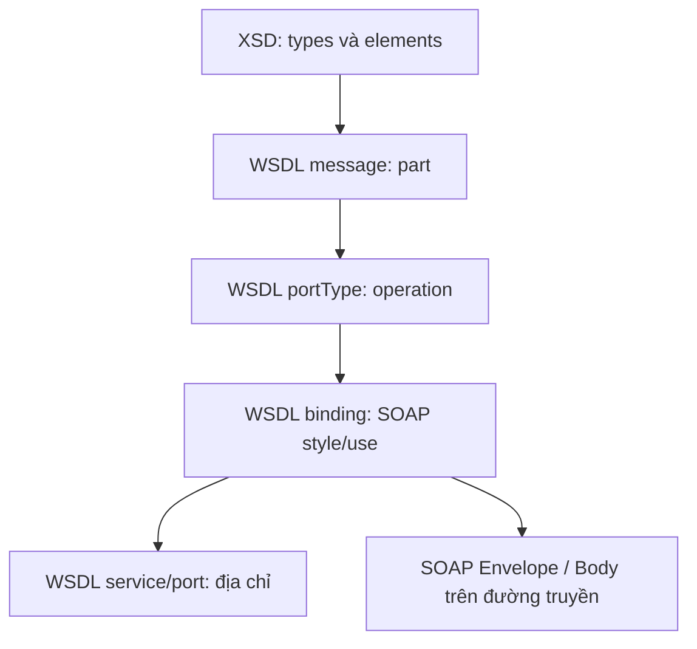

# Document/literal, RPC và ý nghĩa của kiểu liên kết trong WSDL

Trong phát triển dịch vụ SOAP theo hướng **contract-first**, WSDL là bản hợp đồng mô tả cách hệ thống gọi dịch vụ và trao đổi dữ liệu. Hai dịch vụ đều dùng SOAP và cùng nhận một mã đơn hàng nhưng có thể yêu cầu **cấu trúc SOAP Body khác nhau** do kiểu liên kết (*binding style*) của WSDL. Một bên gửi tài liệu XML đại diện cho yêu cầu nghiệp vụ; bên kia gửi lời gọi thao tác với các tham số. Nếu client chỉ biết tên thao tác mà bỏ qua phần binding, thông điệp có thể hợp lệ về cú pháp XML nhưng vẫn bị server từ chối.

Bài thuộc chương **Giao thức SOAP**, trong phạm vi **SPRING_WEB_SERVICES**: thiết kế XSD/WSDL, ánh xạ JAXB, xây dựng endpoint và SOAP client với Spring Web Services (Spring-WS), xử lý SOAP Fault, interceptor, XML security/WS-Security, chứng chỉ số và kiểm thử tương thích khi tích hợp các hệ thống doanh nghiệp. Các ví dụ sử dụng **WSDL 1.1 và SOAP 1.1** trừ khi có ghi rõ; SOAP 1.2 và WSDL 2.0 có quy tắc binding riêng.

## 1. WSDL tách hợp đồng trừu tượng khỏi cách truyền SOAP

Một tài liệu WSDL 1.1 thường có các thành phần sau:

| Thành phần | Câu hỏi được trả lời | Vai trò trong thiết kế contract-first |
| --- | --- | --- |
| `wsdl:types` | Dữ liệu có cấu trúc và kiểu gì? | Chứa hoặc nhập XSD, định nghĩa kiểu và phần tử nghiệp vụ |
| `wsdl:message` | Thông điệp logic gồm những `part` nào? | Liên kết các phần thông điệp với `xs:element` hoặc `xs:type` |
| `wsdl:portType` | Dịch vụ có những thao tác nào, đầu vào/đầu ra là gì? | Giao diện trừu tượng, chưa nói rõ cách đóng gói SOAP |
| `wsdl:binding` | Các thao tác được biểu diễn và truyền như thế nào? | Chọn SOAP binding, `style`, `use`, action, header và body |
| `wsdl:service` / `wsdl:port` | Gọi dịch vụ tại địa chỉ nào qua binding nào? | Gắn binding với endpoint cụ thể qua `soap:address` |



Ví dụ, `portType` có thao tác `GetInvoice` nhận thông điệp `GetInvoiceInput`. Riêng thông tin đó **không đủ để kết luận** SOAP Body phải là `<GetInvoice>` hay phải gồm các tham số `<invoiceId>`. Cần đọc cả `wsdl:message`, `wsdl:binding`, `soap:binding` và `soap:body`.

Trong WSDL 1.1, namespace của SOAP 1.1 binding extension là:

```xml
xmlns:soap="http://schemas.xmlsoap.org/wsdl/soap/"
```

Namespace trên dành cho **khai báo binding trong WSDL**, khác với namespace của SOAP 1.1 Envelope trên đường truyền (`http://schemas.xmlsoap.org/soap/envelope/`). Không nhầm `wsdl:binding` với cấu hình dependency injection hoặc data binding trong Java.

## 2. Hai trục độc lập: `style` và `use`

Để đọc tên thường gặp như **document/literal** hoặc **rpc/literal**, cần hiểu đó là sự kết hợp của **hai lựa chọn**.

### 2.1. `soap:binding style="document|rpc"`

`style` quy định cách hiểu nội dung SOAP Body:

- **`document`:** SOAP Body mang một hoặc nhiều phần tử biểu diễn tài liệu/thông điệp XML. Trong thực hành tương thích WS-I, phần thông điệp gửi qua Body được tham chiếu bằng phần tử toàn cục XSD; tên phần tử gốc được xác định bởi hợp đồng dữ liệu.
- **`rpc`:** SOAP Body biểu diễn lời gọi thao tác; có phần tử wrapper mang tên thao tác, bên trong là các phần tử tham số tương ứng với `wsdl:message/wsdl:part`. Cấu trúc wrapper chịu quy tắc RPC của SOAP/WSDL.

Ví dụ binding SOAP 1.1 khai báo kiểu document:

```xml
<soap:binding xmlns:soap="http://schemas.xmlsoap.org/wsdl/soap/"
              style="document"
              transport="http://schemas.xmlsoap.org/soap/http"/>
```

Thuộc tính `transport` ở đây chọn SOAP qua HTTP; nó **không xác định document hay RPC**. Theo WSDL 1.1, `style` ở mức `soap:binding` có mặc định là `document` nếu bỏ qua, nhưng nên khai báo rõ để dễ đọc và tránh nhầm. `soap:operation` có thể khai báo `style` riêng để ghi đè kiểu chung cho từng thao tác.

### 2.2. `soap:body use="literal|encoded"`

`use` cho biết cách các `message part` được biểu diễn trên đường truyền:

- **`literal`:** Nội dung được biểu diễn theo định nghĩa/schema tương ứng trong WSDL/XSD và quy tắc SOAP binding; không áp dụng bộ mã hóa SOAP Encoding cho dữ liệu đó.
- **`encoded`:** Áp dụng quy tắc mã hóa chỉ ra bởi `encodingStyle`, điển hình là SOAP Encoding đời cũ, với các cách biểu diễn như kiểu tham chiếu và mảng mã hóa.

Ví dụ:

```xml
<soap:body xmlns:soap="http://schemas.xmlsoap.org/wsdl/soap/"
           use="literal"/>
```

**`literal` không có nghĩa là chuỗi văn bản thô.** Payload vẫn là XML có namespace, kiểu dữ liệu và cấu trúc. Tương tự, **`document` không có nghĩa là dùng SOAP 1.2**: SOAP version, HTTP transport, `style` và `use` là những khía cạnh khác nhau.

| Kết hợp | Cấu trúc điển hình | Vị thế sử dụng |
| --- | --- | --- |
| **Document/literal** | Body chứa phần tử XML mô tả thông điệp nghiệp vụ | Lựa chọn ưu tiên cho SOAP contract-first và tích hợp tương tác tốt |
| **RPC/literal** | Body có wrapper thao tác và các tham số ở dạng literal | Hợp lệ trong SOAP/WSDL 1.1, có thể dùng khi hợp đồng yêu cầu |
| **RPC/encoded** | Wrapper RPC kết hợp SOAP Encoding | Thường gặp ở hệ thống cũ; không phù hợp WS-I Basic Profile, dễ gặp khác biệt công cụ |
| **Document/encoded** | Thông điệp kiểu document dùng encoding | WSDL 1.1 có thể mô tả nhưng không phù hợp thực hành WS-I Basic Profile; hiếm nên chọn cho hợp đồng mới |

**WS-I Basic Profile** hỗ trợ khả năng tương tác cho các cấu hình document/literal và rpc/literal với các ràng buộc bổ sung. Vì thế không đúng khi khẳng định “RPC luôn sai chuẩn”; vấn đề là hiểu và triển khai đúng hợp đồng đã chọn. Phần lớn hợp đồng SOAP doanh nghiệp hiện đại chọn document/literal vì dễ đặt toàn bộ payload dưới XSD và kiểm thử thông điệp nghiệp vụ.

## 3. Document/literal: thông điệp XML được xác định từ XSD

Giả sử dịch vụ hóa đơn có thao tác `GetInvoice`. XSD định nghĩa hai phần tử toàn cục `GetInvoice` và `GetInvoiceResponse` với các trường theo thứ tự:

```xml
<xs:schema xmlns:xs="http://www.w3.org/2001/XMLSchema"
           targetNamespace="https://example.org/invoice/v1"
           xmlns:tns="https://example.org/invoice/v1"
           elementFormDefault="qualified">
    <xs:element name="GetInvoice">
        <xs:complexType>
            <xs:sequence>
                <xs:element name="invoiceId" type="xs:string"/>
            </xs:sequence>
        </xs:complexType>
    </xs:element>

    <xs:element name="GetInvoiceResponse">
        <xs:complexType>
            <xs:sequence>
                <xs:element name="total" type="xs:decimal"/>
                <xs:element name="currency" type="xs:string"/>
            </xs:sequence>
        </xs:complexType>
    </xs:element>
</xs:schema>
```

### 3.1. WSDL 1.1 document/literal đầy đủ

WSDL minh họa dưới đây tự chứa XSD trong `wsdl:types`. Trong dự án thật, schema cũng có thể nằm trong file `.xsd` riêng và được nhập vào WSDL:

```xml
<?xml version="1.0" encoding="UTF-8"?>
<wsdl:definitions
    xmlns:wsdl="http://schemas.xmlsoap.org/wsdl/"
    xmlns:soap="http://schemas.xmlsoap.org/wsdl/soap/"
    xmlns:xs="http://www.w3.org/2001/XMLSchema"
    xmlns:tns="https://example.org/invoice/v1"
    targetNamespace="https://example.org/invoice/v1"
    name="InvoiceService">

    <wsdl:types>
        <xs:schema targetNamespace="https://example.org/invoice/v1"
                   elementFormDefault="qualified">
            <xs:element name="GetInvoice">
                <xs:complexType>
                    <xs:sequence>
                        <xs:element name="invoiceId" type="xs:string"/>
                    </xs:sequence>
                </xs:complexType>
            </xs:element>
            <xs:element name="GetInvoiceResponse">
                <xs:complexType>
                    <xs:sequence>
                        <xs:element name="total" type="xs:decimal"/>
                        <xs:element name="currency" type="xs:string"/>
                    </xs:sequence>
                </xs:complexType>
            </xs:element>
        </xs:schema>
    </wsdl:types>

    <wsdl:message name="GetInvoiceInput">
        <wsdl:part name="parameters" element="tns:GetInvoice"/>
    </wsdl:message>
    <wsdl:message name="GetInvoiceOutput">
        <wsdl:part name="parameters" element="tns:GetInvoiceResponse"/>
    </wsdl:message>

    <wsdl:portType name="InvoicePortType">
        <wsdl:operation name="GetInvoice">
            <wsdl:input message="tns:GetInvoiceInput"/>
            <wsdl:output message="tns:GetInvoiceOutput"/>
        </wsdl:operation>
    </wsdl:portType>

    <wsdl:binding name="InvoiceSoap11Binding" type="tns:InvoicePortType">
        <soap:binding style="document"
                      transport="http://schemas.xmlsoap.org/soap/http"/>
        <wsdl:operation name="GetInvoice">
            <soap:operation
                soapAction="https://example.org/invoice/v1/GetInvoice"/>
            <wsdl:input>
                <soap:body use="literal"/>
            </wsdl:input>
            <wsdl:output>
                <soap:body use="literal"/>
            </wsdl:output>
        </wsdl:operation>
    </wsdl:binding>

    <wsdl:service name="InvoiceService">
        <wsdl:port name="InvoicePort" binding="tns:InvoiceSoap11Binding">
            <soap:address location="https://api.example.org/soap/invoices"/>
        </wsdl:port>
    </wsdl:service>
</wsdl:definitions>
```

Nhận diện bốn điểm quan trọng:

1. `wsdl:message/wsdl:part` dùng **`element="tns:GetInvoice"`** và **`element="tns:GetInvoiceResponse"`**, trỏ tới phần tử toàn cục trong XSD.
2. `soap:binding` đặt **`style="document"`**.
3. Cả input và output dùng **`soap:body use="literal"`**.
4. SOAP Body không cần sinh thêm wrapper RPC từ tên thao tác; phần tử gốc của payload là phần tử mà message part tham chiếu.

Yêu cầu SOAP 1.1 phù hợp WSDL:

```xml
<soapenv:Envelope
    xmlns:soapenv="http://schemas.xmlsoap.org/soap/envelope/"
    xmlns:i="https://example.org/invoice/v1">
    <soapenv:Header/>
    <soapenv:Body>
        <i:GetInvoice>
            <i:invoiceId>INV-100</i:invoiceId>
        </i:GetInvoice>
    </soapenv:Body>
</soapenv:Envelope>
```

Phản hồi:

```xml
<soapenv:Envelope
    xmlns:soapenv="http://schemas.xmlsoap.org/soap/envelope/"
    xmlns:i="https://example.org/invoice/v1">
    <soapenv:Body>
        <i:GetInvoiceResponse>
            <i:total>125000.00</i:total>
            <i:currency>VND</i:currency>
        </i:GetInvoiceResponse>
    </soapenv:Body>
</soapenv:Envelope>
```

Payload có thể được xác thực với phần tử `tns:GetInvoice` trong XSD. Quy tắc `xs:sequence` vẫn kiểm soát thứ tự các trường; `style="document"` không làm mất hiệu lực ràng buộc XSD.

### 3.2. Document/literal **wrapped** và **bare**

Hai tên gọi này mô tả **quy ước cấu trúc**, không phải giá trị thứ ba của thuộc tính `style`. Cả hai đều dùng `style="document"` và `use="literal"`.

**Document/literal wrapped** thường sử dụng một phần tử toàn cục có tên trùng thao tác (`GetInvoice`), chứa các trường yêu cầu, cùng phần tử phản hồi theo mẫu `GetInvoiceResponse`. Phần tử wrapper *được khai báo rõ trong XSD*; WSDL input/output thường có một `wsdl:part` tham chiếu phần tử đó. Các công cụ code generation có thể dựa vào quy ước wrapper để tạo chữ ký method thuận tiện, song các tiêu chí nhận dạng chi tiết có thể khác nhau giữa framework.

**Document/literal bare** cũng có một phần tử nghiệp vụ toàn cục nhưng không cần trùng tên với thao tác WSDL. Chẳng hạn thao tác trừu tượng tên `RetrieveInvoice` có request body:

```xml
<i:InvoiceQuery xmlns:i="https://example.org/invoice/v1">
    <i:invoiceId>INV-100</i:invoiceId>
</i:InvoiceQuery>
```

Khi đó, `wsdl:part element="tns:InvoiceQuery"` và XSD phải khai báo `InvoiceQuery` tương ứng. Dù WSDL operation là `RetrieveInvoice`, SOAP Body vẫn bắt đầu từ `InvoiceQuery`. Cần kiểm tra cấu hình định tuyến Spring-WS theo QName payload, không suy đoán QName từ tên operation.

| Điểm so sánh | Document/literal wrapped | Document/literal bare |
| --- | --- | --- |
| `soap:binding style` | `document` | `document` |
| `soap:body use` | `literal` | `literal` |
| Phần tử gốc trong Body | Phần tử toàn cục theo quy ước tên thao tác | Phần tử nghiệp vụ toàn cục do XSD/WSDL chỉ định |
| Mối quan hệ với operation | Thường có tên request trùng tên operation | Không bắt buộc trùng |
| Ý nghĩa triển khai | Thân thiện với code generation theo quy ước wrapper | Nhấn mạnh tài liệu/thông điệp độc lập với tên thao tác |

Trong thực hành document/literal tương thích rộng, nên định nghĩa payload bằng **một phần tử toàn cục rõ ràng** và giữ XSD là nguồn sự thật. Cách chia thành wrapped hay bare **không thay đổi** bản chất `literal` hoặc ngữ nghĩa SOAP Fault.

## 4. RPC/literal: wrapper biểu diễn lời gọi thao tác

Xét thao tác `GetPrice` có tham số `sku` và kết quả `amount`. Ở RPC/literal, `wsdl:message` thường khai báo các `part` bằng **`type`** thay vì tham chiếu tới một phần tử gốc XSD:

```xml
<wsdl:message xmlns:wsdl="http://schemas.xmlsoap.org/wsdl/"
              xmlns:xs="http://www.w3.org/2001/XMLSchema"
              name="GetPriceInput">
    <wsdl:part name="sku" type="xs:string"/>
</wsdl:message>
```

### 4.1. WSDL 1.1 RPC/literal đầy đủ

```xml
<?xml version="1.0" encoding="UTF-8"?>
<wsdl:definitions
    xmlns:wsdl="http://schemas.xmlsoap.org/wsdl/"
    xmlns:soap="http://schemas.xmlsoap.org/wsdl/soap/"
    xmlns:xs="http://www.w3.org/2001/XMLSchema"
    xmlns:tns="https://example.org/pricing/v1"
    targetNamespace="https://example.org/pricing/v1"
    name="PricingService">

    <wsdl:message name="GetPriceInput">
        <wsdl:part name="sku" type="xs:string"/>
    </wsdl:message>
    <wsdl:message name="GetPriceOutput">
        <wsdl:part name="amount" type="xs:decimal"/>
    </wsdl:message>

    <wsdl:portType name="PricingPortType">
        <wsdl:operation name="GetPrice">
            <wsdl:input message="tns:GetPriceInput"/>
            <wsdl:output message="tns:GetPriceOutput"/>
        </wsdl:operation>
    </wsdl:portType>

    <wsdl:binding name="PricingSoap11Binding" type="tns:PricingPortType">
        <soap:binding style="rpc"
                      transport="http://schemas.xmlsoap.org/soap/http"/>
        <wsdl:operation name="GetPrice">
            <soap:operation
                soapAction="https://example.org/pricing/v1/GetPrice"/>
            <wsdl:input>
                <soap:body use="literal"
                           namespace="https://example.org/pricing/v1"/>
            </wsdl:input>
            <wsdl:output>
                <soap:body use="literal"
                           namespace="https://example.org/pricing/v1"/>
            </wsdl:output>
        </wsdl:operation>
    </wsdl:binding>

    <wsdl:service name="PricingService">
        <wsdl:port name="PricingPort" binding="tns:PricingSoap11Binding">
            <soap:address location="https://api.example.org/soap/prices"/>
        </wsdl:port>
    </wsdl:service>
</wsdl:definitions>
```

Thông điệp trên đường truyền:

```xml
<soapenv:Envelope
    xmlns:soapenv="http://schemas.xmlsoap.org/soap/envelope/"
    xmlns:p="https://example.org/pricing/v1">
    <soapenv:Body>
        <p:GetPrice>
            <sku>BOOK-001</sku>
        </p:GetPrice>
    </soapenv:Body>
</soapenv:Envelope>
```

Phản hồi:

```xml
<soapenv:Envelope
    xmlns:soapenv="http://schemas.xmlsoap.org/soap/envelope/"
    xmlns:p="https://example.org/pricing/v1">
    <soapenv:Body>
        <p:GetPriceResponse>
            <amount>199.50</amount>
        </p:GetPriceResponse>
    </soapenv:Body>
</soapenv:Envelope>
```

Theo quy tắc RPC của WSDL/SOAP 1.1 được minh họa ở đây:

- `GetPrice` và `GetPriceResponse` là **wrapper lời gọi/đáp ứng RPC** nằm dưới SOAP Body, với namespace lấy từ binding.
- `sku` và `amount` là **parameter accessors** theo tên `wsdl:part`; ví dụ trên dùng tên không có namespace cho các accessor theo cách biểu diễn RPC/literal thông dụng.
- Các giá trị `sku`, `amount` có kiểu `xs:string` và `xs:decimal`, và vì `use="literal"` nên chúng **không được SOAP Encoding mã hóa**.
- Wrapper RPC được tạo bởi quy tắc SOAP binding; **không tự động đồng nghĩa** với một phần tử toàn cục `xs:element name="GetPrice"` trong XSD.

Điểm cuối giải thích vì sao một SOAP Body của RPC/literal có thể *trông giống* document/literal wrapped nhưng cơ chế giải thích qua WSDL khác nhau. Không thể xác định kiểu binding chỉ bằng cách nhìn một payload có thẻ `GetPrice`.

### 4.2. RPC/literal khác RPC/encoded

RPC là **kiểu tổ chức lời gọi**; encoded là **quy tắc biểu diễn dữ liệu**. Trong RPC/encoded, `soap:body` thường có `use="encoded"` và `encodingStyle` chỉ tới SOAP Encoding, ví dụ:

```xml
<soap:body xmlns:soap="http://schemas.xmlsoap.org/wsdl/soap/"
           use="encoded"
           namespace="https://example.org/pricing/v1"
           encodingStyle="http://schemas.xmlsoap.org/soap/encoding/"/>
```

Khi đó, các client có thể cần hỗ trợ SOAP Encoding, kiểu mảng mã hóa hoặc tham chiếu nhiều nút tùy hợp đồng cụ thể. Đây là nhóm hợp đồng cũ dễ gây vấn đề tương thích giữa các thư viện SOAP. Việc thay `use="encoded"` thành `literal` chỉ trong WSDL **không đủ để chuyển đổi dịch vụ**: phải xem lại mô hình dữ liệu, cấu trúc message part, wire format và mã xử lý của cả hai phía.

## 5. Tại sao kiểu liên kết ảnh hưởng trực tiếp tới client và server?

### 5.1. So sánh hình dạng payload dưới hai binding

Ví dụ **document/literal** có phần tử toàn cục XSD biểu diễn yêu cầu hóa đơn:

```xml
<i:GetInvoice xmlns:i="https://example.org/invoice/v1">
    <i:invoiceId>INV-100</i:invoiceId>
</i:GetInvoice>
```

Ví dụ **RPC/literal** có wrapper thao tác và parameter accessor:

```xml
<p:GetPrice xmlns:p="https://example.org/pricing/v1">
    <sku>BOOK-001</sku>
</p:GetPrice>
```

Cả hai đều chứa wrapper và phần tử con, nhưng ý nghĩa nguồn gốc wrapper khác nhau:

| Khía cạnh | Document/literal | RPC/literal |
| --- | --- | --- |
| Phần tử gốc dưới Body | Do phần tử XSD được `wsdl:part element=...` tham chiếu | Wrapper thao tác theo quy tắc RPC binding |
| `wsdl:part` thông dụng | Tham chiếu `element` toàn cục | Tham chiếu `type` của tham số |
| Cách xác thực payload | Có thể xác thực trực tiếp với phần tử toàn cục XSD | Cần xét quy tắc wrapper và các part/type; không mặc nhiên có global element XSD cho toàn bộ wrapper |
| JAXB/code generation | Thuận tiện sinh các lớp request/response từ XSD | Cần công cụ/ánh xạ hiểu RPC binding và parameter parts |
| Đổi tên operation WSDL | Không bắt buộc đổi QName phần tử nghiệp vụ trong bare style | Có thể đổi tên wrapper lời gọi RPC và làm thay đổi wire format |
| Lựa chọn cho hợp đồng mới | Thường được ưu tiên | Cân nhắc khi cần đáp ứng một hợp đồng RPC có sẵn |

**Không áp đặt** quy tắc của một binding lên binding còn lại. Đặc biệt, SOAP Body chứa một thẻ trùng tên operation **chưa chứng minh** đó là RPC: document/literal wrapped cũng thường mang hình dạng này.

### 5.2. Spring-WS định tuyến theo payload XML

Spring Web Services tập trung vào thông điệp XML và hợp đồng XSD. Với ví dụ document/literal, một endpoint minh họa:

```java
import org.springframework.ws.server.endpoint.annotation.Endpoint;
import org.springframework.ws.server.endpoint.annotation.PayloadRoot;
import org.springframework.ws.server.endpoint.annotation.RequestPayload;
import org.springframework.ws.server.endpoint.annotation.ResponsePayload;

@Endpoint
public class InvoiceEndpoint {
    private static final String NAMESPACE =
            "https://example.org/invoice/v1";

    @PayloadRoot(namespace = NAMESPACE, localPart = "GetInvoice")
    @ResponsePayload
    public GetInvoiceResponse getInvoice(
            @RequestPayload GetInvoice request) {

        GetInvoiceResponse response = new GetInvoiceResponse();
        response.setTotal(new java.math.BigDecimal("125000.00"));
        response.setCurrency("VND");
        return response;
    }
}
```

`GetInvoice` và `GetInvoiceResponse` là **tên lớp minh họa**; hình dạng lớp được sinh thực tế phụ thuộc XSD, phiên bản JAXB và tùy chọn code generation. Ví dụ giả định Spring-WS đã cấu hình marshaller/unmarshaller tương thích. `@PayloadRoot` khớp **QName của phần tử gốc payload**, không trực tiếp đọc tên `wsdl:portType/wsdl:operation`.

Hệ quả:

- Với **document/literal wrapped**, phần tử gốc thường cùng tên operation nên hai khái niệm dễ bị nhầm là một.
- Với **document/literal bare**, operation có thể tên `RetrieveInvoice` nhưng `@PayloadRoot` cần `localPart="InvoiceQuery"` nếu đó là payload thực tế.
- Với **RPC/literal**, phần tử gốc payload là wrapper RPC; tuy định tuyến XML có thể nhìn thấy wrapper đó, việc chỉ sinh JAXB từ các global XSD elements chưa chắc biểu diễn đầy đủ `message part` của RPC. Cần kiểm tra công cụ tạo client/endpoint có hỗ trợ kiểu binding đã nhận.

Spring-WS không biến một WSDL RPC thành hợp đồng document/literal chỉ bằng cách gắn `@Endpoint`. Khi tích hợp RPC/literal hoặc RPC/encoded có sẵn, hãy thử khả năng tương thích WSDL/code generation của stack SOAP đang dùng; có thể cần một bộ thích ứng hoặc công cụ client khác hỗ trợ binding đó.

### 5.3. SOAP client phải gửi đúng wire format

Với Spring-WS, `WebServiceTemplate` có thể marshal một đối tượng JAXB thành SOAP payload theo mô hình đã cấu hình:

```java
import org.springframework.ws.client.core.WebServiceTemplate;
import org.springframework.ws.soap.client.core.SoapActionCallback;

public class InvoiceClient {
    private final WebServiceTemplate template;

    public InvoiceClient(WebServiceTemplate template) {
        this.template = template;
    }

    public GetInvoiceResponse load(String invoiceId) {
        GetInvoice request = new GetInvoice();
        request.setInvoiceId(invoiceId);

        return (GetInvoiceResponse) template.marshalSendAndReceive(
            "https://api.example.org/soap/invoices",
            request,
            new SoapActionCallback(
                "https://example.org/invoice/v1/GetInvoice"));
    }
}
```

Đoạn mã giả định `WebServiceTemplate` được cấu hình `Jaxb2Marshaller` phù hợp với các lớp JAXB. `SoapActionCallback` cung cấp giá trị SOAPAction cần cho hợp đồng HTTP SOAP 1.1 minh họa, nhưng **SOAPAction không quyết định** `style` hay `use`. Một client gửi đúng SOAPAction nhưng sai root element hoặc sai namespace vẫn có thể thất bại.

Đừng tự đổi nội dung XML thành chuỗi JSON, tự đóng gói wrapper RPC hoặc đổi prefix/namespace chỉ vì tên thao tác WSDL trùng với tên method Java.

### 5.4. XSD validation, interceptor và SOAP Fault

Trong Spring-WS, interceptor như `PayloadValidatingInterceptor` có thể kiểm tra payload theo XSD. Với document/literal có phần tử toàn cục, việc xác thực trực tiếp nội dung Body là phương án rõ ràng. Với RPC/literal, wrapper RPC có thể không được định nghĩa là một global element trong XSD; vì vậy cần cách xác thực biết đến binding thay vì mặc nhiên truyền wrapper qua schema của document/literal.

Khi gặp lỗi:

1. XML có thể **well-formed** nhưng không khớp QName hoặc schema.
2. Marshaller/unmarshaller có thể gặp lỗi vì các lớp JAXB không tương ứng phiên bản hợp đồng.
3. Endpoint có thể từ chối dữ liệu hợp cấu trúc nhưng sai quy tắc nghiệp vụ.
4. Spring-WS có thể tạo SOAP Fault theo interceptor và exception resolver đã cấu hình.

Đối với SOAP 1.1, cần phân biệt ý nghĩa Fault **Client** (thông điệp phía gửi có vấn đề, tùy tình huống) và **Server** (lỗi phía xử lý); SOAP 1.2 dùng thuật ngữ **Sender** và **Receiver**. Không thể suy ra chính xác Fault code chỉ từ hai thuộc tính `style/use` vì cơ chế ánh xạ lỗi còn tùy endpoint và framework.

### 5.5. WS-Security không phụ thuộc document hay RPC

XML Signature, mã hóa thông điệp, chứng chỉ và chính sách WS-Security có thể áp dụng trên những thông điệp SOAP dùng các binding khác nhau. Tuy nhiên, vị trí phần tử được ký và QName thực tế quan trọng đối với việc xử lý:

- Xác định đúng SOAP Envelope, Header, Body và các phần tử cần xác minh bảo mật.
- Không tự đổi thứ tự phần tử hoặc thay đổi nội dung được ký trong quá trình “chuyển đổi style”.
- Xác thực chữ ký, trust chain/chứng chỉ và các yêu cầu WS-Security **riêng** với XSD validation.

Một thông điệp có chữ ký hợp lệ chưa chắc đúng document/literal hoặc RPC/literal; ngược lại, đúng WSDL không bảo đảm chữ ký hoặc chứng chỉ hợp lệ.

## 6. Đọc WSDL có hệ thống trước khi tích hợp

Khi nhận WSDL từ đối tác, nên kiểm tra theo thứ tự:

1. **WSDL version và SOAP version.** Xem namespace của `wsdl:definitions`, loại SOAP binding extension (`soap`/`soap12`), Envelope và HTTP Content-Type tương ứng.
2. **Tìm service, port và binding thực tế.** Một WSDL có thể công bố nhiều binding hoặc nhiều endpoint cho cùng `portType`.
3. **Đọc `soap:binding style` và khả năng override ở `soap:operation`.** Đừng chỉ nhìn operation.
4. **Đọc `soap:body use` ở cả input và output.** Ghi nhận `parts`, `namespace` và `encodingStyle` nếu có.
5. **Tra `wsdl:message/wsdl:part`.** Kiểm tra dùng `element` hay `type` và phần tử/schema đang được tham chiếu.
6. **Đọc XSD và WSDL imports.** Xác định namespace, thứ tự phần tử, số lần xuất hiện, nullable, kiểu dữ liệu và schema version.
7. **Kiểm tra SOAPAction, header và fault binding.** Những phần này có thể ràng buộc việc gọi dịch vụ dù SOAP Body hợp lệ.
8. **Sinh hoặc cấu hình client tương thích**, gửi request thật vào môi trường kiểm thử và so sánh XML trên đường truyền với hợp đồng.

> Mẹo đọc nhanh: tìm `soap:binding style`, sau đó tìm `soap:body use`, rồi lần ngược `wsdl:part` đến `xs:element`/`xs:type`. Ba điểm này thường giải thích phần lớn khác biệt document/literal và RPC/literal.

### Checklist kiểm thử tương thích

| Ca kiểm thử | Mong đợi |
| --- | --- |
| Request document/literal đúng global element XSD | Client/server nhận đúng QName payload và validate được |
| Payload document có root trùng tên nhưng sai namespace URI | Bị phát hiện sai hợp đồng hoặc không định tuyến đúng |
| Gửi `<GetInvoice>` khi WSDL bare thực ra yêu cầu `<InvoiceQuery>` | Xác định được sai root element |
| RPC/literal có wrapper thao tác và đúng parameter parts | Server xử lý được giá trị tham số |
| RPC/literal thiếu một tham số bắt buộc hoặc sai kiểu | Có lỗi xác thực/ánh xạ phù hợp với hợp đồng |
| Dùng XML RPC/encoded cho endpoint RPC/literal | Không chấp nhận cách mã hóa không được khai báo |
| Response theo binding đúng nhưng bị đổi thứ tự XSD | Schema validation phát hiện nếu XSD yêu cầu thứ tự |
| Client dùng SOAP 1.2 Envelope với SOAP 1.1 binding | Phát hiện sai phiên bản giao thức |
| SOAPAction khác giá trị hợp đồng/hệ thống yêu cầu | Kiểm thử phản ứng của server/gateway |
| SOAP Fault khi request sai hoặc xử lý lỗi | Client đọc được Fault code và mô tả đúng giao thức |
| Payload có chữ ký WS-Security | Xác minh chữ ký/chứng chỉ trên thông điệp thực tế |
| Sinh lại client sau thay đổi WSDL/XSD | Kiểm tra wire format và tương thích phiên bản |

Để kiểm thử Spring-WS, có thể dùng `MockWebServiceClient` cho endpoint, `MockWebServiceServer` cho `WebServiceTemplate` và contract test sử dụng XSD/WSDL đã công bố. Nếu tích hợp với dịch vụ RPC cũ, cần một vòng thử nghiệm thực sự giữa hai stack thay vì chỉ dựa vào việc lớp Java compile thành công.

## 7. Những nhầm lẫn thường gặp và cách sửa

**Nhầm 1: “Có thẻ mang tên thao tác trong SOAP Body thì chắc chắn RPC.”** Sai. Document/literal wrapped cũng thường dùng phần tử XSD có tên trùng thao tác. Xem `soap:binding style` và `wsdl:part` để xác định.

**Nhầm 2: “`literal` nghĩa là không cần XSD.”** Ngược lại, thông điệp literal được ràng buộc bởi định nghĩa kiểu/phần tử, dù mức độ xác thực runtime phải được cấu hình riêng.

**Nhầm 3: “`wsdl:portType` đủ để viết request.”** `portType` chỉ là giao diện logic; phải đọc binding, message part, XSD và quy tắc SOAP để tạo XML trên đường truyền.

**Nhầm 4: “RPC/literal cũng là RPC/encoded.”** Không. Cùng dùng RPC wrapper nhưng khác `use` và cách mã hóa dữ liệu; chuyển đổi giữa chúng có thể làm thay đổi hợp đồng và payload.

**Nhầm 5: “Đổi tên method Java sẽ tự đổi SOAP operation.”** Không thể suy luận vậy với Spring-WS contract-first. Định tuyến phụ thuộc QName payload, còn tên thao tác xuất phát từ WSDL; hai tên có thể khác nhau ở document/literal bare.

**Nhầm 6: “Cứ gửi đúng SOAPAction là đủ.”** SOAPAction chỉ là một thông tin binding/HTTP; Body, namespace, header, kiểu dữ liệu và chính sách bảo mật vẫn phải đúng.

**Nhầm 7: “Gửi XML parse được nghĩa là đúng WSDL.”** Một thông điệp well-formed có thể sai schema, sai wrapper, sai namespace, sai SOAP version hoặc vi phạm bảo mật.

## 8. Bài tập đọc hợp đồng

### Bài tập 1: Xác định kiểu binding

Cho đoạn WSDL:

```xml
<soap:binding xmlns:soap="http://schemas.xmlsoap.org/wsdl/soap/"
              style="rpc"
              transport="http://schemas.xmlsoap.org/soap/http"/>
<!-- Bên trong wsdl:input: -->
<soap:body xmlns:soap="http://schemas.xmlsoap.org/wsdl/soap/"
           use="literal"
           namespace="https://example.org/catalog/v1"/>
```

**Đáp án:** RPC/literal. Wrapper thao tác theo RPC binding; tham số dùng kiểu literal. Không được gọi đây là RPC/encoded vì `use` không phải `encoded`.

### Bài tập 2: Phân biệt tên operation và payload

WSDL có `wsdl:operation name="LookupCustomer"`, input message gồm một part `element="tns:CustomerLookupRequest"`, binding `style="document"` và `use="literal"`. SOAP Body phải bắt đầu bằng phần tử nào?

**Đáp án:** `tns:CustomerLookupRequest` theo XSD, không phải tự động là `tns:LookupCustomer`. Đây có thể là document/literal bare.

### Bài tập 3: Nhận diện điểm chưa đủ để kết luận

Một request có dạng:

```xml
<m:SubmitOrder xmlns:m="https://example.org/order/v1">
    <m:orderId>ORD-100</m:orderId>
</m:SubmitOrder>
```

Có thể kết luận đây là RPC/literal chỉ từ đoạn này không?

**Đáp án:** Không. Nó có thể là document/literal wrapped nếu `SubmitOrder` là phần tử toàn cục XSD, hoặc là một cách biểu diễn RPC dưới các quy tắc riêng. Cần WSDL binding và message part, đồng thời đối chiếu namespace của parameter accessors.

### Bài tập 4: Chuyển đổi từ RPC/encoded

Đối tác yêu cầu đổi `use="encoded"` thành `use="literal"` để chạy trên một client chỉ hỗ trợ literal. Có thể chỉ sửa một thuộc tính WSDL rồi triển khai không?

**Đáp án:** Không. Phải phân tích cấu trúc request/response, message part, các kiểu mảng và tham chiếu, logic marshal/unmarshal và kiểm thử end-to-end. Thuộc tính mới cần phản ánh một wire format mà server thật sự hỗ trợ.

### Bài tập 5: Ảnh hưởng tới bảo mật

Một gateway xác minh WS-Security signature thành công, sau đó chỉnh SOAP Body từ wrapper RPC sang phần tử document trước khi gửi tiếp. Vì sao cần thận trọng?

**Đáp án:** Gateway đang biến đổi cấu trúc thông điệp theo hai hợp đồng có thể khác nhau; phải biết rõ nội dung đã ký, chuỗi tin cậy và chính sách bảo mật. Nếu thay đổi phần tử/nội dung đã ký, chữ ký sẽ không còn áp dụng cho cùng dữ liệu theo cách ban đầu; việc chuyển đổi còn cần validate schema và binding của đích.

## 9. Ghi nhớ

- Trong WSDL 1.1, **`soap:binding style`** quyết định cách tổ chức SOAP Body thành tài liệu hay lời gọi RPC; **`soap:body use`** quyết định dạng biểu diễn literal hay encoded.
- **Document/literal** dựa vào các phần tử nghiệp vụ được định nghĩa trong XSD. **Wrapped** và **bare** là các quy ước bên trong document/literal, không phải hai giá trị khác nhau của `style`.
- **RPC/literal** có wrapper thao tác và parameter parts, nhưng vẫn dùng dữ liệu literal. **RPC/encoded** là một hợp đồng khác với rủi ro tương thích cao hơn.
- Muốn đọc đúng wire format, phải kết hợp **`wsdl:message` + `wsdl:portType` + `wsdl:binding` + XSD**, không chỉ xem tên operation.
- Với Spring-WS contract-first, đối chiếu QName payload của `@PayloadRoot`, mã JAXB, định nghĩa WSDL/XSD và thông điệp thực tế. XSD validation, SOAP Fault và WS-Security cần được kiểm thử độc lập với lựa chọn style/use.
