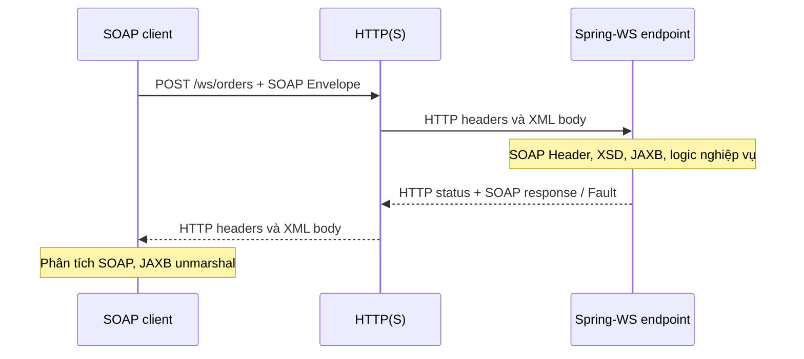

# Đọc một yêu cầu, phản hồi SOAP hoàn chỉnh từ dữ liệu truyền thực tế

Trong tích hợp doanh nghiệp với **Spring Web Services (Spring-WS)**, một request SOAP không đơn thuần là lời gọi method Java: client truyền **HTTP request** chứa **SOAP Envelope** dưới dạng byte, server phân tích XML, kiểm tra hợp đồng XSD/WSDL, xử lý SOAP header và ánh xạ dữ liệu sang JAXB trước khi endpoint thực thi. Response có cấu trúc tương tự, nhưng có thể mang payload thành công hoặc **SOAP Fault**.

Bài học này tập đọc một cặp bản tin trao đổi hoàn chỉnh ở mức HTTP và XML, đi từ request line, `Content-Type`, `SOAPAction`, namespace, `Header` và `Body` đến từng trường nghiệp vụ trong response. Qua đó, bạn sẽ biết cách đối chiếu dữ liệu thực nhận với **contract-first**, phân biệt lỗi transport, lỗi SOAP, lỗi validation và lỗi tại endpoint, đồng thời lưu ý interceptor, XML security và WS-Security.

> **Nguồn dữ liệu trong bài:** Đây là bản tin **mô phỏng định dạng dữ liệu truyền HTTP/1.1 + SOAP 1.1**, giúp thực hành như khi đọc raw request/response. `api.example.test` và các mã đơn hàng là dữ liệu giả, không phải capture của một hệ thống đang chạy. `Content-Length` được tính từ số **byte UTF-8** của phần XML body bên dưới, quy ước XML dùng LF giữa các dòng và **không có newline sau thẻ `Envelope` cuối**; HTTP header theo giao thức dùng CRLF. Khi đọc log thật, phải kiểm tra byte gốc và cách công cụ hiển thị xuống dòng.

## 1. Một trao đổi SOAP qua HTTP(S) trông như thế nào?



| Lớp | Những phần cần đọc | Câu hỏi quan trọng |
| --- | --- | --- |
| HTTP(S) | URL, HTTP method, hostname, status | Request đi đúng nơi, server trả HTTP status gì? |
| HTTP headers | `Content-Type`, `SOAPAction`, `Content-Length` | Đúng loại SOAP và encoding chưa? |
| SOAP Envelope | Namespace `Envelope`, `Header`, `Body` | Bản tin SOAP 1.1 hay 1.2? |
| SOAP Header | Correlation ID, WS-Addressing, WS-Security nếu có | Metadata nào phải được xử lý? |
| Payload XML | QName của phần tử bên trong `Body` | Có khớp phần tử request/response của XSD? |
| Ứng dụng | Dữ liệu đơn hàng, JAXB, endpoint | Nghiệp vụ đã làm gì và trả kết quả nào? |

**Dữ liệu HTTP bên trong HTTPS được TLS mã hóa trên mạng**. Packet capture thụ động có thể chỉ thấy TLS record, không thấy văn bản SOAP; cần công cụ client, log ở nơi xử lý TLS hoặc môi trường thử nghiệm có quyền quan sát nội dung. Không bao giờ kết luận nội dung SOAP chỉ từ metadata của TCP/TLS.

## 2. Hợp đồng ví dụ: operation và phần tử XML cần tìm

Giả sử dịch vụ SOAP có thông tin trong WSDL/XSD như sau:

| Thành phần hợp đồng | Giá trị ví dụ |
| --- | --- |
| Endpoint | `https://api.example.test/ws/orders` |
| SOAP binding | SOAP 1.1, `document/literal` |
| Operation | `CreateOrder` |
| Target namespace | `urn:example:orders:v1` |
| Input element | `{urn:example:orders:v1}CreateOrderRequest` |
| Output element | `{urn:example:orders:v1}CreateOrderResponse` |
| SOAP action | `urn:example:orders:v1/CreateOrder` |

Một đoạn *binding* WSDL minh họa (giả sử file cha đã khai báo `wsdl`, `soap`, `tns` và các `message`/`portType`):

```xml
<wsdl:binding name="OrdersSoap11Binding" type="tns:OrdersPortType">
  <soap:binding style="document"
                transport="http://schemas.xmlsoap.org/soap/http"/>
  <wsdl:operation name="CreateOrder">
    <soap:operation soapAction="urn:example:orders:v1/CreateOrder"/>
    <wsdl:input><soap:body use="literal"/></wsdl:input>
    <wsdl:output><soap:body use="literal"/></wsdl:output>
  </wsdl:operation>
</wsdl:binding>
```

Đây chỉ là **trích đoạn**, không phải WSDL hoàn chỉnh; phần khai báo `wsdl:message`, `portType`, `service` và schema phải có trong hợp đồng thật. Khi nhận một bản SOAP từ đối tác, bắt đầu bằng **WSDL/XSD được công bố**, đừng đoán tên element từ class Java hay path HTTP.

## 3. Request: dữ liệu HTTP trên đường truyền

Đây là request mà SOAP client gửi đến endpoint:

```http
POST /ws/orders HTTP/1.1
Host: api.example.test
Content-Type: text/xml; charset=utf-8
SOAPAction: "urn:example:orders:v1/CreateOrder"
Accept: text/xml
Content-Length: 710
Connection: close

<?xml version="1.0" encoding="UTF-8"?>
<soapenv:Envelope xmlns:soapenv="http://schemas.xmlsoap.org/soap/envelope/"
                  xmlns:ord="urn:example:orders:v1">
  <soapenv:Header>
    <ord:TraceContext soapenv:mustUnderstand="0">
      <ord:correlationId>trc-20261127-0042</ord:correlationId>
    </ord:TraceContext>
  </soapenv:Header>
  <soapenv:Body>
    <ord:CreateOrderRequest>
      <ord:clientOrderId>WEB-20261127-0042</ord:clientOrderId>
      <ord:customerName>Nguyễn Thị Hà</ord:customerName>
      <ord:amount currency="VND">1250000</ord:amount>
      <ord:note>Giao sau 17:00 &amp; gọi trước khi đến</ord:note>
    </ord:CreateOrderRequest>
  </soapenv:Body>
</soapenv:Envelope>
```

Trong HTTP/1.1 thật, mỗi dòng HTTP header kết thúc bằng CRLF, sau header có một dòng CRLF trống rồi đến body XML. `Content-Length` đếm **byte của body**, không tính dòng POST hay HTTP headers. Trong XML trình bày ở đây, dấu xuống dòng là LF và byte cuối cùng chính là dấu `>` của `</soapenv:Envelope>`; thêm newline hoặc BOM vào file sẽ thay đổi `Content-Length`. Tiếng Việt thường chiếm nhiều byte UTF-8 hơn số ký tự được hiển thị.

### 3.1. Phân tích phần HTTP

| Thành phần | Ý nghĩa khi đọc bản tin | Kiểm tra khi xảy ra lỗi |
| --- | --- | --- |
| `POST /ws/orders HTTP/1.1` | Client gửi request tới đường dẫn dịch vụ bằng POST. | Đúng URL/proxy/servlet mapping chưa? |
| `Host: api.example.test` | Virtual host đích trong HTTP/1.1. | Có bị proxy chuyển nhầm host không? |
| `Content-Type: text/xml; charset=utf-8` | Media type hay dùng với SOAP 1.1 và charset UTF-8. | Byte thực có đúng UTF-8? Có bị nhầm SOAP 1.2? |
| `SOAPAction: "urn:example:orders:v1/CreateOrder"` | Action HTTP được công bố cho operation SOAP 1.1. | Có đúng `soapAction` trong WSDL và yêu cầu đối tác? |
| `Accept: text/xml` | Client chấp nhận response ở dạng XML. | Có kỳ vọng khác ở gateway? |
| `Content-Length: 710` | Tổng byte của XML body minh họa. | Có tính nhầm theo số ký tự Java? |
| `Connection: close` | Ví dụ dùng kết nối đóng sau trao đổi HTTP/1.1. | Không phải cơ chế xử lý nghiệp vụ SOAP. |

`SOAPAction` của SOAP 1.1 có thể được sử dụng khi định tuyến hoặc xác thực ở gateway/bên nhận. Nó không thay cho việc kiểm tra QName của payload và không chứng minh XML tuân thủ XSD. Giá trị action và cách đặt dấu nháy phải khớp yêu cầu đối tác; một số binding hợp lệ có action rỗng.

### 3.2. `Envelope` xác định phiên bản SOAP

```xml
<soapenv:Envelope xmlns:soapenv="http://schemas.xmlsoap.org/soap/envelope/"
                  xmlns:ord="urn:example:orders:v1">
```

Phần tử gốc `Envelope` thuộc namespace `http://schemas.xmlsoap.org/soap/envelope/`, vì vậy đây là SOAP **1.1**. Prefix `soapenv` chỉ là bí danh namespace; dùng `soap` hay `env` với **cùng URI** vẫn xác định phần tử SOAP tương đương.

`xmlns:ord` khai báo namespace các phần tử nghiệp vụ. Với XML, định danh cần so sánh là **QName = namespace URI + local name**, không phải chuỗi prefix viết trong file. Ví dụ `ord:CreateOrderRequest` và `x:CreateOrderRequest` là tương đương nếu `ord` và `x` đều ánh xạ đến `urn:example:orders:v1`.

Một SOAP Envelope có `Body` bắt buộc và `Header` tùy chọn; nếu có `Header` thì nó đứng trước `Body`.

### 3.3. `Header` mang thông tin ngoài payload chính

```xml
<soapenv:Header>
  <ord:TraceContext soapenv:mustUnderstand="0">
    <ord:correlationId>trc-20261127-0042</ord:correlationId>
  </ord:TraceContext>
</soapenv:Header>
```

Header block `ord:TraceContext` là **tùy biến của ví dụ**; nó không phải thành phần mặc định bắt buộc của SOAP hoặc Spring-WS. `correlationId` giúp ghép request và response trong log khi nhiều luồng chạy đồng thời. Ứng dụng phải chủ động đọc và, nếu muốn, sao chép correlation ID vào response; Spring-WS không tự động echo mọi custom header.

`soapenv:mustUnderstand="0"` ở SOAP 1.1 chỉ ra header này không bắt buộc được xử lý theo cơ chế `mustUnderstand`. Ngược lại, header có `mustUnderstand="1"` gửi đến đúng node SOAP cần được node đó hiểu và xử lý; nếu không, node phải báo SOAP Fault phù hợp. SOAP 1.1 còn có thuộc tính `actor` để chỉ định vai trò xử lý header.

**Đừng nhầm SOAP Header với HTTP header.** `SOAPAction` ở ngoài XML, trong khi `TraceContext` là một phần của `Envelope`. Header bảo mật `wsse:Security`, khi có, cũng nằm trong SOAP Header.

### 3.4. `Body` chứa input theo XSD

```xml
<soapenv:Body>
  <ord:CreateOrderRequest>
    <ord:clientOrderId>WEB-20261127-0042</ord:clientOrderId>
    <ord:customerName>Nguyễn Thị Hà</ord:customerName>
    <ord:amount currency="VND">1250000</ord:amount>
    <ord:note>Giao sau 17:00 &amp; gọi trước khi đến</ord:note>
  </ord:CreateOrderRequest>
</soapenv:Body>
```

Phần tử payload có QName `{urn:example:orders:v1}CreateOrderRequest`. Các giá trị sau khi XML parser đọc xong:

| Trường trong body | Giá trị đã giải mã | Điều cần đối chiếu |
| --- | --- | --- |
| `ord:clientOrderId` | `WEB-20261127-0042` | Mã đơn do client đưa lên, có bắt buộc hay duy nhất không? |
| `ord:customerName` | `Nguyễn Thị Hà` | Unicode/UTF-8 có bị lỗi dấu tiếng Việt không? |
| `ord:amount` | `1250000` | Kiểu XSD có phải `xs:decimal`, giới hạn min/max thế nào? |
| `ord:amount/@currency` | `VND` | Có được phép và có đúng kiểu thuộc tính trong XSD? |
| `ord:note` | `Giao sau 17:00 & gọi trước khi đến` | `&amp;` là escape XML, khi parse thành một ký tự `&`. |

`currency` không có tiền tố và, theo quy tắc namespace của XML, **không mặc nhiên kế thừa namespace của element**. XSD có thể cho phép attribute này hoặc yêu cầu nó nằm trong namespace khác; cần schema để kết luận.

Một body có đủ thẻ đóng/mở và các ký tự escape đúng thì **well-formed**; nó chưa chắc **valid theo XSD**. Ví dụ thiếu `clientOrderId`, đặt phần tử sai thứ tự, đổi URI namespace, dùng giá trị không đúng `xs:decimal` vẫn có thể khiến contract validation thất bại. XML parser và XSD validator thực hiện hai nhiệm vụ khác nhau.

**Không escape hai lần:** Trong Java/JAXB hãy giữ `String note = "Giao sau 17:00 & gọi trước khi đến"`. Marshaller mới tạo `&amp;` trên XML; nếu tự thay `&` thành `&amp;` trước khi marshal, JAXB có thể xuất `&amp;amp;` và bên nhận đọc sai giá trị.

## 4. Response: đọc phần kết quả trả về

Giả sử endpoint đã chấp nhận tạo đơn và trả response sau:

```http
HTTP/1.1 200 OK
Content-Type: text/xml; charset=utf-8
Content-Length: 613
Connection: close

<?xml version="1.0" encoding="UTF-8"?>
<soapenv:Envelope xmlns:soapenv="http://schemas.xmlsoap.org/soap/envelope/"
                  xmlns:ord="urn:example:orders:v1">
  <soapenv:Header>
    <ord:TraceContext soapenv:mustUnderstand="0">
      <ord:correlationId>trc-20261127-0042</ord:correlationId>
    </ord:TraceContext>
  </soapenv:Header>
  <soapenv:Body>
    <ord:CreateOrderResponse>
      <ord:orderId>ORD-000184</ord:orderId>
      <ord:status>ACCEPTED</ord:status>
      <ord:acceptedAmount currency="VND">1250000</ord:acceptedAmount>
    </ord:CreateOrderResponse>
  </soapenv:Body>
</soapenv:Envelope>
```

Ở response này, `Content-Length` cũng được tính theo đúng body UTF-8 in trong ví dụ, với LF giữa các dòng và không có newline cuối.

### 4.1. HTTP 200 là gì, trạng thái nghiệp vụ là gì?

- `HTTP/1.1 200 OK` là mã kết quả HTTP; nó không tự chứng minh nghiệp vụ đã tạo đơn thành công.
- Payload response là phần tử `{urn:example:orders:v1}CreateOrderResponse`, phải được WSDL/XSD xác định là output phù hợp.
- `orderId=ORD-000184` là mã server cấp. Nó khác `clientOrderId=WEB-20261127-0042` ở request.
- `status=ACCEPTED` là **trạng thái nghiệp vụ giả định** trong hợp đồng. Ý nghĩa chính xác (đã tạo thành công hay mới tiếp nhận) tùy đặc tả dịch vụ.
- `acceptedAmount=1250000`, `currency=VND` là dữ liệu để client kiểm tra tính nhất quán với request.
- Header `correlationId` trong response trùng request do **logic ví dụ** chủ động truyền lại; giao thức SOAP không bắt buộc tự động sao chép custom header.

| Dữ liệu cần đối chiếu | Request | Response | Ý nghĩa |
| --- | --- | --- | --- |
| SOAP version | Namespace SOAP 1.1 | Namespace SOAP 1.1 | Hai bản tin dùng cùng phiên bản. |
| Payload QName | `CreateOrderRequest` | `CreateOrderResponse` | Đúng vai trò input/output. |
| Correlation ID | `trc-20261127-0042` | `trc-20261127-0042` | Gắn các bản tin trong log. |
| Mã đơn | `WEB-20261127-0042` (client) | `ORD-000184` (server) | Mỗi bên có thể dùng mã riêng. |
| Tiền tệ/số tiền | `1250000 VND` | `1250000 VND` | Kiểm tra phản hồi nhất quán. |
| Kết quả nghiệp vụ | Yêu cầu tạo đơn | `ACCEPTED` | Diễn giải theo contract, không chỉ theo HTTP 200. |

Nếu nhiều request được xử lý song song hoặc client retry, thứ tự xuất hiện của log không đủ để ghép request/response. Kết hợp correlation ID, thời gian, mã giao dịch và ngữ cảnh HTTP; cẩn trọng với khả năng có nhiều lần gửi cùng một đơn vì retry.

## 5. Khi phản hồi không thành công: đọc SOAP Fault

Một response HTTP lỗi có thể chứa SOAP Fault. Ví dụ minh họa request thiếu `clientOrderId` và tầng validation hoặc ứng dụng được cấu hình để phát Fault dưới đây:

```http
HTTP/1.1 500 Internal Server Error
Content-Type: text/xml; charset=utf-8
Connection: close

<?xml version="1.0" encoding="UTF-8"?>
<soapenv:Envelope xmlns:soapenv="http://schemas.xmlsoap.org/soap/envelope/"
                  xmlns:ord="urn:example:orders:v1">
  <soapenv:Body>
    <soapenv:Fault>
      <faultcode>soapenv:Client</faultcode>
      <faultstring>clientOrderId is required</faultstring>
      <detail>
        <ord:ValidationFault>
          <ord:code>ORDER_VALIDATION_ERROR</ord:code>
          <ord:field>clientOrderId</ord:field>
        </ord:ValidationFault>
      </detail>
    </soapenv:Fault>
  </soapenv:Body>
</soapenv:Envelope>
```

Mẫu Fault dùng kết thúc kết nối (`Connection: close`) để xác định độ dài body trong HTTP/1.1 và bỏ `Content-Length`. Server thực tế cũng có thể gửi `Content-Length` hoặc `Transfer-Encoding: chunked`. Mã `500` trong ví dụ phù hợp với cách SOAP 1.1 HTTP binding thường biểu diễn lỗi SOAP; trạng thái thực tế phụ thuộc nơi phát lỗi và stack.

| Thành phần Fault SOAP 1.1 | Cách đọc |
| --- | --- |
| `soapenv:Fault` | Nằm trong `Body`, thay thế payload trả thành công. |
| `faultcode=soapenv:Client` | Nhóm lỗi phía yêu cầu được biểu diễn ở SOAP 1.1. |
| `faultstring` | Mô tả để con người đọc, không nên parse như mã lỗi máy ổn định. |
| `detail/ord:ValidationFault` | Payload chi tiết nghiệp vụ được ứng dụng quy ước. |
| `ord:code=ORDER_VALIDATION_ERROR` | Mã lỗi minh họa dùng cho xử lý có cấu trúc. |

**HTTP error không đồng nghĩa SOAP Fault.** `401` do xác thực gateway, `404` do sai URL, `502/503` do proxy hoặc timeout có thể trả HTML/JSON hoặc body rỗng. Hãy xem status và `Content-Type` trước khi cố unmarshal response thành object SOAP.

Trong Spring-WS, SOAP Fault có thể được tạo bởi `SoapFaultMappingExceptionResolver` hay exception resolver/interceptor khác tùy cấu hình. Lỗi parse XML, schema, WS-Security có thể xảy ra trước khi endpoint chạy nên không phải lỗi nào cũng có stack trace trong method nghiệp vụ.

## 6. So sánh SOAP 1.1 và SOAP 1.2 khi đọc wire data

Một cách nhận diện đáng tin là **namespace của `Envelope`**, kết hợp HTTP media type và WSDL binding.

| Đặc điểm | SOAP 1.1 | SOAP 1.2 |
| --- | --- | --- |
| `Envelope` namespace | `http://schemas.xmlsoap.org/soap/envelope/` | `http://www.w3.org/2003/05/soap-envelope` |
| HTTP `Content-Type` thường dùng | `text/xml` | `application/soap+xml` |
| Action HTTP | `SOAPAction` header | Thường dùng tham số `action` của `application/soap+xml` |
| Fault | `faultcode`, `faultstring`, `detail` | `Code`, `Reason`, `Detail` |
| `mustUnderstand` | `0` hoặc `1` | `false`/`true` hoặc `0`/`1` |
| Fault / HTTP status | SOAP 1.1 HTTP binding thường dùng HTTP `500` | Theo SOAP 1.2 HTTP binding, mã HTTP còn tùy loại lỗi. |

Trích đoạn SOAP 1.2 sau **không phải bản tin đầy đủ**, chỉ minh họa dấu hiệu nhận biết:

```http
POST /ws/orders HTTP/1.1
Host: api.example.test
Content-Type: application/soap+xml; charset=utf-8; action="urn:example:orders:v1/CreateOrder"
```

```xml
<env:Envelope xmlns:env="http://www.w3.org/2003/05/soap-envelope"
              xmlns:ord="urn:example:orders:v1">
  <env:Body>
    <ord:CreateOrderRequest>...</ord:CreateOrderRequest>
  </env:Body>
</env:Envelope>
```

Khi chuyển phiên bản, phải đồng bộ cấu hình client, message factory, server và WSDL binding. Đổi riêng `Content-Type` không biến SOAP 1.1 XML thành SOAP 1.2.

## 7. Lần theo bản tin tới XSD, JAXB và Spring-WS endpoint

### 7.1. Tìm đúng payload trong hợp đồng

Trong quy trình contract-first, đọc WSDL và XSD cùng request thực tế:

1. Tìm `wsdl:binding`, phiên bản SOAP, `style=document` và `use=literal`.
2. Tìm `wsdl:operation` tương ứng `CreateOrder`, `soapAction`, phần `input` và `output`.
3. Từ `wsdl:message` xác định global element XSD của request và response.
4. So QName phần tử đầu tiên trong `soapenv:Body` với tên element, **không so literal prefix**.
5. Kiểm tra `xs:sequence`, `minOccurs`, `maxOccurs`, thuộc tính, kiểu `xs:decimal`, enum và các ràng buộc khác.
6. Đối chiếu schema với class sinh JAXB; sửa contract/regen mã phù hợp nếu đã thay đổi XSD.

Ví dụ, `<ord:amount currency="VND">1250000</ord:amount>` nhìn hợp lý nhưng chỉ được coi là hợp lệ XSD khi schema thực sự cho phép attribute `currency` và giá trị `amount`. Không suy cấu trúc JAXB chắc chắn từ XML nếu chưa có hợp đồng.

### 7.2. Handler của Spring-WS nhận request nào?

Ví dụ đoạn endpoint định tuyến theo QName payload (giả định lớp JAXB có `@XmlRootElement` phù hợp):

```java
import org.springframework.ws.server.endpoint.annotation.Endpoint;
import org.springframework.ws.server.endpoint.annotation.PayloadRoot;
import org.springframework.ws.server.endpoint.annotation.RequestPayload;
import org.springframework.ws.server.endpoint.annotation.ResponsePayload;

@Endpoint
public class OrderEndpoint {
    private static final String NAMESPACE = "urn:example:orders:v1";

    @PayloadRoot(namespace = NAMESPACE, localPart = "CreateOrderRequest")
    @ResponsePayload
    public CreateOrderResponse create(
            @RequestPayload CreateOrderRequest request) {

        CreateOrderResponse response = new CreateOrderResponse();
        response.setOrderId("ORD-000184");
        response.setStatus("ACCEPTED");
        return response;
    }
}
```

Đây là đoạn minh họa cơ chế định tuyến, **chưa phải triển khai nghiệp vụ đầy đủ**; response ví dụ ở mục 4 còn chứa `acceptedAmount`. Tùy công cụ sinh JAXB, request/response có thể cần `JAXBElement`/`ObjectFactory` thay vì class gắn `@XmlRootElement`.

- `@PayloadRoot` ánh xạ **QName phần tử payload**, không ánh xạ HTTP path hoặc chuỗi prefix `ord`.
- `@RequestPayload` thường ánh xạ XML payload sang object JAXB; nó **không tự trích mọi SOAP Header**.
- `@ResponsePayload` tạo dữ liệu body response, phối hợp marshaller.
- `Jaxb2Marshaller` giúp chuyển JAXB object ↔ XML; `WebServiceTemplate` hỗ trợ SOAP client.
- SOAP header, HTTP header, tracing, schema validation, security có thể xử lý tại interceptor hoặc tầng message/transport riêng.

### 7.3. Dữ liệu nhận ở Java có giống XML text nguyên văn không?

| XML truyền trên dây | Sau JAXB unmarshal, có thể nhận |
| --- | --- |
| `<ord:customerName>Nguyễn Thị Hà</ord:customerName>` | `String customerName = "Nguyễn Thị Hà"` |
| `<ord:note>... &amp; ...</ord:note>` | `String note = "... & ..."` |
| `<ord:amount currency="VND">1250000</ord:amount>` | Một kiểu JAXB có giá trị `BigDecimal` và attribute `currency`, **nếu XSD định nghĩa như vậy**. |
| `<ord:status>ACCEPTED</ord:status>` | `String` hoặc enum, tùy XSD và cấu hình JAXB. |

Kiểu Java thực tế do schema và cách sinh lớp quyết định. Ký tự `&amp;` được parser giải mã trở lại thành `&`; đây là xử lý XML escaping, độc lập với byte encoding UTF-8.

## 8. Thu thập và kiểm tra dữ liệu thực tế một cách có kiểm soát

Trong môi trường test được phép truy cập, tạo file `request.xml` chỉ chứa `Envelope` XML ở mục 3 (không chèn HTTP headers vào file) và gửi qua công cụ HTTP. Ví dụ PowerShell trên Windows dùng `curl.exe`, với backtick là ký tự nối dòng của PowerShell:

```powershell
curl.exe --http1.1 --include --request POST `
  --header 'Content-Type: text/xml; charset=utf-8' `
  --header 'SOAPAction: "urn:example:orders:v1/CreateOrder"' `
  --data-binary '@request.xml' `
  'https://api.example.test/ws/orders'
```

Đây là cú pháp mẫu; hostname `example.test` không trỏ tới dịch vụ thật. `--data-binary` giữ byte file gửi đi; `curl.exe` tự tính HTTP Content-Length dựa trên byte thực tế (nếu thêm newline hoặc BOM thì khác ví dụ). `--include` hiển thị response headers cùng body, có thể thêm `--verbose` để nhìn request headers. Với dữ liệu nhạy cảm, không để lộ token, cookie, thông tin người dùng hoặc WS-Security password/chữ ký trong log chia sẻ.

Quy trình đọc một bản ghi request–response thực:

1. **Xác minh đã có toàn bộ bản tin:** method, URL, HTTP status, header, body; nhận biết trường hợp capture chỉ có TLS ciphertext hoặc proxy trả trang lỗi.
2. **Đọc HTTP metadata:** `Content-Type`, charset, `SOAPAction`/`action`, framing, `Content-Length`; tránh giả định mọi response là XML.
3. **Giải mã và parse XML:** kiểm tra byte UTF-8, XML declaration, entity escaping, namespace và cấu trúc SOAP Envelope.
4. **Đọc header SOAP:** correlation ID, `mustUnderstand`, WS-Addressing hoặc WS-Security và node/role phải xử lý.
5. **Đọc payload/Fault:** xác định QName, so XSD/WSDL; nếu Fault, xem code/reason/detail.
6. **Đối chiếu dữ liệu hai chiều:** ID đầu vào/đầu ra, trạng thái nghiệp vụ, số tiền, thời điểm, retry và idempotency.
7. **Khoanh vùng lỗi:** transport/gateway → XML parser → SOAP processor/security → XSD/JAXB → endpoint/business logic.

### 8.1. Bản tin SOAP có WS-Security cần chú ý gì?

`wsse:Security` có thể mang timestamp, token, XML Signature và thông tin xác thực. Header có `mustUnderstand="1"` phải được SOAP node được nhắm tới xử lý phù hợp. Chữ ký XML phụ thuộc dữ liệu được ký và canonicalization; việc sửa namespace, text, khoảng trắng có ngữ nghĩa, timestamp hoặc token có thể làm kiểm tra chữ ký thất bại. Chứng chỉ TLS bảo vệ kênh; cơ chế bảo vệ thông điệp WS-Security còn phụ thuộc cấu hình riêng. Không dùng việc chứng chỉ hợp lệ để kết luận XML/XSD hợp lệ.

Parser XML xử lý payload không tin cậy nên được cấu hình hạn chế DTD/external entity và entity expansion, tránh XXE. Mọi capture thử nghiệm cần che hoặc thay thế thông tin nhận dạng, secret, token, private key và dữ liệu khách hàng trước khi chia sẻ.

### 8.2. Nhìn triệu chứng để chọn tầng điều tra

| Triệu chứng | Cần đọc đầu tiên | Hướng xử lý |
| --- | --- | --- |
| HTTP `404` | URL, method, path và reverse proxy | Có thể request chưa đến đúng dịch vụ SOAP. |
| HTTP `415` | `Content-Type` và SOAP version | Bị từ chối media type hoặc binding không khớp. |
| HTTP `500` kèm `Fault` | SOAP `faultcode`/`faultstring`/`detail` | Xem parser, schema, security, resolver và nghiệp vụ. |
| HTTP `502/503` với HTML | Gateway/upstream | Không parse HTML bằng JAXB như SOAP. |
| `Invalid byte ... UTF-8` | Raw byte, BOM, charset, declaration | Đồng bộ encoding giữa file và HTTP. |
| `The prefix ... is not bound` | Namespace declarations | Prefix xuất hiện chưa được khai báo. |
| Không vào `@PayloadRoot` | QName payload, endpoint mapping, WSDL | URI namespace/local name hoặc binding sai. |
| JAXB unmarshalling error | SOAP Body, XSD và model JAXB | Mismatch element/attribute/type/namespace. |
| SOAP `MustUnderstand` Fault | Header block, actor/role và SOAP version | Thiếu xử lý header bắt buộc. |
| WS-Security signature invalid | Timestamp, signed references, canonicalization, certificate | Kiểm tra đồng hồ, nội dung ký, trust chain và cấu hình. |

Exception cụ thể thay đổi theo Spring-WS/SAAJ, XML parser, proxy và exception resolver đang dùng; đừng gán một nguyên nhân duy nhất chỉ từ chuỗi lỗi rút gọn.

## 9. Bài thực hành: giải thích dữ liệu request và response

Từ mẫu request ở mục 3, response thành công ở mục 4 và mẫu Fault ở mục 5, hãy trả lời:

| Câu hỏi | Đáp án theo bản tin minh họa |
| --- | --- |
| Phiên bản SOAP là gì? | SOAP 1.1, dựa trên namespace của `Envelope`. |
| Method/path HTTP nào gửi đi? | `POST /ws/orders`. |
| Action nào được công bố? | `urn:example:orders:v1/CreateOrder` trong `SOAPAction`. |
| QName của payload request? | `{urn:example:orders:v1}CreateOrderRequest`. |
| Nội dung thật của trường `note`? | `Giao sau 17:00 & gọi trước khi đến`. |
| Giá trị nào giúp ghép request–response? | `trc-20261127-0042`, một custom SOAP header. |
| Server trả mã đơn nào? | `ORD-000184`. |
| Mã HTTP của response thành công? | `200 OK`. |
| Lỗi SOAP 1.1 nằm ở đâu? | `soapenv:Body/soapenv:Fault`. |
| Có kết luận XSD-valid từ XML đơn lẻ được không? | Không, phải có hợp đồng XSD và thực hiện validation. |

Bài thử thêm: tạo mỗi lần **một thay đổi** trong request (`&` chưa escape trong `note`; namespace sai; `SOAPAction` không khớp; thiếu `clientOrderId`; dùng SOAP 1.2 Envelope ở endpoint SOAP 1.1). Ghi lại HTTP status, response media type, Fault (nếu có) và tầng phát lỗi. Không áp đặt rằng mọi cấu hình phải trả cùng một HTTP status; quan trọng là giải thích được **vì sao** theo binding/interceptor/gateway của hệ thống đó.

### Ghi nhớ

- Đọc **HTTP trước**, sau đó **SOAP Envelope → Header → Body → QName payload → giá trị nghiệp vụ**.
- Đối chiếu **WSDL/XSD ↔ byte/HTTP thực nhận ↔ JAXB/endpoint** trước khi quy lỗi cho một method Java.
- **SOAP Fault, HTTP error và lỗi nghiệp vụ** là các khái niệm khác nhau; `200 OK` chưa bảo đảm xử lý nghiệp vụ đúng.
- So sánh **URI namespace + local name**, không so literal prefix; kiểm tra `SOAPAction` theo binding.
- `Content-Length` là số **byte body**; `&amp;` khi parse thành `&`; encoding và XML escaping giải quyết hai vấn đề khác nhau.
- Khi có interceptor, SOAP Header, XML security, WS-Security hoặc chứng chỉ, cần theo dõi đúng tầng và bảo vệ dữ liệu trace.

