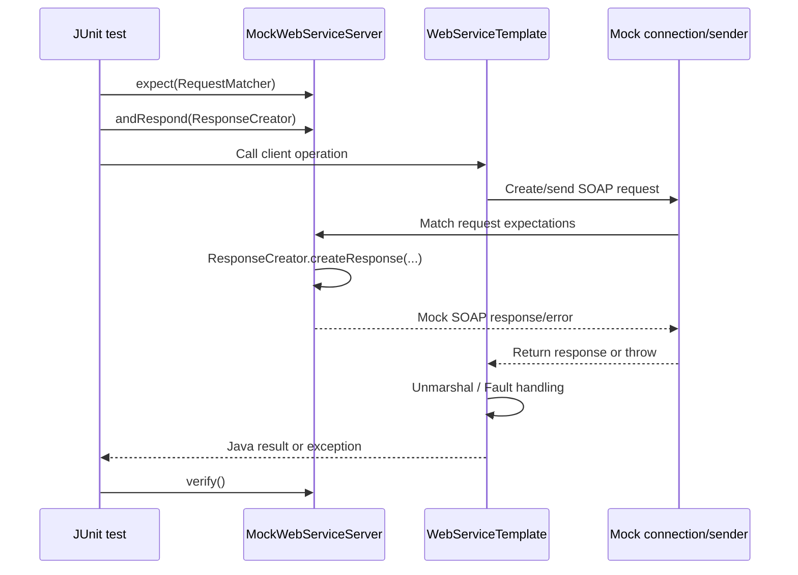

# ResponseCreator, ResponseCreators và tạo phản hồi mô phỏng

## 1. Vì sao cần tạo phản hồi mô phỏng khi kiểm thử SOAP client?

**Spring Web Services (Spring-WS)** hỗ trợ xây dựng SOAP client bằng `WebServiceTemplate`. Client thường marshal Java object thành SOAP request, gửi qua `WebServiceMessageSender` tới đối tác, nhận SOAP response rồi unmarshal thành Java object hoặc xử lý SOAP Fault/transport exception.

Trong unit/integration test, gọi endpoint đối tác thật có một số vấn đề: phụ thuộc mạng và môi trường ngoài, dữ liệu không ổn định, có thể tạo side effects, khó tái hiện lỗi hiếm và khiến test chậm. `MockWebServiceServer` giải quyết việc đó bằng cách thay thế sender ở `WebServiceTemplate` bằng một server mô phỏng trong bộ nhớ. Test khai báo request nào được mong đợi và **ResponseCreator nào sẽ tạo response tương ứng**.

`ResponseCreator` là strategy interface tạo `WebServiceMessage` trả về cho SOAP client. `ResponseCreators` là lớp factory cung cấp các implementation có sẵn để tạo response thành công, SOAP Fault, lỗi connection hoặc exception. Bằng cách lựa chọn creator phù hợp, ta có thể kiểm tra cách client chuyển đổi response thành kết quả Java, ánh xạ Fault, retry/fallback hay propagate lỗi.

### Mục tiêu học tập

Sau bài, bạn có thể:

1. Phân biệt `MockWebServiceServer` với `MockWebServiceClient` và xác định đúng test boundary.
2. Tạo mock server gắn với `WebServiceTemplate`, `WebServiceGatewaySupport` hoặc `ApplicationContext`.
3. Khai báo request expectation bằng `RequestMatcher` rồi gắn `ResponseCreator` qua `andRespond`.
4. Dùng `ResponseCreators.withPayload` và `withSoapEnvelope` cho response SOAP hợp lệ.
5. Dùng `withClientOrSenderFault`, `withServerOrReceiverFault`, `withMustUnderstandFault` và `withVersionMismatchFault` để mô phỏng SOAP Fault.
6. Dùng `withError` và `withException` để kiểm tra lỗi transport/response.
7. Viết `ResponseCreator` riêng khi fixture có dữ liệu động hoặc cần logic phụ thuộc request/URI.
8. Kết hợp request matchers, response creator và `verify()` để kiểm thử client end-to-end trong process.
9. Xử lý version SOAP, XML fixtures, namespace, attachments và test isolation.
10. Hiểu giới hạn của mock sender và biết khi nào phải kiểm thử HTTP/TLS thực.

## 2. Vị trí của ResponseCreator trong chu trình MockWebServiceServer

Chu trình client test có thứ tự rõ ràng:



Các bước tương ứng:

1. Tạo `MockWebServiceServer` gắn với đối tượng client/template đang kiểm thử.
2. Đăng ký expectation cho request bằng `expect(RequestMatcher)`.
3. Có thể nối nhiều matcher bằng `andExpect` để xác minh URL, payload, header, XPath hoặc schema.
4. Gọi `andRespond(ResponseCreator)` để quyết định mock server sẽ tạo response nào khi request khớp.
5. Gọi method client thật; method này tiếp tục dùng `WebServiceTemplate` bình thường.
6. Template nhận response, unmarshal hoặc ném lỗi tùy response creator.
7. Gọi `mockServer.verify()` để xác nhận các expectations đã được tiêu thụ.

**ResponseCreator không tự gọi client và cũng không tự xác minh request.** Nó chỉ mô tả phản hồi sẽ được tạo sau khi request đã khớp expectation.

## 3. ResponseCreator là strategy interface

Trong Spring-WS 4.1.x, interface nằm trong package `org.springframework.ws.test.client`:

```java
package org.springframework.ws.test.client;

public interface ResponseCreator {

    WebServiceMessage createResponse(
        URI uri,
        WebServiceMessage request,
        WebServiceMessageFactory messageFactory
    ) throws IOException;
}
```

Ba đầu vào có ý nghĩa khác nhau:

| Tham số | Ý nghĩa | Có thể dùng để |
|---|---|---|
| `uri` | URI mà client gọi | Sinh response theo endpoint/operation |
| `request` | SOAP request thực tế đã gửi | Đọc payload/header/correlation để tạo response phù hợp |
| `messageFactory` | Factory tạo SOAP message | Tạo message response đúng SOAP implementation/version |

Phương thức trả về `WebServiceMessage`. Nó có thể tạo SOAP response, SOAP Fault hoặc một message được dựng bởi message factory; nếu cần mô phỏng lỗi connection/exception, dùng ResponseCreators có sẵn để chúng thực hiện đúng error behavior của mock connection.

### 3.1. Tại sao API truyền cả request và URI?

Một response creator đơn giản có thể chỉ cần XML fixture tĩnh. Nhưng custom creator có thể đọc request để phản hồi theo nội dung, chẳng hạn:

- Trả đúng customer ID từ request.
- Đưa correlation ID vào response SOAP Header.
- Chọn response payload dựa trên operation/URI.
- Trả một fault cụ thể khi request có business ID test nhất định.
- Tạo response khác nhau theo thứ tự lần gọi, nếu test đang mô phỏng một retry scenario.

Không dùng custom creator để kiểm thử lại logic nghiệp vụ của client. Response nên đại diện cho behavior của remote service theo contract; assertions ở client test cần xác nhận client phản ứng đúng.

### 3.2. ResponseCreator và ResponseCreators

| Thành phần | Vai trò |
|---|---|
| `ResponseCreator` | Interface mô tả cách tạo response cho một request |
| `ResponseCreators` | Factory các response creator có sẵn |
| `ResponseActions` | API trả về từ `MockWebServiceServer.expect`; nối matcher và cuối cùng `andRespond` |
| `MockWebServiceServer` | Điều phối expectation, mock sender và verify |

`ResponseActions.andRespond(ResponseCreator)` liên kết creator với expectation. Một expectation đã được thỏa mãn thì response creator tương ứng được dùng để trả kết quả cho chính request đó.

## 4. Tạo MockWebServiceServer và khai báo response đầu tiên

Có thể tạo mock server bằng các factory method chính:

- `MockWebServiceServer.createServer(WebServiceTemplate)`.
- `MockWebServiceServer.createServer(WebServiceGatewaySupport)`.
- `MockWebServiceServer.createServer(ApplicationContext)`.

Factory method nên được chọn theo cấu trúc ứng dụng. Nếu client giữ một `WebServiceTemplate` cụ thể, gắn mock server trực tiếp vào template đó để test không vô tình dùng template khác.

### 4.1. Ví dụ JUnit 5 với WebServiceTemplate

Giả sử ứng dụng có `CustomerClient` gọi operation lấy số lượng khách hàng:

```java
public class CustomerClient {

    private final WebServiceTemplate webServiceTemplate;

    public CustomerClient(WebServiceTemplate webServiceTemplate) {
        this.webServiceTemplate = webServiceTemplate;
    }

    public int getCustomerCount() {
        CustomerCountResponse response =
            (CustomerCountResponse) webServiceTemplate.marshalSendAndReceive(
                "https://partner.example.org/soap/customer",
                new CustomerCountRequest(),
                new SoapActionCallback("urn:customer:GetCount")
            );

        return response.getCustomerCount();
    }
}
```

Test tạo response XML bằng `ResponseCreators.withPayload`:

```java
import org.junit.jupiter.api.BeforeEach;
import org.junit.jupiter.api.Test;
import org.springframework.ws.test.client.MockWebServiceServer;
import org.springframework.xml.transform.StringSource;

import static org.junit.jupiter.api.Assertions.assertEquals;
import static org.springframework.ws.test.client.RequestMatchers.payload;
import static org.springframework.ws.test.client.ResponseCreators.withPayload;

class CustomerClientTest {

    private MockWebServiceServer mockServer;
    private CustomerClient customerClient;

    @BeforeEach
    void setUp() {
        WebServiceTemplate template = createTemplate();
        customerClient = new CustomerClient(template);
        mockServer = MockWebServiceServer.createServer(template);
    }

    @Test
    void returnsCustomerCount() {
        var request = new StringSource("""
            <cus:CustomerCountRequest
                xmlns:cus="https://example.org/customer/v1"/>
            """);

        var response = new StringSource("""
            <cus:CustomerCountResponse
                xmlns:cus="https://example.org/customer/v1">
                <cus:customerCount>10</cus:customerCount>
            </cus:CustomerCountResponse>
            """);

        mockServer.expect(payload(request))
            .andRespond(withPayload(response));

        assertEquals(10, customerClient.getCustomerCount());

        mockServer.verify();
    }

    private WebServiceTemplate createTemplate() {
        // Configure the same marshaller, message factory and default URI
        // that the production CustomerClient uses.
        return new WebServiceTemplate();
    }
}
```

Đây là skeleton test: `createTemplate()` phải trả template có message sender mặc định/URI phù hợp, SOAP message factory và marshaller/unmarshaller mà `CustomerClient` thực sự dùng. Ví dụ tập trung vào cách nối expectation với response creator; nó không thay thế cấu hình production client.

### 4.2. Vì sao phải verify()?

`verify()` đảm bảo tất cả request expectations đã được tiêu thụ theo cách mock server định nghĩa. Nếu client không gọi remote service hoặc gọi sai số lần, expectation chưa được thỏa và test thất bại. Nên gọi verify sau khi client method hoàn tất, ngay trong test method hoặc lifecycle phù hợp.

Không gọi `verify()` sẽ bỏ lỡ tình huống client âm thầm không gửi request, chỉ gửi một phần expectations hoặc thay đổi luồng điều khiển khiến mock response không được sử dụng.

## 5. ResponseCreators có sẵn

Spring-WS 4.1.x cung cấp các factory method sau trong `org.springframework.ws.test.client.ResponseCreators`:

| Factory method | Response/error được mô phỏng | Dùng để test |
|---|---|---|
| `withPayload(Source)` | SOAP Body với payload XML | Response thành công |
| `withPayload(Resource)` | SOAP Body từ XML Resource | Fixture trong test resources |
| `withSoapEnvelope(Source)` | Toàn bộ SOAP Envelope theo XML Source | Header/Body/Envelope cụ thể |
| `withSoapEnvelope(Resource)` | Toàn Envelope từ Resource | SOAP fixture đầy đủ |
| `withClientOrSenderFault(reason, locale)` | SOAP 1.1 Client hoặc SOAP 1.2 Sender Fault | Lỗi request/client |
| `withServerOrReceiverFault(reason, locale)` | SOAP 1.1 Server hoặc SOAP 1.2 Receiver Fault | Lỗi xử lý phía server |
| `withMustUnderstandFault(reason, locale)` | MustUnderstand Fault | Header bắt buộc chưa được hiểu |
| `withVersionMismatchFault(reason, locale)` | VersionMismatch Fault | SOAP version không phù hợp |
| `withError(message)` | Connection báo error | Error path của response connection |
| `withException(IOException)` | Ném IOException khi đọc response | I/O failure |
| `withException(RuntimeException)` | Ném runtime exception | Lỗi runtime trong transport/mock |

Các method Fault có overload theo String reason và Locale trong API tương ứng. Khi dùng chúng, Fault code/structure được tạo theo SOAP version của message factory. Tránh hard-code một SOAP 1.1 expectation cho client đang cấu hình SOAP 1.2.

**Chọn creator theo lớp lỗi cần kiểm tra.** Lỗi kết nối, IOException, SOAP Fault và response payload không hợp lệ là các kịch bản khác nhau; chúng phải được test riêng để chắc chắn client xử lý từng loại đúng semantics.


## 6. Tạo response từ payload hoặc toàn bộ SOAP Envelope

### 6.1. withPayload(Source)

`withPayload(Source)` tạo một response SOAP message rồi đặt XML Source vào SOAP Body. Đây là lựa chọn mặc định cho response nghiệp vụ thông thường:

```java
Source responsePayload = new StringSource("""
    <cus:CustomerCountResponse
        xmlns:cus="https://example.org/customer/v1">
        <cus:customerCount>10</cus:customerCount>
    </cus:CustomerCountResponse>
    """);

mockServer.expect(payload(expectedRequest))
    .andRespond(withPayload(responsePayload));
```

Overload nhận `Resource` phù hợp khi fixture nằm trong `src/test/resources`:

```java
mockServer.expect(payload(expectedRequest))
    .andRespond(withPayload(
        new ClassPathResource("soap/responses/customer-count.xml")));
```

Resource-based fixture có thể được dùng lại giữa nhiều test. Hãy đảm bảo encoding, namespace, root element và schema version của fixture đúng với contract.

### 6.2. withSoapEnvelope(Source)

Khi cần kiểm soát SOAP Header, Body, namespace hoặc Envelope cụ thể, dùng `withSoapEnvelope`:

```java
Source responseEnvelope = new StringSource("""
    <soap:Envelope
        xmlns:soap="http://schemas.xmlsoap.org/soap/envelope/"
        xmlns:cus="https://example.org/customer/v1">
      <soap:Header>
        <cus:CorrelationId>corr-2001</cus:CorrelationId>
      </soap:Header>
      <soap:Body>
        <cus:CustomerCountResponse>
          <cus:customerCount>10</cus:customerCount>
        </cus:CustomerCountResponse>
      </soap:Body>
    </soap:Envelope>
    """);

mockServer.expect(payload(expectedRequest))
    .andRespond(withSoapEnvelope(responseEnvelope));
```

Khác biệt chính:

| Creator | Nội dung fixture |
|---|---|
| `withPayload` | Chỉ SOAP Body payload; factory tạo Envelope |
| `withSoapEnvelope` | XML của toàn bộ SOAP Envelope, bao gồm Header/Body |

Dùng full envelope khi client cần đọc SOAP Header (correlation, routing metadata) hoặc kiểm thử một cấu trúc message cụ thể. Khi chỉ cần payload, `withPayload` gọn hơn và ít phụ thuộc chi tiết serialization.

### 6.3. SOAP version của response

Envelope fixture phải đúng SOAP version mà message factory/client đang sử dụng. SOAP 1.1 dùng namespace `http://schemas.xmlsoap.org/soap/envelope/`; SOAP 1.2 dùng `http://www.w3.org/2003/05/soap-envelope`. Nếu client có cấu hình SAAJ SOAP 1.2, fixture SOAP 1.1 có thể không được parse/nhận như mong đợi.

Một response body XML hợp lệ nhưng sai Envelope namespace không phải response thành công đúng contract. Nên có test riêng cho mỗi SOAP version được công bố.

## 7. Mô phỏng SOAP Fault bằng ResponseCreators

SOAP Fault là một SOAP response có cấu trúc, không phải lỗi TCP hay exception Java bất kỳ. Các creator Fault cho phép test cách client đọc fault code/reason/detail và chuyển thành exception/handling logic.

### 7.1. Client/Sender Fault

`withClientOrSenderFault(reason, locale)` tạo Fault loại Client trong SOAP 1.1 hoặc Sender trong SOAP 1.2:

```java
import java.util.Locale;
import org.springframework.ws.soap.client.SoapFaultClientException;

mockServer.expect(payload(expectedRequest))
    .andRespond(withClientOrSenderFault(
        "Invalid customer identifier",
        Locale.ENGLISH));

assertThrows(
    SoapFaultClientException.class,
    () -> customerClient.getCustomerCount());

mockServer.verify();
```

Đây là response Fault hợp lệ. `WebServiceTemplate` mặc định dùng fault resolver cho SOAP Fault; trong cấu hình phổ biến, fault được chuyển thành `SoapFaultClientException`. Nếu client thay `FaultMessageResolver` hoặc bắt lỗi trong gateway/service wrapper, hãy assert behavior công khai của lớp client thay vì ép mọi implementation phải ném đúng cùng một exception.

### 7.2. Server/Receiver Fault

`withServerOrReceiverFault(reason, locale)` tạo Server (SOAP 1.1) hoặc Receiver (SOAP 1.2) Fault. Dùng để mô phỏng partner gặp lỗi xử lý:

```java
mockServer.expect(payload(expectedRequest))
    .andRespond(withServerOrReceiverFault(
        "Customer service temporarily unavailable",
        Locale.ENGLISH));

assertThrows(
    SoapFaultClientException.class,
    () -> customerClient.getCustomerCount());

mockServer.verify();
```

Fault này không tự mang nghĩa «nên retry». Quyết định retry phụ thuộc contract, fault detail/code, idempotency của operation và chính sách resilience. Không retry Client/Sender Fault thường xuyên nếu request vẫn không hợp lệ.

### 7.3. MustUnderstand và VersionMismatch

Có thể dùng:

- `withMustUnderstandFault(reason, locale)` khi client/consumer gửi Header bắt buộc mà bên kia không hiểu hoặc không chấp nhận.
- `withVersionMismatchFault(reason, locale)` khi SOAP version không tương thích.

Các trường hợp này đặc biệt hữu ích khi client thêm WS-Addressing, custom SOAP headers hoặc chuyển đổi SOAP 1.1/1.2.

```java
mockServer.expect(payload(expectedRequest))
    .andRespond(withMustUnderstandFault(
        "Unsupported mandatory header",
        Locale.ENGLISH));
```

Không cần giả lập một request XML sai để tạo mọi Fault. Response creator cho phép mô phỏng đúng loại Fault mà đối tác trả lại; nếu muốn kiểm tra server-side Fault generation do request sai, đó là test của phía server bằng MockWebServiceClient.

### 7.4. Fault detail có XML riêng

Các creator Fault chuẩn tập trung tạo Fault code/reason theo loại. Nếu client logic phụ thuộc detail element của partner (ví dụ `PartnerError`, `RetryAfter` hoặc `BusinessRuleViolation`), hãy dùng `withSoapEnvelope` với một fixture Fault đầy đủ để kiểm soát Detail XML.

Ví dụ SOAP 1.1:

```xml
<soap:Envelope
    xmlns:soap="http://schemas.xmlsoap.org/soap/envelope/"
    xmlns:err="https://example.org/errors/v1">
  <soap:Body>
    <soap:Fault>
      <faultcode>soap:Server</faultcode>
      <faultstring>Partner is temporarily unavailable</faultstring>
      <detail>
        <err:PartnerError>
          <err:code>PARTNER_BUSY</err:code>
          <err:retryable>true</err:retryable>
        </err:PartnerError>
      </detail>
    </soap:Fault>
  </soap:Body>
</soap:Envelope>
```

SOAP 1.2 có cấu trúc Fault khác (Code/Reason/Detail); dùng Envelope đúng version. Không khẳng định chỉ một fault string đủ để quyết định retry nếu partner contract định nghĩa fault detail codes cụ thể.


## 8. Phân biệt withError và withException

Hai creator đều phục vụ negative tests nhưng mô phỏng **hai loại thất bại khác nhau**.

### 8.1. withError(message): connection báo trạng thái lỗi

`withError(String)` làm mock connection báo rằng có error. Với `WebServiceTemplate` mặc định, `checkConnectionForError` là true; template kiểm tra error indicator và default error handler ném `WebServiceTransportException`. Đây là đường kiểm tra transport/connection error.

```java
import org.springframework.ws.client.WebServiceTransportException;

mockServer.expect(payload(expectedRequest))
    .andRespond(withError("Partner endpoint returned an error"));

assertThrows(
    WebServiceTransportException.class,
    () -> customerClient.getCustomerCount());

mockServer.verify();
```

Đây là test ở abstraction của `WebServiceConnection`; khi dùng HTTP transport thật, error indicator thường được ánh xạ từ HTTP status. Với mock server, không có HTTP response status thật được phát ra.

### 8.2. withException(IOException): phát sinh lỗi I/O khi nhận response

`withException(IOException)` mô phỏng lỗi I/O trong khi mock connection đọc response:

```java
import java.io.IOException;
import org.springframework.ws.client.WebServiceIOException;

mockServer.expect(payload(expectedRequest))
    .andRespond(withException(
        new IOException("Simulated response read failure")));

assertThrows(
    WebServiceIOException.class,
    () -> customerClient.getCustomerCount());

mockServer.verify();
```

`WebServiceTemplate` thường bọc IOException tầng transport trong `WebServiceIOException` khi đi qua client API; hãy kiểm tra wrapper cụ thể theo phiên bản và sender/client abstraction đang sử dụng. Test nên assert exception contract mà lớp client công bố, không gắn mọi lỗi I/O với một implementation detail nếu ứng dụng có adapter riêng.

### 8.3. withException(RuntimeException): lỗi runtime

Overload nhận RuntimeException phù hợp khi muốn mô phỏng lỗi runtime phát sinh tại response connection/mock transport:

```java
mockServer.expect(payload(expectedRequest))
    .andRespond(withException(
        new IllegalStateException("Unexpected response state")));

assertThrows(
    IllegalStateException.class,
    () -> customerClient.getCustomerCount());

mockServer.verify();
```

Không nên dùng RuntimeException cho mọi lỗi. Hãy chọn IOException khi mô phỏng đọc response bị lỗi I/O; dùng withError khi connection báo error; dùng Fault creator khi đối tác trả SOAP Fault hợp lệ.

### 8.4. Bảng chọn creator theo fault/error boundary

| Kịch bản | Creator | Tầng phản ứng chính |
|---|---|---|
| Response XML hợp lệ | withPayload | JAXB/unmarshaller và business client |
| Envelope/Header cụ thể | withSoapEnvelope | SOAP message factory/header processing |
| SOAP Client/Sender Fault | withClientOrSenderFault | SOAP fault resolver |
| SOAP Server/Receiver Fault | withServerOrReceiverFault | SOAP fault resolver và client policy |
| MustUnderstand/VersionMismatch | Fault creator tương ứng | SOAP protocol handling |
| Connection báo error | withError | WebServiceTemplate connection error handling |
| IOException khi nhận response | withException(IOException) | Transport exception handling |
| Runtime exception | withException(RuntimeException) | Exception propagation/client adapter |

**Không đánh đồng SOAP Fault với transport failure.** Fault là thông điệp SOAP có cấu trúc từ đối tác; transport failure có thể xảy ra trước khi đọc được một SOAP Envelope hợp lệ.

## 9. Xử lý lỗi trong WebServiceTemplate và client wrapper

ResponseCreator chỉ tạo điều kiện lỗi. Kết quả mà caller nhìn thấy phụ thuộc vào `WebServiceTemplate` configuration:

- `FaultMessageResolver` quyết định cách chuyển SOAP Fault thành exception hoặc xử lý khác.
- `checkConnectionForError` quyết định có kiểm tra error indicator từ connection hay không.
- `checkConnectionForFault` quyết định cách xét Fault indicator từ connection/message.
- `ClientInterceptor` có thể quan sát/biến đổi request, response hoặc Fault.
- Client wrapper có thể bắt `WebServiceClientException` và ánh xạ sang lỗi domain/application.

Mặc định, `WebServiceTemplate` dùng SOAP fault resolver; nếu đặt resolver thành null, fault handling mặc định bị vô hiệu hóa và caller có thể tự xử lý SOAP message tùy cách dùng API. Thay đổi này cần có chủ đích, vì bỏ fault resolver có thể làm caller vô tình coi SOAP Fault như response bình thường hoặc bỏ qua detail quan trọng.

### 9.1. Test hợp đồng công khai của client

Nếu lớp client map Fault thành kết quả domain riêng, test qua API đó:

```java
@Test
void mapsPartnerReceiverFaultToTemporaryFailure() {
    mockServer.expect(payload(expectedRequest))
        .andRespond(withServerOrReceiverFault(
            "Partner is unavailable", Locale.ENGLISH));

    PartnerCallException exception = assertThrows(
        PartnerCallException.class,
        () -> orderClient.submitOrder(validRequest()));

    assertEquals("PARTNER_TEMPORARY_FAILURE", exception.getCode());
    mockServer.verify();
}
```

Ví dụ giả định `OrderClient` bắt `SoapFaultClientException` và ánh xạ fault detail sang `PartnerCallException`. Không có mapping đó thì không dùng class exception minh họa này làm assertion.

### 9.2. Kiểm tra Fault detail khi client cần đọc code

Nếu retry policy dựa trên element như `retryable`, test response envelope phải chứa detail theo contract thật. Sau đó assert client phân loại đúng:

- Retryable partner fault → có thể retry theo bounded policy.
- Validation/client fault → fail-fast, không retry mù.
- Unknown fault code/detail → fallback an toàn, ghi telemetry và không làm mất thông tin lỗi.

Không suy ra retryability chỉ từ SOAP Server/Receiver Fault. Một Receiver Fault có thể là business rule hoặc lỗi tạm thời; detail contract và policy mới quyết định.

### 9.3. Phân biệt lỗi HTTP status với SOAP Fault

Với HTTP transport, status không thuộc 2xx có thể là connection error; SOAP Fault thường đi kèm HTTP status theo SOAP/WS-I convention. `WebServiceTemplate` có logic kiểm tra error và fault riêng. `withError` kiểm thử connection error indicator của mock; `withServerOrReceiverFault` kiểm thử SOAP Fault message. Muốn xác minh mapping HTTP 500 + SOAP Fault của HTTP sender thật, cần HTTP integration test bổ sung.

## 10. Tạo ResponseCreator tùy chỉnh

Các factory có sẵn đủ cho phần lớn test. Khi cần response phụ thuộc URI/request hoặc tạo header động, triển khai `ResponseCreator` riêng.

Contract method nhận URI, request message và message factory:

```java
WebServiceMessage createResponse(
    URI uri,
    WebServiceMessage request,
    WebServiceMessageFactory messageFactory
) throws IOException;
```

### 10.1. Response động theo URI

Ví dụ dưới đây chọn payload theo path của URI:

```java
import java.io.IOException;
import java.net.URI;
import javax.xml.transform.Source;
import javax.xml.transform.TransformerException;
import javax.xml.transform.TransformerFactory;

import org.springframework.ws.WebServiceMessage;
import org.springframework.ws.WebServiceMessageFactory;
import org.springframework.ws.test.client.ResponseCreator;
import org.springframework.xml.transform.StringSource;

final class RouteBasedResponseCreator implements ResponseCreator {

    @Override
    public WebServiceMessage createResponse(
            URI uri,
            WebServiceMessage request,
            WebServiceMessageFactory messageFactory) throws IOException {

        String payload = switch (uri.getPath()) {
            case "/customer/count" -> """
                <cus:CustomerCountResponse
                    xmlns:cus="https://example.org/customer/v1">
                    <cus:customerCount>10</cus:customerCount>
                </cus:CustomerCountResponse>
                """;
            case "/customer/status" -> """
                <cus:CustomerStatusResponse
                    xmlns:cus="https://example.org/customer/v1">
                    <cus:status>ACTIVE</cus:status>
                </cus:CustomerStatusResponse>
                """;
            default -> throw new IOException(
                "No mock response configured for URI: " + uri);
        };

        WebServiceMessage response =
            messageFactory.createWebServiceMessage();

        try {
            Source source = new StringSource(payload);
            TransformerFactory.newInstance()
                .newTransformer()
                .transform(source, response.getPayloadResult());
        }
        catch (TransformerException ex) {
            throw new IOException("Cannot create mock SOAP payload", ex);
        }

        return response;
    }
}
```

Điểm cần chú ý:

- Creator dùng message factory được truyền vào để tạo response đúng loại message mà client đang dùng.
- URI là URI gọi service, không phải request body.
- Ví dụ chưa đọc request payload; nếu response cần dựa trên field trong request, parse/đọc request một cách rõ ràng và giữ namespace semantics.
- Khi dùng SOAP message implementation, response được tạo từ message factory sẽ có Envelope phù hợp implementation/version đó.
- Không tạo response bằng một SOAP factory khác với factory client dùng nếu muốn kiểm thử tương thích version/headers.

### 10.2. Gắn custom creator

```java
mockServer.expect(connectionTo("https://partner.example.org/customer/count"))
    .andExpect(payload(expectedRequest))
    .andRespond(new RouteBasedResponseCreator());
```

Nếu cùng URI có nhiều operations, dùng request payload QName/action để chọn response; tránh chỉ dựa URI khi một endpoint xử lý nhiều operations. Đảm bảo expectation vẫn xác minh request đúng operation, nếu không mock creator có thể che giấu lỗi client đang gửi nhầm request.

### 10.3. Custom creator có thể đọc request

Có thể dựa trên SOAP request để tạo response test có correlation value:

1. Lấy payload/header từ request message bằng API SOAP message phù hợp.
2. Parse theo XML parser an toàn, namespace-aware.
3. Tạo response message bằng message factory được truyền vào.
4. Ghi response payload/header bằng API SOAP tương ứng.
5. Ném IOException nếu không thể tạo message hợp lệ.

Không dùng string replacement trên XML tùy tiện; nó dễ hỏng namespace, escaping và encoding. Khi behavior không phức tạp, ưu tiên fixture tĩnh với `withPayload`/`withSoapEnvelope`.

## 11. Kiểm tra request trước khi response creator chạy

`ResponseCreator` được gắn sau một request expectation; nó không thay thế `RequestMatcher`. Trình tự chuẩn:

```java
mockServer.expect(connectionTo("https://partner.example.org/soap"))
    .andExpect(payload(expectedRequest))
    .andExpect(validPayload(requestSchema))
    .andExpect(xpath(
        "/cus:CustomerCountRequest/cus:customerId",
        Map.of("cus", "https://example.org/customer/v1"))
        .evaluatesTo("C-42"))
    .andRespond(withPayload(responsePayload));
```

Các matcher giúp response chỉ được cung cấp sau khi request đạt đúng điều kiện. Nếu request sai URI, payload hoặc schema, lỗi test nên xảy ra ở expectation; không thay response creator để che request sai.

Các matcher phổ biến của `RequestMatchers` gồm kiểm tra payload, connection URI, XSD validity, XPath và SOAP action (tùy API version). Dùng static import hoặc gọi tường minh để test dễ đọc.

### 11.1. Multiple expectations

Có thể đăng ký nhiều request/response pairs trong cùng test:

```java
mockServer.expect(payload(firstRequest))
    .andRespond(withPayload(firstResponse));

mockServer.expect(payload(secondRequest))
    .andRespond(withPayload(secondResponse));

assertEquals("A", client.lookup("first"));
assertEquals("B", client.lookup("second"));

mockServer.verify();
```

Đăng ký đủ expectations trước khi chạy client flow. Không dựa vào thứ tự ngẫu nhiên khi test parallel; kiểm tra API version nếu muốn một matcher đáp ứng nhiều lần hoặc cho phép expectation không theo thứ tự.


## 12. Tạo MockWebServiceServer từ WebServiceGatewaySupport hoặc ApplicationContext

Không phải client nào cũng giữ trực tiếp WebServiceTemplate trong constructor. Spring-WS có các factory method hỗ trợ những kiểu wiring phổ biến.

### 12.1. Client kế thừa WebServiceGatewaySupport

Với client kế thừa `WebServiceGatewaySupport`, tạo mock server trực tiếp từ client:

```java
MockWebServiceServer mockServer =
    MockWebServiceServer.createServer(customerGateway);
```

Factory method lấy template đã cấu hình bên trong gateway support. Đây là cách thuận tiện khi ứng dụng đóng gói client operations trong một gateway class.

### 12.2. Tạo từ ApplicationContext

`createServer(ApplicationContext)` tìm `WebServiceTemplate` đã cấu hình trong context; nếu không tìm thấy template, nó thử tìm `WebServiceGatewaySupport` và dùng template của gateway đó. Nếu không có cả hai, factory method ném IllegalArgumentException.

```java
@SpringJUnitConfig(CustomerClientConfiguration.class)
class CustomerGatewayTest {

    @Autowired
    ApplicationContext applicationContext;

    @Autowired
    CustomerClient customerClient;

    MockWebServiceServer mockServer;

    @BeforeEach
    void setUp() {
        mockServer = MockWebServiceServer.createServer(applicationContext);
    }

    @Test
    void readsCount() {
        mockServer.expect(anything())
            .andRespond(withPayload(new StringSource("""
                <cus:CustomerCountResponse
                    xmlns:cus="https://example.org/customer/v1">
                    <cus:customerCount>10</cus:customerCount>
                </cus:CustomerCountResponse>
                """)));

        assertEquals(10, customerClient.getCustomerCount());
        mockServer.verify();
    }
}
```

Ví dụ dùng `anything()` chỉ để rút gọn minh họa factory; test production-quality nên dùng matcher cụ thể như payload, connectionTo, XPath hoặc validPayload để bảo đảm client gửi đúng request.

Nếu context có nhiều WebServiceTemplate/gateway beans, factory tìm kiếm theo quy tắc API của version đang dùng có thể không xác định được template mà test mong muốn. Khi đó, tạo mock server trực tiếp từ template/gateway cụ thể sẽ rõ ràng hơn.

## 13. RequestMatcher và ResponseCreator là hai nửa khác nhau

Trong một expectation:

```java
mockServer.expect(requestMatcher)
    .andExpect(additionalRequestMatcher)
    .andRespond(responseCreator);
```

- `RequestMatcher` nói request gửi đi có đúng điều client phải gửi không.
- `ResponseCreator` nói remote service giả lập sẽ trả về gì sau khi request thỏa expectation.
- `ResponseActions` nối các matcher bổ sung và creator.
- `verify()` xác minh các expectation đã được thỏa.

Ví dụ nếu test chỉ cấu hình `withPayload(response)` nhưng không có matcher đủ chặt, client có thể gửi sai action, URI hoặc dữ liệu request mà test vẫn pass. Hãy thiết kế matcher theo contract outbound: operation, QName, SOAPAction, required headers và schema.

### 13.1. Một ví dụ đầy đủ với URI, SOAPAction và payload

```java
import org.springframework.ws.soap.SoapMessage;
import org.springframework.ws.test.client.RequestMatcher;

RequestMatcher expectedAction = (uri, request) -> {
    if (!(request instanceof SoapMessage soapMessage)) {
        throw new AssertionError("Expected a SOAP message");
    }
    if (!"urn:customer:GetCount".equals(soapMessage.getSoapAction())) {
        throw new AssertionError("Unexpected SOAPAction: "
            + soapMessage.getSoapAction());
    }
};

mockServer.expect(connectionTo("https://partner.example.org/soap/customer"))
    .andExpect(payload(expectedRequest))
    .andExpect(expectedAction)
    .andExpect(validPayload(requestSchema))
    .andRespond(withPayload(responsePayload));

int result = customerClient.getCustomerCount();

assertEquals(10, result);
mockServer.verify();
```

Các matcher chuẩn trong `RequestMatchers` không cung cấp factory `soapAction(...)`. Ví dụ trên dùng custom `RequestMatcher` để đọc SOAPAction trực tiếp từ `SoapMessage`. Kiểm tra Javadoc `SoapMessage`/binding đang dùng; SOAPAction có thể được biểu diễn khác nhau giữa SOAP 1.1 và SOAP 1.2, nên không giả định luôn là một HTTP header giống nhau trên mọi transport.

### 13.2. Kết hợp XSD validation và response creator

Request schema validation bảo đảm client gửi XML đúng contract; response creator tạo fixture XML. Nếu muốn test response contract, có thể validate kết quả Java/marshal hoặc dùng test schema ngoài mock response creation. ResponseCreator không tự validate response fixture theo WSDL/XSD trước khi trả về; hãy dùng fixtures đã kiểm chứng hoặc thêm assertion/schema test riêng.

## 14. Response headers, Fault metadata và attachments

### 14.1. Header response

Khi client đọc metadata trong SOAP Header, dùng `withSoapEnvelope` tạo toàn envelope. Sau khi client gọi xong, assert giá trị header được đưa vào kết quả/context phù hợp. Response payload-only creator không thuận tiện nếu fixture cần một header block cụ thể.

Ví dụ response header có thể chứa correlation ID, WS-Addressing Action/MessageID hoặc custom partner metadata. Hãy dùng namespace URI và role/actor đúng contract.

### 14.2. Fault reason và locale

Các fault creators nhận `String faultStringOrReason` và `Locale`. Locale giúp tạo reason theo ngôn ngữ mà implementation hỗ trợ. Test nên kiểm tra fault code/category và detail contract; tránh phụ thuộc nội dung text bản địa hóa nếu ứng dụng không cam kết locale-specific wording.

### 14.3. Attachments và MTOM

`withPayload` chỉ đặt SOAP Body payload; `withSoapEnvelope` cung cấp envelope XML. Các helper XML này không phải cách tổng quát để dựng MIME multipart/MTOM attachment. Khi client trao đổi attachments:

- Tạo custom `ResponseCreator` dùng SOAP message implementation/attachment API.
- Thiết lập message factory có hỗ trợ attachment/MTOM.
- Kiểm tra content ID, media type, bytes/checksum và XOP include references.
- Giải phóng stream/temp resources trong test.
- Dùng HTTP integration test nếu cần xác minh MIME serialization và wire headers thực tế.

Không coi payload matcher hoặc envelope XML đơn giản là bằng chứng attachment bytes đã được transport đúng.

## 15. Lifecycle, verify và reset của MockWebServiceServer

`MockWebServiceServer` có hai thao tác quản lý expectation cần hiểu:

- `verify()` xác nhận tất cả request expectations đã được thỏa; nếu thiếu expectation, nó ném AssertionError.
- `reset()` xóa/reset expectations của mock message sender, cho phép cấu hình bộ expectations mới trên cùng mock server.

Một lifecycle test thường là:

1. Tạo server trong `@BeforeEach` hoặc gắn vào một test context cụ thể.
2. Đăng ký tất cả request expectations và response creators.
3. Gọi method của client.
4. Assert kết quả/exception của lớp client.
5. Gọi verify.
6. Nếu tái sử dụng server giữa các scenario, reset trước khi đăng ký expectation mới.

### 15.1. Mỗi test có expectation riêng

Cách đơn giản nhất là setup lại mock server cho từng test method. Nếu dùng Spring TestContext cache, context/client template có thể sống qua nhiều tests; mock server là test infrastructure gắn với template đó. Không để expectations chưa verify hoặc stale expectation từ test trước ảnh hưởng test sau.

### 15.2. Multiple calls và số lần kỳ vọng

Nếu client gọi remote service nhiều lần, khai báo đủ request/response expectations hoặc dùng cơ chế expectation count phù hợp với API version. Đừng giả định một expectation mặc định có thể match vô hạn lần. Nếu thứ tự request quan trọng, test thứ tự; nếu các requests độc lập, cấu hình expectation semantics phù hợp.

### 15.3. Parallel execution và shared template

MockWebServiceServer thay thế message sender trên WebServiceTemplate được gắn vào. Nếu nhiều test chạy song song và chia sẻ cùng template/sender, expectations có thể tranh chấp. Giải pháp:

- Tạo template/client riêng cho test instance nếu test song song.
- Không chia sẻ mutable mock server giữa test classes không liên quan.
- Tắt parallel cho bộ test dùng shared transport state nếu chưa cô lập.
- Reset state rõ ràng và verify trong từng test.
- Không gọi remote service thật từ một test tưởng đang dùng mock server nhưng lại sử dụng template bean khác.


## 16. Ma trận kiểm thử response cho SOAP client

Một client integration test nên có nhiều nhóm response để bao phủ parsing, mapping, fault handling và transport policy.

| Nhóm | ResponseCreator | Điều cần assert |
|---|---|---|
| Happy path | withPayload | Java result được unmarshal đúng |
| Resource fixture | withPayload(Resource) | Fixture classpath đọc đúng |
| SOAP Header | withSoapEnvelope | Header/correlation metadata được xử lý |
| SOAP Fault Client/Sender | withClientOrSenderFault | Fault mapping và fail-fast |
| SOAP Fault Server/Receiver | withServerOrReceiverFault | Fault mapping, retry classification |
| MustUnderstand | withMustUnderstandFault | Client xử lý protocol Fault |
| VersionMismatch | withVersionMismatchFault | Version mismatch được nhận diện |
| Connection error | withError | Error handling của WebServiceTemplate/client |
| I/O exception | withException(IOException) | Transport exception path |
| Runtime exception | withException(RuntimeException) | Runtime failure propagation |
| Dynamic response | Custom ResponseCreator | Response dựa URI/request |
| Full Fault detail | withSoapEnvelope | Client parse partner fault detail |
| Attachment response | Custom ResponseCreator | Client xử lý MIME/MTOM bytes |

### 16.1. Những assertion có giá trị

- Kiểm tra request đúng URI, operation, action và payload trước khi tạo mock response.
- Kiểm tra response object có values đúng, including decimals, dates, optional fields và nested objects.
- Kiểm tra SOAP Fault được map thành exception/domain result đúng.
- Kiểm tra transport errors không bị hiểu thành business Fault.
- Kiểm tra client không retry các non-retryable requests.
- Kiểm tra retryable errors có giới hạn attempts/backoff và không tạo duplicate side effects.
- Verify expectations sau flow, kể cả khi client throw exception.

### 16.2. Test response malformed

`withPayload` sẽ tạo response từ XML fixture, nhưng fixture có thể sai schema hoặc không marshal được. Dùng trường hợp malformed để xác minh client unmarshaller/schema validation báo lỗi đúng. Đây là test serialization/contract failure, khác với `withException` vì connection vẫn có thể trả về SOAP bytes bình thường nhưng nội dung không hợp lệ.

Nên tách rõ:

1. Không nhận được response.
2. Nhận response bytes nhưng XML parse thất bại.
3. XML parse được nhưng QName/schema không phù hợp.
4. JAXB unmarshal được nhưng dữ liệu thiếu/range invalid.
5. SOAP Fault hợp lệ.
6. Response hợp lệ nhưng business content biểu thị lỗi.

Mỗi trường hợp có telemetry và remediation khác nhau.

## 17. Giới hạn của MockWebServiceServer

`MockWebServiceServer` thay `WebServiceMessageSender` của template bằng mock sender. Client vẫn chạy qua `WebServiceTemplate`, marshalling, callbacks, client interceptors và response extraction, nhưng không tạo HTTP connection ra ngoài.

| Được kiểm thử tốt | Cần kiểm thử bổ sung |
|---|---|
| Request XML, payload, QName, SOAPAction trong message abstraction | HTTP header/status thật nếu transport phụ thuộc wire behavior |
| Response payload, SOAP Envelope/Header/Fault | HTTP 4xx/5xx mapping từ server thật |
| JAXB marshalling/unmarshalling | SOAP toolkit interoperability trên mạng |
| Client interceptor và fault handling | TLS/mTLS, hostname/certificate validation |
| Client wrapper, retry classification qua controlled responses | Connection pooling, timeouts mạng thật |
| XML schema/contract fixtures | Reverse proxy, ingress, DNS và load balancer |
| Custom ResponseCreator/RequestMatcher behavior | MTOM MIME wire serialization nếu helper chưa tạo message đó |

Không gọi test MockWebServiceServer là full remote API end-to-end. Nó xác minh behavior của client SOAP pipeline với response mô phỏng đã kiểm soát. Muốn chứng minh server partner thực sự trả đúng status/headers, TLS chain, attachments hoặc performance, cần transport integration tests riêng.

## 18. Bảng lỗi thường gặp và cách xử lý

| Triệu chứng | Nguyên nhân thường gặp | Cách kiểm tra |
|---|---|---|
| Request không match expectation | Payload/URI/action khác fixture | XML diff, connectionTo, payload, XPath |
| Không tạo mock response | Request không đạt matcher hoặc template khác được gọi | Kiểm tra đúng template gắn mock server |
| Client vẫn gọi endpoint thật | Mock server gắn sai WebServiceTemplate | So sánh template được inject và template caller dùng |
| Response unmarshal lỗi | QName/schema/JAXB context sai | Response fixture, XSD, ObjectFactory |
| SOAP Fault thành exception khác mong đợi | Custom FaultMessageResolver/client wrapper | Kiểm tra resolver và public API |
| withError không ném lỗi như kỳ vọng | checkConnectionForError bị thay đổi hoặc custom sender | WebServiceTemplate configuration |
| withException(IOException) wrapper khác | Transport wrapper/version | Assert public exception type phù hợp |
| Response Header thiếu | Dùng withPayload thay vì withSoapEnvelope | Full SOAP Envelope fixture |
| SOAP 1.2 response parse lỗi | Fixture dùng SOAP 1.1 namespace | Message factory/version |
| Fault detail không đọc được | XML Detail namespace/element sai | XPath/QName và partner schema |
| verify thất bại | Client không gọi hoặc số lần call khác expectation | Client flow và expectation list |
| Test flaky | Shared mock server/template hoặc expectations stale | Per-test setup, reset, disable unsafe parallel |
| Test pass nhưng HTTP thực fail | Mock sender không kiểm tra transport | HTTP/container integration test |
| Attachment empty/corrupt | Creator không tạo MIME attachment thật | Custom message attachment API, MIME test |

### Quy trình điều tra

1. Kiểm tra mock server đã gắn vào đúng `WebServiceTemplate` mà client thực sự dùng.
2. Kiểm tra request matcher đầu tiên bị fail: URI, SOAPAction, payload hoặc headers.
3. Xem message response fixture có đúng SOAP version/namespace không.
4. Phân biệt Fault, connection error và exception bằng response creator đang sử dụng.
5. Kiểm tra `FaultMessageResolver`, `checkConnectionForError` và `checkConnectionForFault`.
6. Kiểm tra JAXB context, generated types, XSD imports và response root QName.
7. Xác minh `verify()` và lifecycle của mock server.
8. Nếu lỗi tái hiện chỉ với HTTP/network thật, chuyển sang transport integration test thay vì thêm matcher giả lập.

## 19. Bài thực hành: mô phỏng đối tác Customer SOAP

Xây dựng client gọi partner để đọc thông tin khách hàng; dùng MockWebServiceServer để tạo các response theo kịch bản.

### Giai đoạn A — Client cơ bản

1. Tạo XSD request/response cho GetCustomerCount.
2. Sinh JAXB classes hoặc tạo request/response model theo contract.
3. Cấu hình WebServiceTemplate với message factory, marshaller và URI partner.
4. Viết CustomerClient sử dụng marshalSendAndReceive.
5. Tạo test JUnit 5 và MockWebServiceServer gắn vào đúng template.

### Giai đoạn B — Success responses

6. Tạo expectation cho request payload và URI.
7. Tạo response bằng withPayload(Source).
8. Assert Java result.
9. Chuyển fixture sang Resource trong src/test/resources và dùng withPayload(Resource).
10. Tạo full SOAP Envelope có CorrelationId bằng withSoapEnvelope.
11. Kiểm tra client đọc được response header nếu contract có.

### Giai đoạn C — SOAP Fault và transport errors

12. Dùng withClientOrSenderFault để mô phỏng request bị partner từ chối.
13. Dùng withServerOrReceiverFault để mô phỏng partner service failure.
14. Dùng withMustUnderstandFault để kiểm tra mandatory header behavior.
15. Dùng withVersionMismatchFault cho version incompatibility.
16. Dùng full SOAP Fault envelope để test partner-specific Detail code.
17. Dùng withError để test connection-level error.
18. Dùng withException(IOException) để test response read failure.
19. Dùng withException(RuntimeException) để test runtime propagation.
20. Assert exception classification và retryability theo policy client.

### Giai đoạn D — Custom creator và lifecycle

21. Implement RouteBasedResponseCreator chọn response dựa trên URI.
22. Mở rộng creator dựa trên request QName hoặc request correlation.
23. Đăng ký nhiều expectations cho chuỗi client operations.
24. Gọi verify để xác nhận đủ request.
25. Dùng reset khi tái sử dụng mock server trong một test scenario được kiểm soát.
26. Chạy tests song song nếu mỗi test có template/mock server isolation; nếu không thì giữ tuần tự.

### Giai đoạn E — Negative và integration scope

27. Trả malformed XML; xác nhận unmarshal failure.
28. Trả XML hợp lệ nhưng schema không phù hợp; xác minh validation.
29. Trả response SOAP 1.1 và 1.2 theo từng template/message factory.
30. Nếu client dùng MTOM, tạo attachment response bằng custom creator và kiểm tra bytes.
31. Tạo một HTTP integration test riêng để xác minh status/headers/TLS.
32. Lưu lại test matrix và public error contract của CustomerClient.

### Câu hỏi tự kiểm tra

1. ResponseCreator làm nhiệm vụ gì trong MockWebServiceServer?
2. Ba tham số của createResponse có ý nghĩa gì?
3. ResponseCreators.withPayload khác withSoapEnvelope thế nào?
4. Vì sao phải xác minh request bằng RequestMatcher trước khi tạo response?
5. Khi nào dùng Resource thay vì StringSource?
6. SOAP Fault khác connection error như thế nào?
7. withClientOrSenderFault khác withServerOrReceiverFault thế nào?
8. Tại sao SOAP Fault mặc định thường được chuyển thành SoapFaultClientException?
9. withError và withException(IOException) mô phỏng khác nhau ra sao?
10. Với custom FaultMessageResolver, test cần thay đổi thế nào?
11. Vì sao withSoapEnvelope phù hợp khi test SOAP Header?
12. Làm sao đảm bảo Fault Detail XML theo partner contract?
13. Khi nào cần custom ResponseCreator?
14. Tại sao custom creator phải dùng WebServiceMessageFactory được truyền vào?
15. MockWebServiceServer.verify() xác nhận điều gì?
16. reset() có tác dụng gì?
17. Làm thế nào tránh mock server dùng chung gây flaky tests?
18. Vì sao MockWebServiceServer không kiểm thử TLS/HTTP server thật?
19. Làm sao phân biệt malformed response XML với SOAP Fault?
20. Khi nào cần HTTP/MTOM integration test ngoài mock sender?


## 20. Definition of Done — ResponseCreator và ResponseCreators

Bộ kiểm thử SOAP client sử dụng MockWebServiceServer được xem là hoàn tất khi:

### Setup và request expectations

- [ ] MockWebServiceServer được gắn đúng WebServiceTemplate/gateway/ApplicationContext mà client thật sử dụng.
- [ ] Dependency spring-ws-test có version khớp Spring-WS core và Spring Framework.
- [ ] RequestMatcher xác minh URI, payload, operation/action/headers theo contract cần thiết.
- [ ] Expectations được đăng ký trước client call và đủ số lượng.
- [ ] Client method được gọi qua public API, không thay thế bằng gọi trực tiếp code nội bộ.

### Response creation

- [ ] Happy path dùng withPayload hoặc withSoapEnvelope phù hợp response structure.
- [ ] Resource fixtures được đọc đúng encoding/namespace/schema.
- [ ] SOAP version của Envelope/Fault khớp message factory/client.
- [ ] Fault creators bao phủ Client/Sender, Server/Receiver và Fault types cần thiết.
- [ ] withError và withException được test riêng theo transport failure boundary.
- [ ] Custom ResponseCreator dùng factory được truyền vào, không tạo message bằng factory không liên quan.
- [ ] Fault detail/header/attachment được fixture hóa khi client phụ thuộc metadata đó.

### Client behavior và lifecycle

- [ ] JAXB/unmarshaller và XSD/namespace mapping được kiểm tra.
- [ ] FaultMessageResolver/client wrapper được test qua exception/result contract công khai.
- [ ] Retry/fallback chỉ áp dụng cho fault/error được phân loại retryable và có giới hạn.
- [ ] verify() được gọi để chắc chắn expectations đã thỏa.
- [ ] reset()/setup được dùng để tránh stale expectations giữa scenarios.
- [ ] Test isolation được bảo đảm cho parallel execution và shared templates.
- [ ] Không log token, credentials, private data hoặc toàn SOAP payload nếu chưa masking.

### Phạm vi kiểm thử

- [ ] Test report nêu rõ MockWebServiceServer mô phỏng WebServiceMessageSender.
- [ ] HTTP status/header, TLS/mTLS, proxy, network timeout và pooling được test riêng khi quan trọng.
- [ ] Attachment/MTOM wire formatting có integration test riêng nếu client dùng chức năng đó.
- [ ] Có test interoperability với endpoint thực/staging khi contract yêu cầu.

**Ghi nhớ:** ResponseCreator mô tả cách MockWebServiceServer tạo một WebServiceMessage response cho request đã khớp expectation. ResponseCreators cung cấp các factory cho payload, toàn SOAP Envelope, SOAP Fault, connection error và exception. Hãy chọn creator theo failure boundary, kiểm tra request độc lập bằng RequestMatcher, gọi client qua WebServiceTemplate và kết thúc bằng verify(). Một mock response pass chứng minh client handling trong test pipeline, không chứng minh remote HTTP/TLS endpoint ngoài đời đã hoạt động.

## 21. Tài liệu tham khảo

- [Spring Web Services 4.1.4 — Client-side Testing](https://docs.spring.io/spring-ws/docs/4.1.4/reference/html/#client-side-testing): hướng dẫn MockWebServiceServer, request expectations, ResponseCreator và ResponseCreators.
- [ResponseCreator API 4.1.x](https://docs.spring.io/spring-ws/docs/4.1.x/api/org/springframework/ws/test/client/ResponseCreator.html): interface createResponse và ba tham số uri/request/messageFactory.
- [ResponseCreators API 4.1.x](https://docs.spring.io/spring-ws/docs/4.1.x/api/org/springframework/ws/test/client/ResponseCreators.html): factory methods cho payload, envelope, Fault, connection error và exceptions.
- [MockWebServiceServer API 4.1.x](https://docs.spring.io/spring-ws/docs/4.1.x/api/org/springframework/ws/test/client/MockWebServiceServer.html): factory methods, expect, verify và reset.
- [ResponseActions API 4.1.x](https://docs.spring.io/spring-ws/docs/4.1.x/api/org/springframework/ws/test/client/ResponseActions.html): andExpect và andRespond.
- [RequestMatchers API 4.1.x](https://docs.spring.io/spring-ws/docs/4.1.x/api/org/springframework/ws/test/client/RequestMatchers.html): request matchers sử dụng trong mock client tests.
- [WebServiceTemplate API 4.1.x](https://docs.spring.io/spring-ws/docs/4.1.x/api/org/springframework/ws/client/core/WebServiceTemplate.html): FaultMessageResolver, error/fault handling và client execution.
- [Spring Framework — Testing](https://docs.spring.io/spring-framework/reference/testing.html): JUnit, TestContext và ApplicationContext integration.
- [W3C — SOAP 1.1](https://www.w3.org/TR/2000/NOTE-SOAP-20000508/): SOAP Envelope, Header, Body và Fault.
- [W3C — SOAP 1.2 Part 1](https://www.w3.org/TR/soap12-part1/): SOAP 1.2 Envelope, Fault Code/Reason/Detail và processing model.
- [W3C — XML Schema](https://www.w3.org/TR/xmlschema11-1/): XML schema validation và contract design.
- [W3C — MTOM](https://www.w3.org/TR/soap12-mtom/): SOAP message transmission optimization mechanism.

