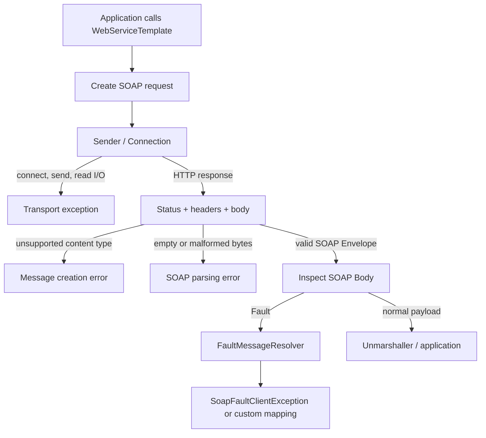

# Mô phỏng SOAP Fault, lỗi truyền tải và nội dung không đọc được

## Mục tiêu học tập

Trong module **SPRING_WEB_SERVICES**, SOAP client phải xử lý cả response thành công lẫn lỗi. Ba tình huống thường bị nhầm là SOAP Fault hợp lệ, lỗi HTTP/transport không có SOAP Envelope và response có bytes nhưng không thể đọc hoặc parse. Spring Web Services (Spring-WS) cung cấp `WebServiceTemplate`, `WebServiceMessageSender`, `WebServiceConnection`, Fault resolver và client testing support để mô phỏng các tình huống này.

Sau bài học, bạn có thể phân biệt `SoapFaultClientException`, `WebServiceTransportException`, `WebServiceIOException`, lỗi content type và lỗi parse; dùng `MockWebServiceServer` để mô phỏng SOAP response/Fault; mock sender/connection để tạo status/body/I/O failure; kiểm tra SOAP 1.1/1.2; xác minh retry/idempotency; và chọn đúng tầng integration test.

## 1. Phân loại kết quả của SOAP call

| Kết quả | Điều client nhận | Cách hiểu |
| --- | --- | --- |
| SOAP response hợp lệ | Envelope + Body hợp lệ | Unmarshal và xử lý dữ liệu. |
| SOAP Client/Sender Fault | SOAP Fault từ chối request | Thường không retry nguyên request. |
| SOAP Server/Receiver Fault | SOAP Fault trong xử lý server | Phân loại code/detail; có thể transient. |
| HTTP 401/403 | Authentication/authorization error | Thường bị chặn trước SOAP dispatcher. |
| HTTP 404/405/415 | Route, method hoặc media type sai | Sửa endpoint/binding. |
| HTTP 429/503 | Quota/service unavailable | Retry có giới hạn. |
| Timeout/reset | Không nhận response hoàn chỉnh | Operation ghi có thể đã commit. |
| Empty body | Không có SOAP document | Message creation/transport failure. |
| HTML/JSON body | Nội dung không phải SOAP | Proxy/gateway error page. |
| Malformed XML | Có bytes nhưng XML không parse | Message parsing failure. |
| Wrong Content-Type | Message factory không chấp nhận | Media type/binding mismatch. |

Không bắt mọi exception rồi trả response rỗng. Điều đó khiến caller không phân biệt authentication, validation, infrastructure và kết quả giao dịch chưa rõ.

## 2. Ba ranh giới lỗi



**Transport boundary:** send/read/network thất bại hoặc transport xử lý HTTP error theo implementation.

**Message boundary:** HTTP response tồn tại nhưng message factory không thể tạo SOAP message do content type/body/parser.

**SOAP/application boundary:** Envelope hợp lệ có normal payload hoặc Fault; sau đó resolver/unmarshaller/application xử lý.

Exception chính xác phụ thuộc sender, SOAP version, message factory và Spring-WS version. Test theo BOM thực tế, không giả định mọi malformed response đều có cùng exception class.

## 3. Luồng xử lý trong WebServiceTemplate

Ở mức khái quát:

1. Chọn `WebServiceMessageSender` và tạo `WebServiceConnection`.
2. Tạo request qua `WebServiceMessageFactory`.
3. Chạy client interceptors và marshal payload/headers.
4. Gửi request.
5. Nhận status, headers và response stream.
6. Tạo SOAP message từ response.
7. Nếu Body là Fault, gọi `FaultMessageResolver`.
8. Nếu là normal response, chạy response interceptors và unmarshal.
9. Đóng connection/resources.

`SoapFaultMessageResolver` mặc định thường ném `SoapFaultClientException` khi gặp SOAP Fault. Custom resolver có thể chuyển Fault thành domain exception. Test phải nói rõ đang kiểm tra default hay custom resolver.

### 3.1. HTTP error không tự động là SOAP Fault

HTTP 401 có thể do Spring Security từ chối trước `MessageDispatcherServlet`, không có SOAP Envelope. HTTP 500 có thể mang SOAP Fault, HTML proxy page, plain text hoặc body rỗng. Không suy từ status rằng body luôn là XML SOAP.

### 3.2. Parse error không đồng nghĩa network error

Kết nối có thể thành công và đọc đủ bytes nhưng XML malformed hoặc Content-Type không được message factory hỗ trợ. Đây là message parsing failure, khác connect/read timeout.

## 4. Các exception thường gặp

| Exception | Trường hợp điển hình | Cách xử lý |
| --- | --- | --- |
| `SoapFaultClientException` | Default Fault resolver nhận SOAP Fault. | Đọc Fault code/detail; không retry mọi Fault. |
| `WebServiceTransportException` | Transport/HTTP status hoặc connection failure tùy sender. | Kiểm tra status/sender/body policy. |
| `WebServiceIOException` | I/O trong send/read. | Giữ cause, đánh giá timeout/reset và outcome. |
| `UnknownContentTypeException` | Response Content-Type không được hỗ trợ. | Điều tra proxy/server/binding. |
| `WebServiceMessageException` | Tạo/đọc/ghi SOAP message thất bại. | Kiểm tra parser, SAAJ/Axiom và payload. |
| Runtime/configuration exception | Marshaller/template/programming error. | Không tự coi là lỗi mạng/retryable. |

Đây là taxonomy định hướng. Thứ bậc exception và wrapping phụ thuộc version/sender. Assert exception contract của wrapper và cause category ổn định, không khóa test vào parser message text.

## 5. WebServiceTemplate cấu hình cho test

```java
@Configuration
public class OrderSoapClientConfiguration {

    @Bean
    SaajSoapMessageFactory orderMessageFactory() {
        SaajSoapMessageFactory factory =
                new SaajSoapMessageFactory();
        factory.setSoapVersion(SoapVersion.SOAP_11);
        return factory;
    }

    @Bean
    WebServiceTemplate orderTemplate(
            SaajSoapMessageFactory messageFactory,
            Jaxb2Marshaller marshaller,
            WebServiceMessageSender sender) {

        WebServiceTemplate template =
                new WebServiceTemplate(messageFactory);
        template.setMarshaller(marshaller);
        template.setUnmarshaller(marshaller);
        template.setMessageSender(sender);
        template.setDefaultUri("https://soap.example.test/ws/orders");
        return template;
    }
}
```

Đây là skeleton. `Jaxb2Marshaller` phải cấu hình context path/classes sinh từ XSD; sender, URI, credentials, TLS và timeout đến từ cấu hình môi trường. Không hard-code production endpoint hoặc secret.

Với SOAP 1.2, dùng `SoapVersion.SOAP_12`, binding phù hợp và test `application/soap+xml`. Chỉ đổi expected Envelope XML mà không đổi factory/media type là chưa đủ.

## 6. MockWebServiceServer: mô phỏng SOAP response

`MockWebServiceServer` kiểm thử `WebServiceTemplate` bằng mock connection. Nó cho phép đặt request expectations và response creators mà không cần network thật.

```java
MockWebServiceServer server =
        MockWebServiceServer.createServer(webServiceTemplate);

server.expect(connectionTo(endpoint))
    .andExpect(payload(expectedRequest))
    .andRespond(withPayload(expectedResponse));

GetOrderResponse response = client.getOrder("ORD-42");

server.verify();
```

`client` là application wrapper; XML fixtures và endpoint là test data. Import static methods từ `RequestMatchers`/`ResponseCreators` đúng package Spring-WS version. Gọi `server.verify()` để xác nhận expectations đã được sử dụng.

### 6.1. Phù hợp để kiểm tra

- Request payload, headers và URI ở client message boundary.
- Marshal/serialization của SOAP request.
- Client interceptors trong request/response path.
- Normal SOAP response và JAXB unmarshalling.
- SOAP Fault do mock server trả.
- Behavior của application wrapper khi nhận message cụ thể.

Không dùng nó để kết luận DNS, TLS/mTLS, proxy, socket timeout, servlet filter chain hoặc gateway production.

## 7. Mô phỏng SOAP Fault

Spring-WS `ResponseCreators` có Fault creator như `withFault` theo version API.

```java
server.expect(payload(expectedRequest))
    .andRespond(withFault(
        SoapFaultDefinition.CLIENT,
        "Invalid order identifier"));

assertThrows(
    SoapFaultClientException.class,
    () -> client.getOrder("bad-id"));

server.verify();
```

Skeleton giả định default `SoapFaultMessageResolver`. Nếu wrapper translate Fault, expected exception phải là domain exception. `SoapFaultDefinition.CLIENT` là khai báo của API; SOAP 1.2 tương ứng Sender. Đối chiếu overload/Javadoc version.

### 7.1. Fault reason và detail

Nếu contract có typed Fault, kiểm tra QName/detail code, không phụ thuộc English reason nếu nó không thuộc contract. Không đưa stack trace, keystore path, token hoặc tenant data vào public detail.

### 7.2. SOAP 1.1 và SOAP 1.2

SOAP 1.1 dùng `faultcode`, `faultstring`, `detail`; SOAP 1.2 dùng `Code`, `Reason`, `Subcode`, `Detail`. Test riêng message factory, binding, media type và Fault semantics.

## 8. HTTP status không phải SOAP Fault

Mô phỏng các tình huống 401/403, 404/405/415, 429/503, 502/504 và 500 HTML/plain text/empty body. `MockWebServiceServer` chủ yếu tạo SOAP message; khả năng điều khiển raw HTTP status/body tùy API version.

Khi cần kiểm tra chính xác status, headers và non-SOAP body, dùng custom `WebServiceMessageSender`/`WebServiceConnection` hoặc embedded HTTP server với sender thật. Không giả định `withPayload` hay `withFault` tạo được mọi tình huống HTTP.

## 9. Mock WebServiceConnection

Test connection có thể:
- `send(WebServiceMessage)` ghi nhận request.
- `receive(WebServiceMessageFactory)` tạo response từ stream.
- `hasError()`/`getErrorCode()` phản ánh status theo API.
- Ném IOException tại send/receive.
- Ghi nhận `close()` và stream cleanup.

Ví dụ skeleton:

```java
final class StubConnection implements WebServiceConnection {

    private final InputStream response;
    private final int status;
    private boolean sent;

    StubConnection(InputStream response, int status) {
        this.response = response;
        this.status = status;
    }

    @Override
    public void send(WebServiceMessage message) {
        sent = true;
    }

    @Override
    public WebServiceMessage receive(
            WebServiceMessageFactory factory) throws IOException {
        if (!sent) {
            throw new IllegalStateException("Request not sent");
        }
        return factory.createWebServiceMessage(response);
    }

    @Override
    public boolean hasError() {
        return status >= 400;
    }

    @Override
    public int getErrorCode() {
        return status;
    }

    @Override
    public void close() throws IOException {
        response.close();
    }

    // Implement các method còn lại theo interface đúng version.
}
```

Đây là skeleton, chưa compile độc lập trước khi implement đủ methods theo BOM. Dùng Mockito nếu chỉ cần mô phỏng exception/verify close; dùng sender thật với embedded server nếu cần chứng minh HTTP integration.

## 10. Empty body và malformed XML

```java
byte[] empty = new byte[0];

byte[] truncated =
    "<soap:Envelope".getBytes(StandardCharsets.UTF_8);

byte[] malformed = """
    <soap:Envelope
      xmlns:soap="http://schemas.xmlsoap.org/soap/envelope/">
      <soap:Body><x:Request></soap:Body>
    </soap:Envelope>
    """.getBytes(StandardCharsets.UTF_8);
```

- Empty: không có SOAP document.
- Truncated: stream kết thúc trước khi Envelope hoàn chỉnh.
- Malformed: XML không well-formed hoặc cấu trúc SOAP không hợp lệ.
- Malformed Fault detail: Envelope có thể parse đến Fault nhưng detail không đúng contract.

Tùy SAAJ/Axiom/parser, exception có thể là `WebServiceMessageException`, `SoapMessageCreationException` hoặc cause được wrap. Assert contract wrapper và nguyên nhân ổn định, không phụ thuộc parser message text.

## 11. Timeout, reset và I/O failure

Transport failure có thể xảy ra ở DNS, connect, TLS handshake, send, read hoặc close.

```java
when(connection.receive(any(WebServiceMessageFactory.class)))
    .thenThrow(new IOException("simulated read timeout"));
```

Test xác minh:
- Template/wrapper ném exception đúng contract.
- Cause chain giữ loại I/O hữu ích.
- Connection đóng cả khi receive lỗi.
- Không tạo success DTO giả.
- Retry có deadline/budget.

### 11.1. Timeout sau POST không chứng minh server chưa xử lý

Với `SubmitOrder`, request có thể đã tới server và database commit nhưng response bị mất. Retry mù có thể tạo order trùng. Dùng idempotency key/business request ID, status lookup hoặc reconciliation.

## 12. Wrong Content-Type và non-SOAP response

Test `text/html` login/proxy page, `application/json` error object, `text/plain` gateway message, SOAP 1.1 media type tới SOAP 1.2 client và SOAP Content-Type nhưng body malformed. Message factory có thể ném `UnknownContentTypeException` hoặc message creation exception trước khi Fault resolver chạy.

Không map HTML/JSON thành business Fault. Log status/content type/correlation và diagnostic đã giới hạn, redact; không log toàn body có thể chứa stack trace hoặc PII.

## 13. HTTP 500 SOAP Fault và HTTP 500 HTML

Test cả HTTP 500 + SOAP Envelope Fault, HTTP 500 + HTML, HTTP 503 + empty body, HTTP 401/403 từ gateway và HTTP 200 + SOAP Fault nếu stack/profile cho phép.

Một số sender dừng ở HTTP status trước khi parse Fault, sender khác cho Fault resolver đọc message. Behavior phụ thuộc transport sender. Không chỉ assert status hoặc giả định mọi HTTP 500 đều là SOAP Fault.

## 14. Custom FaultMessageResolver

`WebServiceTemplate` cho phép cấu hình `FaultMessageResolver`. Default `SoapFaultMessageResolver` thường ném `SoapFaultClientException`; custom resolver có thể map typed Fault thành domain exception.

```java
template.setFaultMessageResolver(
        new SoapFaultMessageResolver());
```

Test custom resolver với Fault code/namespace v1/v2, detail QName/code, reason rỗng/khác ngôn ngữ, SOAP 1.1 Client/Server, SOAP 1.2 Sender/Receiver và redaction. Resolver không nên nuốt Fault rồi trả null/empty result.

## 15. Retryability

| Lỗi | Retry? | Điều kiện |
| --- | --- | --- |
| SOAP Client/Sender Fault | Thường không | Sửa request/policy. |
| Validation/business Fault | Thường không | Chỉ retry nếu code xác định transient. |
| SOAP Server/Receiver Fault | Có thể | Backoff/idempotency. |
| HTTP 401 | Không ngay | Renew credential theo policy. |
| HTTP 403 | Không | Sửa authority. |
| HTTP 404/405/415 | Không | Sửa endpoint/binding. |
| HTTP 429 | Có thể | Retry-After/quota. |
| HTTP 502/503/504 | Có thể | Backoff+jitter+deadline. |
| Connect timeout trước send | Có thể | Budget giới hạn. |
| Read timeout sau write POST | Outcome chưa rõ | Idempotency/reconciliation. |
| Malformed SOAP | Không retry mù | Contract/deployment defect. |
| Wrong Content-Type | Không retry mù | Sửa proxy/server. |
| Invalid TLS certificate | Không | Sửa trust/certificate. |

Retry do application policy quản lý: deadline, exponential backoff, jitter, circuit breaker và retry budget. Không tạo retry vô hạn trong Fault resolver.

## 16. Test application wrapper

```java
public OrderResult getOrder(String orderId) {
    try {
        return (OrderResult) template.marshalSendAndReceive(
                endpoint, new GetOrderRequest(orderId));
    } catch (SoapFaultClientException ex) {
        throw faultTranslator.translate(ex);
    } catch (WebServiceIOException ex) {
        throw new OrderServiceUnavailableException(ex);
    } catch (WebServiceTransportException ex) {
        throw transportTranslator.translate(ex);
    }
}
```

Kiểm tra exception hierarchy thực để tránh catch subtype/base type sai thứ tự. Ví dụ chưa xử lý `UnknownContentTypeException`/`WebServiceMessageException`; ứng dụng phải quyết định policy. Không biến programming/configuration errors thành “server unavailable”.

Mock `WebServiceTemplate` để test exception mapping là unit test wrapper, không chứng minh sender thật ném đúng exception trong network.

## 17. JUnit 5 với MockWebServiceServer

```java
@SpringJUnitConfig(OrderClientTestConfiguration.class)
class OrderSoapClientFaultTest {

    @Autowired
    WebServiceTemplate template;

    @Autowired
    OrderSoapClient client;

    MockWebServiceServer server;

    @BeforeEach
    void setUp() {
        server = MockWebServiceServer.createServer(template);
    }

    @Test
    void mapsClientFaultToDomainValidationError() {
        server.expect(payload(requestFor("bad-id")))
            .andRespond(withFault(
                SoapFaultDefinition.CLIENT,
                "Invalid order identifier"));

        assertThrows(
            InvalidOrderRequestException.class,
            () -> client.getOrder("bad-id"));

        server.verify();
    }
}
```

Skeleton giả định wrapper, test context và Fault translator tồn tại. Nếu không translate, expected exception có thể là `SoapFaultClientException`. Luôn verify expectations để test không pass khi request chưa gửi.

## 18. Chọn đúng tầng mô phỏng

| Công cụ | Dùng cho | Giới hạn |
| --- | --- | --- |
| MockWebServiceServer | SOAP request/response/Fault ở client message seam. | Không TLS/socket/gateway. |
| Mockito sender/connection | I/O, status/body và close. | Không mô phỏng HTTP stack đầy đủ. |
| Embedded HTTP server | Status/header/raw body/timeout với sender thật. | Không đại diện mọi partner stack. |
| Partner interoperability | SOAP version, WS-Security, cert, MTOM/MIME. | Cần môi trường/credentials được duyệt. |
| Load/resilience test | Latency, concurrency, retry storm/resource limits. | Cần môi trường kiểm soát. |

Chọn seam nhỏ nhất đủ trả lời câu hỏi. Không tự viết mock HTTP stack lớn nếu embedded server với sender thật phù hợp hơn.

## 19. SOAP 1.1 và SOAP 1.2

SOAP 1.1 Envelope namespace là `http://schemas.xmlsoap.org/soap/envelope/` và thường Content-Type `text/xml`. SOAP 1.2 dùng `http://www.w3.org/2003/05/soap-envelope` và `application/soap+xml`. Fault 1.1 dùng faultcode/faultstring/detail; 1.2 dùng Code/Reason/Subcode/Detail.

Test đúng message factory, binding, media type, Fault code/detail và wrong-version rejection. Không chỉ thay expected XML namespace mà giữ nguyên transport setup.

## 20. Response không đọc được và lifecycle

| Scenario | Cách tạo | Kỳ vọng |
| --- | --- | --- |
| Empty body | Stream length 0 | Không tạo normal payload. |
| Truncated XML | Cắt giữa Envelope | Parsing/message failure. |
| Malformed XML | Tag sai nesting | Parsing failure. |
| Wrong media type | HTML/JSON/text | Content-type/message failure. |
| Unsupported charset | Header/bytes bất nhất | Decode/parser failure. |
| Read IOException | Stream ném I/O giữa chừng | I/O exception và cleanup. |
| SOAP Body thiếu | Envelope sai cấu trúc | SOAP/message failure. |
| Malformed Fault detail | Detail sai | Không translate thành business error giả. |
| Oversized response | Body vượt giới hạn | Reject, tránh OOM. |

Xác minh stream/connection được đóng khi thành công và thất bại, retry không dùng lại consumed stream, attachment temp files được cleanup, timeout có deadline và body không buffer/log vô hạn. Dùng stream ghi nhận close hoặc mock connection để xác nhận lifecycle.

## 21. Security trong failure tests

Không đặt raw JWT, UsernameToken, private key, certificate bytes, PII hoặc tệp production trong fixtures. Error page/Fault detail có thể chứa host/path/stack trace. Thêm sentinel secret vào response giả và xác minh public exception/log đã redact.

Nếu SOAP Fault có chữ ký, parse được Fault không chứng minh signature hợp lệ. Khi policy bắt buộc Fault verification, cần đường xác minh riêng; không coi Fault chưa xác minh là authenticated result.

## 22. Ma trận kiểm thử client failure

| ID | Tình huống | Kỳ vọng |
| --- | --- | --- |
| F01 | SOAP Client/Sender Fault | Domain validation/policy error. |
| F02 | SOAP Server/Receiver Fault | Retry category theo policy. |
| F03 | Fault detail v1/v2 | QName/code đúng. |
| F04 | HTTP 401 | Authentication error, không business Fault. |
| F05 | HTTP 403 | Authorization error, không retry mù. |
| F06 | HTTP 404/405/415 | Endpoint/binding error. |
| F07 | HTTP 429 | Retry-After/quota policy. |
| F08 | HTTP 503/504 | Retry có budget. |
| F09 | Connect timeout | Transport failure. |
| F10 | Read timeout sau POST ghi | Outcome uncertain/idempotency. |
| F11 | Connection reset | I/O error, resources close. |
| F12 | Empty body | Message creation failure. |
| F13 | Truncated/malformed XML | Parse failure. |
| F14 | HTML text/html | Wrong type, no business mapping. |
| F15 | JSON application/json | Unknown content type/rejection. |
| F16 | SOAP type + malformed XML | SOAP parsing failure. |
| F17 | Wrong SOAP version | Binding/media type mismatch. |
| F18 | Custom Fault resolver | Domain mapping đúng. |
| F19 | IOException receive | Cause retained, connection closed. |
| F20 | Oversized SOAP/MTOM | Size limit, no OOM. |
| F21 | Secret trong body | Không lộ public/log. |
| F22 | Retry write | Không double side effect với idempotency. |

## 23. Bài tập và đáp án

1. **HTTP 401 không Envelope?** HTTP authentication/transport error, không phải SOAP Fault.
2. **Client/Sender Fault retry?** Thường không; sửa request/policy.
3. **Server/Receiver Fault retry?** Chỉ khi code xác định transient và có budget.
4. **Read timeout sau SubmitOrder?** Outcome chưa rõ; idempotency/status lookup trước retry.
5. **HTTP 500 + HTML?** Không unmarshal thành Fault; phân loại Content-Type.
6. **Empty body?** Báo message/transport failure, không tạo DTO rỗng.
7. **Malformed XML?** Test cause category, không assert parser message text.
8. **Wrong Content-Type?** Điều tra binding/proxy, không map thành business error.
9. **MockWebServiceServer làm gì?** Mô phỏng SOAP client message, không network thật.
10. **Cần socket timeout?** Embedded HTTP server hoặc transport mock.
11. **Resolver nuốt Fault?** Nguy cơ che lỗi; propagate/map domain exception.
12. **SOAP 1.2 Fault?** Kiểm tra Code/Reason/Subcode và application/soap+xml.
13. **Connection reset?** Giữ cause, cleanup và retry budget.
14. **Fault QName sai?** Không map nhầm business exception.
15. **Fault có Signature?** Cần verify riêng, parse không đồng nghĩa trusted.
16. **HTTP 429?** Tôn trọng Retry-After, tránh retry storm.
17. **HTTP 403?** Sửa authority, không retry vô hạn.
18. **MTOM response lớn?** Test size, integrity và temp cleanup trên real transport.

## 24. Troubleshooting

| Triệu chứng | Nguyên nhân | Kiểm tra |
| --- | --- | --- |
| SoapFaultClientException thay domain error | Resolver/translator chưa cấu hình. | FaultMessageResolver và wrapper. |
| HTTP 500 thành transport exception | Sender xử lý status trước Fault. | Sender và body. |
| HTML thành message exception | Proxy/login page thay SOAP. | Status, Content-Type, route. |
| Malformed XML bị wrap | Parser/message factory wrap cause. | Cause chain/version. |
| Mock pass, network fail | Mock không mở TLS/socket/proxy. | HTTP integration với sender thật. |
| Expectation chưa verify | Quên server.verify(). | Test lifecycle. |
| Connection chưa close | Close path chưa đúng. | Verify close on exceptions. |
| Retry tạo order trùng | Timeout sau commit. | Idempotency/reconciliation. |
| SOAP 1.2 unsupported media type | Factory/sender mismatch. | WSDL binding/Content-Type. |
| Fault detail không parse | QName/schema mismatch. | Namespace/fixture. |

## 25. Nguyên tắc kiểm thử bền vững

- Mock đúng boundary cần kiểm tra.
- Dùng MockWebServiceServer cho SOAP request/response behavior.
- Dùng mocked connection cho I/O/status/body control.
- Dùng embedded HTTP server cho status/header/timeout với sender thật.
- Dùng partner tests cho mTLS, WSS4J, SOAP 1.1/1.2 và MTOM.
- Assert exception type/cause ổn định, không phụ thuộc parser message.
- Kiểm tra cleanup, retry, idempotency và side effects.
- Fixture nhỏ, versioned, không chứa production secrets.
- Test Fault hợp lệ và response không phải SOAP.
- Không coi mock test là bằng chứng production network đã đúng.

## 26. Checklist

- [ ] WebServiceTemplate có MessageFactory, marshaller/unmarshaller, sender và FaultResolver rõ.
- [ ] MockWebServiceServer gắn đúng template.
- [ ] Expected request URL/payload/header được xác nhận.
- [ ] Normal response unmarshal đúng.
- [ ] SOAP Client/Sender và Server/Receiver Fault được test.
- [ ] Fault detail QName/code/version mapping được xác minh.
- [ ] HTTP 401/403/404/405/415 phân loại riêng.
- [ ] 429/503/504 có retry policy phù hợp.
- [ ] Connect/read timeout, reset và IOException được mô phỏng.
- [ ] Empty/truncated/malformed XML được kiểm tra.
- [ ] Wrong Content-Type/HTML/JSON không thành business Fault.
- [ ] HTTP 500 SOAP Fault được phân biệt với HTTP 500 HTML.
- [ ] SOAP 1.1/1.2 media type và Fault format test riêng.
- [ ] Connection/stream/attachment temp files được cleanup.
- [ ] Read timeout trên write có idempotency/reconciliation.
- [ ] Custom Fault resolver không nuốt lỗi/lộ dữ liệu.
- [ ] Fault signature không được coi verified nếu chưa kiểm tra.
- [ ] Response size/time limits có test.
- [ ] Có HTTP integration và partner interoperability tests.
- [ ] Fixtures không có secrets/PII production.

## 27. Tài liệu tham khảo chính thức

1. [Spring-WS 4.1.4 Reference — Client-side testing](https://docs.spring.io/spring-ws/docs/4.1.4/reference/html/#client-side-testing) — MockWebServiceServer và response creators.
2. [MockWebServiceServer API](https://docs.spring.io/spring-ws/docs/4.1.4/api/org/springframework/ws/test/client/MockWebServiceServer.html) — client testing.
3. [ResponseCreators API](https://docs.spring.io/spring-ws/docs/4.1.4/api/org/springframework/ws/test/client/ResponseCreators.html) — SOAP response/Fault creation.
4. [WebServiceTemplate API](https://docs.spring.io/spring-ws/docs/4.1.4/api/org/springframework/ws/client/core/WebServiceTemplate.html) — send/receive, sender và Fault resolver.
5. [WebServiceConnection API](https://docs.spring.io/spring-ws/docs/4.1.4/api/org/springframework/ws/WebServiceConnection.html) — connection lifecycle.
6. [WebServiceMessageSender API](https://docs.spring.io/spring-ws/docs/4.1.4/api/org/springframework/ws/transport/WebServiceMessageSender.html) — sender contract.
7. [SoapFaultMessageResolver API](https://docs.spring.io/spring-ws/docs/4.1.4/api/org/springframework/ws/soap/client/SoapFaultMessageResolver.html) — default Fault handling.
8. [SoapFaultClientException API](https://docs.spring.io/spring-ws/docs/4.1.4/api/org/springframework/ws/soap/client/SoapFaultClientException.html) — Fault accessors.
9. [WebServiceTransportException API](https://docs.spring.io/spring-ws/docs/4.1.4/api/org/springframework/ws/client/WebServiceTransportException.html) — transport exception.
10. [WebServiceIOException API](https://docs.spring.io/spring-ws/docs/4.1.4/api/org/springframework/ws/client/WebServiceIOException.html) — I/O exception.
11. [SOAP 1.1](https://www.w3.org/TR/SOAP/) và [SOAP 1.2](https://www.w3.org/TR/soap12-part1/) — Fault semantics.
12. [RFC 9110 HTTP Semantics](https://www.rfc-editor.org/rfc/rfc9110.html) — status và representations.
13. [OWASP Error Handling Cheat Sheet](https://cheatsheetseries.owasp.org/cheatsheets/Error_Handling_Cheat_Sheet.html) — safe diagnostics.
14. [Apache WSS4J Documentation](https://ws.apache.org/wss4j/) — message security verification.

**Phạm vi ví dụ:** Hướng tới Spring-WS 4.1.4, Java 17+ và JUnit 5. Sender/connection snippets là skeleton cần hoàn thiện theo interface/BOM thực. Không chạy Maven/Gradle/JUnit trong STEP 4; không claim runtime verification. Đối chiếu Javadoc/version trước khi dùng overload hoặc exception behavior.

## Tổng kết

**SOAP Fault, lỗi truyền tải và response không đọc được là ba tình huống khác nhau cần kiểm thử riêng.** MockWebServiceServer mô phỏng SOAP request/response ở client message boundary; mocked connection hoặc embedded HTTP server giúp tạo status bất thường, timeout, I/O failure, body rỗng và XML malformed. Default SoapFaultMessageResolver thường chuyển SOAP Fault thành SoapFaultClientException; lỗi network/parser có nhóm exception khác tùy sender và message factory.

Client vững chắc không nuốt lỗi thành response rỗng, không retry mù sau read timeout của operation ghi và không coi HTTP error page là SOAP Fault. Hãy phân loại đúng layer, giữ cause/correlation để chẩn đoán, cleanup connection/stream và dùng idempotency/reconciliation khi outcome chưa xác định. Kết hợp mock tests với HTTP, TLS/mTLS và interoperability tests thật để SOAP client xử lý lỗi an toàn trong môi trường doanh nghiệp.

