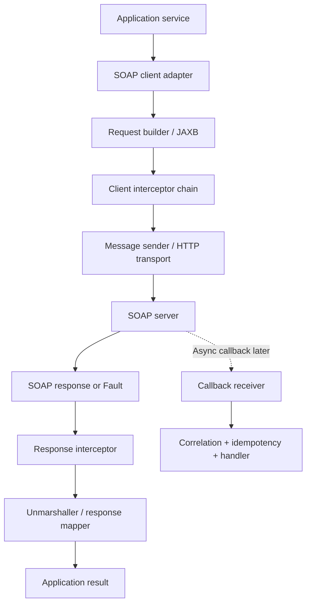
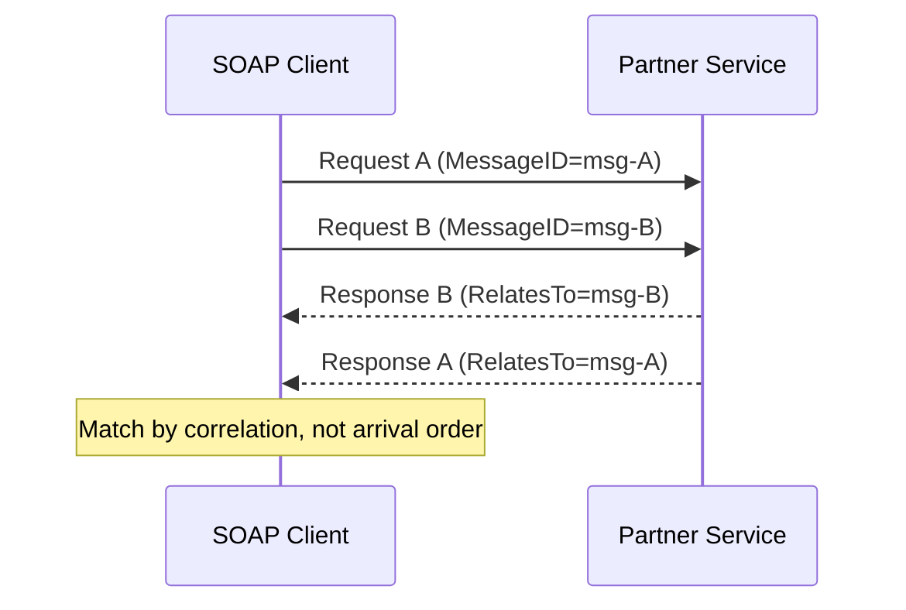

# Kiểm tra callback, interceptor và thông tin tương quan

Một SOAP client không chỉ tạo XML rồi gửi đi. Trước khi gửi, client có thể thêm SOAP Header, WS-Addressing metadata, timestamp, chữ ký WS-Security hoặc correlation ID. Sau khi nhận response, client phải kiểm tra kết quả, xử lý SOAP Fault, cập nhật trạng thái request và có thể nhận callback bất đồng bộ qua một kết nối khác. Nếu interceptor gắn sai Header, callback bị xử lý hai lần hoặc response được ghép nhầm request, client có thể gửi đúng payload nhưng vẫn xử lý sai giao dịch.

**Kiểm thử callback, interceptor và thông tin tương quan** cần chứng minh ba điều:

1. Client gửi đúng SOAP message và metadata bắt buộc.
2. Interceptor thực hiện đúng trách nhiệm, đúng thời điểm và không làm rò credential.
3. Response/callback được ghép với đúng request, partner và giao dịch; duplicate, retry, timeout và Fault không làm hoàn tất nhầm công việc.

Bài thuộc chương **Kiểm thử máy khách** của module **SPRING_WEB_SERVICES**. Module học phát triển SOAP contract-first với Spring Web Services, thiết kế XSD/WSDL, JAXB, endpoint và SOAP client, xử lý SOAP Fault, interceptor, XML security, WS-Security, certificates và kiểm thử tương thích doanh nghiệp. Trọng tâm ở đây là client dùng `WebServiceTemplate`, client interceptors, `MockWebServiceServer`, WS-Addressing và callback receiver.

Ví dụ sử dụng Java 17+, JUnit 5, Mockito và Spring-WS Test. API cụ thể có thể khác theo phiên bản Spring-WS; các class domain/XML namespace là minh họa và cần khớp WSDL/XSD thực tế.

## 1. Những thành phần client cần kiểm thử



| Thành phần | Trách nhiệm | Câu hỏi kiểm thử |
| --- | --- | --- |
| SOAP client adapter | Chuyển input thành SOAP request | Đúng operation, payload, endpoint? |
| Marshaller | JAXB object thành XML | Namespace, field, nil/optional đúng? |
| Client interceptor | Thêm/kiểm Header và security metadata | Chạy đúng thứ tự, đúng một lần? |
| Message sender | Gửi qua HTTP/JMS | URL, timeout, TLS và HTTP status đúng? |
| Response interceptor | Xử lý response trước khi trả caller | Kiểm metadata/signature, không nuốt Fault? |
| Fault handling | Chuyển SOAP Fault thành lỗi ứng dụng | Fault code/reason được xử lý đúng? |
| Correlation store | Liên kết request và callback | Ghép đúng partner/job/MessageID? |
| Callback receiver | Nhận response bất đồng bộ | Xác thực sender, chống duplicate/replay? |

Mock client không tự chứng minh TLS handshake hoặc callback receiver HTTP endpoint thật. Chọn công cụ theo đúng ranh giới.

## 2. Phân biệt SOAP Action, WS-Addressing Action và correlation

| Trường | Ý nghĩa | Mục đích |
| --- | --- | --- |
| HTTP `SOAPAction` | Header HTTP theo SOAP 1.1 binding | Chọn operation theo binding |
| `wsa:Action` | Action URI trong SOAP Header | Ý nghĩa message |
| `wsa:MessageID` | ID duy nhất của message | Nhận diện request/message |
| `wsa:RelatesTo` | Tham chiếu message liên quan | Ghép response với request |
| Business correlation ID | ID giao dịch/job | Theo dõi luồng nghiệp vụ |
| Idempotency key | Khóa chống xử lý trùng | Ngăn side effect lặp khi retry |

SOAPAction hoặc wsa:Action không thay MessageID; RelatesTo không tự là authorization; business correlation ID không tự bảo đảm idempotency. Mỗi trường phục vụ một mục đích.

### 2.1. Request và response có correlation

```xml
<s:Envelope
    xmlns:s="http://schemas.xmlsoap.org/soap/envelope/"
    xmlns:wsa="http://www.w3.org/2005/08/addressing"
    xmlns:o="https://example.org/orders/v1">
    <s:Header>
        <wsa:Action>urn:example:orders:GetOrder</wsa:Action>
        <wsa:MessageID>urn:uuid:11111111-1111-4111-8111-111111111111</wsa:MessageID>
        <wsa:ReplyTo>
            <wsa:Address>http://www.w3.org/2005/08/addressing/anonymous</wsa:Address>
        </wsa:ReplyTo>
        <wsa:To>https://soap.partner.example.org/orders</wsa:To>
    </s:Header>
    <s:Body>
        <o:GetOrderRequest>
            <o:orderId>ORD-1001</o:orderId>
        </o:GetOrderRequest>
    </s:Body>
</s:Envelope>
```

Response:

```xml
<s:Envelope
    xmlns:s="http://schemas.xmlsoap.org/soap/envelope/"
    xmlns:wsa="http://www.w3.org/2005/08/addressing"
    xmlns:o="https://example.org/orders/v1">
    <s:Header>
        <wsa:Action>urn:example:orders:GetOrderResponse</wsa:Action>
        <wsa:RelatesTo>urn:uuid:11111111-1111-4111-8111-111111111111</wsa:RelatesTo>
    </s:Header>
    <s:Body>
        <o:GetOrderResponse>
            <o:orderId>ORD-1001</o:orderId>
            <o:status>PAID</o:status>
        </o:GetOrderResponse>
    </s:Body>
</s:Envelope>
```

Test phải xác minh response liên hệ đúng request, nhất là khi nhiều request chạy song song. Chỉ kiểm Body không đủ nếu client quản lý nhiều request qua WS-Addressing.

## 3. MockWebServiceServer kiểm thử phía SOAP client

Spring-WS Test cung cấp `MockWebServiceServer` để đặt kỳ vọng lên request do `WebServiceTemplate` gửi và trả response giả. Nó phù hợp kiểm payload XML/QName, SOAP Action, SOAP Header, interceptor đã thêm metadata, response, SOAP Fault và số lần gọi.

Nó **không** kiểm server thật, TLS handshake, certificate trust production hoặc callback HTTP receiver. Những ranh giới đó cần integration tests khác.

### 3.1. Cấu hình template cho test

```java
import org.springframework.context.annotation.Bean;
import org.springframework.context.annotation.Configuration;
import org.springframework.oxm.jaxb.Jaxb2Marshaller;
import org.springframework.ws.client.core.WebServiceTemplate;

@Configuration
class SoapClientTestConfiguration {
    @Bean
    Jaxb2Marshaller orderMarshaller() {
        Jaxb2Marshaller marshaller = new Jaxb2Marshaller();
        marshaller.setContextPath("com.example.orders.ws");
        return marshaller;
    }

    @Bean
    WebServiceTemplate orderWebServiceTemplate(
            Jaxb2Marshaller orderMarshaller) {
        WebServiceTemplate template = new WebServiceTemplate();
        template.setMarshaller(orderMarshaller);
        template.setUnmarshaller(orderMarshaller);
        return template;
    }
}
```

Context path là package JAXB generated theo XSD. Nếu production dùng schema validation, SOAP version hoặc interceptors, test context cần phản ánh cấu hình đó. Đừng chỉ tạo template test khác hẳn rồi kết luận interceptor production hoạt động.

### 3.2. Đặt kỳ vọng request và response

```java
import org.junit.jupiter.api.BeforeEach;
import org.junit.jupiter.api.Test;
import org.springframework.beans.factory.annotation.Autowired;
import org.springframework.test.context.junit.jupiter.SpringJUnitConfig;
import org.springframework.ws.client.core.WebServiceTemplate;
import org.springframework.ws.test.client.MockWebServiceServer;
import org.springframework.xml.transform.StringSource;

import static org.junit.jupiter.api.Assertions.*;
import static org.springframework.ws.test.client.RequestMatchers.payload;
import static org.springframework.ws.test.client.ResponseCreators.withPayload;

@SpringJUnitConfig(SoapClientTestConfiguration.class)
class OrderSoapClientTest {
    @Autowired
    WebServiceTemplate template;

    MockWebServiceServer server;

    @BeforeEach
    void setUp() {
        server = MockWebServiceServer.createServer(template);
    }

    @Test
    void sendsGetOrderAndMapsResponse() {
        String expectedRequest = """
                <o:GetOrderRequest
                    xmlns:o="https://example.org/orders/v1">
                    <o:orderId>ORD-1001</o:orderId>
                </o:GetOrderRequest>
                """;
        String response = """
                <o:GetOrderResponse
                    xmlns:o="https://example.org/orders/v1">
                    <o:orderId>ORD-1001</o:orderId>
                    <o:status>PAID</o:status>
                </o:GetOrderResponse>
                """;

        server.expect(payload(new StringSource(expectedRequest)))
                .andRespond(withPayload(new StringSource(response)));

        Object result = template.marshalSendAndReceive(
                "https://soap.partner.example.org/orders",
                buildGetOrderRequest("ORD-1001"));

        assertNotNull(result);
        server.verify();
    }
}
```

Đây là skeleton: generated JAXB classes và `buildGetOrderRequest` thuộc ứng dụng. Test thật nên assert kiểu và field của result thay cho assertNotNull. `MockWebServiceServer` phải gắn với đúng template mà client thực sự dùng; nếu client tạo một template khác hoặc sender khác, mock server có thể không intercept request.

## 4. Kiểm SOAP Action và WS-Addressing Header

Test payload đơn thuần chưa xác nhận action. Có thể đặt matcher SOAP Action:

```java
import static org.springframework.ws.test.client.RequestMatchers.soapAction;

server.expect(soapAction("urn:example:orders:GetOrder"))
        .andExpect(payload(new StringSource(expectedRequest)))
        .andRespond(withPayload(new StringSource(response)));
```

Matcher/overload phụ thuộc phiên bản. Nếu contract dùng SOAP 1.2, kiểm đúng media type/action parameter theo binding; không luôn giả định SOAP 1.1 HTTP SOAPAction.

WS-Addressing Header cần kiểm QName/namespace, không so prefix:

```java
import javax.xml.namespace.QName;
import java.util.Iterator;
import org.springframework.ws.WebServiceMessage;
import org.springframework.ws.test.client.RequestMatcher;
import org.springframework.ws.soap.SoapMessage;
import org.springframework.ws.soap.SoapHeaderElement;

final class WsAddressingActionMatcher implements RequestMatcher {
    private static final String WSA =
            "http://www.w3.org/2005/08/addressing";
    private final String expected;

    WsAddressingActionMatcher(String expected) {
        this.expected = expected;
    }

    @Override
    public void match(WebServiceMessage message) throws Exception {
        if (!(message instanceof SoapMessage soap)) {
            throw new AssertionError("SOAP message expected");
        }
        QName actionName = new QName(WSA, "Action");
        Iterator<SoapHeaderElement> headers =
                soap.getSoapHeader().examineAllHeaderElements();
        int count = 0;
        String actual = null;
        while (headers.hasNext()) {
            SoapHeaderElement header = headers.next();
            if (actionName.equals(header.getName())) {
                count++;
                actual = SoapHeaderText.read(header.getSource());
            }
        }
        if (count != 1 || !expected.equals(actual)) {
            throw new AssertionError("Unexpected WS-Addressing Action");
        }
    }
}
```

`SoapHeaderText.read` là helper test chuyển Source thành text theo MessageFactory/provider đang dùng. Matcher minh họa việc kiểm đúng QName và duplicate; cần bổ sung helper DOM/Transformer trong test project.

### 4.1. MessageID duy nhất trong production, cố định trong test

```java
public interface MessageIdGenerator {
    String nextMessageId();
}

public final class FixedMessageIdGenerator implements MessageIdGenerator {
    @Override
    public String nextMessageId() {
        return "urn:uuid:11111111-1111-4111-8111-111111111111";
    }
}
```

Inject generator để test deterministic. Production phải tạo ID duy nhất theo contract, ví dụ UUID URN. Không dùng fixed ID cho mọi request vì response có thể ghép nhầm hoặc replay detection sai.

## 5. Client interceptor: thứ tự, số lần chạy và state

Spring-WS `ClientInterceptor` có hooks trước khi gửi request, sau response, khi Fault và khi completion. Interceptor có thể thêm trace/correlation Header, audit, ký message, xác minh response hoặc xử lý lỗi.

Các tình huống cần kiểm:

- Đăng ký vào đúng `WebServiceTemplate`.
- Header được thêm đúng một lần, không ghi đè Header do security/contract quản lý.
- Response hook chạy khi thành công.
- Fault hook chạy khi server trả SOAP Fault.
- Fault không bị biến thành success hoặc bị nuốt.
- Exception từ interceptor được xử lý theo client policy.
- Không lưu request-specific mutable state trong singleton interceptor.
- Credentials/signing keys không xuất hiện trong log.

### 5.1. Interceptor thêm correlation Header

```java
import javax.xml.namespace.QName;
import org.springframework.ws.WebServiceMessage;
import org.springframework.ws.client.support.interceptor.ClientInterceptor;
import org.springframework.ws.context.MessageContext;
import org.springframework.ws.soap.SoapMessage;

public final class CorrelationHeaderInterceptor
        implements ClientInterceptor {
    private static final QName CORRELATION = new QName(
            "https://example.org/context/v1", "CorrelationId");
    private final CorrelationIdProvider ids;

    public CorrelationHeaderInterceptor(CorrelationIdProvider ids) {
        this.ids = ids;
    }

    @Override
    public boolean handleRequest(MessageContext context) {
        WebServiceMessage request = context.getRequest();
        if (!(request instanceof SoapMessage soap)) {
            return false;
        }
        soap.getSoapHeader()
                .addHeaderElement(CORRELATION)
                .setText(ids.currentCorrelationId());
        return true;
    }

    @Override
    public boolean handleResponse(MessageContext context) {
        return true;
    }

    @Override
    public boolean handleFault(MessageContext context) {
        return true;
    }

    @Override
    public void afterCompletion(
            MessageContext context, Exception ex) {
        // Không giữ message/principal trong field sau khi request xong.
    }
}
```

`CorrelationIdProvider` là dependency của ứng dụng. Nó phải trả correlation ID theo invocation, không dùng singleton mutable field currentId. Nhiều request đồng thời có thể ghi đè ID của nhau nếu giữ state không đúng scope.

### 5.2. Test hook độc lập và test wiring

Có thể unit test interceptor qua MessageContext:

```java
@Test
void addsCorrelationHeader() {
    CorrelationIdProvider ids = () -> "corr-1001";
    CorrelationHeaderInterceptor interceptor =
            new CorrelationHeaderInterceptor(ids);
    MessageContext context = soapMessageContext(
            "<o:GetOrderRequest xmlns:o='https://example.org/orders/v1'/>");

    assertTrue(interceptor.handleRequest(context));
    assertEquals(1, countHeader(
            context.getRequest(),
            new QName("https://example.org/context/v1",
                    "CorrelationId")));
}
```

`soapMessageContext` và `countHeader` là test helpers tạo message qua Spring-WS MessageFactory. Test này chỉ kiểm hook logic; nó không chứng minh interceptor đã gắn vào template. Cần thêm MockWebServiceServer expectation trên request thực do template gửi.

### 5.3. Kiểm thứ tự chain

Một chain có thể được thiết kế:

```text
Request:
  [Tracing] → [Correlation] → [WS-Security signing] → [Transport]

Response:
  [Transport] → [WS-Security validation] → [Correlation check] → [Tracing]

Fault:
  [Transport] → [Security/Fault handling] → [Audit]
```

Thứ tự thực tế phụ thuộc cấu hình/framework version; không giả định response hooks tự động chạy theo thứ tự ngược request nếu contract không quy định. Dùng event recorder trong test:

```java
final class RecordingInterceptor implements ClientInterceptor {
    private final String name;
    private final List<String> events;

    RecordingInterceptor(String name, List<String> events) {
        this.name = name;
        this.events = events;
    }
    @Override
    public boolean handleRequest(MessageContext context) {
        events.add(name + ":request");
        return true;
    }
    @Override
    public boolean handleResponse(MessageContext context) {
        events.add(name + ":response");
        return true;
    }
    @Override
    public boolean handleFault(MessageContext context) {
        events.add(name + ":fault");
        return true;
    }
    @Override
    public void afterCompletion(MessageContext context, Exception ex) {
        events.add(name + ":complete");
    }
}
```

Dùng hai instance với tên khác nhau, đăng ký như production và kiểm events sau request thành công và Fault. Test phải phản ánh thứ tự mà ứng dụng chủ đích yêu cầu.

### 5.4. Những lỗi interceptor dễ bỏ sót

- Ký message trước khi correlation Header được thêm: Header mới không nằm trong chữ ký.
- Log toàn Envelope sau khi token/certificate đã được thêm.
- Một interceptor trả false làm dừng chain nhưng test chỉ kiểm response.
- handleFault nuốt exception khiến caller tưởng request thành công.
- Retry tạo duplicate Header hoặc tạo MessageID sai semantics.
- Response Header được đọc trước security validation.
- Mutable field trong singleton làm trộn request state giữa threads.

## 6. Kiểm callback và RelatesTo

Khi client gửi request có MessageID, response bất đồng bộ cần tham chiếu message qua RelatesTo hoặc correlation contract riêng. Callback handler không nên chỉ tìm job bằng một ID không scope.

```java
public record PendingSoapRequest(
        String partnerId,
        String tenantId,
        String messageId,
        String businessCorrelationId,
        String idempotencyKey,
        String expectedAction,
        Instant expiresAt) { }
```

Các trường được tạo/lưu theo security design. Không chấp nhận partner/tenant do callback tự khai mà không xác thực sender; correlation lookup phải scope theo partner và tenant.

### 6.1. Response có thể đến không theo thứ tự gửi



Test phải chứng minh response B hoàn tất job B, response A hoàn tất A. Một biến lastRequestId hoặc FIFO không gắn correlation sẽ ghép sai khi response out-of-order.

### 6.2. Các ca correlation cần test

| Tình huống | Hành vi mong muốn |
| --- | --- |
| RelatesTo khớp request đang chờ | Ghép đúng request |
| RelatesTo không tồn tại | Reject/quarantine, không gán đại |
| RelatesTo thuộc partner khác | Reject |
| RelatesTo thuộc tenant khác | Reject |
| Callback đến sau expiry | Reject hoặc áp late-response policy |
| Callback đến hai lần | Idempotent acknowledgement, không lặp side effect |
| Hai request cùng business correlation, MessageID khác | Phân biệt theo contract |
| Response Action không khớp | Reject |
| Callback signature sai | Reject trước khi cập nhật pending state |
| Signature đúng nhưng tenant sai | Authorization từ chối |

## 7. Callback receiver và duplicate delivery

Callback receiver là một endpoint mới. Test cần xác minh sender identity qua mTLS/WS-Security/JWT theo contract; RelatesTo hợp lệ; response Action và payload QName đúng; tenant/partner ownership khớp; timestamp/replay policy; duplicate callback không chạy business side effect hai lần; callback muộn/không có pending request được xử lý có chủ ý.

Pseudocode:

```java
CallbackResult accept(
        VerifiedPartner partner,
        VerifiedTenant tenant,
        CallbackMessage message) {
    PendingSoapRequest pending = store.find(
            partner.id(), tenant.id(), message.relatesTo())
        .orElseThrow(UnknownCorrelationException::new);

    if (!pending.expectedAction().equals(message.action())) {
        throw new CallbackRejectedException();
    }
    return store.completeOnce(
            pending.messageId(),
            message.idempotencyKey(),
            () -> businessHandler.handle(message.payload()));
}
```

Đây là pseudocode. `completeOnce` phải atomic/transactional, ví dụ unique constraint, compare-and-set hoặc inbox table có khóa duy nhất. Một câu if trong memory không chống hai node xử lý duplicate đồng thời.

## 8. SOAP Fault, transport error và retry

| Lỗi | Biểu hiện phía client | Kiểm thử |
| --- | --- | --- |
| SOAP Sender/Client Fault | SoapFaultClientException/fault exception theo API | Code/reason/detail contract |
| SOAP Receiver/Server Fault | Fault từ server | Retry classification |
| HTTP 401/403 | HTTP/transport error; có thể không có SOAP Envelope | Authentication handling |
| HTTP 404/415 | Transport/protocol error | Endpoint/media type |
| DNS/connect timeout | Transport exception | Timeout/retry |
| TLS handshake | SSL exception | Trust/hostname/mTLS |
| Interceptor exception | Client invocation failure | Không nuốt, không ghi sai state |
| Correlation mismatch | Application security rejection | Không cập nhật pending job |

Không giả định mọi lỗi thành SOAP Fault. HTTP security filter có thể chặn trước dispatcher; TLS fail trước message; HTTP body lỗi có thể không phải SOAP.

### 8.1. Mock SOAP Fault

```java
import static org.springframework.ws.test.client.ResponseCreators.withServerOrReceiverFault;

server.expect(payload(new StringSource(expectedRequest)))
        .andRespond(withServerOrReceiverFault(
                "Order service temporarily unavailable",
                Locale.ENGLISH));

assertThrows(SoapFaultClientException.class,
        () -> template.marshalSendAndReceive(endpoint, request));
```

Creator/import và exception type phụ thuộc Spring-WS version và SOAP version. Dùng đúng message factory/binding; khi contract yêu cầu, kiểm Fault code/reason chứ không chỉ assert có exception.

### 8.2. Không retry mọi Fault

| Lỗi | Retry mặc định? | Lưu ý |
| --- | --- | --- |
| SOAP Sender/Client Fault do request sai | Không | Sửa request/contract |
| SOAP Receiver/Server Fault tạm thời | Có thể | Bounded retry + idempotency |
| HTTP 429/503 | Có thể | Theo quota/Retry-After |
| HTTP 401/403 | Không tự retry credential | Kiểm token/permission |
| Timeout sau khi server có thể đã xử lý | Chỉ với idempotency | Có thể UNKNOWN |
| TLS certificate/hostname fail | Không | Sửa trust/identity |
| Correlation mismatch | Không | Security/integrity rejection |

Test phải xác minh retry không tạo duplicate side effect. Định nghĩa rõ MessageID/idempotency semantics: mỗi attempt có thể có MessageID mới nhưng giữ business idempotency key, hoặc giữ MessageID theo contract; không trộn hai vai trò.

## 9. Timeout, retry và interceptor không bị lặp

Khi client retry, kiểm:

- Số request thực tế đúng retry budget.
- Interceptor không thêm duplicate Header qua các lần thử.
- Credentials/signature mỗi attempt phù hợp timestamp/nonce policy.
- Correlation/business ID vẫn liên hệ cùng operation.
- MessageID/idempotency key tuân contract.
- Response trễ của attempt cũ không hoàn tất nhầm attempt mới.
- Cancellation/timeout dọn pending state hoặc đánh dấu UNKNOWN.

Không retry ẩn trong interceptor nếu application retry policy cũng chạy; có thể nhân số attempt. Tách retry orchestration khỏi message mutation và ghi nhận retry qua event/metrics.

## 10. Kiểm response Header an toàn

Response interceptor/client adapter có thể đọc RelatesTo, Action, trace ID hoặc security metadata. Chỉ đọc Header sau khi message security validation hoàn tất nếu contract yêu cầu chữ ký.

Kiểm QName/namespace, Header đúng một lần, RelatesTo đúng pending message, Action phù hợp response, role/actor và mustUnderstand theo binding. Không tin From, tenant hoặc partner từ Header chưa xác thực. Nếu Header ảnh hưởng integrity-sensitive decision, nó phải nằm trong actual signed parts và là đúng node ứng dụng tiêu thụ.

Không dùng XPath rộng tìm mọi element cùng local-name nếu có nguy cơ XML Signature Wrapping khiến client đọc nhầm node chưa ký.

## 11. Security boundary: mock không chứng minh certificate production

| Test | Chứng minh | Không chứng minh |
| --- | --- | --- |
| Mockito verify interceptor | Hook interaction/wiring mock | XML Signature cryptographic validity |
| MockWebServiceServer inspect Header | Header/payload client message | TLS handshake thật |
| WSS4J test với test key/cert | Signature/token validation theo test config | Production CA/truststore/rotation |
| HTTPS integration | TLS/hostname/mTLS theo test setup | Gateway production nếu không có proxy |
| Partner interoperability | Tương thích fixture/staging | Mọi cấu hình ngoài môi trường test |

Không dùng production private key/token trong fixtures. Không disable hostname verification, signature validation hoặc trust checks để test pass.

## 12. Kiểm thử bất đồng bộ và thread safety

Một SOAP client có thể gửi nhiều request cùng lúc và nhận callback không theo thứ tự. Test nên gửi ít nhất hai request với MessageID khác nhau, trả response ngược thứ tự, xác minh từng Future/job nhận đúng kết quả, gửi duplicate callback song song, thử callback muộn/sai partner/tenant, kiểm cleanup/expiry của pending registry và bảo đảm interceptor không lưu correlation/principal trong mutable field.

Ví dụ sketch:

```java
@Test
void matchesOutOfOrderResponsesByMessageId() {
    PendingRequestStore store = new InMemoryPendingRequestStore();
    store.register(pending("partner-A", "TENANT-A", "msg-A"));
    store.register(pending("partner-A", "TENANT-A", "msg-B"));

    coordinator.accept(response("msg-B", "ORD-2002"));
    coordinator.accept(response("msg-A", "ORD-1001"));

    assertEquals("ORD-1001", store.resultFor("msg-A").orderId());
    assertEquals("ORD-2002", store.resultFor("msg-B").orderId());
}
```

Đây là unit-test sketch; store/coordinator/fixtures là domain test doubles. Nó kiểm correlation logic, không kiểm HTTP callback listener hoặc WSS4J.

## 13. Ma trận kiểm thử client

| Nhóm | Ca thành công | Ca lỗi/negative |
| --- | --- | --- |
| Request mapping | QName/body đúng | Namespace/field sai |
| SOAP Action | Action đúng binding | Action mismatch |
| WS-Addressing | MessageID/Action/ReplyTo hợp lệ | Missing/duplicate/invalid |
| Request interceptor | Header thêm đúng một lần | Duplicate/header overwrite |
| Response interceptor | Action/RelatesTo đúng | Response không liên hệ request |
| Fault callback | Fault map đúng | Fault bị nuốt/lộ detail |
| Correlation | Out-of-order ghép đúng | Unknown/foreign tenant/partner |
| Idempotency | Duplicate ack an toàn | Side effect lặp |
| Retry | Bounded retry đúng policy | Retry storm/double execution |
| Security | Signature/cert fixture hợp lệ | Signature sai/cert không trust |
| Transport | Response status/media type đúng | Timeout/TLS/401/415 |
| Concurrency | Nhiều request độc lập | Interceptor state bị trộn |

## 14. Fixtures và tổ chức test

```text
src/test/java/
  .../client/
    OrderSoapClientTest.java
    CorrelationHeaderInterceptorTest.java
    WsAddressingMatcherTest.java
    CallbackCoordinatorTest.java
    CallbackReceiverTest.java
    SoapFaultMappingTest.java
src/test/resources/
  soap/
    get-order-request.xml
    get-order-response.xml
    get-order-fault.xml
    response-wrong-relates-to.xml
    duplicate-correlation-header.xml
  certificates/
    test-client.p12
    test-truststore.p12
```

Không commit production keys/tokens; certificate fixtures chỉ có test key. XML fixtures phải đồng bộ WSDL/XSD version. Dùng Clock/ID generator fake để test expiry và correlation deterministic.

## 15. Lỗi thường gặp

| Triệu chứng | Nguyên nhân | Cách sửa |
| --- | --- | --- |
| Test pass nhưng Header không lên wire | Interceptor không gắn vào template thực | MockWebServiceServer trên đúng template |
| Header xuất hiện hai lần | Interceptor đăng ký trùng/retry mutation | Kiểm QName count và invocation |
| Response ghép nhầm | Dùng arrival order/last ID | Map theo RelatesTo/MessageID |
| Duplicate callback double update | Không atomic idempotency | Unique key/inbox/transaction |
| Fault bị coi success | handleFault/exception mapping nuốt lỗi | Assert Fault path |
| Retry tạo nhiều giao dịch | MessageID/idempotency không tách | Định nghĩa attempt ID/business key |
| Chữ ký không cover Header | Signing chạy trước Header mutation | Signing sau mọi Header cần ký |
| Token lộ trong log | Dump toàn Envelope | Redact/sanitize |
| Test concurrency chập chờn | Mutable interceptor field | Invocation-local state |
| Mock được dùng để tuyên bố TLS đúng | Không có handshake | HTTPS integration test |
| Late callback hoàn tất job hết hạn | Không kiểm expiry/state | Late-response policy rõ |

## 16. Quy trình thêm test mới

1. Xác định test thuộc request mapping, interceptor, response, Fault, callback hay correlation.
2. Chọn ranh giới: unit interceptor, MockWebServiceServer, callback coordinator unit test hoặc HTTP integration.
3. Dùng fixture tối thiểu có MessageID/correlation rõ ràng.
4. Assert payload và Header khi Header thuộc contract.
5. Kiểm số lần gọi và side effect.
6. Thêm negative case: missing, duplicate, mismatch, unknown, late và replay.
7. Nếu phụ thuộc security, dùng test crypto fixture và kiểm actual signed parts.
8. Nếu phụ thuộc transport, chạy HTTP/TLS integration test.
9. Phân loại failure: message construction, interceptor, transport, Fault mapping, correlation hoặc receiver.

## 17. Bài tập tự kiểm tra

**Câu 1.** MockWebServiceServer có kiểm TLS hostname verification không?

**Đáp án:** Không. Cần HTTPS integration test có handshake.

**Câu 2.** SOAPAction và wsa:Action có phải cùng một Header không?

**Đáp án:** Không. SOAPAction là HTTP header theo SOAP 1.1 binding; wsa:Action là WS-Addressing SOAP Header.

**Câu 3.** RelatesTo dùng để làm gì?

**Đáp án:** Liên hệ response với message trước; không tự cấp quyền hoặc bảo đảm idempotency.

**Câu 4.** Vì sao response out-of-order phải có test?

**Đáp án:** Request song song có thể trả khác thứ tự; ghép theo arrival order sẽ hoàn tất nhầm job.

**Câu 5.** Interceptor thêm correlation Header sau XML Signature có vấn đề gì?

**Đáp án:** Header có thể không nằm trong chữ ký. Mutation/signing order phải bảo vệ mọi part bắt buộc.

**Câu 6.** Vì sao không lưu correlation ID vào field singleton interceptor?

**Đáp án:** Request song song ghi đè state và dùng nhầm ID; dùng invocation-local/scoped context.

**Câu 7.** Hai callback cùng RelatesTo đến đồng thời; boolean trong memory có đủ chống duplicate?

**Đáp án:** Không trong hệ nhiều thread/node; cần transaction, unique constraint hoặc compare-and-set.

**Câu 8.** Callback signature hợp lệ nhưng partner không có quyền tenant có được chấp nhận?

**Đáp án:** Không. Signer authentication và business authorization là hai bước riêng.

**Câu 9.** Có retry mọi SOAP Fault không?

**Đáp án:** Không. Sender Fault thường cần sửa request; Receiver Fault có thể tạm thời; tuân retry policy/idempotency.

**Câu 10.** Vì sao cần kiểm Fault hook riêng?

**Đáp án:** Interceptor có thể nuốt exception hoặc không audit Fault nếu chỉ test response thành công.

**Câu 11.** MessageID fixed trong unit test có nên dùng production?

**Đáp án:** Không. Fixed ID chỉ là fixture; production cần ID duy nhất và replay/correlation policy.

**Câu 12.** Mock client test pass có chứng minh callback receiver HTTP endpoint hoạt động?

**Đáp án:** Không. Cần test receiver và HTTP integration test cho endpoint thật.

## Ghi nhớ

- **MockWebServiceServer** kiểm request/response do đúng WebServiceTemplate gửi; không tự kiểm TLS handshake hoặc callback HTTP server.
- Phân biệt **SOAPAction, WS-Addressing Action, MessageID, RelatesTo, business correlation ID và idempotency key**.
- Client interceptor cần test **wiring, thứ tự, số lần chạy, response/Fault hooks và thread safety**.
- Header cần ký phải được thêm trước bước signing; test phải xác minh actual signed parts.
- Response/callback ghép theo correlation đã xác minh, scope theo partner/tenant và hỗ trợ out-of-order.
- Duplicate/late callback cần atomic state transition và idempotency; không dùng biến memory đơn giản trong hệ phân tán.
- Không retry mọi SOAP Fault/transport error; phân biệt lỗi vĩnh viễn, tạm thời và timeout không xác định.
- TLS, mTLS, certificate trust và callback HTTP thật cần integration tests tại đúng transport boundary.
