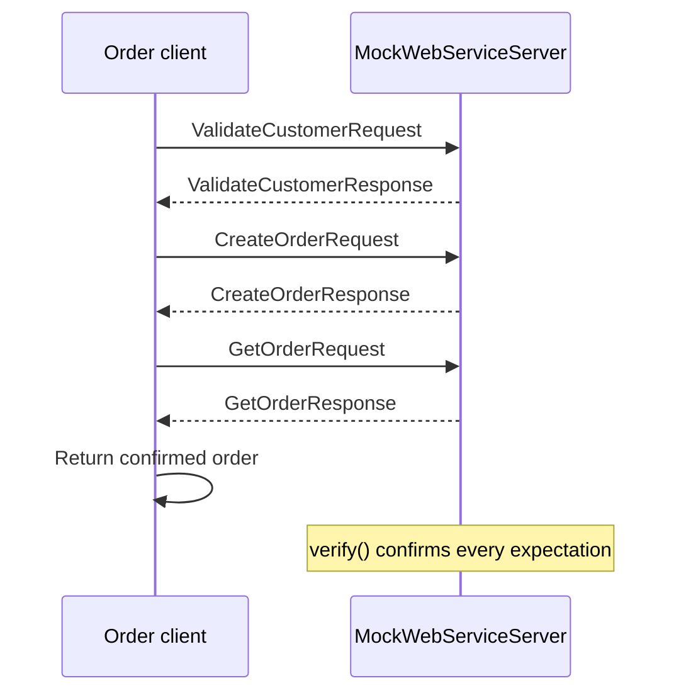

# Thứ tự kỳ vọng, xác nhận lời gọi đã diễn ra và phát hiện thiếu lời gọi

Khi kiểm thử SOAP client dùng **Spring Web Services (Spring-WS)**, chỉ kiểm tra object response là chưa đủ. Client có thể trả kết quả mong đợi sau khi gọi sai operation, gửi payload thiếu field, bỏ qua một bước bắt buộc hoặc gửi request nhiều lần. Một test tốt phải xác minh **request đã gửi, thứ tự gửi, số lần gọi và response mà client xử lý**.

Spring-WS cung cấp **MockWebServiceServer** để giả lập SOAP service ở phía client. Test gắn mock server với **WebServiceTemplate**, đăng ký kỳ vọng về request và response, thực thi client, rồi gọi **verify()**. Cơ chế này phát hiện lời gọi thiếu, lời gọi thừa hoặc request được gửi sai thứ tự.

Bài thuộc chương **Kiểm thử máy khách** của module **SPRING_WEB_SERVICES**. Trọng tâm là tổ chức expectation, dùng request matcher đủ chặt, xác nhận mọi kỳ vọng đã được tiêu thụ và kiểm tra negative path/retry mà không làm test phụ thuộc vào chi tiết không ổn định.

> **Nguyên tắc:** đăng ký expectation chỉ mô tả điều test mong đợi; nó không chứng minh lời gọi đã xảy ra. Phải thực thi client và gọi verify() để xác nhận các kỳ vọng bắt buộc đã được đáp ứng.

## 1. Ba câu hỏi mỗi SOAP client test cần trả lời

1. **Client gửi gì?** Kiểm payload QName/fields, SOAP Header, SOAPAction, WS-Addressing Action và destination nếu thuộc phạm vi.
2. **Client gửi theo thứ tự nào và bao nhiêu lần?** Kiểm chuỗi operation, retry, duplicate hoặc request không được phép.
3. **Client xử lý response ra sao?** Kiểm JAXB unmarshalling, response mapping, SOAP Fault, transport error và side effect phía client.

Ví dụ client tạo đơn có chuỗi:



Nếu test chỉ assert kết quả cuối, client có thể bỏ qua bước validate hoặc gọi nhầm operation mà test vẫn pass. Expectations làm lộ giao thức thực tế client sử dụng.

## 2. MockWebServiceServer đứng ở đâu?

MockWebServiceServer là test utility cho phía SOAP client. Nó gắn với WebServiceTemplate và thay đường gửi/nhận message để request được so với expectations đã đăng ký, sau đó trả response giả lập.

```text
Test method
  |
  v
OrderSoapClient
  |
  v
WebServiceTemplate
  |
  v
MockWebServiceServer
  |-- RequestMatcher
  |-- Expected order
  |-- ResponseCreator
  v
SOAP response -> JAXB/unmarshaller -> client result
```

Nó phù hợp để kiểm payload request được marshal đúng, request đi theo thứ tự, SOAP Header/action, response/Fault handling, retry và lời gọi thiếu/thừa. Nó **không tự kiểm tra** DNS, TCP, HTTP connection pool, TLS handshake, proxy, certificate chain, servlet server hoặc server thật.

## 3. Tạo mock server trên đúng WebServiceTemplate

Ví dụ test gắn mock server với template được Spring inject:

```java
import org.springframework.beans.factory.annotation.Autowired;
import org.springframework.ws.client.core.WebServiceTemplate;
import org.springframework.ws.test.client.MockWebServiceServer;

class OrderSoapClientTest {
    @Autowired
    private WebServiceTemplate webServiceTemplate;

    private MockWebServiceServer mockServer;

    @BeforeEach
    void setUp() {
        mockServer = MockWebServiceServer.createServer(webServiceTemplate);
    }
}
```

Factory overload và import cần đối chiếu Spring-WS test module version đang dùng. Nếu mock server gắn với template A nhưng client sử dụng template B, request không đi qua mock server và có thể chạm network thật tùy cấu hình.

Kiểm tra client được inject đúng template, không tự tạo template khác trong method, mock server có lifecycle riêng, và verify xảy ra sau khi context/client sẵn sàng.

## 4. Đăng ký expectation và response

Một test cơ bản kiểm request payload và trả response:

```java
import static org.springframework.ws.test.client.RequestMatchers.payload;
import static org.springframework.ws.test.client.ResponseCreators.withPayload;

import org.springframework.xml.transform.StringSource;

@Test
void getOrderSendsExpectedRequest() {
    StringSource expectedRequest = new StringSource(
        "<ord:GetOrderRequest xmlns:ord='https://example.com/orders/v1'>" +
        "<ord:orderId>42</ord:orderId>" +
        "</ord:GetOrderRequest>");

    StringSource response = new StringSource(
        "<ord:GetOrderResponse xmlns:ord='https://example.com/orders/v1'>" +
        "<ord:orderId>42</ord:orderId>" +
        "<ord:status>CONFIRMED</ord:status>" +
        "</ord:GetOrderResponse>");

    mockServer.expect(payload(expectedRequest))
              .andRespond(withPayload(response));

    OrderView result = orderSoapClient.getOrder(42L);

    assertThat(result.orderId()).isEqualTo(42L);
    assertThat(result.status()).isEqualTo("CONFIRMED");
    mockServer.verify();
}
```

Tên static imports/response creator cần đối chiếu theo version. RequestMatcher xác định request thực tế đúng hay không; ResponseCreator tạo response giả lập. Matcher sai sẽ báo lỗi tại thời điểm client gửi request; response không được xử lý đúng sẽ làm assertion kết quả thất bại.

## 5. verify() phát hiện lời gọi bị thiếu

Giả sử test đăng ký hai expectation nhưng client chỉ gửi request đầu:

```java
@Test
void verifyDetectsMissingSecondCall() {
    mockServer.expect(payload(validateRequest))
              .andRespond(withPayload(validateResponse));

    mockServer.expect(payload(createRequest))
              .andRespond(withPayload(createResponse));

    orderSoapClient.validateOnly(customerId);

    // Expectation thứ hai chưa được tiêu thụ.
    mockServer.verify();
}
```

Nếu client không gửi request thứ hai, verify() báo expectation chưa được đáp ứng. Nếu không gọi verify(), test có thể pass dù client bỏ qua operation bắt buộc.

Có thể gọi verify cuối test hoặc trong teardown/after-each. Không verify trước khi client hoàn tất; không nuốt verification exception. Nếu teardown tạo thêm failure sau assertion gốc, đọc cả hai lỗi trong test report.

## 6. Thứ tự expectation

Khi thứ tự operation có ý nghĩa, đăng ký theo thứ tự mong đợi:

```java
@Test
void performsWorkflowInExpectedOrder() {
    mockServer.expect(payload(validateRequest))
              .andRespond(withPayload(validateResponse));

    mockServer.expect(payload(createRequest))
              .andRespond(withPayload(createResponse));

    mockServer.expect(payload(getOrderRequest))
              .andRespond(withPayload(getOrderResponse));

    OrderView result = orderSoapClient.createAndLoad(command);

    assertThat(result.status()).isEqualTo("CONFIRMED");
    mockServer.verify();
}
```

Với ordered expectations, request kế tiếp phải khớp expectation kế tiếp. Nếu client gửi CreateOrder trước ValidateCustomer, matcher fail.

Chỉ ép thứ tự khi nghiệp vụ/protocol yêu cầu: lấy token trước operation, validate trước tạo giao dịch, lấy reference ID rồi dùng ở operation sau, hoặc status check bắt buộc sau command. Nếu hai call độc lập và có thể chạy song song, không nên biến thứ tự tình cờ thành contract. Dùng test riêng hoặc cơ chế unordered được version test utility hỗ trợ và đã xác minh.

## 7. Phân biệt lời gọi thiếu, thừa và sai

| Tình huống | Dấu hiệu | Cách bắt |
| --- | --- | --- |
| Thiếu request | Expectation chưa tiêu thụ | verify() |
| Request sai payload | Matcher không khớp | Payload/schema matcher |
| Request sai thứ tự | Không khớp expectation kế tiếp | Ordered expectation |
| Request thừa | Không còn expectation phù hợp | Unexpected-request failure |
| Request lặp | Vượt số lần cho phép | Exact expectations/count |
| Branch sai | Operation bắt buộc không xuất hiện | verify() và branch assertion |

Request không mong đợi thường bị phát hiện khi gửi và không khớp expectation. verify() xác nhận những expectation đã đăng ký được đáp ứng. Muốn kiểm số lần chính xác, đăng ký đúng số expectation tương ứng hoặc dùng count API nếu version có hỗ trợ và semantics đã được xác minh.

## 8. Kiểm số lần gọi chính xác

Nếu contract yêu cầu hai lần polling, đăng ký hai expectation riêng:

```java
@Test
void pollsExactlyTwice() {
    mockServer.expect(payload(statusRequest))
              .andRespond(withPayload(pendingResponse));

    mockServer.expect(payload(statusRequest))
              .andRespond(withPayload(completeResponse));

    OrderStatus status = orderSoapClient.waitForCompletion(orderId);

    assertThat(status.value()).isEqualTo("COMPLETED");
    mockServer.verify();
}
```

Client chỉ gọi một lần thì verify bắt thiếu lần hai; gọi lần ba thì request dư không còn expectation phù hợp. Nếu version có API count, xác minh exact/at-least/at-most, zero invocation và interaction với ordering trước khi dùng.

Không import ExpectedCount từ REST client test rồi giả định Spring-WS cung cấp cùng API. Helper tự viết có thể đăng ký expectations lặp, nhưng phải giữ rõ thứ tự và response từng lần.

## 9. XML matcher phải kiểm semantics

XML có namespace, prefix, attribute order và whitespace. So sánh byte/string tuyệt đối thường quá chặt: hai document có thể tương đương XML nhưng khác prefix hoặc format.

Ưu tiên matcher XML-aware và kiểm điều quan trọng:
- Root QName: namespace URI + local name.
- Required child, value và optional child.
- Element sequence nếu contract yêu cầu thứ tự.
- Attribute và namespace.
- SOAP Header/action/correlation.
- SOAP Fault code/detail.

Không bỏ qua namespace chỉ để test pass. Sai namespace có thể khiến endpoint không nhận operation dù tên element trông giống nhau.

## 10. SOAP Header và SOAPAction

Client có thể marshal Body đúng nhưng gửi thiếu Header hoặc SOAPAction. Kiểm:
- SOAP 1.1/1.2 binding.
- SOAPAction theo WSDL.
- WS-Addressing Action/To/MessageID nếu bật.
- Custom SOAP Header theo contract.
- Correlation/request identifier theo contract.
- WS-Security UsernameToken hoặc signature bằng fixture phù hợp.

Không nhầm HTTP Authorization với WS-Security Header. HTTP Basic cần test HTTP transport/filter riêng; message matcher không tự chứng minh credential được gửi qua TLS.

## 11. Nhiều SOAP calls trong một client operation

Một method có thể gọi nhiều remote operations:

```java
@Test
void submitsOrderThenReadsItBack() {
    mockServer.expect(payload(createRequest))
              .andRespond(withPayload(createResponse));

    mockServer.expect(payload(getRequest))
              .andRespond(withPayload(getResponse));

    OrderView result = orderSoapClient.submitAndRead(command);

    assertThat(result.orderId()).isEqualTo(42L);
    assertThat(result.status()).isEqualTo("CONFIRMED");
    mockServer.verify();
}
```

Nếu second call bị bỏ qua, expectation chưa tiêu thụ và verify fail. Nếu get được gọi trước create, ordered matcher fail. Không chia sẻ một mock server có mutable expectations giữa nhiều test chạy song song.

## 12. Test retry và số lần attempt

Retry phải mô tả chính xác số attempt và response từng lần:

```java
@Test
void retriesOneTransientFailureThenSucceeds() {
    mockServer.expect(payload(createRequest))
              .andRespond(withTransientFailure());

    mockServer.expect(payload(createRequest))
              .andRespond(withPayload(createResponse));

    OrderView result = orderSoapClient.createWithRetry(command);

    assertThat(result.status()).isEqualTo("CONFIRMED");
    mockServer.verify();
}
```

withTransientFailure() là helper minh họa; response creator thực tế cần theo Spring-WS test API hoặc custom ResponseCreator phù hợp. SOAP Fault business có thể không retry. Test cần phân biệt retryable/non-retryable, max attempts, backoff policy nếu có, payload/correlation mỗi attempt, exhausted retry và side effects.

## 13. Xác nhận branch không được gọi service

Nếu input thiếu dữ liệu hoặc precondition fail thì remote service không được gọi:

```java
@Test
void rejectsInvalidInputWithoutCallingSoapService() {
    assertThatThrownBy(() -> orderSoapClient.create(null))
        .isInstanceOf(IllegalArgumentException.class);

    mockServer.verify();
}
```

Không đăng ký expectation cho request ở branch đó. Một request bất ngờ vẫn phải bị mock server từ chối khi xảy ra. Có thể kiểm thêm collaborator/counter để khẳng định zero calls. Test phải assert lý do branch dừng và side effect, không chỉ dùng empty expectation.

## 14. Missing call do exception hoặc short-circuit

Viết riêng success path và failure path:
- Success: A thành công, B bắt buộc chạy; verify bắt nếu B thiếu.
- Failure: A trả lỗi, B không được chạy; không đăng ký expectation B, assert client dừng đúng.

Ví dụ token acquisition fail không được gọi business operation; validation SOAP Fault không được gọi CreateOrder; CreateOrder fail không gọi GetOrder follow-up. Không dùng cùng success expectations cho test negative path nếu điều đó làm failure message khó hiểu.

## 15. Custom matcher

Khi matcher có sẵn không đủ, tạo custom RequestMatcher theo API version:

```java
// Pseudocode: exact method signatures depend on Spring-WS version.
RequestMatcher hasExpectedRequestId(String expectedId) {
    return connection -> {
        // Read request payload/header from test connection.
        // Assert namespace, operation and request ID.
    };
}
```

Custom matcher chỉ kiểm điều quan trọng. Matcher quá rộng (chỉ root element) để payload sai lọt qua; matcher quá chặt vào whitespace/prefix lại làm test vỡ vì serializer thay đổi vô hại. Tạo failure message theo ý nghĩa nghiệp vụ.

## 16. SOAP Fault, transport error và response

Client có thể gặp SOAP Fault, HTTP non-2xx, timeout, XML malformed, JAXB validation error, QName sai hoặc business response rejected.

Kiểm exception/domain result, Fault code/detail, retry classification, absence of follow-up calls và không trả success giả khi parse lỗi. Không coi mọi HTTP 500 là SOAP Fault; proxy có thể trả HTML error body.

## 17. verify và lifecycle của test

Có thể verify cuối test hoặc trong teardown:

```java
@AfterEach
void verifyMockServer() {
    if (mockServer != null) {
        mockServer.verify();
    }
}
```

Đoạn này minh họa lifecycle; behavior khi test không tạo server/expectation tùy version và setup. Không dùng static/shared field giữ expectations qua test. Tạo server per test, không catch verification exception, chờ async calls hoàn tất và verify từng mock server nếu có nhiều template.

## 18. Nhiều WebServiceTemplate và downstream services

| Client | Template | Mock server |
| --- | --- | --- |
| OrderSoapClient | ordersTemplate | ordersMockServer |
| CustomerSoapClient | customerTemplate | customerMockServer |
| PaymentSoapClient | paymentTemplate | paymentMockServer |

Tạo mock server trên đúng template của từng dependency. Nếu workflow gọi Customer rồi Orders, verify từng server; nếu cần thứ tự global qua nhiều service, dùng recorder ở orchestration boundary hoặc integration harness. Một mock server không tự quan sát mọi template cùng URL.

## 19. Concurrency và asynchronous calls

Nếu client phát nhiều request đồng thời:
- Không giả định thứ tự hoàn tất bằng thứ tự gửi.
- Xác định ordering semantics của Spring-WS test version.
- Phân biệt request bằng payload/correlation riêng.
- Kiểm số lần mỗi operation.
- Đợi mọi future hoàn tất trước verify.
- Không chia sẻ expectation state giữa test threads.
- Chỉ assert completion order nếu contract yêu cầu.

Test concurrency nên chứng minh mọi call cần thiết xảy ra và kết quả ghép đúng. Kiểm transport thread safety/connection pooling bằng HTTP integration test.

## 20. Tách client protocol test khỏi network test

MockWebServiceServer thay send/receive ở mức Spring-WS client. Nó không xác minh HTTP pool, DNS, TCP reset, proxy, TLS/cipher/hostname, mTLS, HTTP Basic challenge flow, gateway hay load balancer.

Chia tầng:
1. MockWebServiceServer cho SOAP request/response và call sequence.
2. HTTP integration server cho serialization/content type/headers.
3. HTTPS integration cho trust/hostname/mTLS.
4. Contract interoperability với server/provider fixtures.
5. Fault injection cho connection failure, slow response và retry.

Không dựng TLS trong mọi message test; cũng không dùng mock server làm bằng chứng TLS hoạt động.

## 21. Bẫy khiến test tưởng đã xác nhận lời gọi

| Bẫy | Hậu quả | Cách phòng |
| --- | --- | --- |
| Không gọi verify | Expectation thiếu có thể bị bỏ qua | Verify cuối test/teardown |
| Mock nhầm template | Request không đi vào mock | Kiểm dependency injection |
| Chỉ assert response object | Không biết request nào gửi | Thêm matcher |
| Matcher chỉ kiểm root QName | Payload sai vẫn pass | Kiểm fields/header |
| Không khai báo số lần | Retry/duplicate lọt | Exact expectations |
| Ép thứ tự calls độc lập | Test vỡ do refactor vô hại | Chỉ assert order theo contract |
| Shared server giữa tests | State rò/race | Server per test |
| Verify trước khi futures xong | Báo thiếu call giả | Await completion |
| Dùng mock kết luận TLS | Không handshake | HTTPS integration |
| Dùng business Fault làm transient | Retry policy sai | Phân loại fault |

## 22. Ma trận 40 ca kiểm thử thứ tự và số lần lời gọi

| Mã | Tình huống | Kết quả cần xác minh |
| --- | --- | --- |
| C01 | Một request được kỳ vọng và client gửi | Matcher pass, response được xử lý |
| C02 | Đăng ký expectation nhưng client không gọi | verify phát hiện thiếu |
| C03 | Request sai payload | Matcher fail |
| C04 | Request sai namespace | QName matcher fail |
| C05 | Bỏ qua operation bắt buộc thứ hai | verify phát hiện |
| C06 | Hai operation sai thứ tự | Ordered expectation fail |
| C07 | Request ngoài danh sách | Unexpected request fail |
| C08 | Request lặp ngoài policy | Extra invocation fail |
| C09 | Gửi đúng hai lần theo contract | Hai expectations consumed |
| C10 | Chỉ polling một trong hai lần | verify phát hiện thiếu |
| C11 | Retry transient đúng một lần | Hai attempts đúng thứ tự |
| C12 | Retry vượt max attempts | Extra request fail |
| C13 | Business Fault không retry | Một request |
| C14 | Validation fail trước SOAP call | Không remote invocation |
| C15 | A fail nên B không chạy | Branch dừng đúng |
| C16 | A success bắt buộc gọi B | verify phát hiện thiếu B |
| C17 | Response A làm input B | Data flow đúng |
| C18 | SOAP Fault response | Client map Fault đúng |
| C19 | XML response malformed | Parse error đúng |
| C20 | Response QName sai | Không success giả |
| C21 | SOAPAction đúng | Matcher pass |
| C22 | SOAPAction sai | Matcher fail |
| C23 | WS-Addressing Action đúng | Header matcher pass |
| C24 | Thiếu WS-A header bắt buộc | Matcher phát hiện |
| C25 | Custom SOAP Header sai | Header matcher fail |
| C26 | Body đúng nhưng Header thiếu | Test fail |
| C27 | JAXB optional field vắng | Payload đúng contract |
| C28 | JAXB field sai giá trị | Matcher/validation fail |
| C29 | Hai WebServiceTemplate riêng | Mỗi server nhận đúng call |
| C30 | Mock gắn nhầm template | Setup/test phát hiện |
| C31 | Hai call độc lập hoàn tất đảo thứ tự | Kết quả ghép đúng |
| C32 | Verify trước futures hoàn tất | Test phải await trước verify |
| C33 | Duplicate request ID | Behavior đúng policy |
| C34 | Timeout không retry | Không attempt dư |
| C35 | Timeout retry theo budget | Số lần chính xác |
| C36 | HTTP 500 chứa HTML | Transport error, không giả SOAP Fault |
| C37 | HTTP/TLS integration riêng | Transport thật được xác minh |
| C38 | Teardown verify mọi expectations | Missing invocation không bị bỏ qua |
| C39 | Test chạy song song | Không chia sẻ expectation state |
| C40 | Client workflow hoàn chỉnh | Sequence và final result đúng |

## 23. Chẩn đoán expectation và missing invocation

| Triệu chứng | Nguyên nhân có thể | Hướng điều tra |
| --- | --- | --- |
| verify báo expectation chưa dùng | Client không gửi hoặc đi branch khác | Call path/condition |
| Request mismatch ngay khi send | Payload/header/action sai | Matcher failure |
| Request đầu đúng, request sau sai thứ tự | Workflow đổi | Business dependency/order |
| Mock server không nhận request | Gắn sai template | Bean wiring |
| Test pass dù thiếu request | Quên verify hoặc expectation không đăng ký | Lifecycle/setup |
| Extra request fail | Retry/branch tạo call ngoài dự kiến | Retry count |
| Flaky khi parallel | Shared state/race | Per-test scope |
| Response creator không compile | Test API version khác | Dependency/Javadoc |
| XML diff khó đọc | Prefix/whitespace | XML-aware matcher |
| Test timeout | Client đang dùng real template | Mock template wiring |

Quy trình:
1. Xác định WebServiceTemplate client thật sử dụng.
2. Kiểm mock server gắn đúng instance.
3. Kiểm expectation order và matcher chưa tiêu thụ.
4. Phân biệt missing request với request mismatch.
5. Kiểm branch/exception/retry.
6. Đợi futures hoàn tất.
7. Xác nhận verify chạy mọi test.
8. Phân biệt SOAP Fault với HTTP/TLS error.
9. Kiểm parallel tests có shared server không.
10. Viết regression test nhỏ nhất tái hiện lỗi.

## 24. Bài tập: client bỏ qua bước xác nhận đơn hàng

**Bối cảnh:** submitAndConfirm() phải gửi CreateOrderRequest, nhận CreateOrderResponse có orderId, rồi gửi GetOrderRequest để xác nhận trạng thái. Sau refactor, method trả object từ create response mà không gọi GetOrder. Test cũ chỉ assert orderId nên vẫn pass.

**Yêu cầu:** viết test phát hiện lời gọi bị thiếu và thứ tự sai.

**Hướng giải quyết:**
1. Tạo MockWebServiceServer trên đúng WebServiceTemplate được inject.
2. Expect CreateOrderRequest đúng namespace/payload; trả CreateOrderResponse.
3. Expect GetOrderRequest chứa orderId vừa nhận; trả CONFIRMED.
4. Gọi submitAndConfirm().
5. Assert kết quả cuối lấy từ GetOrder response.
6. Gọi verify(); nếu GetOrder bị bỏ qua, expectation thứ hai chưa được tiêu thụ.
7. Test riêng CreateOrder Fault và xác minh không gọi GetOrder.
8. Test riêng GetOrder Fault và xác minh lỗi được map đúng.
9. Regression test cho request bị đảo thứ tự.
10. Kiểm mock server không gắn nhầm template.

**Tiêu chí đạt:** success path có đúng CreateOrder rồi GetOrder; thiếu/đảo request làm test fail; create fail thì GetOrder không chạy; final result dựa response operation xác nhận.

## 25. Checklist phát hành SOAP client tests

1. Dùng đúng WebServiceTemplate mà client production inject.
2. Tạo MockWebServiceServer per test/lifecycle cô lập.
3. Đăng ký expectations trước khi gọi client.
4. Kiểm payload bằng QName và fields quan trọng.
5. Kiểm SOAP Header/action theo contract.
6. Chỉ ép thứ tự khi business/protocol yêu cầu.
7. Đăng ký từng lần gọi bắt buộc để phát hiện duplicate/missing.
8. Gọi verify() sau khi client/futures hoàn tất.
9. Không bỏ qua verification exception.
10. Kiểm branch không được gọi remote service khi precondition fail.
11. Kiểm response và side effect, không chỉ return object.
12. Phân loại SOAP Fault, HTTP error, timeout và malformed XML.
13. Kiểm retry bằng exact attempt expectations.
14. Không retry business Fault nếu policy không cho.
15. Dùng XML-aware matcher, tránh phụ thuộc prefix/whitespace.
16. Kiểm namespace và SOAPAction để ngăn route sai.
17. Không mock marshaller khi test serialization.
18. Không mock interceptor khi test cần chứng minh nó chạy.
19. Tách nhiều WebServiceTemplate/mock server theo endpoint.
20. Await asynchronous calls trước verify.
21. Không chia sẻ mock server state giữa parallel tests.
22. Pin Spring-WS test module cùng version runtime.
23. Xác minh RequestMatcher/ResponseCreator API theo version.
24. Bổ sung HTTP/TLS integration tests cho transport.
25. Ghi rõ giới hạn: MockWebServiceServer chứng minh SOAP client exchange, không chứng minh network/server thật.

**Kết luận:** Một SOAP client test cần chứng minh request nào được gửi, gửi theo thứ tự nào và bao nhiêu lần. Trong Spring-WS, MockWebServiceServer kết hợp request expectations, response creators và verify() giúp bắt request sai, request dư và lời gọi bị thiếu. Gắn mock server vào đúng WebServiceTemplate, matcher kiểm đúng contract, chờ mọi lời gọi bất đồng bộ hoàn tất rồi verify, và tách HTTP/TLS/broker integration ra đúng tầng. Refactor làm client bỏ qua operation bắt buộc hoặc retry ngoài policy sẽ bị phát hiện ngay trong test.
