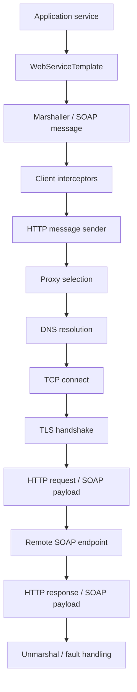
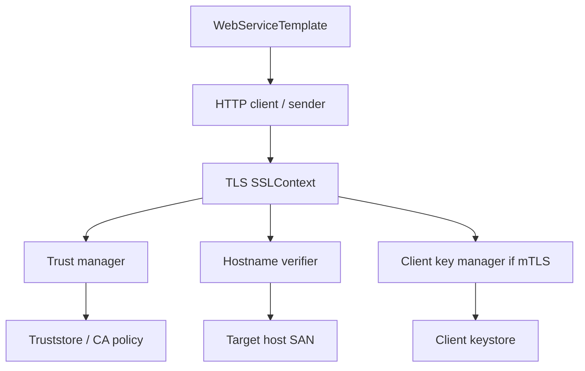
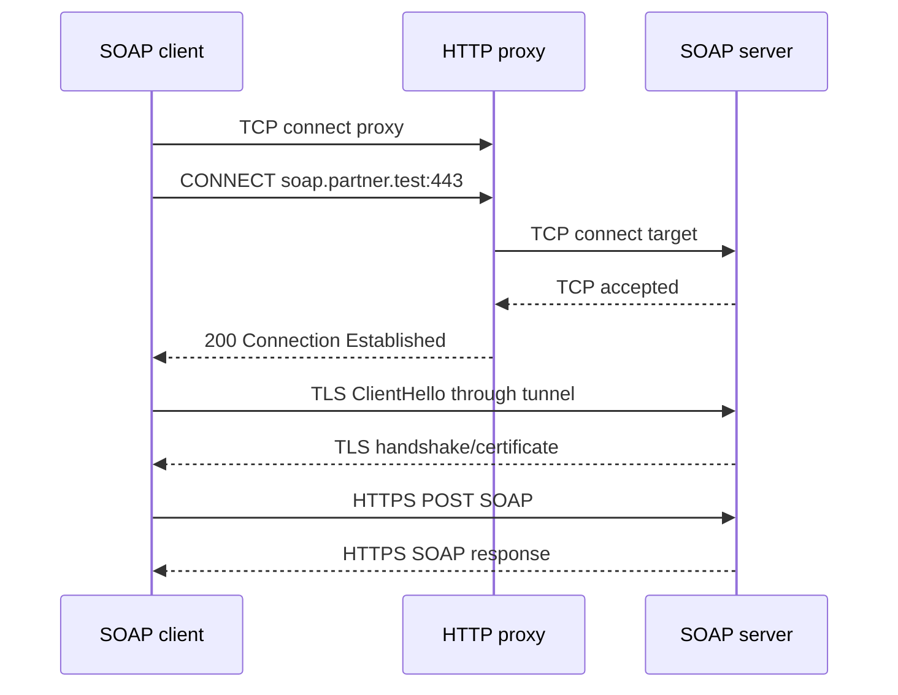

# Những lỗi timeout, TLS, proxy cần kiểm thử thêm qua transport thật

## 1. Bối cảnh: SOAP client chạy tốt trong test nhưng lỗi khi ra mạng thật

Một ứng dụng Spring Web Services gọi hệ thống đối tác bằng `WebServiceTemplate`. Unit test dùng mock response và endpoint test nội bộ đều pass. Khi triển khai staging, request lại thất bại:

- DNS của hostname đối tác chập chờn hoặc trả về IP khác nhau.
- TCP connection không thiết lập được trước deadline.
- Server nhận request nhưng không gửi response đủ nhanh.
- TLS handshake lỗi do trust chain, hostname, SNI hoặc certificate hết hạn.
- Đối tác yêu cầu mutual TLS (mTLS) nhưng client không gửi đúng certificate.
- Proxy enterprise chỉ cho phép CONNECT tới một số host/port hoặc yêu cầu proxy authentication.
- Retry sau timeout tạo đơn hàng trùng vì server đã commit nhưng response bị mất.

Những lỗi này nằm ở **transport path**: DNS, TCP, TLS, proxy, HTTP và thời gian chờ. Test chỉ mock `WebServiceTemplate`, `WebServiceMessageSender` hoặc SOAP response không đi qua đủ các lớp đó nên không thể chứng minh cấu hình mạng đang hoạt động.

Đây là đề mục **“Những lỗi timeout, TLS, proxy cần kiểm thử thêm qua transport thật”**, thuộc chương **Kiểm thử máy khách** của module **SPRING_WEB_SERVICES**. Module phát triển SOAP contract-first với XSD/WSDL, JAXB, endpoint/client, SOAP Fault, interceptor, XML security, WS-Security, chứng chỉ và kiểm thử tương thích.

Sau bài học, bạn có thể:

- Phân biệt connect timeout, read/response timeout, connection-pool wait timeout và overall deadline.
- Thiết kế integration tests cho DNS, TCP, TLS và mTLS.
- Kiểm tra trust chain, hostname, SAN, SNI, certificate expiry và rotation.
- Kiểm tra HTTP proxy, CONNECT tunnel, proxy authentication và bypass rules.
- Xác minh HTTP status, Content-Type, SOAP Fault và transport exception.
- Thiết kế retry có giới hạn với backoff, jitter và idempotency.
- Dựng local test infrastructure có TLS/proxy thật nhưng không phụ thuộc hệ thống đối tác production.
- Chẩn đoán lỗi từ phase, exception, handshake log và correlation ID.

## 2. Mock test và transport integration test chứng minh điều gì?

### 2.1. Các lớp trong một SOAP client call



Một mock ở tầng B hoặc C có thể kiểm tra SOAP payload và mapper, nhưng không đi qua F–I. Mock transport sender có thể giả response HTTP nhưng không chứng minh socket, certificate hay proxy thực hoạt động. Vì vậy test strategy cần nhiều tầng.

### 2.2. Phạm vi test và bằng chứng

| Loại test | Thành phần được kiểm tra | Không thể tự chứng minh |
|---|---|---|
| Unit test mapper | JAXB/domain mapping | HTTP, TLS, DNS |
| Mock SOAP client/server support | Request payload, response mapping | TCP/TLS/proxy |
| Embedded local HTTP server | HTTP method, headers, status, body | TLS nếu server HTTP thuần |
| Local HTTPS integration | TLS handshake, hostname, trust, HTTP | Proxy thực nếu đi thẳng |
| Local proxy integration | CONNECT, routing, proxy auth | Proxy production policy |
| Staging/partner sandbox | Interoperability gần thực tế | Mọi tình huống hiếm và mọi network path |

**Mock vẫn có giá trị cho logic SOAP**, nhưng timeout/TLS/proxy cần test có socket và handshake thật. Hãy chọn test theo bằng chứng cần thu thập thay vì coi một loại test có thể thay thế mọi loại khác.

### 2.3. Test transport không cần gọi hệ thống production

Có thể dựng fixture local:

- HTTP server local nhận request và giữ socket để test read timeout.
- HTTPS server với test CA, server certificate và client certificate.
- Proxy local chỉ cho phép hoặc từ chối CONNECT.
- Test DNS bằng hostname loopback được resolve có kiểm soát hoặc custom resolver.
- Một endpoint delayed/faulting để mô phỏng response chậm, reset connection hoặc HTTP error.

Fixture dùng certificate/test key riêng, không dùng private key production. Mỗi test phải cleanup socket, executor, proxy process và temporary files để tránh flaky suite.

## 3. Timeout: phải kiểm tra từng phase

“Timeout 5 giây” không nhất thiết có nghĩa toàn bộ SOAP call dừng sau 5 giây. Client thường có nhiều timeout riêng.

### 3.1. Connect timeout

Connect timeout giới hạn thời gian thiết lập kết nối TCP tới destination. Có thể hết hạn khi:

- Host không reachable hoặc route bị drop.
- Firewall silently drops SYN.
- Proxy không accept TCP connection.
- DNS đã resolve nhưng IP không thể kết nối.

Kết quả thường là `ConnectTimeoutException`, `SocketTimeoutException` ở phase connect, hoặc exception từ HTTP client cụ thể. Tên exception phụ thuộc transport implementation.

### 3.2. Read/response timeout

Read timeout giới hạn thời gian chờ dữ liệu trên socket sau khi connection đã được thiết lập. Server có thể:

- Nhận request và trì hoãn response.
- Gửi một phần response rồi dừng.
- Giữ connection mở nhưng không có byte mới.
- Xử lý SOAP lâu hơn deadline client.

Một read timeout **không chứng minh server chưa xử lý nghiệp vụ**. Request có thể đã commit ở provider rồi response mới bị chậm/mất.

### 3.3. Connection-pool acquisition timeout

HTTP client có thể dùng connection pool. Khi pool hết connection khả dụng, call đợi một slot trước khi gửi request. Đây là phase khác TCP connect và read:

- Pool acquisition timeout: chờ lấy connection.
- Connect timeout: kết nối socket.
- TLS handshake timeout: chờ hoàn tất negotiation/certificate exchange (có thể chịu ảnh hưởng các timeout socket).
- Read timeout: chờ response data.

Không nhầm pool saturation với đối tác chậm. Quan sát pool leased/available/pending, acquire latency và request concurrency.

### 3.4. Overall deadline

Một operation có thể gồm nhiều lần thử và nhiều phase. Nếu mỗi retry đều có connect/read timeout 5 giây, tổng call có thể vượt 5 giây đáng kể.

Ví dụ:

```text
Overall deadline: 8 s
Attempt 1: connect 1 s + read 3 s
Backoff: 200 ms
Attempt 2: connect 1 s + read còn lại đến deadline
```

Trong ứng dụng có SLA, cần truyền một deadline từ tầng application xuống client/retry policy. Không chỉ cài hai timeout độc lập rồi giả định tổng thời gian đã bị giới hạn.

### 3.5. Timeout matrix

| Phase | Cấu hình thường gặp | Failure cần mô phỏng |
|---|---|---|
| DNS | Resolver/system policy | Host không resolve hoặc resolve chậm |
| Pool wait | Connection request timeout | Pool bị giữ hết slot |
| TCP connect | Connect timeout | Port drop/không accept |
| TLS handshake | Socket/handshake timeout | Peer không hoàn tất handshake |
| HTTP write | Write timeout hoặc deadline | Peer không đọc request |
| HTTP read | Socket/read timeout | Peer không gửi response |
| Overall call | Application deadline | Nhiều phase/retry cộng lại vượt SLA |

Không phải mọi Java HTTP transport có một cấu hình độc lập cho từng dòng. Kiểm tra API của sender/client đang sử dụng và test behavior thực tế của phiên bản dependency.

## 4. Cấu hình timeout cho Spring-WS client

`WebServiceTemplate` dùng `WebServiceMessageSender` để gửi message. Timeout thường được đặt tại transport sender hoặc HTTP client underlying, không phải ở JAXB marshaller.

### 4.1. Lựa chọn transport

Spring-WS có thể dùng các sender khác nhau, ví dụ:

- `HttpUrlConnectionMessageSender`: dựa trên JDK `HttpURLConnection`.
- `HttpComponentsMessageSender`: tích hợp Apache HttpComponents.
- Sender tùy chỉnh: khi cần TLS/proxy/pool policies đặc thù.

Các constructor, setter và version support khác nhau theo Spring-WS/HttpComponents release. **Đừng copy timeout property của HttpComponents 4 sang HttpComponents 5** hoặc ngược lại.

### 4.2. Ví dụ cấu hình sender và template

Đoạn sau minh họa mô hình cấu hình với Apache HttpComponents 4 và Spring-WS version có hỗ trợ constructor/setter tương ứng:

```java
@Bean
HttpComponentsMessageSender ordersMessageSender() {
    HttpComponentsMessageSender sender =
            new HttpComponentsMessageSender();
    sender.setConnectionTimeout(1_000);
    sender.setReadTimeout(3_000);
    return sender;
}

@Bean
WebServiceTemplate ordersWebServiceTemplate(
        Jaxb2Marshaller ordersMarshaller,
        HttpComponentsMessageSender ordersMessageSender) {
    WebServiceTemplate template = new WebServiceTemplate();
    template.setMarshaller(ordersMarshaller);
    template.setUnmarshaller(ordersMarshaller);
    template.setMessageSender(ordersMessageSender);
    template.setDefaultUri("https://partner.example.test/soap/orders");
    return template;
}
```

Đây là cấu hình minh họa; kiểm tra đúng API và lifecycle của Spring-WS/HttpComponents đang khóa. `connectionTimeout` và `readTimeout` là hai giới hạn khác nhau. Nếu dùng pool, cấu hình thêm connection-request/acquisition timeout ở underlying client.

### 4.3. Test phải xác nhận timeout được áp dụng

Một test cấu hình bean nhưng không tạo delayed server không chứng minh timeout hoạt động. Hãy:

1. Dùng local server ghi nhận request đã đến.
2. Cho server giữ response lâu hơn read timeout.
3. Gọi `WebServiceTemplate`.
4. Assert call fail trong khoảng thời gian có giới hạn.
5. Assert server đã nhận request, chứng minh đó là read timeout chứ không phải connect failure.
6. Cleanup server và connection.

Để test connect timeout, fixture cần destination không accept/drop kết nối. Tránh dựa vào một IP ngoài Internet có thể bất ngờ reachable, vì kết quả không ổn định.

## 5. Kiểm thử TLS: trust, hostname và handshake

TLS handshake xác thực server, thương lượng thuật toán/session key và có thể xác thực client nếu server yêu cầu mTLS. Một test SOAP payload pass không chứng minh những việc này thành công.

### 5.1. Phân biệt encryption, trust và hostname verification

Ba điều kiện khác nhau:

1. **Encryption:** dữ liệu đi qua connection được mã hóa.
2. **Trust chain:** certificate server được ký bởi CA mà client tin cậy, hoặc được trust theo policy.
3. **Hostname verification:** tên host client gọi khớp với SAN phù hợp trong certificate server.

Một certificate tự ký có thể mã hóa connection nhưng không được trust. Một certificate có chain tin cậy vẫn có thể không hợp lệ cho hostname đích. Tắt hostname verification để làm test pass sẽ che lỗi cấu hình thật.

### 5.2. Subject Alternative Name (SAN)

Client gọi:

```text
https://soap.partner.example.test/services/orders
```

Certificate cần có SAN DNS tương ứng, ví dụ:

```text
DNS:soap.partner.example.test
```

Modern hostname verification dựa trên SAN. Không thiết kế test chỉ dựa vào Common Name. Negative tests nên dùng certificate hợp lệ về CA nhưng SAN sai host để chứng minh hostname verification thực sự bật.

### 5.3. SNI (Server Name Indication)

Một server có thể phục vụ nhiều certificate/virtual host trên cùng IP. Client gửi hostname qua SNI trong TLS ClientHello để server chọn đúng certificate.

Test SNI:

- Dùng local TLS server/fixture có nhiều virtual hosts nếu stack hỗ trợ.
- Gọi bằng hostname A và hostname B, xác nhận peer trình certificate tương ứng.
- Test trường hợp SNI absent/khác nếu hệ thống phải xử lý các client cũ.
- Ghi nhận hostname/SNI đã dùng mà không ghi private material.

Gọi bằng `127.0.0.1` có thể không gửi SNI như khi gọi DNS hostname; hãy map test hostname tới loopback bằng hosts/custom resolver hoặc dùng transport test support phù hợp.

### 5.4. Truststore và certificate chain

Server chain có thể gồm leaf certificate và intermediate CA; client thường trust root CA trong truststore. Các lỗi thường gặp:

- Thiếu intermediate certificate trên server.
- CA mới chưa được phân phối vào client truststore.
- Certificate hết hạn hoặc chưa tới thời điểm `NotBefore`.
- Truststore dùng nhầm alias/certificate.
- Chain không phù hợp algorithm/policy của runtime.
- Certificate bị revoke nhưng client không có/không bật revocation checking theo policy.

Test cần có positive chain và negative chain. Đừng chỉ thêm leaf certificate vào truststore để “fix” test nếu production policy yêu cầu trust CA; pinning leaf và CA trust là hai mô hình khác nhau.

### 5.5. Cấu hình truststore theo transport

Tùy HTTP client, trust material có thể được gắn qua `SSLContext`, TLS strategy/connection manager hoặc JDK default SSLContext. Nên cấu hình riêng theo client/partner thay vì sửa JVM-wide truststore nếu ứng dụng gọi nhiều đối tác với trust policy khác nhau.

Sơ đồ:



### 5.6. Không tắt kiểm tra TLS trong test

Tránh cấu hình trust-all `X509TrustManager`, `NoopHostnameVerifier` hoặc accept mọi certificate chain. Những cấu hình này chỉ chứng minh server có thể bắt tay khi mọi hàng rào bảo mật đã bị vô hiệu hóa. Test positive nên dùng test CA được trust có chủ đích; negative tests chứng minh certificate sai bị reject.

## 6. Kiểm thử mTLS (mutual TLS)

Trong mTLS, client xác thực server và server cũng yêu cầu/kiểm tra certificate của client. mTLS thường được dùng để xác định workload/partner ở tầng transport, có thể kết hợp với WS-Security để bảo vệ message-level identity/integrity.

### 6.1. Phân biệt client certificate và WS-Security token

| Thành phần | TLS client certificate | WS-Security token/signature |
|---|---|---|
| Layer | TLS handshake | SOAP message |
| Thời điểm | Trước HTTP/SOAP exchange | Sau khi tạo SOAP message |
| Identity | Client/workload/certificate subject | Message signer/username/token |
| Phạm vi | Connection | Message hoặc SOAP parts |
| Qua intermediary | TLS termination có thể kết thúc mTLS | Signature có thể được giữ theo message |
| Rotation | Keystore/cert lifecycle | Token/key/credential policy |

Một client có mTLS không có nghĩa SOAP body đã được ký. Một SOAP message được ký WS-Security cũng không có nghĩa TLS peer được xác thực.

### 6.2. Ma trận test mTLS

| Client credential | Server policy | Kết quả kỳ vọng |
|---|---|---|
| Cert hợp lệ, CA được trust | Yêu cầu mTLS | Handshake thành công |
| Không có client cert | Yêu cầu mTLS | Handshake bị từ chối |
| Cert hết hạn | Yêu cầu mTLS | Handshake bị từ chối |
| Cert ký bởi CA không trust | Yêu cầu mTLS | Handshake bị từ chối |
| Cert hợp lệ nhưng EKU/key usage sai policy | Yêu cầu mTLS | Bị từ chối theo policy |
| Cert hợp lệ, server chỉ yêu cầu TLS thường | Không bắt buộc client cert | Kết nối theo chính sách server |

### 6.3. Ví dụ tạo SSLContext với client key và truststore

Đoạn Java sau minh họa JDK TLS primitives; nó không tự cấu hình Spring-WS sender:

```java
KeyStore trustStore = KeyStore.getInstance("PKCS12");
try (InputStream in = Files.newInputStream(trustStorePath)) {
    trustStore.load(in, trustStorePassword);
}

TrustManagerFactory trustManagers =
        TrustManagerFactory.getInstance(
                TrustManagerFactory.getDefaultAlgorithm());
trustManagers.init(trustStore);

KeyStore clientKeyStore = KeyStore.getInstance("PKCS12");
try (InputStream in = Files.newInputStream(clientKeyStorePath)) {
    clientKeyStore.load(in, clientKeyStorePassword);
}

KeyManagerFactory keyManagers =
        KeyManagerFactory.getInstance(
                KeyManagerFactory.getDefaultAlgorithm());
keyManagers.init(clientKeyStore, clientKeyPassword);

SSLContext sslContext = SSLContext.getInstance("TLS");
sslContext.init(
        keyManagers.getKeyManagers(),
        trustManagers.getTrustManagers(),
        new SecureRandom());
```

Trong ví dụ này:

- Truststore chứa CA/anchor mà client tin.
- Client keystore chứa private key và certificate chain client.
- Key password có thể khác store password.
- Password/key material phải lấy từ secret provider trong production; test dùng fixture riêng.

Phần gắn `SSLContext` vào HTTP client phụ thuộc Apache HttpClient/JDK transport version. Không đặt password thật trong source, logs hoặc command line.

### 6.4. Test alias selection và certificate rotation

Nếu keystore có nhiều key entries, client có thể chọn certificate không đúng partner policy. Test cần xác minh certificate thực tế được server nhận, không chỉ kiểm tra file keystore tồn tại.

Với rotation:

1. Server trust cả CA/certificate cũ và mới trong overlap period.
2. Client chuyển certificate mới.
3. Quan sát handshake và server identity mapping.
4. Xác nhận client cũ không còn dùng sau cutoff.
5. Thu hồi trust cũ theo lịch.

Không xóa trust cũ trước khi mọi instance/partner đã chuyển certificate.

## 7. Certificate negative tests và lỗi handshake

Một suite TLS cần cả positive và negative handshake cases:

- Trust chain không hợp lệ.
- SAN không khớp hostname.
- Expired/not-yet-valid certificate.
- Server yêu cầu mTLS nhưng client không đưa certificate.
- Client đưa certificate không được trust.
- TLS protocol/cipher không giao nhau.
- Certificate rotation với CA cũ/mới.
- SNI trỏ tới virtual host khác.

Handshake failure có thể xảy ra trước khi HTTP request được gửi. Khi đó không có HTTP status hoặc SOAP Fault để assert; test phải bắt transport/TLS exception và xác minh endpoint không nhận SOAP operation.

### 7.1. Dựng local HTTPS fixture

Một local HTTPS server có test certificate cho phép kiểm thử thật mà không gọi đối tác production. Có thể dùng JDK `HttpsServer`, Netty, Jetty hoặc test server phù hợp.

Ví dụ khởi tạo ý tưởng bằng JDK:

```java
HttpsServer server = HttpsServer.create(
        new InetSocketAddress("127.0.0.1", 0), 0);
server.setHttpsConfigurator(new HttpsConfigurator(serverSslContext));
server.createContext("/soap/orders", exchange -> {
    // Đọc request SOAP và ghi lại request count.
    // Trả response SOAP fixture hoặc cố tình delay.
});
server.start();

URI endpoint = URI.create(
        "https://soap.partner.example.test:" + server.getAddress().getPort()
                + "/soap/orders");
```

Đây là skeleton minh họa. Hostname dùng trong URL cần resolve về loopback nhưng vẫn khớp SAN của server certificate. Có thể dùng test hosts entry, custom resolver hoặc test transport routing; nếu gọi trực tiếp IP, hostname verification/SNI sẽ kiểm tra IP SAN thay vì DNS SAN.

### 7.2. Chứng minh certificate sai bị reject

Một test negative nên:

1. Dựng HTTPS server với certificate ký bởi CA test không có trong truststore client.
2. Gửi SOAP request bằng `WebServiceTemplate`.
3. Assert TLS/SSL exception trong cause chain.
4. Assert handler phía server chưa nhận HTTP request (nếu handshake fail trước HTTP).
5. Không nới truststore/hostname verification để biến negative test thành pass giả.

### 7.3. Kiểm tra hostname mismatch riêng

Dùng một CA test đã được trust nhưng phát hành certificate cho hostname khác. Client gọi URL có DNS name không nằm trong SAN; expected là handshake fail vì hostname verification.

Điều này phân biệt:

- Trust failure: chain không được trust.
- Hostname failure: chain có thể trust nhưng identity không khớp.

Hai ca phải có fixture riêng để diagnostics rõ ràng.

## 8. Kiểm thử HTTP proxy và CONNECT tunnel

Ứng dụng enterprise thường truy cập đối tác qua forward proxy. HTTPS thường dùng HTTP CONNECT để yêu cầu proxy tạo tunnel TCP tới host:port đích; TLS handshake sau đó diễn ra giữa client và server qua tunnel (trừ khi có TLS interception).

### 8.1. Các bước của HTTPS qua proxy



Proxy chỉ tạo đường hầm trong trường hợp CONNECT thông thường; nó không đọc SOAP body nếu không có TLS interception. Với TLS interception, client có thể thấy certificate do enterprise proxy CA cấp và cần trust policy riêng được phê duyệt.

### 8.2. Proxy test cases

| Case | Fixture behavior | Expected |
|---|---|---|
| Proxy reachable | Accept TCP, nhận CONNECT | Client tiếp tục TLS |
| Proxy connection refused | Không accept socket | Connect/proxy exception |
| CONNECT denied | Trả 403/405 | Client không gửi SOAP request tới origin |
| Destination denied | Proxy từ chối host/port | Error có destination rõ |
| Proxy auth required | Trả 407 | Client xử lý auth theo policy |
| Proxy credentials valid | Chấp nhận Proxy-Authorization | Tunnel được thiết lập |
| Proxy credentials invalid | Tiếp tục trả 407 | Call fail, không retry vô hạn |
| Bypass host | Client không đi qua proxy | Proxy không nhận CONNECT |

### 8.3. Phân biệt proxy authentication và origin authentication

HTTP 407 Proxy Authentication Required yêu cầu client xác thực với proxy. HTTP 401 Unauthorized đến từ origin service (trong trường hợp proxy tunnel có thể truyền response từ origin). Hai loại credential thuộc hai trust boundary khác nhau:

- Proxy credentials: xác thực người dùng/workload với proxy.
- Origin credentials: HTTP Basic/Bearer hoặc credential khác cho SOAP service.
- TLS client certificate: xác thực client ở TLS handshake khi dùng mTLS.
- WS-Security: bảo vệ/xác thực SOAP message.

Không gửi proxy password thành Authorization của origin hoặc log bất kỳ credential nào.

### 8.4. Proxy selection và bypass rules

Test cần xác nhận đúng proxy được chọn cho từng destination:

- Host/port cần proxy.
- Host nội bộ được bypass.
- Bypass theo domain suffix hoặc exact host.
- Proxy HTTP và HTTPS khác nhau (nếu policy có).
- Proxy fallback/failover khi primary không khả dụng.
- Biến môi trường/JVM proxy properties có ảnh hưởng ngoài dự kiến không.

JDK `ProxySelector`, Apache HttpClient route planner và cấu hình sender riêng có behavior khác nhau. Hãy kiểm tra transport cụ thể, không giả định mọi sender đọc https_proxy hoặc JVM properties giống nhau.

### 8.5. Local recording proxy

Local proxy test nên ghi lại metadata cần thiết:

- CONNECT authority (host:port).
- Proxy-Authorization có/không, không ghi giá trị credential.
- Proxy status và thời gian phản hồi.
- Destination cuối có nhận request SOAP hay không.
- Client có direct-connect bypass hay không.

Proxy fixture không cần giải mã TLS. Có thể dùng một server TLS origin local phía sau proxy để test đường hầm thực tế.

## 9. HTTP response, transport exception và SOAP Fault

Một SOAP operation có thể thất bại ở nhiều lớp. Client test cần phân biệt failure đến từ HTTP transport, SOAP protocol hay business contract.

### 9.1. Các nhóm lỗi

| Tình huống | Tầng | Dấu hiệu thường gặp |
|---|---|---|
| DNS lookup fail | Naming/network | `UnknownHostException` hoặc resolver exception |
| TCP refused/reset | Socket | `ConnectException`, `SocketException` |
| Connect/read timeout | Socket | `SocketTimeoutException` hoặc transport-specific timeout |
| TLS handshake fail | TLS | `SSLHandshakeException`, `SSLPeerUnverifiedException` |
| Proxy auth required | HTTP proxy | HTTP 407 |
| HTTP unauthorized | Origin HTTP | HTTP 401 |
| HTTP forbidden | Origin HTTP | HTTP 403 |
| Unsupported media type | HTTP | HTTP 415 |
| SOAP Fault | SOAP protocol/application | `SoapFaultClientException` hoặc fault resolver |
| XML unmarshal fail | JAXB/XML | `UnmarshallingFailureException`/parser cause |

Tên exception cụ thể tùy sender và HTTP client. Test nên assert nhóm/cause và observable behavior cần thiết, không hard-code toàn bộ message text vốn thay đổi theo JDK/version.

### 9.2. HTTP error không đồng nghĩa SOAP Fault

Server/proxy có thể trả HTTP 502/503/504 cùng HTML/plain text, không phải SOAP Envelope. Khi đó JAXB unmarshaller không nên được giả định luôn nhận SOAP payload. Ngược lại, provider có thể trả SOAP Fault theo binding/status được công bố.

Test cần có:

- HTTP 200 + SOAP response hợp lệ.
- HTTP status có SOAP Fault hợp lệ theo SOAP binding.
- HTTP 401/403/407/429/502/503/504 với body không phải SOAP.
- HTTP 200 nhưng XML malformed hoặc payload QName sai.
- HTTP 200 + SOAP Fault nếu contract/client stack cho phép/đang xử lý dạng response đó.

### 9.3. Phản hồi lỗi từ proxy và origin

HTTP 502/504 từ proxy có thể trông giống gateway error từ API gateway/origin. Log an toàn cần cho biết destination, proxy route và response metadata để phân loại, nhưng không log Authorization headers hoặc SOAP body chứa dữ liệu nhạy cảm.

### 9.4. Test status và content type độc lập

`WebServiceTemplate` chủ yếu trả kết quả SOAP hoặc ném exception qua sender/fault resolver; nếu cần assert chính xác raw HTTP status/header, đặt test ở lớp HTTP integration với transport server/proxy có thể quan sát request/response.

Không thay SOAP endpoint response bằng mock response ở tầng template rồi kết luận Content-Type hoặc HTTP status được xử lý đúng.

### 9.5. Content-Type và SOAP version

Thông thường SOAP 1.1 HTTP binding dùng `text/xml`, SOAP 1.2 dùng `application/soap+xml`; SOAPAction/action parameter cũng phụ thuộc binding. Test cần kiểm tra request thật đi ra transport và response thật đi vào client:

- HTTP method POST đúng endpoint.
- Content-Type phù hợp SOAP version.
- Charset có thể decode XML contract.
- SOAPAction hoặc action parameter đúng theo WSDL.
- Response content type được client chấp nhận.
- HTTP status/fault mapping đúng transport implementation.

Một XML body hợp lệ với SOAP 1.2 có thể vẫn bị peer reject nếu client gửi SOAP 1.1 Content-Type/action.

## 10. Retry, timeout và idempotency

Timeout là tình huống **kết quả nghiệp vụ có thể chưa biết**. Client đã gửi toàn bộ request; provider có thể đã xử lý và commit, nhưng response không về trước deadline. Retry khi đó có thể thực hiện operation lần thứ hai.

### 10.1. Ba trạng thái sau timeout

1. Request chưa tới provider: retry có thể là lần thực hiện đầu tiên.
2. Provider nhận nhưng chưa commit: retry phụ thuộc transaction/operation semantics.
3. Provider đã commit nhưng response thất lạc: retry không có idempotency có thể tạo side effect trùng.

Client thường không thể suy ra trạng thái nghiệp vụ chỉ từ `SocketTimeoutException`.

### 10.2. Chỉ retry lỗi được phép

Một policy có thể cân nhắc retry có giới hạn đối với:

- Một số lỗi connection trước khi request được gửi.
- Read timeout khi operation idempotent và có deduplication.
- HTTP 429/503/504 theo hợp đồng retry và `Retry-After`.
- Proxy tạm thời unavailable nếu lỗi được xác định retryable.

Không tự động retry:

- SOAP Fault nghiệp vụ như validation/not found/conflict.
- HTTP 400/401/403/404 trừ khi có cơ chế refresh credential được thiết kế riêng.
- TLS trust/hostname/certificate failure.
- XML parse/schema/unmarshal failure.
- Các operation tạo side effect không có idempotency guarantee.

### 10.3. Exponential backoff và jitter

Ví dụ lịch retry:

```text
Attempt 1: immediate
Attempt 2: base delay + random jitter
Attempt 3: larger exponential delay + random jitter
Stop: max attempts or overall deadline
```

Backoff giảm tải khi partner đang quá tải; jitter tránh nhiều client retry đồng thời tạo thundering herd. Giới hạn số attempt, tổng deadline và concurrency; không đặt retry vô hạn.

### 10.4. Idempotency key trong SOAP request

Nếu business operation tạo đơn, có thể đưa `clientRequestId`/idempotency key vào contract. Provider cần:

- Scope uniqueness được định nghĩa (partner/tenant/operation).
- Lưu key và kết quả đủ lâu để phủ retry window.
- Cùng key/cùng payload trả lại kết quả tương ứng, không thực thi side effect lần nữa.
- Cùng key/khác payload bị từ chối theo policy.
- Có cách tra cứu/reconcile khi client không biết request đã commit hay chưa.

Một custom SOAP header có thể dùng để truyền correlation/idempotency metadata nếu contract quy định. Header chỉ hữu ích khi provider thực sự enforce semantics; chỉ thêm XML field không tự tạo idempotency.

### 10.5. Test timeout sau commit

Đây là test quan trọng nhất để chứng minh retry an toàn:

1. Server nhận request với idempotency key K.
2. Server ghi side effect một lần.
3. Server giữ response cho tới khi client timeout hoặc chủ động đóng connection.
4. Client retry cùng key K.
5. Server trả lại kết quả đã lưu, không tạo side effect thứ hai.
6. Assert số order/database mutation chỉ bằng một.

Không chỉ assert client cuối cùng nhận response; phải assert business state và count side effects.

### 10.6. Không retry bằng key mới sau timeout

Nếu client tạo idempotency key mới cho mỗi attempt, provider sẽ coi retry là operation mới. Key phải được tạo một lần cho logical operation và giữ nguyên qua toàn bộ attempts.

### 10.7. Retry budget và circuit breaker

Với nhiều client instances, tổng retry có thể làm hệ thống partner quá tải. Có thể kết hợp:

- Retry budget để giới hạn số request retry theo thời gian.
- Circuit breaker để tạm ngừng calls khi failure rate vượt ngưỡng.
- Concurrency limit/bulkhead để giới hạn requests đang chờ.
- Deadline propagation để không gửi request khi caller đã hết thời gian.

Test circuit breaker cần xác minh open/half-open/closed transitions, không chỉ assert một call thất bại.

## 11. Ví dụ integration test cho response timeout

Một local server có thể nhận request rồi cố ý chờ quá read timeout. Điều quan trọng là xác nhận server đã nhận request trước khi client timeout.

### 11.1. Delayed HTTP fixture bằng JDK HttpServer

```java
AtomicInteger requestCount = new AtomicInteger();
CountDownLatch requestReceived = new CountDownLatch(1);

HttpServer server = HttpServer.create(
        new InetSocketAddress("127.0.0.1", 0), 0);
server.createContext("/soap/orders", exchange -> {
    requestCount.incrementAndGet();
    requestReceived.countDown();
    try {
        Thread.sleep(1_500);
        byte[] response = soapResponse.getBytes(StandardCharsets.UTF_8);
        exchange.getResponseHeaders().set(
                "Content-Type", "text/xml; charset=utf-8");
        exchange.sendResponseHeaders(200, response.length);
        exchange.getResponseBody().write(response);
    } catch (InterruptedException ex) {
        Thread.currentThread().interrupt();
    } finally {
        exchange.close();
    }
});
server.start();
```

Test có thể gọi client đã cấu hình read timeout ngắn hơn 1.500 ms:

```java
try {
    assertThrows(WebServiceIOException.class,
            () -> ordersWebServiceTemplate.marshalSendAndReceive(
                    endpointUrl, request));
    assertTrue(requestReceived.await(1, TimeUnit.SECONDS));
    assertEquals(1, requestCount.get());
} finally {
    server.stop(0);
}
```

Đây là skeleton minh họa; exception cuối cùng có thể là transport-specific subclass/wrapper. Nên assert root cause/phase, không khóa bài test vào một exception message. Dùng executor có lifecycle rõ, đảm bảo server được stop trong `@AfterEach` hoặc try/finally và không để thread tồn tại sau test.

### 11.2. Phân biệt read timeout với connect timeout

Trong delayed server trên, latch `requestReceived` xác nhận HTTP request đã tới server, nên lỗi phát sinh sau connect. Với connect timeout test:

- Dùng local fixture đóng port hoặc firewall/network namespace kiểm soát.
- Với refused connection, expected thường là connection refused nhanh, không phải timeout.
- Để kiểm tra timeout thật, cần route/fixture drop packet hoặc TCP server accept rất chậm theo cách có thể tái lập.
- Không dùng một địa chỉ Internet ngẫu nhiên làm endpoint timeout test.

### 11.3. Kiểm tra overall deadline khi retry

Fake clock/timer cho unit test retry policy giúp kiểm tra phép tính backoff. Transport integration test nên dùng timeout ngắn có biên độ đủ rộng, đo elapsed time và xác nhận:

- Tổng thời gian không vượt deadline cộng tolerance hợp lý.
- Không bắt đầu attempt tiếp theo nếu deadline đã hết.
- Mỗi attempt dùng cùng logical request ID/idempotency key.
- Cancellation dừng retry và giải phóng connection.

Không dùng sleep dài trong suite. Delayed fixture nên được điều khiển bằng latch/barrier và delay vừa đủ cho timeout cần kiểm tra.

## 12. Ma trận transport integration test

Một ma trận gọn có thể bao phủ những rủi ro quan trọng nhất:

| Nhóm | Positive case | Negative case | Bằng chứng |
|---|---|---|---|
| DNS | Hostname test resolve đúng | Unknown host | Request tới đúng server hoặc resolver fail |
| TCP | Server nhận connection | Refused/reset/drop | Connect behavior/exception |
| Connect timeout | Connect trước deadline | Route không hoàn thành trước deadline | Elapsed time bounded |
| Read timeout | Response nhanh | Server nhận request nhưng delay | Request count + timeout |
| Pool | Pool có slot | Pool bị giữ hết connection | Pending/acquire timeout |
| TLS trust | CA test được trust | CA lạ/chain thiếu | Handshake result |
| Hostname | SAN khớp | SAN mismatch | Hostname verification result |
| SNI | Virtual host đúng | SNI sai/absent | Server chọn certificate |
| mTLS | Client cert hợp lệ | Missing/expired/untrusted cert | Server handshake identity |
| Rotation | Cert cũ/mới trong overlap | Trust cũ đã hết hạn | Kết quả theo giai đoạn |
| Proxy | CONNECT thành công | 403/407/refused | Proxy log + origin request count |
| Bypass | Direct route đúng | Bypass rule sai | Proxy không/được sử dụng như mong đợi |
| HTTP | 200 SOAP hợp lệ | 401/403/429/502/503/504 | Status/header/error mapping |
| Retry | Tạm lỗi rồi thành công | Hết attempts/deadline | Attempt count/backoff |
| Idempotency | Cùng key sau timeout | Same key/different payload | Side effect chỉ một lần hoặc reject |

Không nhất thiết chạy toàn bộ ma trận trên mỗi pull request. Chia test:

- **PR suite:** deterministic local HTTP/TLS, XPath/contract, timeout ngắn, proxy giả lập đơn giản.
- **Nightly suite:** pool saturation, mTLS rotation, proxy authentication/failover, retry/circuit breaker concurrency.
- **Staging suite:** partner sandbox, corporate proxy route, production-like CA chain và network policy.

## 13. Tổ chức test TLS/proxy fixtures

Ví dụ cấu trúc:

```text
src/test/
  java/
    .../transport/
      SoapReadTimeoutIT.java
      SoapConnectTimeoutIT.java
      SoapTlsTrustIT.java
      SoapMtlsIT.java
      SoapProxyConnectIT.java
      SoapRetryIdempotencyIT.java
  resources/
    tls/
      test-root-ca.p12
      server-valid-san.p12
      server-wrong-san.p12
      client-valid.p12
      client-expired.p12
      untrusted-root.p12
```

Các file `.p12` là test fixtures được tạo riêng, chỉ chứa test key/certificate, không chứa credential production. Không commit private key production hoặc password thật. Nếu pipeline có thể sinh key pair khi test setup, ưu tiên ephemeral material theo run và cleanup.

### 13.1. Quản lý certificate fixture

- Dùng SAN rõ cho hostname trong test.
- Ghi nhận ngày hết hạn và algorithm/key size của fixture.
- Test expired cert cần fixture có validity đã qua một cách deterministic; không phụ thuộc chờ thời gian thực.
- Không đặt test certificate vào truststore default của JVM.
- Mỗi test chỉ trust CA cần thiết để tránh vô tình trust-all.
- Tự động kiểm tra fixture sắp hết hạn để tránh suite đột nhiên fail theo lịch.

### 13.2. Fixture proxy phải xác định

Local proxy nên điều khiển được:

- Status của CONNECT.
- Delay trước response proxy.
- Auth challenge 407.
- Allowed/denied target host.
- Connection close/reset.
- Recording request count và CONNECT authority.

Reset trạng thái fixture giữa test để một test không làm ảnh hưởng test kế tiếp.

## 14. Chẩn đoán timeout, TLS và proxy

| Triệu chứng | Khả năng | Kiểm tra tiếp |
|---|---|---|
| UnknownHostException | DNS/search domain/resolver | Hostname, DNS config, split-horizon |
| ConnectException: refused | Port không listen hoặc firewall REJECT | Destination/port, proxy endpoint |
| Connect timeout | SYN/route bị drop | Network ACL, route, proxy reachability |
| Read timeout sau khi server nhận request | Xử lý chậm hoặc response bị drop | Server trace, downstream latency, commit status |
| Pool timeout | Connection pool hết slot/leak | Leased/available/pending, connection release |
| PKIX path building failed | CA/intermediate không trust | Certificate chain và truststore thực tế |
| No subject alternative DNS name | SAN không match host | URL hostname, certificate SAN |
| SSLHandshakeException | Protocol/cipher/cert/client auth | TLS debug an toàn, peer alert |
| Server báo no client certificate | mTLS key manager/alias | Keystore, key entry, key password |
| TLS fail chỉ qua proxy | CONNECT route/TLS interception | Proxy CA, CONNECT status, SNI |
| HTTP 407 | Proxy authentication | Proxy credentials/scheme/policy |
| HTTP 401 | Origin authentication | Authorization của SOAP service |
| HTTP 502/504 | Proxy/gateway/upstream error | Response headers, proxy route, correlation |
| SOAP Fault thay vì HTTP exception | Peer đã parse SOAP và trả protocol fault | Fault QName/detail và HTTP binding |
| Request chạy hai lần sau timeout | Retry không idempotent | Key stability, provider deduplication, commit timing |
| Lỗi chỉ ở CI | Clock, CA fixture, proxy env, parallel tests | Clock, system properties, port collisions, cleanup |

### 14.1. Thu thập evidence mà không lộ secrets

Nên ghi:

- Hostname/destination port và proxy route (không ghi proxy password).
- Phase thất bại, elapsed time và timeout setting.
- Exception class/cause chain đã loại bỏ thông tin nhạy cảm.
- TLS protocol/cipher và certificate fingerprint/issuer theo policy.
- HTTP status, response Content-Type và correlation ID.
- Attempt number và idempotency key đã hash/mask nếu có dữ liệu nhạy cảm.

Không ghi:

- Private key, keystore password hoặc truststore password.
- Authorization/Proxy-Authorization raw value.
- Full SOAP body chứa PII, token hoặc thông tin thanh toán.
- Session key hoặc TLS secrets.

### 14.2. TLS debug chỉ dùng có kiểm soát

JVM TLS debug có thể cung cấp thông tin handshake hữu ích nhưng log rất lớn và có thể chứa metadata nhạy cảm. Bật trong một test/process cô lập, thu thập ngắn hạn và bảo vệ artifact. Không bật toàn cục ở production chỉ để chẩn đoán một request.

## 15. Checklist release cho SOAP client transport

### Timeout và retry

- [ ] Connect/read/pool timeout được cấu hình theo SLA.
- [ ] Overall deadline bao gồm mọi attempts và backoff.
- [ ] Read timeout được test sau khi request thực sự tới server.
- [ ] Retry giới hạn attempt, backoff/jitter và retryable conditions.
- [ ] Side-effect operation có idempotency/reconciliation strategy.
- [ ] Cancellation giải phóng connection và dừng retry.

### TLS và mTLS

- [ ] Truststore chứa CA/chain đúng policy.
- [ ] Hostname/SAN verification vẫn bật.
- [ ] SNI được test nếu server dùng virtual hosts.
- [ ] mTLS dùng đúng client cert/alias/key usage.
- [ ] Positive/negative handshake cases có fixture độc lập.
- [ ] Certificate rotation có overlap/cutoff/rollback plan.
- [ ] Không có trust-all/hostname verifier tắt trong configuration.

### Proxy và HTTP

- [ ] Proxy route và bypass rules đã được xác minh.
- [ ] CONNECT status và proxy authentication đã được test.
- [ ] Proxy credentials tách biệt origin credentials.
- [ ] HTTP 401/403/407/429/502/503/504 được xử lý đúng.
- [ ] SOAP Content-Type/action đúng SOAP binding.
- [ ] Logs không chứa credential hoặc SOAP payload nhạy cảm.

### CI và vận hành

- [ ] Local TLS/proxy fixtures không cần Internet hoặc hệ thống production.
- [ ] Test cleanup server/socket/thread/certificate temp files.
- [ ] Test song song không tranh port hoặc dùng chung mutable SSL properties.
- [ ] Test clock/expiry deterministic.
- [ ] Nightly/staging suite bao phủ network policy thực tế.
- [ ] Metrics phân biệt DNS/connect/TLS/proxy/read/fault/retry phases.

## 16. Bài tập thực hành

### Bài tập 1 — Read timeout

Dựng local HTTP server nhận SOAP request, ghi request count rồi delay response dài hơn read timeout. Xác nhận client fail, server đã nhận đúng một request và test không nhầm với connect timeout.

### Bài tập 2 — Connect timeout và refused connection

Tạo một server dừng lắng nghe để nhận connection refused. So sánh với một fixture network drop có thể tái lập. Ghi lại exception và elapsed time; giải thích vì sao hai tình huống khác nhau.

### Bài tập 3 — Pool acquisition timeout

Tạo pool tối đa một connection và giữ connection đầu tiên chưa release. Gọi request thứ hai, kiểm tra acquisition timeout và xác nhận metric pending/leased đúng.

### Bài tập 4 — Trust chain

Dựng HTTPS local với certificate do test CA ký. Chạy hai lần: client trust CA và client không trust CA. Chứng minh chỉ cấu hình đầu thành công.

### Bài tập 5 — Hostname/SAN

Dùng CA đã trust nhưng certificate SAN cho hostname khác. Gọi bằng hostname không khớp và xác nhận hostname verification fail. Không dùng `NoopHostnameVerifier`.

### Bài tập 6 — mTLS

Dựng server yêu cầu client certificate. Test cert hợp lệ, thiếu cert và cert từ CA không trust. Đếm request HTTP ở server để phân biệt handshake failure với HTTP authorization failure.

### Bài tập 7 — SNI và rotation

Dựng hai virtual hosts có certificate khác nhau. Kiểm tra client gửi SNI đúng; mô phỏng giai đoạn trust cả cert cũ/mới rồi chuyển client sang cert mới.

### Bài tập 8 — Proxy CONNECT

Dựng proxy local ghi lại CONNECT authority. Test thành công, bị trả 403, bị trả 407 và proxy connection refused. Đảm bảo không log credential.

### Bài tập 9 — Proxy bypass

Cấu hình host A phải đi qua proxy và host B bypass. Kiểm tra proxy recording count và origin server request count để xác định route thực tế.

### Bài tập 10 — HTTP error và SOAP Fault

Tạo endpoint trả HTTP 503 với body plain text, HTTP 401, và SOAP Fault có typed detail. Xác minh client phân loại đúng transport exception và `SoapFaultClientException`.

### Bài tập 11 — Retry với idempotency

Provider lưu order theo idempotency key, nhưng cố ý delay response sau commit để client timeout. Cho client retry cùng key; xác minh có một order và response lần sau trả kết quả đã lưu.

### Bài tập 12 — Overall deadline

Thiết lập hai attempts và backoff. Kiểm tra không attempt mới khi deadline hết, tổng elapsed time nằm trong tolerance và retry key không đổi.

### Bài tập 13 — CI transport suite

Tổ chức PR/nightly/staging test groups. Chạy parallel test và chứng minh không có port collision, certificate fixture race hoặc leaked executor. Ghi lại phase timings mà không log SOAP secrets.

## 17. Tổng kết

**Timeout, TLS và proxy là thuộc tính của đường truyền, vì vậy cần kiểm thử bằng transport có socket và handshake thực.** Mock SOAP payload vẫn cần cho unit/contract tests, nhưng không chứng minh DNS, TCP, certificate, hostname verification, mTLS, proxy CONNECT hay connection pool hoạt động đúng.

Một client ổn định phân biệt connect, read, pool và overall deadline; xác minh trust chain, SAN, SNI và client certificate; kiểm tra proxy route/bypass/authentication; phân loại HTTP error, SOAP Fault và XML failure. Timeout sau khi gửi request tạo ra trạng thái nghiệp vụ không chắc chắn, nên retry phải có giới hạn, deadline, backoff/jitter và idempotency key ổn định.

Trong Spring-WS, cấu hình timeout/TLS/proxy phụ thuộc `WebServiceMessageSender` và HTTP client cụ thể. Khóa phiên bản transport, dựng local HTTPS/proxy fixtures, dùng certificate test riêng, chạy positive/negative cases và xác minh side effects. Khi release, phải có metrics phân biệt phase, không log secrets và có kế hoạch certificate rotation. Cách tiếp cận đó giúp SOAP client được kiểm chứng ở cả tầng message lẫn transport, gần với điều kiện tích hợp doanh nghiệp thực tế.
