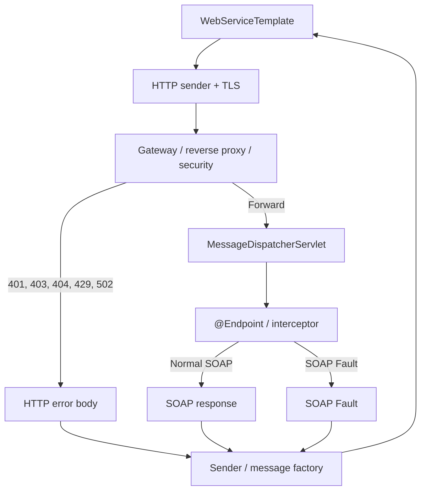

# Kiểm tra HTTP status, SOAP Fault và phản hồi không phải XML

## Mục tiêu học tập

Trong module **SPRING_WEB_SERVICES**, SOAP client phải xử lý response thành công lẫn lỗi từ HTTP transport, gateway và SOAP server. Bài học này hướng dẫn kiểm thử tích hợp qua HTTP để phân biệt SOAP Fault hợp lệ, HTTP error không chứa SOAP Envelope và response có bytes nhưng không thể đọc hoặc parse. Trọng tâm là WebServiceTemplate, HTTP WebServiceMessageSender, embedded test server và cách ứng dụng phân loại lỗi.

Sau bài học, bạn có thể phân biệt HTTP status với SOAP Fault; dùng embedded HTTP server để trả status/header/body tùy ý; kiểm thử SOAP 1.1/1.2; mô phỏng body HTML/JSON/plain text/empty/malformed; kiểm tra sender và FaultMessageResolver; xác minh retry/idempotency; và chọn đúng tầng kiểm thử.

## 1. Các dạng response mà SOAP client có thể nhận

| HTTP status | Content-Type | Body | Ý nghĩa |
| --- | --- | --- | --- |
| 200 | text/xml | SOAP 1.1 response | Normal SOAP response. |
| 500 | text/xml | SOAP 1.1 Fault | Có thể là Fault hợp lệ. |
| 200/500 tùy binding | application/soap+xml | SOAP 1.2 Fault | Fault theo SOAP 1.2. |
| 401 | application/json/text/html | Auth error | Gateway/Security từ chối. |
| 403 | text/plain/empty | Access denied | Không đủ quyền. |
| 404/405/415 | text/html/plain/json | Route/method/media lỗi | Sai endpoint hoặc binding. |
| 429 | application/json | Rate limit | Quota/rate policy. |
| 502/503/504 | html/empty | Gateway/upstream failure | Có thể chưa nhận response SOAP. |
| 200 | text/html | Login page | Redirect/auth integration sai. |
| 200 | thiếu Content-Type | XML/bytes tùy ý | Sender/factory có thể reject. |

HTTP 200 không đảm bảo body là SOAP. HTTP 500 cũng không đảm bảo body là SOAP Fault. Client phải xét status, Content-Type, khả năng tạo SOAP message và nội dung Body.

## 2. Ba lớp lỗi



- **HTTP/edge:** Gateway, proxy, servlet filter, auth, routing, rate limit.
- **SOAP:** MessageDispatcherServlet, endpoint, interceptor, JAXB và Fault.
- **Client:** HTTP sender, message factory, FaultMessageResolver, application wrapper.

HTTP 401 thường được tạo trước SOAP dispatcher nên không có SOAP Fault. SOAP validation Fault được tạo trong SOAP pipeline. Body malformed có thể thất bại khi message factory parse.

## 3. SOAP Fault khác HTTP error

SOAP Fault là cấu trúc nằm trong SOAP Body, có code/reason/detail. SOAP 1.1 sử dụng Client/Server và faultstring; SOAP 1.2 dùng Sender/Receiver với Code/Reason/Subcode. HTTP 401/403/404/415/429 là status của HTTP layer; body có thể không phải XML.

Không suy luận chỉ từ status. HTTP 500 có thể đi cùng SOAP Fault, HTML proxy page, plain text hoặc empty body. Một số HTTP sender xử lý status trước khi chuyển body cho SOAP message factory; sender khác có thể cho Fault resolver đọc. Behavior cần được kiểm chứng với sender thực của ứng dụng.

## 4. MockWebServiceServer và HTTP integration khác nhau

| Công cụ | Kiểm tra | Giới hạn |
| --- | --- | --- |
| MockWebServiceServer | SOAP request, payload, SOAP response/Fault, JAXB client path. | Không socket, TLS, proxy hoặc raw HTTP error đầy đủ. |
| Mock WebServiceConnection | I/O/status/body theo stub. | Không chứng minh behavior HTTP sender thật. |
| Embedded HTTP server | Status, headers, bytes và sender thật qua HTTP. | Không thay gateway production/partner topology. |
| Staging/partner test | TLS/mTLS, proxy, WSS4J, binding và interoperability. | Không thay load/resilience test. |

Dùng MockWebServiceServer cho message-level tests. Dùng embedded HTTP server để xác minh cách sender HTTP thật đọc status, headers và bytes. Dùng staging/partner test cho certificates, gateway và network topology.

## 5. Embedded HTTP server cho client test

Có thể dùng MockWebServer của OkHttp làm HTTP server loopback. Kết hợp nó với WebServiceMessageSender thật mà ứng dụng sử dụng, ví dụ sender dựa trên JDK hoặc Apache HttpComponents phù hợp BOM.

Ví dụ dependency test:

```groovy
dependencies {
    testImplementation("com.squareup.okhttp3:mockwebserver:4.12.0")
    testImplementation("org.springframework.ws:spring-ws-test")
    testImplementation("org.springframework.boot:spring-boot-starter-test")
}
```

Chọn version theo dependency policy/BOM. Đây là ví dụ dependency, không phải bảo đảm version này tương thích mọi project.

Tạo test server:

```java
MockWebServer server = new MockWebServer();
server.start();
String endpoint = server.url("/ws/orders").toString();

try {
    // Tạo template dùng sender HTTP thật và gọi endpoint.
} finally {
    server.shutdown();
}
```

Dùng JUnit lifecycle hoặc try/finally để đóng server, tránh giữ socket/port giữa tests.

## 6. WebServiceTemplate dùng sender thật

```java
SaajSoapMessageFactory factory = new SaajSoapMessageFactory();
factory.setSoapVersion(SoapVersion.SOAP_11);

WebServiceTemplate template = new WebServiceTemplate(factory);
template.setMarshaller(jaxbMarshaller);
template.setUnmarshaller(jaxbMarshaller);
template.setMessageSender(realHttpSender);
template.setDefaultUri(endpoint);
```

Đây là skeleton: marshaller phải cấu hình JAXB classes/context từ XSD; sender là HTTP implementation production/test mong muốn; timeout và TLS được cấu hình rõ. Không hard-code production URL hay credentials.

Với SOAP 1.2, dùng SoapVersion.SOAP_12, binding tương ứng và kiểm tra application/soap+xml. Không chỉ thay XML Envelope trong fixture mà bỏ qua HTTP media type.

## 7. Normal SOAP response qua HTTP

Fixture SOAP 1.1:

```xml
<soap:Envelope
 xmlns:soap="http://schemas.xmlsoap.org/soap/envelope/"
 xmlns:ord="urn:example:orders:v1">
 <soap:Body>
  <ord:GetOrderResponse>
   <ord:orderId>ORD-42</ord:orderId>
   <ord:status>ACCEPTED</ord:status>
  </ord:GetOrderResponse>
 </soap:Body>
</soap:Envelope>
```

Enqueue response:

```java
server.enqueue(new MockResponse()
    .setResponseCode(200)
    .addHeader("Content-Type", "text/xml; charset=utf-8")
    .setBody(soapResponseXml));

GetOrderResponse response =
    (GetOrderResponse) template.marshalSendAndReceive(
        endpoint, new GetOrderRequest("ORD-42"));

assertEquals("ORD-42", response.getOrderId());

RecordedRequest request = server.takeRequest();
assertEquals("POST", request.getMethod());
assertEquals("/ws/orders", request.getPath());
```

Code giả định JAXB types và marshaller có sẵn. Kiểm tra thêm request Content-Type, SOAPAction và payload bytes. HTTP 2xx không đủ nếu body rỗng hoặc không parse được.

## 8. HTTP 500 cùng SOAP Fault

SOAP 1.1 Fault fixture:

```xml
<soap:Envelope
 xmlns:soap="http://schemas.xmlsoap.org/soap/envelope/"
 xmlns:ord="urn:example:orders:faults:v1">
 <soap:Body>
  <soap:Fault>
   <faultcode>soap:Client</faultcode>
   <faultstring>Invalid order identifier</faultstring>
   <detail>
    <ord:OrderFault>
     <ord:code>ORDER_ID_INVALID</ord:code>
    </ord:OrderFault>
   </detail>
  </soap:Fault>
 </soap:Body>
</soap:Envelope>
```

```java
server.enqueue(new MockResponse()
    .setResponseCode(500)
    .addHeader("Content-Type", "text/xml; charset=utf-8")
    .setBody(clientFaultXml));

SoapFaultClientException fault = assertThrows(
    SoapFaultClientException.class,
    () -> template.marshalSendAndReceive(endpoint, request));

assertNotNull(fault.getFaultCode());
```

Đây là behavior cần kiểm tra, không phải bảo đảm mọi HTTP sender đều parse Fault trong HTTP 500. Sender có thể ném transport exception trước Fault resolver. Nếu vậy, kiểm tra implementation/version và xác định behavior được ứng dụng hỗ trợ; không sửa expected một cách mù quáng.

Nếu Fault được parse, xác minh Fault code/detail QName qua API hoặc custom resolver. Không dựa duy nhất vào English reason nếu detail code là phần ổn định của contract.

## 9. HTTP 500 không có SOAP XML

Proxy có thể trả HTML:

```http
HTTP/1.1 500 Internal Server Error
Content-Type: text/html; charset=utf-8

<html><body><h1>Upstream unavailable</h1></body></html>
```

Test phải đảm bảo:
- HTML không được unmarshal thành business DTO.
- Lỗi không bị map thành OrderNotFound hoặc business Fault giả.
- Diagnostic giữ status/content type/correlation.
- Không log HTML body thô nếu có internal trace.
- Retry chỉ theo policy status/error category.

## 10. HTTP 401/403 từ gateway hoặc security filter

Ví dụ:

```http
HTTP/1.1 401 Unauthorized
Content-Type: application/json

{"error":"unauthorized","message":"Bearer token required"}
```

```http
HTTP/1.1 403 Forbidden
Content-Type: text/plain

access denied
```

Đây không phải SOAP Fault. Client wrapper phải phân biệt authentication với authorization, bảo toàn status/cause nếu sender cung cấp và không map thành validation Fault.

Nếu filter từ chối trước MessageDispatcherServlet, endpoint không được gọi. Server-side HTTP integration test có thể xác minh service invocation count bằng zero. Client-side test xác minh application exception mapping cho 401/403.

## 11. HTTP 404/405/415

| Status | Nguyên nhân | Cách kiểm tra |
| --- | --- | --- |
| 404 | Context path, servlet mapping, proxy route hoặc endpoint sai. | WSDL soap:address và effective URL. |
| 405 | Method sai. | HTTP binding thường POST cho SOAP operation. |
| 415 | SOAP media type không phù hợp. | SOAP 1.1 text/xml; SOAP 1.2 application/soap+xml. |

Không retry các lỗi cấu hình này. Kiểm tra external prefix, context path và gateway rewrite.

## 12. HTTP 429/502/503/504

- 429: đọc Retry-After và tuân thủ quota.
- 502: gateway không nhận upstream response hợp lệ.
- 503: service unavailable/maintenance.
- 504: gateway timeout; upstream có thể đã xử lý request nhưng response đến trễ.

Dùng retry budget, exponential backoff, jitter và deadline. Với write operation, status 502/504 không chứng minh transaction chưa commit. Cần idempotency key, status lookup hoặc reconciliation.

## 13. Redirect và login page

Một HTTP sender có thể follow redirect tùy cấu hình. Với machine-to-machine SOAP, redirect tới login page HTML không nên bị coi là thành công. Test 301/302, 307/308, login redirect, redirect loop và cross-origin redirect. Không forward Authorization/certificate identity sang host khác tùy tiện. Cấu hình canonical HTTPS endpoint và fail rõ khi redirect ngoài policy.

## 14. Content-Type và charset

SOAP 1.1 HTTP binding thường dùng text/xml; SOAP 1.2 dùng application/soap+xml. Test:
- text/html hoặc application/json thay SOAP.
- text/xml nhưng body HTML/malformed.
- SOAP content type nhưng XML không có SOAP Envelope.
- Content-Type thiếu hoặc charset không khớp bytes.
- SOAP 1.1 media type gửi tới SOAP 1.2 client và ngược lại.

Không fallback thử JSON/HTML/XML đến khi một parser thành công nếu contract không định nghĩa. Content-Type là tín hiệu; bytes vẫn phải thỏa grammar của SOAP.

## 15. Empty body, truncated XML và malformed XML

```java
server.enqueue(new MockResponse()
    .setResponseCode(200)
    .addHeader("Content-Type", "text/xml; charset=utf-8")
    .setBody(""));

server.enqueue(new MockResponse()
    .setResponseCode(200)
    .addHeader("Content-Type", "text/xml; charset=utf-8")
    .setBody("<soap:Envelope"));

server.enqueue(new MockResponse()
    .setResponseCode(200)
    .addHeader("Content-Type", "text/xml; charset=utf-8")
    .setBody("""
        <soap:Envelope
          xmlns:soap="http://schemas.xmlsoap.org/soap/envelope/">
          <soap:Body><ord:Response></soap:Body>
        </soap:Envelope>
        """));
```

Các case: empty body, truncated Envelope, XML sai nesting, well-formed XML không phải SOAP, SOAP Envelope thiếu Body và Fault detail malformed. Exception chính xác phụ thuộc SAAJ/Axiom/parser; assert exception category/cause theo message factory thực, không khóa test vào parser message text.

## 16. FaultMessageResolver

WebServiceTemplate dùng FaultMessageResolver để xử lý Fault sau khi response tạo thành SOAP message. Default SoapFaultMessageResolver thường ném SoapFaultClientException. Có thể cấu hình rõ:

```java
template.setFaultMessageResolver(new SoapFaultMessageResolver());
```

Custom resolver cần kiểm tra SOAP 1.1/1.2 code, Fault detail QName/code, version v1/v2 và redaction. Không nuốt Fault rồi trả null/empty result.

Nếu sender ném WebServiceTransportException trước khi body được chuyển thành SOAP message, Fault resolver không thể xử lý body mà nó chưa nhận. Đặt logic HTTP status ở transport/application layer tương ứng.

## 17. Status/body handling phụ thuộc sender

JDK sender, Apache HttpComponents sender và sender tự viết có thể khác nhau về:
- Đọc body với status 4xx/5xx.
- Ném transport exception trước khi parse SOAP Fault.
- Expose status/headers/cause.
- Follow redirects.
- Buffer body.
- Connect/read timeout.

Không giả định WebServiceTemplate có một callback chung cho mọi HTTP status trên mọi sender. Nếu application cần raw status/body, xây sender/connection adapter rõ ràng hoặc test HTTP response trực tiếp song song. Dùng đúng sender deploy thực tế.

## 18. Kiểm tra outbound request và HTTP response

Embedded server cho phép kiểm tra method/path/request headers/body:

```java
RecordedRequest request = server.takeRequest();
assertEquals("POST", request.getMethod());
assertEquals("/ws/orders", request.getPath());
assertTrue(request.getHeader("Content-Type").contains("text/xml"));
assertNotNull(request.getBody().readUtf8());
```

Điều này xác nhận request mà client gửi tới mock HTTP server. Để assert raw status từ phía application, wrapper cần expose error metadata hoặc test HTTP exchange trực tiếp; đừng suy status chính xác từ exception class nếu sender không giữ status.

## 19. Test application wrapper

Ví dụ phân loại lỗi:

```java
public OrderResult getOrder(String orderId) {
    try {
        return (OrderResult) template.marshalSendAndReceive(
            endpoint, new GetOrderRequest(orderId));
    } catch (SoapFaultClientException ex) {
        throw faultTranslator.translate(ex);
    } catch (WebServiceTransportException ex) {
        throw transportTranslator.translate(ex);
    } catch (WebServiceMessageException ex) {
        throw new InvalidUpstreamMessageException(ex);
    }
}
```

Đây là minh họa. Kiểm tra hierarchy exception theo version để catch order đúng; bổ sung I/O và UnknownContentTypeException theo behavior thực. Không bắt mọi RuntimeException thành upstream failure vì sẽ che programming defects.

## 20. Retry và idempotency

| Lỗi | Hướng xử lý |
| --- | --- |
| 400/401/403/404/405/415 | Không tự retry; sửa request/credential/route/binding. |
| SOAP Client/Sender Fault | Không retry nguyên trạng. |
| SOAP business Fault | Theo code; thường không retry. |
| 429 | Retry-After/quota/budget. |
| 502/503/504 | Có thể retry read-only với backoff. |
| Connect timeout trước send | Retry có giới hạn. |
| Read timeout sau write | Outcome chưa rõ; idempotency/reconciliation. |
| Malformed response | Không retry mù; điều tra upstream/parser. |
| TLS validation fail | Không retry; sửa trust/certificate. |

Với SubmitOrder, server có thể commit trước khi response mất. Sử dụng idempotency key/business request ID, status lookup hoặc reconciliation trước retry để tránh tạo giao dịch trùng.

## 21. Security và log an toàn

HTTP error body có thể chứa internal host, stack trace, customer data hoặc proxy details. Header có thể chứa Authorization, cookies và identity metadata. Log tối thiểu status, Content-Type, endpoint alias, correlation ID và exception category. Redact token, cookies, certificates, WS-Security headers và PII. Không dump raw SOAP request/response ở production. Nếu cần diagnostic snippet, giới hạn byte, allowlist content type và áp redaction.

Test bằng sentinel secret giả trong body/header rồi xác minh public exception/log không phát tán sentinel. Không dùng production secret trong fixture.

## 22. SOAP 1.1/1.2 compatibility

| Tiêu chí | SOAP 1.1 | SOAP 1.2 |
| --- | --- | --- |
| Envelope namespace | http://schemas.xmlsoap.org/soap/envelope/ | http://www.w3.org/2003/05/soap-envelope |
| HTTP media type | text/xml | application/soap+xml |
| Action | SOAPAction theo binding | action parameter/binding |
| Fault format | faultcode/faultstring/detail | Code/Reason/Subcode/Detail |

Test riêng message factory, WSDL binding, media type và Fault structure. Không chỉ đổi namespace trong XML fixture mà giữ nguyên transport setup.

## 23. Ma trận HTTP/SOAP integration test

| ID | Response | Kỳ vọng |
| --- | --- | --- |
| H01 | 200 + SOAP normal response | Unmarshal thành công. |
| H02 | 500 + SOAP Client Fault | Fault resolver/domain translation. |
| H03 | 500 + SOAP Server Fault | Category/retry policy. |
| H04 | SOAP 1.2 Sender Fault | Code/Reason/Subcode đúng. |
| H05 | SOAP 1.2 Receiver Fault | Server category đúng. |
| H06 | 200 + HTML | Không coi là SOAP success. |
| H07 | 500 + HTML | Non-SOAP upstream error. |
| H08 | 500 + JSON | Không JAXB unmarshal. |
| H09 | 401 + JSON | Authentication failure. |
| H10 | 403 + text | Authorization failure. |
| H11 | 404 + HTML | Route/context error. |
| H12 | 405 | Method mismatch. |
| H13 | 415 | Binding/media type mismatch. |
| H14 | 429 + Retry-After | Quota-aware retry. |
| H15 | 503 + empty body | Upstream unavailable. |
| H16 | 504 after POST | Outcome uncertain/idempotency. |
| H17 | Redirect to login | Reject HTML login page. |
| H18 | 200 + empty body | Message unavailable. |
| H19 | Truncated XML | Parser error. |
| H20 | Malformed SOAP | SOAP parse failure. |
| H21 | SOAP Content-Type + HTML bytes | Parser rejects. |
| H22 | Missing Content-Type | Defined sender/factory behavior. |
| H23 | Wrong charset | Decode/parser error. |
| H24 | Oversized body | Size limit. |
| H25 | Connection reset | I/O failure and cleanup. |
| H26 | Read timeout after write | No blind retry. |
| H27 | Fault detail malformed | No false business mapping. |
| H28 | Sensitive data in body | Redaction. |

## 24. Bài tập và đáp án

1. **HTTP 500 luôn là SOAP Fault?** Không; có thể là HTML, JSON, text hoặc empty.
2. **HTTP 200 luôn là SOAP?** Không; có thể là login page hoặc JSON.
3. **401 từ Security filter?** HTTP authentication error, thường trước SOAP dispatcher.
4. **SOAP Client Fault có đồng nghĩa HTTP 400?** Không; Fault là nội dung SOAP, status là HTTP semantics.
5. **MockWebServiceServer chứng minh TLS?** Không; cần sender thật và HTTP/TLS integration.
6. **500 Fault không parse?** Kiểm tra sender có reject status trước khi đọc body.
7. **500 HTML?** Non-SOAP upstream error, không map thành business Fault.
8. **415 SOAP 1.2?** Kiểm tra application/soap+xml, WSDL binding và message factory.
9. **504 sau SubmitOrder?** Outcome chưa rõ; idempotency/status lookup.
10. **429?** Tuân thủ Retry-After và quota.
11. **302 tới login?** Không coi final HTML 200 là SOAP success.
12. **Malformed XML exception cụ thể?** Tùy message factory/parser; assert category/cause.
13. **Thiếu Content-Type?** Xác định sender/factory behavior qua integration.
14. **Fault detail có PII?** Redact khỏi logs/public exceptions.
15. **Log toàn raw body?** Không ở production.
16. **Cần assert raw status?** Dùng embedded server và kiểm tra response/error metadata có thể quan sát.
17. **HTTP 401 và SOAP Fault khác?** Khác boundary: HTTP authentication vs SOAP Body Fault.
18. **Một test 200 là đủ?** Không; cần negative, Fault, transport và non-XML cases.

## 25. Troubleshooting

| Triệu chứng | Nguyên nhân | Điều tra |
| --- | --- | --- |
| HTTP 500 luôn thành transport exception | Sender xử lý status trước Fault. | Sender implementation và body handling. |
| Local parse Fault, staging không | Gateway/sender khác hoặc Fault body bị thay. | Status, headers, Content-Type trong staging. |
| HTTP 200 nhưng unmarshal fail | HTML/JSON/malformed/wrong namespace. | Body và media type. |
| 401 dù token hợp lệ | Token không forward, issuer/audience hoặc gateway policy. | Auth path, scopes và header redaction. |
| 403 sau SOAP POST | Authority/CSRF/route policy. | Request có vào SOAP servlet? |
| 404 | Context path/servlet mapping/proxy rewrite. | WSDL address và effective URL. |
| 415 | SOAP version/media type mismatch. | WSDL binding/message factory. |
| Fault resolver không chạy | Sender reject status/content type trước parsing. | FaultResolver call path. |
| HTML login trả 200 | Redirect auto-follow. | Redirect policy/final URL. |
| Retry tạo duplicate order | Timeout sau commit. | Idempotency/reconciliation. |
| Error logs lộ nội bộ | Raw body/header logging. | Redaction/bounded diagnostics. |

## 26. Checklist trước production

- [ ] Dùng đúng HTTP sender production.
- [ ] Test SOAP 1.1/1.2 factory, binding và media type.
- [ ] Test HTTP 2xx normal SOAP.
- [ ] Test HTTP 500 SOAP Fault và Fault resolver.
- [ ] Test HTTP 500 HTML/JSON/text/empty body.
- [ ] Test 401/403 auth paths.
- [ ] Test 404/405/415 route/method/media mismatch.
- [ ] Test 429/502/503/504 và Retry-After.
- [ ] Test redirects/login page/cross-origin policy.
- [ ] Test Content-Type thiếu/sai và charset.
- [ ] Test empty/truncated/malformed/oversized body.
- [ ] Test timeout/reset và cleanup.
- [ ] Test idempotency khi response mất sau write commit.
- [ ] Test Fault code/detail theo contract.
- [ ] Error translator không nuốt Fault/transport exceptions.
- [ ] HTML/JSON không map thành business DTO.
- [ ] Log correlation/status/type, không log secrets/raw body.
- [ ] Có HTTP integration và partner/staging tests.
- [ ] Không coi MockWebServiceServer là bằng chứng TLS/gateway.
- [ ] Có retry budget, deadline, circuit breaker và alerting.

## 27. Tài liệu tham khảo chính thức

1. [Spring Web Services 4.1.4 Reference — Client-side testing](https://docs.spring.io/spring-ws/docs/4.1.4/reference/html/#client-side-testing) — MockWebServiceServer và client tests.
2. [WebServiceTemplate API](https://docs.spring.io/spring-ws/docs/4.1.4/api/org/springframework/ws/client/core/WebServiceTemplate.html) — sender, message factory, response/fault handling.
3. [WebServiceMessageSender API](https://docs.spring.io/spring-ws/docs/4.1.4/api/org/springframework/ws/transport/WebServiceMessageSender.html) — sender contract.
4. [WebServiceConnection API](https://docs.spring.io/spring-ws/docs/4.1.4/api/org/springframework/ws/WebServiceConnection.html) — lifecycle/status.
5. [SoapFaultMessageResolver API](https://docs.spring.io/spring-ws/docs/4.1.4/api/org/springframework/ws/soap/client/SoapFaultMessageResolver.html) — Fault handling.
6. [SoapFaultClientException API](https://docs.spring.io/spring-ws/docs/4.1.4/api/org/springframework/ws/soap/client/SoapFaultClientException.html) — Fault accessors.
7. [OkHttp MockWebServer](https://square.github.io/okhttp/5.x/mockwebserver/) — embedded HTTP server for test; use docs matching dependency version.
8. [W3C SOAP 1.1](https://www.w3.org/TR/SOAP/) — Envelope/Fault.
9. [W3C SOAP 1.2](https://www.w3.org/TR/soap12-part1/) — Code/Reason/Subcode.
10. [RFC 9110](https://www.rfc-editor.org/rfc/rfc9110.html) — HTTP status and semantics.
11. [OWASP Error Handling Cheat Sheet](https://cheatsheetseries.owasp.org/cheatsheets/Error_Handling_Cheat_Sheet.html) — safe error handling.
12. [OWASP Logging Cheat Sheet](https://cheatsheetseries.owasp.org/cheatsheets/Logging_Cheat_Sheet.html) — redaction and safe logging.
13. [Apache WSS4J Documentation](https://ws.apache.org/wss4j/) — message security verification, distinct from HTTP status handling.

**Phạm vi ví dụ:** Hướng tới Spring-WS 4.1.4, Java 17+ và JUnit 5; MockWebServer chỉ là ví dụ embedded HTTP server. Snippets cần dependency, JAXB classes, sender và timeout settings phù hợp BOM thật. STEP 4 không chạy Maven/Gradle/JUnit và không xác nhận runtime behavior của sender. Kiểm tra implementation đang triển khai trước khi kết luận cách status/error body được wrap.

## Tổng kết

**HTTP status, SOAP Fault và response không phải XML là các dạng kết quả khác nhau.** SOAP Fault chỉ có khi client nhận và parse được SOAP message chứa Fault. HTTP 401/403 thường do gateway/security chặn trước SOAP dispatcher; HTTP 500 có thể chứa Fault hoặc HTML/JSON/plain text; body rỗng, malformed hoặc sai Content-Type có thể thất bại ở sender/message factory. Cách xử lý phụ thuộc HTTP sender, SOAP version và FaultMessageResolver thực tế.

Dùng MockWebServiceServer cho message contract, nhưng dùng embedded HTTP server cùng sender thật để xác minh status, headers và bytes. Kiểm tra cả success lẫn failure, phân loại exception đúng layer, giới hạn retry, bảo vệ idempotency cho write operation và redact dữ liệu nhạy cảm. Nhờ vậy SOAP client phản ứng đúng với lỗi từ SOAP application, gateway, proxy và mạng trong môi trường tích hợp doanh nghiệp.

