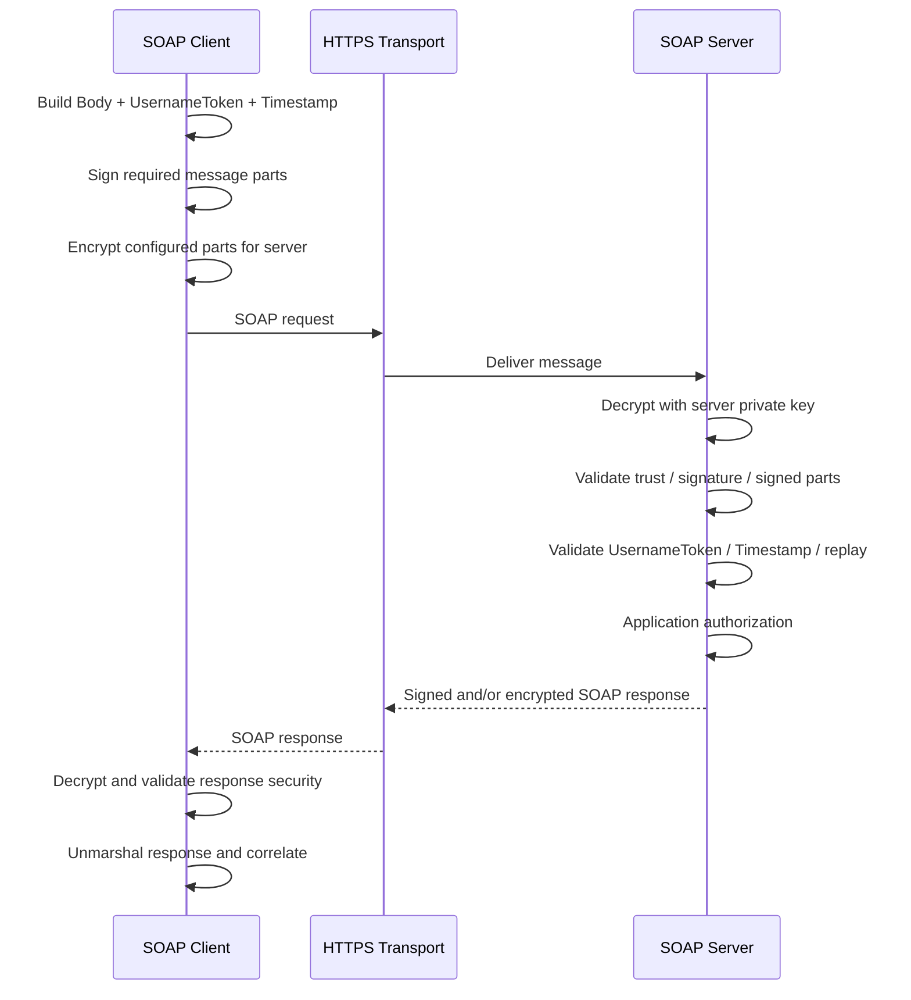

# Kiểm chứng chữ ký, mã hóa, UsernameToken và timestamp giữa hai phía

Một SOAP message có thể đi qua HTTPS nhưng vẫn cần WS-Security để bảo vệ ở tầng message. XML Signature xác minh tính toàn vẹn của các phần được ký và danh tính signer theo trust policy; XML Encryption bảo vệ nội dung khỏi người không có khóa giải mã; UsernameToken mang thông tin xác thực theo profile; Timestamp giới hạn thời gian message được chấp nhận. Tuy nhiên, cấu hình chạy được ở client chưa chứng minh server xác minh đúng, và server cấu hình đúng cũng chưa chứng minh client hiểu response. **Kiểm thử tích hợp phải kiểm tra cả hai phía trên cùng một hợp đồng bảo mật và message thực tế được truyền đi.**

Bài thuộc chương **Kiểm thử tích hợp** của module **SPRING_WEB_SERVICES**. Module học SOAP contract-first, XSD/WSDL, JAXB, endpoint và SOAP client, SOAP Fault, interceptor, XML security, WS-Security, certificates và kiểm thử tương thích doanh nghiệp. Bài đi sâu vào cách chứng minh client/server thống nhất về chữ ký, mã hóa, UsernameToken, Timestamp, truststore, thuật toán và replay policy.

Ví dụ sử dụng Java 17+, Spring-WS, WSS4J và JUnit 5. Setter/property cụ thể phụ thuộc phiên bản Spring-WS/WSS4J; cần đối chiếu dependency thực tế. Certificate/key trong bài là test fixture, không phải vật liệu production.

## 1. Mục tiêu bảo mật của hai phía



Đây là một profile minh họa. Thứ tự ký/mã hóa thực tế phụ thuộc WS-Security policy/profile và cấu hình hai bên. Không mặc định mọi hệ thống phải ký rồi mã hóa theo cùng một thứ tự. Phải xác định message parts, transforms, references và processing order đã thỏa thuận.

Các câu hỏi cốt lõi:

1. Client tạo đúng UsernameToken, Timestamp và security headers?
2. Server giải mã được phần mã hóa bằng private key đúng?
3. Server xác minh chữ ký bằng trust policy đúng và kiểm **chính Body/Header mà ứng dụng tiêu thụ**?
4. UsernameToken được xác minh theo PasswordType/profile và account policy?
5. Timestamp được kiểm validity window, clock skew và replay?
6. Response server ký/mã hóa đúng và client xác minh độc lập?
7. Khi một lớp bảo mật sai, request có bị từ chối trước business side effect?

## 2. Phân vai khóa và trust

| Bên | Tác vụ | Vật liệu khóa thường dùng |
| --- | --- | --- |
| Client ký request | Chứng minh message được ký bởi client signer | Private signing key client |
| Server xác minh request | Xác minh signature và trust signer | Client public certificate/CA trust |
| Client mã hóa request cho server | Chỉ server dự kiến giải mã được | Server public certificate |
| Server giải mã request | Khôi phục nội dung | Server private decryption key |
| Server ký response | Chứng minh response từ server tin cậy | Private signing key server |
| Client xác minh response | Kiểm signer server | Server public certificate/CA trust |
| Server mã hóa response cho client | Chỉ client dự kiến giải mã | Client public certificate |
| Client giải mã response | Khôi phục nội dung | Client private decryption key |

Signing key và encryption key có thể là key pair/certificate riêng để tách trách nhiệm, rotation và KeyUsage. Không giả định một certificate dùng được cho mọi action; phải kiểm KeyUsage, EKU, CA policy và yêu cầu đối tác.

### 2.1. Keystore và truststore

- **Keystore** giữ private key cùng certificate chain mà một phía sở hữu để ký hoặc giải mã.
- **Truststore** giữ trust anchors/certificates dùng để xác minh peer theo policy.
- Certificate gửi trong BinarySecurityToken hoặc KeyInfo là dữ liệu của message; sự hiện diện của nó **không tự biến certificate thành trust anchor**.
- Trust có thể qua PKIX chain validation, pinning hoặc partner certificate registry; cần ghi rõ phương thức.

Fixture có thể tổ chức riêng:

```text
src/test/resources/ws-security/
  client-signing-test.p12
  client-decryption-test.p12
  server-signing-test.p12
  server-decryption-test.p12
  server-trust-client-test.jks
  client-trust-server-test.jks
```

Tên trên chỉ minh họa. Private key chỉ dùng cho test, không tái sử dụng production và không ghi password thật vào log.

## 3. Viết rõ security policy trước khi test

| Thành phần | Ví dụ yêu cầu cần thống nhất |
| --- | --- |
| SOAP version | SOAP 1.1 hoặc SOAP 1.2 |
| WS-Security profile | Namespace/profile/version tương thích |
| UsernameToken | PasswordDigest, Created/Nonce required |
| Timestamp | Created + Expires, lifetime tối đa |
| Signature | Ký SOAP Body và Header bắt buộc |
| Encryption | Encrypt Body hoặc sensitive elements |
| Signature algorithm | Bộ thuật toán hai stack hỗ trợ |
| Digest algorithm | Bộ digest được cho phép |
| Key transport | RSA-OAEP hoặc lựa chọn policy |
| Symmetric encryption | AES theo policy |
| Certificate trust | Chain/issuer/partner mapping |
| Replay | Nonce cache và/hoặc MessageID cache |
| Clock skew | Chênh lệch đồng hồ cho phép |
| Response security | Response phải ký/mã hóa thế nào |

Đây là template, không phải giá trị mặc định cho mọi hệ thống. Giá trị cụ thể phải đến từ hợp đồng với đối tác, WS-SecurityPolicy hoặc security profile được hai bên phê duyệt. Không hạ algorithm để test pass.

## 4. WSS4J ở server và client

Spring-WS tích hợp WSS4J qua Wss4jSecurityInterceptor để xử lý WS-Security ở SOAP message layer. Inbound thường validate; outbound tạo token/signature/encryption. Client và server có vai trò đảo ngược nhau.

### 4.1. Server xác minh request

```java
@Bean
Wss4jSecurityInterceptor inboundSecurity(
        Crypto clientTrustCrypto,
        CallbackHandler passwordVerifier) {
    Wss4jSecurityInterceptor interceptor =
            new Wss4jSecurityInterceptor();
    interceptor.setValidationActions(
            "UsernameToken Timestamp Signature");
    interceptor.setValidationSignatureCrypto(clientTrustCrypto);
    interceptor.setValidationCallbackHandler(passwordVerifier);
    return interceptor;
}
```

Đây là cấu hình khung. Tên setter và action string cần xác minh theo phiên bản Spring-WS/WSS4J dự án dùng. UsernameToken callback/validator phải kiểm password theo profile, không chỉ kiểm sự hiện diện của element. Signature validation cần trust, required signed parts, algorithm policy và replay/time checks; chỉ khai báo validation actions **chưa chứng minh mọi phần tử quan trọng đều đã được ký**.

### 4.2. Client tạo request security

Outbound client profile cần định nghĩa:

- Action list và processing order.
- Signature user/alias và Crypto dùng private key ký.
- Encryption recipient/alias trỏ tới certificate của server.
- Encryption Crypto cung cấp certificate recipient.
- Password callback cung cấp password keystore/private key hoặc UsernameToken secret theo action.
- Timestamp lifetime, nonce, algorithm và signature parts.

Không dùng một callback/password map không phân biệt partner nếu nó có thể trả secret của nhiều đối tác. Chọn profile immutable theo peer đã được xác minh.

### 4.3. Ma trận hai phía

| Phía | Outbound | Inbound |
| --- | --- | --- |
| Client | UsernameToken, Timestamp, ký request, encrypt cho server | Decrypt response, verify server signature/timestamp |
| Server | Ký response, encrypt cho client | Decrypt request, verify client signature/UsernameToken/Timestamp |

Server outbound cần private signing key server và public encryption certificate client. Client inbound cần trust server certificate và private decryption key client. Lỗi thường gặp là đảo certificate recipient hoặc dùng nhầm key của bên gửi để encrypt.

## 5. XML Signature: kiểm chính xác parts được ký

Một XML Signature đúng toán học chưa chứng minh application xử lý đúng nội dung được ký. Policy phải quy định Body, Action, To, MessageID, ReplyTo, custom business Header và Timestamp nào bắt buộc ký.

Ví dụ:

```text
Signed:
  SOAP Body: GetOrderRequest(orderId=ORD-1001)
  ctx:RequestedTenant = TENANT-A
  wsu:Timestamp

Not signed:
  ctx:RequestedRole = ADMIN
```

Nếu application dùng RequestedTenant để chọn data scope, Header ấy phải được integrity-protected theo policy. Ngay cả khi đã ký, server vẫn kiểm partner có quyền tenant đó; chữ ký không cấp quyền nghiệp vụ.

### 5.1. Negative test: Body không được ký

Tạo fixture có signer certificate hợp lệ, nhưng signature chỉ bảo vệ Timestamp hoặc Header không đủ theo policy. Kỳ vọng:

- Security validation từ chối vì thiếu required signed part.
- Endpoint/application service không được gọi.
- Không có repository write/callback side effect.
- Fault/log không lộ certificate secret hoặc raw SOAP message.

Test này có giá trị hơn chỉ assert message có ds:Signature.

### 5.2. XML Signature Wrapping

Tạo negative fixtures cho duplicate wsu:Id, Body/Header trùng QName ở vị trí khác, signed element bị bọc trong cấu trúc không dự kiến, local name giống nhưng namespace khác. Kỳ vọng reject ambiguity và bảo đảm **node được xử lý chính là node đã được xác minh**, không chỉ so chuỗi ID/local name.

## 6. XML Encryption và kiểm tra recipient

Test cần xác minh:

1. Body hoặc sensitive element bắt buộc có EncryptedData/EncryptedKey theo policy.
2. Encryption recipient đúng public certificate của peer.
3. Chỉ peer có private decryption key tương ứng giải mã được.
4. Peer khác hoặc certificate sai không giải mã được.
5. Sau decrypt, XML khôi phục đúng QName/namespace/value.
6. Không còn plaintext copy của sensitive element ngoài vùng được phép.
7. Signature/encryption order và reference coverage đúng policy.

### 6.1. Encryption không xác thực sender

Nếu client encrypt Body cho server bằng public certificate server, bất kỳ ai có public key đều có thể tạo ciphertext gửi server. **Encryption cho recipient không xác minh identity sender.** Cần signature và/hoặc token authentication theo policy. Chữ ký cũng không giữ bí mật nội dung; payload nhạy cảm có thể cần encryption và TLS.

### 6.2. Round-trip hai phía

Integration test phải dùng client WSS4J thật gọi server WSS4J thật trong test context. Server xử lý message sau decrypt/unmarshal; sau đó server tạo response security và client validate/decrypt. Không dùng một helper giải mã phía client để tuyên bố server sẽ giải mã giống hệt; hai cấu hình cần được kiểm độc lập.

## 7. UsernameToken: password type, nonce và verifier

Hai chế độ thường gặp:

- **PasswordText:** Password được biểu diễn trong token. Chỉ dùng nếu policy cho phép và có bảo vệ phù hợp; không log/lưu token thô.
- **PasswordDigest:** Digest được tính từ nonce, created và password theo profile. Password không được gửi trực tiếp trong trường Password; digest không thay TLS hoặc replay prevention.

Server cần xác minh username tồn tại, account được phép dùng operation, PasswordType khớp policy, Nonce/Created đúng format và freshness, password verifier phù hợp, token chưa bị replay và account chưa bị disabled/expired.

Một lưu ý triển khai: xác minh PasswordDigest cần server có cách tính expected digest từ secret phù hợp. Password hash one-way thông thường không phải lúc nào cũng đủ để tái tính digest theo profile. Thiết kế credential storage và UsernameToken validation phải tính tới điều đó.

### 7.1. Ma trận UsernameToken

| Trường hợp | Kỳ vọng |
| --- | --- |
| Username + PasswordDigest đúng, nonce mới | Accept nếu authorization cho phép |
| Password sai | Reject |
| Unknown username | Reject, không tiết lộ account enumeration |
| PasswordText khi policy chỉ Digest | Reject |
| Digest khi policy chỉ Text | Reject |
| Thiếu Nonce/Created khi required | Reject |
| Nonce trùng trong replay window | Reject |
| Created quá cũ | Reject |
| Created ở tương lai ngoài skew | Reject |
| Account disabled/expired | Reject |
| Token malformed/duplicate | Reject |

### 7.2. Password callback

WSS4J có thể dùng CallbackHandler để cung cấp/kiểm password hoặc keystore secret tùy action/profile. Test bằng secret giả lập và xác minh callback được gọi với đúng identifier/action. Không log password; tránh callback mặc định trả một password giống nhau cho mọi username nếu production có nhiều principal.

## 8. Timestamp, clock skew và freshness

WS-Security Timestamp thường chứa Created và Expires. Server so sánh thời gian message với clock hiện tại theo lifetime/skew policy. Clock lệch có thể làm message hợp lệ bị reject; cửa sổ quá rộng tăng cơ hội replay.

Policy phải xác định Timestamp bắt buộc không, lifetime tối đa, skew, Created/Expires, Timestamp có phải được ký, replay key/cache và hành vi khi đồng hồ mất đồng bộ.

### 8.1. Inject Clock cho domain freshness policy

```java
import java.time.Clock;
import java.time.Duration;
import java.time.Instant;

public final class TimestampPolicy {
    private final Clock clock;
    private final Duration allowedSkew;
    private final Duration maxLifetime;

    public TimestampPolicy(
            Clock clock, Duration allowedSkew, Duration maxLifetime) {
        this.clock = clock;
        this.allowedSkew = allowedSkew;
        this.maxLifetime = maxLifetime;
    }

    public boolean accepts(Instant created, Instant expires) {
        Instant now = clock.instant();
        if (created == null || expires == null || !expires.isAfter(created)) {
            return false;
        }
        if (created.isAfter(now.plus(allowedSkew))) return false;
        if (expires.isBefore(now.minus(allowedSkew))) return false;
        return Duration.between(created, expires)
                .compareTo(maxLifetime) <= 0;
    }
}
```

Đây là domain policy minh họa, **không thay WSS4J Timestamp validator**. Khi WSS4J tự validate Timestamp, cấu hình TTL/skew ở security engine và test bằng harness/fixture phù hợp. Tránh hai Timestamp policies không đồng bộ; nếu có thêm business freshness check, phải quy định rõ trách nhiệm.

### 8.2. Timestamp test matrix

| Fixture | Kết quả |
| --- | --- |
| Created gần hiện tại, Expires trong lifetime | Accept |
| Created quá cũ | Reject |
| Expires đã qua | Reject |
| Created tương lai ngoài skew | Reject |
| Expires trước Created | Reject |
| Lifetime vượt giới hạn | Reject |
| Đúng boundary skew | Hành vi inclusive/exclusive được đặc tả |
| Thiếu Created/Expires khi required | Reject |
| Timestamp/nonce đã dùng | Replay reject |

Kiểm boundary ở skew-epsilon, đúng ngưỡng và skew+epsilon để tránh lỗi off-by-one.

## 9. Chống replay: Timestamp một mình chưa đủ

Message có signature hợp lệ và Timestamp còn hạn vẫn có thể được gửi lại trong cửa sổ hiệu lực. Anti-replay có thể dùng UsernameToken Nonce + Created + identity, WS-A MessageID + partner identity, token identifier hoặc business idempotency key cho operation có side effect.

Replay store phải dùng chung giữa các instance nếu chạy cluster, TTL phù hợp, concurrency atomic và không phụ thuộc memory riêng node.

Khi duplicate bị phát hiện, security replay policy có thể reject. Business retry với idempotency contract có thể trả acknowledgement mà không lặp side effect. Hai semantics khác nhau: cùng nonce/token bị phát lại phải theo replay policy; request retry có MessageID mới nhưng cùng business idempotency key có thể hợp lệ theo hợp đồng.

## 10. Certificate chain, rotation và trust

| Certificate case | Kỳ vọng |
| --- | --- |
| Trusted signer, đúng usage, còn hạn | Accept |
| Self-signed/untrusted CA | Reject nếu không được trust |
| Certificate hết hạn/chưa hiệu lực | Reject |
| Chain sai/thiếu intermediate | Reject theo PKIX policy |
| Identity không map partner | Reject/unknown principal |
| KeyUsage/EKU không phù hợp | Reject |
| Certificate revoked | Reject nếu revocation checking được yêu cầu và trạng thái có thể xác minh |
| Certificate mới trong overlap rotation | Accept theo rollout policy |
| Certificate cũ sau overlap | Reject |
| Response signer khác server đã đăng ký | Client reject |

Không chỉ assert Subject CN. Mapping identity nên dựa issuer + serial/fingerprint hoặc registry key rõ ràng, tùy PKI design; Subject có thể không duy nhất. Client và server có thể deploy certificate mới ở thời điểm khác nhau nên rotation là integration concern.

### 10.1. Kiểm tra hai chiều riêng

1. Server trust client signer; reject signer lạ.
2. Client trust server signer; reject response ký bởi certificate lạ.
3. Client encrypt cho server; server giải mã.
4. Server encrypt cho client; client giải mã.
5. Rotation overlap được chấp nhận đúng policy.

Tách fixture/truststore hai phía để phát hiện đảo key hoặc trust nhầm.

## 11. Integration test hai phía

Mục tiêu là dùng **client outbound security thật**, gọi **server inbound security thật**, rồi nhận response qua **client inbound validation thật**.

```mermaid
flowchart LR
    T["JUnit integration test"] --> C["Client WebServiceTemplate"]
    C --> CO["Client outbound WSS4J"]
    CO -->|"SOAP over HTTP"| S["Embedded SOAP server"]
    S --> SI["Server inbound WSS4J"]
    SI --> E["@Endpoint + application service"]
    E --> SO["Server outbound WSS4J"]
    SO -->|"SOAP response"| CI["Client inbound WSS4J"]
    CI --> R["Verified JAXB response"]
```



Test kiểm security pipeline trong test environment, không tự chứng minh CA, gateway hoặc partner production.

### 11.1. Happy path

- Client gửi UsernameToken PasswordDigest đúng profile.
- Timestamp có Created/Expires trong window.
- Client ký Body và Header policy yêu cầu.
- Client mã hóa đúng parts cho certificate server.
- Server decrypt và validate trust/signature/UsernameToken/Timestamp.
- Endpoint nhận payload sau security processing.
- Server ký/mã hóa response cho client.
- Client decrypt và verify server signer.
- JAXB response và business result đúng.

Chỉ assert HTTP 200 chưa đủ; HTTP response có thể chứa SOAP Fault.

### 11.2. Test skeleton với embedded application

```java
@SpringBootTest(
        webEnvironment = SpringBootTest.WebEnvironment.RANDOM_PORT)
class WsSecurityRoundTripIntegrationTest {
    @LocalServerPort
    int port;

    @Autowired
    SecureOrderSoapClient client;

    @Test
    void exchangesSecuredUsernameTokenMessage() {
        GetOrderResponse response = client.getOrder("ORD-1001");
        assertEquals("ORD-1001", response.getOrderId());
        assertEquals("PAID", response.getStatus());
    }
}
```

Đây là skeleton. SecureOrderSoapClient phải dùng WebServiceTemplate có outbound WSS4J; endpoint URL phải trỏ embedded server; test profile phải đăng ký inbound/outbound interceptors với test keystores/truststores. Đảm bảo URL random port thực sự được sử dụng.

### 11.3. Không thay security interceptor bằng no-op

Một test profile có thể thay external IdP hoặc secret provider, nhưng test round-trip phải dùng WSS4J thật và test certificate. Nếu @Profile("test") thay WSS4J bằng no-op interceptor, test đó không chứng minh WS-Security interoperability.

## 12. Negative integration tests

| Lỗi request client | Server mong đợi | Business side effect |
| --- | --- | --- |
| Signature bị sửa sau ký | Reject signature | Không gọi service |
| Signer cert không trusted | Reject trust | Không gọi service |
| Body chưa ký khi policy yêu cầu | Reject signed-parts | Không gọi service |
| Header quan trọng chưa ký | Reject integrity | Không gọi service |
| Encrypted key dành cho cert khác | Decrypt failure/reject | Không gọi service |
| Username/password sai | Reject UsernameToken | Không gọi service |
| PasswordText trong policy chỉ Digest | Reject | Không gọi service |
| Nonce trùng | Reject replay | Không lặp side effect |
| Timestamp expired | Reject | Không gọi service |
| Timestamp quá tương lai | Reject | Không gọi service |
| Lifetime quá dài | Reject | Không gọi service |
| Duplicate wsu:Id/wrapped element | Reject ambiguity | Không gọi service |
| Action mismatch | Reject/dispatch error | Không gọi operation khác |
| Response signer không trusted | Client reject | Không mark success |
| Response Body bị sửa | Client signature reject | Không trả data |
| Response encrypt cho recipient khác | Client decrypt fail | Không trả plaintext |

Mỗi test kiểm cả Fault/protocol result và **không có side effect**. Reject sau khi business đã ghi dữ liệu vẫn là lỗi bảo mật.

## 13. Kiểm response security phía client

Client cũng là security boundary:

- Server response phải ký khi policy yêu cầu.
- Signer certificate phải được trust và map đúng server.
- Response Body/Header nằm trong signed parts.
- Timestamp response được kiểm freshness.
- EncryptedData giải mã bằng client private key.
- Action/RelatesTo khớp request.
- Client reject response thiếu security header khi policy required.

Negative fixtures: unsigned response, signer lạ, Body bị sửa, signature chỉ ký Timestamp, response expired, encrypted sai recipient, RelatesTo mismatch, duplicate Header/XML Signature Wrapping. Không fallback parse plaintext khi security validation fail; phải fail closed.

## 14. SOAP version và interoperability

Kiểm SOAP 1.1/1.2 Envelope namespace, content type, Fault shape; WS-Security namespace/profile/version; canonicalization; signature/digest algorithm URI; key transport; symmetric encryption; inclusive/exclusive namespaces; certificate token reference style (IssuerSerial, KeyIdentifier, DirectReference); Timestamp precision/timezone; UsernameToken PasswordType; SOAP Header role/actor và mustUnderstand.

Không chuyển sang thuật toán yếu hơn chỉ để tránh lỗi interoperability. Nếu đối tác không hỗ trợ profile hiện tại, hai bên phải thỏa thuận profile/version tương thích, đánh giá rủi ro và giới hạn migration.

## 15. Quan sát và chẩn đoán không lộ secret

Log nội bộ đã sanitize có thể như:

```text
event=WS_SECURITY_VALIDATION_FAILED
side=server-inbound
partnerId=partner-A
operation=GetOrder
failure=SIGNATURE_REQUIRED_PART_MISSING
correlationId=corr-1001
decision=REJECT
```

Không log password/PasswordDigest, raw UsernameToken, private key, keystore/truststore password, raw JWT, toàn SOAP Envelope chứa PII, decrypted payload nhạy cảm hoặc key material. Có thể log fingerprint/serial chỉ khi policy cho phép. Tách lỗi signature, trust, decryption, UsernameToken, Timestamp, replay, action mapping và authorization ở telemetry nội bộ; Fault công khai không tiết lộ thông tin account/certificate.

## 16. Lỗi triển khai thường gặp

| Triệu chứng | Nguyên nhân | Cách xác minh |
| --- | --- | --- |
| Server reject signature | Truststore, signed parts hoặc canonicalization sai | WSS4J validation fixture |
| Signature hợp lệ nhưng Body không được bảo vệ | Body không nằm trong References | Negative signed-parts test |
| Server decrypt fail | Encrypt sai recipient/certificate | So public key/alias hai bên |
| UsernameToken bị reject | PasswordType/callback/verifier lệch | Test profile/password callback |
| Timestamp chập chờn | Clock skew/NTP/lifetime không thống nhất | Fixed Clock và clock monitoring |
| Replay lọt qua node khác | Replay cache chỉ local memory | Shared replay store/concurrency test |
| Client không verify response | Server signer không trusted | Truststore/rotation integration |
| Client trả plaintext dù signature fail | Fallback parse không an toàn | Fail-closed response test |
| Test pass dù security disabled | Test profile dùng no-op | Kiểm bean/interceptor thực tế |
| Partner stack khác không tương thích | Algorithm/reference/profile lệch | Wire fixtures/interoperability matrix |
| Fault lộ secret | Raw exception/security detail phản chiếu | Fault sanitization test |

## 17. Quy trình một vòng integration test

1. Chốt policy WS-Security: actions, parts, algorithms, token profile, Timestamp TTL/skew, trust và replay.
2. Tạo test PKI riêng cho client/server signing và encryption.
3. Cấu hình client outbound và server inbound theo policy.
4. Cấu hình server outbound và client inbound để test response hai chiều.
5. Gửi message qua embedded HTTP server hoặc transport integration thật.
6. Assert JAXB payload và application result sau security processing.
7. Chạy negative matrix: signature mutation, missing signed part, wrong cert/key, UsernameToken, expired/future timestamp, replay và response tampering.
8. Assert request reject trước business side effect.
9. Chạy replay/concurrency test nếu service nhiều instance.
10. Ghi profile/algorithm/test certificate version để tái lập interoperability.

## 18. Bài tập tự kiểm tra

**Câu 1.** Client ký request bằng private key client; server cần khóa nào để verify?

**Đáp án:** Public certificate/key của client cùng trust policy, không cần private key client.

**Câu 2.** Client encrypt request cho server bằng certificate server; ai decrypt?

**Đáp án:** Server dùng private key tương ứng với public certificate recipient.

**Câu 3.** Chỉ có XML Encryption, server có biết chắc ai gửi message?

**Đáp án:** Không. Encryption không xác thực sender; cần signature/token/mTLS theo policy.

**Câu 4.** Có ds:Signature nghĩa là Body đã ký?

**Đáp án:** Không. Phải xác minh References/signed parts và node application tiêu thụ.

**Câu 5.** PasswordDigest có thay replay cache không?

**Đáp án:** Không. Nonce/Created cần kiểm và replay state phải được quản lý.

**Câu 6.** Timestamp còn hạn có đảm bảo message chưa được dùng?

**Đáp án:** Không. Cần nonce/MessageID replay tracking hoặc idempotency phù hợp.

**Câu 7.** Certificate trong message có tự trở thành trust anchor?

**Đáp án:** Không. Phải xác minh chain/identity theo trust policy.

**Câu 8.** Vì sao test phải kiểm response security?

**Đáp án:** Client cũng phải xác minh server signer, signed parts, Timestamp và decrypt đúng recipient.

**Câu 9.** Clock skew quá lớn gây vấn đề gì?

**Đáp án:** Mở rộng cửa sổ chấp nhận và tăng nguy cơ replay.

**Câu 10.** Mock no-op interceptor có chứng minh WS-Security hai phía tương thích?

**Đáp án:** Không. Cần WSS4J thật ở hai phía, test keys/certificates và message qua integration transport.

**Câu 11.** Vì sao negative signature test phải kiểm repository không được gọi?

**Đáp án:** Reject sau khi business đã tạo side effect vẫn là lỗi bảo mật.

**Câu 12.** Client/server unit tests đều pass nhưng signature interoperability fail, cần kiểm gì?

**Đáp án:** Signed parts/reference, canonicalization, namespace, algorithm URI, certificate token reference, KeyUsage và version/profile trên wire.

## Ghi nhớ

- **Kiểm thử WS-Security cần cả hai chiều:** client outbound/server inbound và server outbound/client inbound.
- **Signature kiểm integrity/signer; encryption bảo vệ nội dung; UsernameToken xác thực theo profile; Timestamp giới hạn freshness.** Không cơ chế nào thay thế toàn bộ cơ chế khác.
- Keystore, truststore, certificate identity và key purpose phải tách rõ theo vai trò client/server.
- Chữ ký tồn tại không chứng minh Body/Header được ký; kiểm actual signed parts và đúng node application xử lý để phòng XML Signature Wrapping.
- UsernameToken phải kiểm PasswordType, verifier, nonce, Created và account state.
- Timestamp còn hạn không tự chống replay; cần replay cache/nonce tracking với TTL và concurrency semantics phù hợp.
- Integration test phải dùng WSS4J thật và test PKI riêng, không thay security interceptor bằng no-op.
- Mỗi negative test phải chứng minh request bị từ chối trước business side effect; client cũng fail closed khi response security validation không đạt.
