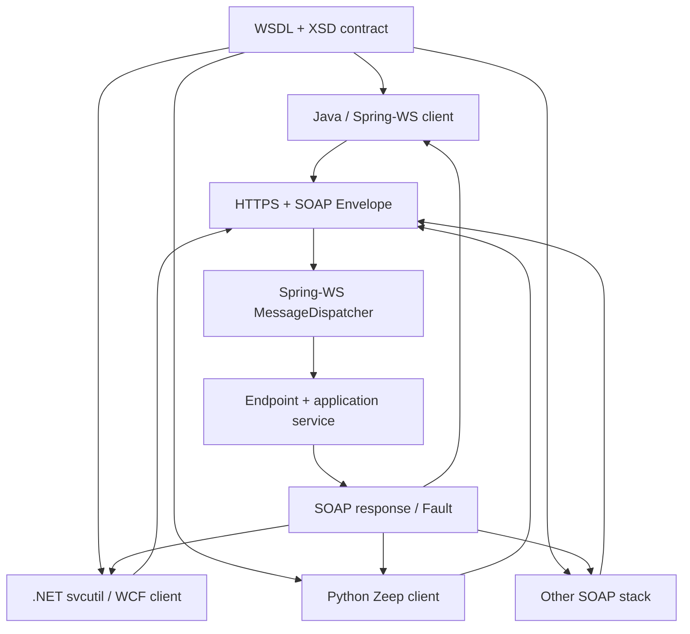

# Tương tác với client ngoài Java và các khác biệt trong mã được sinh

## 1. Vì sao phải kiểm thử SOAP với client ngoài Java?

**Spring Web Services (Spring-WS)** hướng tới phát triển SOAP theo hướng contract-first: XSD mô tả cấu trúc XML, WSDL mô tả service/operation/message/binding, còn Java và Spring-WS là một cách triển khai contract đó. Trong môi trường doanh nghiệp, service Spring-WS thường được gọi bởi ứng dụng .NET, Python, PHP, Java SOAP stack khác, ESB hoặc nền tảng tích hợp cũ.

Một contract có thể hợp lệ theo XSD và vẫn gây lỗi interoperability khi mỗi toolchain sinh client code theo quy tắc riêng. Ví dụ, JAXB có thể biểu diễn optional element bằng `JAXBElement<T>` hoặc trạng thái null; .NET svcutil có thể sinh `Specified` flag cho value type; Python Zeep có thể biểu diễn optional/nil qua sentinel hoặc object wrapper. Những khác biệt này thuộc code generation. Điều quyết định tương thích vẫn là XML được gửi và nhận trên wire.

Bài này tập trung vào cách thiết kế và kiểm thử tích hợp SOAP giữa Spring-WS và client ngoài Java. Mục tiêu là làm rõ WSDL/XSD, SOAP binding, ánh xạ kiểu dữ liệu, cách xác minh message và quy trình tạo client từ WSDL bằng toolchain khác.

### Mục tiêu học tập

Sau bài, bạn có thể:

1. Giải thích vì sao không nên dùng generated Java classes làm định nghĩa SOAP contract.
2. Đọc WSDL binding, SOAP version, operation style/use, endpoint address và XSD imports.
3. So sánh JAXB/XJC với .NET dotnet-svcutil/svcutil và Python Zeep ở cấp độ ánh xạ XML.
4. Nhận diện khác biệt về optional, nillable, choice, sequence, enum, decimal, date/time, QName và arrays.
5. Thiết kế contract document/literal và namespace ổn định cho client đa nền tảng.
6. Kiểm thử request từ client ngoài Java với Spring-WS endpoint và response của Spring-WS với client đó.
7. Kiểm tra SOAPAction, SOAP Header, Fault detail, WS-Addressing, WS-Security và MTOM khi cần.
8. Dùng raw SOAP fixtures và wire-level traces để chẩn đoán lỗi code generation.
9. Xây dựng compatibility test matrix và tiêu chí versioning.

## 2. Hợp đồng trên wire mới là điểm giao giữa các nền tảng

Một SOAP exchange gồm những thành phần quan sát được trên wire:

1. Transport endpoint và protocol (ví dụ HTTPS).
2. SOAP version và Envelope namespace.
3. SOAP Header blocks, action/WS-Addressing metadata.
4. SOAP Body payload XML.
5. Fault code/reason/detail nếu operation thất bại.
6. Attachments/MIME parts nếu service hỗ trợ MTOM/SOAP with Attachments.
7. Message-level security tokens, signatures, encryption và timestamps nếu dùng WS-Security.

Client Java, C# hoặc Python không cần cùng tên class, method hoặc package. Chúng cần tạo ra và hiểu được cùng một message theo contract.

Ví dụ WSDL khai báo operation SubmitOrder và XSD khai báo global element SubmitOrderRequest. Một Java generator có thể tạo SubmitOrderRequest, SubmitOrderResponse và ObjectFactory; một .NET generator có thể tạo OrdersPortTypeClient cùng các class có XmlSerializer attributes; Python Zeep thường cung cấp service/proxy và dynamic type objects từ WSDL. Tất cả cách biểu diễn đó đều có thể tương thích nếu serialize cùng XML contract.

### 2.1. Sơ đồ interoperability



Contract-first làm giảm coupling giữa schema và implementation, nhưng **không tự bảo đảm interoperability**. Phải kiểm tra generated client thực tế vì toolchain có thể hỗ trợ khác nhau về WSDL extensions, XSD features, WS-* policies, SOAP version và binding metadata.

## 3. WSDL cần đọc những gì trước khi sinh client?

Khi nhận WSDL từ service Spring-WS, hãy kiểm tra các phần chính:

| WSDL component | Ý nghĩa | Câu hỏi interoperability |
|---|---|---|
| types | XSD schema definitions | Imports/includes có truy cập được? Types có portable? |
| message | Message parts | Part trỏ tới element hay type? |
| portType | Abstract operations | Operation names và input/output/faults rõ chưa? |
| binding | SOAP protocol/style/use/action | SOAP 1.1 hay 1.2? Document/literal? Action nào? |
| service | Service collection | Có service/port tên ổn định? |
| port | Binding + endpoint address | Address có đúng môi trường/deployment? |

Một client generator có thể thành công khi đọc WSDL nhưng runtime vẫn lỗi vì XSD import URL trả 404/cần authentication; WSDL soap:address trỏ endpoint nội bộ; SOAP 1.1 binding được dùng trong khi client cấu hình SOAP 1.2; SOAPAction khác; WSDL extension/policy bị generator bỏ qua; hoặc TLS trust chain không hợp lệ.

### 3.1. Document/literal là lựa chọn interoperable phổ biến

Với SOAP service mới, document/literal (thường là wrapped document/literal) là lựa chọn phổ biến vì Body mang XML element được mô tả bởi XSD. Nó giúp toolchains độc lập hiểu contract mà không cần dựa vào Java object graph hoặc RPC/encoded conventions.

Spring-WS khuyến nghị tập trung vào XML contract; document/literal phù hợp hướng đó và WS-I Basic Profile. Tránh để generated classes hoặc Java collections tự quyết định wire representation.

### 3.2. WSDL và XSD imports/includes

Một WSDL có thể import schema từ nhiều file hoặc URI. Client generator cần truy cập toàn bộ dependency graph.

```text
contracts/
  orders.wsdl
  xsd/
    common-types.xsd
    order-types.xsd
    order-service.xsd
```

Các nguyên tắc:

- Dùng namespace URI ổn định cho từng schema.
- Dùng relative imports/includes có thể resolve trong gói contract khi phù hợp.
- Không để schema import trỏ vào filesystem path của máy developer.
- Đóng gói WSDL và toàn bộ XSD dependency để partner tải offline nếu cần.
- Bảo đảm schemaLocation và WSDL import URLs đúng khi expose qua HTTPS/reverse proxy.
- Kiểm tra generated client được tạo từ artifact phát hành, không phải WSDL local khác.

### 3.3. Static WSDL và contract drift

Nếu server generate WSDL động từ XSD, output có thể phụ thuộc version/framework/configuration. Khi contract đã công bố, lưu snapshot WSDL/XSD phát hành và kiểm tra thay đổi có chủ đích. Spring-WS hỗ trợ expose static WSDL; đây là lựa chọn giúp kiểm soát contract ổn định hơn khi service cần interoperability dài hạn.

Dù WSDL static, endpoint implementation vẫn phải tuân thủ contract đó. Có thể thêm contract tests để serialize schema fixtures, validate request/response và kiểm tra endpoint mapping.

## 4. Namespace và QName: nguồn lỗi thường gặp nhất

XML namespace được định danh bằng URI, không phải prefix. Hai tài liệu sau biểu diễn cùng QName cho root element:

```xml
<ord:SubmitOrderRequest
    xmlns:ord="https://example.org/orders/v1">
</ord:SubmitOrderRequest>
```

```xml
<o:SubmitOrderRequest
    xmlns:o="https://example.org/orders/v1">
</o:SubmitOrderRequest>
```

Cả hai có namespace URI và local name giống nhau. Prefix có thể khác nhau. Nếu client kiểm tra string XML bằng exact prefix snapshot, test có thể fail dù QName tương thích.

Ngược lại, hai XML sau **khác QName** dù local name giống nhau:

```xml
<ord:SubmitOrderRequest
    xmlns:ord="https://example.org/orders/v1"/>
```

```xml
<ord:SubmitOrderRequest
    xmlns:ord="https://example.net/orders/v1"/>
```

Spring-WS annotation như `@PayloadRoot(namespace = ..., localPart = ...)` định tuyến theo QName. Client ngoài Java cần gửi đúng namespace URI được công bố.

### 4.1. elementFormDefault và qualified local elements

XSD có thể khai báo:

```xml
<xs:schema
    targetNamespace="https://example.org/orders/v1"
    elementFormDefault="qualified"
    xmlns:xs="http://www.w3.org/2001/XMLSchema">
```

`elementFormDefault="qualified"` yêu cầu local elements được namespace-qualified theo target namespace (trừ khi khai báo khác). Nếu client generator tạo XML với local elements không namespace hoặc namespace khác, server có thể không bind/unmarshal được.

Đừng khắc phục bằng cách bỏ namespace ở server nếu đó là một phần contract. Xác minh request bytes và XSD chính xác.

### 4.2. Namespace mapping trong generated code

Các generator có thể map namespace URI sang package/namespace ngôn ngữ khác nhau:

- XJC/JAXB: package Java có thể được cấu hình qua binding files, package annotations hoặc command options.
- .NET: namespace XML được lưu trong attributes/schema metadata; C# namespace có thể đổi độc lập.
- Zeep: type/element QName được quản lý từ WSDL/XSD, object API phản ánh namespace và type definitions.

Tên package C# hoặc Python module không có ý nghĩa với Spring-WS; XML QName gửi đi mới quan trọng.

## 5. Khác biệt trong ánh xạ XSD sang Java, C# và Python

Code generator chuyển XSD types thành language types. Các kiểu đó giúp lập trình viên thao tác thuận tiện, nhưng có thể biểu diễn nhiều trạng thái XML khác nhau. Khi thiết kế contract, hãy xét trạng thái XML trước khi xét tên class được sinh.

### 5.1. Optional khác nil

XSD phân biệt:

- `minOccurs="0"`: element có thể vắng mặt.
- `nillable="true"`: element có thể xuất hiện nhưng có `xsi:nil="true"`.
- Element bắt buộc và không nillable: phải xuất hiện với nội dung hợp lệ.

Ví dụ:

```xml
<xs:element name="middleName"
            type="xs:string"
            minOccurs="0"
            nillable="true"/>
```

Ba trạng thái có thể có:

```xml
<!-- element vắng mặt -->
<ord:Customer/>

<!-- element có mặt, rỗng -->
<ord:Customer>
    <ord:middleName/>
</ord:Customer>

<!-- element có mặt, nil -->
<ord:Customer xmlns:xsi="http://www.w3.org/2001/XMLSchema-instance">
    <ord:middleName xsi:nil="true"/>
</ord:Customer>
```

Không nên mặc định ba trường hợp có cùng ý nghĩa business. Ví dụ, vắng mặt có thể là không cập nhật; rỗng là xóa giá trị; nil là giá trị hiện không xác định. Semantics phải được business contract xác định, XSD tự nó không định nghĩa ý nghĩa nghiệp vụ.

| XSD state | JAXB có thể biểu diễn | .NET có thể biểu diễn | Kiểm tra wire |
|---|---|---|---|
| Optional absent | null, JAXBElement hoặc presence state tùy binding | Nullable reference, Specified flag hoặc wrapper | Element không xuất hiện |
| Present empty | Empty String/object | Empty String/object | Tag có mặt, không text |
| Present nil | JAXBElement nil/nillable handling tùy binding | IsNullable/nullable serialization | xsi:nil="true" |

Không suy luận XML chỉ từ giá trị property sau deserialize; code generator/runtime có thể gộp một số trạng thái. Hãy tạo fixture cho cả ba dạng và kiểm tra serialization/deserialization thực tế.

### 5.2. Java primitive và .NET value types

Một XSD xs:int có thể trở thành Java int, Integer, JAXBElement<Integer> hoặc wrapper khác tùy binding. Trong C#, nó có thể trở thành int cộng PropertyNameSpecified, hoặc int? nếu generator/options hỗ trợ nullable mapping.

Ví dụ C# generated class có thể có pattern:

```csharp
public int Quantity { get; set; }
[System.Xml.Serialization.XmlIgnore]
public bool QuantitySpecified { get; set; }
```

Nếu QuantitySpecified là false, serializer có thể bỏ element khỏi XML; nếu true, nó serialize giá trị (kể cả zero). Nếu developer chỉ set Quantity = 0 mà quên set QuantitySpecified = true, server có thể nhận element absent thay vì zero.

Không được coi 0, false, empty string và element absent là một trạng thái.

### 5.3. xs:sequence, xs:all và xs:choice

| XSD compositor | Semantics | Rủi ro interoperability |
|---|---|---|
| xs:sequence | Elements theo thứ tự khai báo | Serializer phải tuân thủ order |
| xs:all | Các element có thể xuất hiện theo thứ tự bất kỳ trong giới hạn schema | Generator vẫn có thể serialize một thứ tự cố định |
| xs:choice | Chọn một nhánh (hoặc số lượng theo min/maxOccurs) | Generated choice wrappers/identifiers khác nhau |

Ví dụ choice:

```xml
<xs:choice>
    <xs:element name="cardPayment" type="tns:CardPayment"/>
    <xs:element name="bankTransfer" type="tns:BankTransfer"/>
</xs:choice>
```

JAXB có thể tạo một property chung, JAXBElement variants hoặc annotations cho alternatives; .NET có thể tạo choice identifier enum cùng nhiều properties; Zeep có thể yêu cầu object tương ứng element đã chọn. Không kỳ vọng model class giống nhau. Hãy xác minh XML chỉ chứa lựa chọn hợp lệ và không serialize cả hai alternatives.

### 5.4. Repeating elements và arrays/lists

XSD:

```xml
<xs:element name="line"
            type="tns:OrderLine"
            minOccurs="0"
            maxOccurs="unbounded"/>
```

có thể sinh List<OrderLine> trong Java, collection/array trong C#, và list trong Python object model. Hãy thống nhất zero items biểu diễn container absent hay empty; thứ tự repeated elements; duplicates có được phép; maxOccurs; pagination/chunking cho danh sách lớn.

Đừng nhầm repeated sibling elements với wrapper element. Hai XML shape sau khác schema:

```xml
<ord:lines>
    <ord:line>...</ord:line>
    <ord:line>...</ord:line>
</ord:lines>
```

```xml
<ord:line>...</ord:line>
<ord:line>...</ord:line>
```

### 5.5. Enum và unknown values

XSD enumeration có thể sinh Java enum, C# enum hoặc string/dynamic value ở Python. Khác biệt xảy ra khi server thêm enum value mới nhưng client generated cũ chưa biết giá trị.

Cần quyết định enum có đóng hay mở; client cũ gặp unknown value sẽ reject, giữ raw string hay mapping fallback; có cần versioned schema/operation cho thay đổi breaking; có quy ước unknown/other value trong contract không.

Nếu consumer phải forward-compatible, cân nhắc string + validation/documentation hoặc extension pattern được contract hỗ trợ thay vì giả định mọi generator xử lý unknown enum giống nhau.

### 5.6. xs:date, xs:dateTime, timezone và duration

Đây là lỗi liên nền tảng rất phổ biến:

| XSD type | Ý nghĩa | Kiểu ngôn ngữ thường gặp |
|---|---|---|
| xs:date | Ngày lịch, không có time-of-day | LocalDate, DateOnly, Python date |
| xs:time | Giờ trong ngày | LocalTime, TimeOnly, Python time |
| xs:dateTime | Ngày + giờ, timezone có thể có/không | XMLGregorianCalendar, DateTime/DateTimeOffset, Python datetime |
| xs:duration | Khoảng thời gian theo XML Schema | Duration/custom wrapper |

Không map xs:date sang Instant nếu contract chỉ nói ngày lịch. Instant đại diện một thời điểm UTC; ngày lịch không có timezone. Với xs:dateTime, phải xác định timezone bắt buộc hay tùy chọn và quy tắc normalized UTC. Không để server hiểu timestamp không offset theo timezone mặc định JVM/OS.

Các ví dụ XML:

```xml
<!-- Date only -->
<ord:deliveryDate>2026-11-27</ord:deliveryDate>

<!-- Date-time with UTC offset -->
<ord:createdAt>2026-11-27T09:30:00Z</ord:createdAt>

<!-- Date-time with explicit offset -->
<ord:createdAt>2026-11-27T16:30:00+07:00</ord:createdAt>
```

Các biểu diễn có offset tương đương có thể chỉ cùng một instant, nhưng chúng không thể thay thế ý nghĩa date-only. Test ngày nhuận, midnight, offset và timezone transition phù hợp hệ thống.

### 5.7. Decimal, precision và rounding

xs:decimal là số thập phân chính xác theo lexical decimal, không phải floating-point binary. Java BigDecimal, .NET decimal và Python Decimal thường phù hợp hơn double/float cho tiền tệ.

```xml
<xs:simpleType name="Money">
  <xs:restriction base="xs:decimal">
    <xs:totalDigits value="12"/>
    <xs:fractionDigits value="2"/>
    <xs:minInclusive value="0.00"/>
  </xs:restriction>
</xs:simpleType>
```

Test cần xác minh giới hạn digits/fraction, số âm, rounding và lexical formats. Không dùng double rồi kỳ vọng serialize/decode giữ decimal chính xác. Quy tắc rounding thuộc business contract; XSD facets chỉ giới hạn lexical/value space.

### 5.8. QName, any và wildcard schema

XSD xs:QName là một giá trị có namespace URI và local name, được viết bằng prefix trong XML lexical form. Prefix phải được khai báo; generated code có thể biểu diễn QName bằng javax.xml.namespace.QName hoặc kiểu tương ứng ở .NET/Python.

Với xs:any hoặc xs:anyAttribute, schema cho phép extension content. Các generator có thể map nội dung mở sang DOM Element, XmlElement, XmlAnyElement, lxml element hoặc object tùy stack. Interoperability test cần xác minh:

- Namespace của extension element được bảo toàn.
- Nội dung lạ không bị silently drop khi client parse rồi serialize lại.
- processContents/namespace constraints của wildcard được tôn trọng.
- Server xử lý unknown extension theo policy đã công bố.

Dùng wildcard có chủ đích và giới hạn namespace/size. Một schema quá mở có thể làm client không biết phải validate hay authorize extension như thế nào.

### 5.9. Binary, base64 và attachments

XSD xs:base64Binary có thể được ánh xạ thành byte[], byte[], bytes hoặc stream/wrapper. Khi dùng inline base64, XML payload chứa chuỗi Base64; khi dùng MTOM/XOP, SOAP package có thể tham chiếu MIME part bên ngoài.

Đó là hai wire representation khác nhau. Client phải hỗ trợ đúng cơ chế server công bố. Kiểm tra byte content, media type, content ID, size limit và cleanup; không chỉ assert rằng property generated không null.

## 6. Toolchain sinh client ngoài Java

Tạo client từ **WSDL artifact phát hành**. Ghi lại version toolchain và options để việc build client có thể lặp lại.

### 6.1. Java JAXB/XJC

XJC tạo Java model từ XSD; JAXB annotations và binding files điều khiển package/type mapping. Cùng schema nhưng thay package mapping hoặc JAXB version có thể thay đổi generated source mà không đổi XML contract.

Ví dụ gọi client qua Spring-WS không nhất thiết phải dùng SOAP stack sinh từ WSDL: ứng dụng có thể dùng JAXB generated classes với WebServiceTemplate, SOAPActionCallback và một WebServiceMessageSender. Spring-WS tập trung vào document-driven SOAP messaging; không bắt buộc sử dụng generated JAX-WS proxy.

### 6.2. .NET và dotnet-svcutil

Các dự án .NET có thể dùng dotnet-svcutil để tạo proxy/client code từ metadata WSDL. Tool tạo operation methods, request/response types, serializer attributes và cấu hình binding/endpoint. Một số dự án cũ dùng svcutil.exe cùng WCF tooling.

Ví dụ quy trình tổng quát:

```powershell
dotnet tool install --global dotnet-svcutil
dotnet-svcutil https://partner.example.org/orders.wsdl
```

Lệnh/options cụ thể tùy SDK và target framework. Sau khi sinh code, xem generated configuration/binding: SOAP version, message encoding, security mode, endpoint URI và SOAPAction. Không commit endpoint URL dev/secret trong generated config.

.NET generated client có thể dùng XmlSerializer hoặc DataContractSerializer tùy tool/options. Hãy kiểm tra attributes và serialization output; class C# không bảo đảm tự động serialize đúng tất cả schema constructs.

### 6.3. Python Zeep

Zeep consume WSDL/XSD và tạo service proxy/dynamic types. Ví dụ:

```python
from zeep import Client
from zeep.transports import Transport
from requests import Session

session = Session()
# Configure a test-only CA bundle or client certificate as required.
transport = Transport(session=session, timeout=15)

client = Client(
    "https://partner.example.org/orders.wsdl",
    transport=transport,
)

service = client.service
result = service.SubmitOrder(
    requestId="REQ-1001",
    customerId="C-42",
)
print(result)
```

Đây là skeleton để minh họa WSDL-driven client. Chính xác tên operation/argument shape do WSDL binding/type definitions quyết định. Không tắt TLS verification cho convenience; cấu hình CA/test certificates thích hợp. Zeep có thể introspect service/types để xem signature được tạo từ WSDL.

### 6.4. SoapUI và raw SOAP client

SoapUI hoặc công cụ SOAP-capable tương đương hữu ích để import WSDL, tạo sample requests, chỉnh Header và lưu raw request/response. Dùng chúng để kiểm tra contract độc lập với generated code; nếu SoapUI thành công nhưng generated .NET client fail, hãy so sánh raw wire XML và transport/security configuration.

Raw HTTP/SOAP fixture cũng hữu ích trong CI, nhưng phải đảm bảo Content-Type, SOAPAction và Envelope version phù hợp binding. Không chỉ gửi XML Body trần khi endpoint cần SOAP Envelope.

### 6.5. Phiên bản generator là một dependency

Lưu trong integration test documentation:

- WSDL/XSD artifact hash/version.
- Java/JDK và JAXB/XJC version.
- .NET SDK/dotnet-svcutil version hoặc WCF package versions.
- Python/ZeeP versions và transport dependencies.
- Code generation options/binding files.
- SOAP version, endpoint URI profile và WS-* requirements.

Khi update generator, diff generated source và raw serialized XML. Không chấp nhận thay đổi behavior chỉ vì source code diff trông có vẻ là refactor.


## 7. Kiểm thử Spring-WS server bằng request từ client ngoài Java

Cách chắc chắn để xác minh interoperability là lấy raw request được tạo từ client thực (hoặc generator thực) rồi gửi tới Spring-WS server. Có ba lớp test bổ trợ:

1. **Generated-client test:** dùng client được sinh từ WSDL gọi endpoint test/staging.
2. **Wire fixture test:** lưu request/response SOAP thực tế, replay trong integration tests.
3. **Cross-stack round-trip:** client ngoài Java gửi request, Spring-WS trả response, client deserialize và assert business result.

### 7.1. Endpoint Spring-WS minh họa

Giả sử contract có request:

```xml
<ord:SubmitOrderRequest
    xmlns:ord="https://example.org/orders/v1">
    <ord:requestId>REQ-1001</ord:requestId>
    <ord:customerId>C-42</ord:customerId>
    <ord:quantity>2</ord:quantity>
</ord:SubmitOrderRequest>
```

Endpoint có thể xử lý bằng JAXB generated class:

```java
@Endpoint
public class OrdersEndpoint {
    private static final String NS = "https://example.org/orders/v1";
    private final OrderApplicationService service;

    public OrdersEndpoint(OrderApplicationService service) {
        this.service = service;
    }

    @PayloadRoot(namespace = NS, localPart = "SubmitOrderRequest")
    @ResponsePayload
    public SubmitOrderResponse submit(
            @RequestPayload SubmitOrderRequest request) {
        OrderResult result = service.submit(request);
        SubmitOrderResponse response = new SubmitOrderResponse();
        response.setOrderId(result.orderId());
        response.setStatus(result.status());
        return response;
    }
}
```

Class request/response minh họa là types được sinh từ XSD hoặc model có XML binding phù hợp. Endpoint nhận XML đã được Spring-WS parse/unmarshal; client ngoài Java không cần biết tên class Java, constructor hay package.

### 7.2. Contract tests trên server

MockWebServiceClient có thể test message pipeline trong JVM, nhưng không mô phỏng toàn bộ wire request từ .NET/Python serializer. Lưu một số SOAP envelopes đã được tạo bởi external clients và validate/replay qua server.

Test nên assert QName/namespace của Body root; element presence/absence/nil/order; numeric/date/time values; headers/SOAPAction nếu binding yêu cầu; response payload/Fault detail; và việc domain service chỉ chạy khi message hợp lệ.

### 7.3. HTTP endpoint smoke test

Một request thật cần đầy đủ HTTP headers phù hợp binding:

```http
POST /soap/orders HTTP/1.1
Host: localhost:8080
Content-Type: text/xml; charset=utf-8
SOAPAction: "urn:orders:SubmitOrder"

<soap:Envelope
    xmlns:soap="http://schemas.xmlsoap.org/soap/envelope/"
    xmlns:ord="https://example.org/orders/v1">
  <soap:Body>
    <ord:SubmitOrderRequest>
      <ord:requestId>REQ-1001</ord:requestId>
      <ord:customerId>C-42</ord:customerId>
      <ord:quantity>2</ord:quantity>
    </ord:SubmitOrderRequest>
  </soap:Body>
</soap:Envelope>
```

Đây là ví dụ SOAP 1.1 qua HTTP. Với SOAP 1.2, Envelope namespace và HTTP Content-Type/action parameter khác. Không copy header SOAP 1.1 sang binding SOAP 1.2.

### 7.4. CI pipeline cho generated clients

1. Download WSDL và toàn bộ XSD imports từ build artifact/version cố định.
2. Chạy generator .NET/Python/Java với version và options đã pin.
3. Build generated client.
4. Gọi endpoint integration environment.
5. Kiểm tra response object và error mapping.
6. Lưu sanitized raw SOAP exchange làm fixture/diagnostic artifact.
7. So sánh contract hash/diff nếu WSDL/XSD thay đổi.

Không chỉ generate code và xác nhận compile. Code có thể compile nhưng serialize XML sai namespace/order/action.

## 8. Kiểm thử client ngoài Java bằng .NET

Một client .NET generated từ WSDL thường cung cấp proxy methods; generated request/response classes có attributes điều khiển XML serialization. Tên C# property và class không cần giống JAXB model.

### 8.1. Sinh service reference

Với .NET toolchain có WCF client support, dotnet-svcutil có thể sinh service client từ WSDL hoặc metadata endpoint:

```powershell
dotnet tool install --global dotnet-svcutil
dotnet-svcutil https://partner.example.org/orders.wsdl
```

Có thể dùng Visual Studio Connected Services hoặc metadata tooling phù hợp target framework. Với legacy .NET Framework, svcutil.exe là công cụ thường gặp.

Khi generate, kiểm tra tool output và configuration:

- Binding SOAP 1.1/1.2 có khớp service không.
- Message encoding là text XML hay MTOM.
- Endpoint address đúng môi trường không.
- Security mode/credentials có đúng contract không.
- SOAPAction/operation action có đúng.
- WSDL/XSD imports có resolve được từ network/build agent.

### 8.2. Gọi client .NET sinh tự động

Code cụ thể phụ thuộc tên proxy và method generator tạo; mẫu tổng quát WCF-style:

```csharp
var binding = new BasicHttpBinding(BasicHttpSecurityMode.Transport);
var endpoint = new EndpointAddress(
    "https://api.example.org/soap/orders");

var client = new OrdersPortTypeClient(binding, endpoint);

var request = new SubmitOrderRequest
{
    RequestId = "REQ-1001",
    CustomerId = "C-42",
    Quantity = 2
};

var response = await client.SubmitOrderAsync(request);

if (response.Status != "ACCEPTED")
{
    throw new InvalidOperationException("Unexpected order status");
}
```

Đây là minh họa WCF-style proxy; constructor, async method, binding name và generated property names phụ thuộc WSDL/generator. Không copy nguyên code nếu source generated client có API khác.

### 8.3. Kiểm tra raw XML khi .NET client gặp lỗi

Khi proxy .NET gọi Spring-WS thất bại:

- Bật message logging/tracing ở môi trường test và masking.
- Đọc SOAP Envelope thực tế gửi đi.
- So sánh namespace URI, element order, absent/nil fields và SOAPAction.
- Kiểm tra Specified flags hoặc serializer attributes.
- Kiểm tra binding version và Content-Type.
- Kiểm tra Fault detail/body server trả về.
- Xác minh client không dùng endpoint address dev/internal từ WSDL.

Đừng sửa generated code bằng tay như giải pháp lâu dài nếu issue đến từ WSDL mapping. Ưu tiên chỉnh contract hoặc generator customization/binding options, rồi regenerate để thay đổi có thể tái lập.


## 9. Kiểm thử client Python Zeep

Zeep đọc WSDL/XSD để xây dựng service proxy và dynamic types. Đây là cách độc lập với Java để xác minh contract. Tài liệu Zeep mô tả hỗ trợ SOAP 1.1/1.2; WS-Addressing, WS-Security và attachments có mức hỗ trợ riêng, cần kiểm tra theo version đã pin.

### 9.1. Inspect WSDL trước khi gọi

```bash
python -mzeep https://api.example.org/soap/orders.wsdl
```

Lệnh introspection giúp xem service, port, binding, operations và type signatures mà Zeep nhận diện. Nếu không thấy operation mong muốn, kiểm tra WSDL service/port và binding trước khi sửa request code.

### 9.2. Gọi operation

```python
from zeep import Client
from zeep.transports import Transport
from requests import Session

session = Session()
session.verify = "/etc/ssl/certs/partner-ca.pem"

transport = Transport(
    session=session,
    timeout=20,
    operation_timeout=30,
)

client = Client(
    "https://api.example.org/soap/orders.wsdl",
    transport=transport,
)

response = client.service.SubmitOrder(
    requestId="REQ-1001",
    customerId="C-42",
    quantity=2,
)

assert response.status == "ACCEPTED"
```

Đây là ví dụ dựa trên Zeep service proxy; exact argument names và nested object structure do WSDL định nghĩa. Transport timeout dành cho WSDL/XSD loading khác operation timeout. Session TLS verification giữ bật; dùng CA bundle được quản lý nếu endpoint dùng private CA.

### 9.3. Optional values và xsd:choice trong Zeep

Zeep có sentinel/value helpers cho trường hợp special như bỏ qua optional element, và helpers cho xsd:choice. Cần đọc datastructures guide của version đang pin thay vì tự set None cho tất cả states.

Kiểm thử các dạng: bỏ qua element optional; gửi element nil nếu XSD cho phép; gửi empty string; chọn đúng nhánh xs:choice; repeated element zero/one/many; unknown enum hoặc wildcard values nếu schema cho phép.

Với test cần raw request XML, dùng Zeep plugin/history hoặc Client.create_message() để tạo XML message chưa gửi, rồi so với contract fixture. Không chụp log chứa credentials hoặc PII vào CI artifact.

### 9.4. Zeep strict mode và XML security

Zeep settings có strict mode và các tùy chọn parsing XML. Không tắt strict hoặc cho phép DTD/external entities chỉ để làm một service không chuẩn chạy được. Trước tiên xác định WSDL/XSD invalid ở đâu và sửa contract/service nếu thuộc quyền kiểm soát; nếu buộc phải có compatibility setting, giới hạn ở client đó và có test regression rõ ràng.

Giữ XML external entity protections; chỉ tải WSDL/XSD từ nguồn tin cậy; hạn chế kích thước/độ sâu XML và timeout. Caching WSDL/XSD có ích cho tốc độ nhưng cache cần gắn với contract version để tránh chạy client với schema cũ không được nhận biết.

## 10. So sánh trực tiếp các kiểu dữ liệu được sinh

Bảng dưới đây mô tả cách ánh xạ **thường gặp**, không phải cam kết cho mọi generator. Mapping chính xác phụ thuộc XSD facets, binding files, command options, serializer và version runtime.

| XSD/XML | Java JAXB thường gặp | .NET thường gặp | Python Zeep thường gặp | Điều cần kiểm tra |
|---|---|---|---|---|
| xs:string | String | string | str | Encoding, empty/absent |
| xs:boolean | boolean/Boolean | bool/bool? | bool | true/false lexical và absent |
| xs:int | int/Integer | int/int? + Specified | int | Range và presence |
| xs:long | long/Long | long/long? | int | 64-bit range |
| xs:decimal | BigDecimal | decimal | Decimal | Precision/fractionDigits |
| xs:date | XMLGregorianCalendar hoặc binding tùy chỉnh | DateOnly/DateTime tùy tool | date | Không gán timezone |
| xs:dateTime | XMLGregorianCalendar/calendar type | DateTime/DateTimeOffset tùy tool | datetime | Offset/UTC/naive timestamp |
| xs:base64Binary | byte[] | byte[] | bytes | Binary vs MTOM |
| xs:QName | javax.xml.namespace.QName | XmlQualifiedName | QName object | Namespace URI/local name |
| xs:enum restriction | Java enum hoặc string | enum/string | str/dynamic type | Unknown values |
| xs:choice | JAXBElement/choice binding | choice identifier/alternative fields | compound/choice helper | Chỉ một branch hợp lệ |
| xs:any | DOM/Element/custom type | XmlElement/Any | lxml/object | Namespace wildcard policy |
| repeated element | List<T> | collection/array | list | Empty vs absent, order |

### 10.1. Generated code khác không có nghĩa là contract khác

Ví dụ, Java có thể expose method `getDeliveryDate()` trả XMLGregorianCalendar; .NET expose property DeliveryDate; Python Zeep trả object date/datetime. Cả ba có thể serialize thành lexical XML tương thích.

Không viết test yêu cầu field/method name giống nhau giữa ngôn ngữ. Test wire XML và business semantics.

### 10.2. Binding customizations có thể làm lệch behavior

JAXB external binding file, XJC plugins, .NET serializer options hoặc Zeep custom settings có thể thay đổi generated code behavior. Lưu customization trong source control và test raw serialization. Nếu một platform cần manual mapping layer để giữ schema semantics, đặt mapping này trong adapter/service boundary, không leak vào domain model.

## 11. SOAPAction, SOAP version và HTTP binding

SOAPAction là nơi client ngoài Java thường gặp mismatch do WSDL/binding/runtime convention khác nhau.

### 11.1. SOAP 1.1

SOAP 1.1 over HTTP thường truyền SOAPAction qua HTTP header. Binding có thể khai báo action cho operation; client generated dùng giá trị đó khi invoke. Nếu header thiếu hoặc sai và server mapping dựa SOAPAction, dispatcher có thể không chọn operation đúng dù Body XML hợp lệ.

### 11.2. SOAP 1.2

SOAP 1.2 dùng content type application/soap+xml; action có thể được biểu diễn như parameter của content type theo SOAP 1.2 HTTP binding. Đừng giả định header SOAPAction của SOAP 1.1 luôn xuất hiện.

### 11.3. Kiểm tra cả body và action

Một compatibility test cần xác minh SOAP Envelope namespace đúng version; HTTP Content-Type đúng binding; SOAPAction/action parameter đúng WSDL binding; Body root QName đúng operation message; response content type và SOAP version tương ứng; Fault status/body được client parser nhận đúng.

Nếu server mapping dùng payload root QName, SOAPAction sai có thể không ảnh hưởng endpoint selection nhưng vẫn vi phạm contract/interoperability với partner khác. Hãy kiểm tra action khi WSDL định nghĩa nó, không chỉ kiểm tra endpoint đã được gọi.

## 12. SOAP Headers, WS-Addressing và metadata ngoài Body

Không phải mọi dữ liệu thuộc SOAP message đều nằm trong Body. Client ngoài Java có thể thêm header block như correlation ID, WS-Addressing Action/To/MessageID, tenant metadata hoặc security tokens. Spring-WS endpoint/interceptors có thể đọc các headers này.

### 12.1. SOAP Header là XML có QName và role

Ví dụ:

```xml
<soap:Envelope
    xmlns:soap="http://schemas.xmlsoap.org/soap/envelope/"
    xmlns:wsa="http://www.w3.org/2005/08/addressing"
    xmlns:ord="https://example.org/orders/v1">
  <soap:Header>
    <wsa:Action>urn:orders:SubmitOrder</wsa:Action>
    <wsa:MessageID>urn:uuid:12345678-1234-1234-1234-123456789abc</wsa:MessageID>
    <ord:CorrelationId>corr-1001</ord:CorrelationId>
  </soap:Header>
  <soap:Body>
    <ord:SubmitOrderRequest>...</ord:SubmitOrderRequest>
  </soap:Body>
</soap:Envelope>
```

Header QName gồm namespace URI + local name. Prefix có thể thay đổi. Các SOAP roles/actor và mustUnderstand semantics cũng quan trọng; một header block nhắm tới receiver có thể bắt buộc phải được hiểu.

### 12.2. WS-Addressing không phải SOAPAction

WS-Addressing là một bộ SOAP header properties như Action, To, MessageID, RelatesTo và ReplyTo. SOAPAction trong binding/HTTP có thể liên quan operation action nhưng không tự động thay thế toàn bộ WS-Addressing.

Hai phía phải thống nhất:

- Có dùng WS-Addressing không và dùng version nào.
- Action URI cho từng operation.
- To endpoint URI có được kiểm tra không.
- ReplyTo/anonymous addressing behavior.
- MessageID và RelatesTo correlation semantics.
- Fault mapping nếu action/header không hợp lệ.

Một client có thể gửi Body đúng nhưng WS-Addressing Action sai, làm endpoint mapping hoặc interceptor từ chối request.

### 12.3. Kiểm tra Header bằng raw XML và API

Với client generated, xác minh header thực tế thay vì chỉ xem proxy method arguments. .NET/WCF có thể dùng message inspectors/operation contexts; Zeep có SOAP headers/WSA helpers/plugins; Java Spring-WS client có callback/interceptor và SOAP message APIs.

Nếu server bắt buộc header, hãy test absent, malformed, unsupported role và mustUnderstand. Nếu correlation metadata đi qua header, xác minh nó được đưa vào đúng business/audit context và response có RelatesTo/correlation tương ứng theo contract.

## 13. SOAP Fault interoperability và exception mapping

Các SOAP stacks có thể chuyển cùng một Fault thành các exception class khác nhau. Không nên đòi Java/.NET/Python ném cùng exception type. Hãy so sánh Fault XML và business outcome.

SOAP 1.1 Fault thường chứa faultcode, faultstring, faultactor (optional) và detail. SOAP 1.2 Fault có Code, Reason, Node/Role tùy cấu trúc, và Detail.

### 13.1. Fault detail cần là contract

Ví dụ XSD có thể định nghĩa:

```xml
<xs:element name="OrderFault">
  <xs:complexType>
    <xs:sequence>
      <xs:element name="code" type="xs:string"/>
      <xs:element name="message" type="xs:string"/>
      <xs:element name="retryable" type="xs:boolean"/>
    </xs:sequence>
  </xs:complexType>
</xs:element>
```

Spring-WS server nên map application errors thành SOAP Fault detail có namespace và fields ổn định. Client .NET/Python/Java đọc detail và ánh xạ sang exception/domain result theo implementation riêng.

Không đặt Java class name hoặc Java stack trace vào detail schema. Detail chỉ nên công bố thông tin partner cần xử lý như error code, correlation ID, field violations và retryability nếu contract quy định.

### 13.2. Test Fault từ cả hai phía

| Test origin | Tạo lỗi | Điều cần xác minh |
|---|---|---|
| Server Spring-WS | Endpoint/exception resolver trả Fault | External client parse code/reason/detail |
| Client ngoài Java | Gửi malformed request hoặc request bị business reject | Spring-WS trả Fault theo contract |
| Partner service giả lập | Trả Fault envelope fixture | Java client classify/rethrow đúng |
| HTTP gateway | Trả non-SOAP status/error page | Client phân biệt transport error với SOAP Fault |

Một HTTP 502/503 HTML page không phải SOAP Fault hợp lệ, dù client stack có thể ném exception chung. Nếu client retry theo fault code, hãy bảo đảm lỗi transport được phân loại riêng.

### 13.3. Fault code không tự quyết định retry

SOAP Server/Receiver Fault có thể là lỗi tạm thời hoặc lỗi business; Client/Sender Fault thường biểu thị request không hợp lệ nhưng cần xem contract detail. Retry phải dựa vào code/detail policy, idempotency key, operation semantics và bounded attempts.

Kiểm thử cả Fault Detail hợp lệ lẫn Detail không nhận diện để client có fallback an toàn. Không retry vô hạn do một partner trả Server Fault liên tục.

## 14. WS-Security và chứng chỉ giữa các SOAP stacks

WS-Security message-level security độc lập với ngôn ngữ. XML Signature, XML Encryption, tokens và timestamps cần được serialize/verify theo các profile và canonicalization rules thống nhất.

### 14.1. Các khác biệt thường gặp

- UsernameToken password text/digest và nonce/created handling.
- X.509 token inclusion mode (BinarySecurityToken, issuer/serial, thumbprint).
- Signature algorithms, digest algorithms và canonicalization.
- Signed parts: Body, Timestamp, To/Action/custom headers.
- Encryption target/algorithm/key transport.
- Timestamp TTL, clock skew và replay cache.
- Trust chain, certificate alias và key identifier.
- SOAP 1.1/1.2 namespaces và WS-Security policy assertions.

Một Java client ký message hợp lệ với một certificate không tự động chứng minh .NET/WCF client có cấu hình token/algorithm/parts giống nhau. Cần cross-stack tests bằng credentials test và message fixtures.

### 14.2. TLS broker/HTTPS khác WS-Security

HTTPS bảo vệ transport hop giữa client và endpoint (hoặc reverse proxy). WS-Security bảo vệ SOAP message-level content và có thể giữ integrity/confidentiality qua intermediary theo policy. TLS không thay chữ ký message nếu cần end-to-end proof; chữ ký message cũng không thay hostname validation/TLS.

### 14.3. Security test matrix

- Client không có credential → server reject.
- UsernameToken sai password → reject trước business service.
- X.509 certificate untrusted/expired → reject.
- Signature bị thay đổi sau khi ký → reject.
- Body signed nhưng header routing không ký → test threat model; ký các headers ảnh hưởng nghiệp vụ nếu policy yêu cầu.
- Timestamp quá hạn/future quá ngưỡng → reject theo clock-skew policy.
- Replay cùng signed request → replay cache/idempotency policy ngăn duplicate.
- TLS CA/hostname sai → handshake/connection fail trước SOAP parsing.

Không dùng production private key trong tests hoặc fixtures. Quản lý test certificates/key stores riêng, hạn chế quyền, rotate và không log security header/token/signature material nhạy cảm.

## 15. MTOM/SOAP with Attachments giữa nhiều nền tảng

XSD xs:base64Binary có thể được truyền inline trong Body hoặc tối ưu bằng MTOM/XOP. Khi MTOM bật, SOAP Envelope có thể tham chiếu MIME part qua xop:Include và Content-ID.

### 15.1. Wire representation

Inline:

```xml
<doc:content>SGVsbG8gV29ybGQ=</doc:content>
```

MTOM/XOP:

```xml
<doc:content>
    <xop:Include
        xmlns:xop="http://www.w3.org/2004/08/xop/include"
        href="cid:attachment-1"/>
</doc:content>
```

MIME part đi kèm message, có Content-ID tương ứng. Không coi hai cách truyền giống nhau ở transport layer dù chúng có thể khôi phục cùng binary value trong object model.

### 15.2. Compatibility checklist cho attachments

- Client có bật MTOM/attachment support?
- SOAP version và Content-Type multipart/related đúng chưa?
- XOP Include href có trỏ đúng Content-ID?
- Content type và filename metadata có ổn định?
- Binary payload có bị base64 decode/encode hai lần không?
- Payload size limits ở client, gateway, server, proxy có tương thích?
- Streaming/temp-file lifecycle có tránh giữ toàn file trong memory không?
- Signature/encryption policy có bảo vệ attachment content như yêu cầu?

### 15.3. Test với file thực

Tạo fixture file binary có checksum xác định. Gửi từ client .NET/Python/Java và xác minh server nhận đúng byte length/hash; tạo response attachment ngược lại và verify ở client. Bao phủ file rỗng, file nhỏ, file gần giới hạn, MIME type khác nhau và lỗi content ID.

Không chỉ test một chuỗi text nhỏ; encoding/caching và buffering behavior có thể khác đáng kể với file lớn.


## 16. Spring-WS client gọi service của đối tác ngoài Java

Spring-WS không cần generated proxy JAX-WS để gọi SOAP. `WebServiceTemplate` có thể gửi XML `Source` trực tiếp hoặc marshal JAXB objects, cho phép giữ contract-centric approach.

### 16.1. Client dùng generated JAXB types

```java
@Configuration
public class PartnerSoapConfiguration {

    @Bean
    Jaxb2Marshaller partnerMarshaller() {
        Jaxb2Marshaller marshaller = new Jaxb2Marshaller();
        marshaller.setContextPath("com.example.partner.orders");
        return marshaller;
    }

    @Bean
    WebServiceTemplate partnerWebServiceTemplate(
            Jaxb2Marshaller partnerMarshaller) {

        WebServiceTemplate template = new WebServiceTemplate();
        template.setMarshaller(partnerMarshaller);
        template.setUnmarshaller(partnerMarshaller);
        template.setDefaultUri("https://partner.example.org/soap/orders");
        template.setMessageSender(new HttpUrlConnectionMessageSender());
        return template;
    }
}
```

Package context là JAXB package được sinh từ partner XSD. Trong production, chọn sender phù hợp cho TLS, authentication, pooling và timeout. Ví dụ chỉ minh họa template + marshaller; không đưa credentials hoặc private keys vào source.

Gọi service:

```java
public SubmitOrderResponse submitOrder(
        WebServiceTemplate template,
        SubmitOrderRequest request) {

    return (SubmitOrderResponse) template.marshalSendAndReceive(
        request,
        new SoapActionCallback("urn:partner:SubmitOrder"));
}
```

SoapActionCallback phù hợp khi binding cần SOAPAction. Nếu partner dùng SOAP 1.2, WS-Addressing action hoặc custom headers, cấu hình đúng theo WSDL/policy; không mặc định callback SOAP 1.1 giải quyết mọi action/header.

### 16.2. Client gửi XML Source trực tiếp

Nếu không muốn generated JAXB classes quyết định model, có thể gửi XML Source:

```java
Source request = new StringSource("""
    <ord:GetOrderStatusRequest
        xmlns:ord="https://partner.example.org/orders/v1">
        <ord:orderId>ORD-1001</ord:orderId>
    </ord:GetOrderStatusRequest>
    """);

Source response = template.sendSourceAndReceive(
    "https://partner.example.org/soap/orders",
    request,
    new SoapActionCallback("urn:partner:GetOrderStatus"),
    responseMessage -> responseMessage.getPayloadSource());
```

Cách này hữu ích cho contract-centric integration hoặc XML structures không map thuận tiện sang Java object model. Tuy nhiên, ứng dụng phải quản lý XML creation/parsing/validation rõ ràng. Không nối chuỗi user input vào XML; dùng marshaller/XML writer để escaping và validation đúng.

### 16.3. Kiểm thử outgoing Java client với MockWebServiceServer

MockWebServiceServer xác minh request Spring-WS client gửi, và tạo response giả lập. Nó hữu ích cho unit/in-process tests nhưng không thay thế gọi endpoint ngoài Java thật. Với interoperability acceptance, chạy generated client trên runtime/platform thật và xác minh raw exchange.

## 17. Cross-platform test matrix

Một integration plan nên test theo cặp producer/consumer, không chỉ test một stack ở một phía.

| Producer | Consumer | Mục tiêu |
|---|---|---|
| Spring-WS Java client | Spring-WS server | Baseline same-stack |
| .NET generated client | Spring-WS server | External client request interoperability |
| Python Zeep | Spring-WS server | Independent WSDL/XSD interpretation |
| Spring-WS client | .NET/WCF service | External server response/Fault compatibility |
| Spring-WS client | Python SOAP service | Cross-stack response parsing |
| Raw SOAP fixture/SoapUI | Spring-WS server | Wire-level contract independent of generator |

### 17.1. Coverage theo operation và message shape

Với từng operation, ít nhất xác minh:

- Một success request/response điển hình.
- Required/optional/nillable element variants.
- Repeated values và empty collection.
- Decimal precision, date/time/timezone.
- Namespace and QName correctness.
- SOAPAction/WS-Addressing if applicable.
- Business Fault và protocol Fault.
- Invalid XML/schema và unknown enum/choice.
- Security valid/invalid nếu service bật WS-Security.
- Attachment/MTOM nếu operation có binary data.

Không phải operation nào cũng cần mọi case; hãy dựa contract risk và usage. Những schema constructs phức tạp như choice, substitution groups, wildcard và imports nên được test sớm.

### 17.2. Tương thích theo version

Lập ma trận client generation/runtime version:

| Contract | Java generator/runtime | .NET generator/runtime | Python Zeep | Kết quả |
|---|---|---|---|---|
| v1.0 | Pinned baseline | Pinned baseline | Pinned baseline | Pass/Fail + notes |
| v1.1 compatible | Regenerate/old client | Old/new generated client | Pinned/new | Backward compatibility |
| v2.0 breaking | New client | New client | New client | Migration test |

Test ít nhất hai tình huống: client cũ gọi server mới (backward compatibility) và client mới gọi server cũ (forward compatibility) nếu tổ chức cam kết. Không giả định schema addition luôn an toàn; required fields, enums, choice branches và unknown elements có thể làm old clients fail.

## 18. Backward compatibility và versioning contract

Thay đổi WSDL/XSD cần được đánh giá theo consumer impact:

| Thay đổi | Rủi ro | Khuyến nghị |
|---|---|---|
| Thêm optional element | Thường compatible nếu unknown elements được xử lý đúng | Test old/new generated clients |
| Thêm required element | Breaking với client cũ không gửi field | Version operation/schema hoặc rollout staged |
| Xóa element | Breaking nếu consumer mong đợi | Deprecate trước, version sau |
| Đổi namespace URI | Thường breaking toàn diện | Namespace versioning/migration |
| Đổi type/facets | Có thể làm narrowing value space | Compatibility review và boundary tests |
| Thêm enum value | Client generated cũ có thể reject | Unknown-value strategy/version |
| Thêm choice branch | Client generator cũ có thể không hiểu | Test old clients; version nếu cần |
| Đổi SOAPAction | Client proxy có thể vẫn gửi action cũ | Version binding/operation and generated code |
| Đổi SOAP 1.1 sang 1.2 | Binding/Content-Type/Fault semantics đổi | Expose new port/binding hoặc migration profile |
| Thêm mandatory SOAP Header | Client cũ có thể không gửi | Optional rollout rồi enforce sau |

### 18.1. Additive changes không tự động an toàn

Một optional XSD element mới có thể được XML parser phía client bỏ qua, nhưng JAXB/.NET serializer có thể reject hoặc không preserve unknown element tùy configuration. Thêm enum value có thể tạo deserialization error cho enum closed. Vì vậy, «chỉ thêm field» cần compatibility test chứ không phải mặc định pass.

### 18.2. Schema namespace versioning

Một chiến lược phổ biến là namespace versioned:

```xml
targetNamespace="https://example.org/orders/v1"
```

Khi có breaking contract, phát hành namespace/port mới và duy trì v1 trong thời gian migration. Không đổi namespace giữa chừng mà giữ cùng endpoint rồi kỳ vọng generated clients tự hiểu.

### 18.3. Deprecation và rollout

- Công bố ngày deprecation/removal cho operation/version cũ.
- Theo dõi consumer identity/version qua metadata đáng tin cậy.
- Chạy compatibility tests với client packages thật.
- Rollout server trước khi gửi client mới nếu change backward-compatible.
- Với breaking change, triển khai song song port/namespace mới.
- Có rollback path và schema artifact được version control.

## 19. Chẩn đoán lỗi interoperability

| Triệu chứng | Nguyên nhân thường gặp | Cách xác minh |
|---|---|---|
| Server báo NoEndpointFound | Body root QName/namespace sai | Raw SOAP Body và endpoint mapping |
| JAXB UnmarshalException | Element order/type/nillable mismatch | XSD validation và generated binding |
| .NET bỏ field zero/false | Specified flag chưa set | Raw serialized XML và generated class |
| Optional field thành xsi:nil | Generator/runtime mapping | Compare absent/empty/nil fixture |
| Zeep không tìm thấy operation | WSDL service/port/binding selection | python -mzeep và binding QName |
| SOAPAction mismatch | SOAP 1.1 action/binding khác client setting | HTTP headers + WSDL soapAction |
| SOAP 1.2 media type lỗi | Content-Type/Envelope version sai | HTTP request/response headers |
| Unknown enum parse fail | Client generated enum closed | Raw XML and deserializer exception |
| DateTime lệch giờ | Local/offset/UTC handling | Raw lexical value, timezone mapping |
| Decimal sai rounding | Float/double used | Serialize exact decimal; facets |
| Missing vs nil bị gộp | Generated type không giữ presence | Presence flags/JAXBElement/wire fixtures |
| Fault detail bị mất | Client framework không expose detail mặc định | Raw Fault Envelope, inspect SOAP fault object |
| HTTP 500 bị hiểu là SOAP Fault | Gateway trả HTML/non-SOAP | Content-Type/body và transport exception |
| Signature invalid | Canonicalization/algorithm/parts/cert mismatch | WS-Security policy and signed XML |
| Attachment empty | MTOM disabled or Content-ID mismatch | MIME boundary/Content-ID/XOP |
| WSDL load succeeds but call fails | soap:address points wrong endpoint | Inspect binding/service/port and resolved URL |
| Request works from Java only | Java-specific type/serialization assumptions | External generated-client round trip |

### 19.1. Quy trình điều tra có thứ tự

1. Giữ nguyên raw request/response đã masking; không chỉ đọc generated object.
2. Kiểm tra HTTP status, Content-Type, SOAP version và endpoint address.
3. Xác minh WSDL binding, operation, action và namespace.
4. Parse XML và xác minh QName/order/nillable/choice theo XSD.
5. Validate message với XSD artifact đúng version.
6. Kiểm tra generated client serializer/deserializer và binding options.
7. Kiểm tra SOAP Header, WS-Addressing và security policy.
8. Kiểm tra Fault detail hoặc HTTP gateway body.
9. Reproduce bằng một client độc lập (SoapUI/Zeep/.NET) để cô lập stack issue.
10. Sửa contract/configuration/custom binding rồi regenerate client và chạy lại ma trận.

Đừng gửi production SOAP logs chưa che dữ liệu cá nhân, credentials, tokens hoặc payment information cho tool/vendor bên ngoài.


## 20. Bài thực hành: Spring-WS Orders service với .NET và Python clients

Mục tiêu là chứng minh một Spring-WS endpoint nhận request từ hai client khác nền tảng và hai client xử lý được response/Fault theo contract.

### Giai đoạn A — Chuẩn hóa contract

1. Tạo namespace `https://example.org/orders/v1`.
2. Định nghĩa XSD cho SubmitOrderRequest/Response, OrderLine, Money, OrderFault.
3. Xác định required/optional/nillable fields.
4. Xác định order qua xs:sequence và lựa chọn qua xs:choice nếu cần.
5. Định nghĩa date/dateTime/timezone, decimal facets, enum và repeated elements.
6. Tạo document/literal WSDL với SOAP version và action rõ ràng.
7. Đóng gói WSDL/XSD imports và xác minh mọi URI/schemaLocation.
8. Lưu contract artifact có version/hash.

### Giai đoạn B — Spring-WS server

9. Sinh JAXB classes từ XSD hoặc dùng XML payload mapping.
10. Tạo OrdersEndpoint với @PayloadRoot và application service.
11. Cấu hình MessageDispatcherServlet, message factory, OXM, validation và interceptors.
12. Cấu hình Fault mapping có stable fault code/detail.
13. Expose WSDL/endpoint address phù hợp test environment.
14. Viết MockWebServiceClient tests cho QName, schema, validation, business Fault.
15. Viết HTTP integration smoke test cho URL, SOAP version, SOAPAction và TLS.

### Giai đoạn C — .NET client

16. Sinh client từ WSDL artifact bằng dotnet-svcutil hoặc Connected Services phù hợp target.
17. Ghi lại SDK/tool version và generated files.
18. Inspect generated bindings/endpoint configuration.
19. Gọi SubmitOrder và xác minh response object.
20. Capture raw SOAP request/response ở môi trường test.
21. Test optional absent, nil, quantity zero, decimal boundaries và dateTime offset.
22. Test Fault detail và invalid request.
23. Test MTOM nếu operation có binary attachment.

### Giai đoạn D — Python Zeep client

24. Chạy python -mzeep để inspect WSDL service/port/operations.
25. Pin Zeep và dependencies.
26. Tạo Client với TLS verification và operation timeout.
27. Gọi SubmitOrder rồi kiểm tra response.
28. Test optional/nil, choice, repeated values và enum handling.
29. Capture raw message qua plugin/history hoặc create_message.
30. Test SOAP Fault và response detail.
31. Nếu cần, test WSSE/WS-Addressing/MTOM theo mức hỗ trợ của version Zeep.

### Giai đoạn E — Cross-platform acceptance

32. Gửi cùng fixture semantics từ .NET và Python; so sánh QName, fields và values sau deserialize.
33. Gửi request sai namespace; server phải từ chối/map lỗi nhất quán.
34. Gửi optional absent/nil/empty; xác minh semantics không bị gộp ngoài ý muốn.
35. Gửi decimal/dateTime boundary cases.
36. Test SOAP 1.1 và 1.2 nếu service công bố cả hai.
37. Test WS-Addressing Action/MessageID/ReplyTo nếu profile yêu cầu.
38. Test signature/certificate/time skew và replay theo security policy.
39. Test HTTP gateway non-SOAP error và phân biệt với SOAP Fault.
40. Chạy compatibility suite với generated clients cũ và mới khi phát hành contract version mới.
41. Lưu sanitized fixtures, generator versions và report kết quả.

### Câu hỏi tự kiểm tra

1. Vì sao XML wire contract quan trọng hơn tên generated class?
2. WSDL types/message/portType/binding/service/port có vai trò gì?
3. Vì sao document/literal thường phù hợp cho interoperability?
4. Prefix XML có phải một phần của QName không?
5. Khác nhau giữa minOccurs=0 và nillable=true?
6. JAXB JAXBElement và .NET Specified flag có thể giữ trạng thái gì?
7. xs:sequence khác xs:choice thế nào?
8. Vì sao xs:date không nên map trực tiếp thành Instant?
9. Khi nào BigDecimal/decimal/Decimal nên dùng thay double/float?
10. Unknown enum value có thể phá compatibility như thế nào?
11. WSDL imports cần được đóng gói ra sao cho build agent?
12. SOAP 1.1 SOAPAction khác action parameter của SOAP 1.2 như thế nào?
13. WS-Addressing Action có thay SOAPAction không?
14. SOAP Fault Detail nên được thiết kế ra sao cho cross-platform?
15. Vì sao HTTP 502 HTML không phải SOAP Fault?
16. TLS và WS-Security bảo vệ hai boundary nào?
17. MTOM/XOP khác inline base64 ở wire representation thế nào?
18. Toolchain version ảnh hưởng generated client như thế nào?
19. Làm sao chứng minh client ngoài Java thật sự gọi được Spring-WS?
20. Tại sao nên kiểm thử cả old client → new server và new client → old server?

## 21. Definition of Done — External SOAP client interoperability

Một service được xem là sẵn sàng tích hợp client ngoài Java khi:

### Contract

- [ ] WSDL/XSD là artifact có version, ổn định và có dependency graph đầy đủ.
- [ ] Binding style/use, SOAP version, actions, endpoint URI và fault contract được công bố.
- [ ] Namespace/QName, elementFormDefault và imports/includes được xác minh.
- [ ] Optional, nillable, sequence, choice, repeated values và enum semantics được tài liệu hóa.
- [ ] Date/time/timezone, decimal precision, binary/MTOM representation được xác định.
- [ ] Contract không phụ thuộc Java class names, Map/Set semantics hoặc proprietary object graph.

### Generated clients

- [ ] Java/JAXB client được generate/build từ WSDL/XSD phát hành.
- [ ] .NET client được generate/build từ WSDL/XSD phát hành nếu partner dùng .NET.
- [ ] Python Zeep hoặc client stack khác inspect được WSDL và gọi operation cần thiết.
- [ ] Generator/runtime versions và customization options được pin/document.
- [ ] Raw SOAP request từ mỗi client khớp QName, namespace, body structure và action.
- [ ] Generated source có thể regenerate mà không chỉnh tay ngoài quy trình đã ghi.

### Runtime interoperability

- [ ] Spring-WS nhận request từ client ngoài Java trong HTTP integration environment.
- [ ] Client ngoài Java deserialize response đúng contract.
- [ ] Client phân tích được Fault code/reason/detail.
- [ ] Header, WS-Addressing và SOAPAction được kiểm tra nếu sử dụng.
- [ ] SOAP 1.1/1.2 được test theo từng binding nếu service công bố cả hai.
- [ ] WS-Security token/signature/certificate/time policy được cross-test.
- [ ] MTOM/attachments được test bằng MIME integration nếu operation hỗ trợ.
- [ ] Transport errors và SOAP Fault được phân loại riêng.

### Versioning và vận hành

- [ ] Compatibility matrix bao gồm client cũ/mới với server mới/cũ theo cam kết.
- [ ] Breaking changes có migration/versioning plan.
- [ ] Có sanitized raw-message fixtures và contract regression tests trong CI.
- [ ] Có logging/tracing an toàn, che PII, credentials, tokens và binary payload.
- [ ] Có giới hạn payload/XML depth/timeouts, TLS validation và external schema access policy.
- [ ] Có runbook để so sánh WSDL, regenerate client, capture wire message và phân loại Fault/transport errors.

**Ghi nhớ:** Client ngoài Java không cần giống generated Java model; chúng cần trao đổi đúng XML/SOAP contract. Kiểm tra WSDL/XSD đã phát hành, generated-client behavior và raw wire messages từ từng stack. Khi có lỗi, đối chiếu QName, presence/nil, order, data types, binding/action, Fault detail, headers và security policy trước khi thay đổi business code.

## 22. Tài liệu tham khảo

- [Spring Web Services 4.1.4 — Reference Documentation](https://docs.spring.io/spring-ws/docs/4.1.4/reference/html/): contract-first, supported standards, XML marshalling, client API, server API và WS-Security.
- [Spring-WS 4.1.x — WebServiceTemplate API](https://docs.spring.io/spring-ws/docs/4.1.x/api/org/springframework/ws/client/core/WebServiceTemplate.html): SOAP client execution, send/receive, callbacks và transport abstraction.
- [Microsoft Learn — Generating a WCF Client from Service Metadata](https://learn.microsoft.com/en-us/dotnet/framework/wcf/feature-details/generating-a-wcf-client-from-service-metadata): svcutil sinh client từ WSDL/service metadata và options cho generated clients.
- [Microsoft Learn — dotnet-svcutil tool](https://learn.microsoft.com/en-us/dotnet/core/additional-tools/dotnet-svcutil-guide): WCF client generation cho .NET projects.
- [Zeep — Python SOAP client documentation](https://docs.python-zeep.org/en/latest/): WSDL-driven service proxy, SOAP 1.1/1.2, transport, data structures, attachments, WS-Addressing và WS-Security.
- [Zeep — Client object](https://docs.python-zeep.org/en/stable/client.html): service/port binding, WSDL/XSD caching, custom service address và raw XML creation.
- [Zeep — Transports](https://docs.python-zeep.org/en/stable/transport.html): TLS verification, timeout, session/proxy và caching.
- [Zeep — Settings](https://docs.python-zeep.org/en/latest/settings.html): strict mode, XML parsing settings và external entity controls.
- [W3C — SOAP 1.1](https://www.w3.org/TR/2000/NOTE-SOAP-20000508/): SOAP Envelope, Header, Body, Fault và HTTP binding.
- [W3C — SOAP 1.2 Part 1](https://www.w3.org/TR/soap12-part1/): SOAP 1.2 processing model, envelope, roles, mustUnderstand và Fault.
- [W3C — SOAP 1.2 Part 2](https://www.w3.org/TR/soap12-part2/): SOAP 1.2 HTTP binding và action parameter.
- [W3C — WSDL 1.1](https://www.w3.org/TR/wsdl.html): WSDL types, message, portType, binding, service và port.
- [W3C — XML Schema 1.1 Part 1](https://www.w3.org/TR/xmlschema11-1/): schema type system, facets, occurrence, nillable, choice và sequence.
- [W3C — MTOM](https://www.w3.org/TR/soap12-mtom/): SOAP Message Transmission Optimization Mechanism.
- [OASIS — WS-Security SOAP Message Security 1.1.1](https://docs.oasis-open.org/wss-m/wss/v1.1.1/os/wss-SOAPMessageSecurity-v1.1.1-os.html): SOAP tokens, XML Signature và Encryption.

