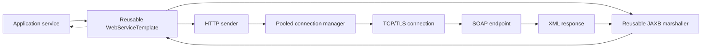
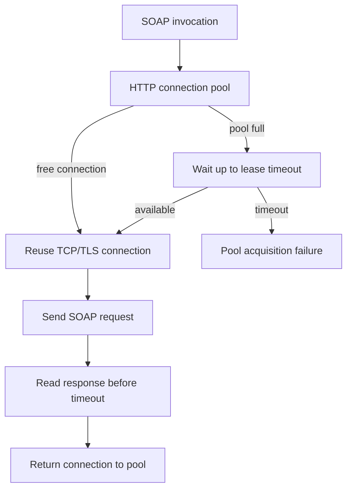

# Tái sử dụng cấu hình client, JAXB context và nhóm kết nối

Một SOAP client có thể gọi cùng service hàng nghìn lần trong vòng đời ứng dụng. Nếu mỗi invocation tạo WebServiceTemplate, JAXBContext hoặc HTTP connection manager mới, ứng dụng lãng phí CPU, bộ nhớ, socket và thời gian handshake. Khi tải tăng, chi phí khởi tạo lặp còn làm tăng latency và khiến số kết nối khó kiểm soát.

Trong **Spring Web Services (Spring-WS)**, cấu hình client nên được tạo một lần và tái sử dụng. Ba thành phần có vai trò khác nhau:

- **WebServiceTemplate** giữ cấu hình gửi/nhận SOAP, sender, marshaller, unmarshaller, interceptors và callbacks.
- **Jaxb2Marshaller/JAXBContext** giữ metadata để chuyển đổi XML và Java object theo model/schema.
- **HTTP connection pool** tái sử dụng TCP/TLS connections và giới hạn tài nguyên khi nhiều calls đồng thời.

Mục tiêu không chỉ là dùng singleton, mà là xác định thành phần nào dùng chung, thành phần nào thuộc từng invocation, cách cấu hình timeout/pool, cách đóng resource và cách đo hiệu năng.

> **Nguyên tắc:** dùng chung object cấu hình đã khởi tạo xong và an toàn cho concurrent access; giữ request/response data và mutable state riêng mỗi call. Pool phải có giới hạn, timeout và lifecycle rõ ràng.

## 1. Vì sao cần tái sử dụng?



Khởi tạo theo mỗi invocation có thể lặp chi phí tạo JAXB metadata, message factory, transformer, HTTP client, TCP connection và TLS handshake. Nó còn tạo nhiều socket, ephemeral ports, garbage collection pressure và nhiều pool nhỏ khó quản lý.

Tái sử dụng giúp giảm setup cost, tăng keep-alive reuse và tạo một nơi cấu hình timeout, security, logging, metrics nhất quán.

## 2. Thành phần nào dùng chung?

| Thành phần | Cách dùng khuyến nghị | Lý do |
| --- | --- | --- |
| WebServiceTemplate đã cấu hình | Shared Spring bean | Cấu hình client ổn định |
| Jaxb2Marshaller đã khởi tạo | Shared bean | Quản lý JAXB context |
| JAXBContext | Tái sử dụng | Tạo context có chi phí |
| Marshaller/Unmarshaller instance | Theo lifecycle implementation | Có mutable properties |
| HTTP connection manager | Shared pool | Quản lý sockets |
| SOAP request/response DTO | Theo invocation | Dữ liệu riêng |
| SOAP Header/callback mutable | Theo invocation | Tránh rò state |
| Security token/request ID | Theo request identity | Không dùng chung giữa calls |
| Metrics registry | Shared | Aggregation |

Không suy từ singleton rằng mọi field bên trong đều bất biến/thread-safe. Dựa vào API contract và không lưu request-specific state vào field của client bean.

## 3. Tái sử dụng WebServiceTemplate

WebServiceTemplate là entry point phổ biến của Spring-WS client. Cấu hình sender, marshaller, unmarshaller, default URI, interceptors và message factory một lần:

```java
import org.springframework.context.annotation.Bean;
import org.springframework.context.annotation.Configuration;
import org.springframework.oxm.jaxb.Jaxb2Marshaller;
import org.springframework.ws.client.core.WebServiceTemplate;
import org.springframework.ws.transport.WebServiceMessageSender;

@Configuration
class OrdersSoapClientConfiguration {
    @Bean
    WebServiceTemplate ordersWebServiceTemplate(
            Jaxb2Marshaller ordersMarshaller,
            WebServiceMessageSender ordersMessageSender) {
        WebServiceTemplate template = new WebServiceTemplate();
        template.setMarshaller(ordersMarshaller);
        template.setUnmarshaller(ordersMarshaller);
        template.setMessageSender(ordersMessageSender);
        template.setDefaultUri("https://soap.example.test/orders");
        return template;
    }
}
```

Client inject template đã cấu hình:

```java
import org.springframework.stereotype.Component;
import org.springframework.ws.client.core.WebServiceTemplate;

@Component
class OrdersSoapClient {
    private final WebServiceTemplate template;

    OrdersSoapClient(WebServiceTemplate template) {
        this.template = template;
    }

    OrderResponse getOrder(OrderRequest request) {
        return (OrderResponse) template.marshalSendAndReceive(request);
    }
}
```

Mỗi remote service/binding có thể dùng một template bean riêng. Với nhiều endpoint, dùng bean name/qualifier rõ ràng. Không thay global default URI hoặc sender trong khi có calls đồng thời.

### Cấu hình trước khi phục vụ traffic

Không thay marshaller, sender, message factory, interceptor list hoặc default URI sau khi client bắt đầu xử lý requests. Nếu URI thay đổi theo tenant/request, truyền URI theo invocation bằng API phù hợp thay vì mutate shared template.

## 4. Thread safety và shared state

WebServiceTemplate đã cấu hình được thiết kế để tái sử dụng, nhưng thread safety của call path còn phụ thuộc sender, message factory, custom interceptor và callbacks.

- Không lưu request DTO vào field singleton.
- Không sửa shared map/header template mà không đồng bộ.
- Không dùng một mutable SOAP Header cho nhiều calls.
- Không chia sẻ Marshaller/Unmarshaller instance giữa threads nếu implementation không bảo đảm.
- Interceptor tránh mutable per-request fields.
- Callback capture immutable data hoặc state theo invocation.
- Connection manager phải hỗ trợ concurrency.
- Credentials/certificate rotation phải có lifecycle rõ ràng.

Ví dụ sai:

```java
@Component
class UnsafeOrdersClient {
    private OrderRequest currentRequest; // Shared mutable state

    OrderResponse getOrder(OrderRequest request) {
        this.currentRequest = request;
        return send(this.currentRequest);
    }

    private OrderResponse send(OrderRequest request) {
        // marshal/send
        return null;
    }
}
```

Hai thread có thể ghi đè currentRequest của nhau. Giữ request là local variable và truyền trực tiếp.

## 5. Tái sử dụng JAXBContext với Jaxb2Marshaller

Xây dựng JAXBContext cần đọc generated classes và annotation metadata. Đây là thao tác tốn kém hơn một lần marshal/unmarshal. Spring OXM Jaxb2Marshaller quản lý việc khởi tạo JAXB infrastructure và thường được cấu hình như shared Spring bean.

```java
import org.springframework.context.annotation.Bean;
import org.springframework.context.annotation.Configuration;
import org.springframework.oxm.jaxb.Jaxb2Marshaller;

@Configuration
class OrdersJaxbConfiguration {
    @Bean
    Jaxb2Marshaller ordersMarshaller() {
        Jaxb2Marshaller marshaller = new Jaxb2Marshaller();
        marshaller.setContextPath("com.example.orders.v1");
        marshaller.setCheckForXmlRootElement(true);
        return marshaller;
    }
}
```

Có thể dùng setClassesToBeBound(...) thay context path nếu muốn khai báo model classes rõ. Chọn cách phù hợp generated model và JAXB version; không trộn package contract không liên quan nếu lifecycle/version khác nhau.

Phân biệt:
- **JAXBContext:** metadata binding XML/Java; theo JAXB API có thể được chia sẻ thread-safe.
- **Marshaller:** Java object thành XML.
- **Unmarshaller:** XML thành Java object.

Marshaller/Unmarshaller có mutable properties như listener, schema, adapter và event handler; không chia sẻ instance giữa threads trừ khi implementation cam kết. Spring Jaxb2Marshaller quản lý chi tiết việc tạo JAXB marshaller/unmarshaller theo lifecycle của nó.

## 6. Không tạo JAXBContext trên hot path

Anti-pattern:

```java
// Anti-pattern: re-create JAXBContext for every call.
JAXBContext context = JAXBContext.newInstance(OrderRequest.class);
Marshaller marshaller = context.createMarshaller();
marshaller.marshal(request, output);
```

Nếu model được gọi hàng nghìn lần, newInstance lặp metadata introspection. Dùng Jaxb2Marshaller do Spring quản lý hoặc cache JAXBContext theo model set/classloader nếu dùng JAXB API trực tiếp. Tránh static cache không giới hạn làm giữ classloader trong môi trường reload/plugin.

## 7. Cấu hình schema validation một lần

Nếu client cần validate XSD, cấu hình schema resources trên marshaller bean thay vì compile schema mỗi call:

```java
@Bean
Jaxb2Marshaller ordersMarshaller() {
    Jaxb2Marshaller marshaller = new Jaxb2Marshaller();
    marshaller.setContextPath("com.example.orders.v1");
    marshaller.setSchemas(
        new ClassPathResource("contracts/orders/v1/orders.xsd"),
        new ClassPathResource("contracts/shared/common/v1/common.xsd"));
    return marshaller;
}
```

Ví dụ cần import ClassPathResource; cách dùng nhiều schema phụ thuộc imports/includes và Spring OXM version. Validation làm tăng CPU; đo với payload thật và không tắt validation nếu contract/security yêu cầu. Kiểm schema được đóng gói cùng artifact và imports resolve offline.

## 8. HTTP connection pooling

Với HTTP transport, mỗi SOAP invocation có thể mở một connection. Keep-alive reuse giảm TCP/TLS setup và latency. Pool quản lý connections đồng thời và chờ connection rảnh nếu đạt giới hạn.

Các cấu hình:
- Maximum total connections.
- Maximum connections per route/host.
- Connection lease/request timeout: chờ lấy connection từ pool.
- Connect timeout: thiết lập TCP connection.
- Read/response timeout: chờ dữ liệu.
- Idle/expired connection eviction.
- Keep-alive/server idle timeout.
- TLS trust, hostname verification, client certificate.
- Connection manager ownership và shutdown.



Pool nhỏ gây queueing/lease timeout; pool quá lớn làm tăng socket, backend pressure và memory. Sizing dựa workload, không chỉ tăng max connection để che latency.

## 9. Sender và pooling implementation theo version

Spring-WS có thể tích hợp HTTP sender dựa trên nhiều HTTP client implementations. API khác nhau tùy Spring-WS/Spring Framework và Apache HttpComponents generation:
- HttpComponents 4.x và 5.x có package/API khác.
- Spring-WS version hỗ trợ sender implementation nào.
- Connection manager do sender hay external bean sở hữu.
- TLS configuration và pooling settings khác nhau.
- Timeout có thể là milliseconds, Duration hoặc request configuration riêng.

Không copy code HttpComponentsMessageSender từ major version khác mà không kiểm compile/Javadoc. Preflight dependency tree, chọn sender được version hỗ trợ, xác định manager owner, cấu hình pool/timeout, xác minh bean close khi shutdown và test HTTP integration.

## 10. Minh họa cấu hình pooling

Đây là pseudocode; tên class/constructor cần điều chỉnh theo HttpComponents/Spring-WS version:

```java
ConnectionManager manager = createPoolingConnectionManager();
manager.setMaxTotal(100);
manager.setMaxPerRoute(20);

HttpClient httpClient = createHttpClient(manager);
WebServiceMessageSender sender = createSpringWsSender(httpClient);
```

Giá trị 100/20 chỉ là ví dụ, không phải default recommendation. Max per route phải đủ concurrency tới một SOAP host; max total tính mọi destinations dùng manager; pool phải finite. Evict idle/expired connections theo keep-alive của server/load balancer. Không tạo connection manager mới mỗi request. Nếu nhiều senders share manager, có một owner chịu trách nhiệm đóng.

## 11. Timeout có ngân sách rõ ràng

| Timeout | Bắt đầu khi nào | Ngăn chặn |
| --- | --- | --- |
| Pool lease/request | Chờ lấy connection | Chờ pool vô hạn |
| Connect | Mở TCP | Connect treo |
| TLS handshake | Thương lượng TLS | Handshake quá lâu |
| Read/response | Chờ response bytes | Downstream không trả |
| Overall deadline | Từ đầu đến cuối call | Vượt SLA |
| Caller timeout | Caller chờ kết quả | Giữ caller quá lâu |

HTTP client version có thể không tách riêng tất cả timeout; xác minh semantics thực tế.

Ví dụ SLA 3 giây: lease 200 ms, connect/TLS 500 ms, read 2 giây, phần còn lại cho serialization/scheduling. Đây chỉ là ví dụ budget. Retry phải dùng chung overall deadline, không cộng thêm thời gian vô hạn sau mỗi attempt.

## 12. Retry và connection pool

Retry có thể khuếch đại tải khi downstream chậm. 100 calls đồng thời timeout và mỗi call retry 3 lần có thể tạo tới 400 attempts. Retry không thay thế pool capacity/timeout policy.

- Chỉ retry lỗi transient đã phân loại.
- Không retry mọi SOAP Fault; business Sender/Client Fault thường không transient.
- Giới hạn attempts, backoff và jitter.
- Giữ overall deadline.
- Không giữ connection trong backoff.
- Đảm bảo request body gửi lại được.
- Operation có side effect cần idempotency key.
- Theo dõi retry rate và lease timeout.

Không tăng pool size để che retry storm. Dùng circuit breaker/bulkhead nếu có, đồng thời kiểm thứ tự kết hợp retry và connection acquisition.

## 13. Lifecycle và đóng connection manager

Connection manager sở hữu socket và có thể tạo eviction threads. Khi shutdown, manager cần giải phóng persistent connections, idle/expired sockets, background threads, TLS/session resources và executor nếu nó sở hữu.

Xác định **một owner**:
- Nếu sender sở hữu manager, để sender đóng theo lifecycle.
- Nếu manager là bean được inject/shared, cấu hình destroy method theo API.
- Không để sender và application cùng quản lý lifecycle mơ hồ.
- Không đóng pool sau từng SOAP call; điều đó triệt reuse và có thể gây race với in-flight calls.

## 14. Tách pool theo security identity và downstream

Một pool chung phù hợp khi calls cùng TLS/auth configuration và route. Cân nhắc tách khi mỗi partner có client certificate riêng, authentication state không được chia sẻ giữa tenants, downstream chậm không được chiếm connection của service khác, hoặc SLA/rate limit khác nhau.

Nếu sender dùng connection-bound authentication hoặc mutable credentials, không chia sẻ pool bừa bãi giữa security identities. Kiểm tra connection context, credential scope và TLS key selection của HTTP client.

## 15. Concurrency và backpressure

Pool max connections chỉ giới hạn transport connections, không phải toàn bộ concurrency. Khi pool đầy, threads có thể chờ lease timeout và giữ request context/buffers. Có thể dùng semaphore/bulkhead hoặc bounded executor để giới hạn outbound calls.

Sizing cùng nhau:
- Inbound/outbound concurrency.
- Pool max total/per route.
- Queue/bulkhead capacity.
- Downstream rate limit.
- Timeout/deadline.
- Payload size và memory mỗi request.

Nếu mỗi request giữ 2 MB payload và 500 calls đồng thời, riêng payload buffers có thể chiếm khoảng 1 GB, chưa kể object graph/XML/HTTP buffers. Đo bằng workload thật.

## 16. Metrics cần theo dõi

| Metric | Ý nghĩa | Dấu hiệu điều tra |
| --- | --- | --- |
| SOAP calls total | Invocation volume | Giảm bất thường |
| Latency p50/p95/p99 | Phân bố thời gian | Tail latency tăng |
| Pool leased/available/pending | Trạng thái pool | Pending cao, available zero |
| Lease timeout count | Không lấy được connection | Pool starvation |
| Connect/TLS handshake time | Chi phí connection mới | Network/certificate latency |
| Read timeout count | Downstream chậm | Backend saturation |
| SOAP Fault by code | Lỗi protocol/business | Fault tăng theo operation |
| Retry attempts | Amplification | Retry storm |
| HTTP status by destination | Lỗi transport/server | 401/403/5xx/415 |
| JAXB duration | XML conversion | Schema/payload cost |
| In-flight requests | Concurrency | Saturation |
| Connection reuse ratio | Keep-alive hiệu quả | Reconnect quá nhiều |

Tag theo service/operation/destination group có cardinality hữu hạn. Không gắn request ID, customer ID hoặc URL có tenant parameter vào metric labels.

## 17. Logging và tracing

Log nên có trace/correlation ID theo policy, operation, destination group, duration, HTTP status, SOAP Fault code, retry attempt, timeout category, pool acquisition failure và contract version.

Tránh log raw SOAP Body, WS-Security token, UsernameToken password, Authorization header, private key hoặc certificate secret. Nếu bật message logging trong test, mask dữ liệu và giới hạn size/retention.

Tracing tạo client span cho outbound SOAP, gắn operation/destination/status/timeout; không dùng request body làm span attribute.

## 18. Memory và kích thước SOAP message

JAXB marshalling và XML parsing có thể tạo object graph, buffer hoặc DOM. Pool reuse không giảm memory của payload.

- Giới hạn request/response size.
- Không giữ DTO/DOM/XML string sau call nếu không cần.
- Không log toàn message production.
- Dùng streaming/attachments/MTOM khi contract và stack hỗ trợ.
- Đo heap allocation và GC với payload đại diện.
- Kiểm response parsing có tạo DOM toàn bộ không.
- Giới hạn concurrency theo memory budget.

Không bật MTOM chỉ vì payload lớn nếu partner contract không hỗ trợ; thay attachment representation là interoperability change.

## 19. Load test và sizing pool

Quy trình sizing:
1. Xác định throughput mục tiêu và concurrent calls.
2. Đo baseline với WebServiceTemplate/Jaxb2Marshaller reuse.
3. Thử pool nhỏ và quan sát queue/lease.
4. Tăng max per route có kiểm soát, theo dõi downstream.
5. Kiểm connect/read/overall timeout.
6. Test slow server và error burst.
7. Test TLS reuse/renewal.
8. Test idle eviction/server keep-alive.
9. Đo CPU, heap, GC, sockets và p95/p99.
10. Chọn cấu hình không vượt capacity downstream.

Little's Law ước lượng concurrency trung bình: L = λ × W. Ví dụ 40 requests/giây với service time 0,5 giây tương ứng khoảng 20 requests in-flight trung bình. Đây là trung bình; cần headroom và tail latency để sizing. Không đặt max threads bằng max connections một cách máy móc.

## 20. Nhiều SOAP services trong một application

Nếu application gọi Orders, Payments và Customer:
- Dùng named template/marshaller/sender rõ ràng.
- Chia pool theo downstream/security identity khi cần isolation.
- Tách timeout/retry theo SLA.
- Dùng qualifiers để inject đúng template.
- Có thể chia sẻ immutable JAXB model/context nếu namespace/model lifecycle phù hợp.
- Theo dõi metrics theo destination group.
- Không để Payment chậm chiếm hết capacity của Orders nếu cần isolation.

```java
@Bean("paymentsWebServiceTemplate")
WebServiceTemplate paymentsTemplate(
        @Qualifier("paymentsMarshaller") Jaxb2Marshaller marshaller,
        @Qualifier("paymentsSender") WebServiceMessageSender sender) {
    WebServiceTemplate template = new WebServiceTemplate();
    template.setMarshaller(marshaller);
    template.setUnmarshaller(marshaller);
    template.setMessageSender(sender);
    template.setDefaultUri("https://soap.example.test/payments");
    return template;
}
```

Bean names/URI chỉ minh họa; cấu hình thật lấy từ environment/configuration và secret management.

## 21. Test chứng minh reuse và concurrency

Không chỉ đọc config rồi kết luận pool đang dùng. Kiểm:
- Nhiều calls dùng cùng WebServiceTemplate bean identity.
- Marshaller được reuse và initialization không lặp mỗi call.
- Pool reuse connections qua HTTP client metrics/test server.
- Max total/per route được enforce.
- Lease timeout khi pool cạn có behavior rõ.
- Idle/expired connections được xử lý.
- Parallel calls không rò request/header.
- Fault/timeout không làm connection leak.
- Application shutdown đóng manager.
- TLS trust/hostname vẫn đúng khi reuse.

Unit tests kiểm bean identity/config. Embedded HTTP server hoặc provider thật mới kiểm transport/pool semantics. Mock sender không chứng minh socket pooling hoạt động.

## 22. Ma trận 40 ca kiểm thử tái sử dụng và connection pool

| Mã | Tình huống | Kết quả cần xác minh |
| --- | --- | --- |
| P01 | 100 calls cùng template | Template instance reuse |
| P02 | 100 calls cùng JAXB model | JAXBContext không tạo lại mỗi call |
| P03 | Client gọi từ nhiều threads | Không rò request state |
| P04 | Requests khác nhau đồng thời | Payload không trộn |
| P05 | Interceptor chia sẻ giữa threads | Không mutable state leak |
| P06 | Header callback theo request | Header không rò |
| P07 | Hai service templates riêng | Không inject nhầm endpoint |
| P08 | HTTP pool keep-alive | Connection reuse |
| P09 | Pool total max đạt | Không vượt giới hạn |
| P10 | Per-route max đạt | Isolation theo policy |
| P11 | Pool hết connection | Chờ/fail theo lease timeout |
| P12 | Lease timeout | Error phân loại đúng |
| P13 | Connect timeout | TCP failure đúng hạn |
| P14 | Read timeout | Downstream chậm được giới hạn |
| P15 | TLS handshake timeout | Không giữ request vô hạn |
| P16 | Overall deadline | Không retry vượt deadline |
| P17 | Server đóng idle connection | Reconnect theo policy |
| P18 | Idle eviction | Connection quá idle bị loại |
| P19 | Expired connection | Không reuse connection hết hạn |
| P20 | HTTP keep-alive reuse | Giảm reconnect/handshake |
| P21 | HTTP 500 | Connection return/close đúng |
| P22 | SOAP Fault | Không leak connection |
| P23 | Malformed XML response | Cleanup đúng |
| P24 | Retry transient error | Attempts trong budget |
| P25 | Business SOAP Fault | Không retry trái policy |
| P26 | Retry burst đồng thời | Không retry storm |
| P27 | Connection manager shutdown | Socket/threads đóng |
| P28 | Shutdown còn request | In-flight policy rõ |
| P29 | Hai tenants dùng cert riêng | TLS identity không lẫn |
| P30 | Pool riêng cho downstream chậm | Không chiếm pool service khác |
| P31 | JAXB schema validation bật | Validation đúng, cost đo được |
| P32 | Invalid XML payload | Reject rõ |
| P33 | Payload sát size limit | Memory/size policy áp dụng |
| P34 | MTOM khi contract hỗ trợ | Attachment interoperability |
| P35 | Ổn định dưới tải mục tiêu | p95/p99/error đạt SLA |
| P36 | Burst vượt capacity | Backpressure/timeout kiểm soát |
| P37 | Connection reuse qua TLS | Trust/hostname đúng |
| P38 | Load balancer keep-alive ngắn | Stale connection được xử lý |
| P39 | Pool leased/pending metrics | Saturation quan sát được |
| P40 | Restart application lặp | Không sót pool thread/socket |

## 23. Chẩn đoán hiệu năng và connection pool

| Triệu chứng | Nguyên nhân có thể | Điều tra |
| --- | --- | --- |
| Latency tăng sau deploy | Template/JAXB tạo lặp | Bean lifecycle/allocation |
| CPU marshal cao | JAXBContext/schema/model churn | JAXB config/profile |
| Pool pending cao | Pool nhỏ hoặc downstream chậm | Lease/route metrics |
| Lease timeout, backend khỏe | Pool capacity/leak | Leased/available/cleanup |
| Nhiều TLS handshakes | Không keep-alive hoặc pool đóng | Reuse ratio |
| Socket tăng liên tục | Client/manager lặp hoặc leak | Lifecycle/close |
| Requests chéo dữ liệu | Mutable shared state | Client/interceptor fields |
| Retry làm tải tăng | Retry storm | Classification/budget |
| Chậm sau idle | Server đóng keep-alive, stale connection | Eviction/validation |
| Service khác bị ảnh hưởng | Shared pool thiếu isolation | Pool topology |
| OOM khi concurrency cao | Payload buffers/in-flight quá nhiều | Heap/size/bulkhead |
| Shutdown treo | Eviction thread chưa đóng | Destroy lifecycle |

Quy trình:
1. Đo end-to-end latency và phase nếu có.
2. Kiểm WebServiceTemplate/marshaller identity.
3. Kiểm JAXB initialization có lặp sau startup không.
4. Đọc pool leased/available/pending/max per route.
5. Phân biệt lease, connect và read timeout.
6. Kiểm connection reuse/TLS handshake rate.
7. Tra retry và SOAP Fault classification.
8. Kiểm manager ownership/close lifecycle.
9. Profile heap/GC theo payload/concurrency thật.
10. Chạy lại load test sau mỗi thay đổi cấu hình.

## 24. Bài tập: tối ưu SOAP client gọi ba service

**Bối cảnh:** ứng dụng Spring-WS gọi Orders, Payments và Customer. Mỗi call tạo WebServiceTemplate, Jaxb2Marshaller và HTTP client mới. Khi 200 requests đồng thời, socket tăng, TLS handshake lặp, p99 cao và có timeout.

**Yêu cầu:** thiết kế lại reuse và sizing.

**Hướng giải quyết:**
1. Đưa WebServiceTemplate thành bean theo remote contract/binding và inject vào client.
2. Tạo Jaxb2Marshaller bean theo model; reuse JAXBContext.
3. Dùng HTTP sender tương thích Spring-WS/HttpComponents version.
4. Dùng pooling connection manager có total/per-route limit.
5. Đặt lease, connect, read và overall timeout theo SLA.
6. Tách pool/bulkhead giữa Payments và Orders nếu SLA/security identity khác.
7. Giữ request DTO, header và correlation ID theo invocation.
8. Interceptor không lưu mutable request state.
9. Xác định owner/shutdown lifecycle cho connection manager.
10. Benchmark trước/sau với 200 concurrent calls, payload thật, Fault, slow response và TLS.

**Tiêu chí đạt:** không tạo template/JAXB context/manager mỗi call; socket và handshake giảm nhờ reuse; pool có giới hạn; p95/p99/error rate đo được; không rò state; shutdown giải phóng resource.

## 25. Checklist vận hành

1. **Tạo WebServiceTemplate như bean cấu hình một lần** cho mỗi contract/binding.
2. **Tái sử dụng Jaxb2Marshaller/JAXBContext**, không tạo context trong hot path.
3. **Không chia sẻ mutable Marshaller/Unmarshaller instance** giữa threads nếu implementation không bảo đảm.
4. **Không lưu request/response/header state trong field singleton**.
5. **Giữ interceptor/callback thread-safe** và tránh mutable request state.
6. **Dùng HTTP connection pool có giới hạn total/per route**.
7. **Đặt lease/connect/read/overall timeouts** rõ ràng.
8. **Tính TLS handshake và keep-alive lifecycle** trong latency budget.
9. **Cấu hình idle/expired connection eviction** theo server/load balancer.
10. **Chốt owner và shutdown lifecycle** của connection manager.
11. **Tách pool theo destination/security identity** khi cần isolation.
12. **Giới hạn concurrency/backpressure** theo pool, memory và backend.
13. **Phân loại SOAP Fault/transport errors** trước retry.
14. **Giữ retry trong overall deadline** và dùng idempotency cho side effects.
15. **Theo dõi pool pending/leased, p95/p99, timeouts, retry và TLS handshakes**.
16. **Giới hạn payload/logging** và đánh giá streaming/MTOM theo contract.
17. **Test parallel calls** để phát hiện state leak.
18. **Load test với payload/concurrency thực tế** trước khi chốt sizing.
19. **Pin Spring-WS, HttpComponents, JAXB và JDK versions**.
20. **Ghi giới hạn guarantee:** pooling giảm setup cost, không sửa được downstream chậm hoặc backend capacity thấp.

**Kết luận:** Tái sử dụng WebServiceTemplate và JAXB context giảm chi phí khởi tạo; HTTP connection pool giảm TCP/TLS setup và giới hạn số kết nối đồng thời. Hiệu quả chỉ xuất hiện khi object shared được cấu hình trước, an toàn cho concurrent calls và có lifecycle rõ ràng. Request-specific state phải nằm trong từng invocation; pool cần giới hạn, timeout, eviction và shutdown đúng. Đo latency, pool saturation, TLS handshake, JAXB cost, retry và memory dưới workload đại diện mới giúp chọn cấu hình phù hợp cho SOAP client chạy lâu dài.
